# 88年已婚宝妈，裸辞GAP的第823天，她活成了什么样？一个折腾十连败正在上岸的人生故事

裸辞823天后，88年宝妈终于上岸：从“十连败”到“人生教练”，她把低谷活成了礼物

嗨，圈友们，我是大栗子。今年4月18日才加入赚钱，在这里链接过项目、跑过航海（全勤上岸）、当过志愿者。一个活了35年、表面循规蹈矩、内心却翻江倒海的“人间小太阳”ENFJ。先递上我的临时名片——

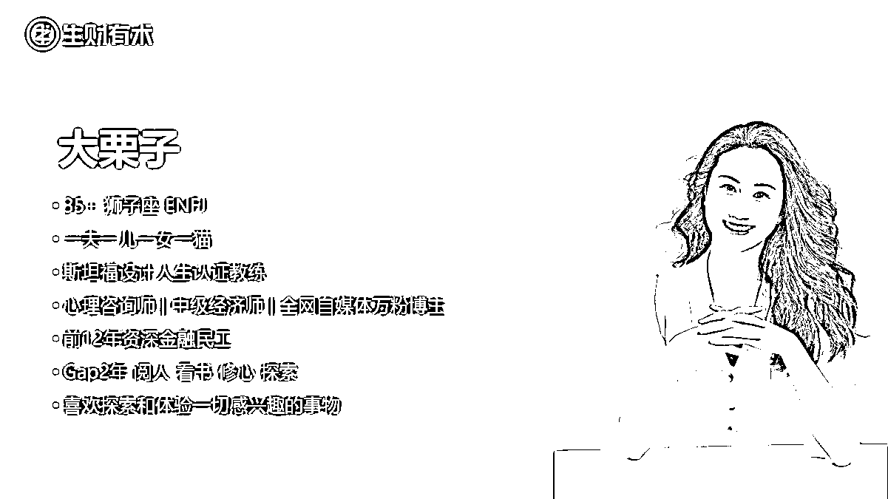

很高兴认识你。

前几天，我在公众号上发了第一篇自己的故事，本以为普通人没人听，没想到收到很多回应，有人说看到了共鸣和力量。雪姨鼓励我发到赚钱，我也就整理了一下。全文有点长，大概15分钟，希望能给正在迷茫、焦虑的你，带去一点微光。

---

**辞职前：银行里的12年**

我曾经是个标准的“金融民工”，在银行待了整整12年。这期间，我享受过单位福利，顺带把自己的人生大事也解决了：老公是“收编”的，孩子生了俩。有过特别难过的一段日子，转正等了整整5年，充满了不公和不甘；也有过高光时刻，从乡下一线网点直接竞聘到总行管理岗，那种“一飞冲天”的感觉至今记得。

工作本身对我来说并不难，靠着一股“不会就学”的劲头，我学得又快又好，领导认可、同事喜欢。所以当我提离职时，所有人都觉得不可思议。

**为什么非辞职不可？**

其实家庭不是压垮我的最后一根稻草。我和老公是双职工，两边老人都有自己的事业，帮不上忙。我每天像陀螺一样转：上班、加班、接送孩子、做饭、辅导作业、洗衣拖地……周末经常“沉浸式做家务”，被同事吐槽“周末总是失联”。可这些隐形劳动，在很多人眼里就像不存在一样。我也崩溃过，但领导说得对：请个阿姨就能解决大半，所以我咬咬牙也能撑。

真正让我想走的，是那份“无意义感”。有些工作根本没必要存在，只是为了一串漂亮的数字，就得耗进去大量时间和精力，甚至加班加点。人这一辈子只有一次，我不想把余生透支在这种既不能让自己成长、也带不来价值的事上。我承认，我是个把个人成长、价值感、意义感、归属感看得比高薪和权力更重的“理想主义者”。

还有一个原因，这份工作从一开始就是“父母的期待”。大学时我也风光过：当团支书、协会会长，拿奖学金、评优，组织义卖捐助山区小学，还开着一家已经跑通供应链的淘宝店。临近毕业我特别想留在城市创业，我爸一句“大学生出来开服装店像什么话”，硬是让我回家考了银行。后来我帮堂妹注册淘宝店、教她操作，短短三五年，她财务自由、全家搬去准一线城市，连孩子都上了好学校。我当然替她高兴，但心里总有一根刺：那本来也可以是我。我爸却说：“你现在安安稳稳一家四口不也挺好？”安稳确实好，但“没做自己想做的事”成了我这辈子最大的遗憾。所以，我既孝顺、也贤惠，但骨子里，我一直是那个向往自由、不服管的“叛逆小孩”。

**提交离职后：两种声音**

决定提交后，我给大学好友打电话。她沉默了一会儿，叹气说：“也好，这么多年你辛苦了，去做想做的事吧。”我在电话这头泪如雨下。

后来总有同事跟我说“好羡慕你”，我总说，你也可以的，开始永远不嫌晚。有人却笑我太天真，是鸡汤喝多了。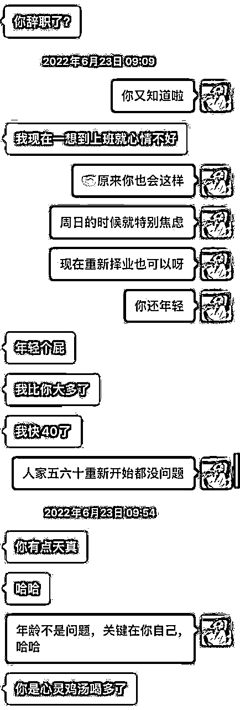 我当时不以为然，可是没想到，这句话真的被他说中了。

**裸辞即低谷：800多天的黑暗**

离开职场的第一天，我就摔进了低谷。800多天，我一个人在迷茫里摸爬滚打。一开始不知道干什么，就疯狂考证。每天5点起床，趁孩子还没醒，爬起来上课。两年里拿下了中级经济师、心理咨询师、高级家庭教育指导师、高级婚姻关系指导师4个证。可这些证没有给我安全感，反而让焦虑变本加厉：钱只出不进怎么办？未来能做什么？万一离婚，没工作怎么争抚养权？又该怎么给孩子更好的生活？担忧像潮水一样涌过来。

于是我又给自己排满了TO DO LIST，看书、运动、学习、听播客、冥想，一样都不落。结果越是完不成，越是自我攻击，状态比上班时还糟糕。崩溃到极点，我就躲进地下车库，在车里痛哭。家里的气氛也降到了冰点。好在学过心理学，加上那些成长和修行类的书，我一点一点把自己拽了回来。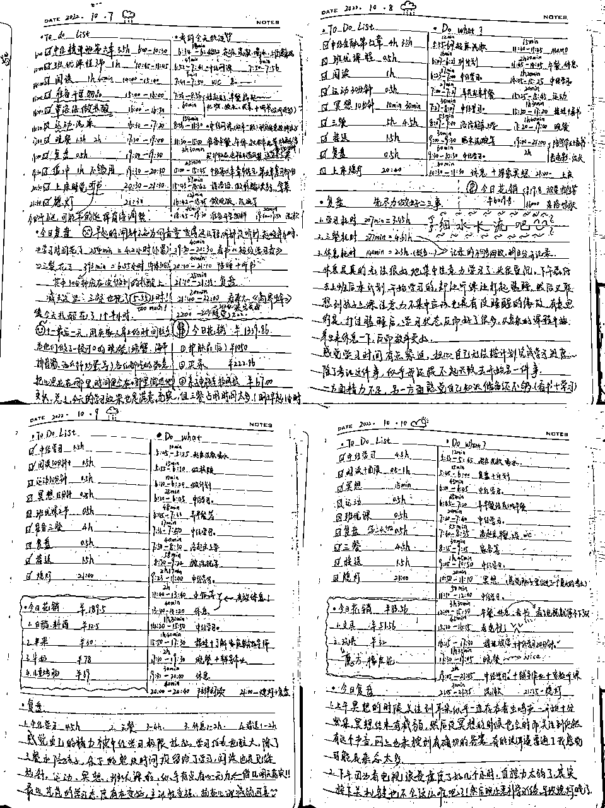

**折腾十连败：原来我是一棵“绿韭菜”**

情绪稍微稳了，我又开始四方出击，想找一个能做起来的事。结果除了考证顺利，其他探索全部阵亡：

做书单号，一个月没涨粉，输；做VLOG，耗神耗力，放弃，输；做混剪卖货，感觉自己像个机器，输；做口播，上了文案课也拍不出来，输；做图文，四五十篇没流量，输；开聊天直播，涨粉不变现，输；做好物社群，有收入但太少也不喜欢，输；做AI+公众号爆文，日更一个月没起色，输；换个赛道做口播，有小成却卡在转化，输；又起了一个新号，涨粉飞快但无法变现，输。

学费交了五位数，我自嘲是棵“绿得发蓝的大韭菜”。看到社交平台上别人裸辞翻身、月入几十万，我更加怀疑自己：是不是我太差？为什么别人行我不行？是不是我太笨？

直到后来，我慢慢麻了。我试着不再死磕结果，一边保持行动，一边给自己耐心，向内看：我到底想做什么？如果不是为了钱，我真正要的是什么？我能给别人带去什么？

**转机：一个洗碗的中午**

不再盲目乱撞之后，转机反而来了。一个普普通通的中午，我一边洗碗一边听播客，正好听到雪姨采访“明白老师”。那位老师身体不便、工作受限，却靠着赚钱做到了年入百万。我一下子被戳中了，立刻去链接雪姨，进了她的社群，然后加入了赚钱。其实两年前我就知道这个平台，但当时没想过进来。要是早两年知道，也许我早就开启副业了，根本不用在外面交那几万学费。

进了赚钱，我像只饿鼠闯进了大米仓，看什么都新鲜，恨不得天天泡在精华帖里，还一口气报了好几个航海。

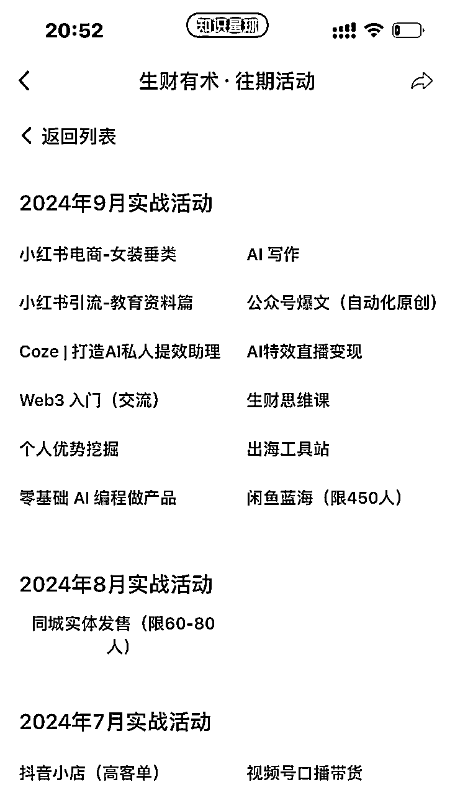
（这是部分航海截图）

结果呢？全勤上岸，但精力不够，无法深耕，只能算体验过。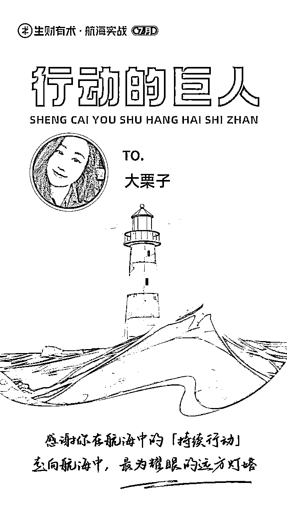 后来我也试着链接一个项目，变现闭环很快跑通，但总觉得不适合自己的长期方向，就半做半停地留着。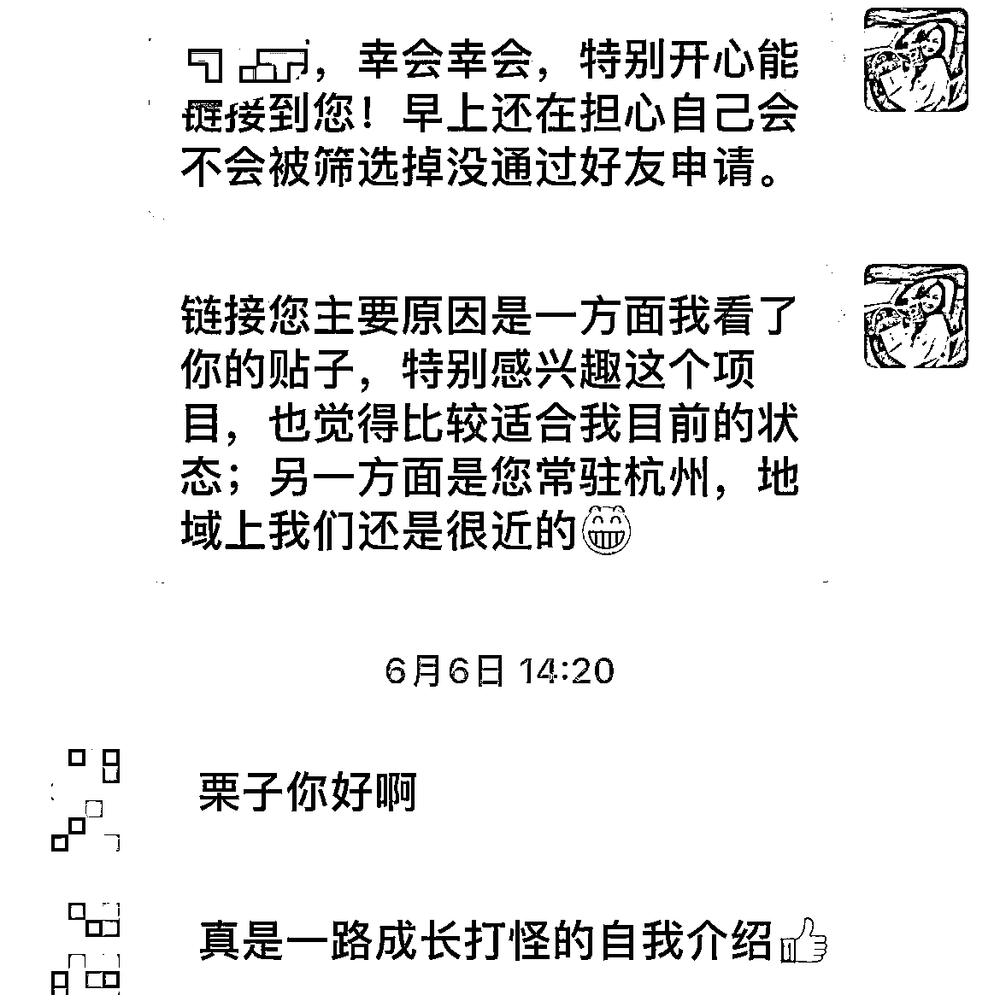 我还去做过航海志愿者，批改船员日志，发现很多圈友和我一样：同时想做太多事，精力被切得稀碎，连30个字的日志都写不好。

这半年我依然没拿到结果，甚至有一阵子看到星球里的赚钱贴就焦虑，但收获却很多。我想对有同样处境的朋友说几点：

第一，少看别人。每个人当下要解的题都不一样。与其看到别人赚钱就自我否定，不如盯着今天的自己是不是比昨天好一点，距离自己的目标还差多少。

第二，中途放弃不可怕。只要你还留在这个场域里，还在吸收信息、参与体验，就一定有收获。哪怕没赚到钱，也比从前的自己多了认知和底气。

第三，速成是假的。李笑来老师说过，速成不可能。很多质变是由无数量变堆出来的。一个985中文系的人做公众号爆文，和我这种普本理工生能一样吗？人家是从0到1，我是从-10到1。如果还没成，说明你还在积累阶段。改变永远是螺旋式上升的。

第四，求财其实是修内在课题。这也是最容易被忽视的。很多人项目做大了、钱赚够了，却依然不快乐。所以在追风口之前，先问自己：我到底想要什么？擅长什么？如果财务自由，我想做什么？拿这个“人生罗盘”校准方向，再去补课，才能少走弯路。

**新起点：斯坦福设计人生课**

想明白这些，我不再急于求成，决定先搞清自己，再找一个能深耕下去的方向。我开始回归日常，看书、觉察、成长，每天在雪姨的打卡群里发阅读记录。

后来雪姨看到我的文章，问我要不要加入“千人计划”——一个帮1000个女孩找到自己商业位置和价值的项目，成为她新播客的核心成员，前提是先学斯坦福设计人生课。设计人生是用积极心理学和设计思维，配合一套系统工具，帮人解决卡点问题的咨询方法。我之前接过心理咨询个案，总觉得缺一个能落地的抓手，这门课像是给我量身定做的：能结合我的经历、我对心理学的热爱，还有一整套工具。虽然费用接近3万，我还是果断报了。

2024年7月，是gap两年中最精彩的月份。我飞去广州上了北辰青年超哥的闭门课，见了一群价值观相近的人；紧接着又跑了两趟杭州，上DT.School的线下课。那种真诚的、彼此托住的社群感，让我特别感动。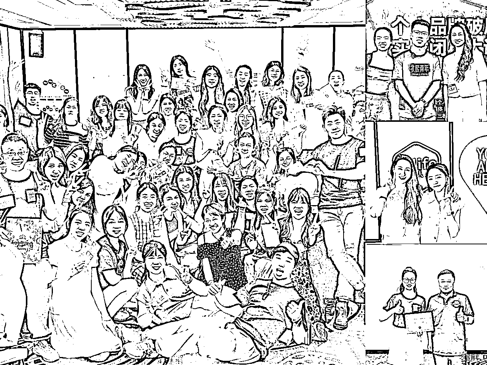

学完之后，我找到了喜欢的新身份：设计人生教练。因为自己淋过雨，太知道一个人卡在中间有多难受，所以我想成为那个同行者。但第一个问题来了：案主从哪来？我试过几个千粉账号，粉丝属性不对，引流效果很差。朋友圈招募后，曾经在赚钱链接过的圈友主动来了。一个月内，我快速完成了30小时以上的教练认证，成为同一批教练里最早拿证的人。和案主对话，就像照一面双面镜，我照见他们，也照见自己，真心为他们的改变而开心。赚钱，算是为我的新旅程做了“最佳暖场”。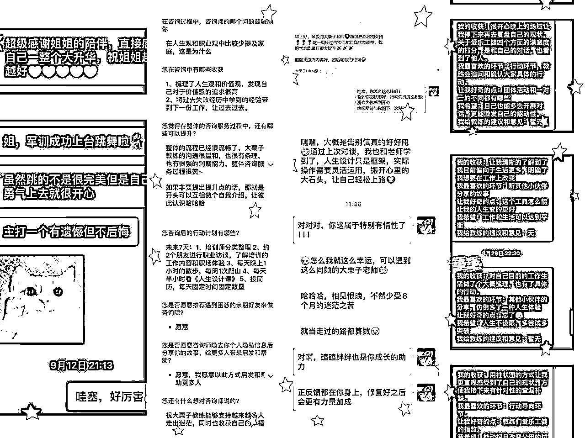

**释怀：那些失败原来是珍珠**

学了设计人生之后，我慢慢对过去的失意释怀了。那些坚持不下去的尝试，原来不是半途而废，而是“最小MVP”，是“原型设计”；那段低谷，不过是人生从过去到未来的中间地带，我只是暂时被卡住；项目中断，也不是三心二意，人生本来就可以有好多版本，就像我虽然热爱教练，但以后不一定只做教练。

当内核稳定以后，失败对我来说都变成了工具，只有自我否定是虚幻的。十连败的教训、赚钱学过的项目，成了我的最佳辅助；心理学知识、读过的书、对金融的理解，成了教练的厚度；加入的社群、链接过的人，慢慢转化成了另一种资源。就像纪录片《施图茨的疗愈之道》里的“珍珠串”理念：我是把下一颗珍珠串在绳子上的人，不管结果好坏，都要保持行动。别给行动贴价值标签，它们价值相等，你只需要去做，一颗一颗串下去。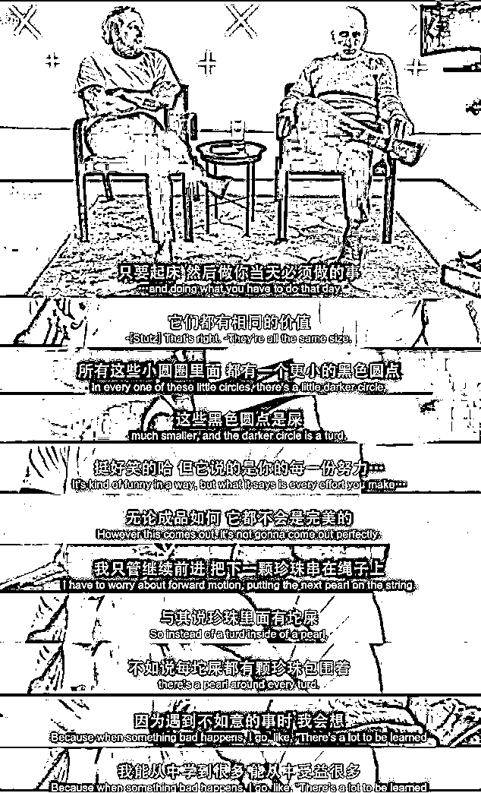

**写在最后**

写完那篇文章，我去取快递，意外发现：那天恰好是我裸辞的第823天，也是我正式拿到设计人生认证教练实体证书的第1天。两个日子重叠在一起，像命运给的一个闭环。

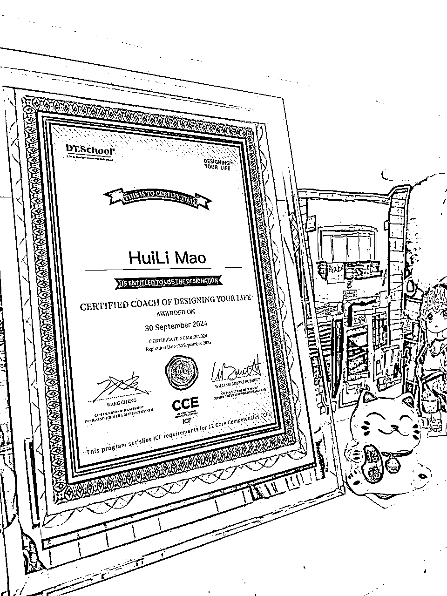

以前我总不敢自称“心理咨询师”，但今天，我终于可以自信地介绍自己：你好圈友，我是设计人生认证教练大栗子，很高兴认识你。如果你的人生暂时被卡住，别灰心，请相信美好终会到来。我很喜欢设计人生里的一个理念：保持好奇，不断尝试，早点开始，早点失败，早点成功。尽管下场把手弄脏，你我终将穿出属于自己的那条璀璨珍珠串。

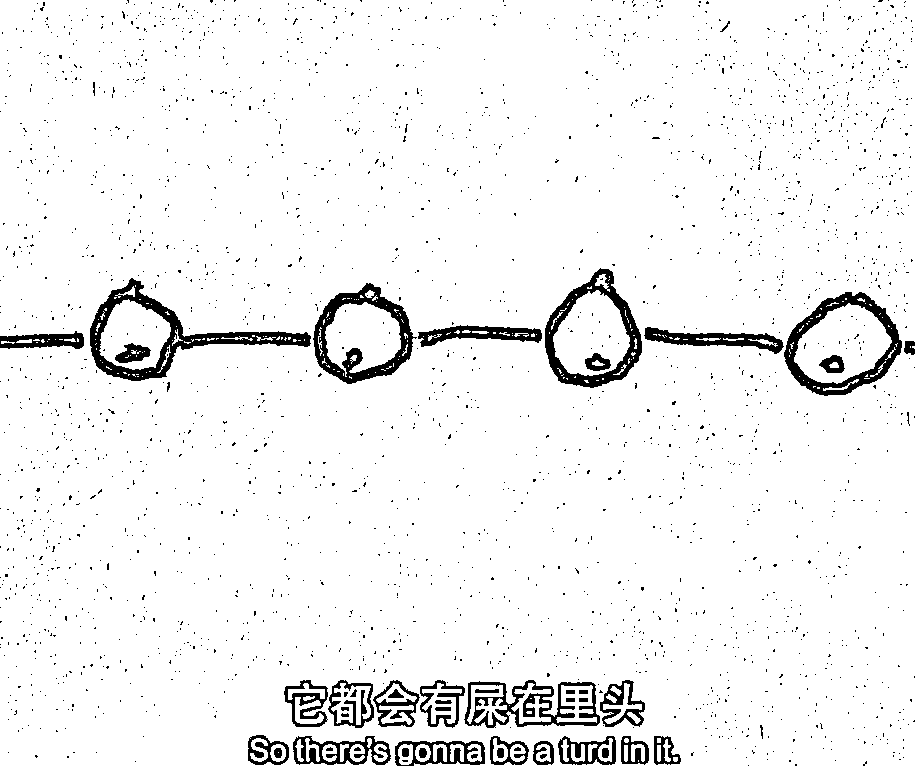