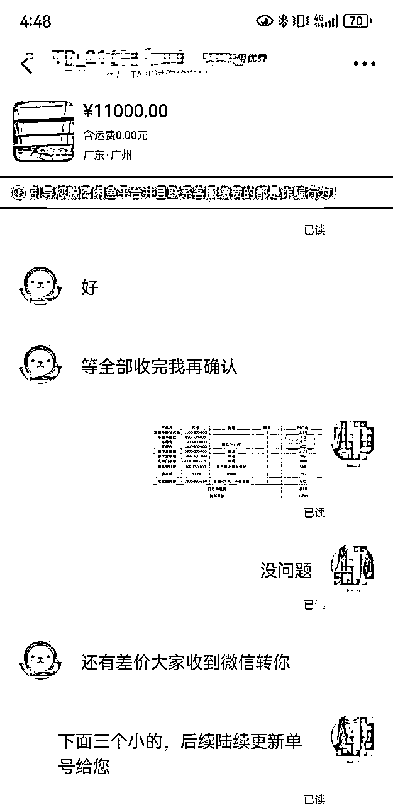
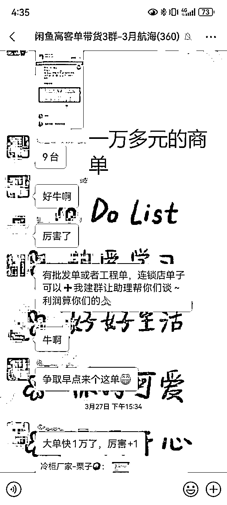
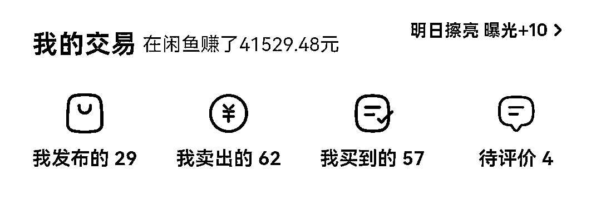
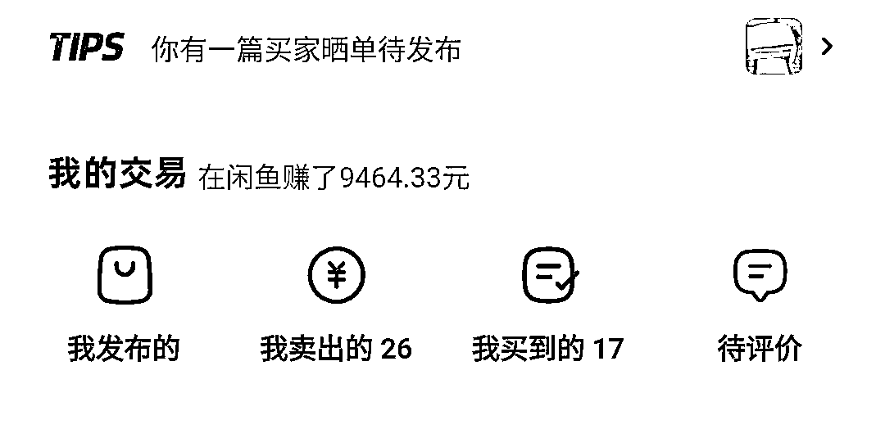
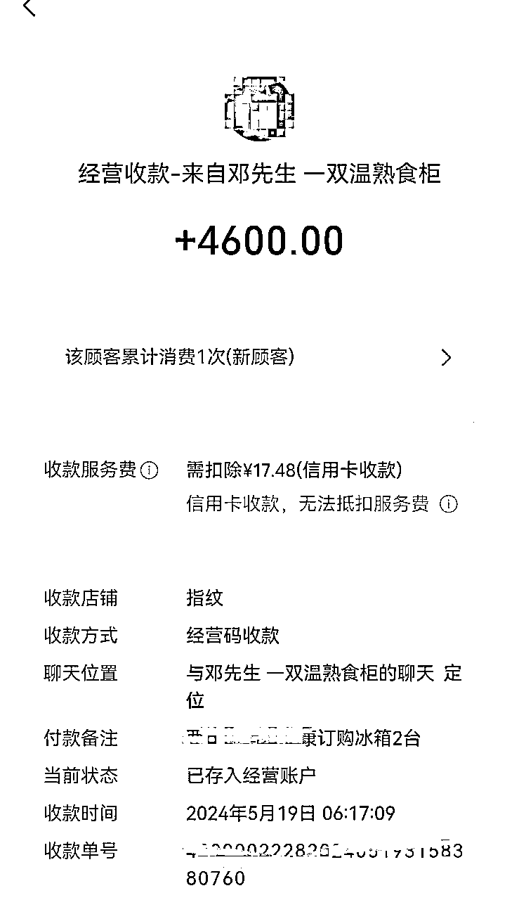
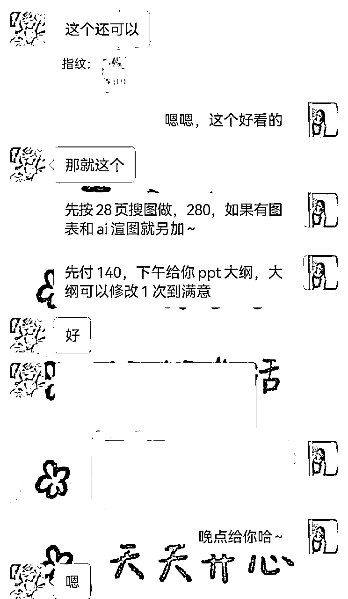
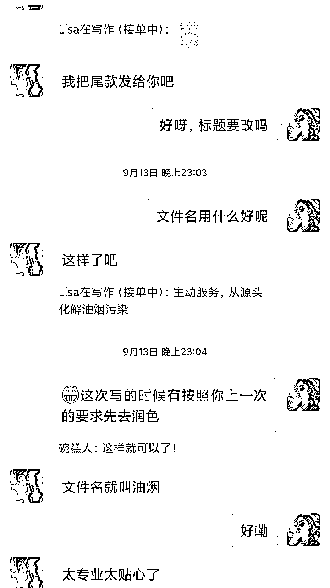

# ('闲鱼一鱼三吃：我在生财赚到的第一桶金', (2, 20))

前阵子有圈友问我：普通人怎么跨出第一步，真正从这个社群挣到钱？我脑子里一下就冒出自己春天那段经历。行，就说说它。

我叫指纹，平时扑在闲鱼卖货上，也经营一个图文社区的个人号。去年三月，为了添些副业进项，我交了会员费进生财。刚进去那阵子，我都只是东看西看，不敢真刀真枪上手。后来随意试过几个小方向，全都没起色。脑子里的道理攒了不少，账户里的数字却纹丝不动。

今年又到续费关口，我向自己立了誓：无论如何都得把投进去的会员费捞回本。四月，平台推了一期针对闲鱼大额商品的训练营。那条赛道对新手特别友好。看到通知的一瞬间，我就有预感，机会大概要落在这儿了。进圈整整一年后，我总算正儿八经下场。

最初几天，我基本是老实照做。当天晚上就把项目方放出的商用冷柜货源铺上货架。白天继续挂链接，夜里翻操作手册，见空就拉着带队老师追问。照着营里给的爆款模板去发商品，浏览数据肉眼可见地飞涨，单日好几万次曝光，私信咨询有二十来条，可就是没人拍下。我不服气，手机不离身，消息一来就秒回，话术天天改，连吃饭都在琢磨。就这么死缠烂打一阵子，再搭上主动让利，首单总算谈拢，挣了五十块。

虽说赚得不多，但蹊跷的是，后续找上门的客人反而更精准。聊上几次后，我应答熟练了，开场三两句就能把没诚意的咨询筛掉，差不多五次问价能成一次。每天抽一小时补补货、回回消息，就能做成两三单，日净利稳稳有两百上下。

吃到甜头，我就想趁热把盘子铺大，转头去问带队老师，矩阵号怎么组，还有什么招能把量再抬一档。那阵子带我的两位老师，一位叫动物园园长，另一位则叫栗子。谈单的窍门是她们拆给我听的，把咨询的人引到私聊慢慢养，也是她们手把手带我练的。这套打法跑顺之后，训练营开营才十来天，利润已经破千。

趁着手气正旺，我接着又开了一个号，专攻办公类用品。恰好此时，私域里攒下的客人也开始回头了。有位做连锁餐饮的老板，一次要了十台冷柜，还说只要货没问题，以后就在我这里长年采购。等这期训练营完整跑完，一个批发单加上两个号，替我挣了六千上下。别说眼下的会员费，往后两年的社群开支都一并有了着落。

可惜好日子并没有撑太久。五月旺季一过，六一八促销潮就压了上来，各路人马都不约而同地压价。两个号过去一天少说能进账两三百元，后来有时等一整天也看不到一单。更有甚者，一些厂家直接派自己人入驻闲鱼开店，挂出的价位，甚至低过我拿货的成本。我没认输，转而去另一家电商平台薅补贴，拿优惠券加查价工具做差价，把平台贴的让利变成我的毛利。就这么着，在漫天降价声里，我好歹没有倒下。

到七月八月，流量争抢愈发惨烈。我渐渐看明白，闲鱼初期那波红利已经耗尽，买家也开始全网搜最低价。手里没有独家的供货渠道，只靠倒来倒去根本无法长久。价格战又是个无底洞，再耗下去，两个号很难稳住每个月数千块的产出。于是我再次回到生财，翻找更适合我的路子。

翻着翻着，我注意到闲鱼格外偏爱非标品和服务型产品。想起我从前在企业做人事，经常替领导润色稿子、做汇报PPT——这不就是现成的本事吗？转天，我就把“代写文案、代做PPT”挂上了闲鱼。做法仍然照旧，先拉人进私域，老客户再来时，我主动配合他们的要求改，还顺手给个九折。收入拼图里，便又多出一块相当稳的板块。

闲鱼这边我玩得愈发顺手，我爱人也坐不住了。他常年鼓捣植物标本，手里压着一些圈内少见、自己又不舍得低价出的收藏品。有心卖掉，却搞不清如何标价、怎么配图写文，也不懂流量怎么引，连成交环节心里都没底。他跑来向我求助，我就把从社群学到的东西，连同自己踩过的坑，一股脑全倒了出来。

先把账号的门面立起来——头像、个人简介、主页讲什么故事；再找十来个对标账号，拆一拆人家的首图和文案结构；日常运作持续看数据调优，把曝光一点点顶上去；连售前怎么开口、售后怎么避开风险，都提前给他列成清单。我趟过的沟，他基本绕着走。

全套功夫使完后，他的号两周就起了势，每天进账一百到四百元。那时候我才猛地意识到，从实打实的门外汉，到能带新人的闲鱼熟手，中间只隔了四个月。不压货的倒卖、纯服务收费、小圈子爱好品，经我手里都能稳稳跑通，单号每月产出数千元到万把块。

如今回望，一切的拐点就是四月里那个决定：非得把会员费挣回自己兜里不可。更关键的一步，是我戒掉了只想不做的毛病。这个社群真正该用的方式，也被我摸索出来了——先挑定一个赛道，下手干；一旦有利润，就快速学习、快速放大；等到跑出结果，便回落到自己最熟的那块根据地，继续往深处挖，死磕到底。

现在我敢说，自己早已不是那种看到“月入十万”标题就头脑发热、立马掏钱，指望一夜暴富就报班学习的人。等我连续做出成绩以后，我便以做事业的人自居了。跟圈里那些手笔很大的人比，月入数千确实算不上什么。

但对我而言，一个从前靠薪水过活、一旦失业就要断粮的普通打工人，能靠着判断、执行力与韧劲，把信息差捅破，实实在在把钱挣进账户，已经是很有分量的收获。我攒下了可周转的生产资料，还多出一根不会轻易断掉的收入管道。这笔钱，算是我做起生意后攒下的头一笔本金，也是生财送我的礼物——帮我拆掉了那面过去看不见的墙。

闲鱼不过是起点。财富总会奖励那些真正看懂规则的人。往后我继续做正确的事，剩下的，就交给时间慢慢兑现吧。