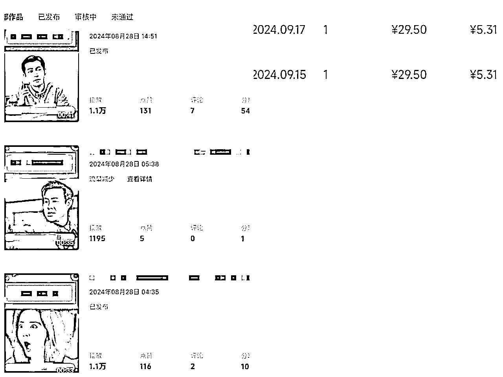
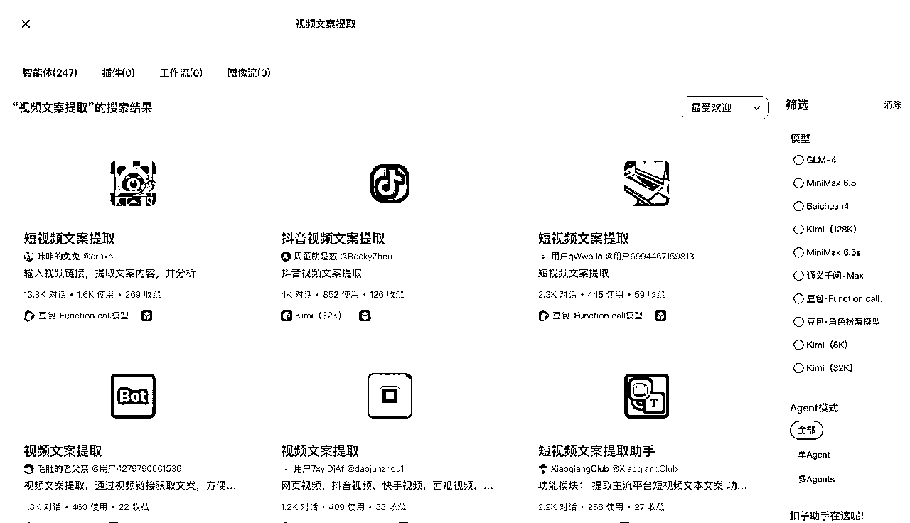
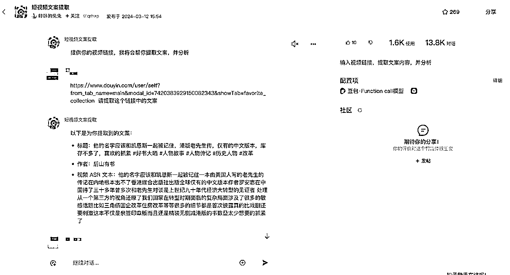
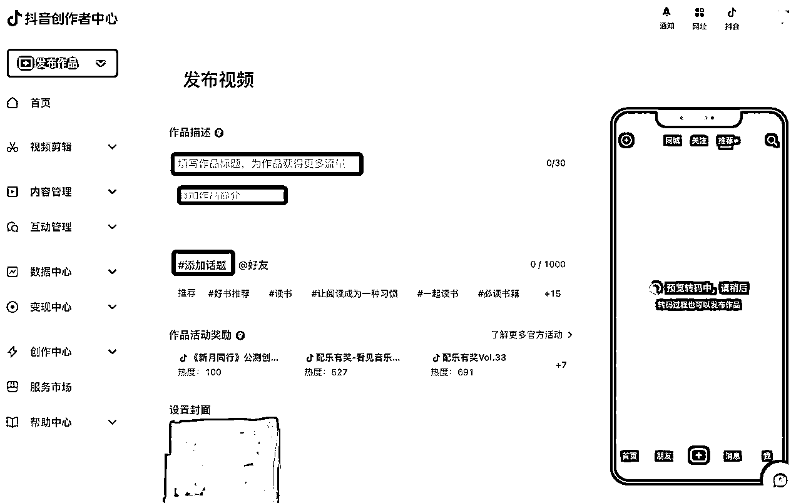
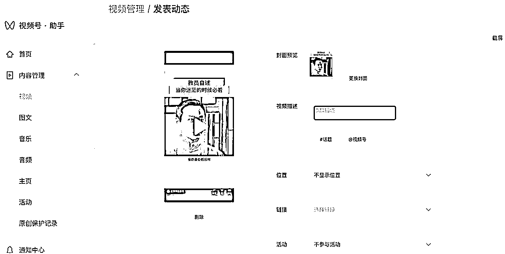
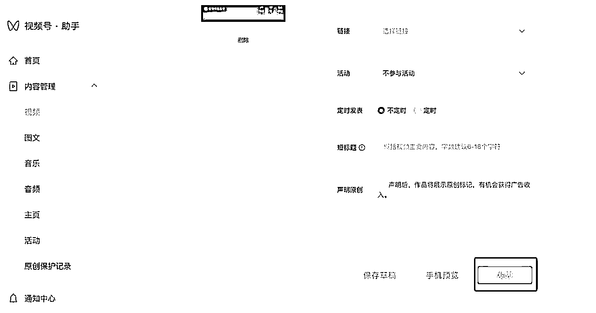

# ('剧综带书（社科政史）——新手小白进入生财的第1块钱，真的是第1块小钱钱！', (2, 38))

如果你期待一夜暴富，请直接划走。这个玩法不像生财里那些大佬的暴力项目，它更适合刚进圈子、急需“赚到第一块钱”来建立信心的新人。

我当初刚来生财的时候，真的像刘姥姥进了大观园，满眼都是机会，感觉啥都能干，结果东试西试到处碰壁。再看看别人月入十万百万，心里那个焦虑啊……所以我特别需要一件“小而美”的事，让我尽快拿到正反馈，给自己一个坚持下去的理由。

后来我遇到这个项目——**剧综带书**。本质上是短视频带货，但用的是影视剧混剪画面来推荐书籍。最关键的是：我从决定做到真的出单，只花了3天！速度快到我自己都懵了，因为实在简单到“有手就行”。

**为什么选社科政史类？**  
我测了一圈，发现这类书比文学类竞争小很多，对新人特别友好，容易在短时间破零。佣金方面，和出版社/图书公司合作定向佣金一般是20%～25%；如果直接对接图书店铺，能到35%～50%，甚至更高（因为售价上去了）。

**我的实测数据：**  
统共发了10条视频，用2个视频号+1个抖音号，都是很久没用的老号，粉丝只有两位数。不能挂车，也没发流量视频养号，直接硬发带书视频，靠评论区引导成交。8月28日发的第一条，视频号在8月30日就出单了；抖音晚一些，9月15日才出第一单。但毕竟没花一分钱推广，这效率我很满意。

  

**实操路径：**  
注册账号 → 选品 → 做文案 → 找素材 → 剪辑 → 发布 → 引导购买

**注册账号：**  
一个手机号能注册1个视频号+1个抖音号，都需要实名。一个身份证可以实名2个视频号、1个抖音号。不够用就找家人朋友帮个忙。

**选品（最关键的一步）：**  
直接上干货：打开抖音 → “我” → “电商带货” → “创意中心”（能看到实时爆单的品） → “销量榜” → “近24小时” → 类目选“图书教育”。右边展示的就是当下24小时内的爆款产品和对应作品。

点开任意作品，就能看到它的销量、播放量、账号信息等数据。**注意：教辅和育儿类尽量别碰，90%以上是投流出来的。**我们只挑政史社科类。

第一轮筛完后，想要出单概率更大，再做第二轮筛选：回到“我” → “选品广场” → 搜索刚才筛出的书 → 点进去 → 重点看“起量时间”和“下单转化率”。一般一本书在刚起量的两周半里，销量和转化率最高，转化率能到50%～55%，第三周热度就开始降了。所以原则是：结合热度周期和转化率，从高到低选品。

**敲重点：** 即使前面说政史社科好出单，但要是有高客单价、且刚起量的品，一定要优先试！因为佣金香啊！

**文案制作：**  
先从爆款作品（视频/图文）里提取文案，可以用coze里的免费插件。然后拿几段爆款文案放一起，用A的开头、B的第二句、C的第三句……这样穿插着改，就能做出一篇基本过审、又不容易同质化的文案。

  

举个例子，我参考了《毛泽东自述》的三条爆款文案，每条都有几百上千赞，然后交叉组合成自己的版本。这里给出参考链接（大家去抖音搜“毛泽东自述”也能找类似爆款）：  
（文案示例略，具体操作就是“开头取A，中间取B，结尾取C”）

**分析爆款视频：**  
看模板：上下黄色底图，上面放两个文本框当标题，下面放一个文本框当字幕。然后拉片分析爆款文案怎么匹配画面，每个画面时长大概多久。认真拆两三个爆款，基本就能掌握套路了。

  

**搜集画面素材：**  
根据文案内容找关键画面。比如讲教员的，就剪教员的影视剧片段。其他书就按文案提到的人物和情节去找。素材来源：抖音、快手、B站、小红书、视频号都能下载。

**剪辑：**  
剪辑软件随意，剪映就够用。注意画面和文案的对应节奏。

**发布：**  
抖音：用“抖音内容创作者中心”上传，填标题、简介、带话题，直接发。  
视频号：用“视频号助手”发布，填标题、话题即可，**一定不要勾选“声明原创”**。

  
  

**引导购买：**  
新号不到千粉，就在评论区置顶购买引导；过了千粉，直接挂小黄车。

**几个避坑提醒：**  
1. **文案必须查重**，拿到爆款文案一定要改，不然系统限流。  
2. **画面查重**，每条下载的素材选用画面不超过2次，重复多了限流。  
3. **名人正脸少用**，能用侧面就侧面，数据会好很多。  
4. 抖音对混剪的宽容度比视频号高，想多做一个号优先抖音。  
5. 如果收到优化提醒，按平台要求去申诉就行。

以上，真心希望刚入圈的小伙伴能尽快拿到第一笔正反馈。有什么不懂的，评论区留言，我看到都会一一答复～