# 40个高客单私域谈单心法：学会这些，客户追着给你付钱
作者：龙哥

大家好，我是龙哥，一名谈单教练。平时专门帮普通人靠沟通“逆天改命”，做自己人生的销冠，赚钱也赚幸福。先晒一波近期战绩，全部经得起查，大家自己感受：

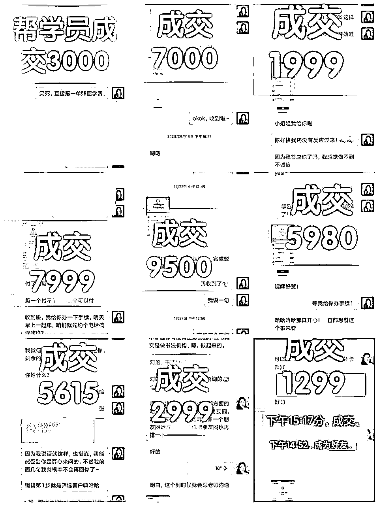
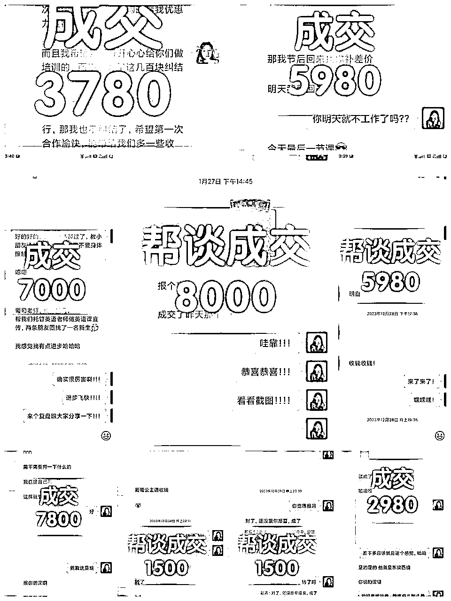

你是不是也遇到过这种情况：客户主动来问你，聊得好像挺热乎，你也是有问必答，认认真真跟了三天，最后对方却来一句“我再考虑考虑”，然后就没影了。你辛辛苦苦输出的内容，全被他带走，自己只剩一脸懵。有过这种经历的朋友，先点个赞再走。

其实高客单私域成交，绝不是拼话术，而是拼心法。今天我就把40个核心心法全部分享给你，每一个都亲测有效。

**一、真正的高手，先“查户口”再开口**

很多人谈单，只盯着客户🛰️上发来的几句话，然后反复问“你多大了”“现在做什么”这种没营养的基础信息。结果战线越拉越长，单子越聊越跑。更糟的是，只学“话术”不学“思路”，最后容易变成四不像。

什么叫真正分析客户？就是对方还没问完，你已经把她整个人研究了一遍。她的朋友圈、视频号、👸号、知识星球，甚至你俩共同群聊里的自我介绍，全都被你摸透了。

举个例子。之前谈一个3000的私教单子，我帮合伙人谈完，问她：“你翻过她朋友圈吗？”她说没有。我说我翻了。我从聊天记录里看到对方名字，又发现我们在同一个群，顺着群里的自我介绍，摸到了她的朋友圈、👸号和视频号。我知道她社群一百多人，小报童用户十几个，👸号和视频号都做得很猛，还是赚钱的嘉宾。我知道她什么时候进的群，她的困惑是什么，她对我私教产品的真正诉求是什么。这些信息不用问，自己就能找到。当对方发现你比她自己还懂她，她会觉得你很“神”，对你自然另眼相看。你的方案直接打到她的需求和情绪上，这单最后顺利收款，私教还给我发了188红包。

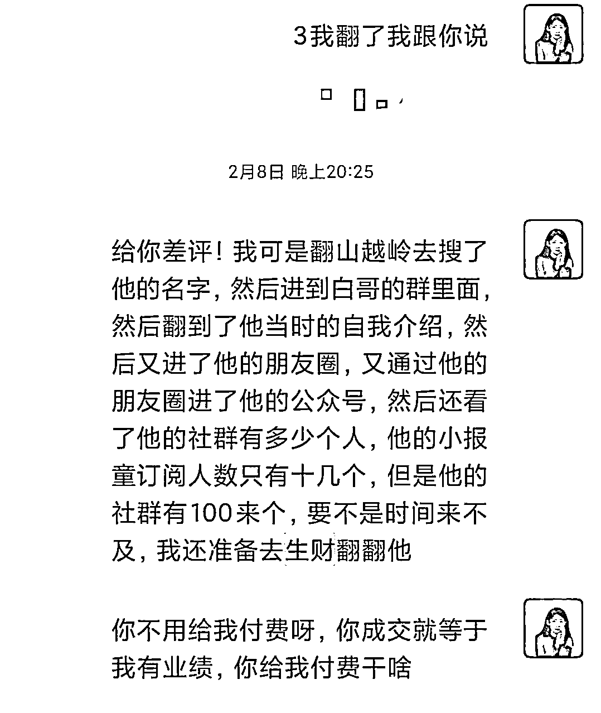
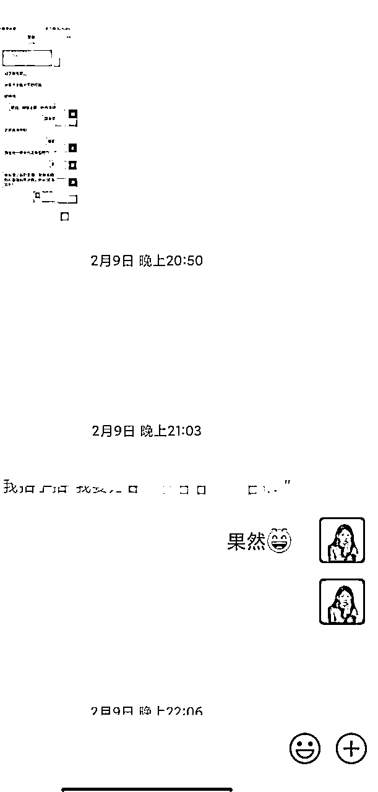

**二、活用“Yes, and”**

都知道要肯定客户，但很多人只学会了夸，没学会“顺着话头放大痛点”。真正的yes and，是接住客户的表达，然后推进一层。

比如客户说“我资金流不太健康，老乱花钱，所以想买个理财强制储蓄”。你立刻接一句：“是的是的，很多朋友就是理财意识跟不上，赚得不少，却存不下几个，跟钱包里住着小偷似的。”她听着痛不痛？太痛了。只要对方露出一点点话头，你就顺势跟上，别等她继续说“我考虑考虑”。

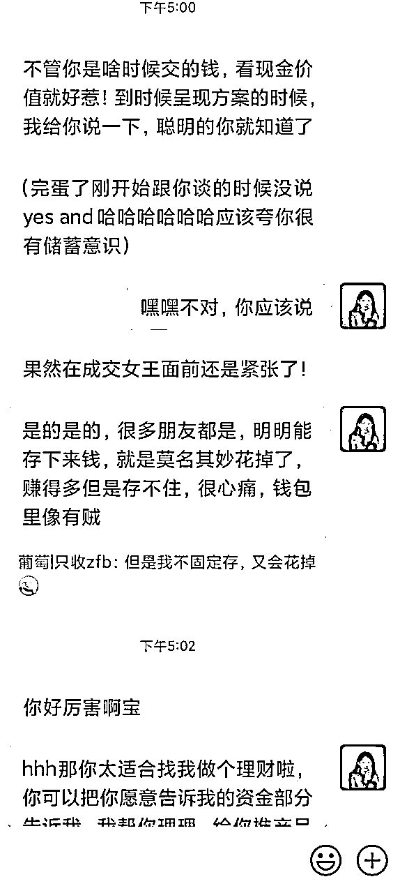

**三、说“人话”，别端着**

很多IP成交不了客户，问题不是产品不好，而是“不说人话”。你面对的人，认知大概率没你高。你满嘴专业术语，客户听得费劲，成交链路变长，概率自然下降。你说“这个产品能提高你的认知”，不如说“你能从里面学到很多内行才知道的东西。比如买了珠宝课，以后自己买珠宝再也不怕被坑”。这样一来，客户秒懂，心动，然后行动。

**四、用场景“勾住”她**

有个客户咨询私教英语课，聊了五分钟，我让私教对她说：“一年以后，别人问你怎么英语这么厉害，你只能苦笑一声说，害，被逼的。”话音刚落，对方直接把钱打过来了。全程不到十分钟。为什么这么有用？因为你给她描绘了一个活生生的美好画面，她的情绪一下子盖过了理智，付费就成了最自然的动作。

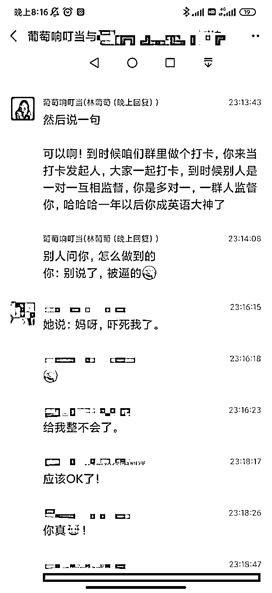
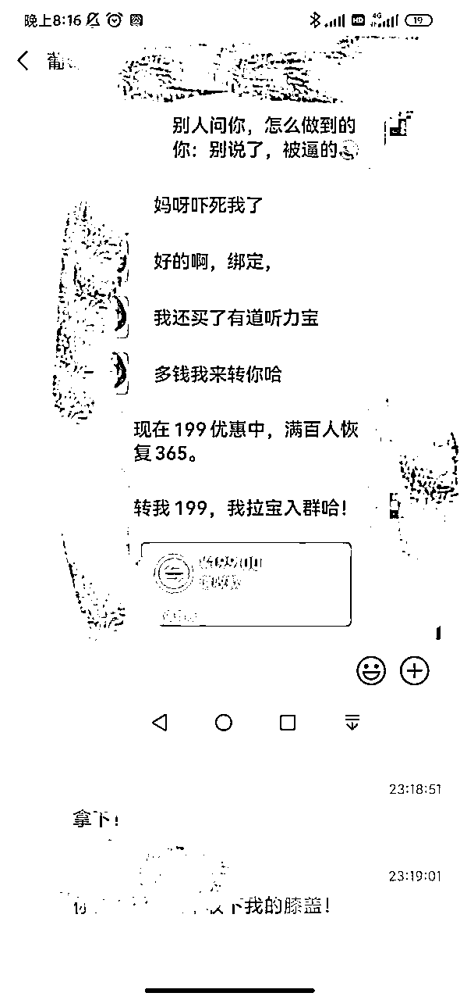

**五、随时随地“占据心智”**

那句“今年过节不收礼，收礼只收脑白金”大家都听过，这就是把产品硬生生塞进人的脑子里。私域谈单也一样。客户来找你学自媒体变现，你要做的，就是不断把“跟我学就能赚钱”这颗种子种进她心里。

你可以说：“等你来了，直接收钱就行。”“之前我学员也是差不多三个月就跑出来了，已经开始赚钱。”她就算还没付费，已经提前开始想象自己赚钱的样子。有个客户咨询视频号带货，我只发了几句话，然后甩过去收款码，十分钟后她说成交了4580。还有一句很妙的话：**“希望下个月或者下下个月，你来找我报喜。”** 大家可以细品，这句话本身就是一颗心智锚点。

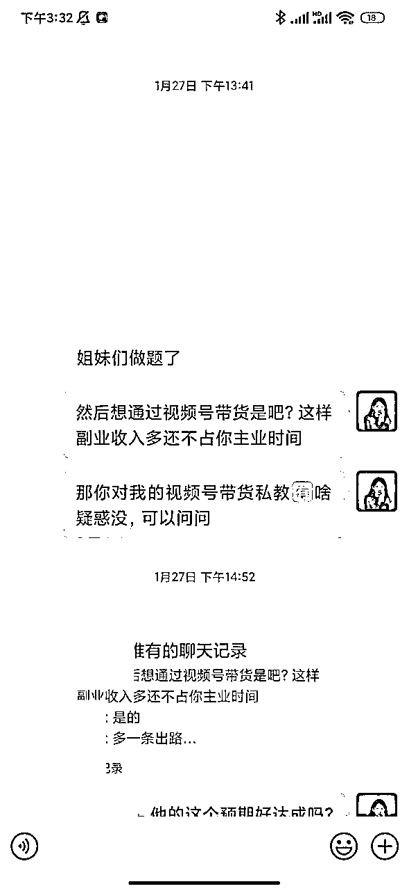
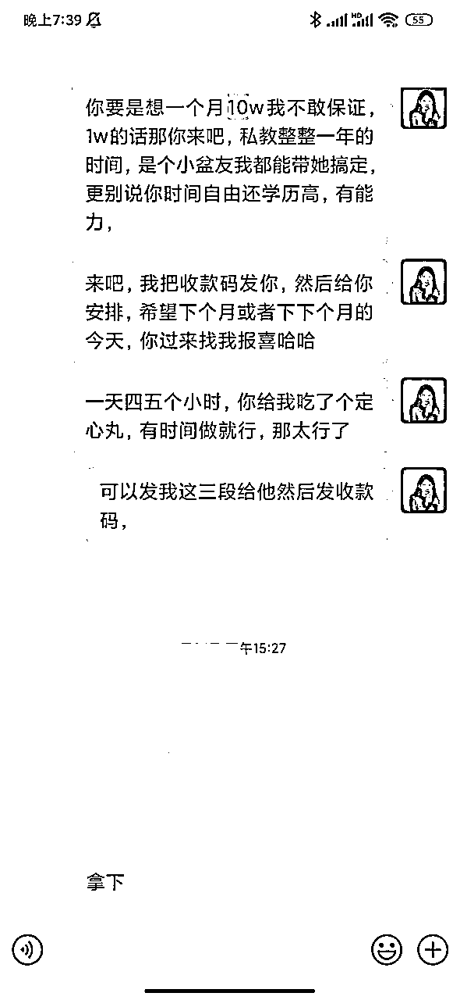
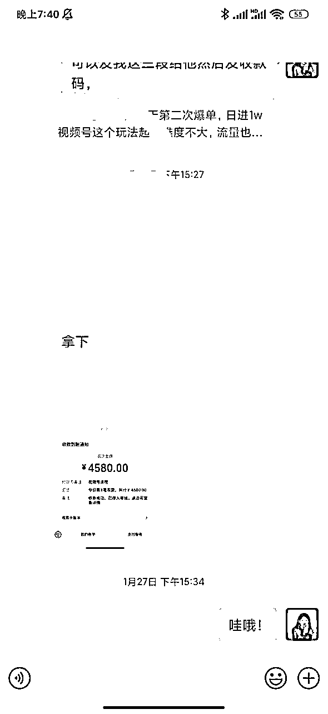

**六、经营“亲密关系”**

哪怕你是社恐，哪怕你不懂任何销售技巧，只要你懂人性，照样能成交。人性就三样：亲密关系、损失厌恶、期待美好。

《思考，快与慢》里说，人大脑里有两套系统：第一套靠直觉和情感，快速做决定；第二套靠推理逻辑，慢速且费劲。而人的大多数决策，其实都是第一套系统在主导。也就是说，当客户觉得跟你是自己人时，下单阻力几乎为零。

我加完新好友，会反复收回成交需求，不停说“不买也没关系，我们依然是朋友”，不断强化“我们都是同一类人”的身份认同，也会分享一些自己的生活。我希望自己不是销售，而是一个恰好卖某样东西的朋友。先交朋友，再谈生意。我有很多新好友加进来24小时内就成交四位数单子的经历，秘诀都是：我先回应她一堆问题，给出各种思路，送了一堆资料，最后才告诉她“我有个产品，你可以了解一下”。多付出一点，收获就多一点。就算没成交，多一个朋友也很好。

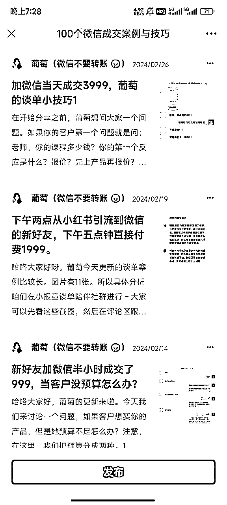

**七、用“损失厌恶”推一把**

大家刷📕会发现：同一篇内容，“新手妈妈必学的三件事”和“新手妈妈不看就完了！新生儿真的很脆弱很危险”，后者往往爆款。因为人天然害怕失去。

你和她说这样做能赚10块，她可能没感觉；但你说不这样做钱包会莫名少10块，而且还会一直少下去，她马上来问怎么办。有个客户犹豫要不要报📕课，我让私教学员这么对她说：“其实你比我优秀多了，我根本没你厉害。你的私域做得这么好，如果再会做公域，你比我多赚十倍。我现在只是多赚一点，无非是因为先学了方法。”当天，客户就付费了2980。

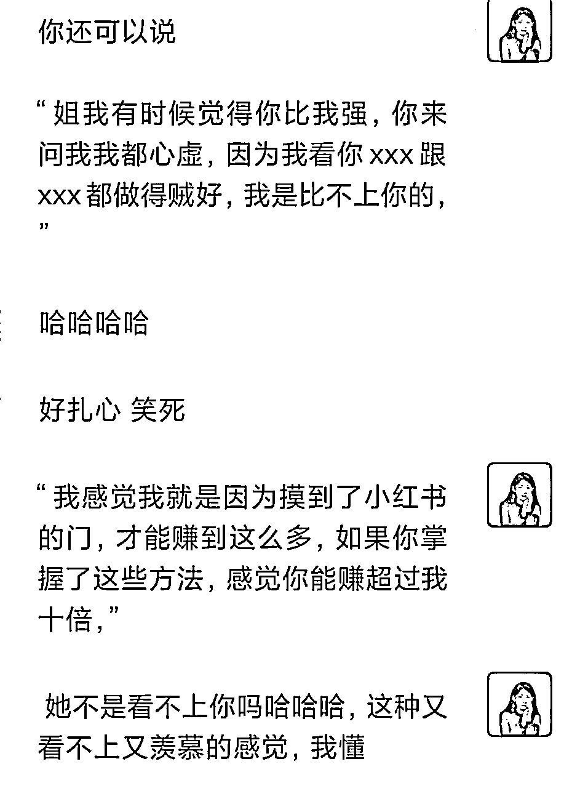
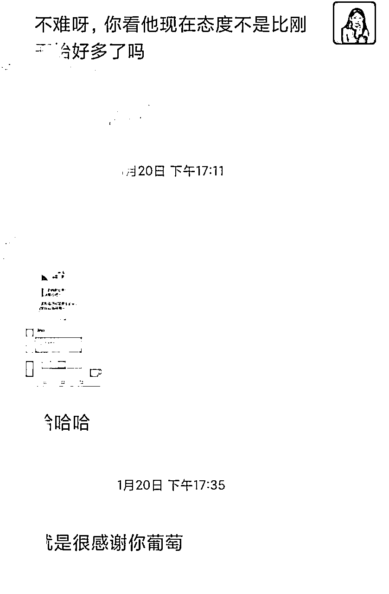

**八、卖“期待”，不卖“产品”**

面对客户，你的身份不是销售，不是客服，而是导师。顶级的成交思维，是给她递去一幅未来生活的美好画卷，而不是反复逼单。有个客户做美容院，私域里有7000个好友，但几乎没成交，她想学朋友圈文案。我让私教这样跟她说：“你7000个客户，客单价一万多，只要能发好朋友圈，出四五单就是四五万，而且这个技能一辈子都能用，以后改行也有用。”加上好友六小时内，她直接付费了朋友圈私教课。

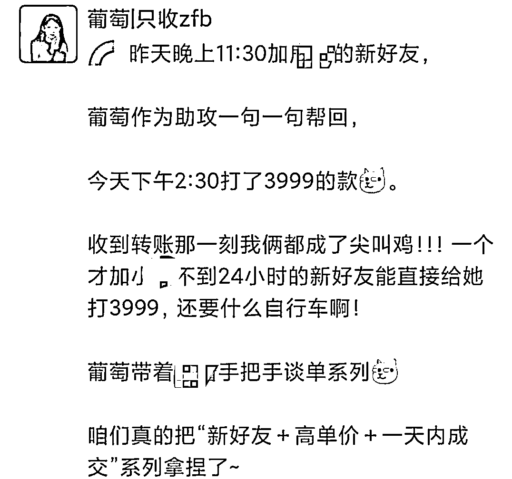

**九、坦坦荡荡“节日逼单”**

菜市场大妈跟你说“这菜好、那菜也好”，你会觉得她只想让你掏钱。但如果大妈说“孩子你来这边挑，那边菜晒蔫了”，你会觉得这人实在，反而愿意多买她家菜。单子已经聊到差不多了，就差她花钱那一刻，不如大大方方说：“我就是希望在节日里成交你，所以会给你优惠，这样咱俩都开心。”这种坦诚反而让人放心。这一单最后成交了5980。

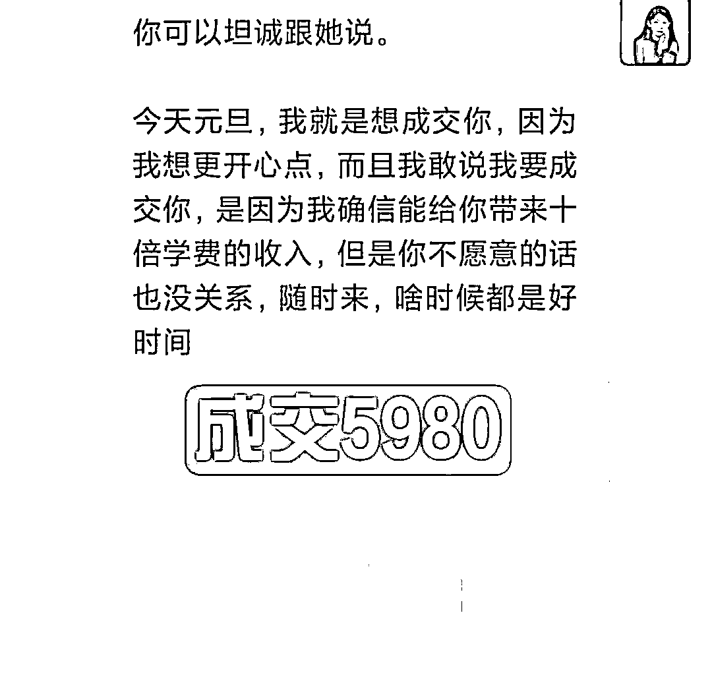

**十、给产品穿上“情绪价值”**

节日离不开礼物，而礼物最值钱的不是价格，是情感。比如父母想给孩子买金首饰却犹豫，你可以帮他打“爱”的牌。泡泡玛特创始人说过：如果盲盒手办加一个U盘功能，你根本不会买那么多。手办吸引人的是情绪价值，情绪价值可以很贵，贵到一千块也有人倾家荡产去买。如果只有功用价值，反而卖不动。那产品不带情绪价值怎么办？自己加。

我之前帮自习室老板谈单，家长想给孩子定位置。我说：“这个宿舍的女生考公考研全上岸了，你今天预定，我就把这屋留给你。”当天家长就交钱了。保险销售也可以这样：把一份保险变成一个“从你出生时，爸爸妈妈就为你准备好的礼物，跨越十八年来到你身边，不管多少风雨，这份教育基金都没动过”。钱有价，爱无价。我们自己舍不得吃车厘子，给爸妈买却整箱整箱买，这就是爱的力量。

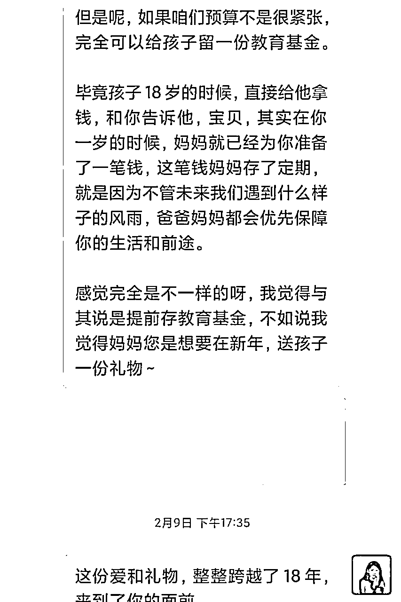

**十一、把需求问“具体”**

客户说“老师我有家实体店，想学线上”，你一定要追问：“是做线下流量不够了，还是想多铺一个渠道？现在的业绩是多少，你希望通过线上达到什么结果？”让他自己说出一个具体数字。比如“我是想做到几十万”，那么他就会想：怎么实现？我得跟你学。家长来说补英语也一样，多问一句“目前差多少分，目标是多少分”，让她把想要的场景说出来。场景越具体，她越想跟你学。

**十二、把话说到心坎里，种下“锚点”**

他是什么人，在乎什么，你就夸什么。一个男人来找你学项目，说想多赚点钱给家人花。你就说：“哇，现在这样的好男人真不多了，有你这样的好丈夫好父亲，你家人太幸福了。”他听了舒服，也愿意为这份“人设”继续付出。家长来帮孩子问学习，你可以说：“您真的很懂教育，有您这样的父母是孩子的幸运，以后孩子肯定差不了。”家长会觉得付出得到了认可，自然愿意继续掏钱。

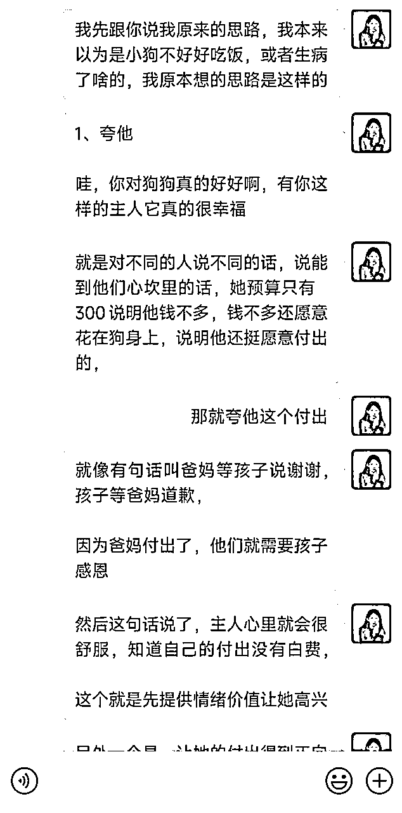
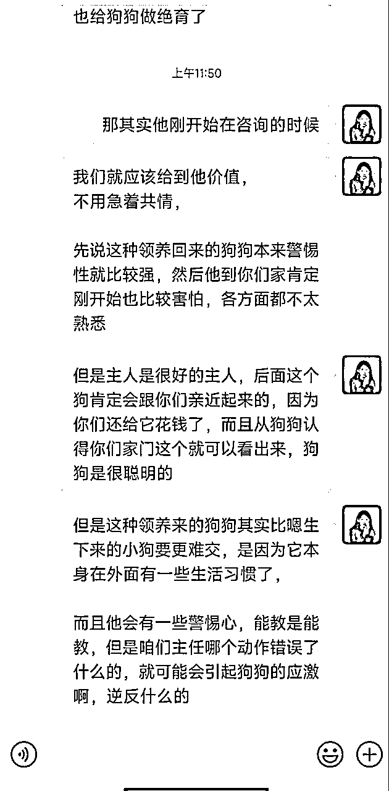

**十三、面对“挑刺”客户，有两种打法**

第一种，他只是过来挑刺的，专门质疑你，甚至可能是同行来探消息的。这种不用深聊，直接顺着说：“你说得对，我这边确实不行。”然后结束。第二种，是想买但忍不住挑刺。这种你就要火力全开，用实力压住他，别被牵着鼻子走。比如他说“我们流量挺好，就是转化不行”，你全程抠住这个点：“你们一周流量多少？能转化多少？把具体数据发我，我给你诊断。我们学员做私域成交都很稳，能帮你提高转化，不然你前面吭哧吭哧做直播，流量加到🛰️却转化不了，最后一步抓瞎，图什么？图直播热闹吗？”一句话：打他，上意大利炮。

**十四、会“挖需求”才是高手**

每个来咨询的人，不管她想买课、搞钱还是减肥，你都得先挖需求。比如她想减肥是因为暗恋一个男生，你说“等你瘦下来，五官像范冰冰，绝对把crush迷晕”，这单基本就拿下了。但挖需求别傻傻问“你为什么想学呀？”你可以问：“你是看了我哪条朋友圈来的？”“海报哪个部分吸引你？”这样既能问出动机，也能知道自己的哪个卖点最有效。

**十五、线上谈单读心术**

线下能看到客户表情，线上看不到，所以很难猜对方心思。我早年为了写小说，专门研究过怎么通过对话表现人物性格和心理活动，后来发现这招可以反向用在谈单上。客户一句话过来，我基本能反推她背后是什么想法。大家也可以看看相关书籍，亲测极有用。

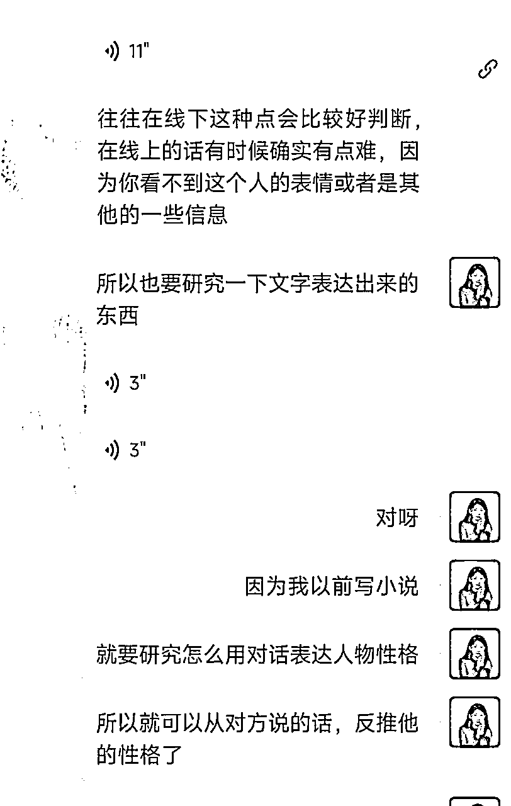

**十六、低价产品要“快刀斩乱麻”**

高客单产品权益多，客户咨询时你可以慢慢聊，深挖痛点；但低价产品呢，比如一两百的小课或社群，对方就是冲这个主题来的，没必要拉长战线。一两百块买就买了，不买也就不买了，想法变得很快。你越快直接成交，单子越是你的。

**十七、客户问“怎么学习”，怎么接？**

“怎么学习”可能有几种意思：用什么方式学，还是怎么才能学？我们可以直接“误解”成第二种，然后顺势圆回来：“付费199就可以学习，老师在群里讲课，你跟着实操，学完21天，就能拍出有美感的照片，吸引更多客户下单。”不管她问哪种“怎么学”，你都把它定义成“学习途径”——也就是交钱学习。听话，交费吧。

**十八、多晒肌肉，多放锚点**

有时候话术再多，不如一张学员成交截图真实。很多人不知道借用图片，所以我特别提醒一下。随时随地提自己的产品和学员：“等你来了，我们先给你诊断一下直播和私域，看看怎么扩大流量，再带你把成交过一遍，比如客户问茶怎么介绍更容易下单，朋友圈怎么发客户看了就付款。”这是植入。“我有个学员卖珠宝，想做线上，我们带她做了📕，现在粉丝多少，引流多少人，上个月业绩多少。”这就是秀肌肉。

**十九、抓住客户和你的产品的“连接点”**

比如你卖盖洛普优势产品，客户说职场很迷茫。你和产品的连接点就是：“迷茫是因为你不清楚自己的优势，找不到合适的方向。盖洛普测评能帮你找到优势，让你在擅长的领域大放光彩。”这最后一句话就是爽点，一定要随时给对方画爽点。客户说不学摄影，要带孩子玩，你可以说：“好呀，每天抽二十分钟学一下，以后带孩子出门，给她拍一堆美美的照片，把童年留下来。”这也是连接。

**二十、把一切“具象化”**

客户觉得求职辅导星球299太贵，你可以帮他算一笔账：跟你竞争同一个岗位的，很多是985、211甚至海归。人家花了多少时间精力金钱，才把简历填得那么漂亮。而你花299，就能把简历丰富到和他们一样，找到同样的工作。这才是这299最值钱的地方。当你把付出和收获都变成具体画面，客户自己就说服自己了。

以上这些心法，几乎覆盖了高客单私域谈单的全流程。你会发现，成交最关键的不是嘴皮子，而是你有没有真正站在客户那边，给她描绘出想要的人生。如果这篇对你有启发，记得点个赞，转给需要的朋友。后面我继续分享实战细节。

很多人问我，为什么花299就能拿到别人砸十几万才换来的结果？答案很简单：时间、精力、金钱上的成本，我都帮你省了。

接下来这套谈单的底层逻辑，是我这些年带学员实战里反复验证的，换个说法讲给你听。

021 真正的痛点藏在后面
有个做茶的学员来找我复盘，她总结客户痛点是“转化率低”。我告诉她太浅了。
比如客户说我想做线上独立老师不知道从何下手，这只是表面症状。继续挖才发现，她线下带课时间被锁死，完全是拿时间换钱，特别想多陪家人。这才是会掏钱的点。
同理，茶店老板说“转化率低，回不了本”，再往下问，真相是：今年生意就难做，客流进来靠砸钱引流，最后进店了也带不走，生怕钱打水漂。
这时候才能真聊到痛处：生意本来就卷，再不拿一套系统的成交方法，砸进去的广告费等于把钱往火里扔，扎心吗？

022 捧着扎，比硬扎管用
大家都知道要扎痛点，但力度不好把握。扎轻了没反应，扎重了像诅咒。
试试捧着扎。想卖养老保险，没必要说不买就去养老院。
换一句话：你又爱画画又爱书法还爱到处跑，我觉得你老了也肯定是那个自由又文艺的老太太。以后每个月领着养老金，天南地北潇洒走一路，多自在，比整天在家转悠强多了。

023 让客户看见买了以后的生活
为什么渣男能把人拿捏住？因为他会把未来画面讲得很具体：你和别人不一样，第一眼见到你世界都亮了，以后咱们养猫养狗，你做饭我洗碗。
卖不出去的本质，很多时候是不会描摹画面。
比如卖钙片，别只说骨质疏松。你要说，以后你老公可能坐轮椅，看你照样在广场上蹦，身边小伙子喊着蹦擦擦，多有面子。

024 学会打比方，立刻懂
销售难成交和夫妻吵架很像，都卡在共识上。用比喻就通了。
老婆想要贵口红，老公说不都是红的。换成比喻：好口红对我就像你那双AJ一样重要，你给我买假货，我就天天给你买假鞋，你也穿着去打球吧。
卖课程也一样。买录播课就像对着视频自学帕梅拉，运气好能成，运气不好练出斜方肌。买私教是有人盯着你练，错了马上改，成长姿势都给你纠正好。

025 先问诊再开药
最大的坑就是客户还没说清楚要什么，你就急着介绍产品。最后必然无功而返。
谈单要像医生问诊。病人不会上来就问我要吃啥药，医生会先问哪里疼、疼多久、吃什么缓解过。问清楚了再开方，病人才乖乖照做。
所以别被“你的产品是什么”带跑，先把需求挖透，时机对了再上产品。

026 先学会筛人
再好的方法也救不了错误的目标。学会筛，是谈单的第一步。
付费意愿比付费能力更重要。判断很简单：对方连续问你三个问题，你都认真回了，到了第四五个问题时就可以自然带出产品。
如果两次推荐她都回避价格和交付，直接放弃，别浪费时间。

027 产品要烂熟于心
一个销冠能在1分钟内说出产品的至少5个卖点、使用场景和具体好处。这就是底气。
沟通技巧再强，你也不可能卖一个你自己都不了解的产品。梳子卖给和尚能火，前提是销售对梳子的价值点烂熟于心。
先把白纸上的卖点和场景写出来，才能谈得顺。

028 别当没头脑配不高兴
客户像没头脑，天天问，销售像不高兴，越聊越离谱。
核心就两点：精准识别需求，和随时拉回主线。
客户说不参加培训了，要陪小孩旅游。别跟着聊风景，直接把她拉回来：那太好了，等妈妈参加完摄影课，以后带娃出游都能留下温馨瞬间。

029 成交是两个人的进度条
谈单不是100%能成。把成交想象成10分的进度条，销售占5，客户占5，超过6就成交。
销售口才一般拿2分，但客户本身意愿有5分，照样成。客户意愿只有2分，销售发挥到5分，一样能成交。
复盘关键是看是哪一边拉满了。

030 顾问式销售
别只讲产品多好，要讲能解决什么问题。帮助老师成交家长，帮助IP成交课程，本质都是先解决卡点。
客户买销售私教，不是因为想买私教，而是因为谈单卡住了。先帮他疏通卡点，产品自然顺手成交。

031 找到蚌壳的缝
“他羡慕什么、尊重什么、在乎什么、恐惧什么，就是付费点。”
有个新朋友夸我内容好，说好的圈子真的很重要。这句话就是缝。我顺势推荐社群，说待在好圈子里进步飞快，她立刻转账了。
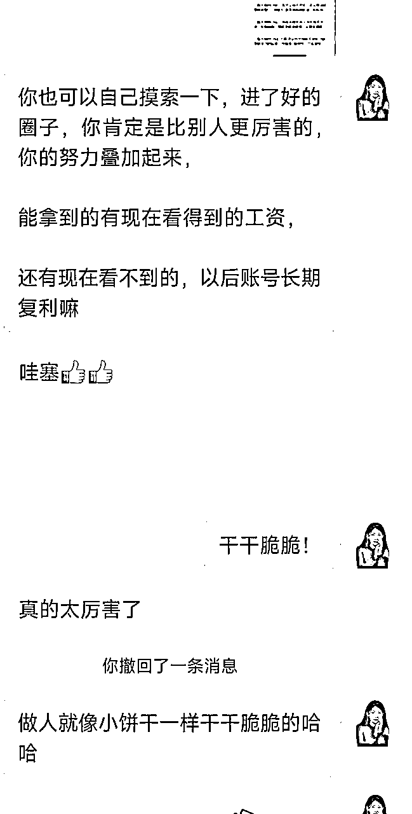
复盘你的谈单记录，哪些缝你找出来撬开了，哪些缝明明在眼前却错过了。

032 把对方当人
最反感的销售就是只把你当提款机。
以前我讨厌卖保险的，因为我明明说了预算3000需求123，她还是不管不顾巴拉巴拉。后来遇到一个姐姐，她先看我的朋友圈，我生病时先关心我，再说现在有适合你的产品看看吗。感觉被当人对待了。
在推销前先问自己：她是我朋友，她现在需要什么？

033 别直接报价格
第一，痛点没挖清就报价，等于自杀。客户预算6000你报8000，直接凉。
第二，报价要带权益。别甩一段大字文档，没人看。权益要具体、可感知。

034 利他式话术
想让同桌帮你买辣条，别说我馋。说我听说小卖部进了你喜欢的爱豆杂志。要为对方考虑，把这份考虑表达出来，客户自然被诚意打动。

035 描绘场景之外的场景
卖的不是产品，是情绪。卖水晶手串，说漂亮销量+1，说年轻就该有亮晶晶销量+100，说招财销量+10000。
AI代写客户本质想省时间。你别只说省时间，要描绘省出来的时间：点杯冰奶茶，刷甄嬛传，我们帮你干活。这就是把情绪点亮了。

036 合理装傻
不管对方想白嫖什么，都说这个在XX产品里都有，可以过来买。再配合之前的心法就够用了。

037 学会克制
有人加我上来就说我现在就想给你付费，我一句话产品都没推。学会克制很重要。客户现阶段没有需求，你硬推只会把真心推走。等她真正求助时再出手，更有信任感。

038 注意时间窗口
客户聊到中午12点，然后到14点半断联，晚上21点才回。这不是你聊得不好，是人家上班了。
教培老师周末和工作日晚上才有空，宝妈可能10点以后才有空。找对时间聊，转化率立刻不一样。

039 及时抽离，保持客观
当局者迷，谈到关键时容易忘掉方法。两个办法：熟能生巧，还有就是经常抽离。
我在谈单时中途会把手机放下，远距离看客户信息，拉远视角回看对话起点，客户是谁、要什么、卡在哪。这样能冷静下来继续聊。

做销售谈判，最忌讳被客户的问题牵着走。遇到提问，先深呼吸，跳出问题本身。比如客户问你“是专业做这行，还是副业？”——别急着答。一旦老老实实回答“主业”或“副业”，成交十有八九会被拖慢。她表面问身份，实际是想确认你的可靠程度。通常这种人一开口就会说“我是某某公司员工，来对接采购”，她需要对这笔交易负责，自然希望你主业就是吃这碗饭的，合作更有保障。想通这一点，你就不会被“主业还是副业”困住，而是顺着她的真实需求，继续攻击她最在意的那根软肋——专业性和保障。这就等于把谈单结束后的复盘挪到了谈判过程中，边谈边校准。下次不妨试试“抽离”视角。

再说一个很多销售会忽略的环节：谈单也有“兵器库”。我一度觉得自己挺有天赋，好歹也是葡萄，开个单还不是手到擒来？结果第二天就悻悻地去求朋友补课。这才想起，早期谈单我每次都会先给产品做总结。没有这一步，神仙也难谈好单。所谓的兵器库，其实就五件：

第一件：把痛点挖得足够细。每个产品至少列五个痛点，再配上具体场景。做情绪体重管理产品的，痛点就有“反复暴饮暴食后焦虑”“控制不住进食”“对自己失去信心”；做📕带货获客的，痛点就是“店铺没客流”“笔记发了没曝光”。痛点写得越细，扎得越准。

第二件：把买点提炼得足够香。同样写五个左右。比如那个教📕获客的课程，买点是系统指引：怎么找对标账号、怎么引导评论区留言、怎么提高引流人数。买点要让人一看就觉得“这就是我要的”。

第三件：把爽点描绘得足够美。这是买点的进阶，把收益变成画面。比如报了这个课，以后你就不用自己可怜巴巴地一天发十几条还没人看，老师直接帮你指导，你只负责把🛰️号准备好，等着流量爆棚。再比如报个减脂陪跑，夏天穿着吊带裙出去浪，随手一拍都超有感觉，朋友圈点赞量直接起飞。爽点让人当下就心痒。

第四件：把用户画像分得足够清。不同产品对应不同人群，谈单风格也得跟着换。做项目类的客户，多半敢想敢干，愿意付费，最关心收益而非情绪价值；想打造IP的人，更看重信念与价值感，你跟他谈“使命”比谈“钱”更有效；传统线下老板呢，你得专业术语和日常大白话交替着来，否则他可能觉得你在吹牛，直接不理你。我甚至冒出一个念头：把各类人群都做个简单分类，再配上专属谈单风格和话术，应该很实用——如果大家觉得这想法靠谱，就给我点赞，回头我就去整理。

第五件：把素材库备得足够足。谈判跟写文章一个道理，光有论点不够，还得有论据。我的素材库分三层：成功客户案例、成功同类案例、大场景案例。举📕培训的例子——客户案例：“你看这位学员，跟我学了三个月，现在三万粉了”；同类案例：“你同赛道的那个人，已经变现二十万，做得风生水起”；大场景案例：“现在连新东方这样的大公司都进场做📕了，矩阵号铺了两百多个”。如果换成教育行业，客户案例可以是“这个学生跟我学，考上了985”；同类案例：“你知道吗，那个大学状元本来英语很差，学了某某单词速记法，自己说成绩提升特别快”；大场景：“北京深圳那些一线城市，早就在用这种方法了”。

聊完兵器库，再分享一个心法——尊重客户认知。我帮一位IP朋友理成交逻辑时，反复强调要“1+1=2”，别给人家“3×3÷2”。什么意思？有位营销教练在给传统企业老板讲私域运营，可满嘴都是“转化率”“流量更大化”“跑通闭环”。老板一愣，说了句“我再想想”，回去后一直在琢磨这些词到底啥意思，反而把自己原本要学私域的事给忘了。面对不懂知识付费的人，你得把话翻译成他能秒懂的样子。教培圈有句话：“很多名校出身、专业很强的老师，未必教得好孩子——成绩好和会教是两码事。”原因就是，有些老师潜意识里没有尊重孩子的认知。六岁孩子有六岁孩子的世界，八岁孩子有八岁孩子的世界，能把知识转化成他们听得懂的语言，才算真正会教。当年白居易写诗连老太太都能听明白，宋人还嘲笑他，可后人偏偏把它当美谈传颂，说明大家都打心底敬佩那些愿意俯身迁就他人认知的人。卖产品也一样，只有把事儿跟客户讲透了，产品才卖得出去。记住：在尊重对方认知的前提下，尽量平视他。

最后，聊聊发售期怎么分类谈单。前阵子帮朋友做发售，🛰️一下子涌进大量新流量。很多老板或销售的习惯是“统一自我介绍+送资料”，省时省力，但对成交率不友好。我当时按不同标准把客户分成了ABCD四类——因为主推的是五位数的高单价产品，所以分类标准比较独特，大家也要具体问题具体分析。

A类：有付费能力，业务不错，能力强，对主理人有一定信任和明确意向。这样的客户要重点跟，前期多挖需求，多展示主理人的风格和实力。尽量不要群发，免得打扰对方、破坏信任。哪怕有个别直播或课程必须通知，也要挨个私聊，就算话术相同，也要在开头写上对方的名字。一轮二轮回访，全部一对一，绝不群发。

B类：态度好，会主动领资料，公开课上有互动，经常主动复盘，确实需要主理人服务的。这类客户在有余力时，同样尽量点对点私聊，不用群发。

C类：进来领了资料，其他什么也不说。但如果他们的朋友圈业务能跟主理人衔接上，可以适当私聊，同时群发回访。

D类：加了🛰️不说话，资料也不领，朋友圈业务毫不相关，大概率只是来围观发售的。把他们放在朋友圈慢慢养，真要回访时用群发话术就行。

这样分类的好处是：能用80%的精力去攻克20%真正有成交意向的人，也不用担心群发会拉低客户对IP的好感。结果呢，大约一周时间，A类客户交了5个定金，B类交了2个，尾款顺利补上，总成交额正好10万。C类和D类暂时没有转化，期待接下来的数据。除了发售，日常谈单也可以根据产品属性给客户贴标签，成交效率会明显提升。好了，今天的心法先讲到这儿，觉得有用记得给我点赞哦～#100个谈单心法