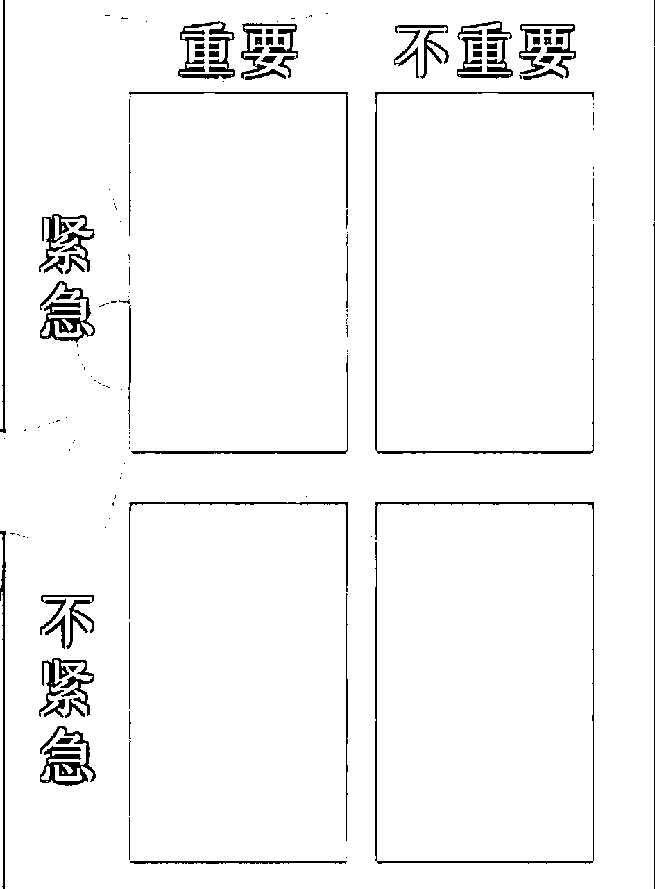

# 我把自己的时间管理迭代了十年，现在的工作时长只有5-6小时，一年也能做到7位数收入
作者：龙哥

提升效率这个话题，对做项目的人、创业者，或者是身兼主业副业的人来说，几乎是永远的命题。

坦白说，我现在的工作节奏算是比较轻的，每天有效工作5~6小时，一年收入稳稳进入7位数。能做到这点，不是靠加班，靠的是这些年一点点打磨出来的时间管理体系。

这套体系我内部把它叫做从1.0到7.0的七代迭代。用了将近十年，每年都在复盘优化。核心逻辑只有一个：时间管理的前提是先搞清楚人生的方向。

* * *

# 先定罗盘，再谈效率

我做时间管理前，先做人生罗盘。

效率再高，如果方向错了，最后也只是把自己打磨得更快偏航。

罗盘就是把你的价值观拆开来排优先级。我把它拆成五个维度：健康、家庭、事业、金钱、爱情。

事业和金钱要分开，因为事业观和金钱观是两回事。家庭和爱情也要分开，家庭是和父母、子女的互动，爱情是和伴侣的独处。很多人把这两样混在一起，最后既感受不到爱情，也经营不好家庭，总觉得另一半抱怨时间都给孩子和工作了。

罗盘的作用就是在大海上给船定方向。没有参照物时，罗盘能告诉你哪里是东，哪里是南。你先知道自己要往哪走，后面的时间分配才不会越走越偏。

* * *

# 第一代：便条式，不忘事

第一代是最原始的待办管理。每天把要做的事写在便利贴或手机待办里，做完撕掉一张。

好处就是记忆外化，不会丢事。老师交代、客户需求、突然冒出来的想法，当下立刻记下来，不隔夜不隔一小时，不然肯定忘。

我习惯晚上整理第二天的便条。早上起床整理容易被耽误，晚上安静，反而能把脑子里的碎片梳理清楚。对我来说，这一阶段用了两年，解决的是“记不住”的问题。

* * *

# 第二代：优先次序，知道先做什么

便利贴越来越多时就会发现，做不完。于是进入第二代，排序。

排序的依据回到罗盘。如果爱情排在前面，那每天陪伴的时间就是不可挪动的底线。比如我会固定留10点到11点和伴侣独处，不管会议多紧急，赚钱有多诱人，这段时间不动。

不同人生阶段的排序也不同。20-30岁的年轻人，我建议把赚钱放前面，体力、脑力都在线，动力也足。

操作上就是把当天的便条重新排个序。带孩子上学、股东会议、运营社群、和伴侣聊天、做家务……原本按1-2-3写下来，排序后可能变成3-4-1-2-6。煮饭扫地可以外包，就往后放；社群运营一停，现金流立刻受影响，就必须往前提。

能做到排序后，人会明显没那么慌。先把前三件核心事做完，时间有剩余再处理次要事，做不完就顺延到明天。这是年入50万以上的基本功，执行力够了，收入自然比普通上班族更稳定。

* * *

# 第三代：重要紧急四象限，拉长赛道

到第三代就从当天跳到人生层面了。

第一象限 重要且紧急：银行关门前存钱、高铁临期抢票、信用卡还款、证件过期。这类事不做会出事。

第二象限 不重要但紧急：临时电话、别人的插队请求、突如其来的委托。当下不做会被催，是最容易偷走时间的杀手。

第四象限 不重要不紧急：刷手机、发呆、白日梦。做了也不产生价值。

第三象限 重要不紧急：运动、阅读、资产规划、复盘、人际经营。今天不做明天也不会塌，但长期不做，竞争力就会被拉开。

我观察大部分成功者，80%以上的时间都花在第三象限。他们每天讲课、写文章、固定的学员沟通、和老婆约会，这些都是重要不紧急的事。坚持下来，长期的人就越轻松，紧急的事情自然变少。

我现在价值观是爱情第一，家庭第二，赚钱第三。所以会每天亲自送孩子上学，学校有校车我也不让坐，多出来的路上时间就是亲子关系。做饭时一起吃饭，也是用很少的时间维护长期的关系。

* * *

# 第四代：行程表，从个人到全局

第四代是把优先级变成时间轴。不是写“今天要开会”，而是写“8:00-9:00股东会”。

有行程表后，我不仅不忘事，还能准点完成，还能看到人生是否失衡。我用颜色做分类：健康绿、爱情黄、工作赚钱红、固定事项蓝、学习黑。

一周表一看就知道哪种颜色缺了。整周没有红色，说明根本没碰赚钱的事；一个月没有黄色，爱情出问题很正常。行程表也让我能管理团队，避免时间冲突，约客户不会撞期。

这一代是从个体分配变成全局检视，开始能看到生活结构的平衡度。

* * *

# 第五代：角色管理，学会切换状态

第五代是角色扮演。回到家是父亲和丈夫，在公司是老板和同事，每个角色需要的情绪和语气完全不同。

最难的是转场。不能把对下属的强势带回家，也不能把对老婆的腻歪用在团队沟通上。切换身份的核心是能量恢复。

我会找一套自己的“情绪重启”动作，比如把玩扑克牌、听喜欢的歌、做饭、看书、看脱口秀，15分钟就能把状态拉回来。转场顺了，角色才不会互相污染。

* * *

# 第六代：能量管理，情绪不失控

第六代就是情绪管理，也就是能量管理。会议上不能发脾气，公开场合不能失态。一旦在不合适的时机情绪失控，积累很久的信任会瞬间跌到50分甚至30分。

能量管理的关键是冷静能力。学会在情绪上来时先按下暂停键，保护好和他人的关系，也保护自己的长期口碑。

这套从便条到能量的六代迭代，本质上是在做一件事：先用罗盘定方向，再用工具把时间、优先级、情绪全部打通。效率不是做更多事，而是让每件事都在正确的时间、正确的身份下，以合适的能量完成。

总有人问我：时间管理走到第七代，最难的那关到底是什么？

我的答案可能有点反直觉——排在难度第二位的，不是安排任务的技巧，而是掌控自己情绪节律的本事。你得知道自己做什么能立刻回血，什么动作能瞬间把压在心头的雾霾拨开，重新找回轻快上扬的状态。

这就像角色扮演中的换场。戏与戏之间切换，最关键的是“频道转换”。对我来说，能让我迅速嘴角上扬的开关很清晰：刷一段即兴喜剧、翻一翻和爱人一起拍过的旧录像，或者点开孩子们幼时的视频，情绪就会像被点了火一样亮起来。

所以问题来了：有没有一套可复用的方法，能让我们随时随地把自己拽回高能量区间？哪怕只是一个具体动作或一条清晰路径，也足够让我不再被情绪牵着走。

拿开会来举例。会议室里谈的都是正事，但坐在对面的人，私下都是无话不谈的好友。公事一聊开，语气难免会重，甚至带着火药味。可会议一结束，大家转身就要同桌吃饭——刚才还板着脸被批评的人，马上要嬉皮笑脸敬酒夹菜，那股别扭劲儿，谁碰谁知道。

我的解法，是先给自己划出一道缓冲带。要么在开饭前，独自留在车里发呆十到十五分钟，让心里的风速降下来；要么干脆摆到台面上，提前向大家“报备”：

“工作这一页已经翻过去了，现在我们恢复朋友模式。刚才在公司里如果有话说得冲，我真心道歉——那不是针对谁，只是想把公事和私交分开。只有这样，咱们的感情能走得远，合作也能稳得住。各位多担待，接下来咱们好好吃这顿饭。”

先把话递出去，等于给所有人都发了一个信号：我要换挡了。如果没这个动作，带着一肚子坏情绪去做看起来正确的事，结果大概率是负分。

能量管理这件事，在我的时间管理版图里，从来不是某个孤立的模块，而是嵌在每一环里的隐形轴心。比如我很早就察觉到：清晨列待办清单，反而让我浑身发懒、提不起劲；换成晚上列，朋友们又正好在线呼我聊天，根本静不下手。

这种时候，真正要做的是给自己找一个“绝对安静”的缝隙，把重要的事安放进去。只要能量处在正位，前面那六代时间管理才有施展的舞台；能量一旦歪了，做什么动作都像踩在棉花上，使不对力。

再讲一个更紧迫的处境：马上要见客户，心情却糟到谷底怎么办？比如和另一半刚吵完，一小时后还有一场线上咨询。我的做法是，先跟对方“叫暂停”：

“亲爱的，能不能晚半个小时再聊？我马上有个咨询要开工。眼下家里的收入，真的很需要我把这场咨询稳住。我担心继续吵下去，我会带着杂念上阵。咱们先各自缓一缓，等我咨询结束，一定好好陪你聊到底。”

这就是切断电闸式的能量管理。当怒火和焦躁上头时，最关键的诀窍不是压抑，而是“切断”。有能力按下暂停键的人，才算真正的心智成熟。也只有这种人，才有资格谈高效二字。

---

# 第七代时间管理：习惯管理

最后这一代，我把“习惯管理”放进了我的效率系统——这也是我在过去一年里才补上的最后拼图。我认为它是最难、但复利最惊人的一环。

人的一天有太多时间，被无意识的小动作悄悄吞掉。而习惯的价值，就是把正确的优先级“焊死”在日常轨道上，让身体替你抢时间。

我见过一个美团骑手，跟我同乘一部电梯上到19楼。门一开，他冲到某间办公室门口把餐放下，转身的瞬间伸手按下了对向电梯的下行键。等他把餐递好回到电梯前，电梯已经打开门等他。就是这一个顺手动作，他比别人少等了半分钟。我知道，这个骑手肯定是个老手。

这样的“顺手”其实无处不在。我家的鞋柜和电梯就挨在一起。早上出门，要么先穿鞋，要么先按电梯。我一定选择先按电梯再穿鞋——电梯可能停在二十几层，先把它叫下来，等我这双鞋套好，电梯刚好开门。做饭也是同理。如果汤要熬上两小时，我必然先把汤炖上，再去淘米、备菜。否则等所有菜都切好码好，才想起饭没煮，手忙脚乱就晚了。

去商场的套路也一样。如果是熟悉的商场，我会直接把车开到离我最常用那个电梯最近的位置，再绕着外围找停车格；如果是陌生的场子，我会先找一个带编号的电梯，把编号记在手机里，以它为圆心向外辐射找车位。因为路线被习惯固定了，我从不担心找不到车，离场时沿着原路走，就能精准穿回爱车旁边。

早上到公司的第一件事，我也不会用来处理自己的事务，而是先给团队布置任务：“今天你们三个人各自负责什么。”把指令先发出去，他们就能立刻启动运转，而不是等我处理完自己的活、两小时后才想起来通知他们——那两小时就是白白漏掉的时间。

别小看一个动作的调整。一个小习惯，可能每天偷出二十分钟；三个小习惯叠在一起，就是一小时。这一小时可以用来补觉、恢复状态、陪家人——价值远超想象。

# 如何练就这一代？

练习惯管理，最快捷的方式是“抄作业”。多找几位你觉得活得特别高效的人聊聊，看看他们的日程表长什么样，听他们讲每天睁眼先做什么。聊完之后，把他们的习惯一条条写下来，再对照自己：哪些是我没有、但很想要的？

把这些习惯列在纸上，它们就会在你心中埋下种子。之后你会惊喜地发现，自己在不知不觉中，已经开始用他们的节奏处理事务了。原本一天要干满八小时的活，因为习惯顺了，每天空出一大块自由时间，不是梦。

比如写文章这件事。以前我写一段，就停下来改错字、调排版，结果思路总被打断，一篇文章磨蹭半天。现在的顺序是先一口气写完，再统一处理排版和文字问题。同样的产出，耗时直接砍半，效率完全不同。

还有我的“五十分钟法则”：每专注五十分钟，我一定强制自己休息十到十五分钟。连续肝三个小时，效果永远比不上“两小时工作+中间歇二十分钟”。人的精力本来就有潮汐，硬扛只会越做越躁。刷两条短视频、回几条🛰️、找老婆聊两句，或者开一局小游戏，能量就能重新充满。

这些细微的取舍，全是习惯在做主。

---

# 结语

习惯管理，是给效率做乘法。这是我这两年底层升级的收官模块。正因开始刻意经营习惯，我才惊觉——原来每天可以挤压出这么多余量，用来休息、用来做喜欢的事。

上面这份七代时间管理全案，我自己跑了快十二年。如果里面有一个点能落在你心上，哪怕只是每天多赚一小时，或者让工作效率悄悄翻倍，我就觉得没白写。

# 尾声

我是根源，第四期赚钱圈友。一名手里攥着两万多例实战沉淀的心理咨询师，干了十二年线下销售与带班子，两年前转战线上知识付费。

能看到这里，说明你对我写的字有几分偏爱。若是喜欢，不妨接着翻翻我过往的旧作。

2021年的文章（精华x1）
1. 精华《直觉式萨克斯 透过社群成功变现146万》 https://t.zsxq.com/116B1bcYc
1. 《73项被动收入打造》 https://t.zsxq.com/11EHjTH0P
1. 《杭州夜话02场，夜话官复盘》 https://t.zsxq.com/19IkX4UMl
1. 《年入百万，团队从20人到4万人》 https://t.zsxq.com/19JYt77hL
1. 《主题：如何更有效的链接见面会认识的圈友》 https://t.zsxq.com/19VY2LWg4

2022年的文章
1. 《互联网小白，第 1 次做线上产品，7 天赚回 10 倍门票》 https://t.zsxq.com/11ooZZbM7
1. 《把捣乱分子『逆势』转成爱用者的好方式》 https://t.zsxq.com/19lipLhJ5
1. 《 好的内容，是目前依旧没退旧流行的变现方式 》 https://t.zsxq.com/19BLMAYw1
1. 《明白老师的一个启发，让我从100天日耕的过程赚了30W+》 https://t.zsxq.com/19BgNoxfi

2023年的文章（精华x6）
1. 《私域的意义不是管理，而是经营》 https://t.zsxq.com/19WEsfSq1
1. 精华《9年传统行业 1 年时间，从一无所有，到年入 200 万》 https://t.zsxq.com/10nmEr1cA
1. 精华《25个提高🛰️成交率的小技巧》 https://t.zsxq.com/11AgRW24F
1. 精华《35 个让私域收入翻 3 倍的技巧》 https://t.zsxq.com/11FmV2aqZ
1. 精华《续篇 - 25个提高🛰️成交率的小技巧（26 - 50）》 https://t.zsxq.com/13yRbmUwo
1. 《 私域话题：涨价之后，如何回复以及留住客户？》 https://t.zsxq.com/11UJk9HxQ
1. 精华《成为自由职业者的20个必备特质 》 https://t.zsxq.com/14XTxhh15
1. 《 36个让私域成交率翻倍的实战指南！ 》 https://t.zsxq.com/17zSrYzvk
1. 精华《产品线有引流体系，如何通过沟通促成升单？》 https://t.zsxq.com/17ocUJEFA
1. 《知识付费赛道，如何透过处理『反对问题』，增加用户粘性和复购率？》 https://t.zsxq.com/181fSc5rv

2024年的文章（精华x7）
1. 精华《第一次尝试「问答群形式」的公域往私域转化，7天变现11万》 https://t.zsxq.com/18gBXlWxE
1. 《 线上新手，我是如何用一套固定流程，累计成交 300 万高价产品？ 》 https://t.zsxq.com/18IWgDiXo
1. 精华《 私域话题-如何在客户咨询过程中，透过三个步骤提高2倍成交率？ 》 https://t.zsxq.com/196Ad34aR
1. 《私域的十倍增长话题：不同信任程度的客户，如何提升成交率？》 https://t.zsxq.com/YKHGT
1. 精华《 为什么都是做副业，我能第一年就达到七位数？ 》 https://t.zsxq.com/APodD
1. 《 写作赛道，如何使用「算账思维」精准地评估产出？》 https://t.zsxq.com/ymcEE
1. 《 私域+知识付费话题：如何通过增加合理的触达次数，提升2倍以上成交率？》 https://t.zsxq.com/elSxU
1. 《9年传统行业转型第2年，如何维持百万利润》 https://t.zsxq.com/61VlK
1. 《把副业做到超过主业收入，你必须得知道的20件事！》 https://t.zsxq.com/bkbd1
1. 精华《用这 13 个思维，我做过的副业全都成功变现！》 https://t.zsxq.com/1q1Re
1. 精华《如何找到靠谱的人，让项目成功几率提升十倍？》 https://t.zsxq.com/hJZfN
1. 《私域筛选流程小尝试，四位数产品课程，转化率40%》 https://t.zsxq.com/o2dJx
1. 《 30个『提高5倍🛰️成交率』的小技巧 》 https://t.zsxq.com/oThQB
1. 《私域话题—引流来的客户，用什么样的话术，可以提高2倍成交率？》 https://t.zsxq.com/RuaIy
1. 精华《如何处理退费(反对)问题，让高客单产品的退费率大幅降低？》 https://t.zsxq.com/X2PEX
1. 《如何善待恶贵人，增加项目赚钱的稳定度？》 https://t.zsxq.com/aspYc
1. 精华【赚钱技能】如何透过几个标准、筛选出合适的合伙人？ https://t.zsxq.com/h1J4J