# 半夜睡过广场，也月赚过16.5万，我是怎么一步步找准「AI+做课」这条蓝海赛道的？

你有没有想过，一个从陕北山沟里走出来的穷小子，居然能靠自己的折腾，一路从半夜睡广场的窘境，走到月入16.5万的高光时刻？

我叫半目，85后，一个普通的中年奶爸。今天想和你聊聊我的故事——关于我怎么在一次次跌入谷底后，踩着AI的风口，找到了属于自己的蓝海赛道。

先说结果：我在知识付费领域摸爬滚打了6年，曾经一门新课上线第一个月，光一个微信号就收了16.5万，算上支付宝，那个月总收入破20万。

这不是炫富，而是想说——这世上真有逆袭的路，关键在于你往哪个方向走。

---

**从小山沟到奥运会，我本以为自己要起飞了**

我生在陕北，典型的黄土高坡人家。父亲是村里第一个考出去的人，这才让我们从土窑洞搬进了石头窑。我呢，老老实实当了个“小镇做题家”，一路考上了省重点高中。

高三那年，干了一件影响高考的事——喜欢上了隔壁班一个长得像孙燕姿的女生。心思一飘，成绩就飘了，不过还是考上了一所全国重点大学，但那口气，始终没咽下去。

上了大学，我开始疯狂折腾自己：做家教、拉赞助、办活动、进山区做公益，甚至帮人扛水上楼，扛一桶挣5毛钱。

2008年北京奥运会，我如愿成了志愿者，在运动员休息区服务。亲眼见过大人物，和小罗纳尔多迎面碰上，还拿到巴西球星迭戈的签名帽子。那一年，我真的觉得自己在发光。

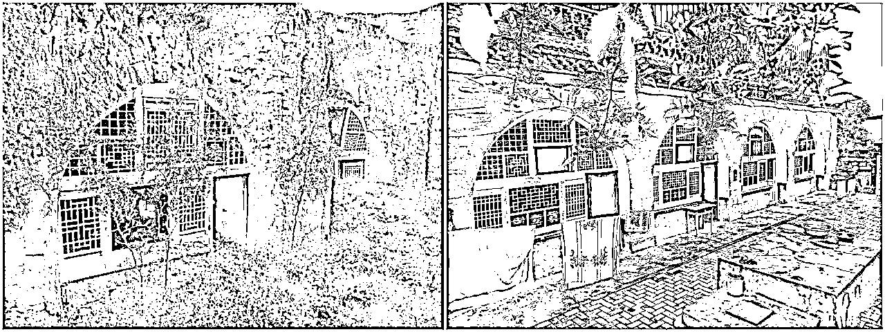

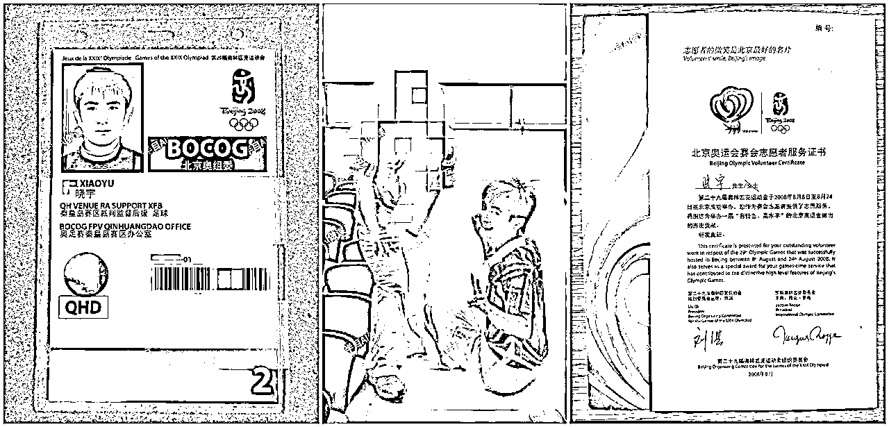

可命运这东西，从来不会让你一直得意太久。

**从开胸手术到露宿广场，我把人生最惨的日子都过了一遍**

2009年，我咳血了。检查出来肺部囊肿，但性质难定。转院到第四军医大学，专家说：边手术边化验。父亲签字的时候，手是抖的。

手术前一晚，我偷偷写了遗书，塞进父亲包里。好在最后结果良性。后来母亲告诉我，父亲听到手术成功的一瞬间，直接瘫在地上哭了出来。

家里为我的手术欠了外债。那时我术后躺在床上没事干，就开始研究网上的兼职。结果呢？“打字赚钱”“挂机项目”全是坑，一个月600块生活费差点搭进去，饿得一顿饱一顿。

但我没停下对互联网副业的关注。现在回头看，每一步弯路，都在为后来的路埋种子。

2010年毕业后，我进了央企，干技术。干了8个月，不喜欢，裸辞回了西安。接下来成了一枚流浪青年，住过城中村的隔间床位——铁架床，床单当墙。最尴尬的一次，洗澡时门坏了，被女室友撞见，恨不得当场消失。

2012年我在一家研究所上班，经常出差。有一次在郑州火车站，凌晨一点多，看着广场上打地铺的人，我犹豫了——要不要也省这一晚住宿钱？最后真就这么坐了一夜。

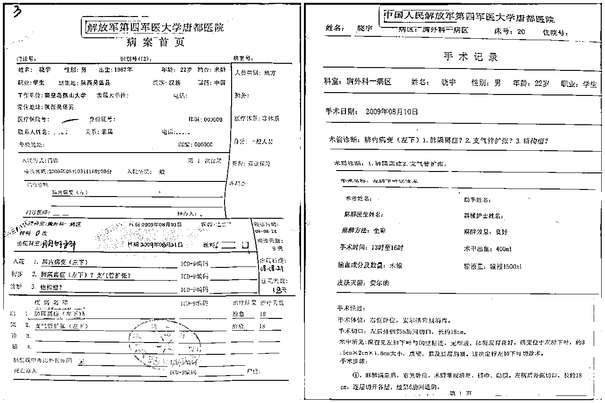

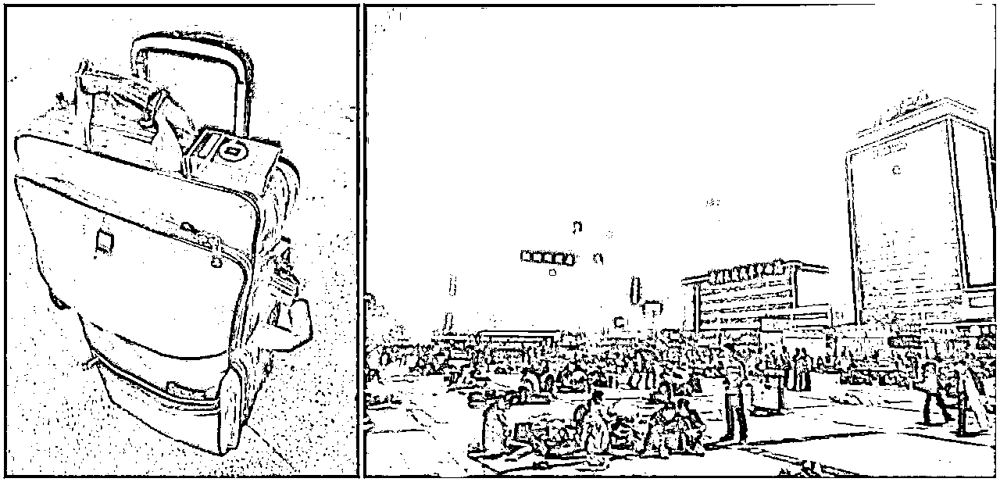

穷不可怕，可怕的是认命。就是在那时候，我认识了现在的媳妇。有了想保护的人，动力就来了。

**从淘宝到微商，我终于尝到了副业的甜头**

2013年到2015年，我像是突然开了窍。做淘宝代理软件，卖一套挣490；做网站论坛卖会员；微商火起来后又搞微分销源码。那三年，副业月均收入1万左右，而工资才六七千。

小日子过得舒坦了，把婚也结了。

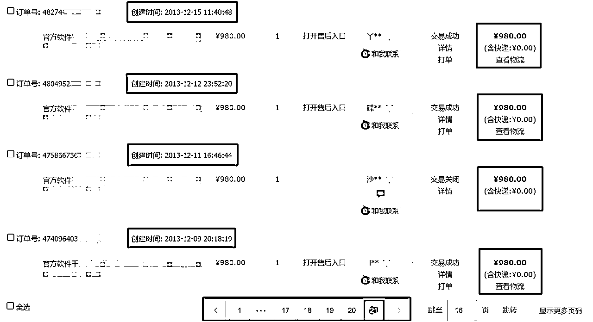

可安稳从来不是因为幸福，而是因为时机的再次变动。

2016年女儿出生，我不再能频繁出差。同时副业大幅萎缩，淘宝政策收紧，微商也没做深。多重压力下，我辞了职，全家搬到成都，打算重新开始。

摆地摊卖书、直播卖书……什么都试了，全都没起色。

**从8000到16.5万，我用两次转型换来人生新高度**

2018年，我终于冷静下来，系统地学习知识付费领域的玩法。当时我发现一个巨大的商机：那些做一门课上线平台的人，卖一份和卖一万份，成本几乎一样。这生意能做。

但我没直接开干，而是边学边拆解，把自己的理解发到各种平台上，先吸引同行者，再做变现。

一开始三种方式赚钱：收会员费、分销课程、做淘宝客。什么都试，最后锁定了职场、副业、炒股这三个方向。

2018年1月收入8000多，然后每个月稳定上涨，过上了不错的日子——买了车，第一次自驾去川西，雪山草地，美到窒息。

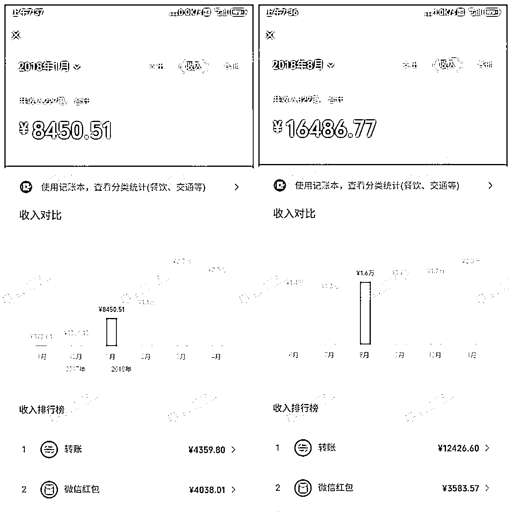

可惜好景不长。2019年上半年收入连续下滑，从九千多掉到五千多。更紧迫的是，女儿要上幼儿园了，我们必须买房，积蓄加上所有能借的钱，还是差20万。

人被逼到绝路，潜力就出来了。我静下来分析原因：职场和副业课程单价低、佣金少、粘性差；炒股课则相反，而且产品体系单一，缺少高端利润产品。

于是做了两个决定。

第一步，全面砍掉低利润板块，专攻炒股。2019年7月，收入升到4万。

第二步，把自己赚钱的整套方法论打包成一门售价5000元的高价课程出售。推出来的当天晚上，四千五千的转账款没停过，一周不到多收了近十万，整月微信收入16.5万，加支付宝超20万。

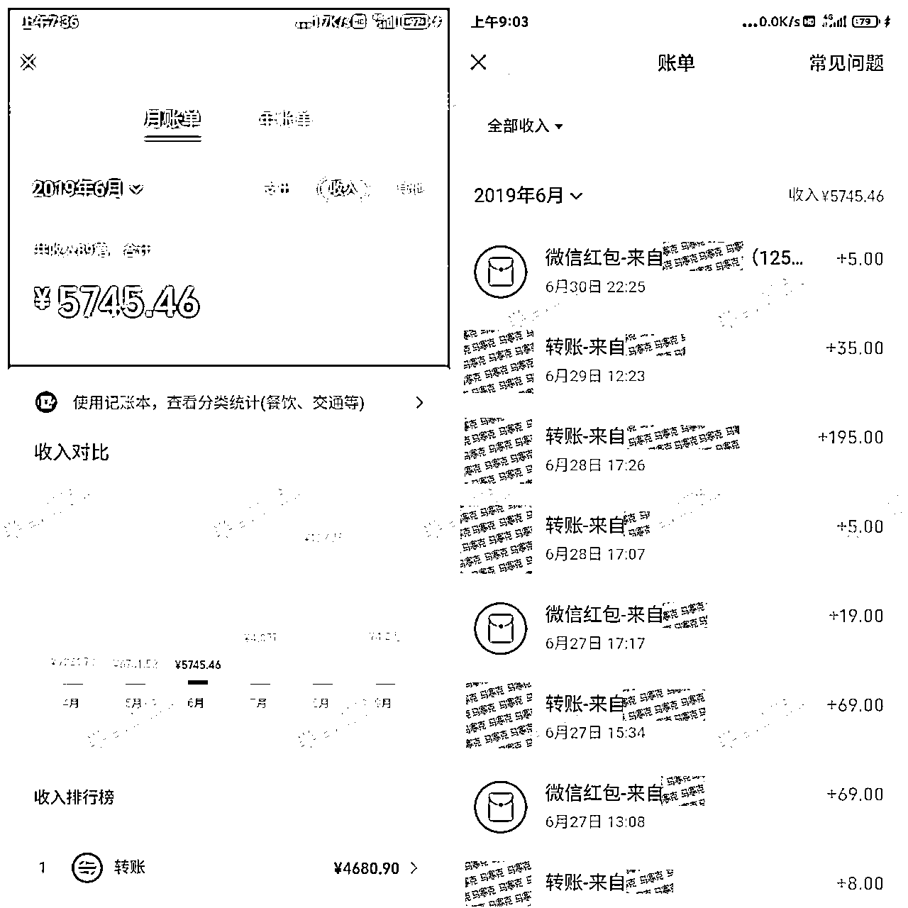

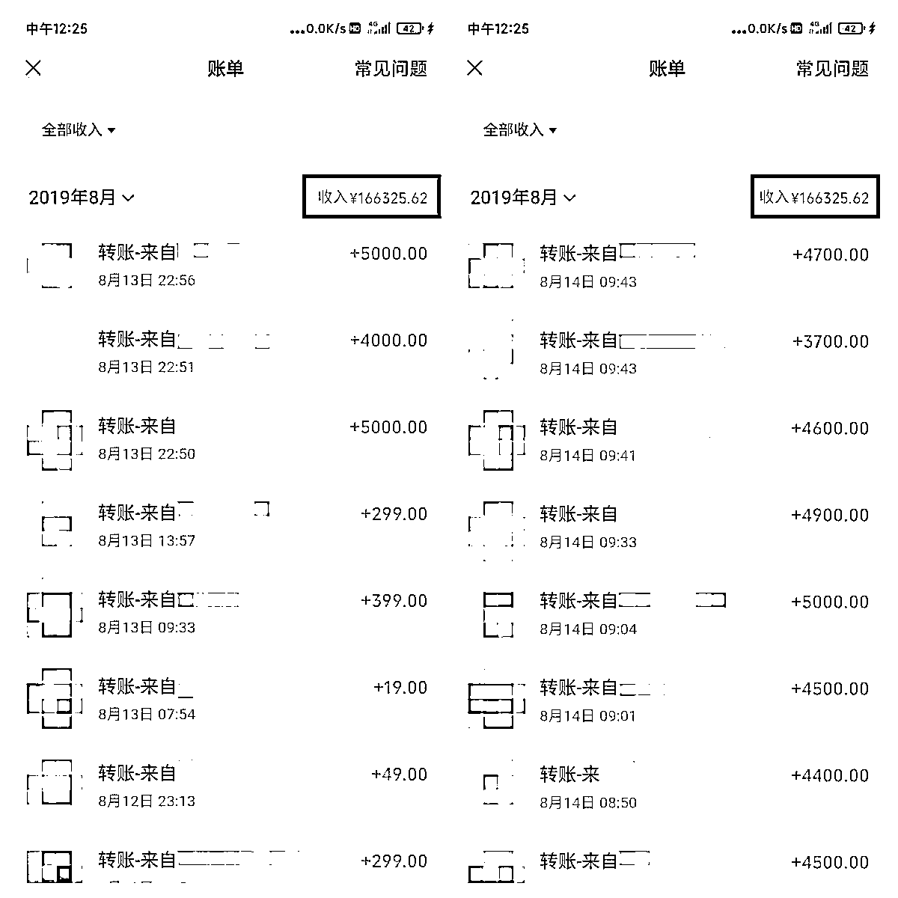

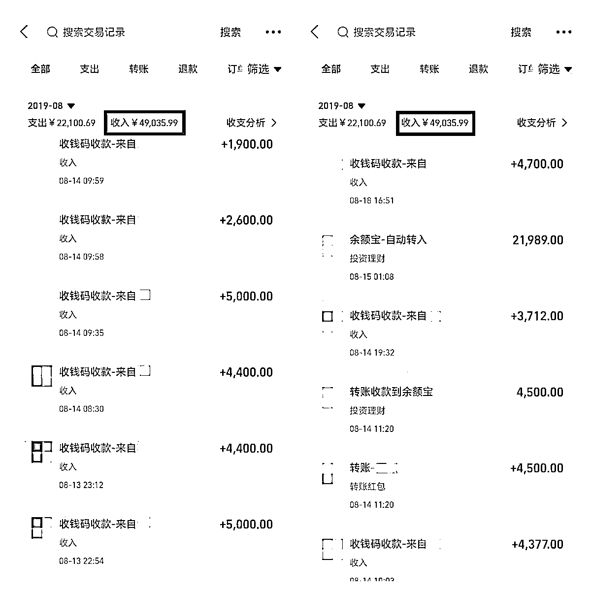

买房的缺口，一个月就凑齐了。媳妇看我，眼睛全是光。

**从温水煮青蛙到跳出舒适圈，AI让我找到第二春**

2019年到2022年底，我一直靠着老路子月入稳定小几万。可说实话，那三年我飘了，像只温水里的青蛙，舒服到不想跳。

直到2022年12月的一天，在龙哥盟星球看到两篇关于AI大模型的帖子，我“虎躯一震”，一个理工男的直觉告诉我：这东西要改变世界。

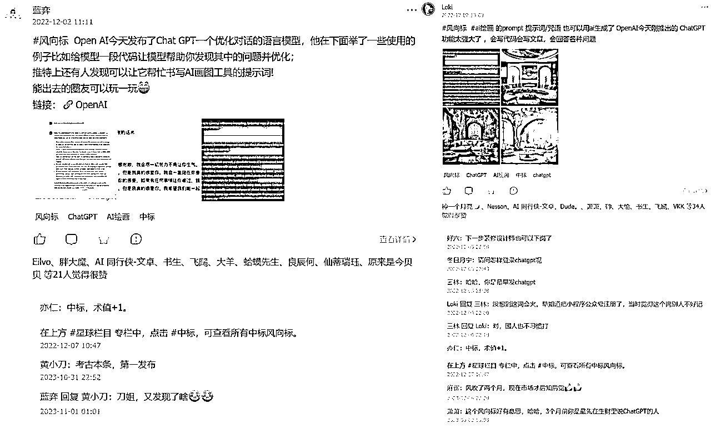

于是我开始疯狂研究AI。巧合的是，那段时间股市不行，炒股课卖不动了，收入大幅缩水。2023年6月，我终于下定决心告别旧业务，把所有东西打包送给群里想接的人——又一次“裸辞”，又一次重启。

之后整整一年，我像苦行僧一样寻找方向，经常一个人开车去川西，看雪山、草地、牦牛，一个人思考、沉淀。

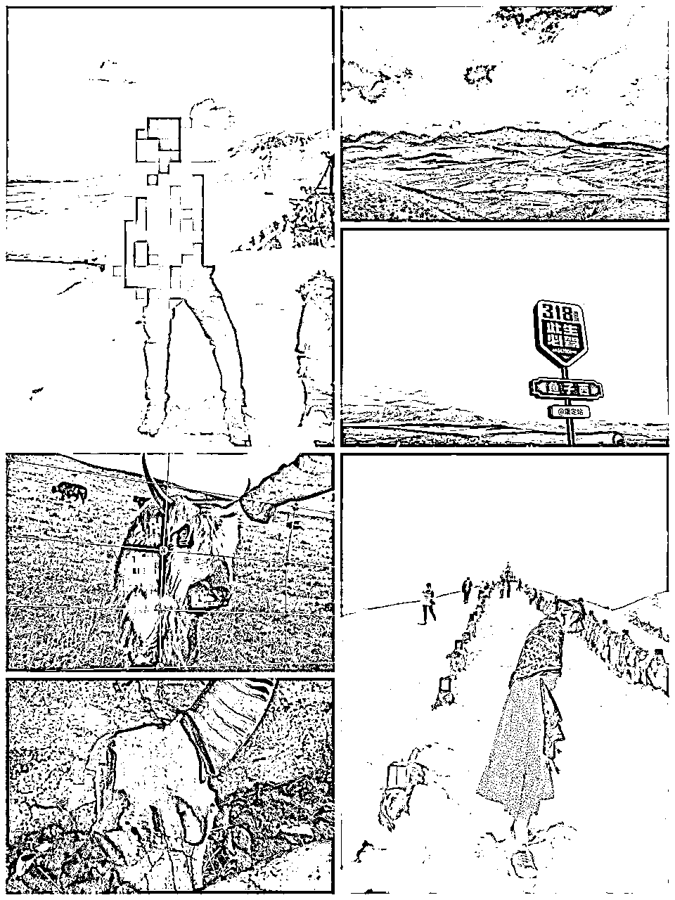

直到有一天洗澡时，脑子里突然炸开一个念头：我懂AI，又有6年做课卖课的经验，为什么不把这两个结合起来？AI应用已经很火，但AI细分到“做课”这个场景，还没有多少人在做——这是蓝海！

想通了就干。我花了半年多时间，把做课的每一个环节，从选题、大纲、讲稿、PPT到录制、剪辑、上架，全用AI重新跑了一遍流程。除了打磨方法，我还办了营业执照，成立了工作室，买好了整套录课设备——要做就做专业级的。

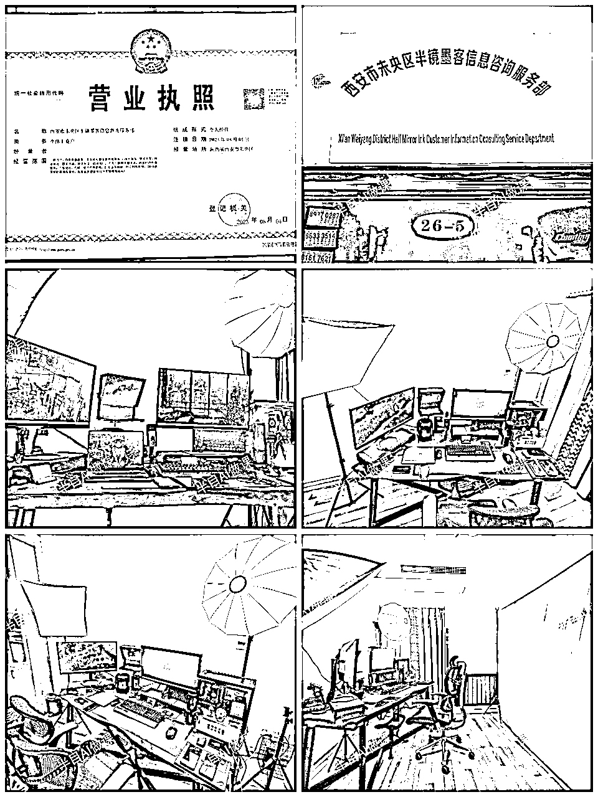

现在，我和「玩赚新媒」的芷蓝一起，正在交付“AI做课卖课”陪跑服务。这条路已经跑通，事业迎来真正的第二春。

---

回看这些年，我最大的感悟是：所谓绝路，往往只是你还没看到另一扇门。

每一次被迫转型，都是我人生最重要的转折点。穷不可怕，怕的是不敢穷则思变；失败不可怕，怕的是不再尝试。

AI+做课这条赛道，可能就是这个时代给我们普通人最好的机会之一。风口一直在变，但敢于撬动变化的能力，永远稀缺。

如果你也正处在低谷，别急着否定自己。去学新东西，去拥抱新工具，也许你的“蓝海”，就在某个洗完澡的瞬间。

如果你也想试试「AI+做课」，我们可以聊聊。

2024年进入八月时，我负责的课程制作流程里，AI指令已经调校到顺手流畅的程度。眼看着手里的方法论成型，新的问题随之冒出来：这条赛道怎么起盘？启动的第一波流量从哪儿来？

恰好在低谷期，@张可粒 老师给我的一句点评——“有种必成大器的感觉”，像一针强心剂。正是这份笃定，让我几乎没犹豫，就把一笔几万块的预算砸进去了，加入了此前一直想站进去的高质量学习场域。@张可粒 老师的「超级个体孵化基地」、「粥左罗·10年顶峰会」，@芷蓝 老师的「玩赚合伙人」，这些社群的加入，本质上是我想借力校准业务模型，用外部视角完成冷启动的流量与方法论的双重补位。

这个决定后来被验证为正确的选择。整个八月在老师们的牵引下，我对「AI+课程制作」这条新赛道做了全盘拆解。课程的核心定位是谁、目标用户画像如何清晰化、定价怎么设计、视觉物料的海报细节怎么打磨，每个环节都被反复推敲。

第一款产品选定为《AI·7天做课营》作为切入口。首发优惠定价199元，课程框架、卖点权益、配色视觉，我自己反复打磨后觉得拿得出手，也具备可复制的参考价值。

## 1小时17分钟，7笔成交，收入693元！

物料到位，课程就绪，还差一个点火的瞬间。8月26日，我突发奇想发了一条朋友圈：烫头立誓，为新课上线而改头换面。@芷蓝 大佬把这个“烫头梗”转发出去，热度一下子升起来了。

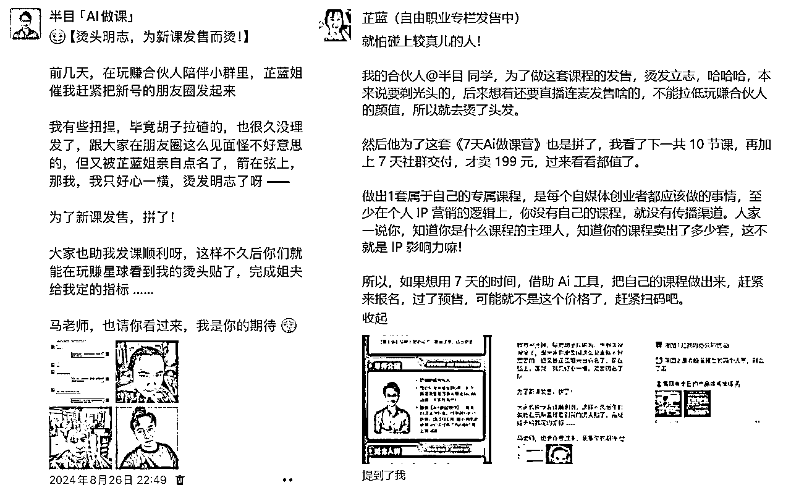

2024年9月2日，14:07-15:24，耗时1小时17分钟，微信新增好友8人，其中7人完成付款，收入693元。

这个结果与预期基本一致，也证实了模式的可行性。背后是长达一年的心态建设、物料沉淀和内容打磨。这里要特别感谢 玩赚新媒 @芷蓝、@王斯基、@马热爱 的认可与大力支持。

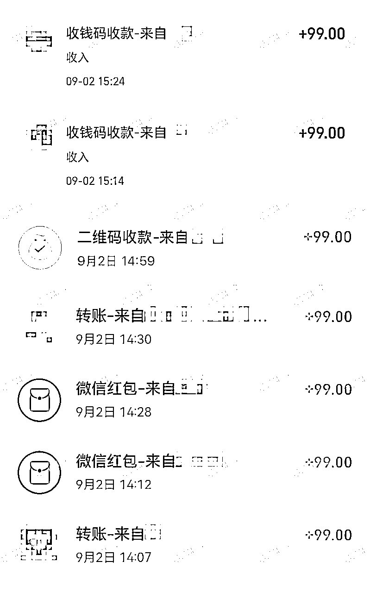

2024年9月2日至2024年9月13日，《AI·7天做课营》第一期正式开营，共招收85位学员。课程交付以极致实操为标准，训练营内容扎实到“齁”，学员反馈非常正向，收到了大量真实的好评。

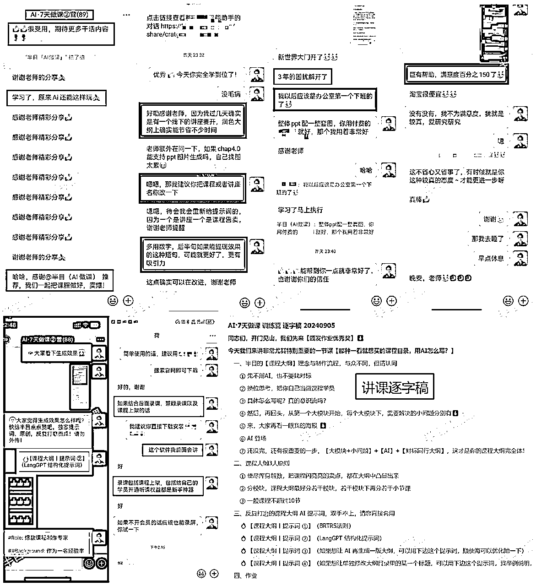

## 从被看见到主动合作

努力之后，机会往往会自己靠过来。

2024年9月4日，经营万人知识星球的 @芷蓝 大佬，在旁听我两次课程后，认为我的交付思路清晰、逻辑顺畅，于是主动提出合作，共同打造一款以「AI做课卖课」为核心的私教陪跑服务，用来填补「玩赚体系」里的中客单价层级。小群一对一辅导，双倍交付。

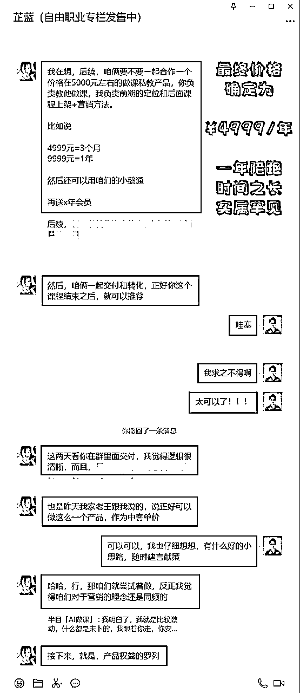

这是我长期置顶关注的「玩赚新媒」社群，付费用户接近万人，主理人 @芷蓝 的内容输出十年如一日，持续影响我坚守内容为王、长期主义的信念。被这样的大佬看见并认可，对我而言是极具分量的成长契机。既然被信任，就必须用结果回馈，于是立刻投入协作。

合作节奏异常顺畅，价值观相近，头脑风暴中我们抛出的想法往往不谋而合。

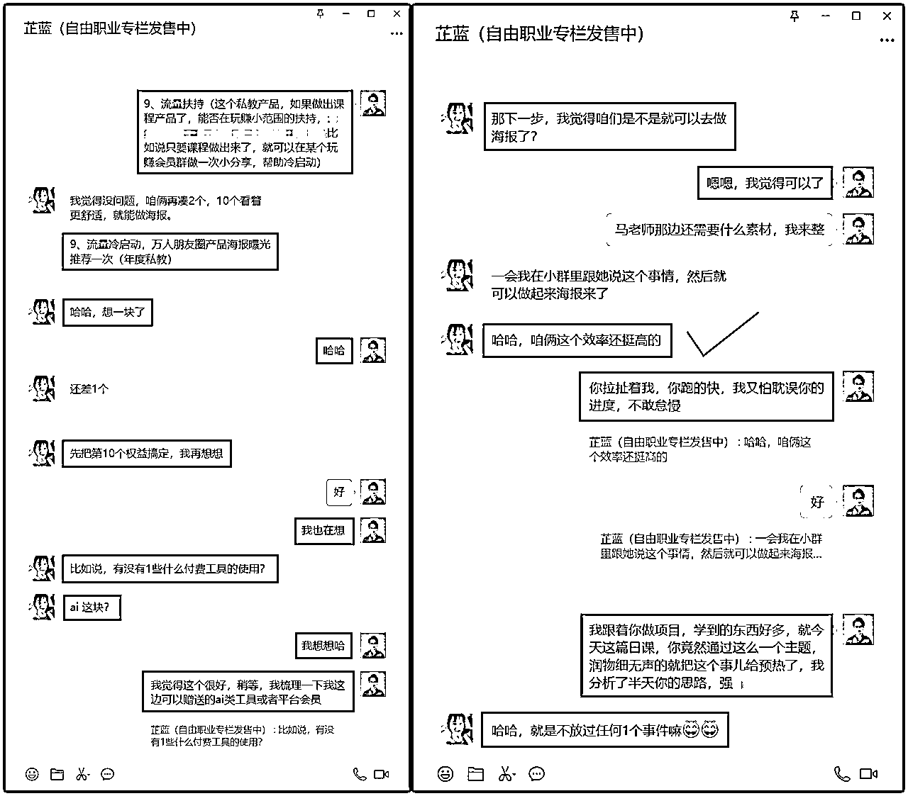

## 事业第二春的雏形

前后近一个月的高强度打磨后，我们从陪跑权益的穷举、陪跑流程的细化、SOP的标准梳理，到课程海报的反复调整，最终由我与万人星球「玩赚新媒」主理人 @芷蓝 深度联合推出，小群一对一指导、双倍交付的《玩赚AI做课卖课陪跑》服务。

课程海报这里就不放了，避免引流嫌疑。

我感觉，这位苦行僧正在迎来职业生涯的第二个春天。「AI+课程制作」这条蓝海的闭环已经跑通，站位也从巨人肩膀上再往前一步。接下来只要持续深耕内容，用心服务用户，路径就很清晰。

读到这里，你能感受到字里行间半目的认真。我是怎么一步步锁定「AI+做课」这条蓝海，并持续深耕的，相信已尽在掌握。

也希望你继续关注半目，我有信心带着更亮眼的数据回来复盘分享。哪怕我的经历能给你一点启发、一丝借鉴，对我来说就足够有价值了。

这是我第一次系统梳理自己的过往，有低谷也有高光。

期待你的点赞与评论，这是第一次长文输出，还请多多鼓励。更欢迎围绕「AI+课程制作」这个我最擅长的方向来提问，任何问题我都会毫无保留地解答。

如果这篇反响不错，后续我计划连载分享【AI+做课】的日常实操细节，持续输出干货。