我靠AI+RPA把小红书笔记改成“小绿书”自动发布，附完整思路和RPA脚本

最近“小绿书”热度很高，很多人的第一反应是：能不能直接把小红书笔记搬过去发？但仔细一想，原封不动照搬肯定不行。于是有人想到了另一条路：把图片里的文字内容提取出来，改改写法和用词，再替换成新背景，做成“小绿书”风格发出去。这个思路没问题，但纯靠手工会把人累到崩溃。

目前已经有很多大佬把这条链路用AI+RPA跑通了。我自己也专门搞过影刀RPA来发小绿书，还结合了交流群朋友们的反馈。说实话，市面上的现成方案多少都有点毛病：

- RPA工具种类太多太杂，对不熟的人来说，想把工具装起来用起来，简直像取经一样难。
- 有些工具封装得挺漂亮，但内部流程完全不透明。一旦碰到不适用的场景，想自己改都不知道从哪里下手。
- RPA环节一旦参与得太多，稳定性就很难保证。链路里任何一款软件稍微调整一下，整套流程可能直接报废。

所以我这次重新做了优化，核心思路就是四个方向：

一、选更容易分享、更容易安装的RPA，降低大家的上手门槛。  
二、尽量减少RPA工具去“点来点去”的环节，能用接口就尽量用接口。  
三、把工作流拆成一个个小零件，谁想改就换掉对应节点，方便自己迭代。  
四、使用层再做一个封装，让不懂工作流的人也能直接跑通。  

换句话说，小白有一键傻瓜用法，老手也有充分魔改空间。

下面直接说整体流程，一共六步：

1. 用RPA采集小红书笔记，把数据写进飞书。  
2. 在Coze工作流里读取飞书中的链接，用OCR识别并改写内容，再批量生成新图片，最后写回飞书的待发布文章列表。  
3. 用RPA触发Coze工作流自动执行。  
4. RPA读取待发布文章，批量发布到小绿书。  
5. 第4步的脚本如果配合比特浏览器使用，可以实现多账号发布，还能做IP隔离。  
6. 所有脚本都挂上定时执行，整套流程就能全自动跑起来。  

接下来是详细配置。

先安装比特浏览器。官网下载直接装就行，没有特殊门槛。装完打开软件，进入“系统配置”，找到“文件下载目录配置”，改成你想要的目录。 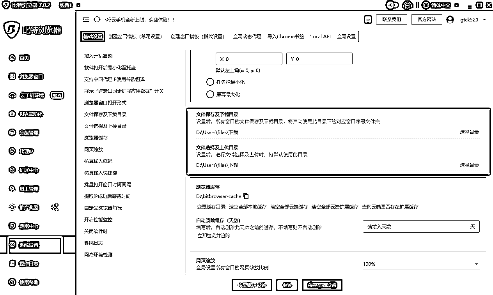 这个目录后面下载小绿书图片时要用到。

然后是导入RPA脚本。你手里会有三个脚本文件。打开比特浏览器，点击“RPA自动化”进入流程设计。 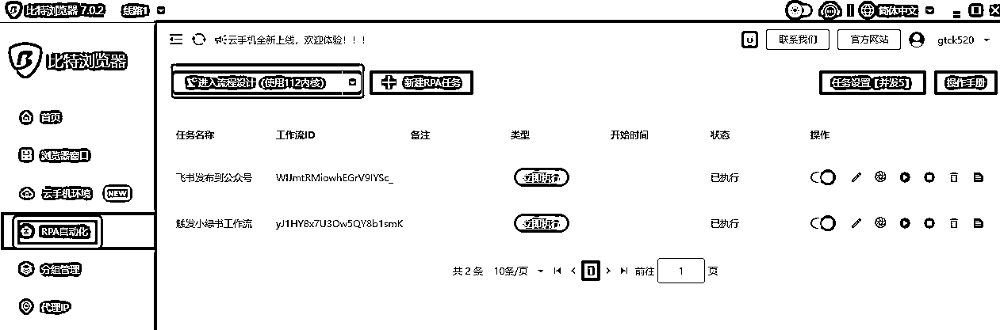 浏览器会自动初始化，并打开一个用于调试的RPA窗口，同时装好自带的Automa插件。  打开Automa的工作流页面，点下拉菜单，选择“导入工作流”，把三个脚本全部导入。 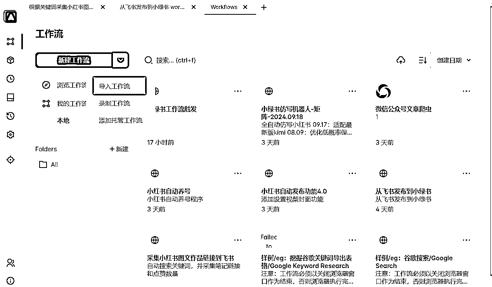

接着配置飞书信息。我的整套方案默认用飞书做数据存储，所以必须先建飞书应用，拿到app_id和app_secret。这一步很关键，如果配错，后面的流程全部跑不通。请严格按照教程操作。进入我的飞书表格，先创建一个副本。 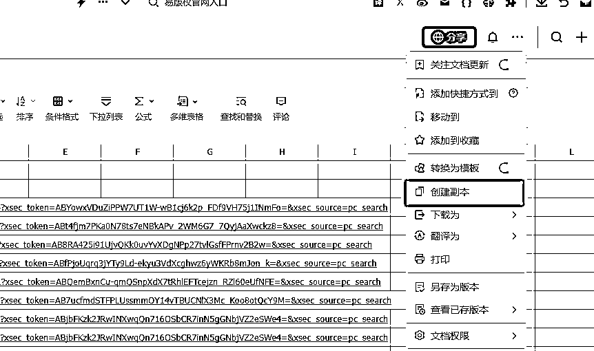 然后获取飞书表格的链接。注意：每个表单点进去链接都不一样，后面配置时要一一对应，千万别搞混。 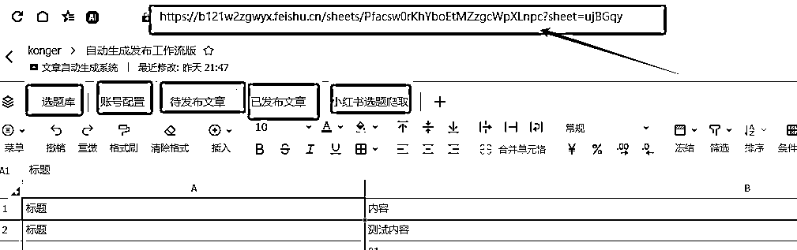

然后是脚本默认配置。进入比特浏览器的“RPA自动化”->“流程设计”，找到刚导入的脚本，点进编辑页面。在触发器后面能看到一个“插入数据”节点，双击这个节点，再点击左侧的“insert data”按钮。 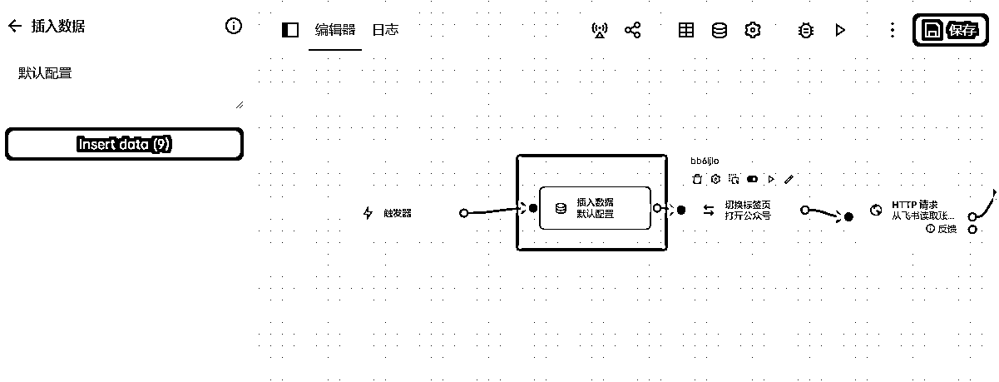 这时会弹出一个配置面板，把面板里的值全部替换成你自己的，变量名一定不要修改，否则会出错。 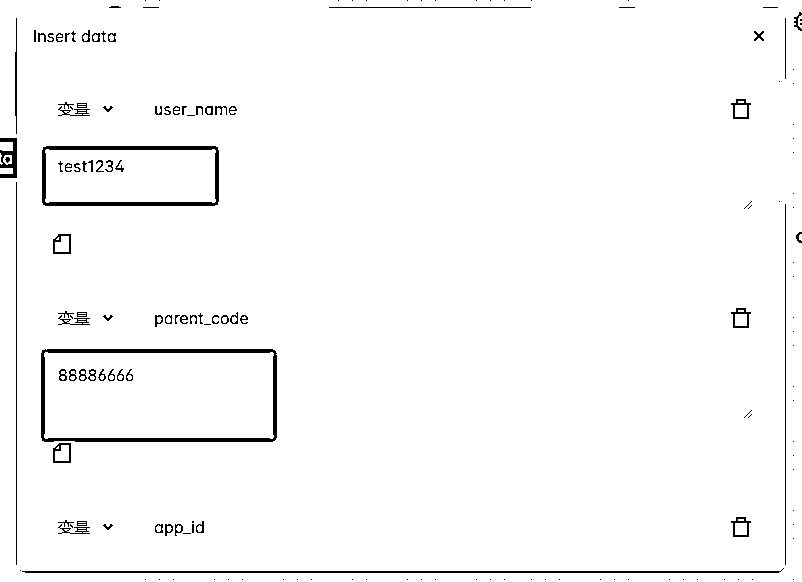 具体字段含义如下：  
- app_id：飞书应用的app_id  
- app_secret：飞书应用的app_secret  
- daifabu_sheet_url：飞书待发布表单链接  
- yifabu_sheet_url：飞书已发布表单链接  
- zhanhao_sheet_url：飞书账号配置表单链接  
- sheet_url / xhs_sheet_url：飞书小红书采集表单链接  
- save_draft：填1表示发布到草稿箱，填0表示直接发布（这个功能待测试完善）  
- download_path：填比特浏览器的下载目录  
- is_bite：如果是其他浏览器，或者在比特浏览器里做RPA调试时填0；正式绑定到窗口使用时填1  

注意：三个脚本都有这套默认配置，每一个都要改。配置完成后记得点右上角保存。 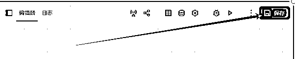

接下来，把RPA绑定到浏览器窗口，这样就能实现定时执行和IP隔离。

首先点击“浏览器窗口”->“创建窗口”。 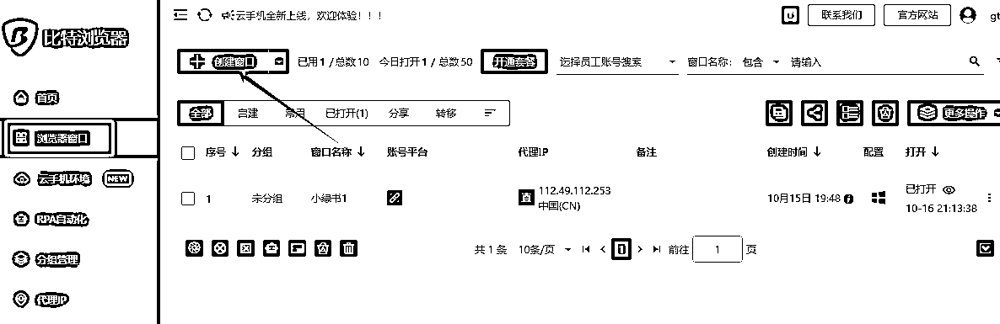 设置一个窗口名称，其他选项直接用一键随机生成就行。 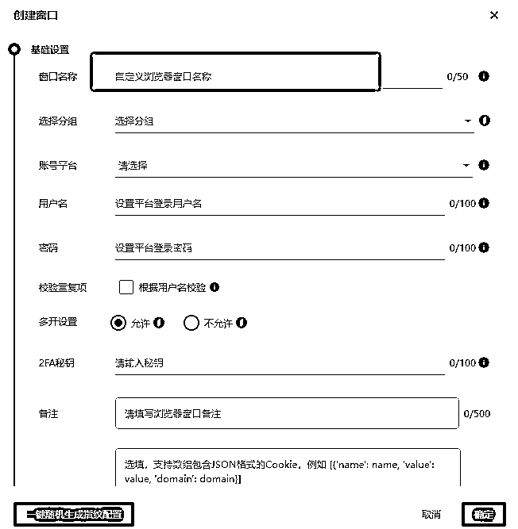 创建成功后，列表里就会出现你命名的窗口。 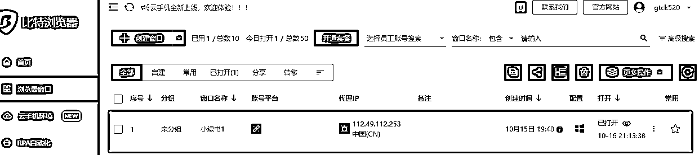 你可以把这个窗口理解成一台最小化的电脑，它只运行一个浏览器。每个窗口可以配置不同的IP地址，这样一来，不同账号就在不同“电脑”上登录，模拟出多台设备的效果。所以你想做几个账号，就建几个窗口，然后把不同的微信分别登录进去。

接着点击“RPA自动化”->“新建RPA任务”。 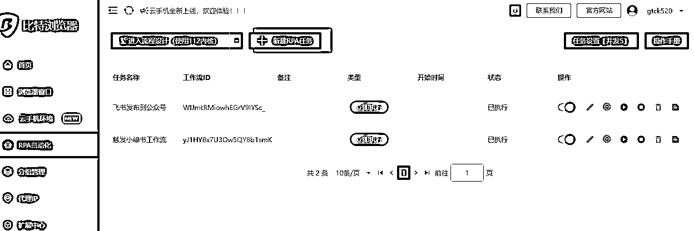 填写任务名称和工作流ID，然后点击“绑定”。 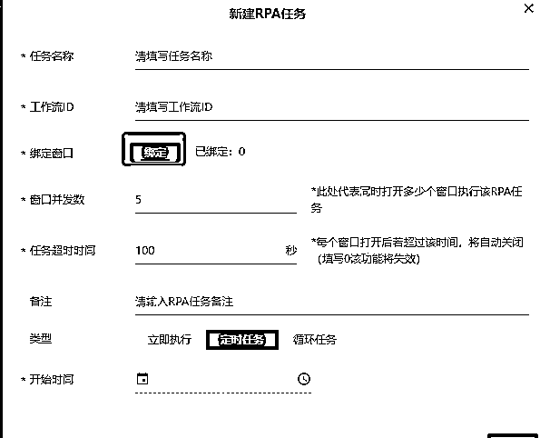 在弹出的绑定窗口里，选择你刚才创建的那就行了。 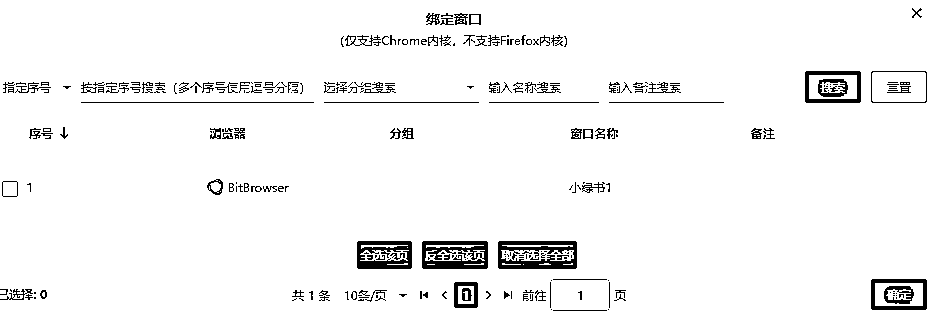 其他脚本用同样的方式绑定。不过要注意：采集小红书的脚本在运行前需要填一个输入参数，如果绑到窗口执行会不太方便，建议暂时不要绑定，除非你清楚怎么优化。  

当两个脚本都绑定好后，页面会显示对应的任务列表。 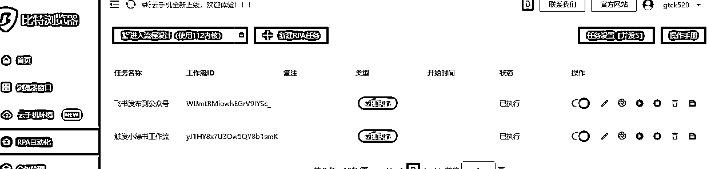 这里特别提醒：工作流ID从哪里复制？就是绑定RPA任务时前面的位置。 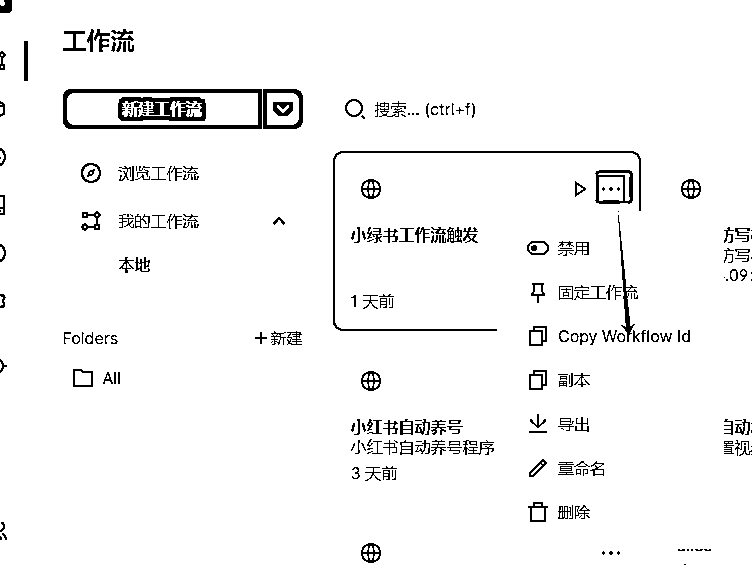 另外，如果绑定到了默认窗口，从飞书发布到小绿书的脚本里，“保存资源”这个控件默认没有写入下载目录的权限，需要手动改一下。 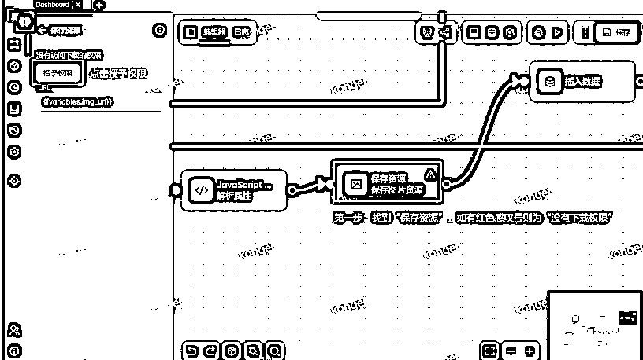 到这里，基本就可以跑起来了。

当然，这套流程目前还不完美。尤其是图文混合比较多的小红书笔记，比如这种。 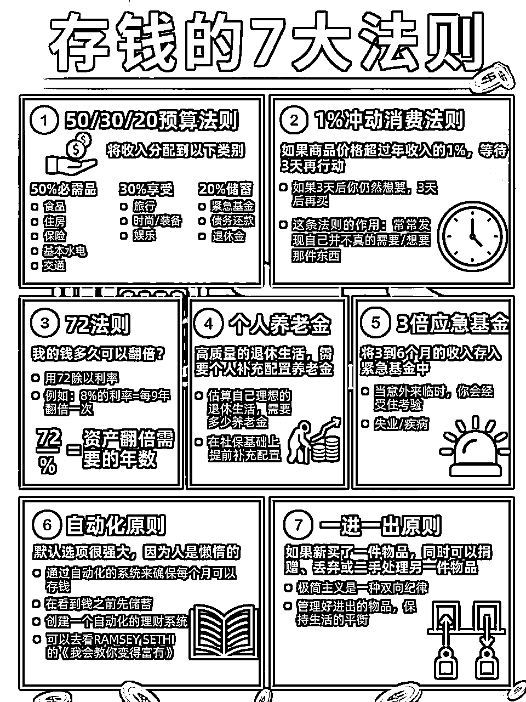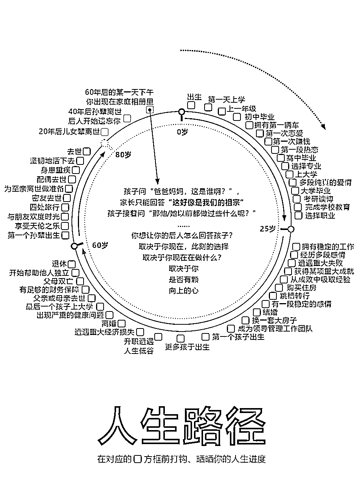 OCR能识别出文字，但所有内容会被无规律地拼在一起，像这样。 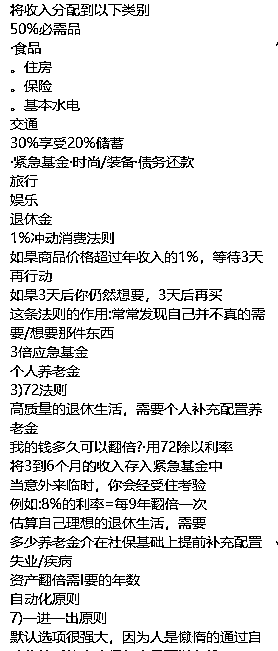 大模型虽然能根据语义理解出大致意思，但要还原原笔记的精华真的很难。我自己测试过，目前这套工作流在这种复杂情况下基本不能用，期待有大神能做出更牛的方案。目前来看，只有图片背景干净、文本比较简洁的笔记才容易转换成功。内容太杂的，很容易出现和预设模板不匹配的情况。不过好消息是，总能从一堆笔记里挑出几篇能用的来发，比自己慢慢手工改要强多了。

最后是常见问题，直接帮你避坑：

1. 采集小红书运行成功，但没有写入飞书。这种情况99%是权限配置或者表格没对应好，先排查一遍配置。  
2. 小绿书工作流触发脚本时报错，比如“很抱歉，同步失败”或“运行中止”。只要不是一运行就失败，而是转了很久才失败，大概率是Coze工作流超时。超时之后，飞书其实可能已经生成了文章内容，去待发布表格看一下，有内容就可以忽略报错。  
3. 报错 Cannot read properties of undefined (reading '账号名称') 或者 (reading '标题')。这通常是表格里没有读到内容，先检查内容是否为空，或者待发布文章链接是否配错。  
4. 脚本运行没有报错，但公众号没有发布。账号配置里有“领域”和“类型”，只有待发布文章的领域、类型和账号配置对应上，才会发布；另外账号名称必须和公众号名称一致，脚本是靠名称识别是否发布的。  
5. Mac用户的路径格式和Windows不一样，需要修改脚本里“提取图片内容”代码块的路径写法。

最后感谢圈友@朱越的小绿书精华文，我的脚本就是参考这位大佬的分享改的，省了不少事。希望这篇内容也能帮到你。