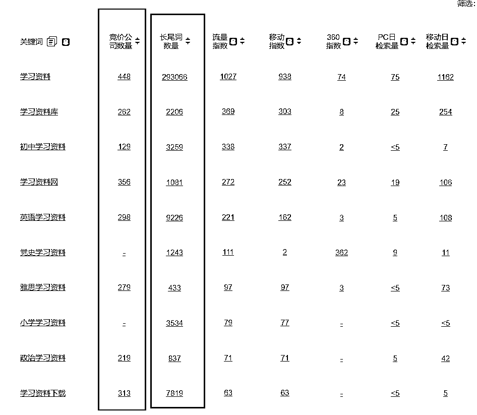
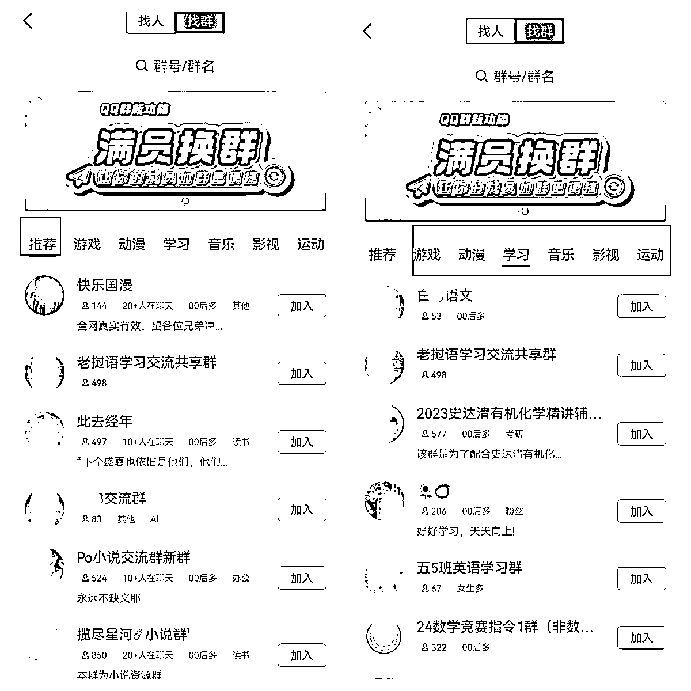
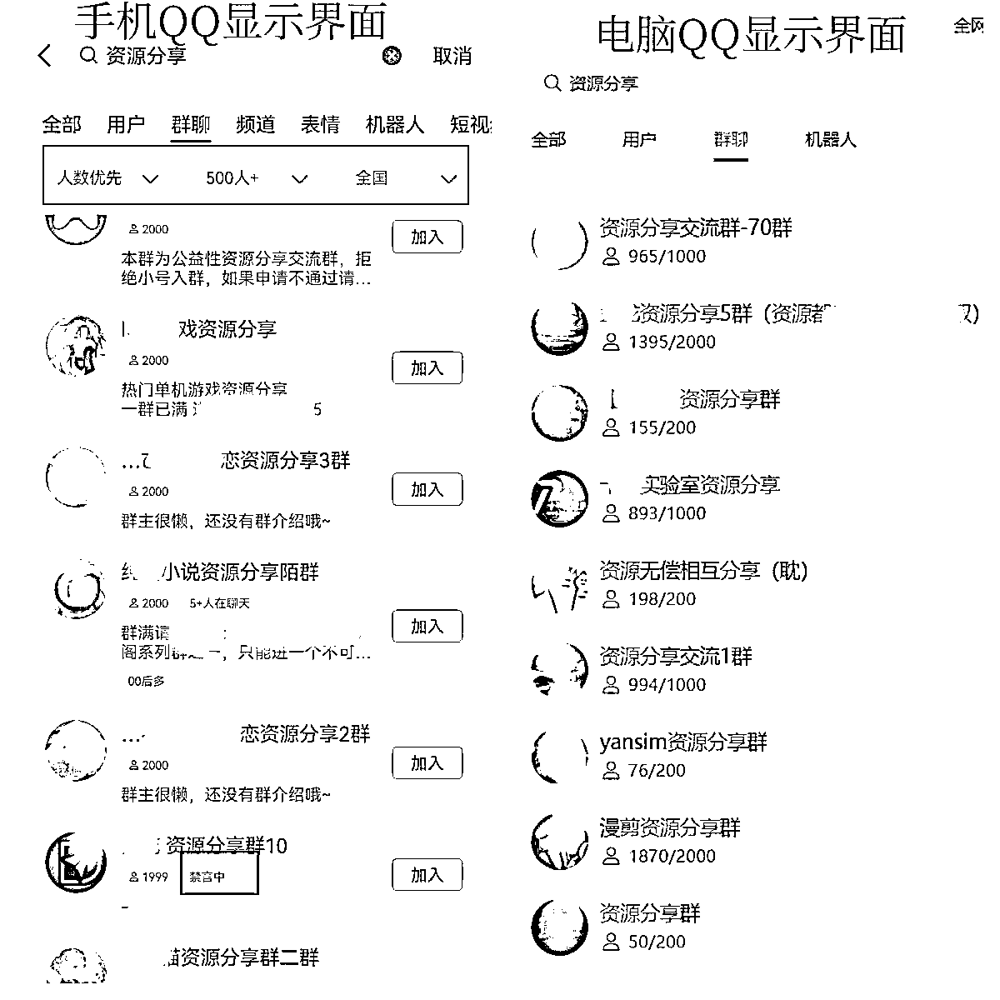
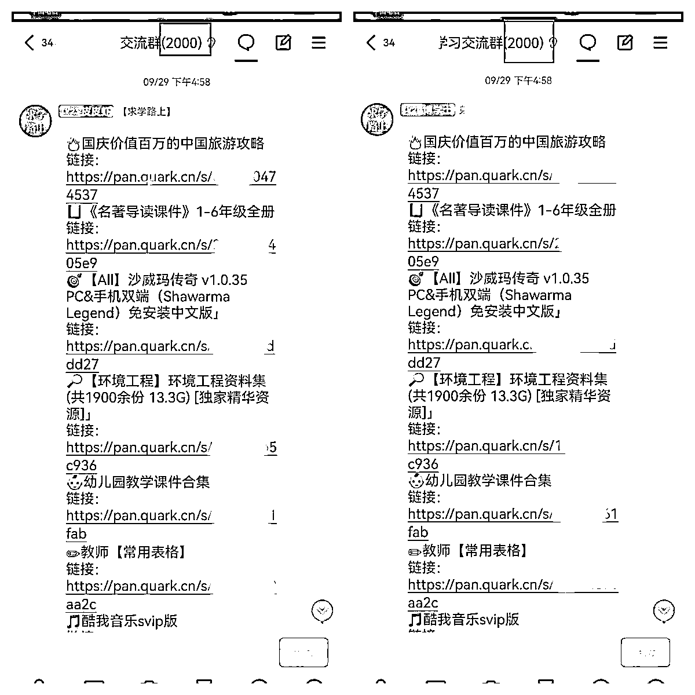
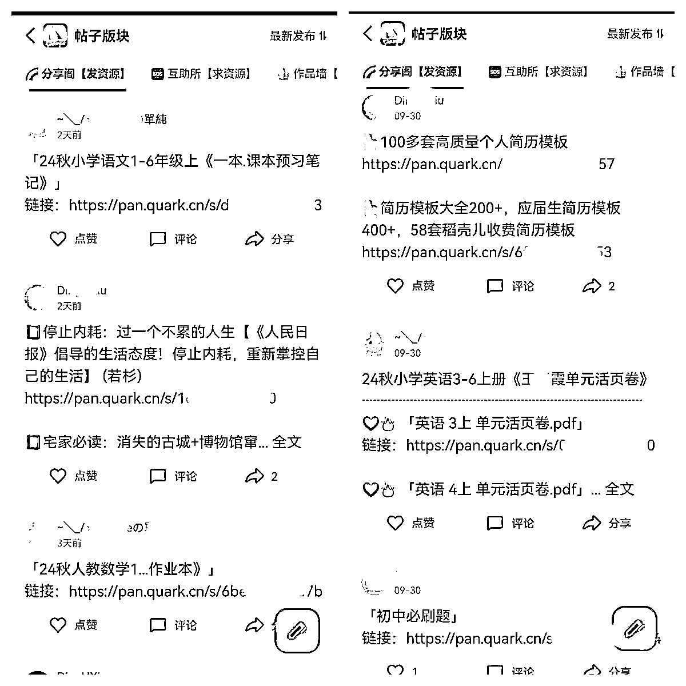
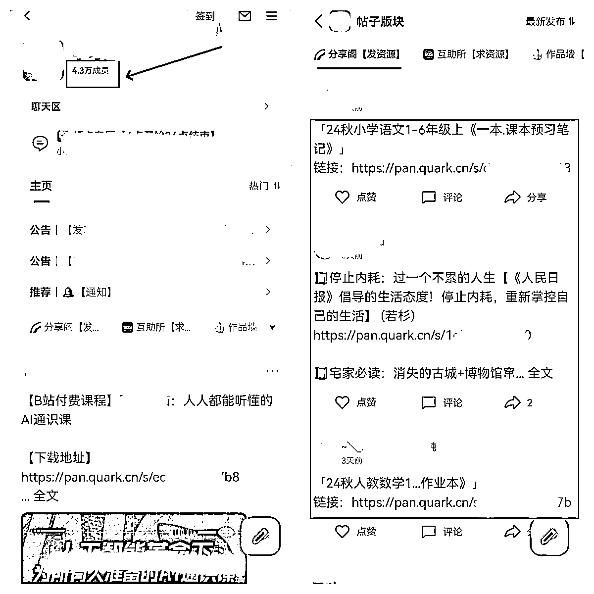
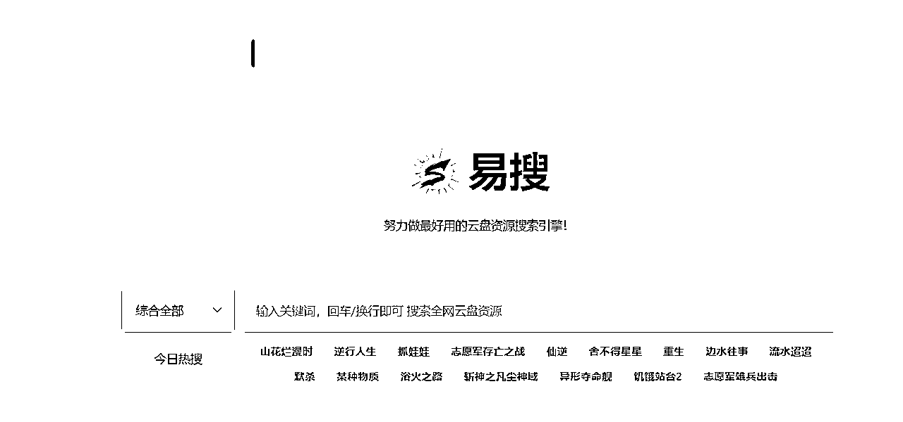
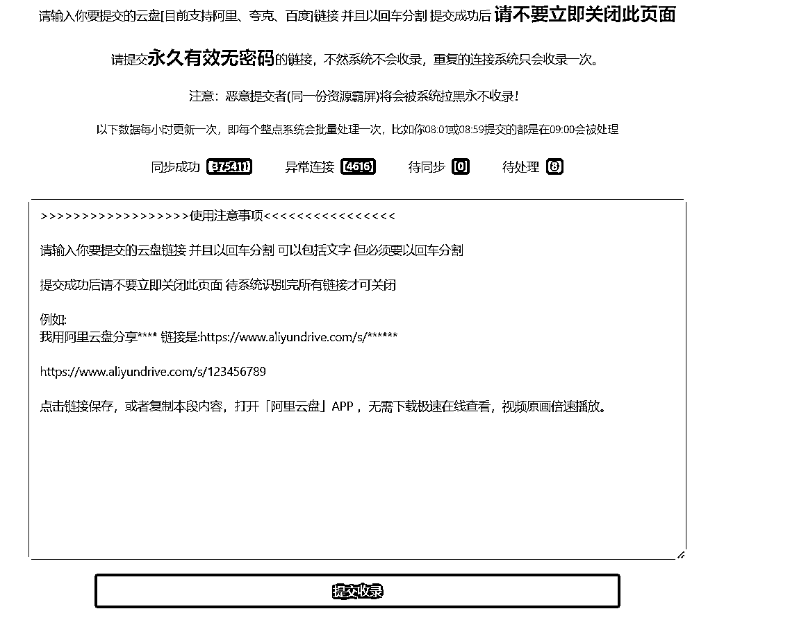

# 资源无脑分享玩法教程（网盘拉新）

各位朋友，大家好！圈里人都喊我“一网”。干网盘拉新这摊活儿，我已经做了三年多，在龙哥盟里也泡到了第四个年头。

任何一个项目，流量都是绕不开的关口，而流量说到底要靠内容来带。常规内容无非文字、图文、音频、视频这几样。可在网盘拉新这个细分领域里，偏偏有一类玩法，这些通通可以放下，照样能把收益做起来。

今天这篇文章，我就把这个路子从头到尾拆给你，名字很直白——**资源无脑分享玩法**。

一句话版本：不用写稿、不用作图、不用录音、不用剪片子，甚至连对标同行这一步都能省掉。只需一部手机，把网盘里的文件往合适的平台一扔，就能持续拿到拉新收益。不管你是刚入行的新手，还是做了很久的老手，都能直接上手。

## 这玩法究竟是啥？

底层逻辑不复杂：先收集、整理一批允许对外发布内容的平台地址，再把想推广的文件提前转存进自己的网盘，之后每天不用多想，按自己的节奏往这些平台发就行。

## 它强在哪儿？

**门槛极低。** 有部手机就能开工，每天投入半小时足矣。

**操作极简。** 对接好网盘拉新之后，剩下的活儿就是无脑分发，小白照做就能跑通。

**收益稳定。** 只要天天发、日日更，用户不断转存你的文件，收益就会不断进账。

**适用面很广。** 不要求你会写文章，不要求你录音剪片，连“研究同行”都不必。

## 三条分发渠道

QQ群、QQ频道、网盘搜索站。可以三条线一起铺，也可以先集中火力打穿一条。

## 拉新渠道对接

拉新渠道：https://dt.bd.cn/#/pages/login/register?invite_code=678678

注册完记得下载APP登录。要是登录后看不到网盘项目入口，随时来找我，我帮你搞定。

---

## 渠道一：QQ群

**① 先搞定一个QQ号**
号码方面优先选老号；实在没有，某宝上也能找到现成的，懂的都懂。

**② 把号“养”一下**
不管是新注册的还是弄来的老号，都要先养几天。流程很简单，就像普通用户一样每天登录上去，随便看看、点点功能，让系统觉得这是个真人在用的号就行。

**③ 定赛道**
想清楚自己要主推哪一类资源。我的建议是走综合赛道——只要不违法、不违规，用户缺什么你就发什么，覆盖面越宽，机会越多。

**④ 铺关键词**
动手之前，得先找一批能让你发资源的QQ群进去。找群不能乱来，必须跟你的赛道对得上。只有混进垂直类的群、发对口的内容，用户转存的效果才出得来。

换个角度讲，找群本质上就是找关键词。想发学习资料，就去搜“学习资料”“小学学习资料”“中学学习资料”“初中学习资料”“高中学习资料”这类词；想发影视资源，就去搜“电影”“电视剧”“短剧”“美剧”“韩剧”……思路照此展开就行。

不过，想找到更多更准的群，关键词得成体系地挖。这里分享一个我常用的办法，叫**词根加减法**。

操作起来分两步。先确定一个核心词当“词根”。比如你主打学习资料，词根就是“学习资料”。

然后是**词根加法**——在这个词根前后缀加前缀或后缀，批量产出长尾搜索词：

按学习阶段加：小学、中学、初中、高中、大学，于是得到“小学学习资料”“中学学习资料”“初中学习资料”“高中学习资料”“大学学习资料”；
按学科门类加：政治、英语、日语、语文、物理、化学、地理、历史、数学，于是一串“英语学习资料”“数学学习资料”“物理学习资料”“化学学习资料”就冒出来了；
按获取方式加：免费、下载、卖、分享，于是“免费学习资料”“下载学习资料”“卖学习资料”“学习资料分享”全都齐了。

光做这一轮加法，就能攒下一大批新词。

再来看**词根减法**——把原词根拆掉一部分，提炼出新的词根继续拓。拿“学习资料”举例，删掉“资料”，留下“学习”，再对“学习”反复做加法，就能延伸出“学习资源”“英语学习资源”“英语学习资源分享”等一串新方向。

这套加减法来回用，基本能把一个赛道里的词翻个底朝天。你自己要是对赛道很熟，脑子里自然有词；可万一你做的是不熟的综合赛道，想不到词怎么办？答案很简单：交给工具。

这里推荐一个关键词挖掘工具，注册一下就能用：https://www.5118.com/ci?promote=1F9C8B

提醒一句：我们挖词不是为了做SEO，而是想把词根延伸出的长尾词尽量一网打尽。所以筛词的时候，不必太在乎搜索量，真正值得看的是两个数：**竞价公司数量和长尾词数量**。

竞价公司越多，说明词背后商业价值高、用户需求硬，对应这类资源的群通常也多；长尾词越多，说明搜索需求又杂又足，同样意味着相关群的数量很可观。

讲到这儿，可能还有部分新朋友毫无头绪，不知道自己该搜什么。那就换个笨办法：去QQ群的分类目录里慢慢翻。虽然费时费力，但也能扒拉出一些合适的群。

要是还嫌麻烦，再给一个简单到不行的路子：直接搜大热词，比如“资源”“资料”“资源分享”“资料分享”。这些词多搜几轮，QQ的推荐栏会自动给你推一大批相关群，顺着推荐板块挑一挑，目标群就到手了。

**⑤ 搜群**
把前面整理好的关键词挨个复制进QQ搜索框，逐个去找群。

这里有个关键提醒：搜群尽量用手机QQ，别用电脑端。因为电脑端在进群之前看不到群有没有开全员禁言，也没法做筛选；手机端就不一样，可以先按群成员数筛掉小群，优先挑人数多的。假如你有地域上的要求，还能按地区过滤。这些功能电脑端通通没有。

**⑥ 加群**
看中了就挨个申请加入。要是号权重不高，短时间内加太多群，系统很可能提示异常，这时候别硬顶，把加群节奏放慢、战线拉长就好。全员禁言的群就别进了，进去也说不了话，纯属占名额。

**⑦ 筛群**
进群之后先别急着发内容，花点时间确认这个群允不允许分享资源。群主管得严的话，你一进去就发文件，大概率被踢。QQ号要是频繁被不同群踢来踢去，搞不好会被系统标记异常。当然，要是你手里小号够多，走“进一个群发几条就跑”的野路子也不是不行。

**⑧ 转存文件**
你打算推哪个方向的内容，就提前把对应的文件转存到网盘。自己没货的话，可以去拉新圈子的知识星球、求学路上资源导航网、各类资源汇总表里淘，也可以直接在咱们交流群里找圈友要。

**⑨ 发资源**
文件转存妥当，就可以往挑好的群里发了。打个比方：你进的群都是2000人的大群，铺满100个就是20万人，铺满1000个就是200万人。靠自己建100个群难如登天，但混进100个群真没那么难。每天随手发发资源，赚点转存收益，性价比相当高。

不过发布的时间点很有讲究。每个用户每天的有效转存只有一次，想让这一票投给你，就得保证大部分用户能第一时间刷到你的消息。

按我们圈友的实战反馈，最推荐两个时段：**凌晨12点之后**，以及**早上7点30到8点之间**。

夜里的逻辑是：12点一过就算新的一天，那时还挂在线上的人只要转存，基本都会被记为有效转存。可惜这个点大多数人已经睡了，活跃的只有少量夜猫子。

早上的逻辑是：7点半到8点正是通勤高峰，大家打开手机QQ正好看到你的内容，只要资源足够诱人，转存的概率普遍不低。

**QQ群这条线，划重点：**
- 找群认准手机QQ，禁言状态一目了然，电脑端做不到。
- 一个群每天发一次就够，多发无益——每个人一天只有一次有效转存。
- 发布时一定要配上抓眼球的文字说明，别干巴巴甩个链接，效果天差地别。
- 一天之内别猛加群，防止账号出问题。
- 多备几个QQ号轮着用，把进群量分散开。

整条链路浓缩成三步：**找到群、混进去、发内容。**

---

## 渠道二：QQ频道

**① 找频道**
思路跟找QQ群一样，拿你赛道的关键词去搜，就能找到一堆对应的QQ频道。

**② 加频道**
优先进人数多的频道。用户量太少的话，发出去也没什么动静，不如跳过。

**③ 筛频道**
有些频道对分享资源管得很严。加进去后，先把各板块的规则快速过一遍，允许发内容的就留着，禁止分享的直接退出。

**④ 转存文件**
想深耕哪个赛道，就转存对应的资源，跟前文一个套路。

**⑤ 发内容**
依旧是无脑操作，每天固定发一次即可，没必要反复刷屏。

最佳时段照旧：凌晨12点后，或早上7点半到8点之间。

很多QQ频道的体量都在万人以上，你覆盖的频道越多，消息触达的用户盘子就越大。别多想，只管发，效果自然不会差。

频道这条线也很简单：**搜频道、进频道、发资源。**

---

## 渠道三：网盘搜索站

先解释一下网盘搜索站是啥。你可以把它理解成一个专门聚合网盘资源的搜索引擎——用户靠它找文件，站方靠它收内容。你要做的就是把资源传上去；一旦被收录，用户搜到并转存你的文件，收益就产生了。

**① 找站**
这类站不太好找，所以我直接把一批种子站列在下面：

易搜：https://yiso.fun/
混合盘：https://hunhepan.com/
咔帕搜索：https://www.cuppaso.com/
小云搜索：https://www.yunso.net/
爱盘搜：https://aipanso.com/
fastsoso：https://www.fastsoso.cn/
毕方铺：https://www.iizhi.cn/

为啥叫“种子站”？因为这些搜索站大多在页面底部挂友情链接互相推荐。你手里有A站，顺着友链就能摸到B站；再从B站找到C站……一环套一环，站点越滚越多。

**② 筛站**
先看它支持哪种网盘。有些站只收百度网盘的链接，你要是专做夸克网盘，这站直接淘汰；再看它能不能投稿。有的站只提供搜索、不接受上传，这种也果断划掉。

**③ 注册**
筛剩下的站，挨个注册账号。

**④ 转存文件**
想发什么内容，就转存什么文件，跟前两个玩法一模一样。

**⑤ 上传资源**
把网盘链接提交到站上，等它收录就行了。

搜索站这条线同样三步：**把站找好、把账号注册好、把资源传上去。**

---

## 想赚更多？记牢三条高阶思维

这套玩法表面上很简单，但想做大做强，思路必须升维。

**第一，放大思维。** 弄更多的QQ号，进更多的QQ群，铺更多的QQ频道，挖更多的搜索站。每一项前面加个“更”字，收益就会跟着成倍往上翻。

**第二，引流思维。** 别满足于发完资源就收工。一定要给自己做资源承载体和引流钩子，比如搞一个资源聚合页，比如养一个公众号，在分享的同时，把用户一点点引到自己的私域里来。

**第三，私域思维。** 建起自己的流量池，比如自建QQ资源群、QQ资源频道，把公域里捞来的用户沉淀成长期资产，以后想推什么、想卖什么，都有现成的盘子。

以上所写仅供圈友参考，想进一步交流的朋友，欢迎来找一网细聊。