# 不写代码、不碰RPA？我用扣子工作流把👸号“全自动生产”跑通了！

> 之前分享过一套工具，大家反馈不少，但真正用起来，问题也暴露得挺明显。  
> 第一，非技术背景的朋友搭建RPA时，光是调试环境就能卡半天；  
> 第二，RPA稳定性扛不住外部变化——豆包或任何关联软件一更新，操作元素就得跟着改，维护成本实在有点高。

有没有更省心、更好上手的路子？

我琢磨着把整个流程重新拧了一遍。既然微信👸号有官方API可以直接发文，扣子上也有现成插件，那就别让RPA干那么多活了。能交给工作流和插件的，全部转移过去，RPA只兜底那些实在绕不开的部分。折腾完之后，现在的效果是：**文章一键生成、自动配图、批量多账号发布一步到位**。

下面直接拆解这套方案。

---

## 整个流程的工作原理

先说明，网上已经有人分享过“一键发布”的思路，但我自己写了插件做了升级，把自动配图和批量发布也塞了进来。

整个链路是这样的：

1. 用飞书表格当“控制台”，同时兼职数据库；
2. 扣子大模型生成文章后，先存进飞书文档——为的是后续能一次性推给多个账号；
3. 扣子再读取文档里待发布的文章，调微信API发出。

理论上，光靠工作流里的现成工具也能搭，但我个人不建议在工作流里写太多代码。那些麻烦的操作，我都封装成插件了，这样大家跑通率更高，也更省事。

---

## 这套方案的三点优势

### 1. 文章生成模块可替换

我把“选题”“写文”“发布”拆成三个独立部分，每一块都能单独换。比如我现在用的是国学感悟文生成工作流，如果你想写科技、情感、职场，完全可以照葫芦画瓢，替换成自己的内容流，照样一键生成。

### 2. 图像生成模块可替换

同理，你觉得我的配图风格不对味，自己搭一个更合适的图像流就行，不影响其他环节。

### 3. 发布独立，不依赖RPA

发布模块是单独存在的，既能被工作流触发，也能单独手动调。微信有官方API支持，全程工作流就能搞定；其他没有API的平台，后期我会用RPA补位，但至少现在这一步已经不被RPA绑死了。

---

## 手把手搭建流程

### 第一步：复制飞书模板

先打开我的飞书模板，创建副本。如果还不清楚怎么申请飞书应用的app_id，先去前面那篇教程补课，这一步后面要用到：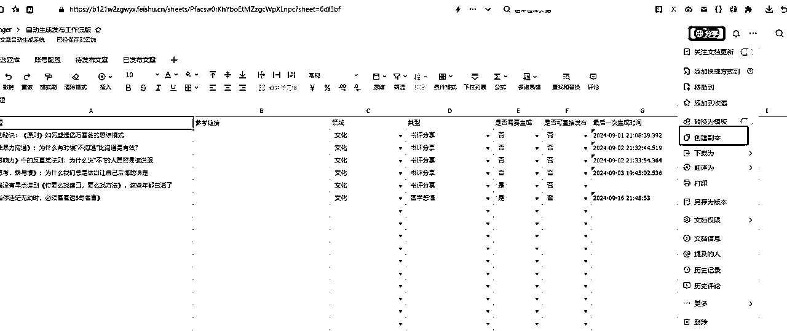

### 第二步：配置“一键飞书发布”插件

1. 进入我的coze团队，打开“插件”页，找到我开发的那个插件。非社群成员的话，我后面会附上插件代码：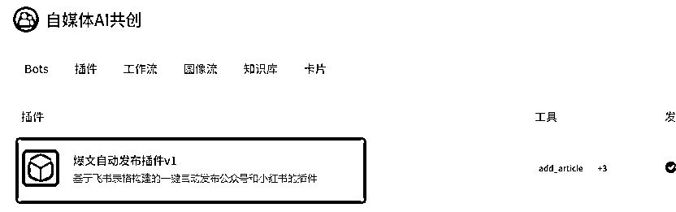

2. 找到“add_article”这个录入工具，点右侧的“...”，进入Code Snippet：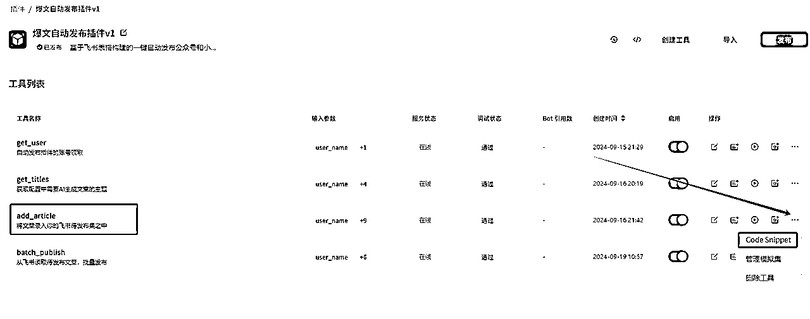

3. 选择默认的CURL方式，点复制：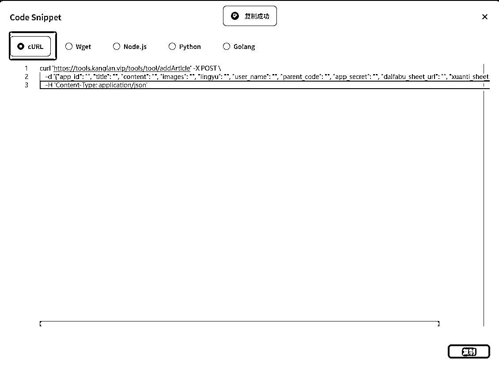

4. 切到个人空间的“插件”里，点导入。为什么不在团队里直接用？因为工具要填飞书和微信的密钥，团队里大家都看得见工作流，这些敏感信息一旦泄露容易被搞破坏，所以必须拿到自己空间里：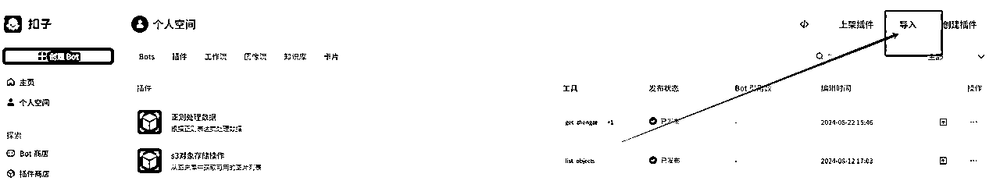

5. 导入页面选“URL”和“原始数据”，把刚复制的代码贴进去，下一步：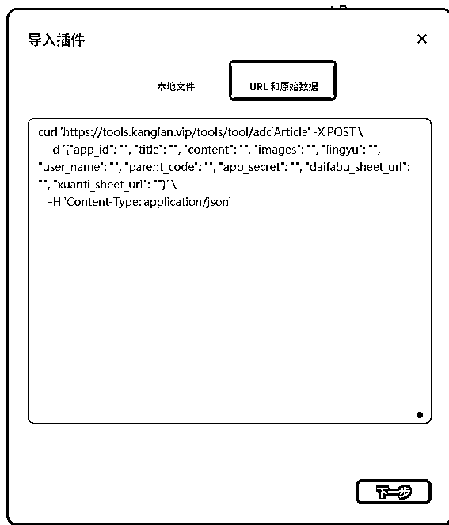

6. 填好插件名称和描述，其他保持默认：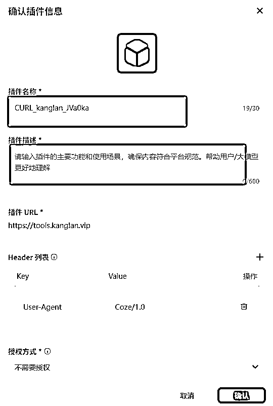

7. 导入成功后先点“启用”再调试，启用后点工具名称进详细设置：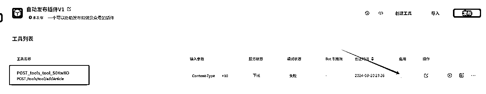

8. 点“编辑工具”：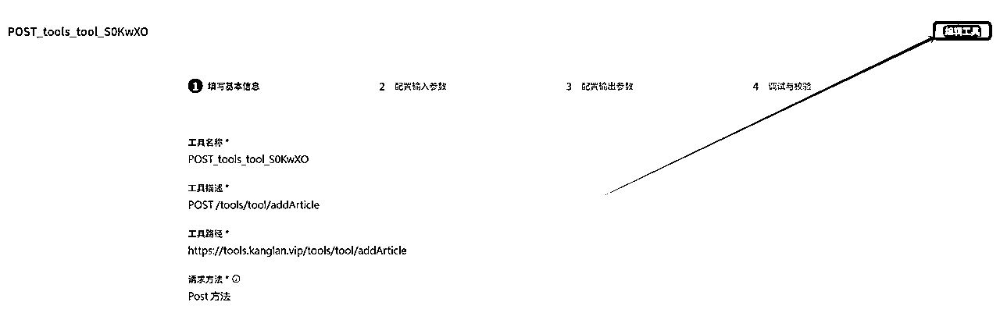

9. 在编辑页里，你可以把名称改成自己顺手的，不改也完全没问题：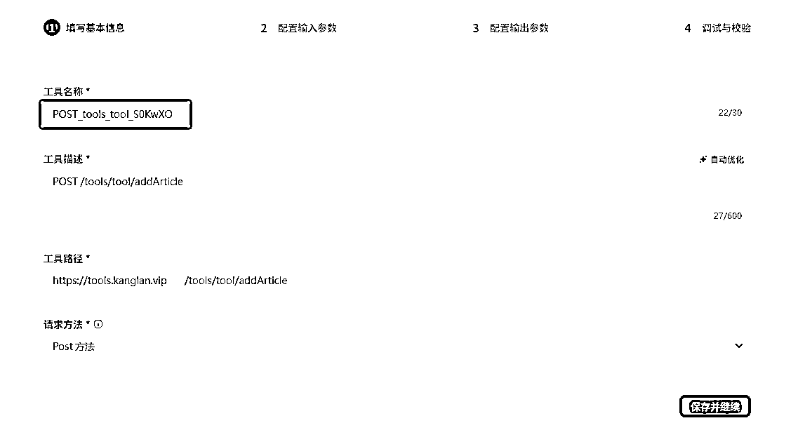

10. 保存后继续，把红框里那几项参数（比如对应的飞书表格链接）填到“默认值”栏，再把“可见”关掉。这样以后用的时候，这些固定参数就不用每次填了。另外，最上面的Content-Type参数可以直接删掉：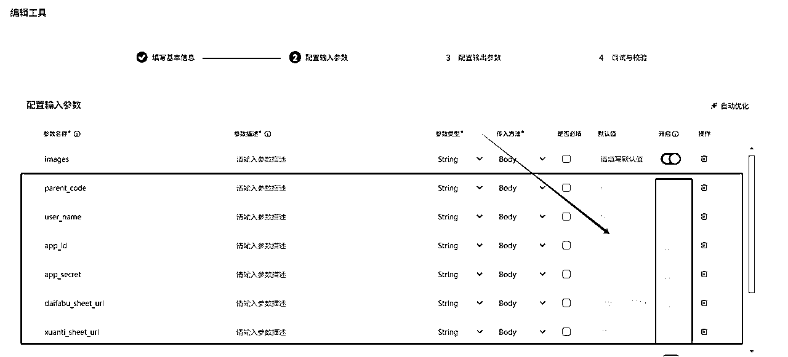

11. 参数描述是必填项，直接从我共享的原始插件那里复制即可：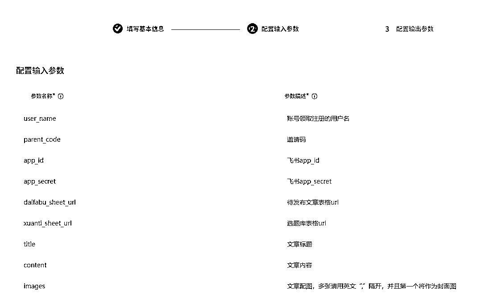

12. 输出参数保持默认，直接下一步：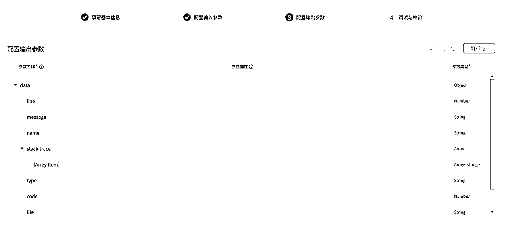

13. 最后做调试，随便输入点内容，如果出现下图的提示，说明配置成功了：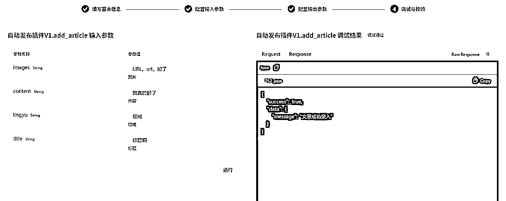

14. 用同样的方法，把“批量发布”的插件也添加进来：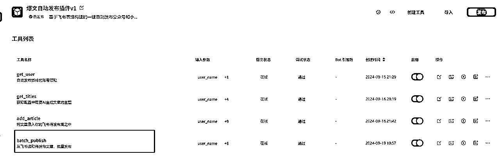

### 第三步：认识飞书文档配置项

#### 1. 待发布文章表格

主要字段有标题、内容、领域和配图。注意“领域”必须与账号配置里的领域对应，文章才会发到那个账号：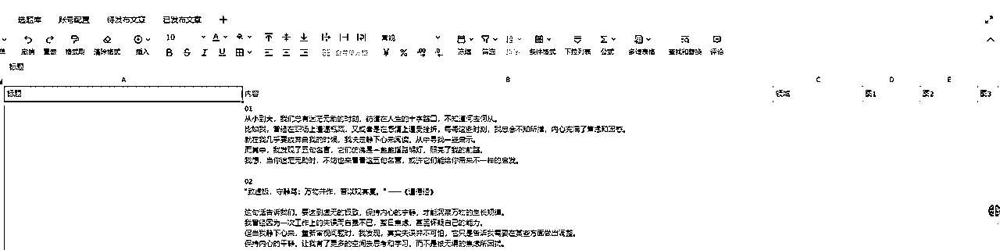

#### 2. 账号配置

账号ID用来登记已发布状态，防止重复发文。app_id和app_secret填微信开发者后台的信息：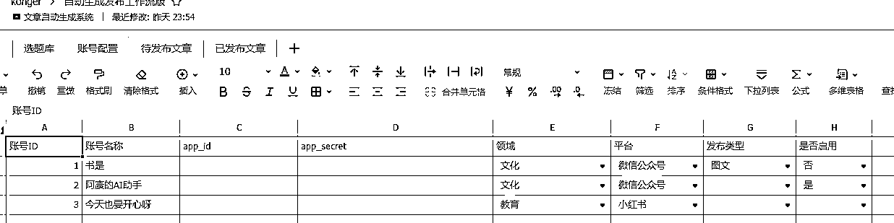

记得把IP地址106.55.181.114加进白名单，否则接口没法用。领域要和待发布文章对应；平台选“微信👸号”，程序会识别。发布类型暂时没用到，“是否启用”打开才会参与发布：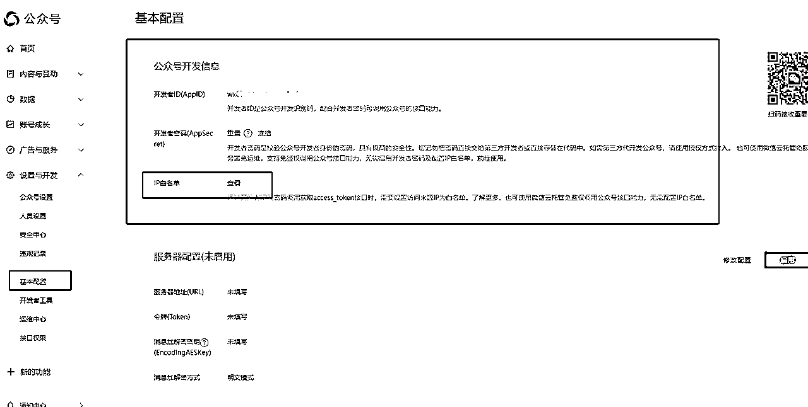

#### 3. 选题库存放未来要用的选题，目前没启用；“已发布文章”不用动。

### 第四步：搭建一键发布工作流

所有工作流，已经加入社群团队的成员，可以直接在coze团队下搬运。

1. 先做配图图像流。现阶段我做得比较简单，你可以按自己需求优化提示词，做出想要的效果：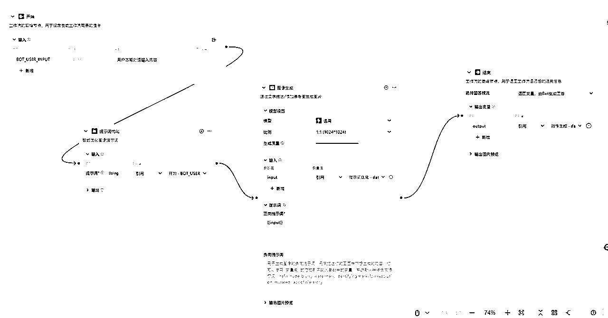

2. 再做文章生成流。我这边是国学文模板，你可以根据自己发文领域去调教，保证输入一个主题就能生成一篇文章即可：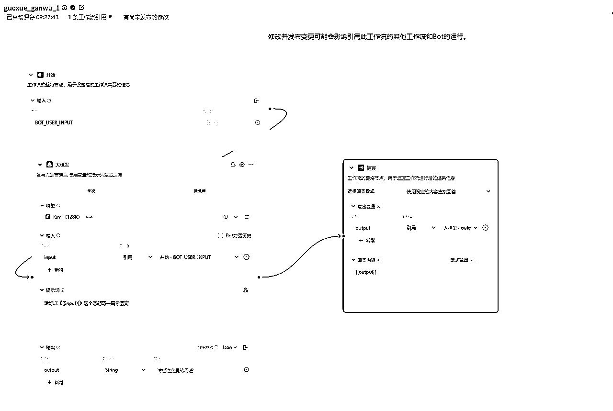

3. 然后做一个“根据文章内容拆分配图提示词”的工作流：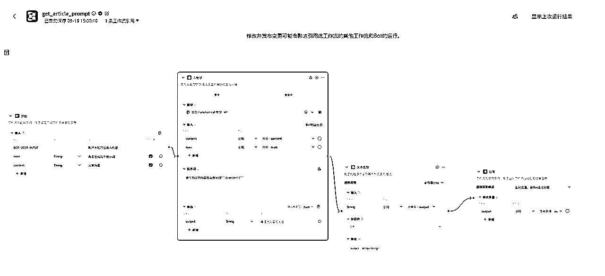

4. 把这些工作流和我的插件串联起来，按参数要求传递即可。这里用到一个代码块，记得把环境从默认的JS切换成Python：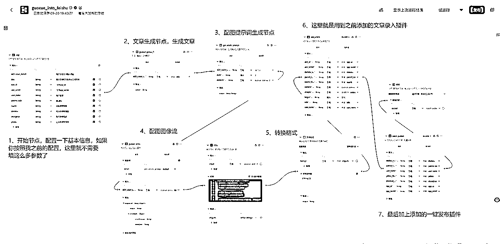```
async def main(args: Args) -> Output:
    params = args.params
     # 将JSON字符串转换为Python字典
    # data = json.loads(json_data)

    # 提取"String1"键对应的列表
    string1_list = params['input']

    # 提取列表中每个字典的"output"键的值，并构建新的列表
    output_list = [item["output"] for item in string1_list]

    # 返回转换后的列表
    ret: Output = {
        "imgurls": output_list
    }
    return ret
```

5. 调试跑通，这个工作流就算完成了，可以根据实际情况微调。

---

## 目前待完善的地方

1. 📕暂时没找到API调用方式，后期还是会用RPA做一键发布，但相比之前，RPA的操作量已经大幅降低了。
2. 选题库功能还没完善，后续计划用RPA抓热点或关键词自动选题，最终形成从选题到发布的闭环。
3. 因为处理环节增加，整套流程跑一次要一分多钟，日后做批量发布会更慢。所以后续会把一键发布改成定时执行，我们只需要负责选题和生成文章入库就行。
4. 剩下的就看大家实际反馈了，有问题我再迭代。

---

## 附：插件代码

录入飞书插件代码：```
curl 'https://tools.kanglan.vip/tools/tool/addArticle' -X POST \
    -d '{"user_name": "", "parent_code": "", "xuanti_sheet_url": "", "content": "", "images": "", "lingyu": "", "app_id": "", "app_secret": "", "daifabu_sheet_url": "", "title": ""}' \
    -H 'Content-Type: application/json'
```  
一键批量发布代码：```
curl 'https://tools.kanglan.vip/tools/tool/publish' -X POST \
    -d '{"yifabu_sheet_url": "", "app_id": "", "app_secret": "", "user_name": "", "parent_code": "", "daifabu_sheet_url": "", "zhanhao_sheet_url": ""}' \
    -H 'Content-Type: application/json'
```

到这里，这套工作流就完整了。希望它能让你早点下班，把时间留给真正重要的事情。