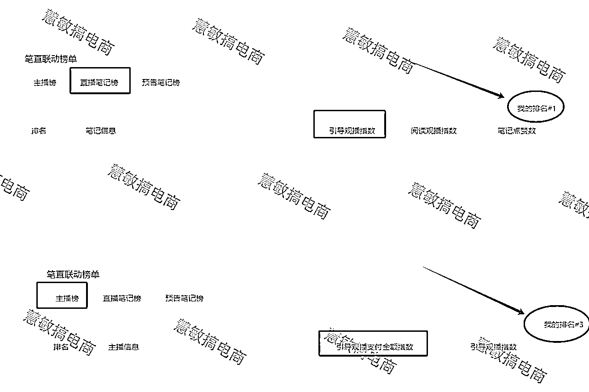
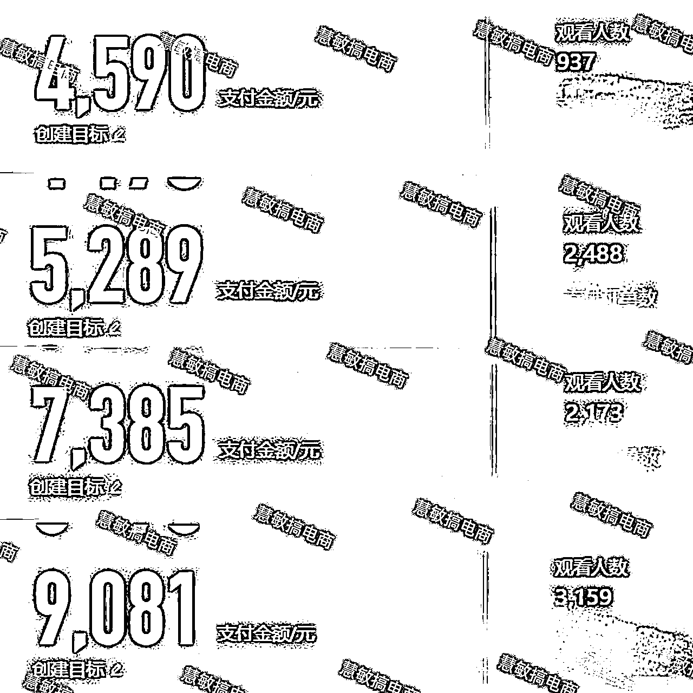
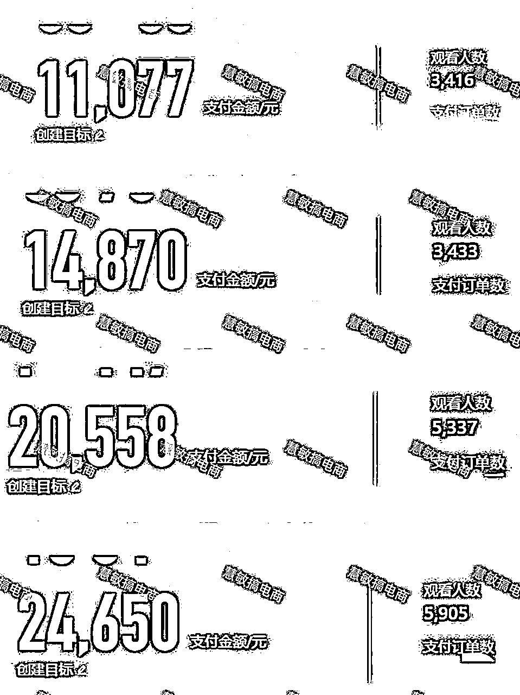
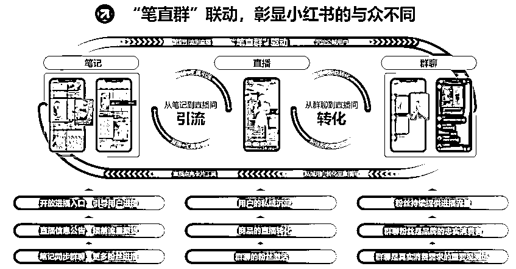
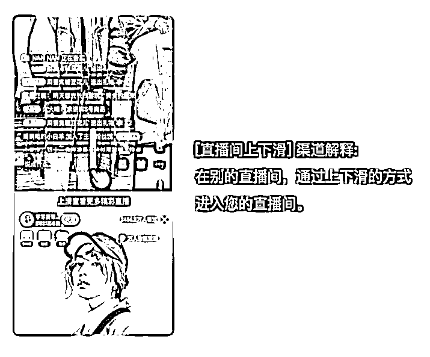
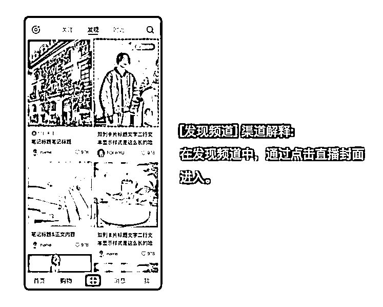
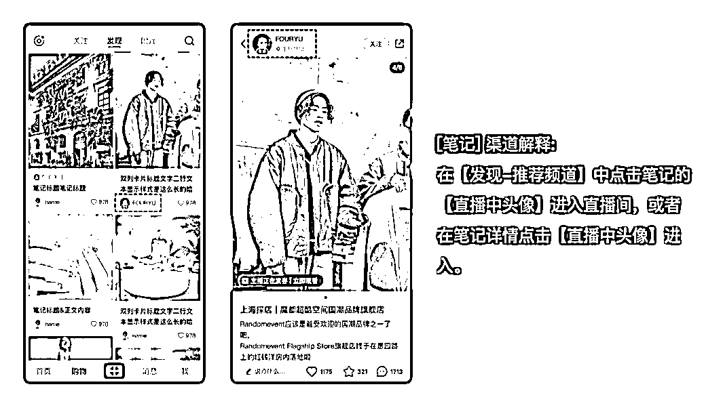
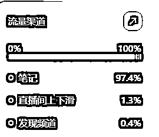
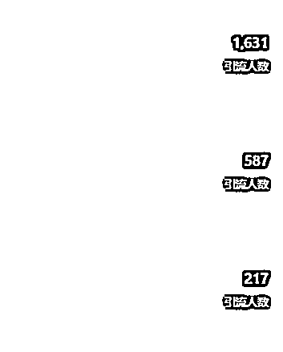
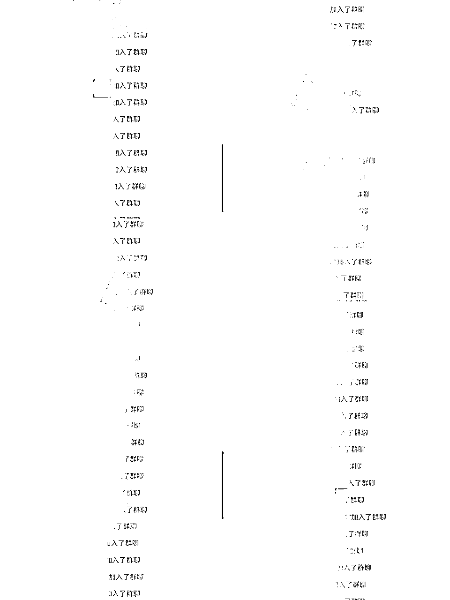

最近不少朋友在问小红书还能怎么做，今天就把我们跑通的最新打法拿出来聊聊。

先说一下背景。小红书平台的审核和规则越来越严，能钻的空子确实变少了，想在这里面继续赚钱，就得换思路。我们也是在不断试错之后，总结出了一套“笔记+直播（无人）+群聊”三方联动的3.0模式，今天完整分享出来。

老规矩，先上数据。

乍一看，场观不算高，GMV好像也没有特别炸。但懂行的人应该能看出门道：为什么场观这么普通，UV价值却这么高？到底是客单价撑起来的，还是转化率太强？如果我再告诉你，客单价其实就在50到100元之间，而且这只是单个账号一天内多次开播的累计结果，你大概就明白了吧？

话不多说，直接进入正题。

# 一、什么是小红书的“笔直群”联动？

之前大家熟悉的是“笔直联动”，现在小红书又多了“群聊”这个环节。为什么平台要推“笔直群”？因为官方数据表明，用户通过群聊下单的GMV增速很快，占比也在持续上升。也就是说，想做好小红书，不能只盯笔记和直播，群聊的维护与转化同样重要——当然，前提是产品本身要靠谱。

## 1、笔记

- 笔记不带购物车，只负责把人引导进直播间（这样笔记的电商数据就不被考核）
- 开播之前发预告笔记，让用户预约直播，提前造势
- 直播过程中发普通笔记，把用户导进直播间，直接促成下单
- 笔记数量建议至少10篇以上，封面用爆款款，脚本用热门款，混剪之后批量发

### 1.1 小红书笔记的四要素

#### 1.1.1 封面

封面决定点击率，必须重视。

- 去小红书找同行的爆款封面，下载下来混剪再用
- 根据爆款封面反推类似画面。比如爆款封面是两姐妹坐电梯，那就去全网搜“两姐妹坐电梯”，类似的素材会有一大堆，挑着用就行
- 从自己的笔记短视频里截取合适画面（剪映可以设置导出），剪辑后当封面
- 实在不行就实拍相似场景
- 爆款封面要交替使用，别一直用同一个

#### 1.1.2 标题

每个产品先收集至少10个爆款标题备用。

- 从表格里选标题，可以加小红书表情（按“window+句号”就能调出来）
- 注意：不能照搬原标题，必须改一改。

比如：“被同事问了10000遍的**来了……”可以改成：
“被闺蜜问了10000遍的**来了……”
“被姐妹问了9999遍的**来啦……”

#### 1.1.3 正文+话题

每个产品先收集至少10个爆款正文。

- 拿玩具举例，可以加上 #我的玩具分享[话题]# #玩具[话题]# #潮流玩具[话题]# #家有玩具大推荐[话题]# #新款宝宝玩具[话题]# #好物推荐[话题]# #宝宝玩具怎么选[话题]# #宝宝玩具[话题]# #我的玩具日记[话题]# #儿童益智玩具[话题]# #玩具推荐[话题]# #玩具分享[话题]# #对讲机[话题]# 这类热门标签，能加多少加多少。

#### 1.1.4 笔记形式

以短视频混剪为主。

搬运素材注意几点：

- 尽量别碰真人出镜太多的视频，非用不可就加剪映的人脸卡通特效
- 别蹭在世的大牌明星，已故的基本没风险
- 素材来源很广：抖音、小红书、快手、视频号、多多视频、YouTube、TikTok都能扒
- 抖音分手机版和网页版。网页版直接搜产品，按“最新发布”或“最多点赞”排序；手机版搜商品名，商品页面里能看到达人的带货视频，可直接下载
- 抖音刚发的优质素材，如果小红书上还没有对应账号或没人搬过，可以直接发，不混剪也行；抖音上点赞过100的爆款视频，收集起来当小红书爆款脚本
- 小红书里搜产品名，点赞50以上的笔记脚本也可以收。但注意：小红书的爆款笔记下载后不能直接发，必须混剪，否则轻则限流，重则账号违规

### 1.2 笔记怎么发

#### 1.2.1 电脑端发布入口

小红书创作者平台：https://creator.xiaohongshu.com

#### 1.2.2 发布数量

一个账号一天发8到10个短视频笔记。

#### 1.2.3 发布时间

早上7点到9点，中午11点到13点，傍晚17点到22点。可以提前预约发布。每条之间间隔至少1小时。

#### 1.2.4 流量判断标准

以24小时“小眼睛”为准：

- 不到200：视频可能重复或违规，系统不推流（大概率被判定为搬运）
- 200到500：点赞个位数，封面标题一般，基本没违规，但推荐极少
- 超过1000：封面标题正常，系统会正常推荐，有机会进入更大流量池
- 超过10000：笔记质量不错，过了人工审核，会持续推荐（小爆）
- 超过10万：妥妥爆款，数据非常好（大爆）

- 如果连续几篇小眼睛都不超过200，就发一个实拍原创视频，看看流量能不能恢复正常。

### 1.3 优质笔记的三种模型

#### 1.3.1 强攻略

产品要有明确的使用场景，能提升生活幸福感。用户看完能学到新知识，或者解决某个痛点（穿搭攻略/送礼攻略/生活攻略/知识科普都算）。

#### 1.3.2 重细节

展示产品的上身效果、使用过程、原生态、成品细节，突出品质感，快速抓住眼球。同时画面构图要和谐，光影色彩要舒服，符合小红书的美学调性。

#### 1.3.3 超实惠

适合高客单价行业。强调“有品质且优惠”或“一手价”，配上好看的图片和花字，让用户觉得“赚到了”。注意：超实惠不等于超低价。

## 2、直播

### 2.1 直播形式

真人、无人、半无人、绿幕、手播都可以，不展开讲。

### 2.2 直播封面与标题

直接借爆款笔记的封面和标题就行。

### 2.3 直播流量从哪里来

- 直播间上下滑。这种方式进来的人多，但很泛，转化率最低。

- 发现频道。用户点击直播封面进入，转化率也不算高。

- 笔记。用户从发现页的呼吸灯头像进入，或者点进笔记详情再点头像进入。这种流量最精准，转化率也最高。

### 2.4 直播小结

3.0玩法的核心，就是让笔记真正成为直播的流量来源。通过笔记筛选出更精准的购买人群，直播转化率自然就上去了。

## 3、群聊

### 3.1 怎么建群

手机端App点下方“消息”，右上角“发现群聊”，再点“创建群聊”。

### 3.2 群聊设置

群广告、群欢迎语、群昵称、群优惠、群小号等都可以配置。

### 3.3 群聊玩法

- 在笔记和直播间设置各种钩子，引导用户进群
- 产品品质过硬，群聊才有价值
- 群聊能带动用户多次复购
- 每次开播，群聊里都会有消息提醒
- 群聊引私域的其他玩法，这里先不深挖

# 二、总结

这套3.0玩法，其实是在原来的2.0“笔直联动”上做了一次小升级。别小看这个升级，它衍生出的玩法空间大了很多，尤其适合产品品质好、复购率高的玩家。

想在小红书长期稳定赚钱，就得顺着平台的规则走，这也是我们一直在做的事。当然，所有玩法都是试出来的。人往往容易待在舒适区，尤其是曾经赚到过钱的地方，想转型真的很难。但想赚更多，就必须逼自己跳出来。

共勉。

欢迎大家一起交流更多小红书玩法，V信：17816628276