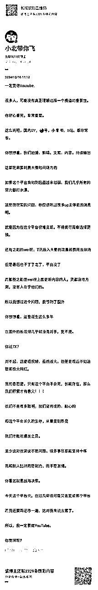
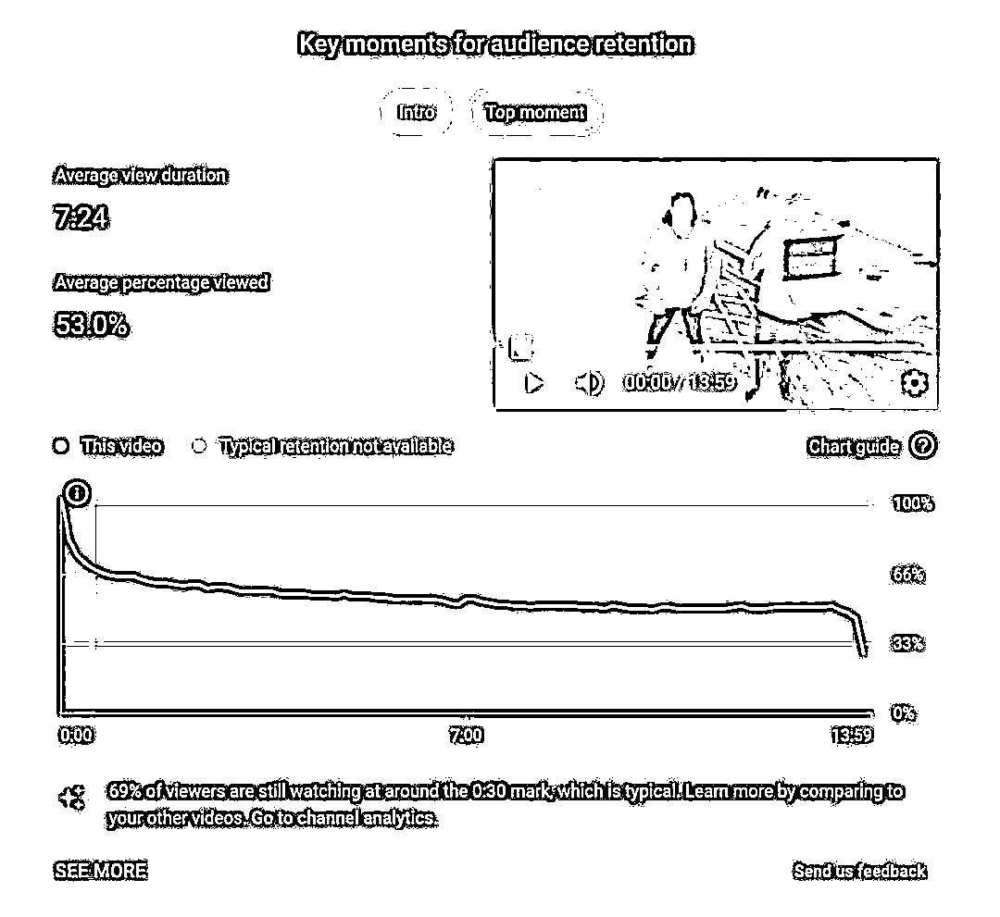
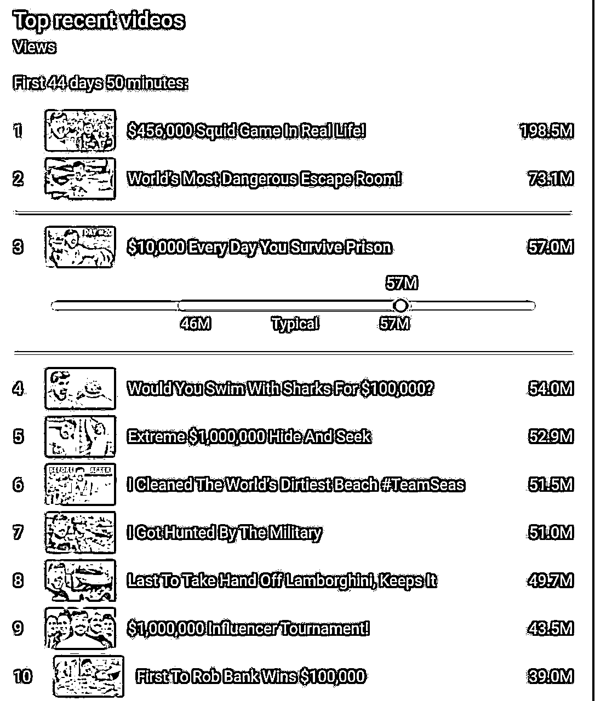
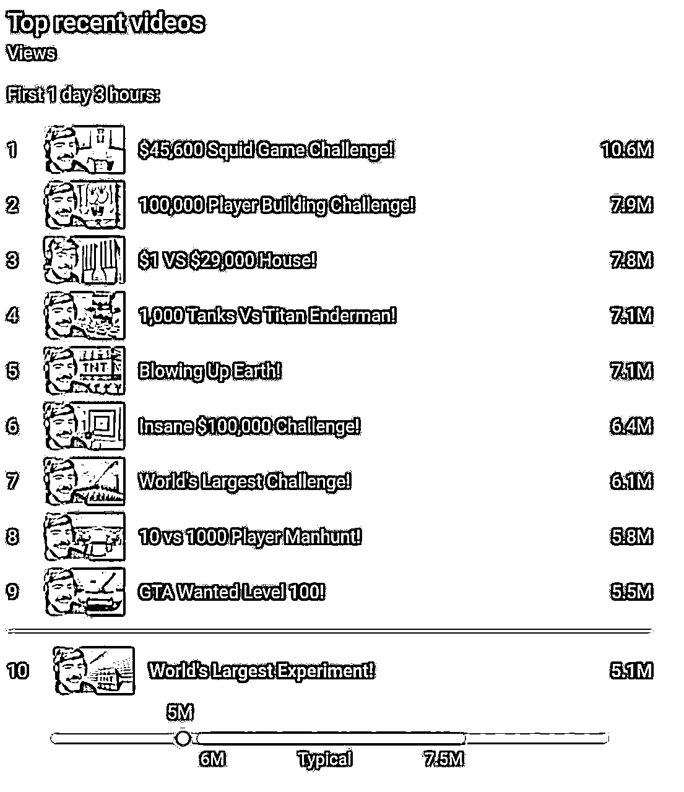
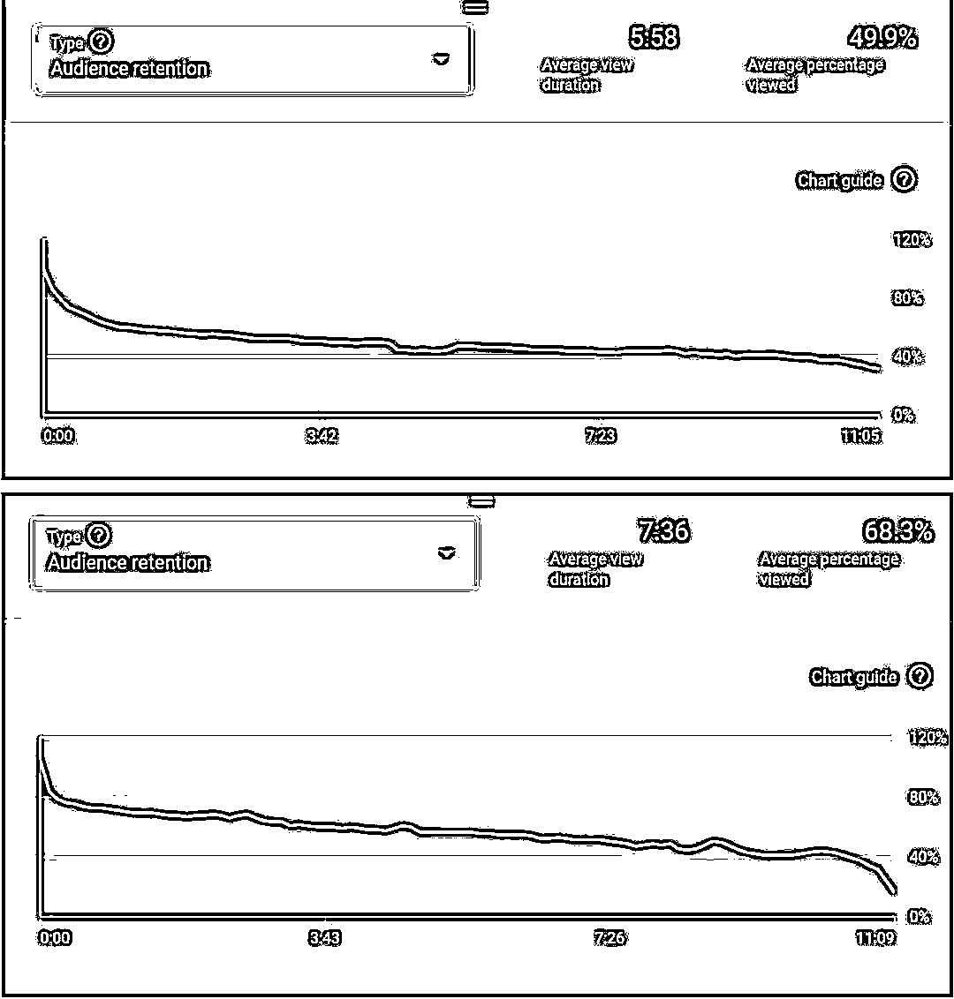
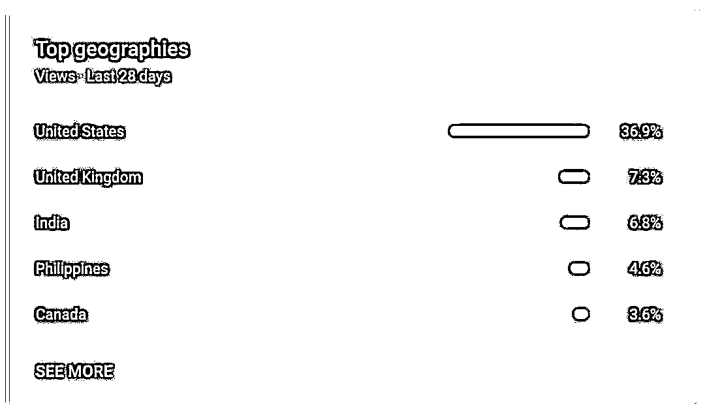
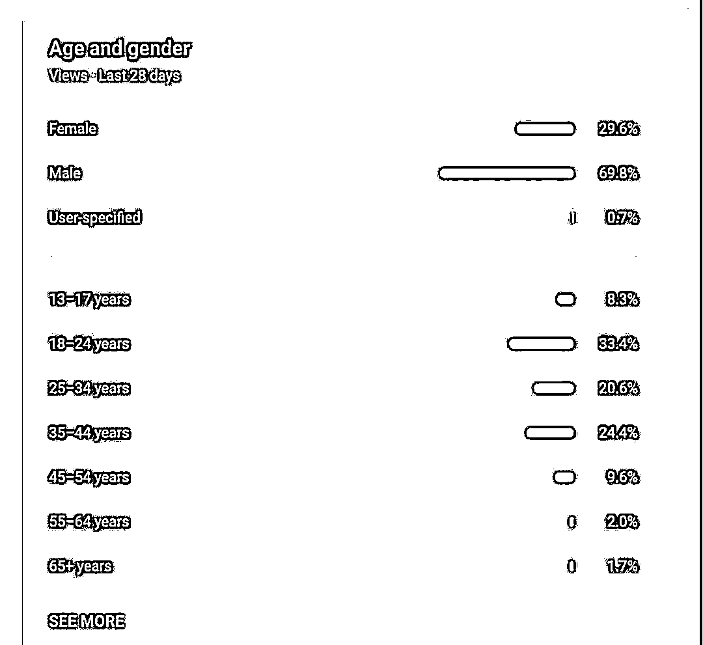

# YouTube的当下格局，以及MrBeast和华人区头部博主的打法拆解

最近亦仁老师放出了YouTube的超级笔记，正好我也在整理这一块的内容，时间点撞到一起了。

下面这篇的整体脉络⬇️

先复盘YouTube的核心数据面貌
再看全球第一博主MrBeast做内容的方法论
再看华人区代表老高与小茉的操作逻辑
最后给出一组可落地的行动建议

希望对正在观望或已经入局的朋友有参考价值。

# 先认识YouTube这条赛道

## 关键数据快照

1. 用户体量
- 月活超25亿
- 日均观看时长以数十亿小时计
- 全球约20亿登录用户每月至少登陆一次

2. 内容供给
- 每分钟约有500小时新视频被上传
- 日观看次数过10亿次
- 平台上累计视频已达数十亿条

3. 创作者生态
- 超过200万创作者加入YouTube合作伙伴计划
- 上万个频道订阅破百万
- 平台每年向创作者支付数十亿美元

4. 商业价值
- 年广告收入超过200亿美元
- YouTube Premium、YouTube Music等付费业务用户持续上升
- 在全球数字广告市场占有重要份额

5. 增长方向
- 移动端观影占比持续抬升，占比已超70%
- 直播与短视频Shorts加速扩张
- 电视端观看时长明显增长

## 李尚龙老师对YouTube的判断

全世界海外华人的总量约6000万，但油管官方披露用中文输入的人数有8500万，多出来的那部分基本都是翻墙用户。

平台上主流的视频时长普遍在三十分钟以上，和Ins、Facebook相比，来YouTube看视频的人要多得多。

一般把频道做到两三万粉丝，月收入就能达到体面水平，关键变量还是播放量。

YouTube的变现效率在各平台里是最高的，甚至是B站的几十倍。

2012年前后有一个叫Pudi pie的博主，他的视频累计观看时长高达1300多亿分钟，而背后的运营者是卡尔伯格，一年收入3880万美元，其中95%来自YouTube视频和广告。

YouTube的分成机制对创作者很友好，广告商每投1美元，平台分走45美分，给到创作者55美分。

2021年油管公布了史上最大单季广告收入，达70亿美元。与此同时宣布三年内向创作者总支付达300亿美元，可见其对内容方的投入决心。

福布斯曾发布过最富有的YouTuber榜单，其中一个典型案例是9岁的瑞安。从2018年起，瑞安一边学习一边成立工作室，父母借助他的知名度在沃尔玛、Target等渠道售卖瑞安品牌的玩具、服饰、床品，内容基本围绕儿童。2020年瑞安的预估收入接近3000万美元。一个9岁的孩子年入3000万，足以说明平台的商业潜能。

## 顾小北老师对YouTube的看法

前不久顾小北老师也分享过关于YouTube的思考，观点很到位

## 为什么做不出中国的YouTube

延伸阅读：谁也成为不了中国的YouTube

# MrBeast的团队培训手册拆解

MrBeast是美国第一网红、全球第一网红，YouTube订阅量最高者，截至2024年9月订阅数达3.17亿。这份36页的PDF《在MrBeast制作团队中如何成功》，由Jimmy本人撰写，是其内部培训手册。

想学YouTube，最好的老师就是做得最好的人。下面是野兽先生的核心方法论。

## 三大核心指标

### 点击率CTR

无论岗位在哪，点击率都至关重要。CTR=看到缩略图的人数/点击人数。1亿曝光带来1000万点击，CTR就是10%。这决定了后续一切。

《我在自家院子里待了50小时》听起来很平淡，不会让人点。而《我在番茄酱里泡了50小时》就极具传播力。制作成本相近，但画面冲击力完全不同。

标题同理。把“我待了50小时”改成“我活过了50小时”，悬念和极端感立刻提升。一般来说，越极端越有效。“我不喜欢香蕉”远不如“香蕉是地球上最糟糕的食物”。

对制作、创意部门的人来说，标题和封面关乎预期。用户点开“世界上最大的充气城堡”，封面是巨大的黄色城堡配高楼，结果视频里城堡是红色、不是最大、还在一片空地。这种预期落差会直接导致跳出。所以必须清楚自己视频的标题和封面给观众设定的预期是什么。

### 平均观看时长AVD

指观众在单个视频上的平均停留时间。YouTube会提供每秒流失的详细曲线。

蓝色曲线代表6000万人注意力的变化。几乎所有视频都一样，第一分钟流失最严重。MrBeast对第一分钟极度重视。

以某支视频为例，第一分钟流失2100万观众，这在同类频道里已算不错。如果开头灯光不对、没兑现承诺、没提前预告，流失会更惨。第一分钟后剩下的3900万，可能直接跌到2000万。

第一分钟是视频最重要的60秒。

1到3分钟是要从预告转向兑现。不要继续说你要做什么，直接开始做。举例10分钟野外生存视频，不会按时间顺序讲第一天，而是前三分钟快速覆盖数天经历，让观众迅速入戏，再在第3分钟左右安排一个“再吸引点”。

再吸引点是指极具冲击力且贴合剧情的桥段，只有MrBeast能做到的瞬间。在“每天给你1万美元直到你离开监狱”里，Karl监督Josh就是典型的再吸引。

3到6分钟要塞入最刺激、最简单、最有视觉冲击的内容，快速剪辑。目标是让观众爱上故事、爱上人物。如果能撑到中段，基本会看到结尾。第6分钟左右再放一个需要解释的再吸引，为后半段做铺垫。

后半段要小心质量。很多视频在后半段被放弃。6分钟后观众已进入“松弛”状态，意识不到自己在看视频。但不能在结尾前释放收尾信号，除非是为最后的奖励做铺垫。长篇解释、意外、计划变更等内容可以放在这一阶段。

### 平均观看百分比AVP

除了数据，还有一个难以量化的“哇”因子，是主观但关键的。满足CTR和AVD，表现仍可能平平。

例如“100天在圆圈内生活”，承诺给50万美元让一个人待在田野圆圈100天，开场30秒用吊车把房子整体吊进圆圈。这种操作对标题封面没加成，但留存和记忆点极强。

哇因子就是别人做不到、只有你能做到的瞬事件。它把内容拉开差距，无法用数据衡量。

## 内容生产原则

### 沉浸在YouTube里

无论是制作、创意、拍摄还是剪辑，都要对YouTube上瘾。放弃Netflix、Hulu，多刷YouTube。投入越多，对趋势越敏感，越知道怎么突围。

除了看视频，建议阅读《目标》这本书。瓶颈的根源往往很简单，不懂就毁掉一支片子。

深刻理解从视频立项到拍摄完成的完整流程很重要。假设你负责的视频45天后拍摄，提前就要拿到封面草图和脚本，不要等到需要时才去催。

### 录下所有东西

把制作当成团队协作，而不是个人任务。勘景、选址、道具细节都要录像存档。未来团队其他成员会问你场地问题，靠记忆会出错。10人团队同时了解，远胜于1人知道。视频记录能避免大量沟通成本，尤其在采购环节。

### 关键组件

关键组件是指没有它视频就做不了的东西。想在岛上安排100个人送给一人，岛本身就是关键组件。标题和封面也可能是关键组件，如果封面承诺的黄色城堡实际是红色，预期就崩了。

一旦确定关键组件，就要像对待孩子一样保护：每天检查十次，有备选方案，运输不用普通物流，派人亲自盯。出现问题立刻上报，不要赌概率。

备用拍摄日必须预留。租场地、租设备花费几十万美元，万一游戏类视频延档导致你的视频要推迟一天怎么办？宁愿选一个90%完美但灵活配合的主人，也不要100%完美却不讲理且没有备用日的合作方。

沟通层级越高越好。关键组件的对接，邮件是最差的。面对面最好，其次电话，再次短信。文字无法传递语气和表情。事情越复杂，沟通形式要越高。书面沟通不算完成，除非对方明确确认已阅。

### 承认错误

借口最让人反感。犯错可以，学到东西才重要。团队里每个老人都曾让老板亏过100万美元。A级选手会从错误中成长，C级选手只会重复错误。承认错误才能快速解决问题。

### 优先事项优先

接到任务要列出优先清单。被告知买20万以下的兰博基尼、贴动漫贴纸、定制方向盘，这三件事就必须无条件先完成。救火、帮其他团队都不该影响核心优先项。

### 用顾问作弊

做世界最大蛋糕，先问问之前做过最大蛋糕的人。十年的YouTube痴迷经验可以把一个新创作者从100粉做到1万粉，省下几年试错。每个任务先问自己能不能找到顾问，能省大量时间。

### 五条解决路径

所有问题都可通过数学、科学、愿景、审批、预算这五条路径解决。

### “不”不是终点

和外部合作时，不要把一次性的“不行”当最终答案。想买下商店所有商品，对方说不能拍摄，就去找其他员工、他们的粉丝、老板、社交团队。用推特私信也能打开局面。持续沟通往往能破局。

做内容这一行，最怕的不是碰壁，而是碰一次壁就折返。

头部团队在谈判中常用一条准则：如果在这家门店被拒绝，就带着方案去下一家。因为每间门店的负责人或许不同，说不定下一任恰好认可你、愿意开绿灯。团队管这个叫“推开那扇门”：不因某个人的否定而停下，直到所有出路都被试过，才算完成。

这套思路不仅用于对外协作，也贯穿团队的每日节奏。

在一线制作里，团队绝不让单一素材独占某天。理由很简单：为了一条片子连续投入三天，其他项目的排期就会整体向后塌陷；之后为了补进度，只能从更后面的任务中借时间，最终陷入不断追债的循环。反过来的做法是让多条片子同时滚动，每天推进一点，时刻保留提前量。所以哪天如果只产生一支片子，那天基本等于白过。

成员各司其职是真的，但有一项隐藏的通用要求：会用团队惯用的拍法操控摄影机。原因很实际——去外地做大型拍摄时，不愿为了两三个补充机位，就把一支庞大的摄影组空运过去。现场需要帮手，优先从创意或制作团队里抽人补位就好。何况镜头数量越多，单颗镜头能承载的分量反而越轻。

YouTube 会自动把你新发的作品和之前九支短片放在一起比较，时间窗口是发布后的前几个小时。它展示的不是质量评分，而是吸引力排名：第1名是惊喜，第10名是灾难。示意图如下：  

强度上的要求是向外顶，不是向内耗。团队会提前数周把进度赶完，这样开拍前反而不用熬夜。拍摄中出了意外，第一反应是问：这算不算现成素材？例如树干砸中运货车的后备箱，刚好损坏了要送人的一百个花瓶——这种画面太有戏剧性，应该写进片子里。

上马之前，会有一道专门的评估工序：确认某份策划中的关键环节是否真实可行。比如想在一座全球第一高楼上玩躲猫猫，评估者的任务就是去查能不能拿到入场许可。若能成，片子进入制作；若不成，也正好在早期拦住后面所有人，避免大家白费时间。

创意体系的原点，用主理人的话说是：先让坐在镜头前的那个人兴奋起来。他从不演情绪——倘若一部点子让他提不起劲，那就不该被拍出来。为了这种兴奋，他可以做很多看起来荒唐的事：从一直数到超过十万，把自己埋进土里，或穿着一双巨大的怪鞋完成一场长跑。该频道被他视为亲手养大的孩子，牵绊深到连他自己都笑称“有点病态”。正因为这种连接，他有一条绝不妥协的底线：哪怕一支作品成本高达数百万美金，只要感觉不到位，也会直接作废。

什么叫好内容？答案是：几乎什么素材都行。拿一只布娃娃举例，可以组织五个人比谁用非惯用手把它丢出最远的距离；也可以准备上千只，测试要多少只才能扔进远处的小床；还可以试试堆多少只才能压断一块木板。同一个物件，能演化出无数版本。这就是团队的秘密：不被既定思路锁死，万物皆可入题。可一旦放到 YouTube 上，又必须服从它的语法：作品不会仅有60秒，得有一个让人想跟下去的故事；观看群体可能覆盖数千万人，所以叙事必须足够直白。内容自由与叙事规则之间的平衡，就是团队的日常功课。

判断作品是否成功，他们只盯三组数字：CTR、AVD、AVP。只要把一支新作发布出去，查看受众平均停了多久、看到哪个位置离开，就能判断大家喜不喜欢。内部做过一次对比：两支作品时长几乎一样，A 的累计点击数达到1.2亿，B 只有4500万。观众留存曲线见 ——高人气的A，平均停留时间比B多出整整1分38秒。这足以解释为何 YouTube 会把它推向更多人。结论很简单：让人停留越久，作品成绩越好；开头前几秒必须引入情境，中段不能留气口，结尾要给出一个让人愿意等到的落点。

结构能显著抬高留存。像那类比谁更能耗的挑战，赢家直到最后一刻才揭晓，所以只要观众一入场，就会对后续发展产生牵挂。另一种常用套路是层层加码：那期从1美金的小型焰火开始，之后依次点燃10、50、375、1000、10000美金的焰火，中间穿插调侃，再升级到4万、10万美金的规格，末尾是一次破纪录的巨型焰火。赌注越堆越高，离场成本也就越高。

还有一类追捕式剧情，职业猎人、部队或者联邦探员都出现过。悬念与前面那种挑战同源：他会不会被抓到？能不能脱身？不到结尾不会揭晓。

团队不迷信单一架构。早年靠随机给直播播主送大额礼物起过一波热度，前后做了约十二期就收了。尽管当时很多人在评论区喊“再来一期”，团队还是选择换题。这刚好对应苹果那位创始人的名言：用户往往说不清内心想要什么。持久使用的同一条公式，最终都会让受众疲劳。因此他们刻意不让同一架构的片子连续上桌，中间一定会穿插别的类型。

后台能看到，这个账号早就穿透年龄和性别：孩子会拉着妈妈一块看。女性比例虽然只有三成，但放到全球基数上，每月仍相当于数亿次观看。欧美地区的贡献超过半壁江山。若真要画一幅受众画像，大概是个喜欢打游戏、混迹网络梗圈的少年。下方两张后台分布图可以佐证这一点：。

人会产出什么，通常和他平日的摄入结构关系密切。团队里有一位特别会逗乐的老成员，他的幽默看似手到擒来，根源是多年来大量吸收无厘头动画和搞笑片段。那些东西在他脑中形成了一座素材库，随时能调出一整集海洋动画的台词来制造笑点。假如他当年每天看的是财经节目和投资分析，五年后大概连现在一半的幽默感都剩不下。

做内容的人需要像管理食谱一样管理自己的信息摄入。举一个例子：假设澳洲内陆存在某种紫色果实，食用后能让人一夜长高两英尺。你过去未必知道这件事；但一旦知道，它就悄悄进入你的素材储备。短期内用不上，某天头脑碰撞时却可能突然派上用场。所以，没见过的事永远无法成为你的灵感来源，这是铁律。

每天都要主动补充这类养料：热门梗、名人动态、各大平台正在疯转的段子、同行的新玩法，都在摄取范围内。

同时，团队拒绝玩作假那套。上镜的参赛者会被提前照顾到位，现场氛围尽量轻松，让每个人愿意放开说话。倘若一支成片只有五成把握让人满意，那就干脆换一个选题；点子无穷无尽，不值得在原地凑合。

组织变大之后，标准流程不可避免，但他们时刻警惕流程绑架创作。流程可以是骨架，不能变成天花板。公司应围绕着创意来建设，不能让创意反过来迁就公司。遇到流程卡住脑子的时候，可以直接找主理人汇报，当场砸开那套锁。

衡量一个好点子，外部反馈和数据各占一半。片子发布之后，创意小组会复盘数字，也会认真读差评。受众骂得越具体，越能指明下一版的修改方向。

“新”是这里最硬的通货。同一个框架可以重复使用，但每次都要更换场景、规则或障碍，让老形式长出新皮肤。跟风是被明确禁止的：如果某个想法仅仅因为别人做了就想做，那它基本不合格。受众想看的不是又一个仿制品，而是别家没有的玩法。

前60秒是一条片子的生死线。如果这个窗口抓不住受众，后面再精致也无效。所以每次动工前都要问一句：这里的开场够不够勾人？不够，就推翻重来。

每个项目都要有自己的主线命题。从标题、封面到剪辑与配音，全部素材都围绕这条主线展开。如果拍摄中偏离主线的枝节越来越多，就应当踩刹车回看，把方向掰正再继续。

最终评价权永远在受众那里。数据只是落后指标，观众的真实反应才是裁决者。正面反馈让人知道保留什么，负面反馈让人知道修复什么。两者都要被郑重接住。

再看一句内部常说的话：完成作品，不是完成流程。当流程挡了出品，就绕开它、打破它。衡量工作的标准是交付，不是程序是否漂亮。

创意不是只在会议桌上发生的。拍摄现场随时可能出现更生猛的表现方式，一旦出现，就当场换上。把方案供在神坛上，恰恰违背了这个行业最朴素的原则：好灵感来了，立刻让它进场。

再看一组坐标：老高和小茉。两人合力运营的频道算得上华语 YouTube 市场的头部样本，单支内容大多能拿下七位数的观看数。仅靠平台广告分成，年收入就有机会冲到千万级别。老高还做过一个收费课程，课程名写作“财富·自由团”，里面全是少走弯路的实战心得。

老高特别提醒过 Shorts 这波窗口期。抖音带来的竞争压力，让 YouTube 正在全力给短片导流；大家的时间被切得很零碎，这种轻量形态天然更容易被接住。它也的确有优势：平台倾斜流量，制作成本低，受众接受快，还能带动关注量快速上涨。短板同样清楚：停留太浅，难以建立真正的连接；靠 Shorts 攒来的关注者，未必会迁移到长片上去；而且入场门槛低，竞争极度拥挤。所以结论是：要趁窗口还没关时冲进去，但别把所有希望押在短片上，长期还是得靠多元布局。

至于怎么定选题，老高的原则可以浓缩成三层：做自己愿意一直做下去的领域，并对照同类账号，既往相邻话题扩展，也往同一话题的深处挖；做自己明显比大多数人擅长的方向，这样产出稳定、失误率低；若前两条都还没头绪，就选自己真正爱看的类型，用兴趣当向导。

说到底，做内容不是拍片那么简单，它拼的是韧性、节奏、结构，以及摄取信息的习惯。与其追问爆款为何没来，不如自查：你在他人的否定前止步了吗？你的排期是否被一项工作拖垮？你给脑子喂的料够新鲜吗？如果答案不对，就换一套答案。

做YouTube，别急着学剪辑，先搞懂这几件事

很多人在YouTube上试水，第一反应是：买什么设备、用什么剪辑软件、要不要做英文内容。但真正跑通的人会告诉你，这些都不是最先要考虑的。你需要先想明白方向、摸清平台规则，再谈怎么做出播放量。

一、先选方向：热爱比风口更靠谱

选频道主题时，别盯着别人赚了多少就去模仿。最适合你的内容，往往藏在你心里真正想做的领域里。如果你还不确定，可以翻一翻自己喜欢的账号，试着模仿喜欢的内容，这个过程中很可能找到新的兴趣点。

如果几个方向都想不清楚，那就去看看哪些领域播放量高。但要记住：热门内容未必适合你。别人的成功无法直接复制，只有你对内容的那份热爱和热情，才能真正吸引观众持续来看。花时间了解自己，找到真正想做的事，才算是迈出了第一步。

二、上传设置：这五个步骤别跳过

影片拍好了，上传时的设置也会影响后续表现。标准流程大致是五步：先填详细信息——这部分最关键，包括标题、缩略图、播放列表；再设置创收，决定是否开广告以及广告位置；然后等系统做视频元素检查，确认有没有色情、暴力、侵权之类的违规内容；接着设置公开范围，选公开、私密或不公开；最后交给系统做版权等自动检查。

其中，对播放量影响最大的设置是标题：它直接关系到搜索和推荐，标题里要有关键词，但必须自然可读，还要贴合视频实际内容。缩略图排第二，影响点击率，设计时要足够抓眼球。播放列表也很重要，它能够帮YouTube理解你的频道分类，从而影响推荐，不同主题的视频最好分开存放。说明栏和字幕对播放量影响不大，但前者能补充信息、放购买链接，后者能帮多语言观众看懂，所以仍然值得做好。

还有一些红线要格外留意：儿童内容必须特别标记，否则可能影响信用和推荐；暴力、裸露、性暗示等成人内容，严重时会被封号；有付费宣传必须标注，AI生成内容也要标记，避免假新闻等风险。

上传时坚决避开黄赌毒、暴力、恐怖、危险画面；音乐要确认版权合法。标题和缩略图是观众愿不愿点进来的关键，播放列表则帮平台更好地推荐。说明栏和字幕虽然不算关键，但能提升体验。说到底，内容质量才是根本，严格遵守规则才是频道能走远的前提。千万不要去试探平台的底线——万一平台把规则收紧，你手里那些账号都可能受影响。正确的上传设置，能在不牺牲内容的前提下，让播放量和观看体验都更好。

三、内容怎么做？先研究观众，再谈技巧

对自媒体而言，影片质量的唯一标准，就是播放量。好不好看，不是创作者自己说了算，而是观众用点击和观看时长投票。所以在动手之前，最该花时间研究的不是剪辑技巧、不是买什么麦克风，而是你的观众到底是谁。

你要为作品画一张观众画像：他们来自哪里、说什么语言、是男是女、多大年纪、习惯什么时候看视频？更重要的是，他们为什么看你的视频，想从里面获得什么？带着这些答案去定内容，然后直接满足那个需求，别堆无关信息。如果观众在前几秒没看到自己想要的东西，手指一划就走了。

视频多长不重要，重要的是每一秒有没有信息价值。不要为了凑时长硬加内容。如果你发现某个视频突然播放量爆发，说明你已经做对了，接下来就是复盘它到底做对了什么，然后复制这个成功。一次爆不算完，连续复制出正确动作，才可能等来真正的爆发期。成功不是偶然，它来自方法和理解；失败和成功往往只在一念之间，想清楚“观众要什么”，路就走对了。

四、经营频道的一些实战经验

声音比画面更要先解决。用手机拍视频没问题，关键是声音清楚、杂音少。从第一期开始就要确立自己的风格，这样制作成本会越来越低，观众也会更习惯你的内容。剪辑软件推荐剪映/CapCut，免费而且功能足够强大。

频道名要符合内容定位，出镜人的名字最好容易记。同一个话题很多人做不可怕，你能做出自己的特色，就不用怕竞争。视频时长不是重点，质量才是。只要不违反社区准则，在其他视频下留言不会影响频道本身的权重。别用时薪思维衡量YouTube工作，因为最终收益和播放量挂钩，而不是你投入了多少小时。流量是变现的基础，有了流量，变现机会会自己找上门。平台提供的宣传视频功能，本质上相当于付费广告，用好了可以增加曝光。更新频率要稳定，但稳定不等于水内容。

另外，普通创作者不必自己花大钱搭服务器、训练AI，这些更适合大公司来做。发布视频尽量选观众活跃的高峰时段；不要频繁删除重新上传，这可能触犯社区准则。短视频封面目前只有安卓端能设置；长视频和短视频对频道没有绝对好坏，按自己的实际情况选。小众市场同样可以成功，只要你能做出特色和辨识度。

还有一个信息差思路：如果你发现某个软件或主题的英文内容很多，中文内容很少，但中文圈子里明显有人需要，那你去做中文内容，就是机会。

五、一份现成手册+几句真心话

之前生财出过一份YouTube航海手册，即使过了这么久，很多底层逻辑依然通用。建议直接点进链接，在生财有术索引站里打开看一遍：
https://scys.com/view/docx/doxcnPgun49EUoAyPo60slrnNIe

最后送几句直白的话：不要整天说“期待”，要自己研究，然后开干。赚钱最怕等别人喂；别人给个线索，剩下的路要自己走。先开通账号，把第一条视频发出去，遇到问题再解决问题。缺什么就补什么，不会AI就去学，不懂YouTube就去搜去查，不知道行不行就去试。

失败和成功不是反义词，更像是同义词——它们共同的反面是什么也不做。所有赚钱上的成功，靠的就是策略和坚持，而坚持本身就是最重要的策略。丢掉“等我准备好再开始”的念头，别畏手畏脚。毛姆有句话说得很好：大胆去做，不要怕，没人在乎；就算有人在乎，人又算什么东西？

碰到挫折时，把第一反应换成“哈哈，事情开始变得有趣了”。经常庆功，就能成功。机会来了就去试，试错的成本并不高，错过的成本才高。我也不是一开始就懂YouTube，但靠着自己搜索、研究、边做边学，现在不仅更了解平台，账号也跑起来了。希望想做的朋友也能赶紧动起来，加油！