最近有朋友来问我怎么选赛道，聊下来发现他（她）比较介意真人出镜，但又想认真做内容。那今天我就专门写一篇帖子，梳理一下不露脸也能跑通的视频方向，算是个抛砖引玉吧。

### 一、游戏方向

游戏类目里其实早就跑出了很多超级大号，比如 nigahiga、PewDiePie、MrBeast 这些。

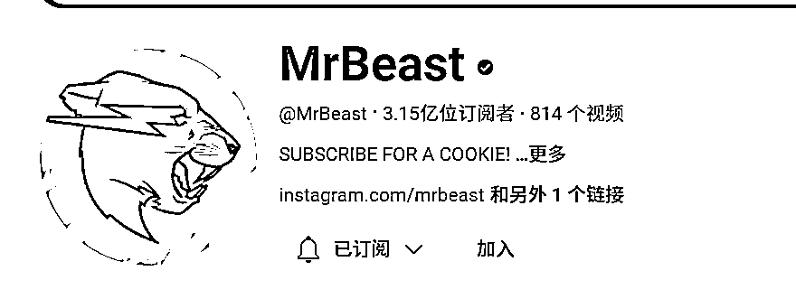

这里先补充一个背景信息：MrBeast 早年就是从游戏频道起步的，那个号叫 Dynamo Gaming。他当时就是把整个玩游戏的过程录下来，每支视频动辄好几个小时，照样有很多人爱看，播放数据也不差。

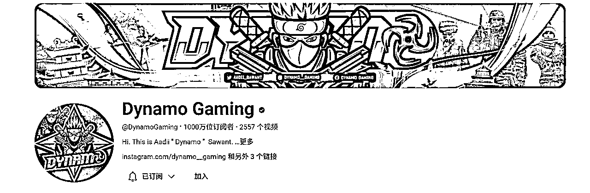

现在平台在力推短视频，他那个频道也跟上节奏，开始传一些短片内容了。

再说个延伸：国内有些主播也做这类内容，比如红警、90年代经典游戏的通关流程，衍生出来就是游戏解说，比较知名的有红警08、红警月亮3；如果想看怀旧游戏推荐，可以留意82电玩大叔。

### 二、产品测评方向

每个人其实都有测评的资格，因为大家每天都在买各种东西——家居、数码、日用品，随便拿一件身边的商品就能拍。你只要能讲出自己的真实体验，点出哪里好用、哪里踩雷，就能帮别人在花钱之前把把关。

参考频道：Household Hacker

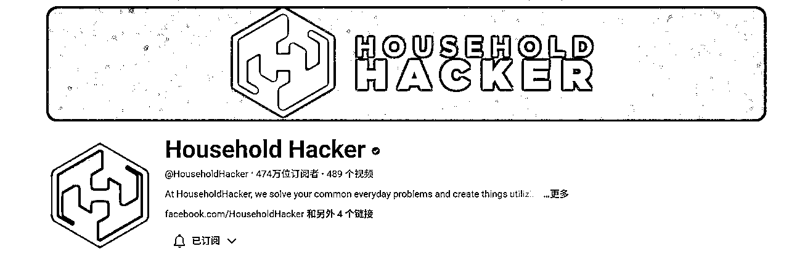

这个频道从头到尾没有人露脸，纯粹就是在展示生活里的各类物品，介绍使用感受、提醒使用注意事项。

这类视频的核心是“产品”本身。只要你的信息对别人有用，观众根本不在乎画面上有没有你。他们过来就是想搞清楚哪个值得买、哪个赶紧避开，拿到答案就满意了。

扩展一点：这个频道里有些东西看起来挺不错的，可以查查国内有没有同类在卖；如果还没有，那可能就是个机会。

比如这种

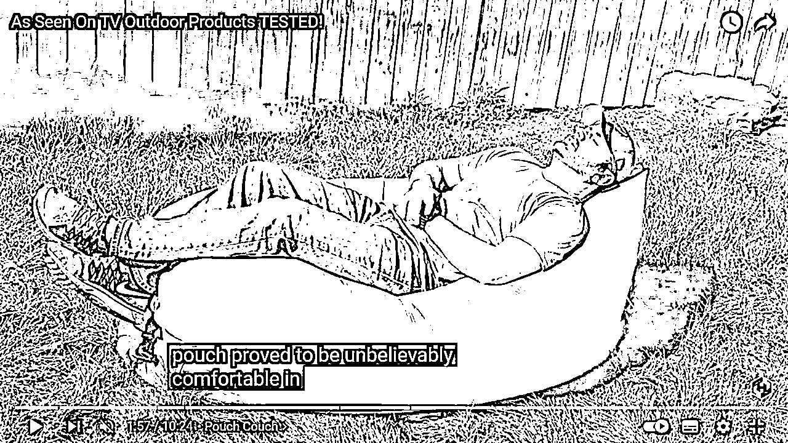

又比如这种专门用来挖土的手套

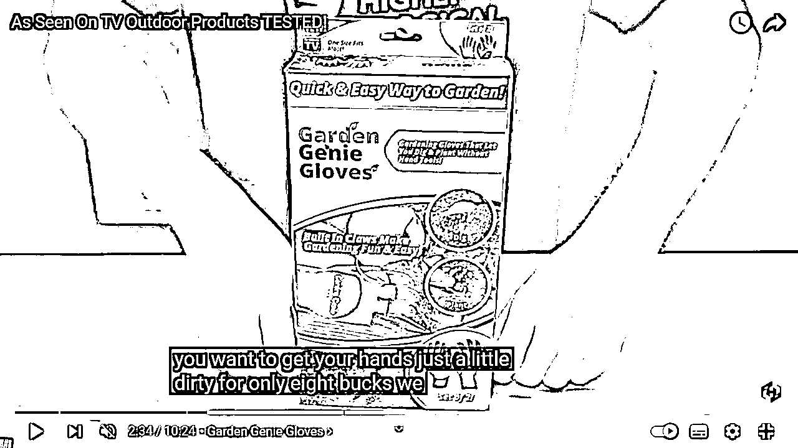

总之，先去搜搜国内有没有卖。如果国内买不到，而你自己又觉得这个东西有潜力，那就可以去找厂家谈生产；当然，有些人自己本来就有工厂，那就更方便了。关注这个频道，说不定就能挖到潜在商机。

咱们既可以把国内的好东西卖到海外，也能把海外的新鲜玩意儿引进国内，核心玩法就四个字：信息差。

### 三、美食方向

这个领域的范围非常大。你可以拍街头小吃、各地特色菜，也可以做平价美食或高端餐厅的测评。

参考频道：Mashed

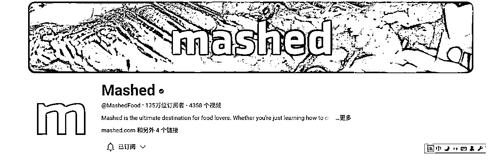

这个频道会做很多西式快餐的内容，比如汉堡、薯条。它会告诉你世界上最好吃的薯条是哪种、最好吃的汉堡是哪家，还会科普很多跟食物相关的知识，提醒大家平时容易犯的错误。

全程没有人出镜。一部分画面是实际操作，另一部分就是用素材图或素材视频来展示。

国内做得好的美食博主也很多，像李子柒、美食作家王刚，都是不同风格的代表。

### 四、健康方向

现在大家对健康的关注度越来越高，这个赛道选对了是很有潜力的。

推荐案例：Body Hub

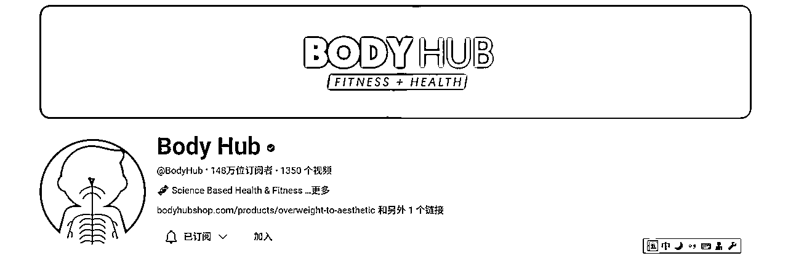

这个频道有个很明显的特点：用很短的视频讲一个健康小常识，节奏非常讨喜。

谁不愿意花三五分钟，学一个让自己身体更好的小技巧呢？它的做法很简单——图片加上文字，再配一段自己录的讲解就够了。

这个频道取胜靠的是内容本身的价值，而不是剪辑特效，所以操作门槛真不高。

### 五、实验/解压方向

推荐案例：Power Vision

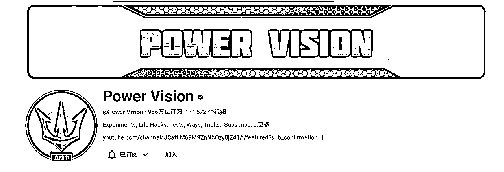

看这种视频第一感觉就是解压。有些嗅觉灵敏的朋友，可能早就在做“搬运”了，因为可看性确实很强，比如下面这两张图。

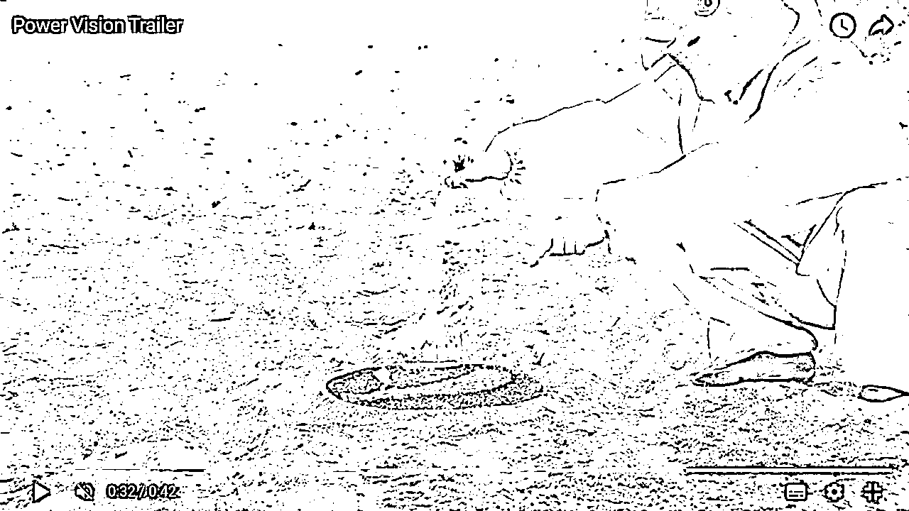

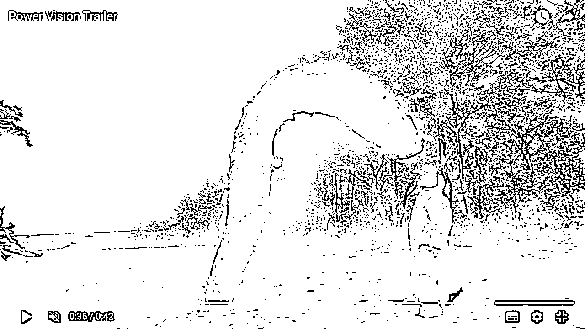

这个频道全是各种小实验，没有炫技的剪辑，但选题非常好。每支视频就是一个新奇的小实验，很容易勾起观众的好奇心，让人忍不住点开。

所以，如果你喜欢动手捣鼓、又有创意，这个方向很适合你。

这种内容自带解压属性。而解压视频不止在国外火，国内也有大把受众，把国外的好内容转到国内来，早就不是新鲜事了。

### 六、心理学方向

大家对心理健康的重视程度越来越高，想学心理学知识的人也越来越多。

推荐案例：BRAINY DOSE

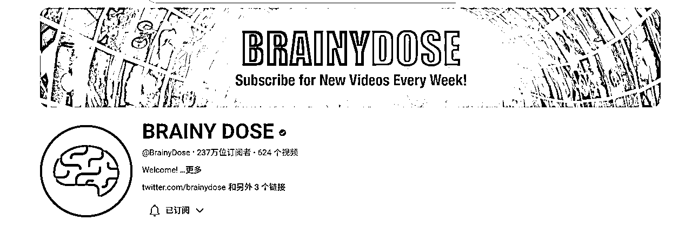

这个频道主要讲心理知识，比如怎么调整心态、怎么让自己变得更好、怎么自我提升。

它的视频基本是由素材、图片和视频拼接而成，作者完全不露面。所以这类频道的成败，很大程度取决于文案。只要你的文案够好、信息足够有价值，观众照样看得津津有味。

国内做心理咨询、心理疗愈的同行，可以去这个频道找找灵感。当然，原创永远是最好的；只是说利用信息差，很多人上不了外网，你发到国内平台，天然就成了“原创”。

### 七、地理方向

推荐案例：WonderWhy

这个频道会讲世界各地有意思的事情，也讲不同地方的历史。喜欢历史、地理的观众，很容易就会爱上这种内容。

观众只需要花十几二十分钟，就能了解一个地方的文化和历史，快速补充新知，那种获得感是非常强的。

### 八、奢华/猎奇方向

推荐案例：Mr. Luxury

这个方向很有意思，受众基本是带着猎奇心理来的。

频道里展示的全是富人的世界：富人的玩具、私人飞机、游艇、豪宅、生活方式等等。

大家看了就会感叹，原来有钱人可以富到这个程度。

里面也有不少抓眼球的话题，比如全球最贵的手表、全球最贵的电视、亚马逊上能买到的最贵单品等等。

所以只要能把这些资料收集好、整理成视频，一定会有人想看。这些话题天生就能勾起好奇心。

观众想知道富人到底怎么生活，也想知道最贵的手表长什么样。而且这种频道完全不用露脸，只要会找素材图、素材视频，再用文字加声音把故事讲出来就好。

### 九、软件教程方向

很多软件真的能极大提升效率。比如 Everything，就比微软自带搜索好用太多了。

PotPlayer 64 目前算得上是最好用的视频播放器；小丸工具箱则是非常好用的压缩工具。

你可以录屏讲这些软件怎么用，顺便安利一些宝藏工具。只要配上自己的声音讲解，带着观众一步步学会，就可以了。观众不在意你长什么样，他们只关心能不能通过你的教程掌握这个软件。

推荐案例：Photoshop Tutorials by Webflippy

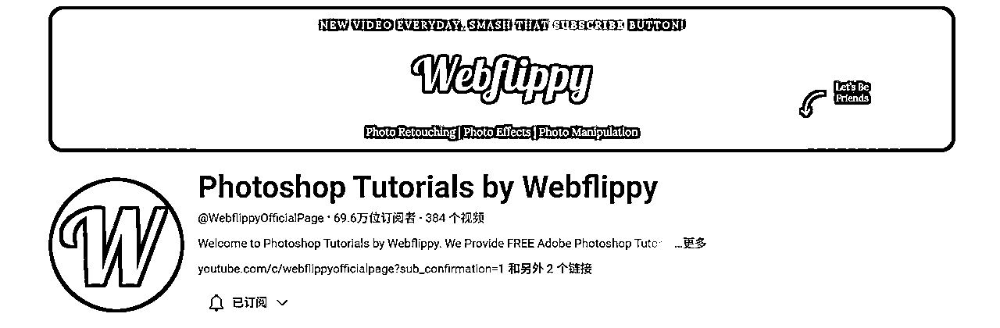

这个频道全部内容都是讲 Photoshop 的，分享各种 PS 技巧。形式上就是纯录屏，有些视频甚至一句话都没有，全靠文字提示。

举一反三，你完全可以去搜关键词，找到一大批类似博主。国内的话，像“零度解说”就是这类。这个赛道拼的就是一个“坚持”。

我也知道有人直接把湾湾那边博主的内容拿来再讲一遍，国内做公众号分享这类软件教程也很普遍。

通常是先用文字介绍软件，然后让读者输入关键词（一般先让你关注），再给下载链接。我自己觉得这个方向是能跑的。

想做好，就得多铺量——一个人搞几个账号，全网各平台一起发。坚持下来，按年收费是行得通的，身边确实有人这么做。

免费内容可以引流，付费内容就做成定制化服务，再拉个交流群。这算是小白最容易上手的方向之一。

至于收入，我认识一个做付费社群的人，他透露去年光会员费就收了大概50万。具体数字只有他自己清楚，但可以确定的是，YouTube 上有海量软件教程频道，市场很大。

### 十、科学方向

推荐案例：SMART BANANA

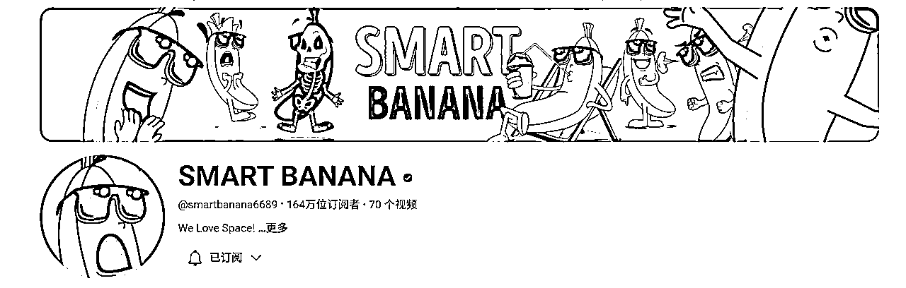

这个频道用动画加配音的方式，把各种科学知识讲得明明白白。这种形式有趣味性，观众更容易接受，理解起来也不费劲。

如果你对科学感兴趣，不一定非要搞出那么复杂的动画，简单一点的动画也完全可以。不用出镜，把信息传递出来，让观众学到知识就行。

这个方向真正的难点在“趣味性”。如果国内做，一个思路是把原视频的英文去掉，配上中文配音。这些动画本身很有趣，完全可以引流到小孩教育方面。

可以做两个版本：一个纯英文版，一个中文翻译版，用AI配音或者普通配音软件就能完成。

顺着这个思路，其实还能再发散一下：找到类似视频，专门面向国内儿童教育，也是一个方向。通过视频把人吸引过来，再卖跟小孩教育有关的产品或服务，就能变现。

### 十一、运动方向

推荐案例：Nonstop

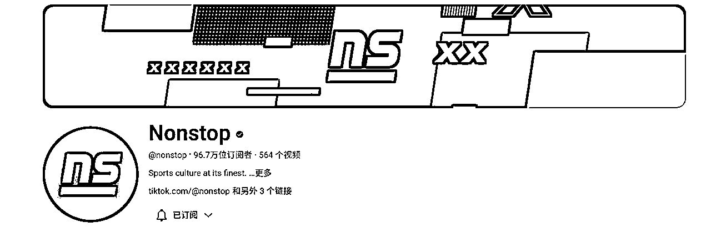

运动领域超级广阔，篮球、足球、棒球、羽毛球、乒乓球、田径，样样都能聊。

这个频道就覆盖了很多项目，包括 NBA、NFL 这些。它的视频内容非常丰富，比如不同球队对比、不同球员对比。呈现方式就是素材图加素材视频，作者全程不露脸。

所以，只要你对某项运动有热情，就可以围绕自己喜欢的运动做频道。把素材整理好，配上自己的信息输出，完全能跑起来。

### 十二、测试方向

推荐案例：1 Million Tests

这个方向真的很有趣。1 Million Tests 这个频道会做各种测试，智商、情商、性格……种类非常丰富。

视频形式是简单动画加配音讲解。最关键的一点是，大部分测试没有时效性——无论什么时候看到，观众都能上手测。这也就意味着，这些视频能持续为你带来流量和播放量，长期躺赚。

### 十三、旅游方向

推荐案例：touropia

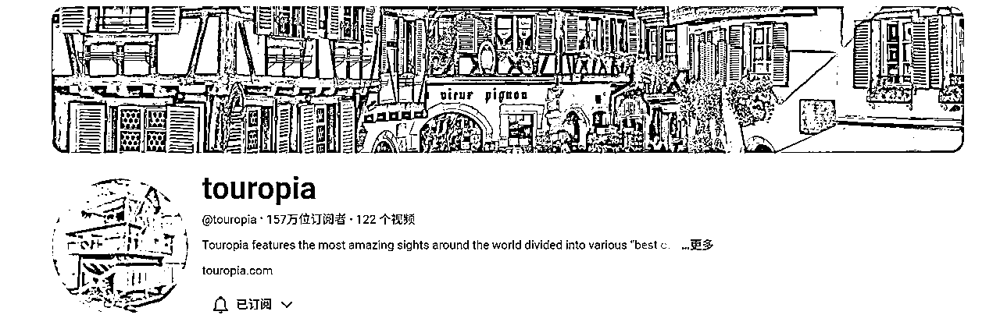

很多人以为做旅游频道就必须跑去当地实拍，其实真不一定。

touropia 这个频道介绍了大量国家、地区的信息，比如墨西哥最值得去的10个地方，英国最值得去的10个地方。

它的视频不露脸，也没有到当地拍摄，而是把所有信息整理好，用素材图、素材视频呈现出来。这种内容往往很有价值。

观众根本不在乎你长什么样。他们只想弄清楚，如果我要去英国，该去哪儿、不该去哪儿。只要信息到位，那就够了，真没人在意频道主是谁。

### 十四、自我成长方向

推荐案例：Practical Wisdom - Interesting Ideas

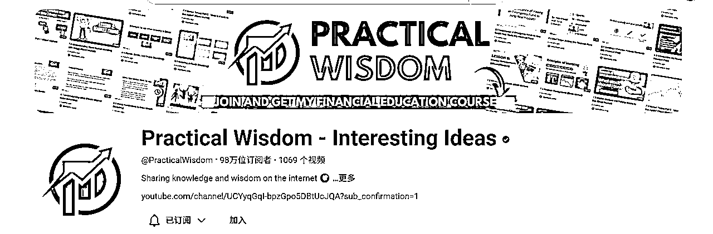

这个频道专门讲自我提升。里面有很多有意思的话题，比如“10个最没用的大学学历”“12个你需要更多独处的理由”。

视频形式就是素材视频加文字，再配上自己的声音讲解。这类内容最核心的就是文案。文案够好、传递的价值够重，观众就会认可，也就会持续追更。

### 十五、加密货币方向

推荐案例：Satoshi Stacker

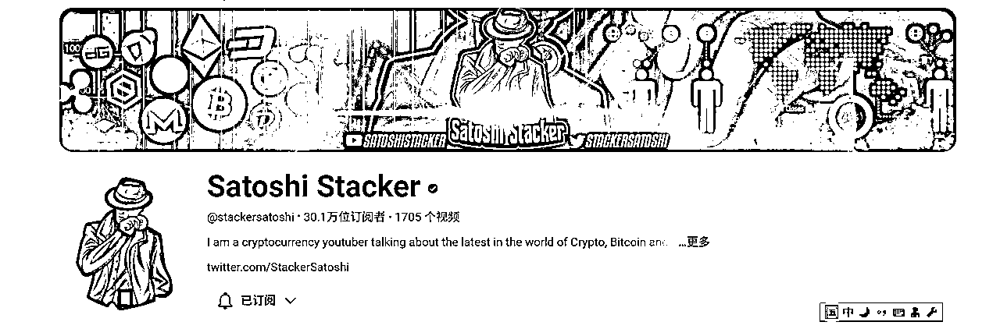

加密货币这个赛道，已经让不少人赚到钱了，这是公开的事实。

最近这些年，加密货币一直是热门话题，相关频道也能吃到很大的流量红利。

Satoshi Stacker 这个频道就没有真人出镜，主要是屏幕录屏加声音解说。

因为大家对加密货币最关心的就是最新资讯，所以只要信息及时、有用，谁还管你露不露脸？

如果你有相关研究，完全可以开一个 YouTube 频道，分享你的观点和策略。只要观众能学到东西，流量很快就会起来。

### 十六、艺术方向

推荐案例：drawholic

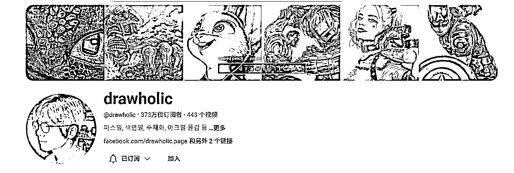

如果你会画画，那你完全不需要露脸。大家看的是你的创作过程，根本不是你长什么样、声音好不好听。甚至不用说话，靠文字提示就能讲清楚每一步。

drawholic 这个频道就是专门给名人画肖像。视频内容就是全程录制画画过程，不说话，只配背景音乐。就靠这种形式，它做到了370多万订阅，每条视频都是几十万甚至上百万的播放量。

所以，如果你平时就爱画画，不妨把过程记录下来，发到 YouTube 上，让更多人看到你的作品。

### 十七、ASMR方向

推荐案例：VIVA ASMR

ASMR 提供各种好听的声音，让人听得很放松、很享受，甚至能帮助入眠。

VIVA ASMR 这个频道有大量舒适、安静的音乐，听着很治愈。这个领域很明显不用露脸——观众就是奔着声音来的。

说句实话：只要有心，这种内容搬到国内也很合适。现在大家压力都大，愿意听放松音乐的人真的不少。

### 十八、产品开箱方向

推荐案例：Dr Debox

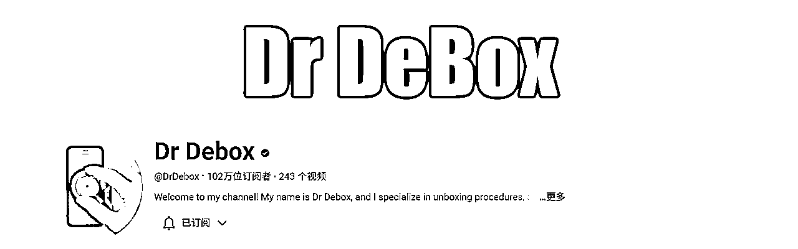

开箱和测评不一样，不需要你有多深的产品知识。你只需要从包装还没拆开始，一步步带着观众看看里面到底有什么配件、功能介绍一下就行。

Dr Debox 这个频道主要做科技产品开箱，它会非常细致地带你看清每一款科技产品里都有什么原件。

所以，如果你是个科技产品爱好者，又一直在追最新数码资讯，完全可以开一个开箱频道，带别人逐个看产品。

### 十九、动物方向

推荐案例：Animal Facts

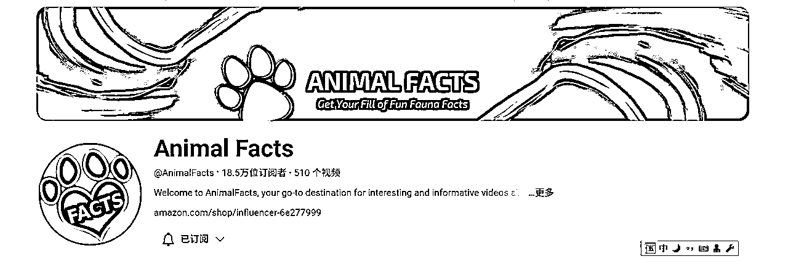

这个频道主要围绕猫狗和其他小动物做内容，提供了很多实用信息。它的话题也很有意思，比如“最适合公寓养的7种小狗”“最不需要照顾的10种宠物”。

视频形式依然是素材图加素材视频，配上文字和声音讲解。这类内容最重要的就是信息量。只要观众能学到新知识，能获得有用信息，视频就会受欢迎。

### 二十、商业方向

推荐案例：Young Entrepreneurs Forum

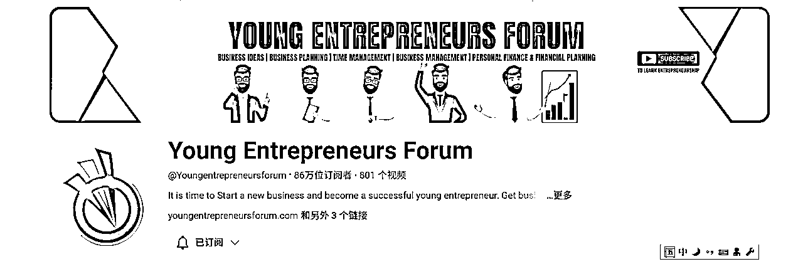

讲商业、讲创业，不露脸也完全能做。这个频道就是通过简单的动画形式，清楚地讲了很多商业和创业的干货主题。

### 一点个人感想

做个人IP，真人出镜确实是一种很好的方式。但这不代表只要露脸就一定能讲得更好。只要你提供的信息足够有用、逻辑清晰、表达清楚，观众一样会喜欢。

上面一共盘点了20个细分领域和20个具体频道，这些账号都没有露脸。希望能给大家带来一点启发。

### 加餐环节

这份文档里我没有摆出一大堆频道列表。但只要你确定了方向，找到对应领域的 YouTube 频道其实很简单。

举个例子：你想做产品测评，那就把 Household Hacker 的视频挨个点开。在右侧，YouTube 官方会自动推荐跟你正在看的视频相关的频道。你一个个订阅就行了。

再比如，订阅了 Dope、Danny Gonzalez 之后，用同样的方法继续挖，就能找到更多同领域频道。这种玩法，就是拔出萝卜带出泥。

办法虽然笨了点，但胜在实用。

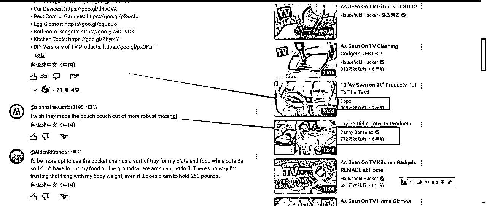