# 【小白跑通闲鱼项目分享】

从“假装努力”到月销2w+：一个职场宝妈的闲鱼逆袭复盘

大家好，我是周玉英，龙哥盟三年级学员。这两年里，一次志愿者经历让我找到了适合自己的副业方向——零投入在闲鱼卖货，今年8月销售额超过2万，净利润2000多。

回顾我的赚钱之路，真的不算顺。2022年4月18日我正式加入赚钱。同年8月第一次参加航海，选的是小红书爆款笔记。当时完全没抓住要点，笔记全以公司产品为主，只会堆砌卖点，21天下来只攒了4个粉丝，收入为零。紧接着又参加精华共读、图书共读、视频号带货，看起来忙忙碌碌，其实没有真刀真枪干出成绩，在赚钱第一年依然0变现。

等到了2023年6月，我参加小红书运营航海和续航航海，终于有几篇笔记火了，接到人生第一个广告，是个婴儿实物产品，赚了1块钱。后来陆续参加剪辑航海、vlog博主、快团团卖货、小红书电商，每次也能赚点钱，几十到几百不等。坦白说，过去两年我几乎每期航海都不落下，但要么0变现，要么变现少得可怜。

真正的转折发生在今年6月——我第一次以志愿者身份参加闲鱼高客单价项目运营。从试水到小爆发，只用了两个月，8月终于迎来高光时刻。

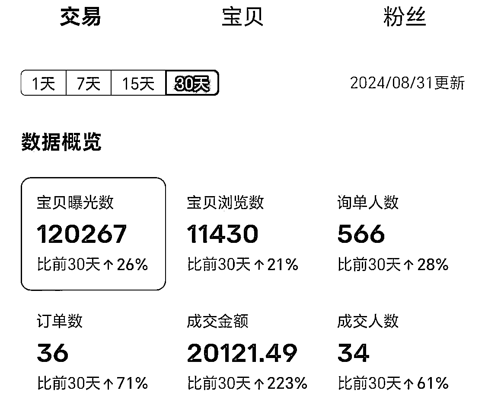

我给自己重新找方向的起因，其实是一次很痛苦的经历。我是90后职场宝妈，去年5月当妈妈后，一直在做小红书母婴育儿赛道。拼到300个粉丝，也接过几次推广。可每次更新都像逼自己上刑，数据反馈少，心里越来越累，慢慢就不想动了。

后来我找靠谱做了一次电话咨询。她帮我解读盖洛普测试，说我的纪律性排第一，执行力完全没问题；但成就动机靠前，非常依赖正反馈，所以更新意愿低，做小红书很难持续。她建议我去做能快速拿到正反馈的事情，比如电商。

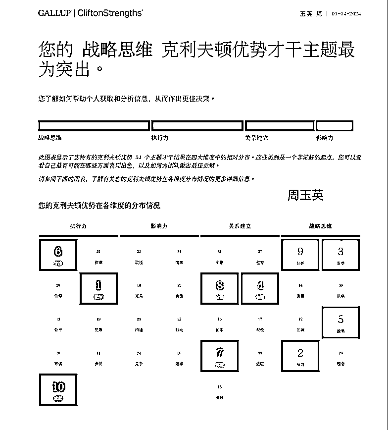

就是这个建议让我豁然开朗。换成电商赛道后，出单快，正反馈一来，行动力自然跟上，行动力又带来更多正反馈，形成了良性循环。

如果你也在瓶颈中纠结，不知道是坚持还是换项目，可以试试我的方法：

第一步，提升自我认知。用盖洛普这类工具，搞清楚自己擅长什么、不擅长什么，做什么事更轻松更容易有结果。

第二步，找专业的人解读。别东听一句西听一句，专业解读才能给出相对客观、正确的建议，否则只会越看越焦虑。

第三步，根据结果调整策略，选择适合自己的项目。龙哥有句话很有道理：每个项目都可能让你赚到100万。项目本身不分好坏，适合你的才是最好的。

定位调整后，我果断放下小红书运营，专攻电商。今年4月参加了小红书电商运营航海，开了一家卖桐乡特产胎菊的店，也出了几单。但随着天气变热，问题来了：5月过后的胎菊口感明显下降，金黄色的花苞渐渐发白。我特意请教公婆，他们说胎菊品质最好的时间段是11月到清明，之后的货就会缩水。我又去其他平台买了别人的胎菊对比，发现都一样。我实在过不了自己心里那关，不想让客户失望，最后选择放弃卖胎菊。

放弃胎菊后，我的主业帮我打开了另一扇门。我的工作其实和闲鱼八竿子打不着——在小家电行业做品牌管理。因为要帮公司处理淘汰品，才顺手注册了闲鱼。平时只是三天打鱼两天晒网地上传商品，没想到竟然能陆续出单，那种正反馈简直让人上瘾。今年6月，我报名学习闲鱼高客单价运营，开始认真做，坚持选品、上架、优化话术。到8月终于爆发：一周成交近1.3万，其中一单客单价高达2700元，整个8月销售额冲上两万。

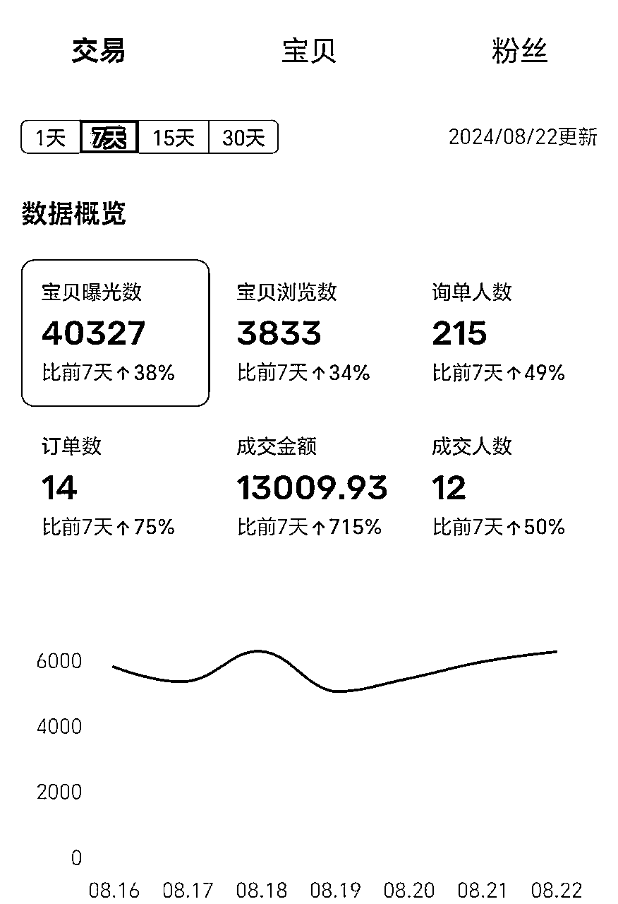

复盘这次能拿到结果，我认为就三句话：志愿者视角、听话照做、守住三个基本点。

先说志愿者视角。以前我总以普通学员身份参加航海，这次跳出来当志愿者，一下子站到更高处，能看到几十个真实案例，等于把别人的经验直接喂给自己。利他到最后，其实是利己。我带了34名组员：1位围观、2位落水、31位成功上岸；其中2位满勤，1位航海王者，28位完成12次打卡，393份作业我每一份都认真看过，还做了点赞和点评。

有疑问的，我催着他们去群里提问；有人让我复述，我让他们去爬楼看学习记录。组员里有个因为售后想放弃的，我一直在后面打气，后来她出了第二单，兴奋地跑来和我分享；还有一个到第15天还没开单，急得不行，我让他再坚持一下，结果第19天终于开单，第20天又继续出单。那几天我其实也捏着汗，就怕他中途撂挑子。

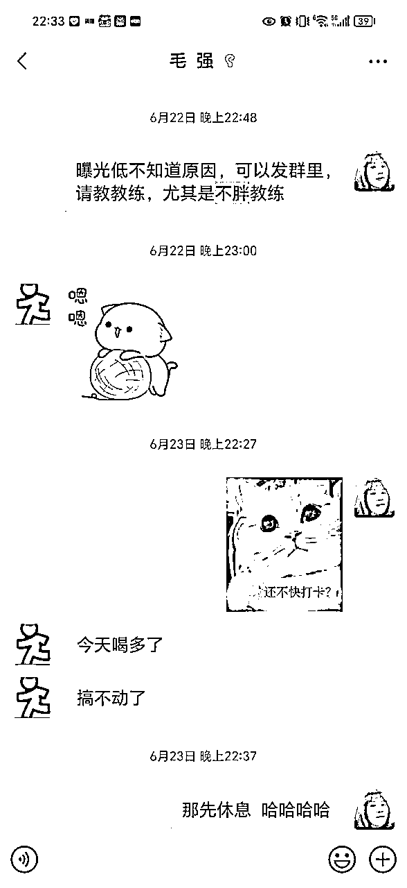

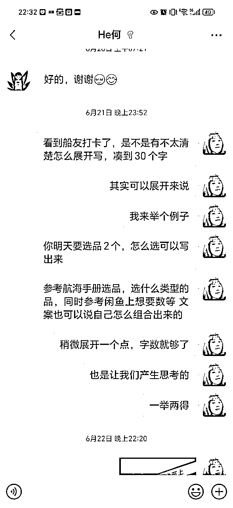

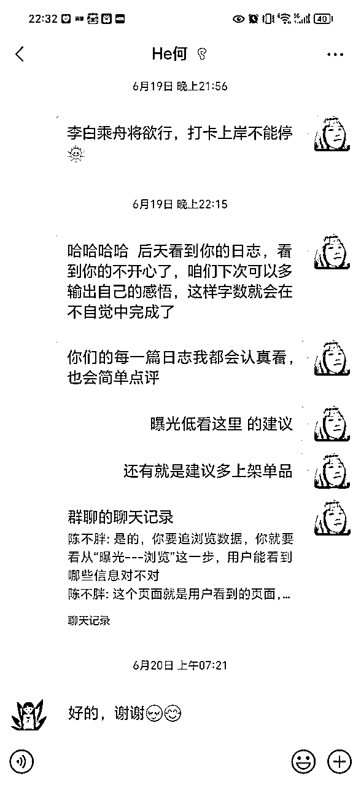

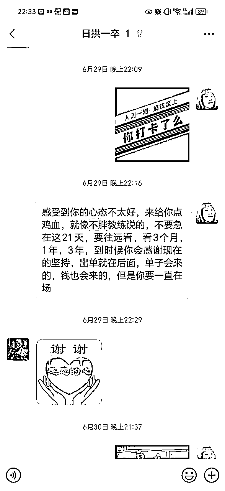

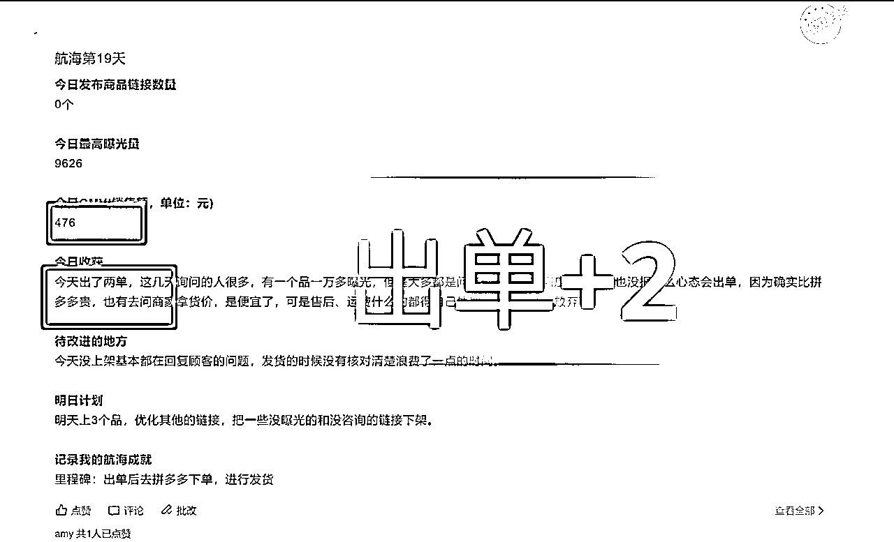

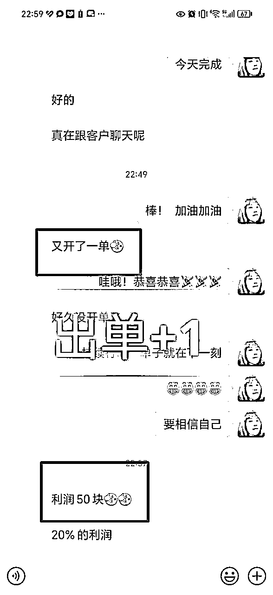

这些画面里都有我过去的身影，但那21天里我学到的东西，比过去两年都多。从结果倒推，闲鱼项目变现的关键就六个字：执行力+不放弃。每天看这30多个案例，自然就明白哪些动作拖后腿、哪些动作加速结果，我跟着调整，进度想不快都难。

再来说听话照做。闲鱼的门槛低到让人意外：上一批学员都是小白，大概第五天就陆续开单。你不用会精美制图，也不用天生会选品，只要做到四个字——听话照做。

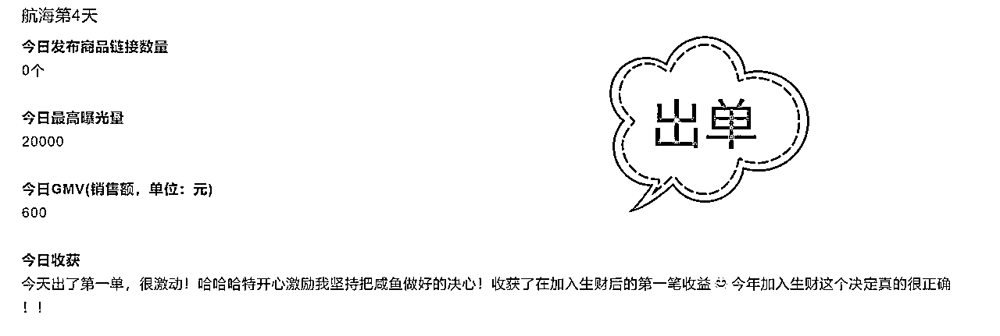

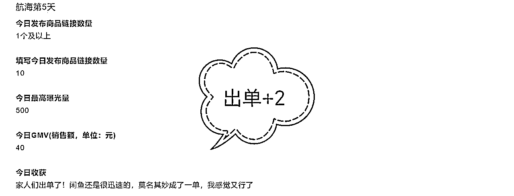

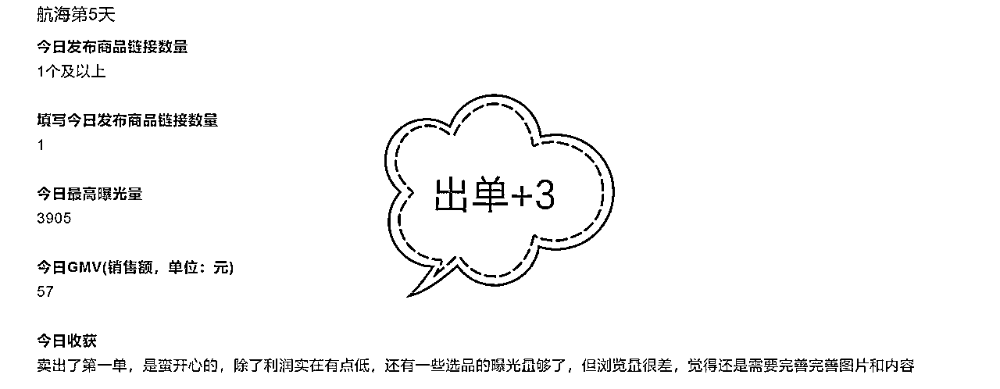

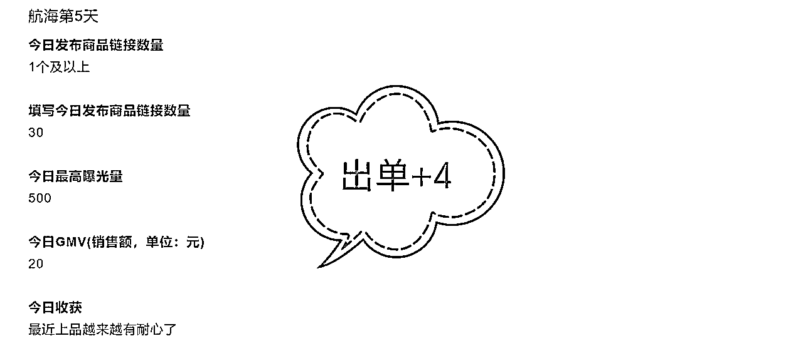

航海手册等于一份傻瓜式说明书，注册、上架、选品、售后话术全部齐全，都是大佬们验证过的经验，直接照做就行。没经验也不用怕，航海直接给了60个选品，挑一个之后去评论区找买家秀，选画面干净、产品主体清楚的照片当首图；文案就写“处理”“低价清仓”这类词，或者直接用99元、65元这样的数字标价。货源按教练建议去拼夕夕进，因为它售后靠谱，退货换货都不折腾。开通拼夕夕的“先买后付”后，付款周期基本和闲鱼到账同步，客户就算不提前确认收货，我也几乎不用垫钱，等10天自然到账，根本不用催。

新手前期一定要保持上架频率，最好每天更新3到5个品，做不到就1到2个，尽快把50个坑位填满（没开鱼小铺时上限是50个）。上满后开始做优化：曝光差的就换封面、换文案，或者直接下架换新品。让店铺里剩下的全是数据好的品，这样权重才能涨，流量才会来。

当然，光听话照做还不够，还要守住三个基本点。

第一，了解产品。很多新手上架前会纠结三件事：

- 这个产品我不懂，也不喜欢，要不要上架？——别急着拒绝，先去查查市场数据。需求够旺，就值得干，毕竟赚钱的机会不会等人。
- 上架了，可我一窍不通怎么办？——赶紧去详情页把每个字都看一遍，把自己逼成半个专家。
- 客户问东问西，答不出来怎么办？——拼夕夕客服就是你的外挂，回复速度飞快；这家不回就换一家，还能顺便学他们的销售话术。

第二，售前话术。先搞清楚客户想要什么，每句回复都带上卖点，对方确认款式后别忘了夸他。遇到砍价的，适当松点口。闲鱼买家普遍追求“便宜”，但重点是要让他感觉占了便宜，而不是真的亏本大甩卖。如果让完价自己赚不到钱，那这单不做也罢。所以定价时可以先留出让利空间，客户嫌贵就降5块10块，对方心里舒坦了，成交也就顺理成章。

第三，做好服务。服务做到位，客户会变成回头客。不管对方买不买，都要让人如沐春风；不买也热情送客，补一句“有需要再来”。成交后及时和发货方对接物流，客户如果催得急，你就多盯一盯。对方收货满意，复购自然就来了。

以上就是我做闲鱼的一点心得。写这篇分享时，9月第一周已经完成过万销售额，含一笔4000多的团购，每天还能稳定出2到3单。这次真的靠着闲鱼赚到了未来两年的门票，虽然只是个小起点，但我已经很知足。

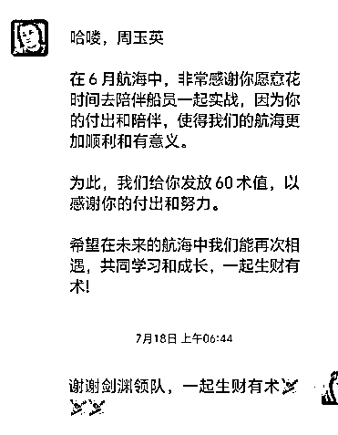

感谢靠谱帮我做定位，感谢芷蓝姐指导我写作，也感谢雪雪运营对本文提出的建议。也感谢赚钱认可我的志愿者工作，奖励了60术值。未来继续一起在龙哥盟实战航海，加油！