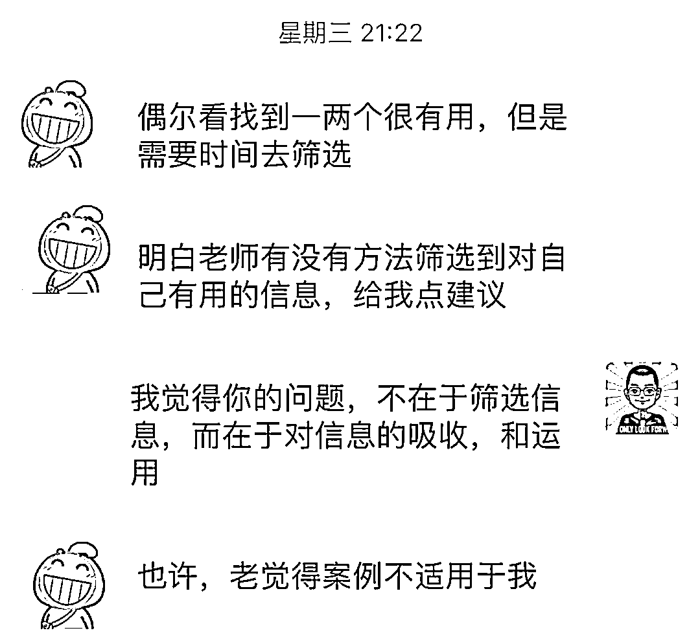
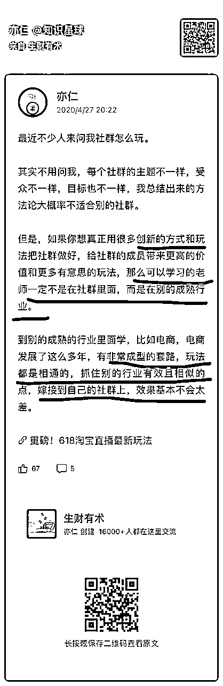
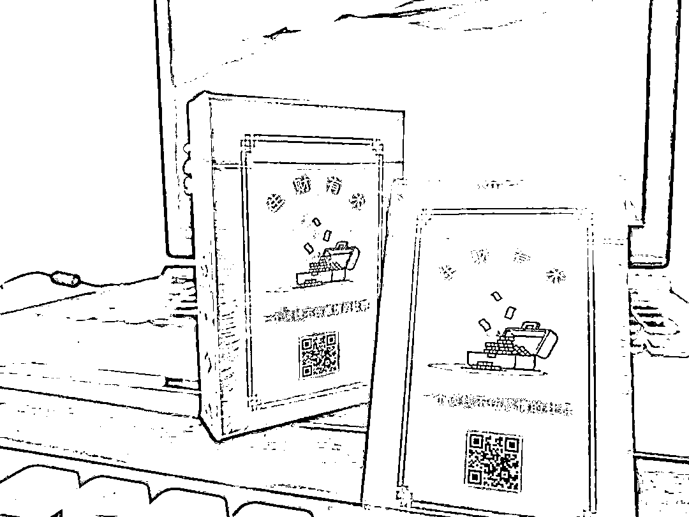
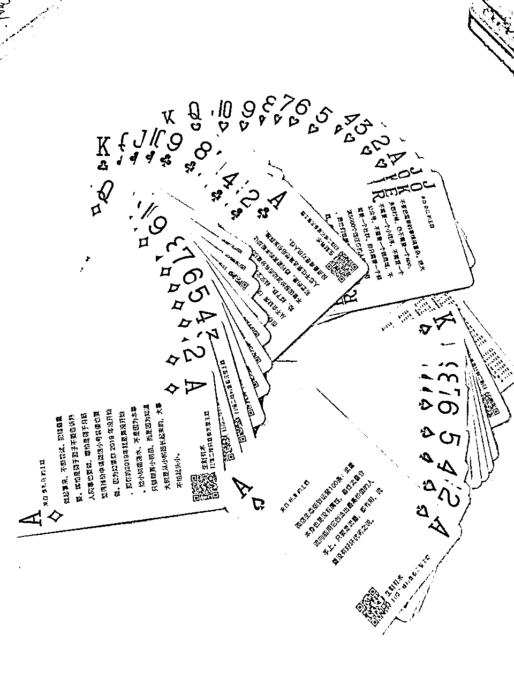
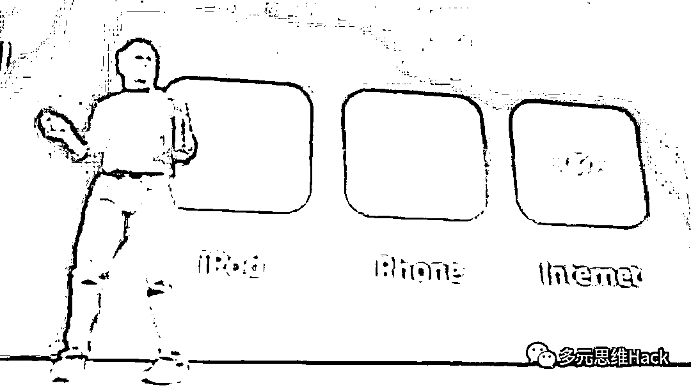
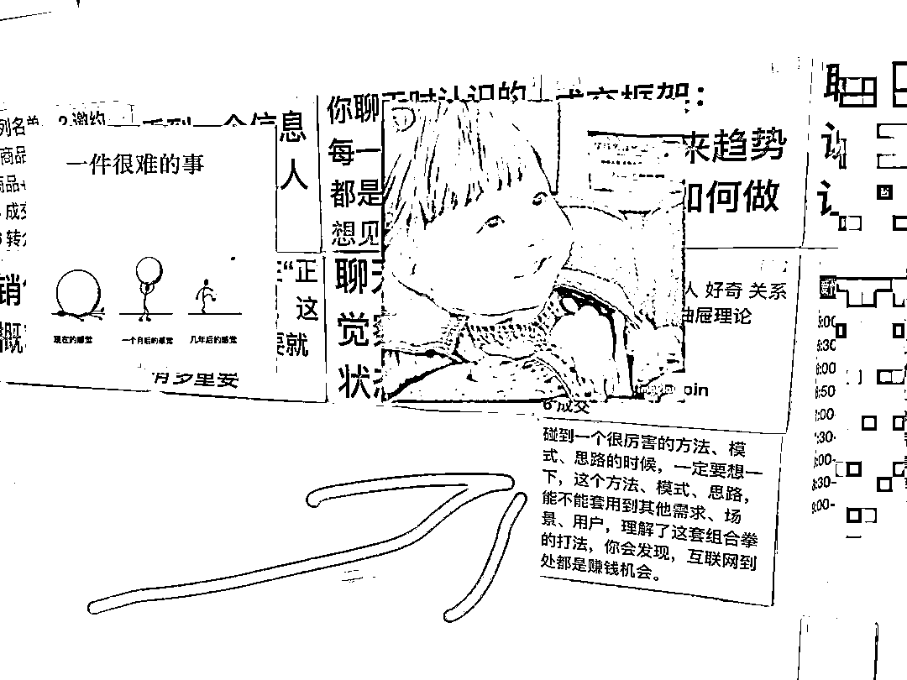
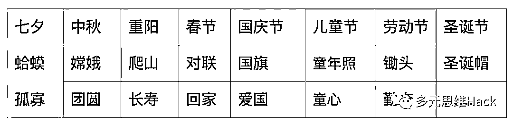
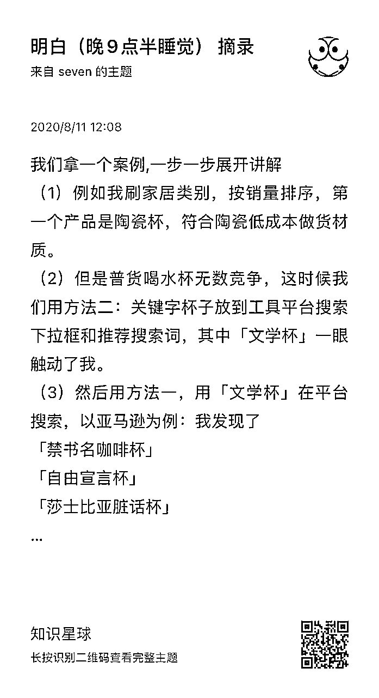
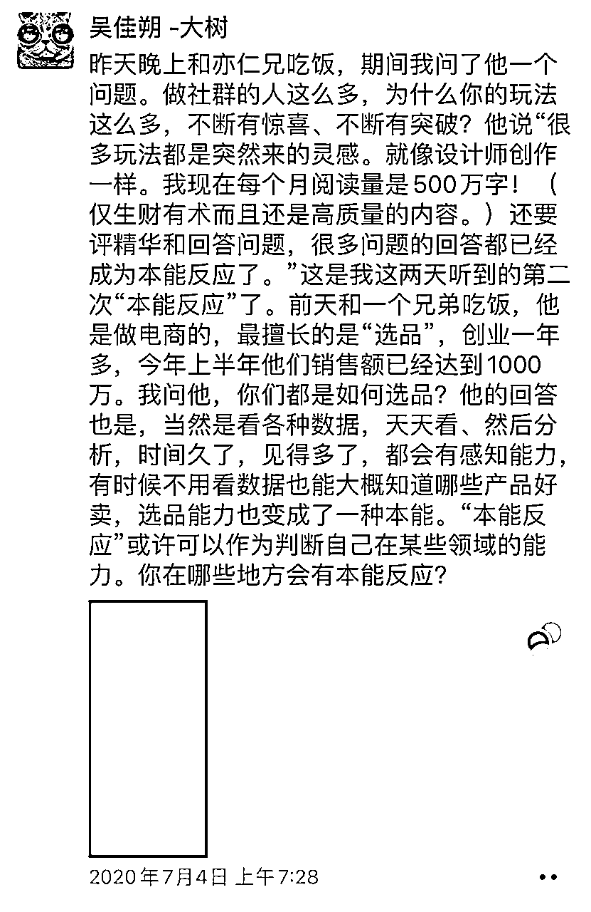

# 如何参考其他行业的成熟套路，举一反三帮自己拓展出更多赚钱思路？

大家好，我是龙哥，龙哥盟第8期老圈友。

前几天和一位朋友聊天，她说自己副业折腾很久，总在原地打转；案例看了不少，但套到自己身上就失效。我想到龙哥四年前发过的一条帖子，或许正好能解开这个结。

很多人学案例，习惯停留在表面的“术”。一旦看不到和自己完全一样的项目、用户、流程，就会觉得“这招没用”。可现实里，哪有两个项目能一模一样？同一套打法，两个人执行，遇到的坑也各不相同。真正要学的，不是别人的操作细节，而是背后的原理。把原理抽出来，才能在不同场景里灵活借用，让别人的经验为我所用。

今天，我把自己关于这个问题的思考整理了一下：从用户、需求、场景这三扇门进去，可以拆出很多赚钱的idea。

先回到龙哥那条老帖子。

龙哥当时说：社群要玩出新花样，不妨去看看别的成熟行业是怎么做的。

乍一听有些反常识。一般人做项目，第一反应是研究同行，因为同行离得最近，方法最容易抄。可龙哥偏说要去别的行业找灵感，这让人摸不着头脑。

后来我想通了：同行之间的玩法太像，用户早就看腻了；反倒是别的行业那些成熟的打法，搬到自己的领域里，会产生一种“原来还能这样”的新鲜感。

顺着这个思路往远处推，我发现它不仅能用来做社群，还能用来找赚钱路子——甚至可以说，用好了，能衍生出上千种赚钱的打开方式。

这篇就来拆一拆：所谓“参考其他行业”，到底怎么做？背后的原理是什么？怎么把它迁移到赚钱这件事上？

如果你正在找副业，想拥有独立赚钱的能力，或者在事业、副业、赚钱的路上卡住了，希望这篇文章能给你一些启发。

# 1 龙哥盟怎么把“别的行业”搬进来？

按常理，做社群就该盯着其他社群抄。可龙哥偏不。我们不妨看看龙哥盟的产品，是不是真藏着其他行业的影子。

## （1）阶梯式涨价

龙哥盟第一期，圈子年费定在365元，每多100人加入，价格就上浮100元。

这种玩法，在当时的社群里算得上罕见，效果也很亮眼。它不像抄同行的，倒像从零售业借来的：

一家服装店，100件衣服时每件卖100元；剩50件，每件卖120元；剩10件，每件卖200元。库存越少，稀缺感越强，定价权就越大。

龙哥盟借的是同一个“稀缺”逻辑，只是把变量从库存换成了人数。人越多，说明社群被认可的程度越高，价值感越强，价格自然水涨船高。

## （2）赚钱日历

做内容社群，同行常规操作是出合集、出电子书、印实体书。赚钱日历却换了一个载体，把每天的内容做成日历，这明显是向豆瓣日历之类的文创产品借的灵感。

结果也证明这条路走得通：2021年赚钱日历卖出了60000册。后来的赚钱扑克，同样是向实体潮玩借的形式。

## （3）会员日

每年的4月18日，龙哥盟会拿出近万元奖品做抽奖。这个玩法，在社群圈子里也算少见。它的原型，可能来自公司每月的团建——用固定节点来凝聚团队、制造氛围。

同样，大航海计划是从企业立项里找的灵感，龙珠、夜话、线上团队等玩法，也都能在不同行业里找到相似物。

当然，以上只是我个人从外部观察做的推断，未必准确，甚至可能猜错。

但这不妨碍我们确认一件事：跨行业借鉴这条路，确实走得通。

也有人说：这些玩法我都见过，早不新鲜了。很正常，个例说明不了什么。创新不需要讨好所有人，只要大部分目标用户觉得“有意思、有价值”，就已经赢了。创业本来就是概率游戏，没有100%稳赢的剧本。

所以，龙哥那句话是对的：想做出创新玩法，就去参考其他成熟行业。

# 2 为什么跨行业借鉴能奏效？

我始终觉得，学一个方法，不光要知其然，更要知其所以然。只有把原理吃透，才能根据自己的情况调整，否则一句“参考其他行业”根本落不了地——行业那么多，案例那么多，到底参考什么？怎么参考？

那背后的原理是什么？

万维钢在《精英日课》里给过一个公式：喜欢=熟悉+意外。

人天然喜欢熟悉的东西，这是心理学里的“多看效应”。完全陌生的东西，会触发本能的不安，就像人面对未知时会紧张一样。

所以，做一个让人喜欢的产品，第一步是让用户觉得熟悉；但光熟悉还不够，还得加点意外，让用户“咦”一下。

当年乔布斯发布iPhone，说它是“iPod+Phone+Internet”。

iPod是熟悉的，Phone是熟悉的，Internet也是熟悉的，但把三样拼在一起，用户就会想：这也行？这一愣，就是意外。惊喜感就是这么来的。

用在自己的事情上：你在本行业里做事，用户天然觉得熟悉；这时引入一个跨行业的陌生玩法，用户就会觉得新奇、有意思。反过来，天天抄同行，用户看过太多，自然谈不上惊喜。

熊彼特在《经济发展理论》里也说：创新=旧元素+新组合。

本行业的东西是旧元素，其他行业的东西也是旧元素，组合起来，就成了新东西。乔布斯也说过类似的话：创新不是凭空造物，而是把已有的东西连点成线。

所以，跨行业借鉴之所以有效，本质是在“熟悉”里加了“意外”，让用户眼前一亮，价值感也随之放大。

不过，知道原理还不够，还需要一个可以上手的操作框架。别急，继续往下看。

# 3 举一反三，其实有套路

2020年赚钱日历里，我写过一段话：

当我们碰到一个很厉害的理论、模式、产品时，一定要想一想：这个理论、模式、产品，能不能套用到其他需求、场景、用户上。理解了这套组合拳的逻辑，你会发现互联网到处都是赚钱机会。

这段话，我曾经贴在墙上，每天至少看100遍。

它其实就是在讲“旧元素+新组合”的具体操作：看到一个厉害的东西（旧元素），然后把它换到别的需求、场景或用户身上（新组合）。

具体可以从三个角度切入。

## （1）用户变了，价值就变了

一个被验证过的东西，换一个用户群，往往会生出新价值。

比如我那门《不用写代码的爬虫课》，原本是给程序员抓数据用的。但换个用户群，价值就完全不一样：

- 运营可以拿来搜集热点，策划活动；
- 产品可以拿来整理用户反馈；
- 设计可以拿来批量下载素材。

人性是相通的：程序员想提效，运营、产品、设计同样想提效。关键是看透产品的底层需求，再针对不同人群重做功能和服务。一旦这样想，机会就藏在人群的切换里。

## （2）场景换了，玩法就活了

前面卖衣服的案例，核心逻辑是“随某个变量调整价格”。这个逻辑不只能用在服装店：

- 龙哥把它挪到社群，变量变成人数，价格跟着涨；
- 我把它挪到课程，变量变成销量，价格也阶梯上调；
- 还可以挪到运营活动，变量变成参与人数，门槛随之提高。

这里的关键，是先抽离出底层原理，再问自己：哪些变量要换？为什么换？换到新场景后怎么调整？想清楚这些，剩下的就是执行和迭代。

## （3）需求变了，组合就新了

2020年“七夕孤寡蛤蟆”活动火过一阵。把它的元素拆开，可以连到许多相近的需求上——

然后就能继续问：这套活动的方法，能不能换到别的需求上？

更详细的拆解，可以看我写过的那篇《七夕孤寡蛤蟆日入10万，人人可复制的赚钱思路》：https://t.zsxq.com/Yx8Pb

以上三点只是抽象的思考框架，具体细节还需要自己去研究。

顺嘴说一句：用户、场景、需求这个框架，也不是我的原创，我是从龙哥的文章里学来的。

# 4 怎么用这套思路，变出1000个赚钱路子？

回到龙哥的帖子：做社群，可以去参考其他行业。

这句话细想之下，其实是个无限游戏——“其他行业”是一个无穷无尽的元素池。

既然原理已经清楚了：喜欢=熟悉+意外。那做任何事，都可以从用户、需求和场景出发，去别的行业里找一个成熟的模式或产品，嫁接到自己正在做的事上（熟悉+意外），形成一个新组合。

赚钱也一样。

举几个例子：

颜过老师在星球里分享过两个跨境电商案例：

（1）剃须刀的功能，搬到理发场景里，变成了光头神器。

（2）卷发棒的功能，搬到胡子场景里，变成了打理大胡子的工具。

seven老师分享过他的亚马逊选品思路：把文学元素印到杯子上，就成了各种细分主题的文学杯。

我2019年升级爬虫课时，虽然它是一门技术课，但我参考了大量理财、成长、副业类课程和书籍的做法。我把自己课程的功能点、卖点全部罗列出来，再和别人的优点一一配对，反复组合，最后才有了那版课程。

发现了吗？这些思路简化后就是两句话：

- 我手里有一样东西，但不知道怎么让它更值钱；
- 我看到另一样好东西，把它的亮点拆下来，和自己的东西拼在一起。

甚至可以这么说：那些让人惊喜、让人喜欢、让人愿意付费的东西，多半是“拼”出来的。

再落到个人身上。

经常有读者问我：怎么找到自己的赚钱方向？每次我都会说：你身上一定有别人没有的东西——知识、技能、信息、兴趣、专业，这些就是“熟悉”的部分。你缺的不是方向，而是一个“意外”的元素。去别的行业、别的领域找一款成熟的产品或模式，从用户、场景、需求三个角度拆出几个元素，和自己的东西一组合，突破点自然就浮出来了。

但也会有人说：组合谁不会？知道了又怎样？还是不知道从哪下手啊。

这很正常，拼装看起来很轻巧，但有个前提：你得有料可拼。很多时候，我们不是不会拼，而是手里空空如也。

怎么有料？只能多看。多看需要什么？不是天赋，而是勤奋。

你知道龙哥每天要看多少信息吗？

（截图经大树老师授权，500万是笔误，实际上是100万。）

看得多了，脑子里的元素自然就多了。等需要的时候，它们会自己跳出来，自动排列组合。不然，想破头也没用。

当然，光看还不行，还得带着目的拆解：它好在哪里？底层逻辑是什么？能不能换到我的场景里？这样看一条，顶别人看十条。

当一个人足够勤奋，他的“赚钱兵器库”会越来越厚，能用来组合的元素越来越多，赚钱的思路和方法也就源源不断。这样的人，怎么可能赚不到钱？

这篇文章，除了聊创新，还有一层更重要的意思——

通过拆解龙哥“参考其他行业做社群”这个案例，我们能真切感受到：高手之所以看起来举重若轻，背后靠的不是天赋异禀，而是日复一日的积累。

这个认知很重要。否则你会以为赚钱高手都是灵光一现的天才。真不是。他们靠的是耐心、勤奋和死磕。

所以，如果你想进步得快一点，不用去找捷径，像龙哥那样勤奋就够了。时间会把你推到高手那一列。

# 小尾巴：历史介绍~

我是明白，龙哥盟8期老圈友，星球编号20。

程序员出身，目前自己创业，做一个成长社群《日新月异俱乐部》。

下面是我在赚钱的27篇精华帖合集，也算是我的成长记录。感兴趣的话，点链接就能看到——

2024年（x1）

1. 《参加航海实战，如何让自己每天都有正反馈？》https://t.zsxq.com/9e2ns

2. 《详解：写作和赚钱的4个关系！看完你一定会忍不住想开始写！》 https://t.zsxq.com/192OLDlds

3. 《7年赚钱拉新1100+，我只做对了一件事》https://t.zsxq.com/19SqL7McC

4. 《当思考成为习惯，赚钱会更容易》https://t.zsxq.com/19vgyk7cp

(这个还没得精华，但我觉得写得很好哈哈，是赚钱最重要的一个环节）

2023年（x1）

1. 《身体残疾卧床3年，我在人生最低谷加入龙哥盟，有哪些成长？》 https://t.zsxq.com/19KWDvzz0

2021年（x3）

1. 《复盘 | 龙哥3年前的帖子，帮我每月被动收入1万块》 https://t.zsxq.com/19jaotwbv

2. 《嘉宾问答|“想去更好的公司，我该如何利用好时间？”》 https://t.zsxq.com/1952Q3a92

3. 《2883人向朋友介绍龙哥盟时，说的最多的16个词！》 https://t.zsxq.com/19MYWwvCl

2020年（x6）

1. 《产品想要获得更大收益，应该不断向用户的真实需求靠近》 https://t.zsxq.com/19kQ7NILy

2. 《我的2019：普通人如何培养自己的用户视角？》 https://t.zsxq.com/19fyFdZRL

3. 《如何通过分析成功案例，帮自己建立赚钱清单》 https://t.zsxq.com/19FNjtIjB

4. 《思路详解：如何为某个细分领域用户提供产品，并赚钱》 https://t.zsxq.com/19qoI1🐧B

5. 《学习和赚钱是什么关系？》 https://t.zsxq.com/19uQcuMzJ

6. 《5000字深度拆解 | Manchuan👸号2个月涨粉百万，普通人如何复制？》 https://t.zsxq.com/19cD1keUB

2019年（x8）

1. 《在龙哥盟，普通人如何从0到1，培养赚钱思维》 https://t.zsxq.com/19rA0kWrD

2. 《龙哥盟第3期，我是如何做到邀请245个用户的？》 https://t.zsxq.com/1968tlTAx

3. 《👸号和抖音之间的赚钱机会》 https://t.zsxq.com/19OfzDckK

4. 《可复制，零门槛 | 如何借别人的流量，打造一个稳定的被动收入系统》 https://t.zsxq.com/19sVRn6Yx

5. 《做自己擅长的事，把技能树打通，然后再去赚钱》 https://t.zsxq.com/19evWC1Xl

6. 《信息整合：一个可复用，低门槛的成熟商业模式》 https://t.zsxq.com/192zoSooT

最近挖到一组被很多人忽略的实操笔记，内容很干，全部是关于低成本获客、产品认知和赚钱思路的。虽然有些时间比较早，但方法论没怎么变，值得反复琢磨。

先分享一个最有启发性的点：把数据当成需求的抽象化表达。如果你正愁没有赚钱方向，可以尝试从数据反推用户要什么，据说能快速找出100种想法。具体拆解在这：https://t.zsxq.com/19QrIpsuC

接着是关于产品命名的底层逻辑：好名字唯一的目标，是帮用户节省理解成本，而不是追求所谓的高级感。这个观点讲得特别透：https://t.zsxq.com/19QUBrDOT

另一篇推荐了一款叫WebScraper的软件，让非技术朋友也能轻松完成爬虫级别的数据采集，对运营来说非常实用。https://t.zsxq.com/19RSl40n5

2018年的三条案例同样够劲：有人专门分享了定向抓取精准🛰️号的操作方式，不是普通加粉，而是有效筛选。https://t.zsxq.com/19sKQT9bF

有人讲述了怎样用几乎零成本，做出一个超过一万人的付费学员盘子，过程非常值得参考。https://t.zsxq.com/198XWAGhV

还有从36个小而美赚钱项目里抽出的蛋黄酥白皮书，把单品的整套玩法拆得很细。https://t.zsxq.com/19G4PKUXr

这些内容放在今天，依然能帮助你降低认知门槛、找到精准用户、用更小的成本撬动付费转化。需要的朋友，可以把链接存下来慢慢看。