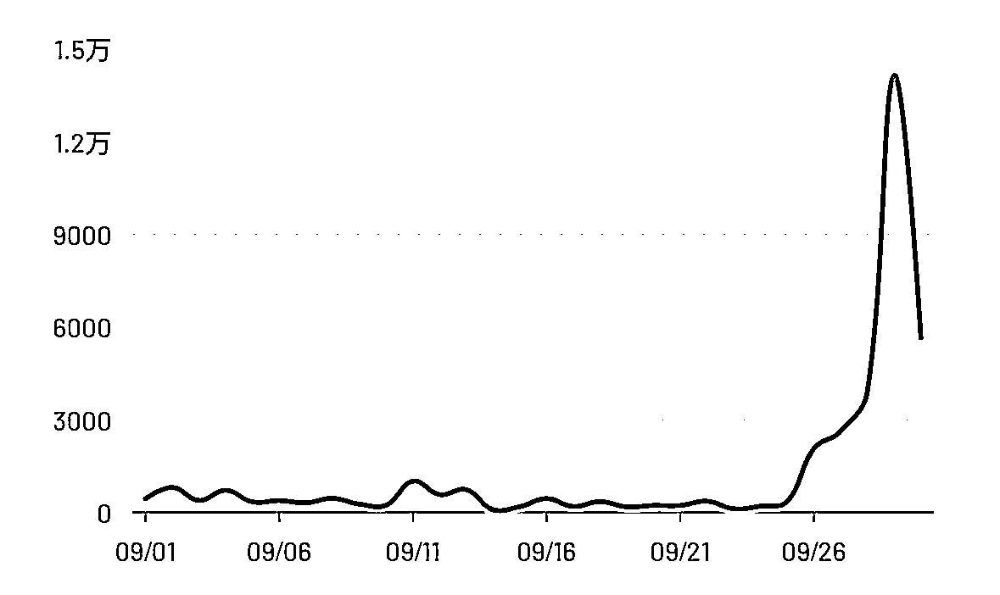
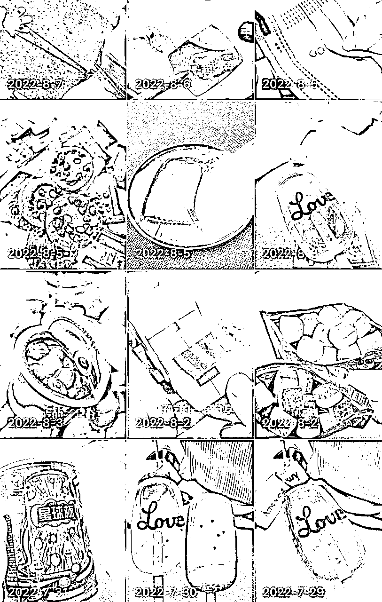
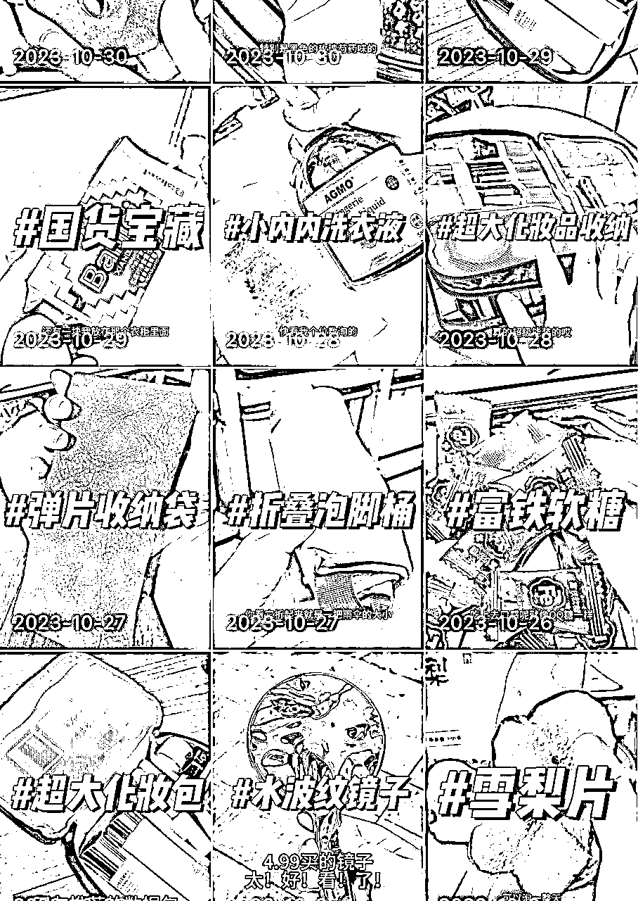
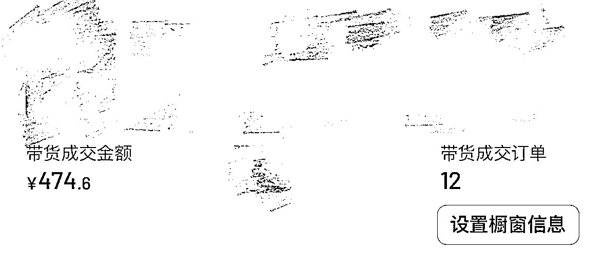
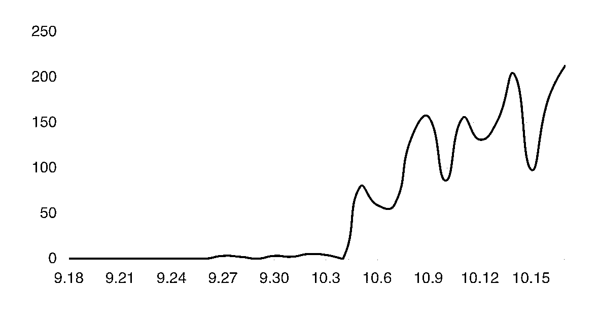
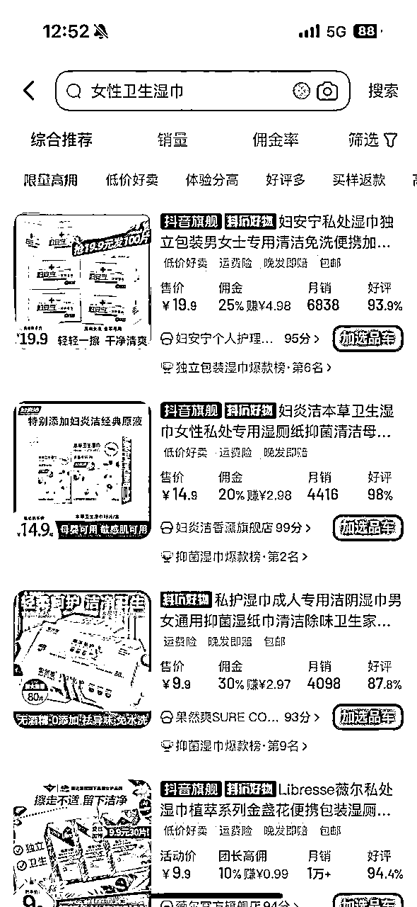
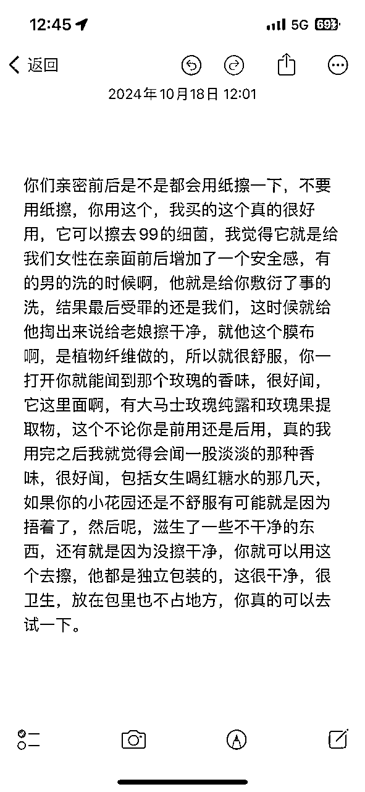
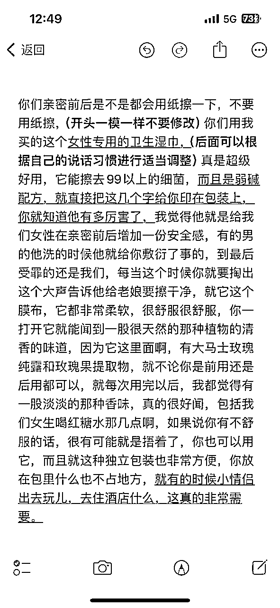

# 从月入3千到15天赚1.5W：一个三线宝妈在抖音带货圈的“逆袭”手记

老实说，我从没想过有一天自己也能以“圈友”的身份坐在这儿分享经验，哈哈！

先做个自我介绍吧。我是龙哥，坐标某三线城市，一个白天上班、业余搞副业的宝妈。大学毕业后这些年，我啥都折腾过——📕、微商、代购、二手奢侈品，如今的重心全押在了抖音带货上。

不绕弯子，直接说战绩：报名参加「抖音精致达人」航海项目的第15天，我爆单了。而且一次爆俩视频——一个跑到了11万播放，另一个也有7万，半个月下来账号直接进账1.5万。给大家看看我9月份的数据曲线。

9月13号发了加入航海之后的第一条视频，9月26号就有一条突然炸了。

* * *

## 时间拉回两年前：那些跌跌撞撞的日子

其实我碰抖音带货已经整整两年了。22年那会儿，刷到一个博主晒自己小号的日入战绩——你们猜多少？每天2-3k。说实话，那会儿看到这个数字，对比自己每月工资，说不心动是假的。然后我一个连电商都没碰过、拍视频都手抖的纯素人，就这么一头扎进去了。

当时选的是零食赛道。为啥？客单价低、容易开单、退款少，而且一大批博主都在喊“新手友好”。那时候抖音上真人出镜的带货博主还不多，哪有什么“精致达人”概念，满屏都是桌拍流。虽然那个日入2-3k的博主就是真人出镜，但我当时认知水平实在有限，压根没看懂这背后的降维打击逻辑，还是老老实实做了个不出镜的桌拍号。

结果呢？闷头拍了快一年，单量惨到没法看。

到了23年，我转战百货赛道，运气不错押中了一个特别小众的品，靠它零零散散出了几千单，其他品偶尔也能蹦几个单出来。

今年加入赚钱之后，我疯狂刷了大量带货精华帖和航海手册。4月份的时候搞出了一个香薰蜡烛小爆款，单月GMV最猛冲到20万。可惜啊，我没有复制爆款的能力，等到参加航海之前，GMV已经滑落到一个月3千块了。

直到这次报名了抖音精致达人航海——里面全是能直接落地的实操干货，每条视频教练都会带着复盘，再加上我自己这几年攒下的经验和认知，一下子全打通了，才有了这次的爆单！

## 这趟航海到底经历了啥？

进群第一件事，是被拉进新手群。新手群里有专门给新人准备的爆品池，照着教练给的清单去申样就行。拿到样品之后，按照表里提供的对标视频去拍。拍完发群里，教练会一对一拆解我的视频问题，给修改建议。

在新手群发了大概两三条视频，教练就把我拉进了冲刺组——那边基本都是水平更高的同学了。接着继续拍冲刺组的爆品。到现在我一共带了10个爆品，拍了41条视频。

下面我从「经验篇」「行动篇」「心态篇」三个方面，把这趟航海的完整心得分享给大家。

* * *

### 经验篇：爆单凭什么？

#### 1、爆单的地基：选对品

没加入航海之前，我的选品构成是这样的：50%来自精选联盟，40%盯着对标账号，10%等后台商家邀约。

看着好像没啥大问题？但真正自己选过品的人才知道坑有多深。

第一，你的选品大概率是你的品味，你喜欢不代表市场买账。而且自己对接商家的话，还得随时交作业，拍摄节奏完全被打乱，太被动了。第二，好不容易碰到一个你喜欢市场也喜欢的品，热度可能已经过了，流量早就凉了。第三，有些数据很漂亮的品，其实是投流喂出来的，自然流根本跑不动。第四，品类太杂的话，每个品类的拍法都不一样。对于等级还低的达人来说，选品在精不在多，得测出真正适合你的品！如果某个品带来的流量比你以往视频高个两倍左右，出单量也多了一倍——这种品你就死磕它，反复拍，天天发都不过分！

现在我干脆不用自己选了，直接挑教练们整理好的品，上面那些坑一次性全绕开了。

不过，我这次爆单的品并不是选品池里的——聊聊我的选品逻辑。

1、之前我用非爆款文案拍过这个产品，居然出了十几单。这对我来说就是个强烈信号：这品有市场。我随手拍的都能出单，那要是换成爆款文案再拍一遍，不就等于有机会再炸一次？底层逻辑很简单——拿一条经过市场验证的爆款文案，去超过那条出过单的视频。

2、还有一点，我注意到我的对标账号拍这个产品也爆了。这又是一个信号——说明这个产品近期卖得正猛，平台正在往这边推流。

3、另外一个很关键的加成：我之前同类型的产品出过爆款。比如你以前带过女性卫生湿巾火了，那其他牌子的女性卫生湿巾也都值得试一试。

#### 2、出单的密码：抄爆文

说出来你们可能不信，我这个爆单产品，之前断断续续拍了快5次，一次都没爆过。

以前我是真看不出自己视频有啥问题，只是隐约觉得水平差了点意思。直到航海教练给我把了脉，一针见血指出两个问题：文案和选品。听完我就想明白了——之前出过单的品，卡在文案上；那些死活不出单的，是选品没选对。

选品刚才聊过了，现在重点说文案。记住一句话：必须抄爆款文案！必须抄爆款文案！必须抄爆款文案！因为只有市场拿真金白银验证过的东西，才是能赚钱的东西！

但要抄，就抄近7到15天内爆过的文案！时间隔太久的早就凉透了，别去捡剩饭。

具体怎么抄？我举个例子。这是一个爆款文案原版：

这是我改完之后的版本：

开头必须一模一样地保留，中段的卖点和结尾的促单可以根据自己的说话节奏微调一丁点，但绝对不能大改。

航海群里，教练每天雷打不动分享最近爆掉的文案和热门视频，你只需要无脑1:1抄作业就行，省时又省力！

#### 3、流量密码：高质量出片

加入航海第三天，我就明显感到自己以前拍的视频质量上不了台面。以前怎么拍？一个人坐在固定位置对镜头念稿，最多加几个画中画的产品特写，然后就没了。

跟着教练分享的爆款视频拍了几条之后，我才后知后觉——原来每一帧画面背后都有讲究，构图、妆造、打光、场景、黄金前3秒……全是环环相扣的。任何一环做到位了不够，得每环都做到尽善尽美，整条视频才立得住。

最后总结一下：抄爆文、选爆品、能出片，这三样缺一不可！

1、选品：锁定近15天内有达人爆过的品——爆单的人少，竞争就小。
2、开头3秒＋文案：直接套用同类产品里爆过的开头和文案，最好是近7-15天的。或者用能通杀的万金油文案。记住，市场验证过的才是永恒真理。
3、视频质量：你的画面质感至少要贴近甚至超过对标视频，这直接决定了你的作品能不能跑出去。

* * *

### 行动篇：说干就干，把时间切成块

我相信屏幕前很多人都想搞份副业——谁嫌钱多啊！但紧接着就是一连串的担心：没时间、怕做不好、觉得抖音太卷了。

我其实不是什么时间管理大师，也经常焦虑今天又没完成任务，觉得时间被切得稀碎，没有完整的大块时间干正事。

但我有个习惯：把时间分类，心里清楚什么时间段该干啥。

工作日——碎片时间看群消息、处理杂事；午休用来剪视频，剪完直接发；通勤路上输入学习，听书也好、播客也好、刷赚钱精华也好；下班后写复盘日记。晚上的主要时间给娃和家人，偶尔素材不够会抽空拍视频，平均每周砸在拍摄上的大概是3-4小时。

周末——利用孩子午睡的时间集中拍摄，一周大约5-6小时。

说真的，我花的时间特别少，产出自然也不多，要进步的地方还有很多很多！

但我的优势是行动力强。想到啥新点子立马就干，不管干得好不好，先干了再说。而且这两年年纪渐长，我越来越体会到积累和坚持的分量——只要你不下车，哪怕第一年毫无成绩，第二年多少也能混个脸熟，攒点经验；第三年说不定就碰上或发掘出赚钱这样的优质社群了。等到第四年、第五年甚至第十年，最初的目标一定够得着。

* * *

### 心态篇：不怕输，不下牌桌

做抖音带货，心态比什么都重要。

如果你动了开始的念头，那就从现在立刻去做。别怕失败，你不试试，连自己几斤几两都摸不清。

做零食那阵子，我这个纯新人每次拍剪都要耗掉大量精力，发出去却石沉大海。无数次反复点开后台看数据，没流量、不出单，那种失落感别提了，甚至严重自我怀疑，觉得这辈子跟抖音带货没缘分。但我很快把自己拽回来了——告诉自己，不能就这么认输。

做百货的时候，靠天天刷视频练出了一丢丢网感，看多了猪跑也算会跑几步，勉强能出些单，结果脑子一热学人投流，赚的钱全亏进去了，又不会复盘，爆款复制不了，认知太低了。

刷到别的博主今天小爆明天大爆，说不羡慕是假的。转头看看自己，连稳定出单都做不到，真的会陷入深深的自我怀疑：凭什么别人能爆，我连个水花都打不起来？

没错，我一直毛病不断，但正因为咬着牙没下牌桌，才有了后面的翻盘。

我不在乎别人怎么看怎么评价。认清自己几斤几两，定一个够得着的目标就好——因为我知道，自媒体就是普通人低成本撬动大财富的路子。心里有了信念，才走得动这条路。

当然，光有信念不够，还得有正确的方法论。加入航海之后，我才算真正找到了那条道。

首先，我的认知被彻底洗了一遍。搞懂了带货的底层逻辑，慢慢能看懂一个账号为什么能爆、背后是什么在驱动。其次，遇到限流、违规、卡审、规则突变这些糟心事的时候，有教练和同学们的实战经验兜底，帮我快速爬出来，接着冲。

虽然我现在依然还在摸索中，但我相信跟在坤哥团队后面，会越来越好的！

* * *

说句掏心窝的话，从我今年1月进赚钱那天起，就在等着抖音短视频带货航海。之前也买过别的课，全是天马行空的理论；蹲过直播间，知识碎片化到离谱——今天听一嘴选品，明天听一嘴文案，完全没有针对性。

加入航海之后是什么感觉呢？就像一条在海上漂着的小船，前面忽然出现一艘大船——方向给你指好了，油也给你加满了，你只管把好舵就行。

抖音现在越来越专业化和商业化了，单打独斗真的很难。如果有团队帮你搞定专业化那一摊子事，你只管专注在拍摄和剪辑上——这两股力量合在一起，绝对是一加一大于二的效果。

我还记得坤哥说过，抖音精致达人这条赛道是有门槛的。你得投入足够长的时间去磨练表现力、剪辑力、拍摄力这些综合能力——这是一件长期主义的事情。而我呢，恰好就是个更适合长期主义的人。我也坚信抖音短视频带货的生命周期起码还有5到10年，所以——大家一起加油吧！