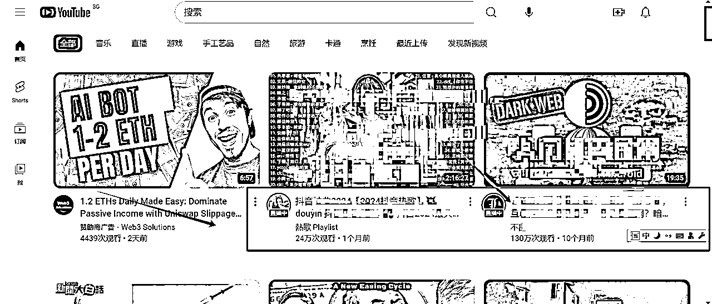
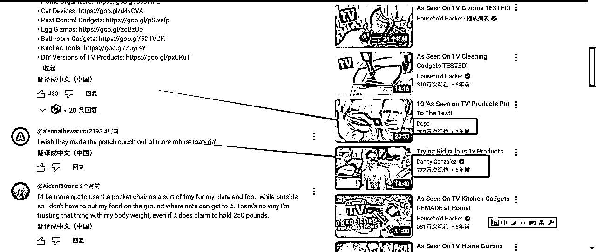
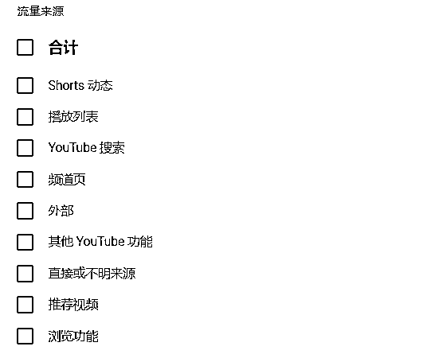

# 小白零基础入局 YouTube，从0到1的实操思路

先说结论：想起号，别一上来就死磕算法。你要先把人引进来，再让 YouTube 发现你。

前一篇已经讲清了底层逻辑，今天就聊点落地的。先看一个业内人士的原话，Todd 是 YouTube 算法方面的权威。

他是这么说的：

> 如果一支视频从外部链接来了很多流量，但完播和留存很差，会不会被判定为劣质？不会。
> 我们判断推荐的核心，还是基于我们自身的推荐流和搜索流。给每个观众推什么内容时，外部来的流量基本不会被计入考量。

翻译成人话就是：外部引流是能用的，而且是起步阶段的利器。但 YouTube 的推荐体系里，这个权重极低，几乎不影响你能不能上推荐。

那到底什么才算进推荐体系？很简单，就是用户在 YouTube 内部的行为。

上面这张图里，红色箭头指的两个位置就是典型的推荐位。另外，右下角的推荐卡片、Shorts 混猜页、以及用户主动用关键词搜出来的结果，都属于内部流量。这些才是算法真正会看的信号。

明白了这个区别，策略就清晰了。

第一阶段：用外部渠道做冷启动，把人骗进来。
网站、Facebook 群组、X、Telegram、🛰️群、🧣，都可以拿来发你的 YouTube 链接。目的不是看完，而是让他点进频道、点一下订阅。哪怕一开始留存低也没关系，先把第一批种子用户喂进去。

第二阶段：把外部用户转化成内部行为。
别指望外部来的僵尸粉能活。纯买粉、纯互粉在 YouTube 风险很高。更稳的做法是小团队抱团，几个人一起做内容，互相通过搜索和推荐去看对方的视频，这样出来的观看时长和互动才算数。

YouTube 后台会明确告诉你流量来自哪。打开分析就能看到推荐流量和浏览流量占比。一旦这两项开始抬头，就说明号活了。

如果你懂 SEO，YouTube 搜索这条路性价比也非常高。搜索来的流量同样会被纳入推荐模型，是一个长期可做的方向。

之前聊过，决定推荐量的核心永远是：内容被机器和用户同时认可。怎么做？就一个词：多发。

更新频率就是曝光量的基础。视频越多，被推的机会越多，沉淀下来的长尾也越多。早期用数量换概率，后期再用精品做放大。只做精品但隔三差五才出一支，很快就会被别的新号抢走注意力。

一个频道要活下来，持续更新是底线。

最后分享一个很典型的留人套路，算是认知操盘的案例。

吃播博主尼古拉斯·佩里，网名尼可卡多/牛油果，多个账号加起来粉丝超 860 万，总播放破 25 亿。

他过去几年把自己从 140 斤吃到 360 斤，胖到走路要靠助力车，咳嗽一声都可能伤到肋骨。

然后在两周的间隔里，他发了一条播放 3000 万的视频：从 360 斤直接瘦到 140 斤。两周减 220 斤，显然不科学。

真相是，他早在 2022 年就开始减肥了，从那时起发的所有“吃播”都是减肥前拍好的存货。隔段时间放一期，制造一种他一直很胖的假象，让观众持续劝他减肥。

他在视频里还故意说 2023、2024 年减肥都失败了，进一步加重观众的无望感。

等反转一出，关注度直接爆炸。这就是典型的预埋内容 + 节奏把控 + 情绪反转的组合拳。高明的不是剪辑，是对观众心理的操控。

小结一下能落地的四个点：

1、前期靠外链引流，把第一批真实用户拉到频道并完成订阅
2、内容要持续输出，数量上来才能提高被推荐的基数
3、可以组小团队互相观看，但要走搜索或推荐路径，别硬刷
4、学会用内容钩子、反差和反转把人留在频道里