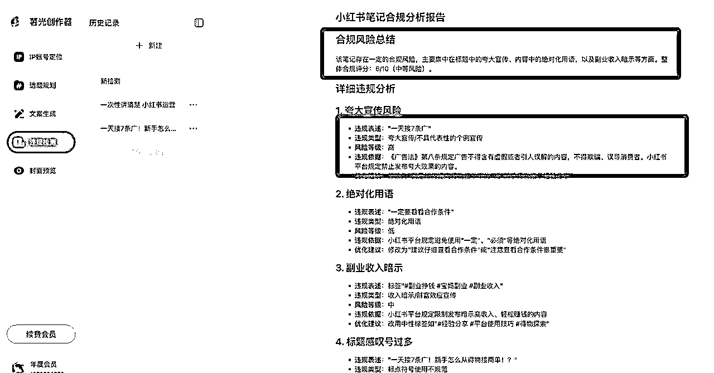
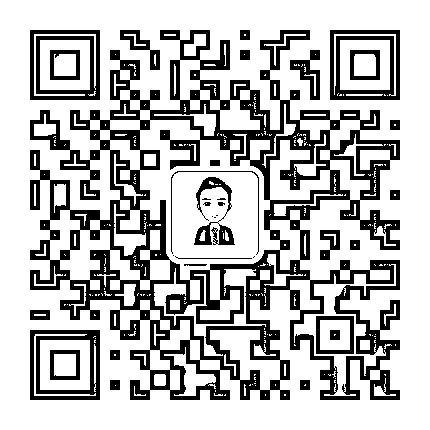
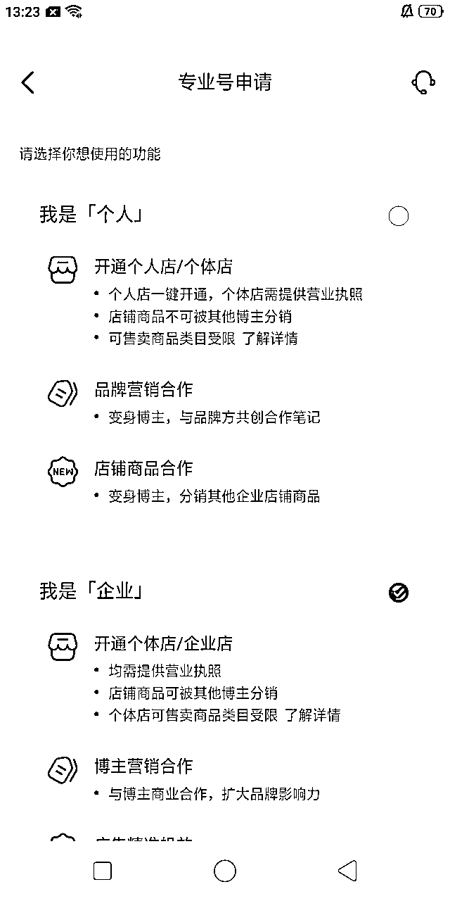
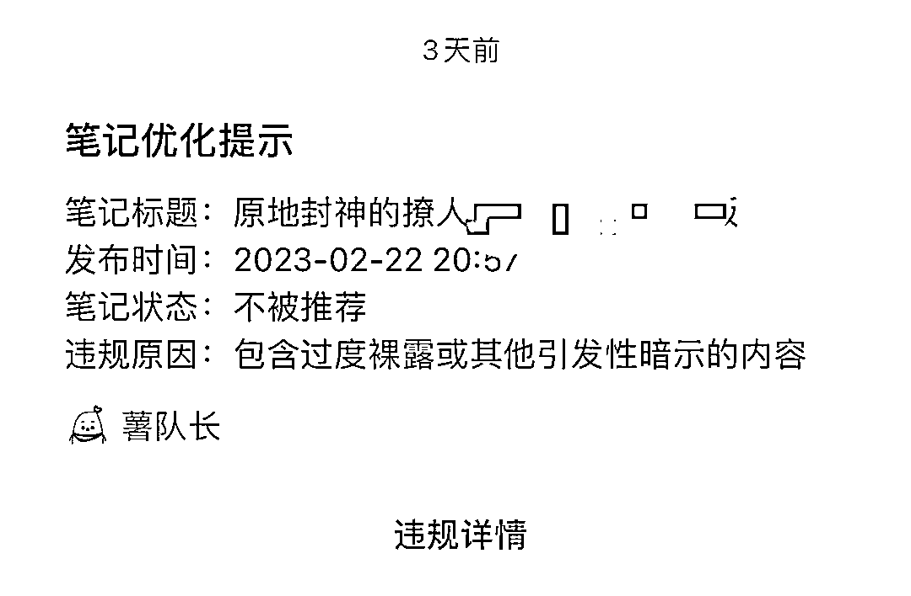
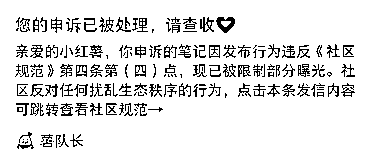
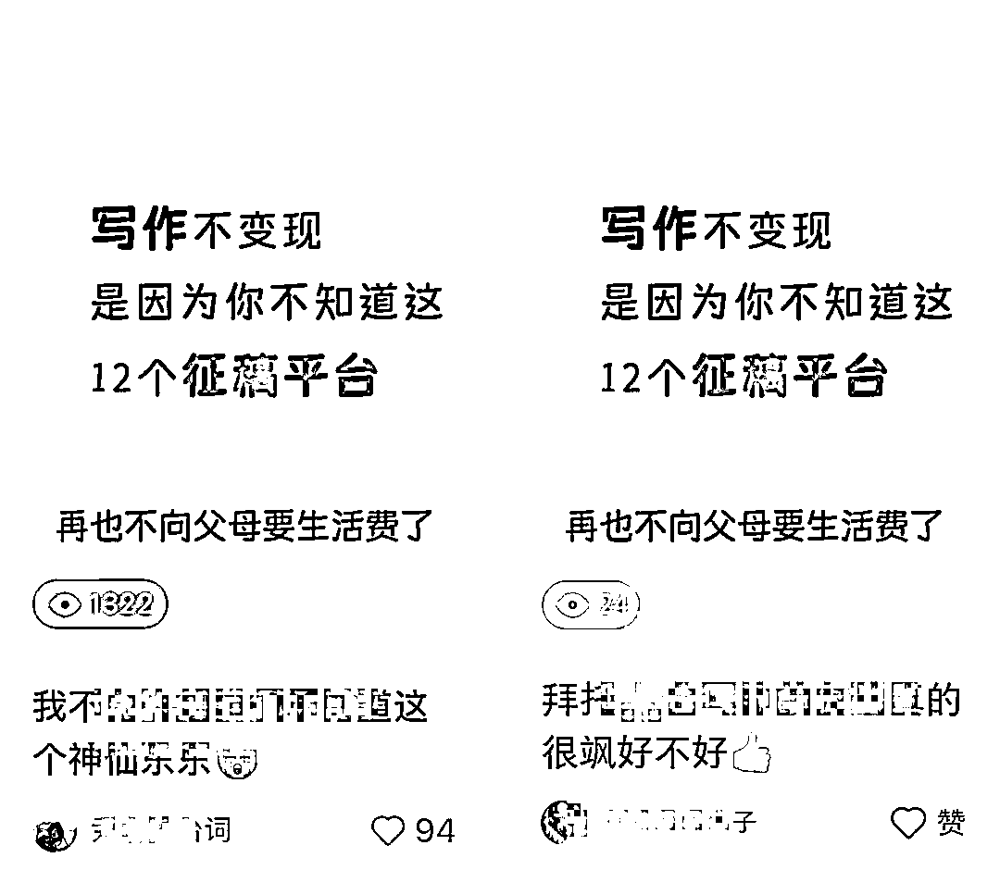
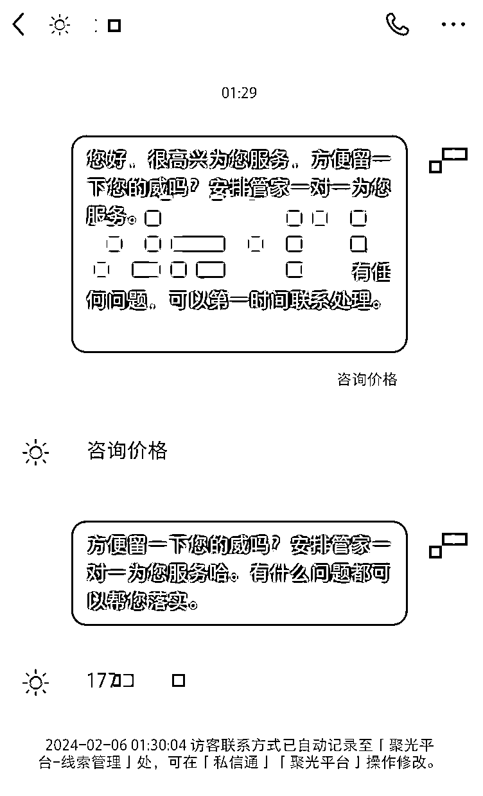
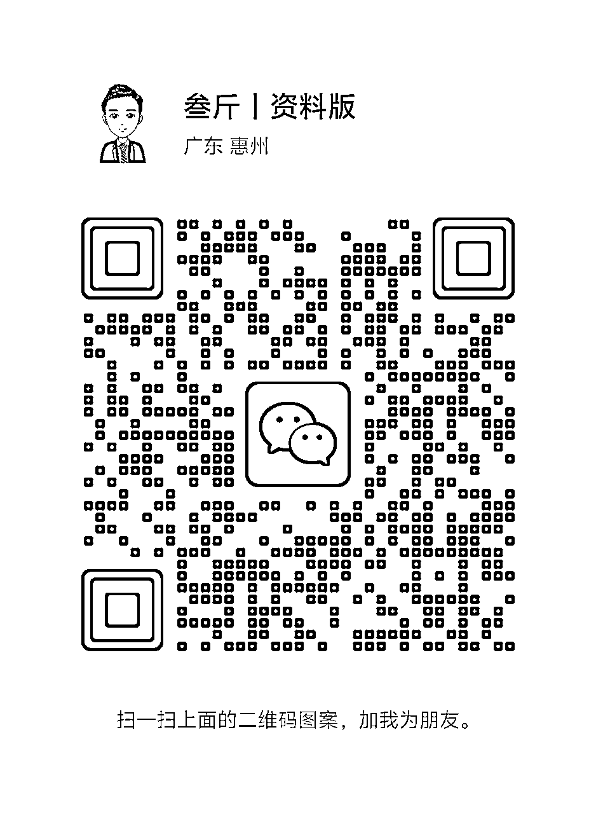

# 📕实战避坑指南——叁斤高频问答合集

Halo，我是龙哥，95后自由职业者，👸号：叁斤，🛰️：Msan53

在陪大家做📕的过程中，发现很多问题都是一遍遍重复在问。为了节省大家时间，我把运营、变现、引流、账号等高频问题整理成了这份问答手册。目前已收录一百多条，后续会持续补充。

## 手册说明

本合集是我对📕各类问题的实操解答，涵盖账号健康、内容运营、变现引流、店铺经营等方向。问题按出现频率排序，并非难度排序，内容会不定期更新。

如果这份文档没能解决你的困惑，欢迎直接联系叁斤 Msan53 提问，我会筛选合适的题目加入进来，每周一整理发布。

发布时间：2024年 9 月 23 日
更新时间：2025年 9 月 07 日

## 发布前自检

担心笔记踩雷，可以先用 https://sgcreator.zhimoxiezuo.cn/ 这个工具自查一下。

## 官方规则速查

在📕做商业行为，前提是遵守平台规则。建议定期查看官方最新指引。

《📕社区规范》：https：//agree.xiaohongshu.com/h5/terms/ZXXY20221213003/-1
《📕社区公约》：https：//www.xiaohongshu.com/crown/community/agreement?fullscreen=true
《社区商业公约》https：//school.xiaohongshu.com/rule/detail/5d67e65f0000000000000000/62738ce116a4f800136cbe3a?jumpFrom=school
《📕专业号禁入行业有哪些》https：//school.xiaohongshu.com/helper/detail/1416?jumpFrom=pro
《蒲公英审核规范》： https：//ad.xiaohongshu.com/help/docs?id=2760
《蒲公英审核指南》：https：//ad.xiaohongshu.com/help/docs?id=2756
【蒲公英合作笔记-低差营销案例解读】https：//doc.weixin.qq.com/doc/w3_AIoA6QbFAO0P60xgVqCTHaEGU3Pgp?scode=ANAAyQcbAAgeDqhv4dAIoA6QbFAO0
《薯条审核规范》：https：//ad.xiaohongshu.com/help/docs?id=2761

违禁词清单：点击直达>>>
📕术语表：点击直达>>>
叁斤👸号：

# 运营篇

## 新手一定要换新卡新号吗？
不用。老卡老号完全能用，关键是账号状态健康，不能是违规或限流的。没发过内容的老号也行。

## 新号需要养号吗？
基本不需要。注册就能发。但长期沉睡或曾被处罚过的号，建议先发点日常内容唤醒一下。

特殊情况：新号就要发硬广营销类的内容，建议先养几天。养号不是刷屏点赞，而是正常发生活向的内容，让系统识别你是真实用户。

## 刷的和发的方向不一致会有影响吗？
没有。平时浏览什么内容只代表你的兴趣，不会决定你的笔记推送给谁。兴趣标签和内容标签是两套逻辑。

## 两个号养号时要分开刷吗？
和上面同理。刷内容只能影响你能看到什么，不会影响你的笔记推荐给谁。

## 老号换项目发新内容，能用吗？
可以，只要没违规限流就行。

## 零粉丝能引流吗？
能。引流私域看的是笔记效果，不是粉丝数。0粉也能成交。开店同理，笔记做的好就能出单。

## 能不能一个号发内容，一个号日常用，来回切换？
可以。日常号和工作号混用没问题。但引流号风险高，和工作号最好分开。

## 新号怎么打标签？
刷内容打不了标签。新号刷垂直内容，只会让你看到更多相关内容。要想笔记被精准推送，靠的是笔记本身的关键词、话题和内容调性。

## 修改笔记会掉数据吗？
会。数据差时改封面和标题可能起效。数据好时改动加了违禁词就可能被限流。修改会重新触发审核，擦边内容尽量别动。

投薯条被提示广告合规问题时，可以把敏感措辞改一下再重新审核。

## 笔记间隔多久发合适？
1-2小时间隔比较稳妥。

## 主页怎么设计更吸睛？
封面尺寸统一，建议3:4。色调统一，封面带标题。

## 昵称头像简介怎么写？
昵称简短好记，无生僻字。头像贴合赛道定位。简介突出身份和价值点。

## 想换赛道怎么换？
有粉丝基础的话，尽量换与原粉丝重叠度高的赛道。无粉丝基础直接换即可。选赛道优先考虑变现路径，离赚钱越近越好。

## 什么情况下投薯条？
薯条是放大器，不是拯救器。笔记发布后第二天数据、互动都不错时再加热。数据差的笔记投了也白费。

## 薯条投不了怎么办？
先自检申诉是否违规。广告笔记可降低营销感再试。把敏感词删掉或谐音替代，审核通过后再投。

## 薯条什么时候投？怎么设置？
没有固定最佳时段，看内容人群习惯。规则上人群选智能推荐即可，投放时段6-24点都行。测试期可拉长12小时，效果好再追加6小时集中曝光。

## 用Wi-Fi还是流量？
账号少于20个，Wi-Fi流量都行。超过20个建议做好IP隔离，避免同网。引流类账号最好用4G。

## 能不能多台手机连一个Wi-Fi？
引流违规风险高的账号建议用4G独立网络。正常矩阵做广告或平台变现，20个以内同Wi-Fi问题不大。但做私域引流建议用4G更安全。

## 苹果还是安卓？
要方便管理就选苹果，数据传输方便。iPhone XR以上体验更好，预算紧选iPhone 8以上。

## 多设备怎么传资料？
苹果用隔空投送。安卓用数据线或飞书、🛰️、🐧传输，飞书文档很顺手。

## 一天发几条？什么时间发？
建议3-5条/天，做不到就日更1条，至少周更3条。发布时间对流量影响不大。

## 没数据能刷赞吗？
小范围内互相点赞可以，但大批量买赞会被删，弄巧成拙。

## 能批量删或隐藏笔记吗？
不要批量删，先隐藏慢慢处理。

## 违规笔记怎么处理？
显示已违规的直接删除。

## 评论别人看不见？
评论带营销或引流嫌疑会被限流屏蔽。

## 矩阵号内容能一样吗？排版不同行吗？
最好不要。矩阵意义在于测试不同内容。账号间发相似内容会内耗。

## 矩阵做同赛道还是多赛道？
看项目。多数情况矩阵是同赛道放大，比如旅游矩阵分不同目的地。

## 笔记多久推流？自然流多久？
审核通过就开始推了。正常自然流3-5天，1-2天不过百基本内容问题。

## 能用小号去评论互动吗？
笔记起量后可以用小号带节奏。日常不需要。

## 为什么有流量券却没可推广笔记？
流量券只适用于获得券之后发布的笔记。之前的笔记无法使用。

## 能删差评吗？
可以删，对流量无明显影响。广告截流评论建议直接删。

## 泛娱乐几万播放有价值吗？
基本没商业价值，对权重帮助也有限。

## 只有专业号才有人工客服吗？
目前是的。

## 爆款文案怎么收集？
网页版能直接复制。图片文案用🛰️截图识别，视频文案可用“轻抖”。

## 封面模板固定还是多样？
先用多模板测试点击率，确定高点击模板再固定使用。

## 小眼睛长期50以下要不要换号？
不用。能到50说明没被限流，是内容选题、封面、标题问题，全部换一遍测试。

## 为什么要把图文做成视频？
📕是瀑布流，先看封面标题再点进。视频笔记进来看完可以直接滑走，下一个视频无需点击，天然点击率更高。

## BGM不够用怎么办？
酷狗、🐧音乐、网易云都能找，记下名字下载MP3格式即可。

## 怎么快速建立素材库？
关注对标号，📕会推相似账号。给优质笔记点赞收藏，系统会持续推相似内容。把收藏页的笔记提炼成选题入库。

# 账号篇

## 新号没流量要不要先投薯条？
不要。没流量多半是内容问题。薯条只能放大好内容，不能让坏内容变好。

## 新号几分钟有赞后面没了，为什么？
平台有保量推荐。笔记发布24小时内会给基础曝光，如果前期一下子用完，后面就竞争不过。内容承接不住流量就会断崖。

## 一个手机两张卡切换登录有影响吗？
两三个号内没问题。一卡一机一号在小号情况下不用过度焦虑。

## 一台电脑切换多个账号行吗？
账号不多时没问题，我经常3-5个号切换。

## 手机不登录时能共用网络吗？
正常运营可以共用。做大批量矩阵或违规内容时需IP隔离，App后台会持续运行。

## 账号半年没发了重启有影响吗？
先活跃3-5天再发。浏览互动一下恢复状态。如果数据还是差，查小眼睛，个位数可申诉，几十几百说明内容需优化。

## 老号不用了要注销重注册吗？
不违规的直接用就行，发几篇日常看看数据是否正常。

## 实名能取消吗？
实名不能取消，只能注销账号释放实名。

## 不实名会影响流量吗？
不影响推荐。但开通专业号、开店、接蒲公英必须实名。

## 一部手机能同时登录多个号吗？
双开切换都行。但发营销或引流内容时不行，会有连坐风险。

## 小红薯等级影响权重吗？
不影响，不用刻意养。

## 以前乱发内容想重做要换号吗？
不违规且浏览正常就不用换。先发新内容，等数据回暖后再把旧笔记设为仅自己可见。

## 注销后重注册算新号吗？
注销前严重违规过，重注册仍易违规。无违规记录重注册也能获得成长流量券。算不算新号意义不大。

## 能一机多号运营吗？
做正常内容和平运营，一机多号没问题。📕本身有切换登录功能。做和平台博弈的高风险引流内容就要一卡一机一号，避免设备连带封禁。

## 矩阵号同时间发相似内容有影响吗？
有。📕有笔记相似度推荐机制，相似内容会被推给同一批人，内耗严重。错开时间发布会好很多。

## 一台手机用流量，两台手机连热点引流影响大吗？
只要不引流、不发严重违规内容，影响不大。很多人也这么操作。

# 店铺篇

## 物流模板和发货地址什么时候填？
没确定选品前可先不填。确定供应商后再按实际地址填写。

## 一个手机号能开几个店？
一个手机只能开一个店，一个实名也只能认证一个店。

## 产品不出单要下架吗？
产品相同就不用下架，优化内容即可。产品完全不同才需要下架重上。

## 个人身份证开店还是个体户执照？
大部分品类个人身份证即可。少量品类必须企业店。后续有投流或找达人合作，企业店更方便。

## 个体户开店提示身份证被占用？
一个身份证只能开一个店，一个营业执照可开两个店。开店时点错了个人/企业入口也会提示占用，企业入口用营业执照申请即可。

## 开店了要注销账号才能关店吗？
先关闭店铺，公示期后再注销账号。

## 店铺号需要养号吗？能直接带链？
不需要养号，直接发笔记带产品链接即可。

## 开店会掉流量吗？
开店本身不影响流量分配。但开店后内容容易写成硬广，导致没人看。

## 无货源有哪些货源渠道？
服装：一手app、搜款网、人人货源。百货：1688、拼多多、义乌购。常用就是1688和拼多多，注意规避无货源代拍风险。

## 小白适合做无货源吗？
不了解电商和运营的话不建议，容易踩雷。

## 一件代发算无货源吗？有风险吗？
一件代发是正规批发商合作，属于正常商业行为，不是无货源。

## 店铺限流要求投流才解除怎么办？
先养号等限流期过去，内容必须更精细原创。

## 店铺类目能改吗？
可以后期增加类目。增加后保证金可能变化，需要补齐差价。

## 多个账号能绑定一家店吗？
企业店可绑定3个个人主理人和3个企业主理人，共7个账号绑定同一店铺。

## 虚拟商品选什么类目？
大部分可选择艺术品及周边>艺术定制>虚拟定制。

## 已发货买家申请退款怎么办？
先联系快递尝试拦截，拦截不到只能收货后退。

## 商品错挂类目被提醒违规有影响吗？
无影响，按提示改回正确类目即可。

平台对店铺和账户实行绑定管理。店铺若是被判定严重犯规，账户大概率受到牵连，具体严重程度取决于惩罚类型。例如，有的惩罚会限制带商品内容的曝光。如果店铺设置了主理人，相关的个人主理人号通常不会受连带。

### 品牌认证号的增粉与运营

品牌认证号自带营销感，用户容易本能排斥，因此增粉逻辑与个人号有明显的差异。想在起步阶段快速攒泛流量，做抽奖活动是最有效的方法。但若要积累高精准关注，靠的还是慢慢深耕内容。

想经营好品牌认证号，要理解一个底层逻辑：产品决定了所有运营动作的起点，产品不行，后面的运营再华丽也没有意义。产品底气足，运营人员就要想清楚以下问题——用什么样的人设发声？商品能解决用户的什么具体痛点？满足哪些需求？为什么用户要从你这里购买？同时，将品牌认证号与个人号配合使用，并给人设增添更多人格化细节，往往能获得更好的效果。

### 本地门店如何导流

本地店铺的账号想带来客流：第一步，把店铺的基础所在地信息填写完整、准确；第二步，在发布的帖子中融入城市名、道路名等地域标签，并在发布时带上门店的位置；第三步，在品牌认证号后台找到店铺地址设置入口，把地址配置上去。

### 投放模型和ROI

关于按 KFS 框架投达人、信息流与搜索流，没有确定的ROI数字。不同品类的买量成本差别极大，且随着入局者增多，信息流成本持续上涨。如今投广告必须更精细地筛选达人、圈定人群和选择关键词。搜索流的转化效率目前最高，但光靠搜索还不够，需要在📕平台制造声量，把 KOC、KOL 和信息流一起整合。

### 一店多号带货

商家可以让多个号共同为一个店铺带货。企业认证号最多能绑定3位个人主理人号和3个企业认证号，这些被绑定的对象不需要单独开店，只要关联到主店铺，就能挂主店商品链接。绑定个人主理人时，每个号都要实名并完成主理人认证；企业认证号则只需企业资质认证。

### 执照认证数量

一个营业执照（包括个体户）最多能认证2个企业认证号。若同一主体想认证更多，需要走特殊申请的报白通道，条件要向官方直客咨询。

### 引流与小号

做导流的小号不必刻意养号，它们本身就是高危号，随时可能被封。凡导流便有风险，不想花钱的话，最简办法是用小号承接风险；想更稳妥，就付费投放聚光的客资收集，走白名单渠道最安全。

需要注册多个手机号时，可以在拼多多购买注册卡或流量卡，月租约19.9到29.9元，流量充足，或者用“和多号”虚拟卡号也能注册平台。

### 获取精准客资

找到精准人群有两个核心动作：挖客和搜索。

挖客就是找到同类账号与爆款内容，潜入评论区，寻找有咨询意向的留言，然后主动私聊，交换联系方式。

搜索则是最精准的流量来源。在内容里布局好关键词，再指派一批人去搜索这些关键词，模拟真实访客点击、浏览、互动，以推高搜索排名，但这个方法不稳定。最稳定的是开通聚光搜索广告，把所有相关词全部买下，确保展示。若想排到前几位，可以做抢占赛道，让内容稳定出现在广告位第一或前三，费用不低。

### 外链、邮箱与私信规则

平台不让内容里出现邮箱，通常过不了审。如果关注者超过5万，或许可以用emoji或🐧替代，平台大概率不会立刻下架。群里也不能发网盘链接，所有外链都会被识别。

自2025年1月7日起，商家若想在私聊中提供手机号、🛰️号等联系方式，只能通过私信获客组件完成。该组件包含留资卡、企微/个微/电话名片，能满足不同交换需求。在私信或欢迎语里配置自己的联系方式，都是被禁止的。

如果用户在咨询后主动留下联系方式，商家不会被判定为犯规。平台允许这种行为，但切忌反复向用户索要，否则会被视为骚扰。

投放聚光广告的商家，即使是付费用户，也不能在私聊里明文写出手机号/🛰️号，或引导用户去第三方平台交易。错误的说法如“加老师V【Msan53】详聊”“+18X11111111领福利”“去XX平台搜索领福利”。正确做法是使用私信获客组件，引导用户点击企微卡片或复制🛰️；例如“可以点击这个【企微卡片】添加顾问老师”“服务定制可点击卡片上的「复制🛰️」联系我们”。解答完用户疑问后，邀请意向用户留资是允许的，比如“您留个电话号码，我们帮您预约优惠活动”“需要的话留下🛰️，方便详细沟通”。

### 变现逻辑

持续性好的赛道，通常是平台频道分类和千瓜、新红等第三方工具里有独立分类的赛道。选赛道时，不同赛道都有赚钱和不赚钱的案例。想了解大盘，可以去灰豚数据、蒲公英查各赛道博主报价，按整体大盘来说，接广告最多的是美妆护肤、母婴和家居。但这个数据无法覆盖引流变现和电商变现：电商转化要去看平台销量，引流变现在第三方数据里难以统计。所以更好的方式是结合自身优势和兴趣，先选几个赛道，再逐个调研其变现能力。

变现模式主要有三种：电商、广告、带货。引流私域没被算在内，但私域项目的变现能力也很强，只是项目类型太多且各有差异。没有哪一种模式绝对最好，关键是看个人擅长什么。

若想接广告，适合做买手人设，既能接品牌合作，也能带货拿佣金。

### 爆文与广告流量

爆文和转化不能画等号。做爆款时，应该围绕自己的产品植入使用场景。并不是每篇爆款都能带来成交，卖货型账号不必刻意追爆文，内容和产品强相关、吸引来的粉丝够精准，比爆文更重要。

一发广告就掉流量，通常是内容和产品结合得太硬。可以把账号的关键词、产品卖点、用户痛点都写出来，找到它们的交集，这个交集就是自然选题。例如个人成长号卖养生茶：账号关键词是努力工作、赚钱，产品卖点是养身体。“熬夜”处在工作赚钱和养身体之间，把熬夜和养生联系起来，选题就成立了。

博主做内容带货的门槛是：粉丝超过1000，并完成专业号认证。

### 限流排查与恢复

遇到流量被压制，先别急着折腾，要判断是内容出了问题还是号出了问题。有些限流会直接给出原因，按平台提示修改即可；有些则需要自己去申诉。

如果判断是内容的原因，直接申诉，看平台反馈，再按反馈调整。

若反馈很模糊，例如

只说“违反社区规范第四条第四点”，但没有指向具体小项，这时可考虑是不是号本身也有问题。

解决账号方面的疑惑。

可以把这篇疑似违规的内容发到另一个干净的号上测试。换号后依旧被限，说明是内容问题；换号后正常，则是号的问题。若换号正常，原号的申诉也通过了，但原号流量仍差，可能是号太新、权重低，平台盯得紧，此时不要发明显营销向的内容。

平台给出的申诉结果一般比较明确，比如提示内容过度裸露，那么删除相关图片或换成不过曝的图，过审后流量会回来。常见的处罚集中在营销、导流、低质内容、伪科学等，删改对应句子即可。

如果确实是号的问题，一般也会告知原因和修改方法，但多数情况下只能养号或者放弃。养号有两种：未提示限流时间的，发一些不带营销的日常内容，并正常刷平台互动，通过互动量判断流量是否恢复；提示限流多天的，这几天不做发布，只浏览互动，期满再发新内容。

偶尔一次简介或瞬间被判定犯规，基本不影响内容流量；次数太多，简介可能被永久重置。关于间歇性审核，平台对内容有多轮审查，发布时初审，曝光量起来后还会再审，因此存在“火了之后被追上处罚”的情况。

内容在发布5小时后仍显示审核中，并不罕见。偶尔会碰到审核异常慢的情况，删除重发基本就能解决。

发布之前可以用零克查词等工具检测敏感词，网上搜索“敏感词查询”有很多选择。如果直接把对标的图片下载去重发布，风险很大，平台对二次创作和搬运的识别能力在增强，即使一开始过了审，火了也可能被复审处罚。爆款内容打印出来再实拍，则要看情况，把顺序打乱再实拍风险更低；直接照拍的，自然流也许没事，投流阶段大多过不了审核。

### 判断是否被限流

想知道内容是否被限流，可以看四点：发布后次日阅读仍在个位数或几十，八成是限了；直接发起申诉，平台会反馈问题；检查站内有没有处罚通知；尝试进入薯条投放界面看能不能投。其中最直接的还是申诉，有问题平台会指出来。

判断号被限流有几个信号：后台明确提示限流；新内容发布24小时后，阅读数不到50；发布互动型话题（如“月入三万的老板们进来”），24小时后仍不到50；内容数据里首页推荐和搜索占比小于主页占比。从以上几点基本能判断。

有人担心被连续点赞导致限流，其实不会。若实在介意，把对方拉黑即可。

正常内容投放薯条时提示违规，可能是因为薯条审得更严，带产品推荐等营销性质的内容不允许投。不能投薯条不等于内容违规，自然推荐流量仍会正常。如果自然流量也没有，才说明真的出事了。

### 封号与换号

被封过的手机上用其他号注册新号，有没有影响要看封禁类型。只是封号，一般没影响；若是封了设备，新号注册后可能直接再被封。账号有过普通违规，例如单篇内容、简介或昵称有问题，不必注销重来。轻度限流但有明确期限的，也不用。如果期限过了流量还没恢复，再考虑换号。

自己的内容和图片反复发布，新规下即使只改动个别文字，也可能被判定为抄袭或搬运。

至于“最”这类词，平台判断的是词意而不是词本身。比如“我最好的闺蜜”“我和闺蜜天下第一好”，是主观表达，不算违规。但“这个产品是全国最好用”“这款产品的去屑效果是同类中最好的”，属于对产品功效的客观宣称，就很可能被判定违规。

### 投流与聚光

想开通自动回复，

需要先完成企业认证，并给聚光广告充值。近30天消耗达到1000元后，下一个周二能在专业号平台打开“私信服务组件”，再打开“欢迎语助手”，自动回复就能设置。

开户方面，找官方直客开聚光，最低充值5000；自己开，最低2000；找代理开，能拿到5%到10%返点。官方直客服务速度取决于人，遇到靠谱的响应很快，遇到不热心的可能开户后就不怎么管；代理响应稍慢，特别是封号捞号时更明显，优点是返点。

封面优选和标题优选要不要开？如果所有图片都比较相似，哪张当首图无所谓，可以开。如果首图是特意设计的，其他图撑不起门面，就不要开。标题同理。

单条作品允许被放进多个投放计划，但计划与计划之间要有关键变量，不要做两个完全相同的重复计划。

聚光和千帆ARK的区别：千帆ARK主要服务开店商家，操作简单，适合快速出单，但放量能力一般，人群圈选不够细。聚光可以投商销，也可以投互动，选择面广、自由度大，更容易放量，但操作门槛高。开店卖货、预算有限想尽快见效，选千帆ARK；预算足、想放量，可以千帆ARK和聚光组合使用。

经常投聚光不会让自然流量变差，两种流量是独立的，甚至广告拉动的数据会在一定程度上帮自然流量破圈。同行总来点广告，目前没有好的办法，只能手动拉黑。

行业能不能投聚光，参考境内主体准入规范：https://ad.xiaohongshu.com/help/docs?id=2767

投流期间账号被封，只要不是严重违规，可以请官方直客协助找回；严重违规则无法找回。新注册的营业执照拿到证书后马上就能认证企业号。广告计划里有1个创意犯错，不会拖累其他创意，各创意相互独立。

广告投放跑不量、钱花不出去，检查三个方向：计划设置是否合理，关键词和人群是不是圈得太窄；出价是否远低于行业平均，太低自然没量；内容制作是不是太差，拉不动点击。

投流过程中被禁言，先判断禁言原因。如果是在满足消耗条件的情况下，因为导流被禁言，大概率是系统误判，可以找直客解封。未满足消耗条件时被判定导流，也还有机会捞出。但如果是因为截流、发表不当言论等其他原因被禁，基本无解。

千帆里用相同素材建不同计划，不会“撞线”，前提是计划间有变量。例如相同素材但人群不同，或者相同计划但一个ROI设为3、一个设为2。

同一个作品既做产品种草又做客资收集投放，两个目标互不干扰，前者看重互动和曝光，后者主攻引流。先投种草把互动数据做起来，再投开口留资，理论上可以提升ROI，因为用户有从众心理，互动高会降低投放成本，成本低了ROI自然上去。

全站开口与信息流开口用同样的预算和内容可以吗？全站会把内容投到搜索、信息流和视频流，信息流则只覆盖信息流场景，两者互相独立，不会抢量。

信息流计划使用自动出价却跑不出去，大概率是人群圈得太窄、出价太低，或者是内容本身缺乏吸引力。两条计划内容不同、关键词一样，不会自相残杀，反而能通过对比跑出优质素材，跑一两天后把不行的计划关掉即可。

一些内容投了一段时间后被拒，是因为平台的审核分层级进行：发布时审一次，广告创建时审一次，投放中还会反复审，每次审核员的尺度也未必一样。内容若有隐患，后续复审中就可能被拦下。

以上是当前能整理到的完整问答，后续还会持续补充，希望对你有点帮助。

👸号：叁斤，🛰️：Msan53

