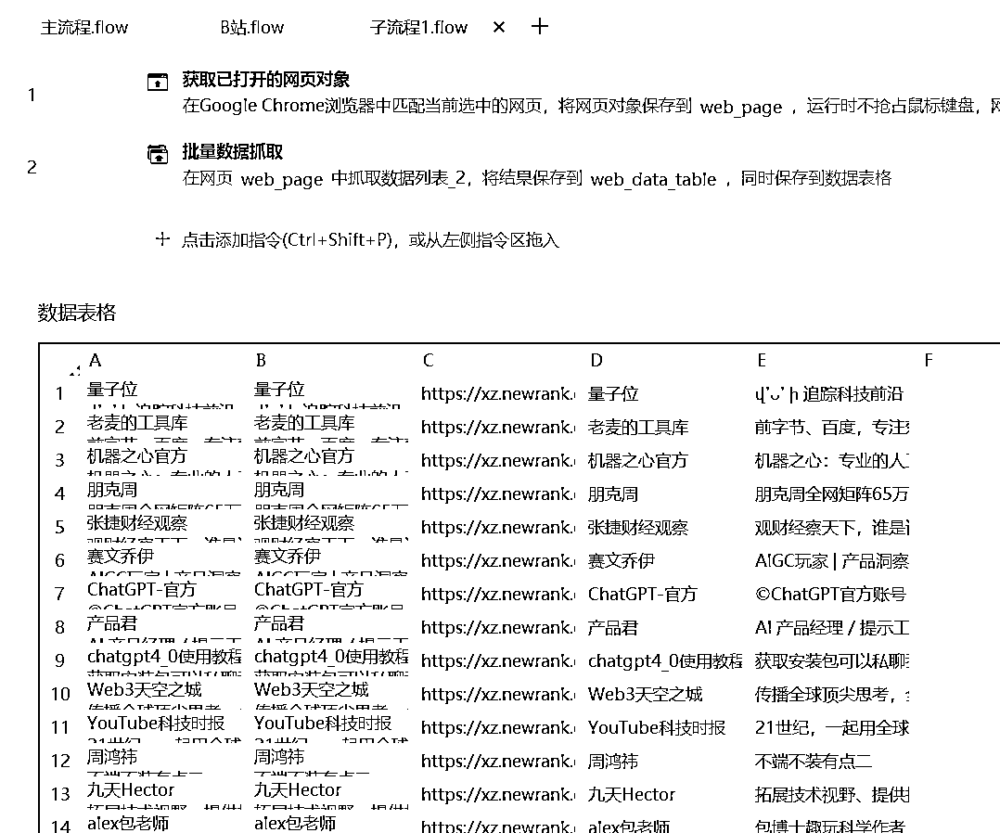
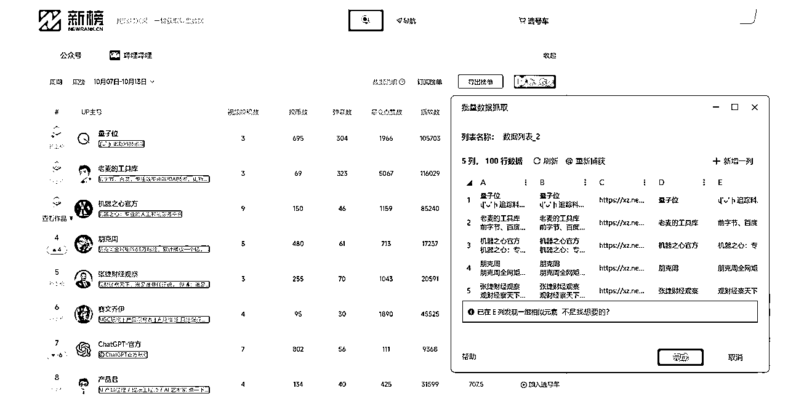
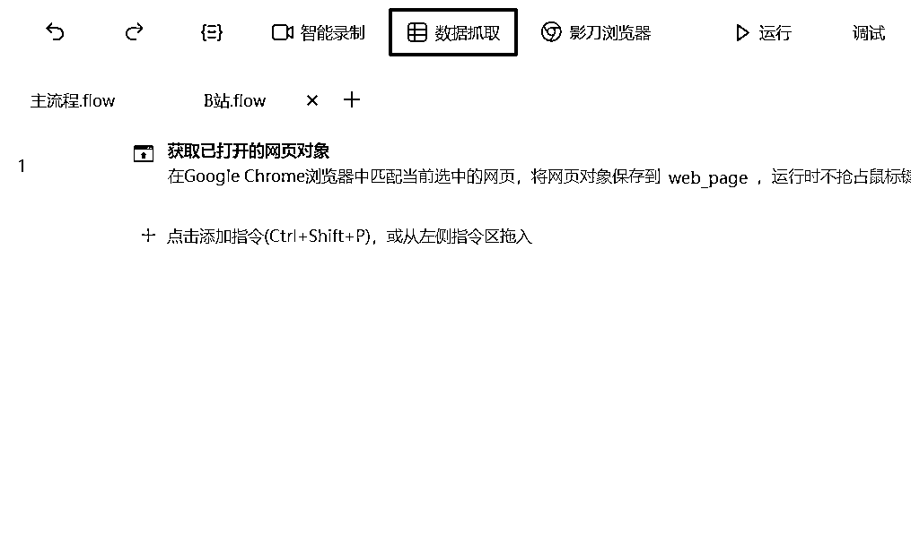
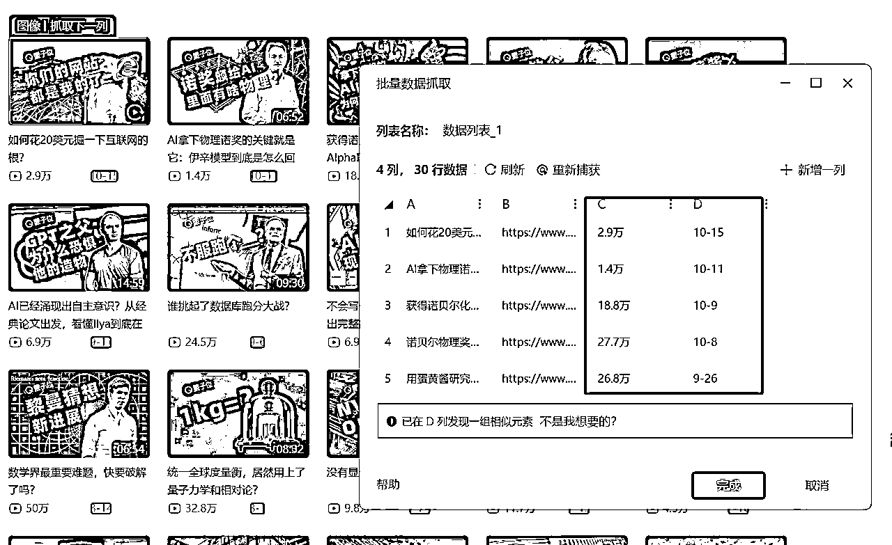
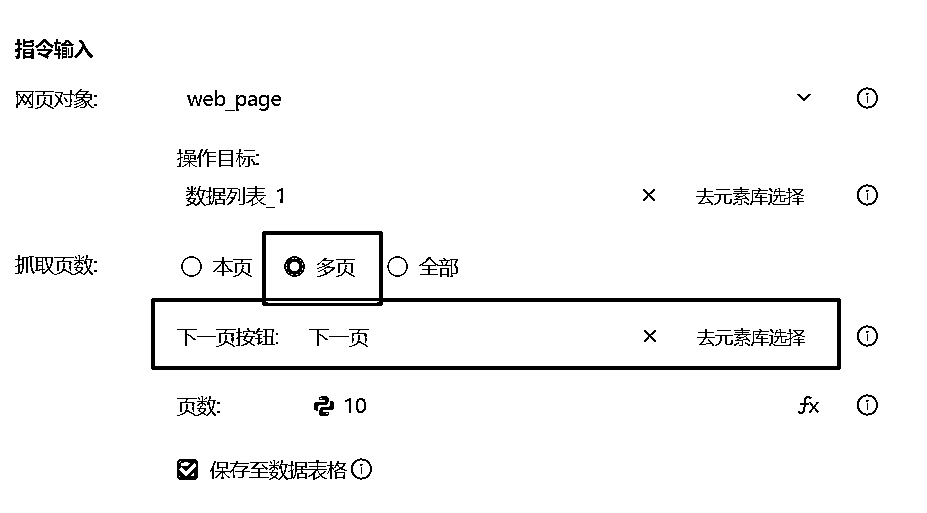
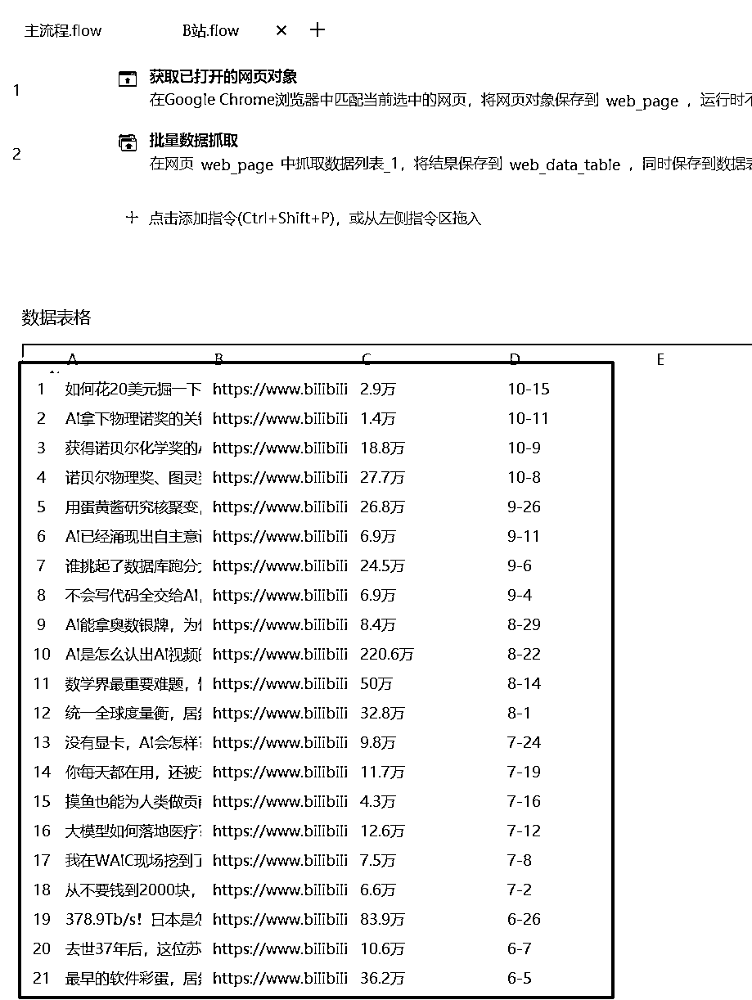
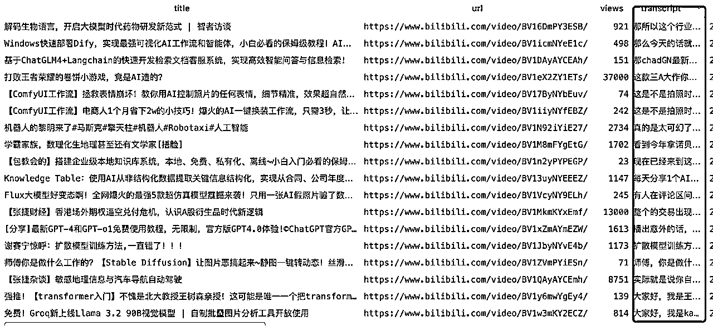
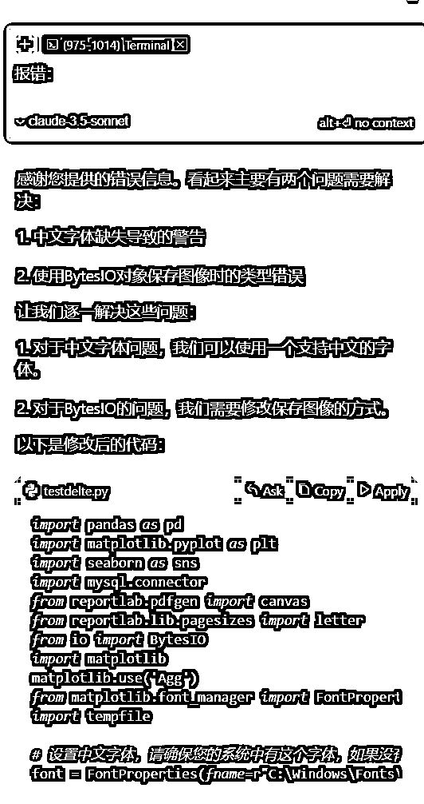
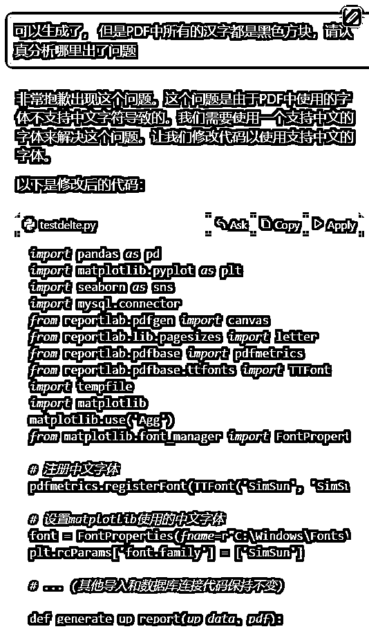

# B站百位AI垂类创作者视频全量抓取与内容转写实践
作者：龙哥


此前完成过一篇关于👸号AI KOL 十万＋稿件的抓取与拆解，灵感来自龙哥提出的首个超级标签。这次把视角转向视频端。

我把B站上100位聚焦人工智能领域的头部创作者全部纳入样本，累计视频总量超过3.2万条。其中播放表现靠前的约1万条，通过Whisper完成了语音转文字。最终沉淀的数据表涵盖了创作者画像、作品标题、播放表现、脚本文本等维度，便于做定位参考和对标复盘。

原始表格已公开，下面复盘从名单获取到最终分析的完整操作链路。

首要任务是确定目标名单。我依旧在新榜的哔哩哔哩AI KOL榜单中查找。新榜自带导出受限，我直接借助影刀完成抓取。打开榜单页面，调用影刀网页数据提取功能，框定表格区域并自动识别，一键即可把名单拉取下来，完全无需编码或逆向。





名单到手后，下一步要把这100个创作者的全部投稿抓齐。为了降低学习成本，我继续使用影刀完成。新建采集流程，先获取当前网页对象进行调试，打开某创作者的主页，点击影刀的数据采集入口，在弹出的配置面板里新增字段，分别选取标题、链接、播放量、发布时间，确认后单页数据即可跑出。






单页仅是起点。我们需要的是个人空间的全部内容。影刀支持跨页采集，只需开启多页模式并指定下一页的翻页元素，即可自动循环滚动直至采集完该创作者的所有投稿。



执行后可以看到目标创作者的全部作品已被完整抓取，数据包含标题、链接、播放量、发布时间四列，结构符合预期。



抓取结束，我把结果落库。Excel、飞书或数据库均可，这里为了后续处理方便，我选择写入数据库。

第二阶段是文案转写。此前分享过一篇《借助AI打造高效短视频工作流，日均提取2万+视频文案》，核心思路是基于SenseVoice或Whisper进行批量语音转写。这次沿用同一套工作流，只需把数据源替换为本次采集到的B站视频链接，接入自动化流程即可。运行后，视频文本自动写入表中。



目前表内保留的字段有：
创作者主页、昵称、简介、粉丝规模、累计播放、累计点赞、作品标题、作品链接、单条播放、发布时间。

至此采集与转写环节收尾。

最后进入洞察环节。我让Cursor生成分析脚本，核心指令如下：

我采集到一些B站 UP主的公开数据，采集的字段包括：用户主页、UP主昵称、描述、粉丝数、视频总播放次数、视频总点赞次数、视频标题、视频地址、观看次数、发布时间等，详细表结构如下：CREATE TABLE bilibili_videos (
id int NOT NULL AUTO_INCREMENT,
title varchar(1000) DEFAULT NULL,
url varchar(1000) DEFAULT NULL,
views int DEFAULT NULL,
publish_time date DEFAULT NULL,
up_homepage varchar(1000) DEFAULT NULL,
up_nickname varchar(255) DEFAULT NULL,
up_description text,
follow_count varchar(1000) DEFAULT NULL,
fans_count varchar(1000) DEFAULT NULL,
likes_count varchar(1000) DEFAULT NULL,
play_count varchar(1000) DEFAULT NULL,
transcript_time varchar(255) DEFAULT NULL,
PRIMARY KEY (id)
) ENGINE=InnoDB AUTO_INCREMENT=19264 DEFAULT CHARSET=utf8mb4 COLLATE=utf8mb4_0900_ai_ci;

以上表中有不同的UP主的所有视频信息，下面我想研究该UP主所有的视频观看次数曲线、热门视频，随着发布时间观看次数变化曲线图，不同观看次数区间范围视频数柱状图；

请你对所有UP主账号进行逐个账号级别的分析并最终输出报告，每个UP需要有UP主名称，UP主描述、UP主主页地址、粉丝数、总获赞数、总播放数、最早视频日期、最新的视频日期、根据所有视频观看数计算出来的平均观看次数。还要帮我列出观看最高的20个视频以及视频地址、还要画出阅读数随时间的变化趋势图、视频观看数分布图、以月为单位的观看数趋势图。

接下来请你使用python代码实现，并输出一份最终的PDF文件






请你对所有UP主账号进行逐个账号级别的分析并最终输出报告，每个UP需要有UP主名称，UP主描述、UP主主页地址、粉丝数、总获赞数、总播放数、最早视频日期、最新的视频日期、根据所有视频观看数计算出来的平均观看次数。还要帮我列出观看最高的20个视频以及视频地址、还要画出阅读数随时间的变化趋势图、视频观看数分布图、以月为单位的观看数趋势图。

接下来请你使用python代码实现，并输出一份最终的PDF文件

脚本会按创作者逐个拆分，输出账号画像摘要、Top20爆款清单、播放随时间走势、播放分布直方图、月度播放趋势图，并整合成一份完整的PDF报告。

整套流程从榜单获取、作品全量抓取、语音转写到可视化分析，全程免代码门槛，迁移到其他垂直领域也很容易复用。

```
import pandas as pd
import matplotlib.pyplot as plt
import seaborn as sns
import mysql.connector
from reportlab.pdfgen import canvas
from reportlab.lib.pagesizes import letter
from reportlab.pdfbase import pdfmetrics
from reportlab.pdfbase.ttfonts import TTFont
import tempfile
import matplotlib
import os
matplotlib.use('Agg')
from matplotlib.font_manager import FontProperties

# 指定字体文件的完整路径
font_path = r"C:\Windows\Fonts\simsun.ttc"

# 确保字体文件存在
if not os.path.exists(font_path):
    raise FileNotFoundError(f"找不到字体文件：{font_path}")

# 注册中文字体
pdfmetrics.registerFont(TTFont('SimSun', font_path))

# 设置matplotlib使用的中文字体
font = FontProperties(fname=font_path, size=10)
plt.rcParams['font.family'] = ['SimSun']
db_config = {}
# 连接到MySQL数据库
conn = mysql.connector.connect(
       **db_config
    )
# 从数据库中获取数据
query = "SELECT * FROM bilibili_videos"
df = pd.read_sql(query, conn)

# 关闭数据库连接
conn.close()

# 将publish_time列转换为日期类型
df['publish_time'] = pd.to_datetime(df['publish_time'])
def plot_views_over_time(up_data):
    plt.figure(figsize=(10, 6))
    plt.scatter(up_data['publish_time'], up_data['views'])
    plt.title('观看数随时间变化', fontproperties=font)
    plt.xlabel('发布时间', fontproperties=font)
    plt.ylabel('观看次数', fontproperties=font)
    plt.xticks(rotation=45)
    return plt

def plot_views_distribution(up_data):
    plt.figure(figsize=(10, 6))
    sns.histplot(up_data['views'], bins=20)
    plt.title('视频观看次数分布', fontproperties=font)
    plt.xlabel('观看次数', fontproperties=font)
    plt.ylabel('视频数量', fontproperties=font)
    return plt

def plot_monthly_views(up_data):
    monthly_views = up_data.groupby(pd.Grouper(key='publish_time', freq='M'))['views'].sum()
    plt.figure(figsize=(10, 6))
    monthly_views.plot(kind='bar')
    plt.title('月度观看次数趋势', fontproperties=font)
    plt.xlabel('月份', fontproperties=font)
    plt.ylabel('观看次数', fontproperties=font)
    plt.xticks(rotation=45)

    # 修改x轴标签为年月格式
    ax = plt.gca()
    ax.set_xticklabels([d.strftime('%Y-%m') for d in monthly_views.index])

    plt.tight_layout()
    return plt

def wrap_text(pdf,text, max_width, font, font_size):
    pdf.setFont(font, font_size)
    words = text.split()
    lines = []
    current_line = []
    for word in words:
        if pdf.stringWidth(' '.join(current_line + [word])) < max_width:
            current_line.append(word)
        else:
            lines.append(' '.join(current_line))
            current_line = [word]
    lines.append(' '.join(current_line))
    return lines

def generate_up_report(up_data, pdf):
    def set_chinese_font():
        pdf.setFont("SimSun", 12)

    up_name = up_data['up_nickname'].iloc[0] or "未知"
    up_description = up_data['up_description'].iloc[0] or "无描述"
    up_homepage = up_data['up_homepage'].iloc[0] or "无主页"
    fans_count = up_data['fans_count'].iloc[0] or "未知"
    likes_count = up_data['likes_count'].iloc[0] or "未知"
    play_count = up_data['play_count'].iloc[0] or "未知"
    earliest_video = up_data['publish_time'].min()
    latest_video = up_data['publish_time'].max()
    avg_views = up_data['views'].mean()

    set_chinese_font()
    y_position = 750
    line_height = 20

    for label, value in [
        ("UP主", up_name),
        ("描述", up_description),
        ("主页", up_homepage),
        ("粉丝数", fans_count),
        ("总获赞数", likes_count),
        ("总播放数", play_count),
        ("最早视频日期", earliest_video),
        ("最新视频日期", latest_video),
        ("平均观看次数", f"{avg_views:.2f}")
    ]:
        text = f"{label}: {value}"
        wrapped_lines = wrap_text(pdf,text, 500, "SimSun", 12)
        for line in wrapped_lines:
            pdf.drawString(50, y_position, line)
            y_position -= line_height

    pdf.drawString(50, y_position, "观看最高的20个视频:")
    y_position -= line_height

    top_20 = up_data.nlargest(20, 'views')
    for _, video in top_20.iterrows():
        title = video['title'] or "无标题"
        url = video['url'] or "无链接"
        views = video['views'] or "0"
        text = f"标题：{title[:50]}... -观看次数：{views} 链接： {url}"
        wrapped_lines = wrap_text(pdf,text, 480, "SimSun", 12)
        for line in wrapped_lines:
            if y_position < 400:  # 如果剩余空间不足，创建新页面
                pdf.showPage()
                set_chinese_font()  # 在新页面上重新设置字体
                y_position = 750
            pdf.drawString(70, y_position, line)
            y_position -= line_height

    # 确保有足够空间绘制图表
    if y_position < 400:
        pdf.showPage()
        set_chinese_font()  # 在新页面上重新设置字体
        y_position = 750

    views_over_time = plot_views_over_time(up_data)
    with tempfile.NamedTemporaryFile(suffix='.png', delete=False) as tmp:
        views_over_time.savefig(tmp.name, format='png')
        pdf.drawImage(tmp.name, 50, y_position - 300, width=500, height=300)

    pdf.showPage()
    set_chinese_font() 

    views_distribution = plot_views_distribution(up_data)
    with tempfile.NamedTemporaryFile(suffix='.png', delete=False) as tmp:
        views_distribution.savefig(tmp.name, format='png')
        pdf.drawImage(tmp.name, 50, 500, width=500, height=300)

    monthly_views = plot_monthly_views(up_data)
    with tempfile.NamedTemporaryFile(suffix='.png', delete=False) as tmp:
        monthly_views.savefig(tmp.name, format='png')
        pdf.drawImage(tmp.name, 50, 100, width=500, height=300)

    pdf.showPage()

def main():
    pdf = canvas.Canvas("bilibili_up_report.pdf", pagesize=letter)

    for up_homepage in df['up_homepage'].unique():
        up_data = df[df['up_homepage'] == up_homepage]
        generate_up_report(up_data, pdf)

    pdf.save()

if __name__ == "__main__":
    main()
``` 最终成果已经呈现，下面便是本次产出的 PDF 文档。