# 龙珠悬赏-用流量榜单玩一次全球网站探险

> 来源：[https://qnfoes1o78.feishu.cn/docx/JWdfdSjZmoVNT9xpu0Cc70N2nic](https://qnfoes1o78.feishu.cn/docx/JWdfdSjZmoVNT9xpu0Cc70N2nic)

身为一个喜欢刨根问底的信息搜集控，这个选题正好戳中我的点。

先抛个问题给你：放眼全世界，访客最多的那些网站到底是哪几家？

听起来像闲聊，其实能从中窥见全球流量的大致版图。

# 一、我今天要安利的宝藏站就是：Similarweb

## 1）先在谷歌里把安全搜索关掉再开搜。

口令：https://www.google.com/#newwindow=1&q=abcde&safe=off

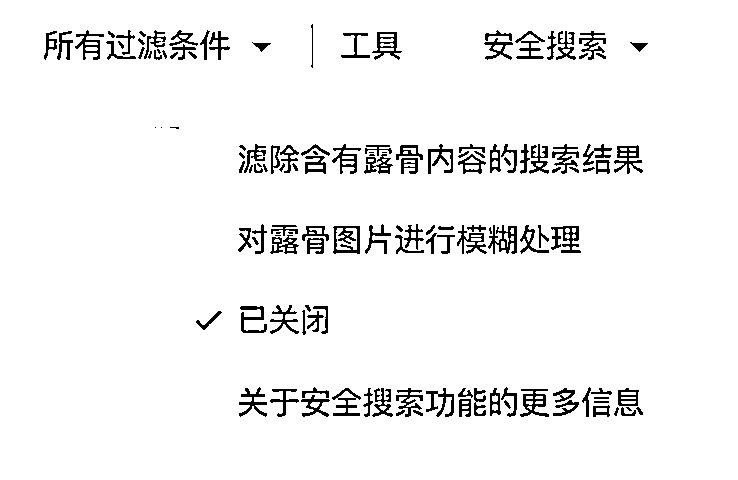

## 2）输入 Similarweb 搜一下，结果首条就是干货。

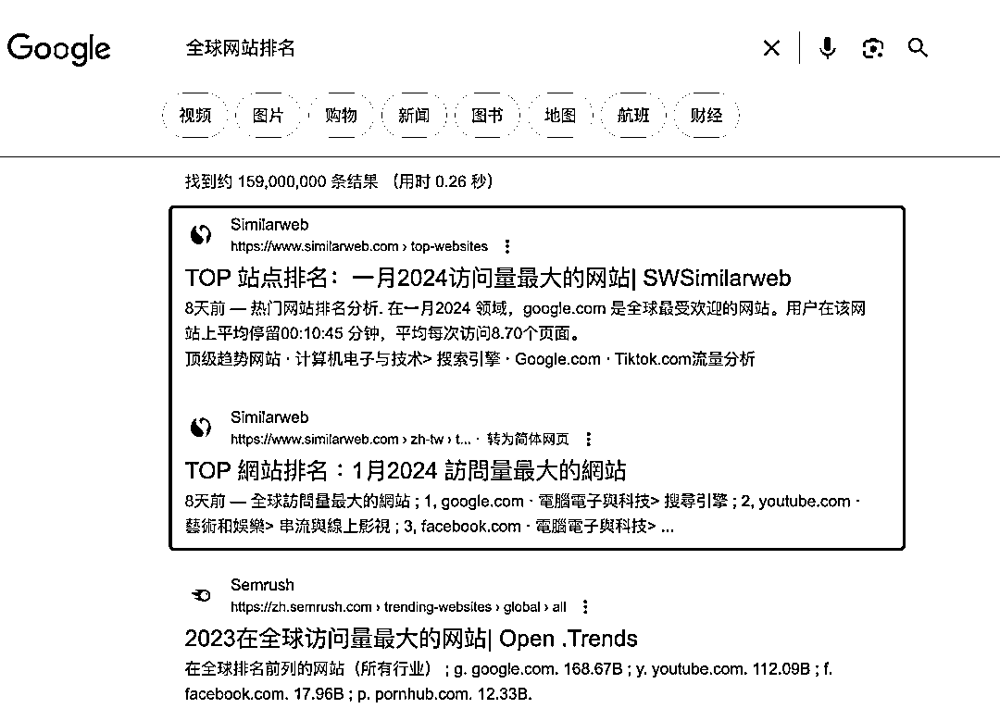

## 3）点进去首页直接上全球前十榜单

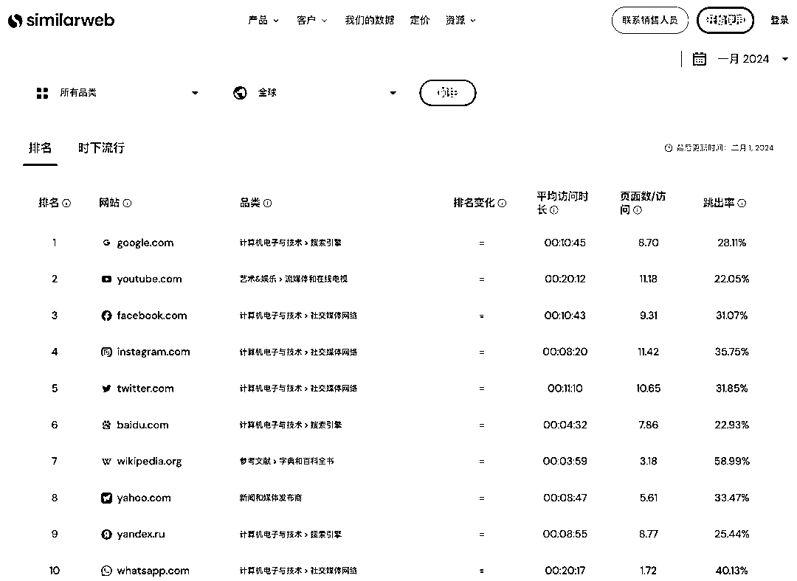

榜上网站基本都是大家日常会点开的熟面孔，

百度排到第六名，这个成绩确实不容小觑。

再往下看第11到20名，

会混进几家成人向站点，P站、X站都在列。

奈飞、ChatGPT 也榜上有名。

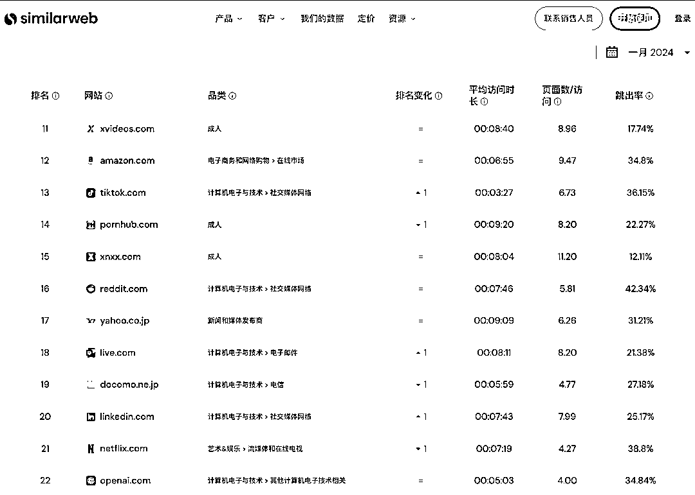

继续往下滑能看到 TOP50 的信息

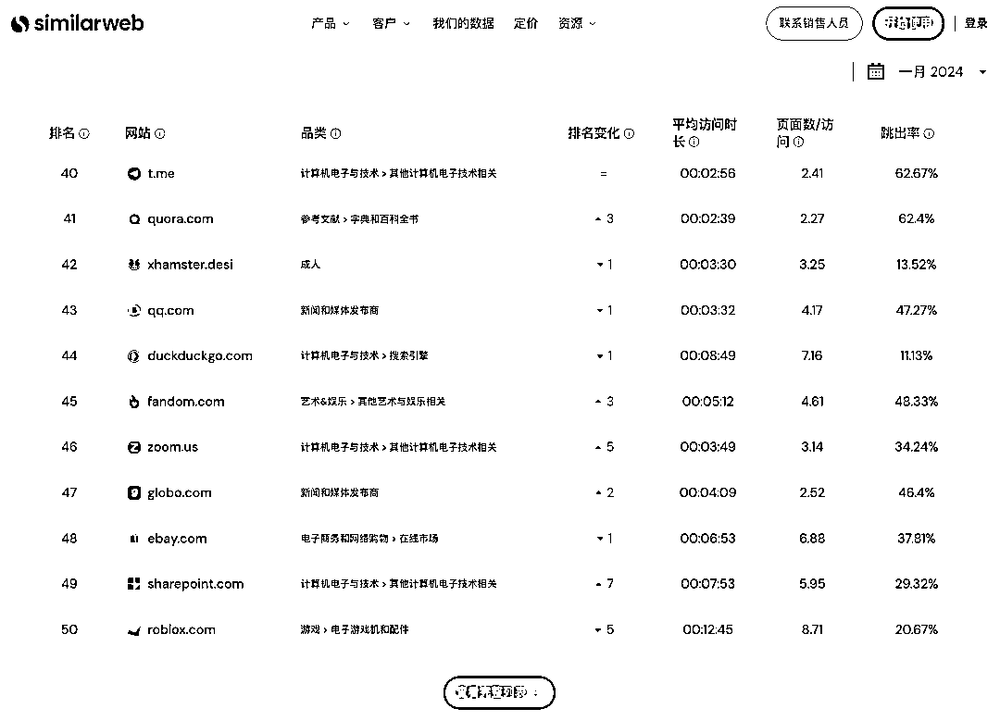

想看完整清单就得付费开会员了。

## 4）还有一个免费版就能玩的绝活

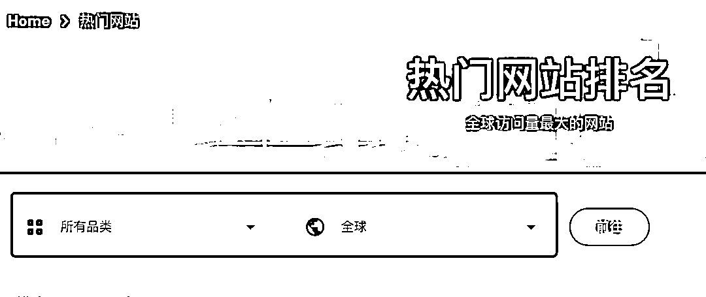

锁定品类、锁定国家，

说人话就是，能查出某个国家某行当里，本地的头号玩家是谁，

想快速摸清当地市场的门道时，这就是个相当靠谱的风向标。

可选分类多到眼花，先截几张给大家感受下。

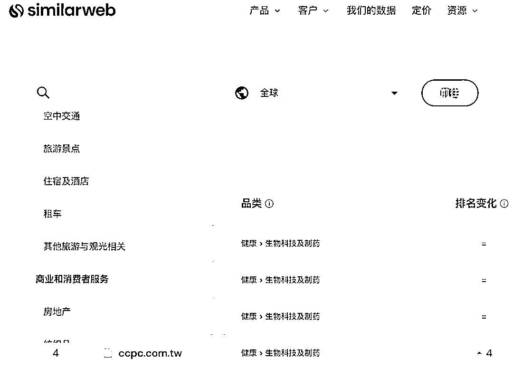

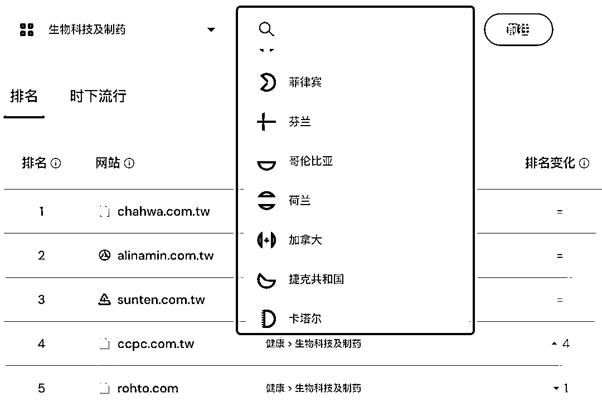

举个栗子看看效果

查美国的成人网站↓

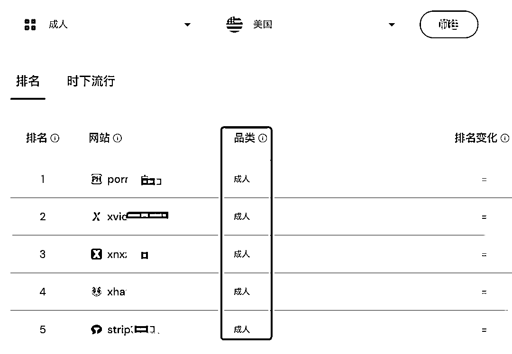

俄国的电商市场↓

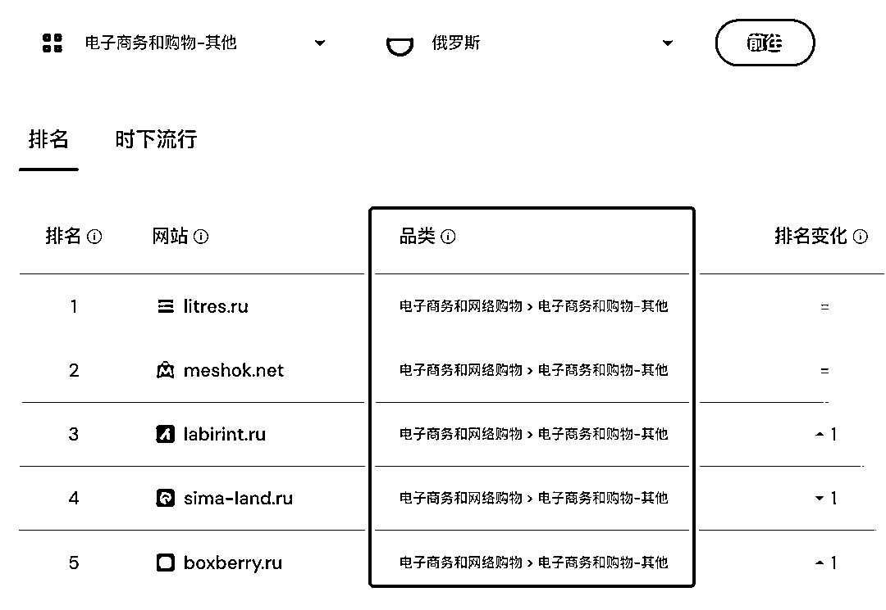

台湾的生物科技↓

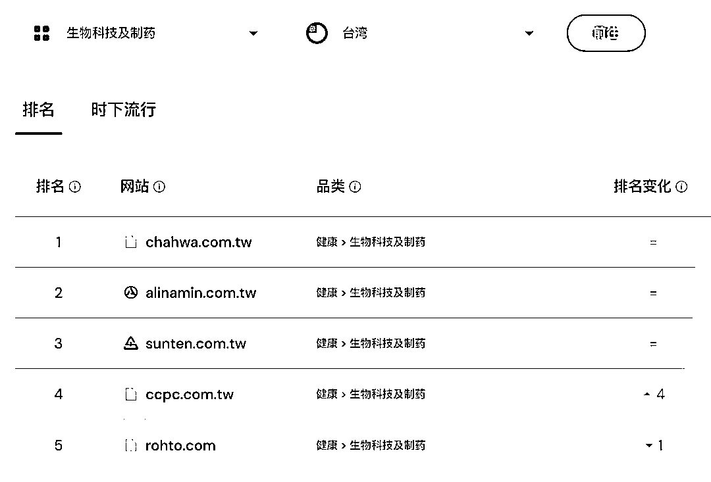

换不同的国家+分类组合，就能挖出之前从未听说过的站点，

感觉就像在网上探险寻宝，意外又上头。

没事的时候拿它解闷，放松下大脑也挺合适。

# 二、X 上一些好用的搜索语法

1、关键词后空一格加 “lang:zh”，就能只筛出中文推文。

2、关键词后加上 filter:links，就只剩带链接的内容，找资源时特别省事。

3、遇到被搜索引擎屏蔽的敏感词，可以给关键词加双引号，或在词后空一格加减号再跟一串乱码。例如搜索：["马斯克"] 或者 [马斯克 -jsdkskf]

YouTube 搜索小技巧：

指定频道搜内容，关键字：royal wedding, channel；

找最新内容，关键字：oprah winfrey, this week；

只看原创，关键字：never say never, partner

找长片电影，关键字：jackie chan, movie

标题精准匹配，关键字：allintitle:”google goes gaga”

组合条件筛选，关键字：ted talks, hd, this month

# 三、在纸飞机上能找到专门挖资源的群组，用一两个关键词就能撬出十几个高质量群，如下图

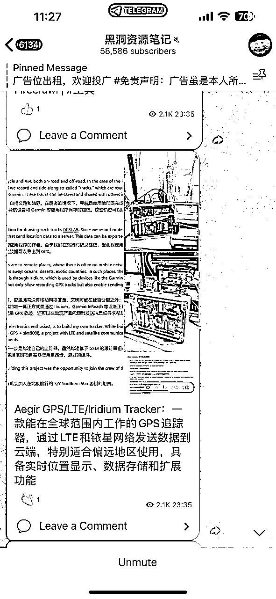

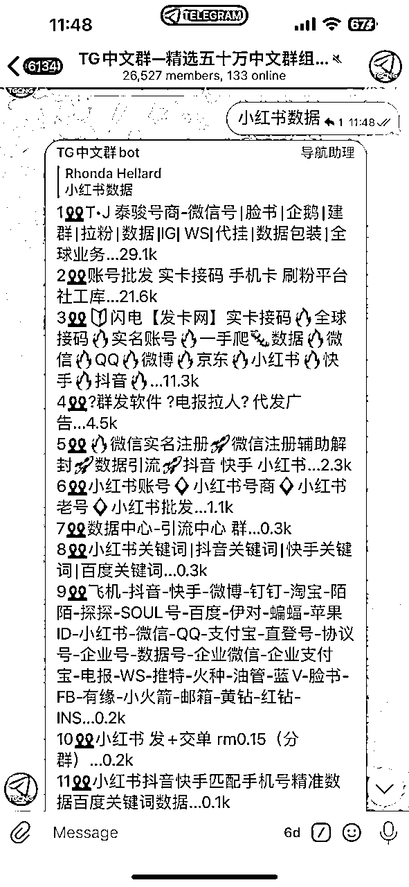

时间有限，今天就先到这里，边做边完善。

如果你也对信息检索这块感兴趣，后面我再补更多平台的搜索手法。

换个平台、换个技巧，就能解决不同问题、拿到不同资料。

这就是一门软实力！

可能不如硬技能抢眼，但关键时刻能把效率拉满。

虫部落；

超级搜索；

信息源：

1、x，追踪这些技术大牛

2、纸飞机，淘各路资源群

3、quora，看他们在用啥

4、