# 📕薯店蓝海掘金实战笔记
作者：龙哥

大家好，我是龙哥，在赚钱混迹多年，项目做过不少，航海也上了几回，可惜一直没打出亮眼成绩。今年把重心放到📕店铺的蓝海赛道上，终于撞出了点小火花，今天就把这段踩坑后的心得摊开说。

# 一、玩法总览

圈内人都清楚，📕的变现路径大致有三种：做IP接商单、用内容做导流拿佣金、开薯店直接卖货。我这次分享的也是开店卖货，但路线和市面上常见的女装、零食、百货不一样，我走的是蓝海路线。

蓝海的意思就是找那些需求更垂直、品类更小众、竞争相对温和的产品或类目。📕里这类机会不少，利润空间也挺可观。我观察到的账号，月净利从一万到十万甚至更高都有。归根结底，📕不只是女装的天下，蓝海一样能吃到肉。找到合适的品，先算清楚利润，再摸清对手实力，觉得能打就直接复刻。

举个例子

夏天女生想穿凉快又怕某些部位尴尬，就催生出一些去黑类需求，比如去脖子黑、去膝盖黑、去腋下黑；另外一些寓意好、体量小的摆件也吃香，外观讨喜年轻人喜欢，比如招财水晶；养生板块同样藏着不少蓝海，像颈贴、脐贴这类身体局部保养品就是其中之一。

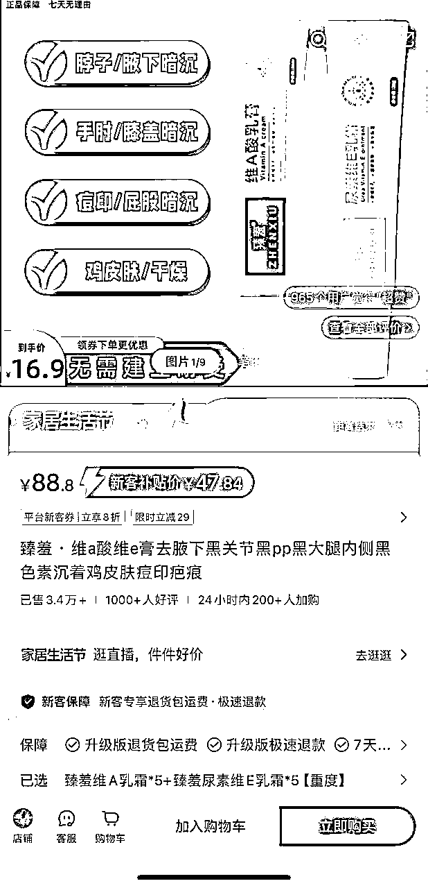

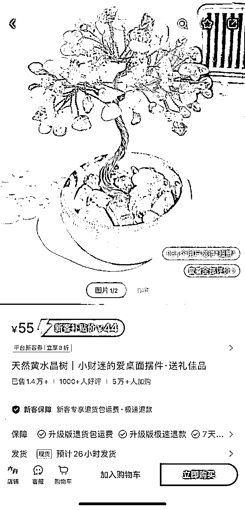

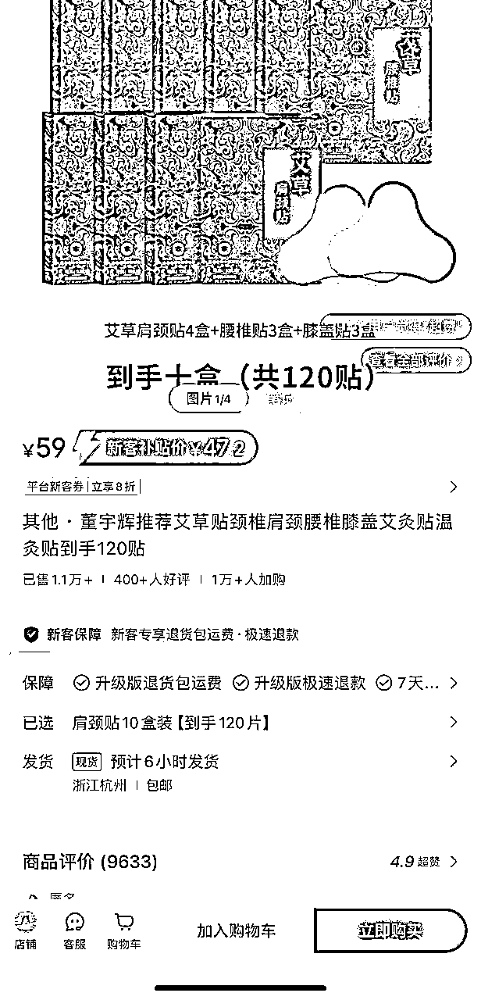

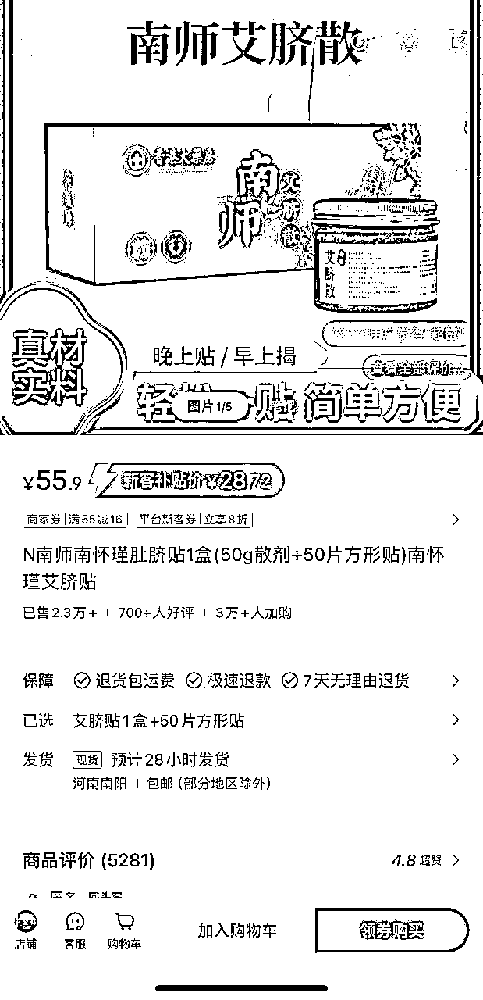

# 二、实操闭环

📕店铺的通用打法，赚钱的精华帖和航海手册里已经讲得很细了，这里只说我自己跑通的环节。

## 选品

先从蓝海词、细分长尾词入手，把合适的蓝海品筛出来。

## 调研

锁定品后要做全盘摸底：

*   这个品在📕的月均利润大概多少？
*   商品链接的总销量水平如何？一般建议1000起步。
*   对手的近期动向如何？只有持续出单才说明需求在线。我主要看三点：一是对手链接的最新评价是否持续上新；二是统计链接销量，取7天均值，日均是多少，适合万件以下的链接；三是看24小时加购数，几百上千加购基本就是在跑量。
*   货源成本和毛利预估。先在1688以图搜图查一件代发价，拿对手售价乘销量再减成本，得出粗略毛利。观察对手上架时长，换算出大致月利润，也能通过跟踪日销量估算对手当前日利润。
*   竞争强度与可复制性。
*   商品页搜关键词按销量排，销量前10里旗舰店占比最好别超50%。
*   商品页搜关键词按销量排，销量300以上的店铺数量越少越好。
*   推荐页搜关键词按最新排，限定最近1天/1周，看挂车笔记的有效竞争数，越少越好。
*   推荐页搜关键词按最新排，看对手最近笔记的质感能否抄，比如场景、人物、出镜、构图是否可复刻。

## 找货上架

确定品后就去找源头上架。我常用的渠道是1688和闲鱼，规模化产品1688基本都能找到，小众点就去闲鱼淘。

两个小技巧：

*   1688搜不到也不代表没货，有时商家没上架但有库存，可以找卖同款的商家发图询价。
*   特别看好的品实在找不到源，可以先在淘宝、拼多多或对手店买回来申请退货，退货电话往往就是上游货源，直接对接谈合作。

## 拆解

选好对标账号就要拆，因为要抄，就得知道抄什么、为什么爆。

*   收集对标
商品页搜关键词能筛出大部分对标，再去推荐页补笔记，基本就全了。

*   拆爆款
拆是为了给创作定方向，也能锻炼运营思维。
比如拆封面：
光源走向？光线质感？背景搭配？道具有哪些？出镜的手部/面部表情动作？产品构图？整体画面构图？文案内容和位置？画面在情绪上做了什么：场景感、氛围感、满足感，实用价值是否清晰：省力、神器、即时满足。

*   分类归档
把下载的爆款笔记按品类、主题重命名分文件夹存，别全堆一起，否则越做越乱。

## 生产

我主打原创实拍。定品后先下样，模仿爆款拍一批素材，前期拍摄后期调色，再参考对标的文案风格加字。所需能力包括布光、布景、构图、拍摄、调色、修图。工具用醒图、美图秀秀居多，专业点就PS、LR。

标题正文也批量处理，先收集对标素材丢给AI仿写，AI能做到六七分，剩下的人工润色，把高频词补进去即可。

## 测试与迭代

我一个号基本一天10篇左右，主要在测封面、标题和内容表现。哪篇发出去小眼睛数据快起来，哪篇近期出单多，就拆它的标题、画面，抄自己，持续做相似款去验证。

## 我的实操案例

目前稳定出单的号有3个，6-7月曾多次爆发，当时月GMV到20万，到手利润8万，后面日单稳定在100-200单之间，利润率约40%。

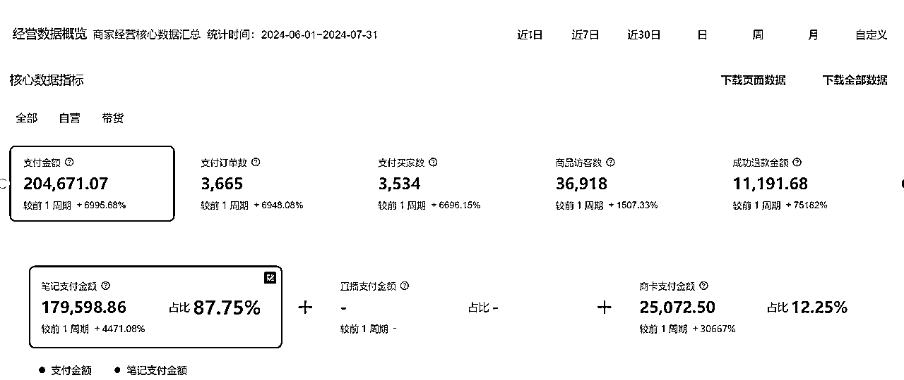

①选品
今年大环境偏冷，我感知到大家对玄学类内容更关注，而玄学品女性用户占比高，和📕属性高度契合，于是围绕玄学关键词去找蓝海品。

②调研
整理好对标后做整体评估：

*   该品在📕平台的最高销量；
*   在1688确认成本价，测算头部账号大致利润；
*   统计对标的日销量、发帖量、涨粉量，判断当前需求热度并估算月利润；

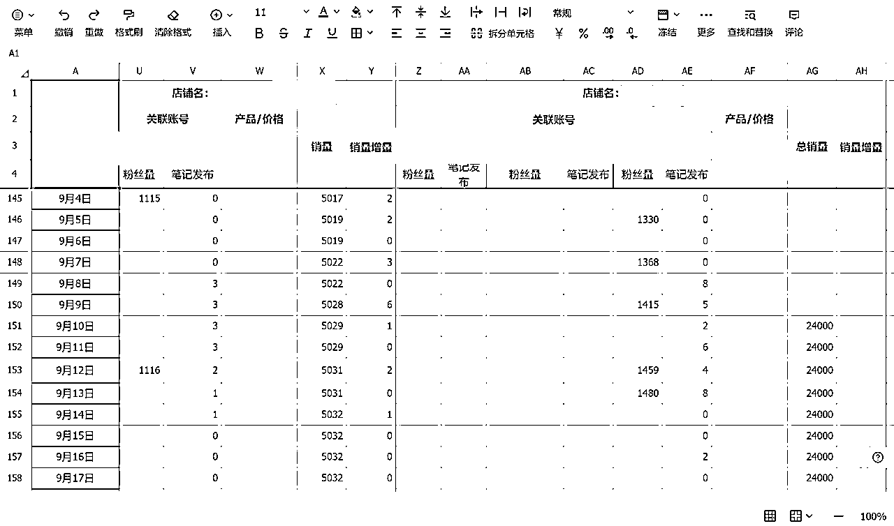

*   查看有效竞争店铺数和近1天有效竞争笔记数，判断竞争度；
*   判断头部账号的笔记质感是否在自己能力范围内可复制。

③拆解
确认可做后，开始收集中拆解对标爆款。直接导入亨亨猫下载，分类归档。拆解分封面和运营逻辑两块。

封面拆解前面已说，这里略过，我自己还做了套拆解表。

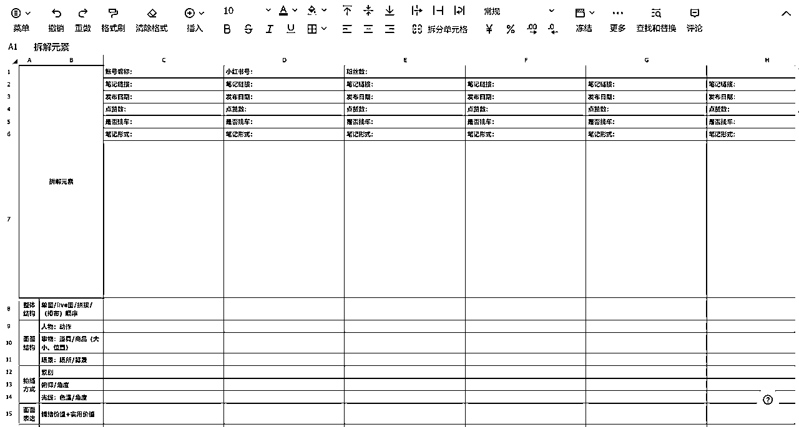

运营逻辑拆解：看爆款笔记的开头、中部、结尾的共性，提炼“卖法”。
我当时发现对标都用一个套路：

*   开头用氛围感背景和光线，配合不同拍摄角度和道具，营造玄学感；
*   中间用案例增强信任，激发用户“我也想要”的冲动；
*   结尾总结产品卖点和配件，并说明用法。

基本头部号都在用这套框架。

④生产
拆完就照着做。从实拍到后期都尽量还原对标。我一般每隔三四天集中一天拍摄，其余时间做笔记制作、发布和复盘。

最难的是灯光背景的营造，这个品对氛围感要求极高。对标用的灯不是普通摄影灯，我试了不少宝上相似灯，都退了；还拆解光线样式买发光物件测试，甚至自己买COB灯珠组装。最后还是找人定制才基本还原。

后期用美图秀秀和PS配合，设备和环境有限，原图不完美，后期很重要。美图秀秀的贴纸、文字款式和批量功能是优势；PS负责精修。标题正文直接搬对标喂AI仿写，再人工加高频词润色。

⑤测试与迭代
素材齐了就开始日更测试。实拍一次能出几百张图，批量调色效率很高。
期间不断复盘对标爆款和自己的笔记差异，以及数据反馈去优化。我的复盘思维导图迭代了十几版。刚开始两三个月数据很惨，但看到对标利润诱人，还是咬牙拆步骤、补短板。坚持到第二个月后才迎来拐点。

📕不是即时反馈的平台，但非常长尾。一篇笔记爆了，能持续帮你赚钱。所以耐心和坚持很关键，方向和方式对了，黎明会来。

# 三、选品方法论

蓝海的核心是词根，抓到词根就能批量挖品。我的词根挖掘方式有以下几种。

## 原始词根

原始词根就是一个大词，从它能分支出一堆细分需求。

比如“防晒”就是大词，下能分出防晒衣、防晒裤、防晒帽、防晒口罩，也能分人群：儿童防晒、男士防晒、婴儿防晒。

原始词根从哪里来：

### ①热搜榜

*   淘宝热搜

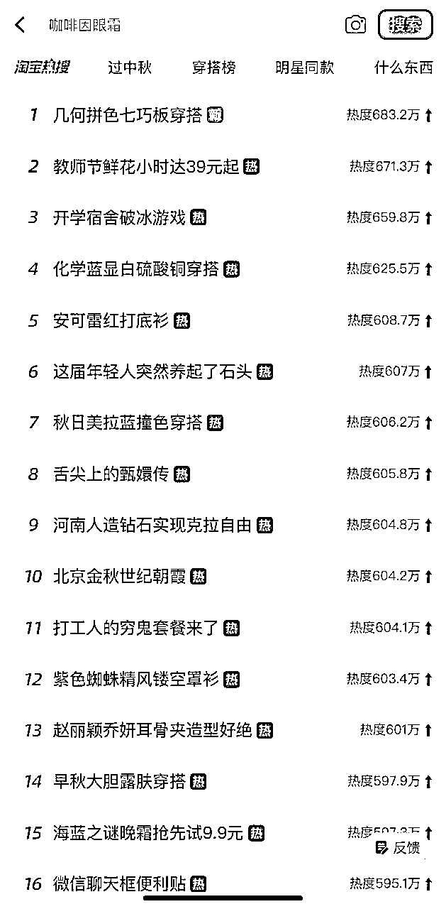

*   1688热搜

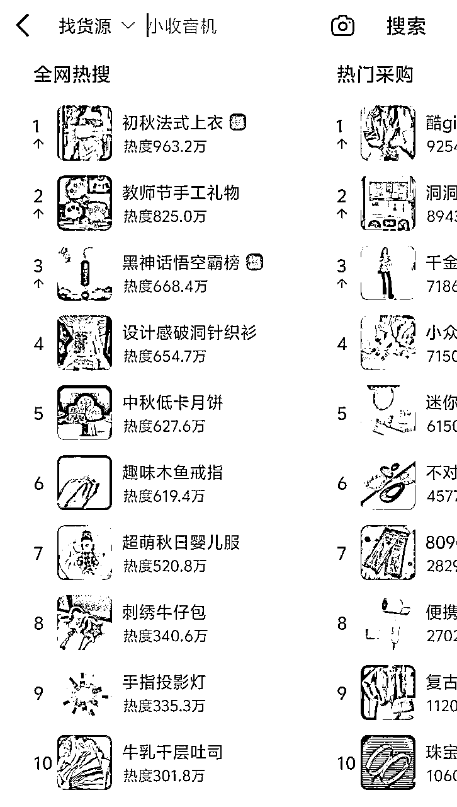

*   📕热搜

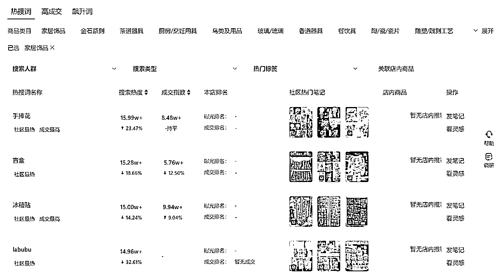

### ②报告指南

平台或机构基于消费行为做的研报，常藏着品类和需求关键词，特别适合找应季和垂类品。

*   巨量算数—算数报告

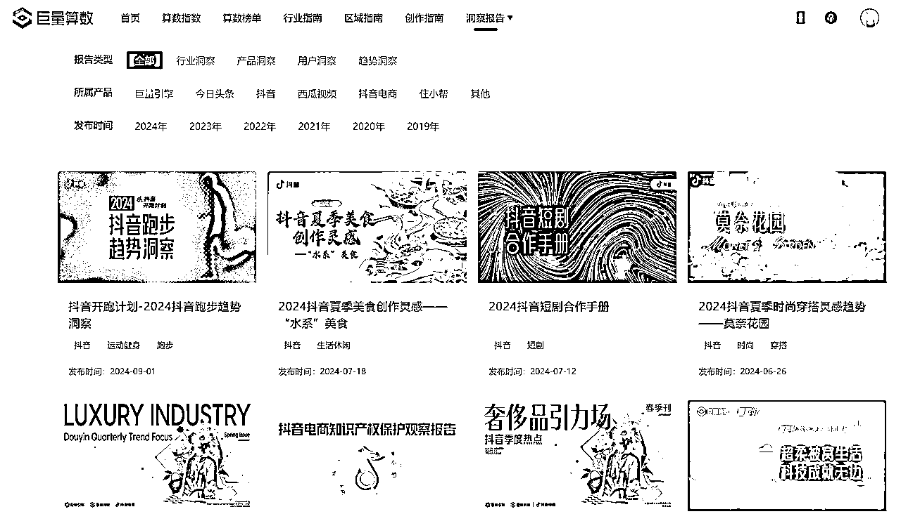

*   电商群

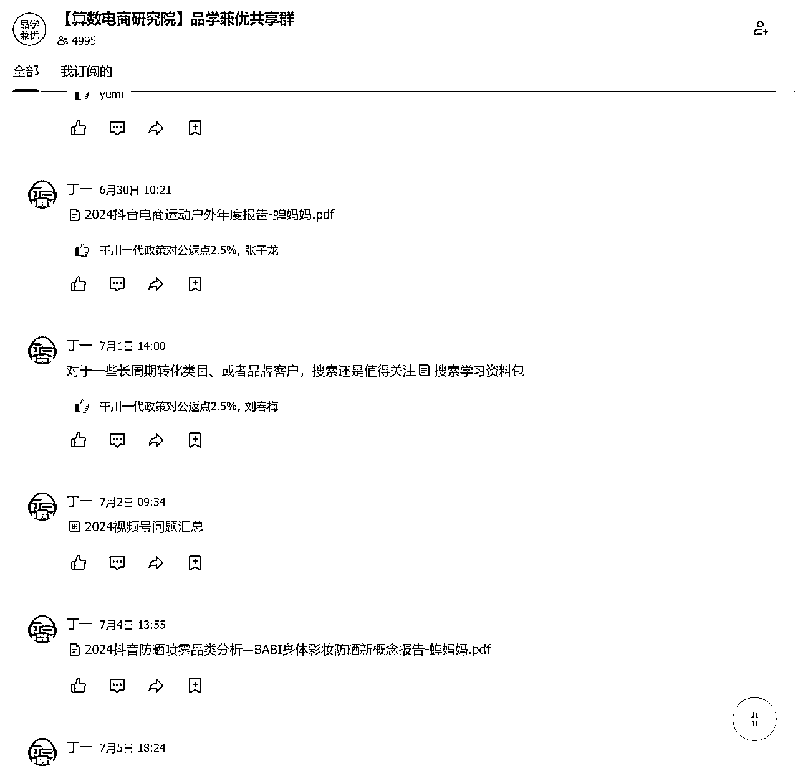

### ③类目梳理

笨办法但全面，能挖到很多没想到的小类。

*   买购网

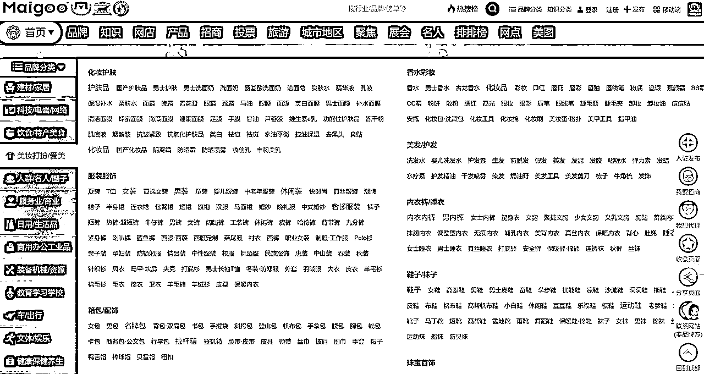

*   淘宝网—商品分类

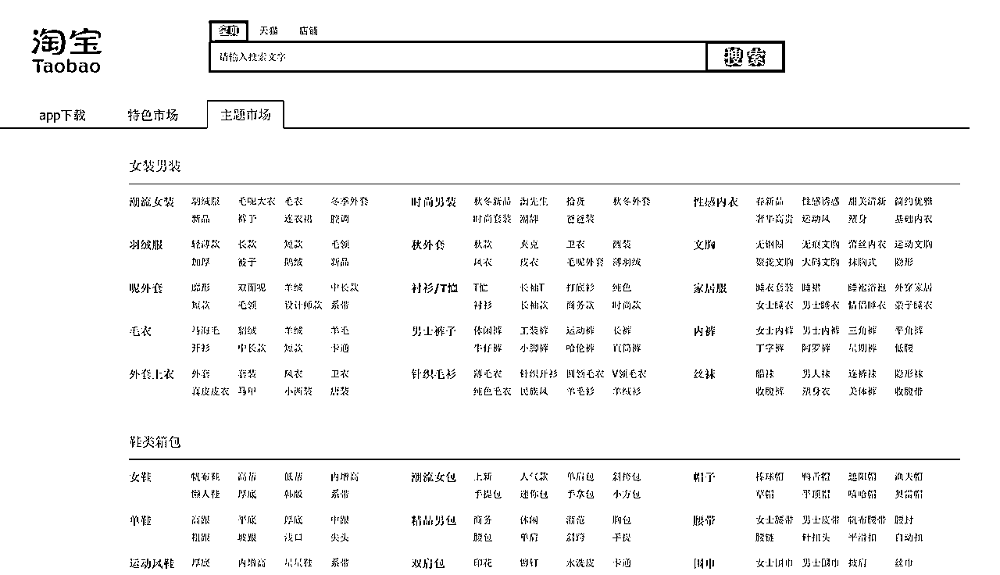

*   📕商机中心

商机中心有全平台类目盘点，还有大数据筛选出的近期机会类目，是选品宝库。

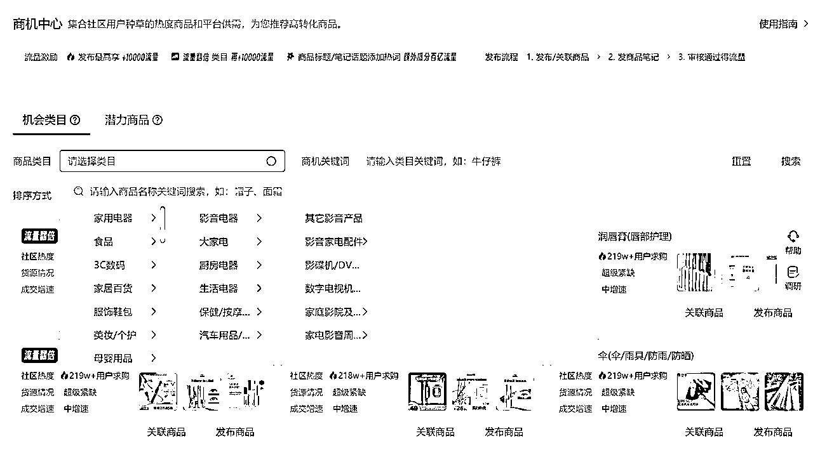

### ④经验沉淀

我自己做过淘宝，攒了一些人群、爱好、应季的细分词库，用着用着就越用越顺。

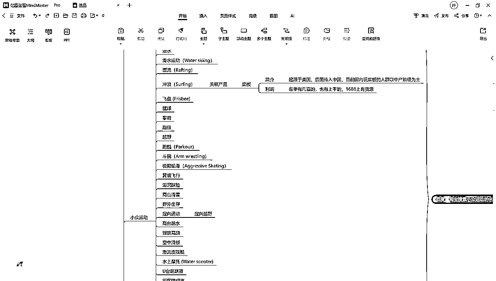

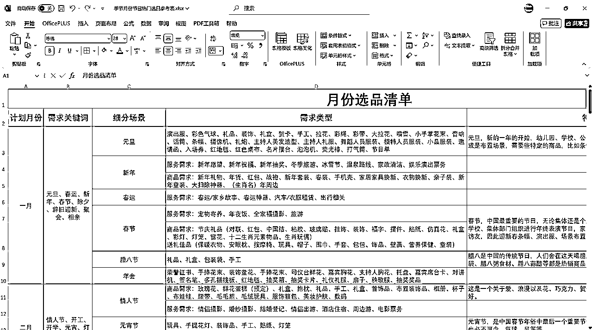

## 拓展关键词

拿到原始词根后，要做长尾拓展。

### ①搜索栏下拉词

别用百度那种问题词，直接用货架电商的搜索下拉，出来的多是产品和品类词。

比如百度搜“防晒”会出来“防晒霜哪个牌子好”，而淘宝搜索下拉会给到具体产品词。

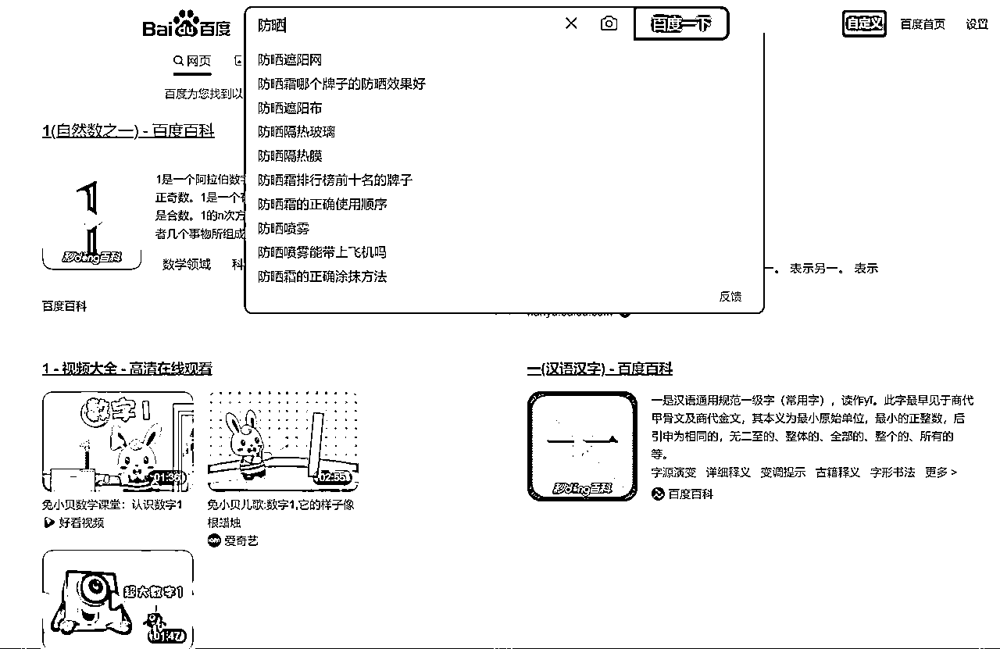

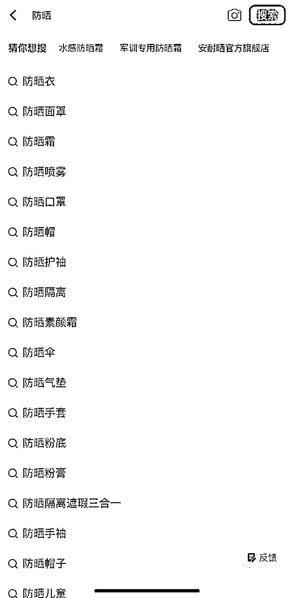

我常用淘宝搜索栏、抖音商城搜索栏、📕商品搜索栏。

### ②关联词挖掘

*   巨量算数—算数指数

抖音的数据能力强，关联词很准。

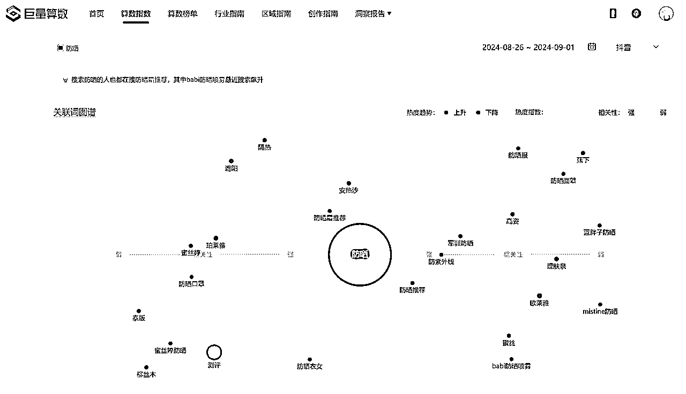

*   深言达意

AI驱动的文本处理工具，可根据模糊描述找词。

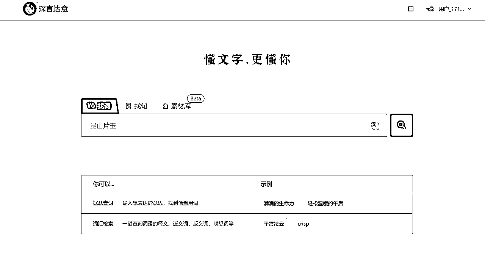

*   5118—相关词

老牌工具，词库庞大。

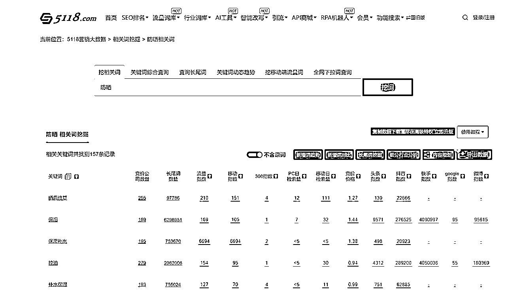

*   商品标题关键词
商品标题里藏着大量细分词，可以拿来二次搜索。
比如搜“枕头”，标题里出现“反牵引颈椎枕头”；搜“护颈”，出现“加热艾草枕头”。

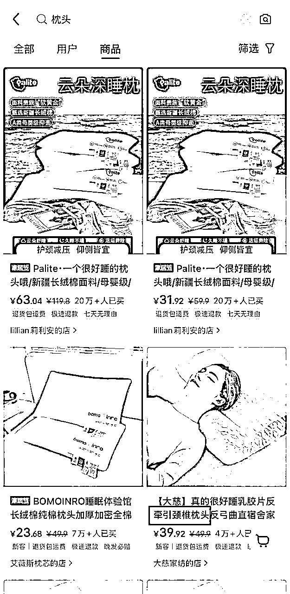

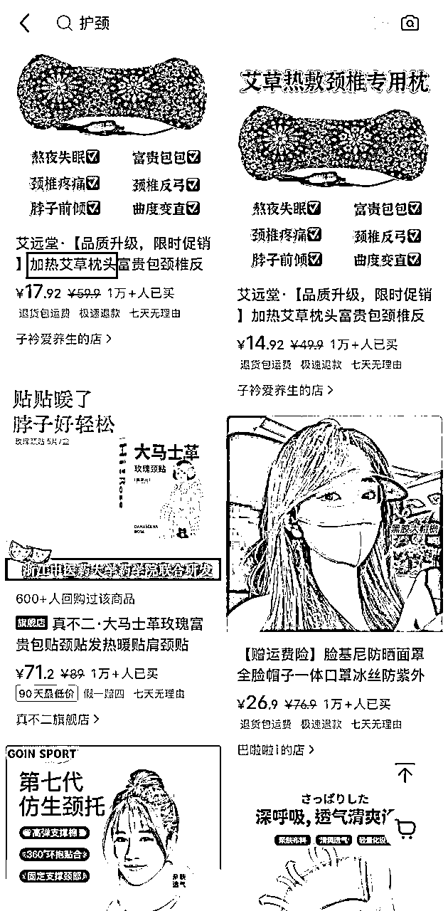

## 挖掘蓝海

最后去📕商品页搜关键词，按销量排序找品，别在推荐页瞎找笔记效率低。此方法只适用于已在📕开店带货的品。

举例：之前找养生品，搜“养生”商品页全是养生茶。去买购网看养生相关细分词，再逐个去搜，就挖出了儿童足浴包，后来因素材产出难放弃。

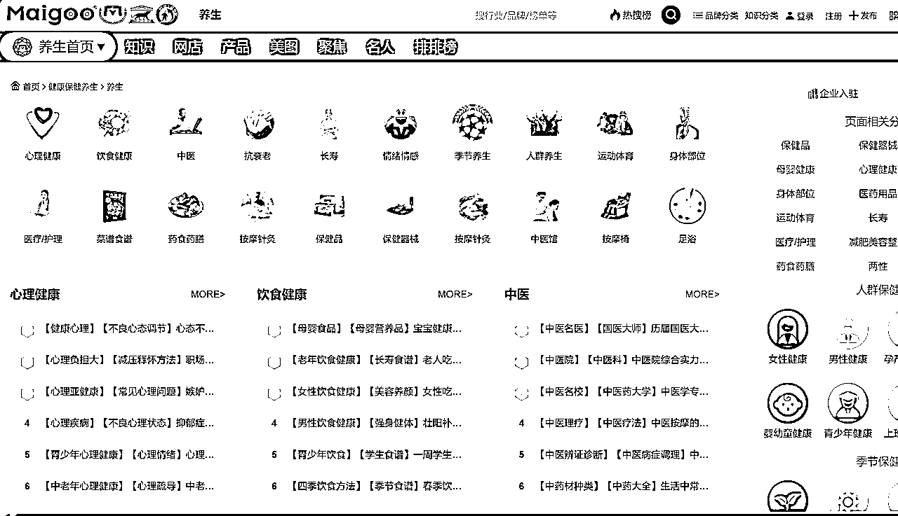

# 四、入局建议

📕的蓝海现在竞争并不算白热化，很多类目仍有人在闷声赚钱。但门槛也不低，除了选品眼光，还需要爆款拆解能力、内容生产能力：前期拍摄布光布景构图，后期调色修图，以及笔记运营和店铺运营。缺一不可。

不过蓝海有个核心优势：靠一篇爆款笔记就能长期吃长尾收益，不像女装要不断换款。只要方向对、方法对、足够坚持，这个赛道值得入局试一试。