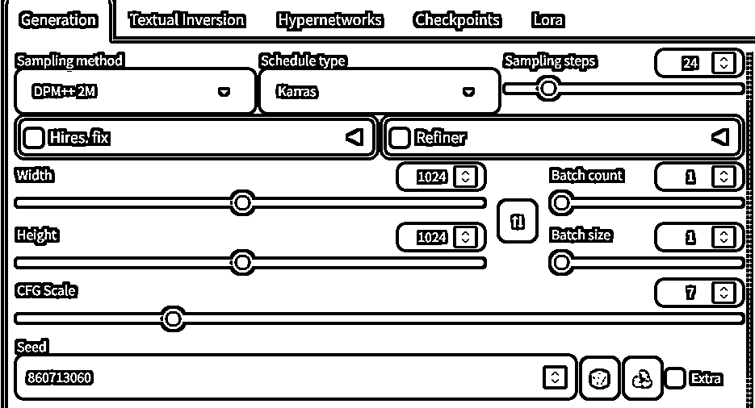
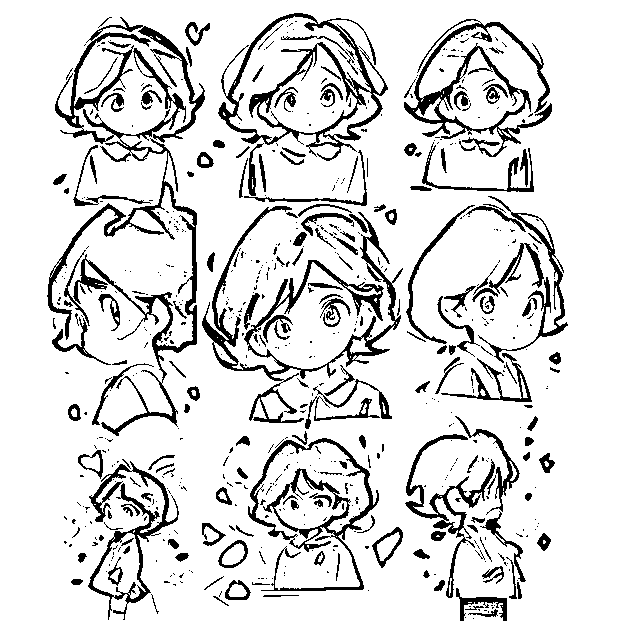
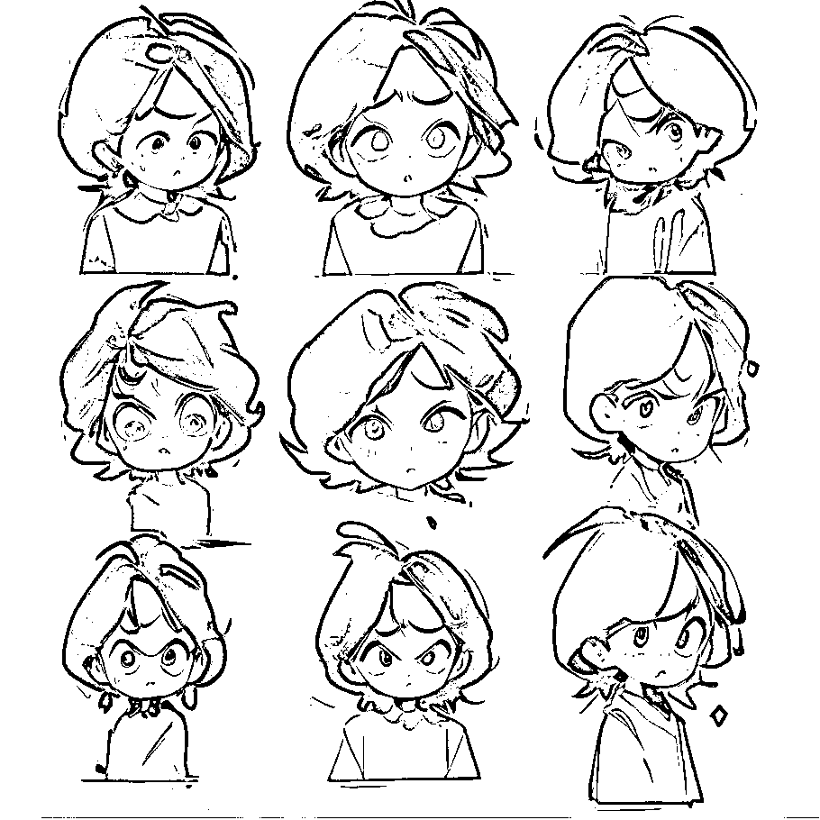

# 国庆7天，我把“做表情包”变成了一台自动赚钱机器

> 事情要从一个挑战说起：Coze航海领队佳文发起了一个“搞钱机器设计挑战”，规则很简单——从龙哥盟的风向标里挑一个项目，花7天时间把它变成一套能自动运转的Coze工作流，做成一个真正能赚钱的机器。

我当时一眼就挑中了“批量表情包”这个方向。坦白说，做这个项目就是为了逼自己一把。内容随便跑出来容易，但真要做到能变现，质量门槛还是有的。尤其是我在小红书上看到原帖作者晒出的玩法——他做这个项目的真正目的是引流卖课。我给自己定的目标也很实在：先把MVP跑通，抛砖引玉。

另外先说明一下：虽然这是Coze的挑战，但我实际上并没有在Coze上把整个流程跑起来。因为Coze的图像生成能力有限，而表情包需要一个特定的模型加上专门的AI绘画工具来完成，比如本地部署的Stable Diffusion WebUI、ComfyUI，或者其他在线工具。特别提一句ComfyUI，它本身也是基于工作流的，功能相当强大，赚钱里也有不少介绍文章。这篇文章的重点是讲清楚MVP怎么跑通的，不会手把手教你AI绘画，所以读之前最好对AI绘画工具有一定的使用经验。

## 我是谁？

本职是大厂程序员，日常工作就是训练和优化AI模型，图像生成模型和语言模型都在做。加入赚钱的契机是朋友推荐了一个出海工具站的项目。我一直想找一个能长期积累的副业方向，但一直没找到合适的切口，赚钱算是对上了我的需求。

## 为什么参加航海

我第一次报名的是出海工具站和Coze两个航海。说实话，我的日常工作和Coze要干的事非常接近——都是把AI模型嵌进流程里。但我还是报了Coze，原因很简单：做一个工作流，最重要的不是“实现”这个动作，而是“想法”和“拆解”。再复杂的工作流，只要有人做出来了，你照着一步步搭、一步步排错，最终一定能跑起来。实在不行还可以花钱请人帮你实现，但想法和拆解，是钱也买不来的。

参加航海最大的收获，是看到大家把自己独特的想法用工作流变成现实。一开始我很困惑：很多AI项目在公司里是根本拿不出手的，但在赚钱，大家就是能靠这种看起来“不专业”的成果赚到钱。在公司，我的任务是不断优化已有流程的效果；在赚钱，要做的是从想法到结果，用最简单粗暴的方式打通。后来我才理解，为什么很多技术人员离开公司环境后反而赚不到钱——因为在公司，流程和分工是现成的，你只需要负责其中一环；而在赚钱，你需要自己完成从0到1的闭环。

## 这个项目的核心流程

### 需求拆解

需求本身不复杂——用AI绘画模型生成表情包风格的图片，上架到各平台，靠赞赏变现。但真正难的是隐藏需求：一套表情包里的所有图片，风格和人物必须保持一致，同时每张图还要有差异，体现不同的情绪。这两点是表情包的核心竞争力。

动手之前，我梳理了一下AI绘画在这个项目里的优劣势：

**优势：**
- 质量够用：AI绘画技术已经相当成熟，水平普遍在平均线以上，用户能接受。
- 批量生产：AI可以在短时间内大量出图。
- 成本几乎为零：除了订阅工具的费用，生成过程几乎不花什么钱，时间成本也比找画师低得多。

**劣势：**
- 效果不稳定：每次生成的结果未必都满意，需要反复试错、从多张里挑最好的。
- 图片间一致性差：每次生成都是独立的，而表情包偏偏对人物一致性要求极高。
- 依赖提示词：提示词几乎决定了出图质量，一套好用的提示词是成败关键。

所以，整个项目的拆解下来就是四步：
1. 写提示词
2. 用提示词生成内容
3. 重复前面两步批量生产
4. 从结果里抽出好图，人工处理后按平台要求上传

### 动手流程

第一步，下模型。表情包需要的Lora模型可以去Civitai或LiblibAI这类网站搜“sticker”，有的Lora对底模有要求，有的比较宽松，得根据实际情况挑底模。我选的是这个底模和这个Lora（这里指Civitai上的链接）。这个Lora生出来的表情是九宫格样式——好处是一次能出几张人物相对一致的图，坏处是需要抠图，而且单张图的质量会略打折扣。

第二步，生成提示词。提示词最简单粗暴的来源，就是模型网站上别人已经生成好的图，直接抄下来用。我用的提示词就是从模型详情页里拿的：

正面提示词：```
parameters stickers,biaoqing,stickers of girl in blue, white background,simple background,emotional,illustration,best quality,highly detailed,masterpiece,an extremely delicate and beautiful,extremely detailed,8k wallpaper,Amazing,finely detail,official art,
```

负面提示词：```
lowres,bad anatomy,bad hands,text,error,missing fingers,extra digit,fewer digits,cropped,worst quality,low quality,normal quality,jpeg artifacts,signature,watermark,username
```

人物描述根据自己的需求来定义外貌和穿搭。因为表情包的核心是传达情绪，所以还得加上能体现人物心情的描述。可以参考微信里的表情包，先用中文把动作写清楚，再翻成英文。

第三步，跑图。这一步可以多试几次，换不同的设定和随机种子，直到找到自己满意的结果。我的设定是这样的：



生成出来的图片效果在这里：



第四步，固定种子，改提示词，重新跑。这一招是解决一致性问题最直接的方式。随机数种子就像一个个平行世界，提示词则是你在那个世界里的选择；当你只改部分提示词，就相当于在平行世界里做另一个选择，看未来会怎么变。我这次改动的提示词主要加了表情描述：

```
parameters stickers,biaoqing,stickers of girl in blue with Pouting face, white background,simple background,emotional,illustration,best quality,highly detailed,masterpiece,an extremely delicate and beautiful,extremely detailed,8k wallpaper,Amazing,finely detail,official art,
```

出图效果如下：



最后一步，从结果里挑出满意的图，把需要的人物抠出来整理好，上传到对应平台就完成了。

### 还能怎么进一步优化？

这套流程虽然已经能通，但提升空间还有很多：

1. 用Controlnet的Reference Only功能，提供人物形象参考，进一步强化形象一致性。
2. 优化提示词表达。
3. 换效果更好的模型。
4. 自己训练人物专属Lora。
5. 用其他增强效果的插件。

## 最后说几句

整个流程并不复杂，但每一个环节都有大量的调节空间：模型、Lora、提示词、参数，以及是否引入Controlnet等插件。任何一个参数点展开来，可能都得琢磨半天。我因为时间有限，没有继续深挖。想提升效果，核心还是多积累——把试过的有效提示词记下来，多看看别人作品，琢磨别人是怎么优化效果的。这条路不难走，但每一步都值得认真走。