# 抖音月销2000万，不是靠“直播神话”，而是靠这套笨功夫

大家好，我是一焱，重庆人在成都，刀姐的记名弟子。去年4月才正式起盘做抖店，现在单月GMV已经突破2000万。

先晒一晒我们团队这一年的部分成绩：

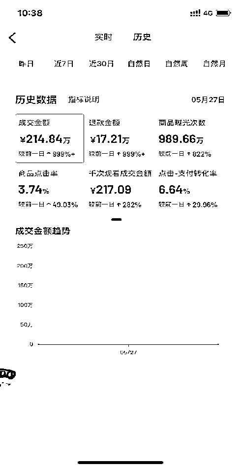
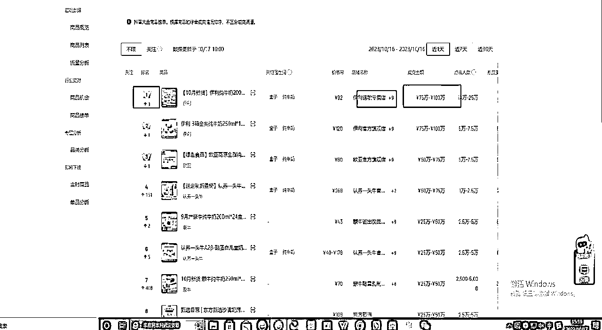

伊利锦歌专卖店，单店单日做到过200万，类目排名第一，把东方甄选这些头部旗舰店都甩在了身后。

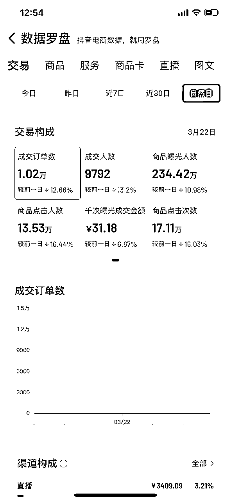
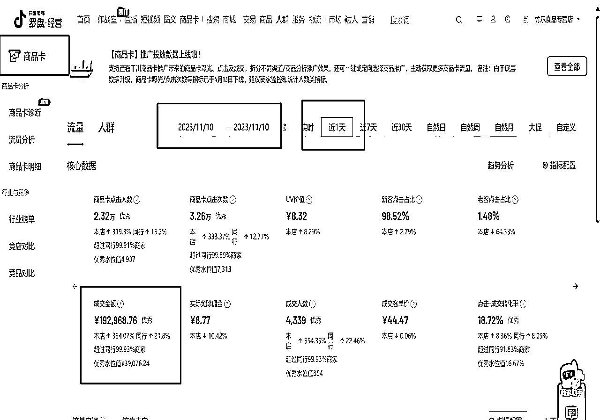

借力抖音“拼多多化”的趋势，低价秒杀活动让单店单日破万单；商品卡的自然成交，单店单日卖到19万。

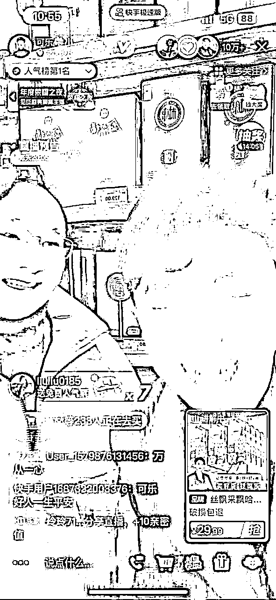
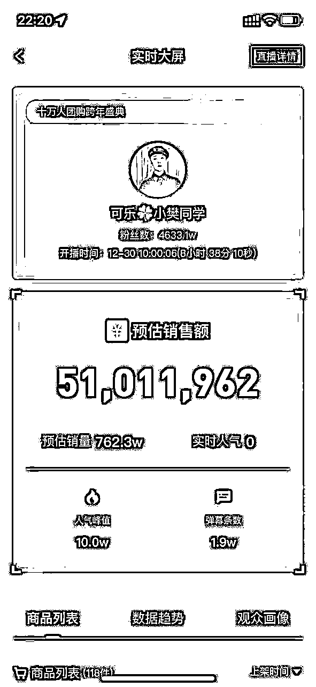

我还给快手Top3主播可乐做过助播，当天销售额破了5000万。（知道绿色那个靓仔是谁的圈友，应该懂）

接下来，我把这一路跑通的东西拆给大家。

## 一、抖音现在还能抓住的蓝海

知识付费这个方向，现在千万别再冲了，抖音正在严打，别跟平台逆着来。

平台现在的重心是推商品卡，口号喊的是“全网低价”，同时还会扶持中小主播。但说实话，后面这句听听就好，中小主播没有“苦大仇深”的那股劲，很难真正做起来。

这些人大多是字节跳动出来的，有字节背景的圈友应该能认出一些。当时平台测试扶持中小主播，我们也是承接方之一，后来项目不了了之，主要问题在于交付太重；除了小主播能拿到收益，我们这些承接方要出场地、货盘、培训，却基本看不到利润。

2023年的大盘，90%以上主播是亏的，钱主要烧在人力跟投流上。但换个角度看，如果你把“直播带货+店铺”或者“短视频带货+店铺”一起做，形成多维竞争力，组合竞争本身就是一片蓝海。

直播真正的作用，不是靠它赚大钱，而是把一个品打爆；哪怕不是爆款，只要有稳定单量，就可以去报抖音活动，之后交给达人分发，收益自然就来了。若把所有筹码都押在直播上，那就是破釜沉舟，我不太建议这种姿势。靠直播赚钱，大概率赚不到，甚至大概率亏损。这里也提醒各位，凡是直播间相关的知识付费，慎入、慎入、慎入——很多做直播的人已经开始靠卖课赚钱了。

我们主播“我想静静”单场最高破过100万，但这个号算下来去年基本不挣什么钱。真正利润高的，反而是店铺端收商家的合作年框费用。

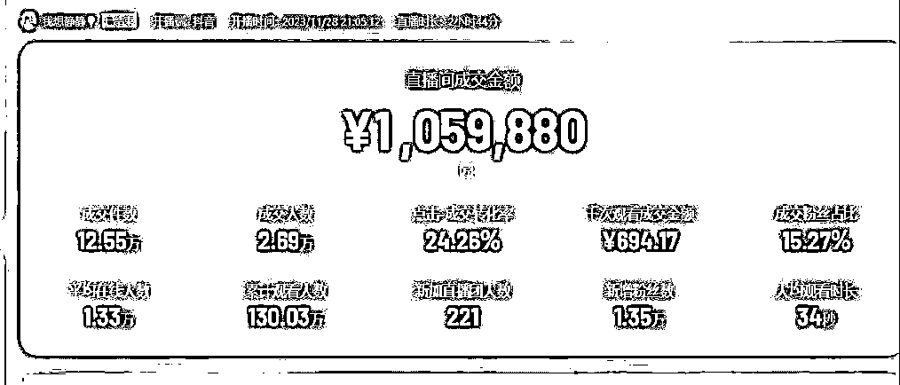

一句话总结：以店铺为核心，把链接打爆，吃平台规则里的商品卡流量，再承接中腰部达人，这仍然是蓝海。现在做直播，别想着从直播佣金里赚钱；可以收年框、用直播打品养店铺、也可以收徒，单靠佣金根本走不起来。

链接爆了之后，甚至能直接给1%-2%佣金。大主播用来爆链接，小主播直接接低佣。

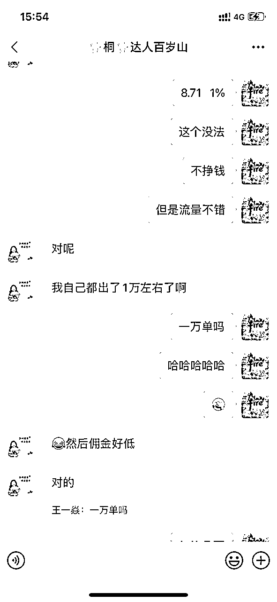
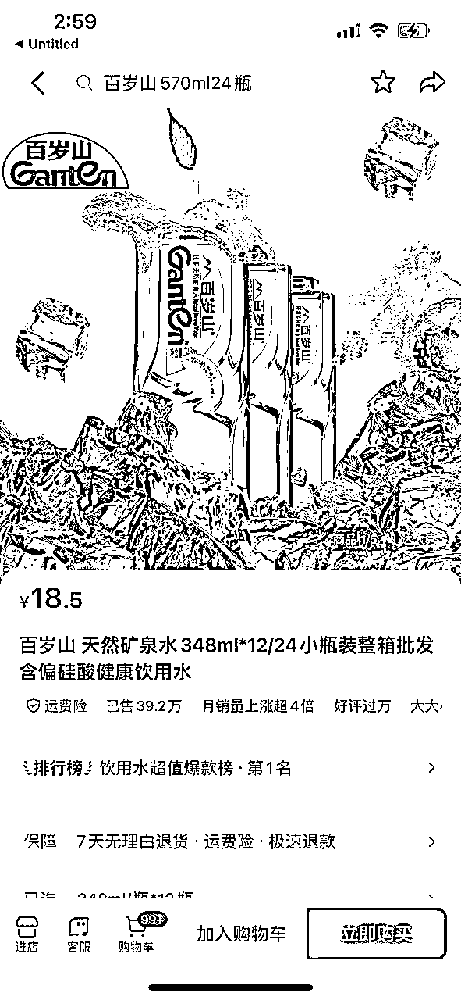

你可以直接跟达人直说：这单不赚钱，但链接爆了对大家都有好处，1%也有人愿意带。实际上，我们还有品牌方完成任务后的返点，大概又能多出8个点的利润。

## 二、选品逻辑：供应链才是命根子

我以前对选品的理解太浅了。现在我的理解非常朴素：选品的关键，就是有优势的供应链，其他都不重要。

我眼里的供应链公式是：产品成本+快递费+包材+工人费用+发货速度+单日发货上限。

上个月合作了一个纸品，真是被坑惨了。深度合作主播当天出了三千多单，结果货发不出去。最后主播账号死了，店铺也死了，主播打电话回来骂人，我们既赔了投流费，也伤了关系。这个坑，大家一定要绕开。

产品成本大家其实都差不多，真正有空间的是快递费。我有个合作伙伴，夜场商务公关能力很强（不知道这个能不能展开聊，但我觉得这能力非常重要），我们拿到的价格是：1KG以下快递费一单一元；10KG的快递费大概一单6.5元。能拿到这种价，也和一些快递公司需要刷单充量、国家有GDP要求有关。接着，打包工人和包材也要反复去谈。做9.9元的产品时，我们真的是按分分钱来抠成本，同行比到最后，拼的就是分毛级差价。

所有成本都必须极致压缩。

现在抖音对“多商品分考核”的占比已经降了，大概在25%-30%，各个品类都在往下调；重点变成了服务和物流。只要你卖的东西质量不是太差，就不用太担心。常见打法是用优质款和劣质款搭着卖，不断测试两端占比，这样成本节省空间很大。但发货一定要快，服务一定要好。我之前专门写过一篇怎么处理差评的帖子，可以参考。

我的目标说到底还是挣钱，所以对产品品质没有不切实际的执念。产品标准参照抖音对店铺的各项考核和复购率来定，核心是赚钱效率。我一直认为，品质是靠销量堆出来的；电商里大多数品都不具备长期价值，先把钱搞到手，才是正经事。

## 三、怎么把达人绑成自己人

一个深度绑定的达人，顶得上十个同级别达人。所谓深度合作，本质就是利益交换。

这里有个很关键的细节：80%的达人商务都有权决定上品，所以前期建联，搞定达人商务就够了。不管是达人还是达人商务，都一定要满足他们的利益诉求。具体怎么冷启动建联，生财里有两篇精华帖，大家可以翻出来看看。

我常用这么几种方式：

### 1、捆绑推荐品

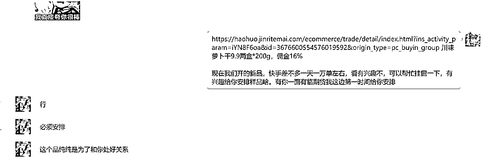

当我们自身量级上来以后，有些达人已经深度捆绑，甚至反过来很依赖我们的产品。这时候，我们会顺手推一些白牌产品给他们做冷启动。关系这东西，说来也简单：不断合作、不断拿结果，关系自然更深；同时，白牌冷启动的成本也被大大摊薄了。

### 2、让达人商务的利益最大化

我在成都，成都做得不错的达人，像C魅、刘巧巧、可乐、彩虹夫妇、大大小小的窝等，我们都有深度合作。

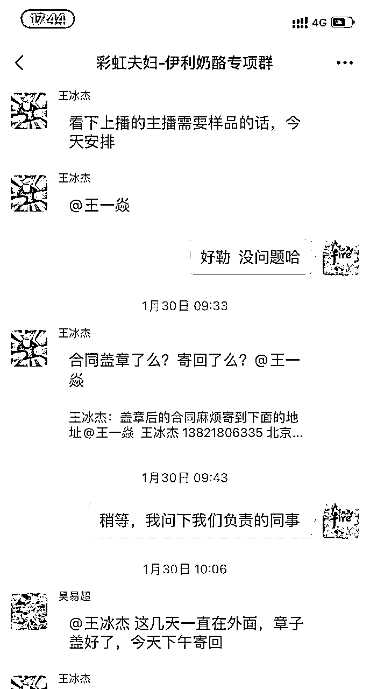
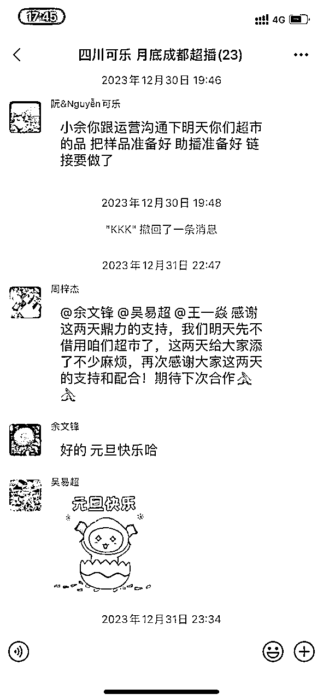
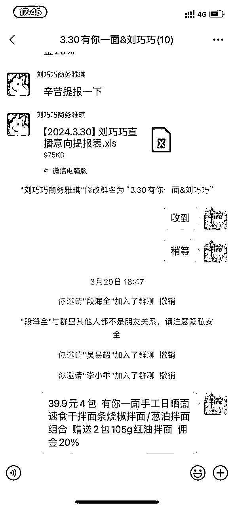
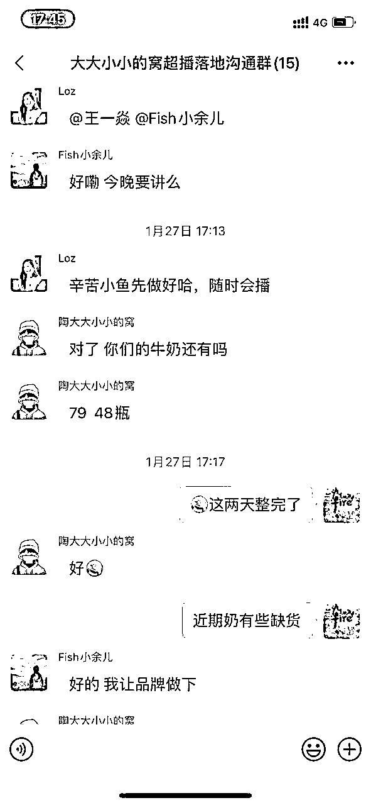
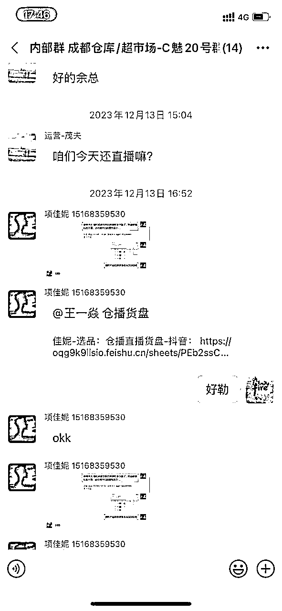

简单说，我们会定期拜访他们，给商务返点，送钱、公关，也会一起去商K。除了利益，还有感情纽带。今年的目标是搞定杭州的一些肩部以上主播。

### 3、让达人本尊的利益最大化

这里和商务的打法要区分开。能合作的达人本尊，很多都是老板亲自下场一路拼出来的；请职业经理人来做，大概率做不成。直播里的不确定因素实在太多，耗费精力财力巨大，还得不到确定的结果。

我们对这类达人老板，返点未必有用，因为他赚多少都是自己的。我们的合作方式是：直接把店铺给他们，分给他们五到六成，再帮他们把店铺运营起来。谈判逻辑很简单——他们心里也清楚直播不稳定，但店铺相对稳定。

我们还会帮他们亏品。在抖音，亏品比投流划算多了：流量越来越贵，亏品能提高成交密度，更容易撬开流量池子。这样一来，主播老板的深度合作就自然建立了。

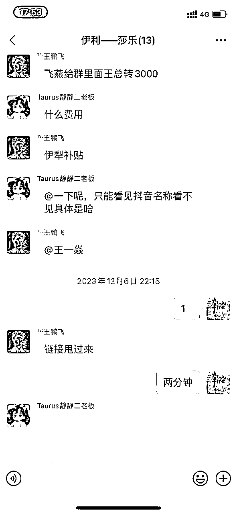
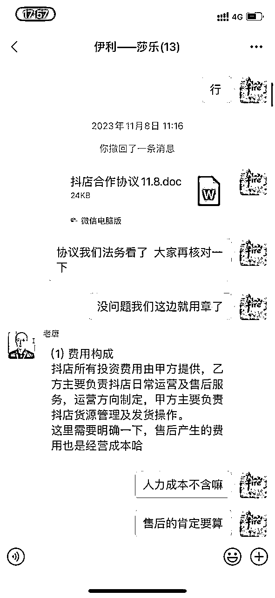

### 4、超级主播怎么建联

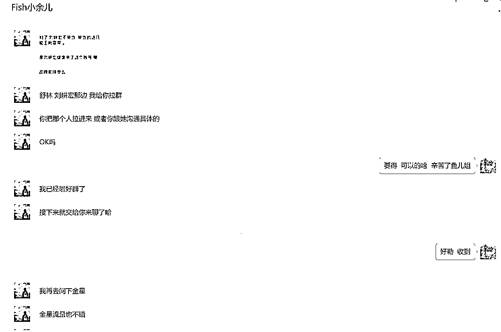

至于大主播，我们主要对接的是给大主播做助播的余澜。每次合作都给她一笔收入，哪怕自己前期不挣钱，也要让她多分一点；平时经常一起吃饭，把关系处到位。她帮我们拿到的价格一般比市场低，甚至可以免费上品。很多大主播都是她介绍过来的，而且黏性很不错。

一句话：直接给介绍人利益，让她能搞到钱。少数朋友找我对接头部主播，我也会说，简单直接付费就好。给大主播的商务花钱是值得的，因为大主播99%都不保量。这里也有个误区：很多人觉得付了坑位费，就一定要对方保证多少GMV，这样大主播商务根本不会搭理你。关系搞好之后，后面挂大主播橱窗甚至可以不花钱。

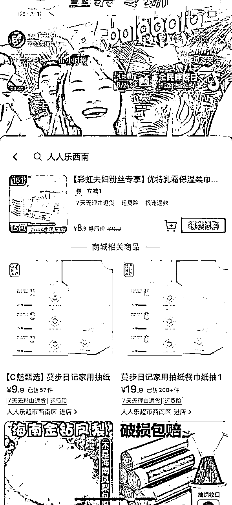
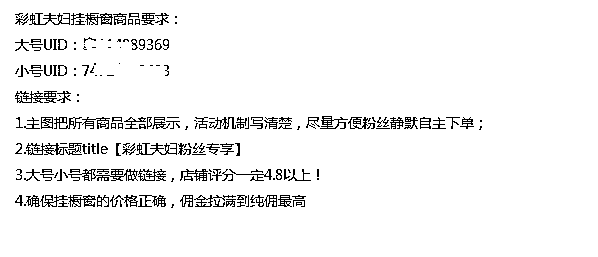

比如我们和人人乐合作的店铺，就直接免费挂进了彩虹橱窗；论分数、论单量，其实都没达到人家标准。另外，对接大主播还得看品。即便是伊利奶酪这种大品牌，给了坑位费也不一定上，之前伊利奶酪找彩虹夫妇合作，坑位费还被退了回来。所以推品之前，一定要把数据和主播的具体诉求调研清楚。

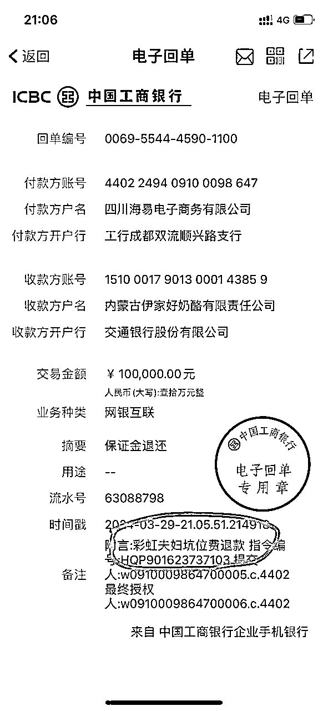

## 四、如何运营好店铺，接住抖音“拼多多化”的自然流量

我们目前测出来的“报名指南”，流量真香：新店刚报上名，一天都能出上千单。

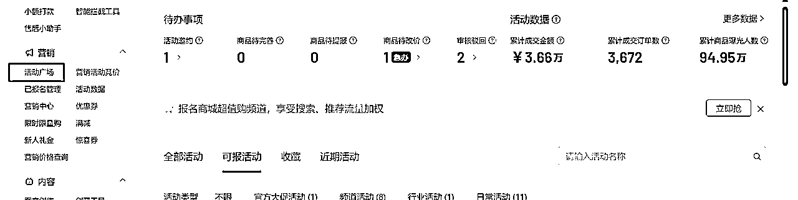
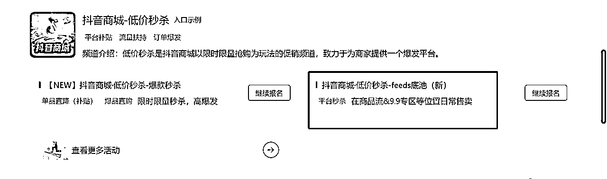
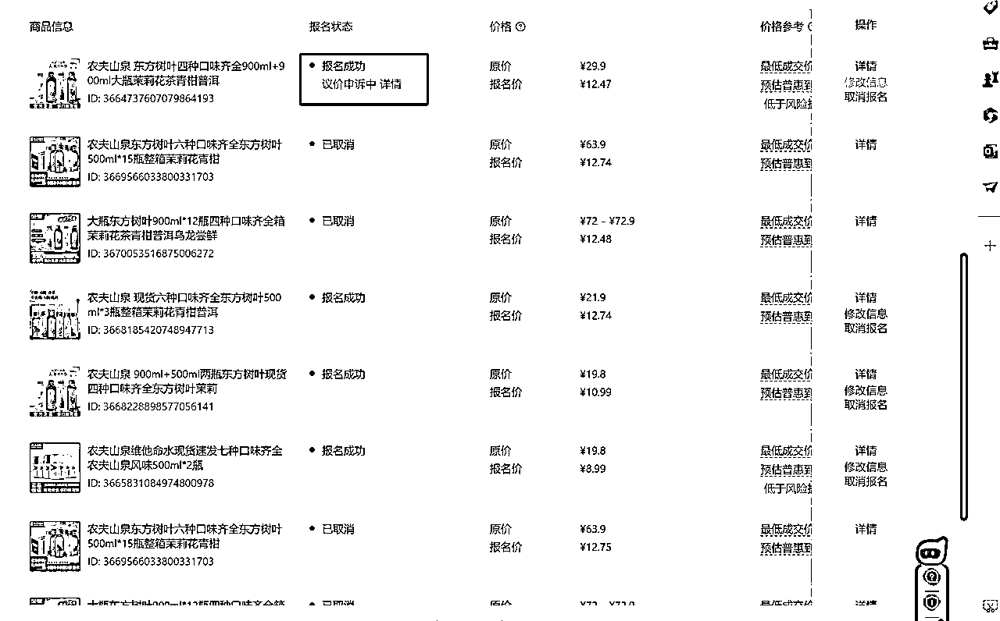

这里有个技巧：跟平台小二搞好关系，就能直接安排流量加权。字节的同学还是很正气的，方法就是积极参加平台活动、多回应、多请教，关系自然就好了。

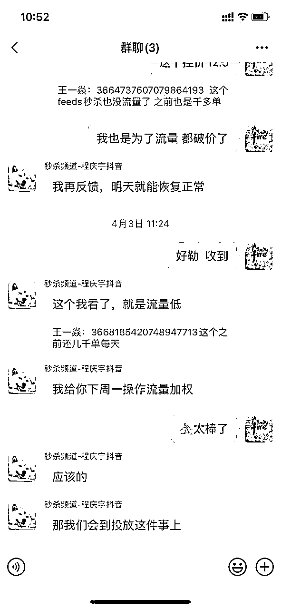

后面我们单店能爆万单，靠的全是小二给的流量加权。链接一旦爆了，就算达人只放三个点以内的佣金，也有很多人愿意带。这时候，人工、包材、仓储这些成本，也全都被摊薄了。

## 五、现在入场抖音，什么姿势才能搞到钱

很多人会好奇我们团队多大。其实核心人员只有四个，很多事我都亲力亲为；其余的人都是现结合作，包括明星助播、分发团队，全部按项目制来做。圈内一位大佬说过：这个时代的人均上限，是人效一年挣300万，我们目前还没到。

抖音卷，是真的卷。要进场，一定要有多维竞争力。我的组合就是“店铺运营+达人资源”，最后靠抖音商品卡这个蓝海来变现。别忘了，商品卡成交是免平台扣点的。

我们的目标，是把一个白牌打成一个半品牌；做成真正的品牌，则是一辈子的战略目标。商业模式也很好理解：先在抖音把单品打爆，再做全域电商截流，我们原本就更擅长传统电商。我个人认为，目前只有抖音还有机会造就一个品牌，值得全身心投入。

我们还在创业初期。最后引用谷歌创始人拉里·佩奇的一句话：一个人创业能否成功，首先要看能不能把自己压榨到极致，任何岗位有空缺，自己都能顶上；其次，要看有没有能力养活一个团队。

与君共勉。

也再次感谢生财这个平台，感谢亦仁老大。很多精华帖都让我受益匪浅，我看到了太多实干家的魅力。之前我也不是一帆风顺，深夜翻翻亦仁老大的收藏夹，就又能给自己充满电。当然最重要的是，我在这里挣到了钱。谢谢！