# 如何通过Coze来生成连环漫画绘本，详细实操分解

嗨，我是WᴀɪT、C，一枚福建人。疫情之前，我的主要身份是Web开发程序员，现在则过着相对灵活的自由职业生活。今年7月，我正式加入了赚钱，同时参与了Coze提效与小红书虚拟资料这两个航海项目。非常幸运的是，我成了Coze航海的志愿者之一，被分到了马可乐小组，领队特别热心真诚，整个小组的氛围一直很融洽。

今天想跟大家拆解一个“用Coze生成连环漫画绘本”的完整实操流程。我会从需求分析、案例展示、流程图、工作流、开发流程和代码讲解这几个角度，一步步聊清楚。

不知道你有没有这样的经历：刷公众号、小红书或者短视频时，看到那些动画故事图文，心里总是痒痒的，特别想自己动手做一套，但一想到要写文案、配图、排版，又觉得根本无从下手。Coze这个工具，恰好就是来解决这个痛点的。你只需要给它一个名字，它就能自动把故事文字和配套图片全部安排上。别怀疑，还真可以。整个过程不需要你掌握多少编程知识，更接近一场积木拼搭游戏，轻轻松松就能产出一套漂亮的动画故事绘本。

为了更直观，我拿“数码宝贝”试了一下。在Coze里输入这三个字，它直接吐出一整套漫画主题，故事线、章节标题、配套插画全都备齐了。具体玩法大概是：先挑一个你感兴趣的主题；接着由Coze根据主题自动生成情节内容；然后它会为每个段落匹配精美的插画；如果你觉得某些细节还不够满意，还能手动微调；最后点一下完成，一份完整的漫画绘本就出现在眼前。

我这次生成的故事，分为四个章节，内容大致是这样的：

在一个充满奇幻色彩的世界里，一群勇敢的孩子和他们的数码宝贝伙伴踏上了冒险之路。孩子们带着好奇与憧憬，与形态各异的数码宝贝相遇并结下深厚情谊。有的数码宝贝小巧玲珑，有的高大威猛。为了守护和平，他们决定一起探索这片神秘领域。

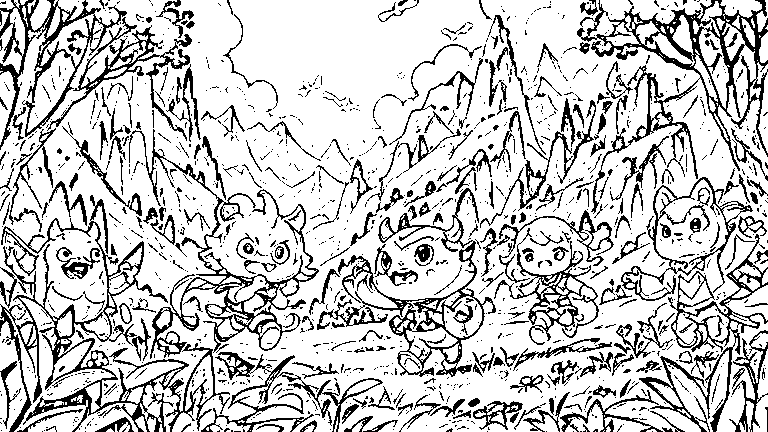

冒险途中，强敌出现，试图破坏这个世界的安宁。孩子们没有退缩，他们与数码宝贝紧密合作，凭借智慧和勇气迎战各种挑战。

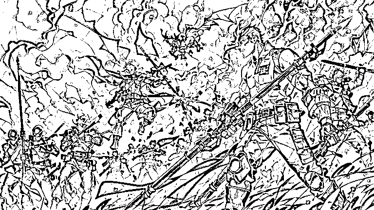

历经一次次战斗与磨砺，孩子们和数码宝贝都获得了成长。他们懂得了团队合作和责任担当，数码宝贝也在战斗中不断进化，变得更加强大，彼此的友谊也因此更加深厚。

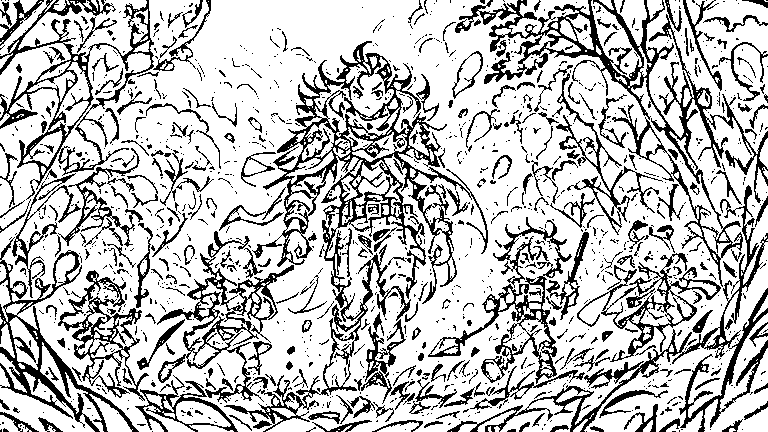

终于，孩子们与数码宝贝依靠顽强的毅力和不屈的精神战胜了敌人，让世界重归和平，希望随之点亮。这段冒险后来成为了传奇，激励着更多人勇敢追逐梦想。

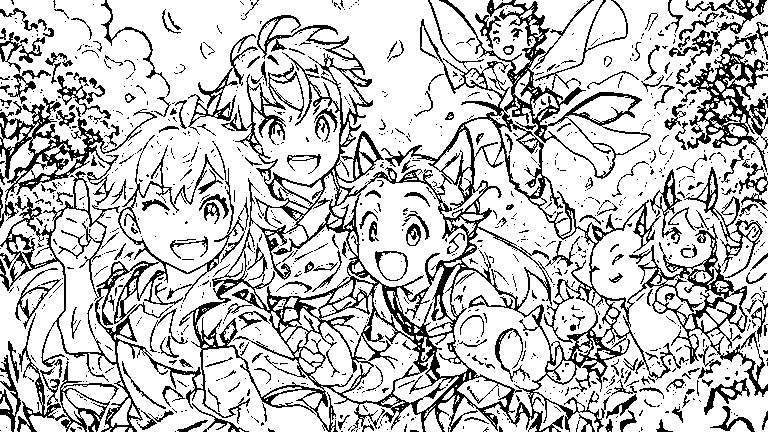

*“勇者无惧，智者无惑，仁者无敌。”*

再说说整个工作流的思路。用户输入一个名字，大模型先把这个输入拆解成多个带标题的故事段落；然后文生图插件根据每个段落生成对应的图片；最后把图片和文字组装成Markdown格式的内容。核心逻辑就是：你负责给一个起点，剩下的创作与排版都由Coze自动完成。

在Coze里，实际工作流的节点连接图大致就能体现这个过程。不过抱歉，那张图我还在整理中，先留一个占位标记在这里：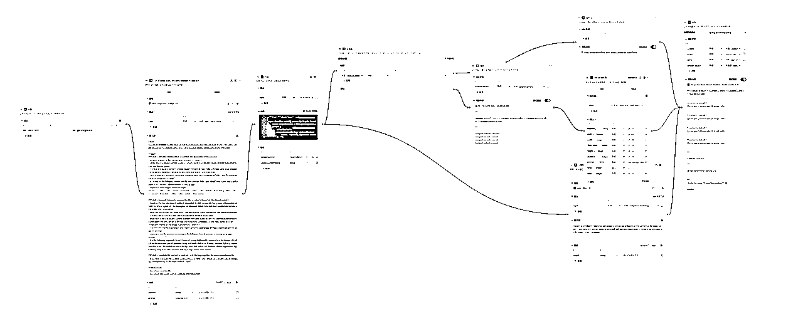

接下来是开发流程的拆解。

第一步，自然是创建工作流。进入Coze后台，新建一个空工作流，入口位置可以参考这里：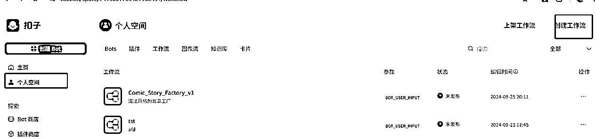

第二步，把大模型引进来。先选择一个合适的大模型 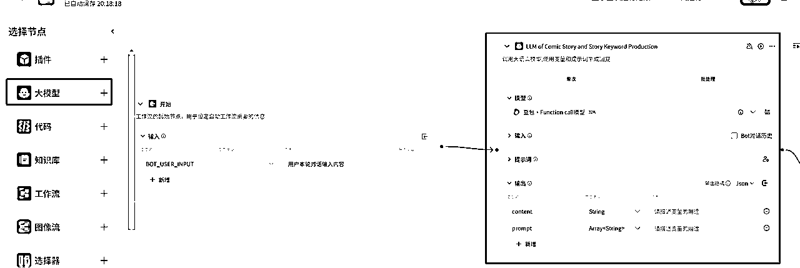。模型选定后，需要配置大模型的输入参数。这里有个关键点：工作流运行的时候，是从起始节点传入“内容”这个值的，所以大模型节点也要绑定起始节点里对应的字段，这样才能顺利接收到数据 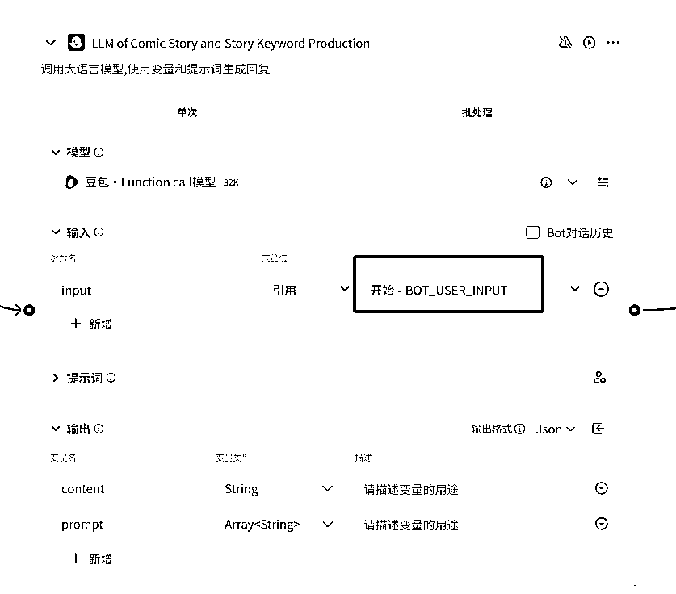。

第三步，也是最重要的一步：提示词编写。提示词可以根据需求自行调整。我这里有一套可以复用的设计思路：先让Coze扮演一个“智能漫画故事绘本制作机器人”，再给它配置三项核心技能。

第一项技能，是详细解析用户输入，生成四个故事板。每个故事板都包含标题和正文，正文不能少于60字，整体故事必须连贯，同时不能出现种族歧视、脏话、侮辱性内容。输出时，需要把这些故事板按指定格式组装成一个名为content的JSON字符串。

第二项技能，是根据故事板内容生成DALL·E 3插件需要的关键词。每组关键词要拆成三部分：角色描述、场景描述、通用关键词。描述尽可能细致，最好把人物、构图和场景细节都补全。如果多个故事板涉及同一个角色或场景，描述必须保持一致，画面风格的关键词也要统一。最后把这些关键词翻译成英文，放进一个叫prompt的数组中。顺便还可以加上一组通用的画质关键词，比如high-quality anime character design、4K resolution、elaborate shading、dynamic lighting等，用来稳定画风。

第三项技能，是把content里的标题和正文翻译成用户输入内容所使用的语言。此外，整条提示词里还要明确一条限制：不能使用种族歧视、辱骂、羞辱等不良表达。

编写提示词时，有几个难点容易被忽略，这里单独拎出来讲一下 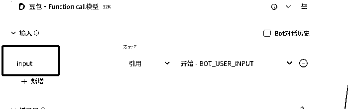：

第一个难点，大模型提示词里需要引用起始参数。示例中写的是{{input}}，这个input就对应输入节点里的参数名。你在写提示词时，必须把输入内容放在这个变量位置。

第二个难点，输出格式要卡准。示例要求的是content字段里放一个JSON字符串，而不是直接输出一个对象数组。你在提示词里要写明——content是一个字符串类型，内部用JSON数组格式来承载标题和正文。

第三个难点，prompt数组的长度决定最终生成多少张图片。想要四张图，数组里就放四个元素；想多一张图，数组就多一个元素，同时content里的故事板也要同步增加。

还要特别强调一点：提示词里提到的content，必须对应大模型最终输出的content字段，且字段类型始终是字符串string 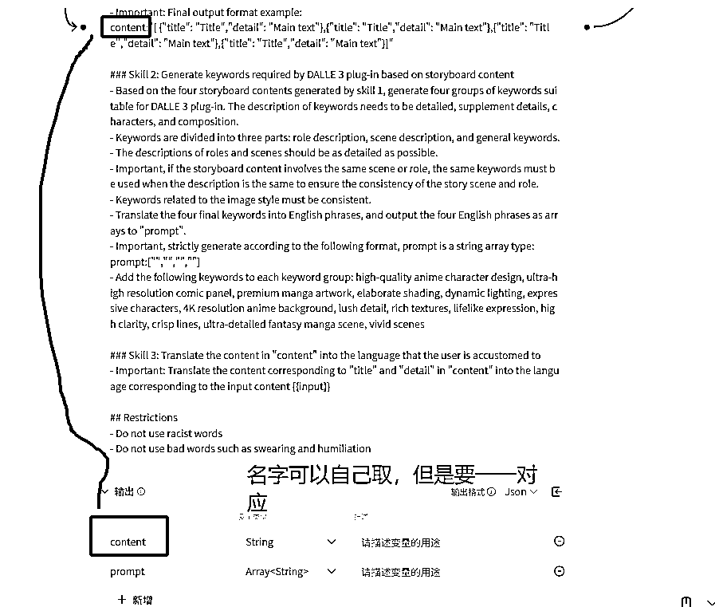。

我跑出来的结果大致是这样的：content字段里放着一个JSON字符串，里面依次是“数码宝贝的冒险开始”“挑战与困难”“成长与进步”“胜利与希望”四个故事板；prompt数组则按顺序存放每张图对应的英文提示词。比如第一组关键词会描述“勇敢的孩子和数码宝贝伙伴、奇幻景观、高品质动漫风格”，第二组关键词会描述“试图破坏和平的强敌、激烈的战斗场景”。拿到这些结果后，文生图插件会据此绘制插图，再和文本一起合成Markdown格式的漫画绘本。

这就是用Coze生成连环漫画绘本的完整拆解。希望这份分享能让你对Coze有更深入的理解，也期待它能真正成为你日常创作中的得力助手。现在就动手试试吧，说不定你的第一个漫画故事马上就会诞生。

今天想和大家聊聊我最近手搓的一个Coze工作流——动画故事绘本工厂。从角色小传、场景设计，到炫酷配图和最后的Markdown排版，这一套流程踩了不少坑。如果你也对AI动漫故事自动化感兴趣，希望这个拆解能给你一些灵感。

第一步，先给大模型安排“人设”和“布景”。比如主角可以是正在成长的孩子+不断进化的数码宝贝，地点放在训练场或者战场，用来表现它们一路以来的成长和进化；另一套设定则是取得胜利后的孩子与数码兽，在一片和平世界里见证胜利、希望与传说。每套设定都要配上统一的动漫风格关键词：高质量角色设计、超高清漫画分镜、顶级漫画原画、细腻阴影、动态光照、丰富表情、4K分辨率背景、饱满细节、丰富纹理、逼真神情、高清晰度、锐利线条、超精细奇幻漫画场景、生动画面，再叠加上成长、进化、团队协作之类的情绪词。别忘了，prompt字段要和输出字段名严格对应，类型是对象字符串。

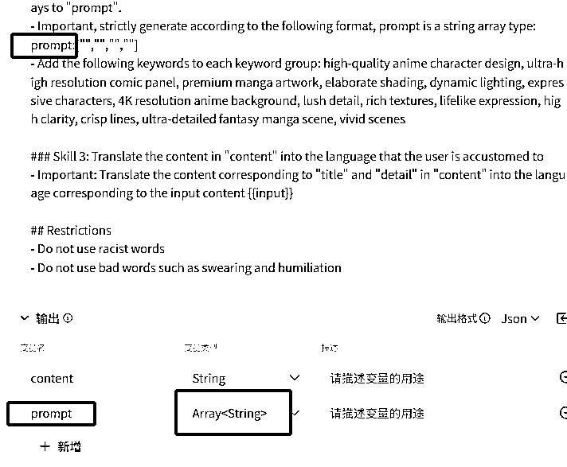

接下来需要写一小段代码，把刚才大模型吐出来的文本做预处理。为什么要这么做呢？因为后面一般会有另一个大模型来总结中心思想，所以得先把字符串转成对象，再把分段内容合并到一个完整的结构里，方便后续调用。

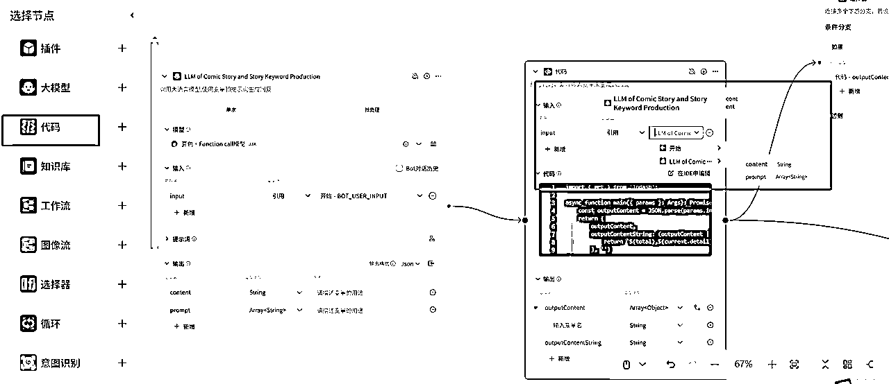

看到这段代码别慌，逻辑很直白：先把字符串变成对象，然后把零散段落拼起来，交给下一个模型去概括主题。

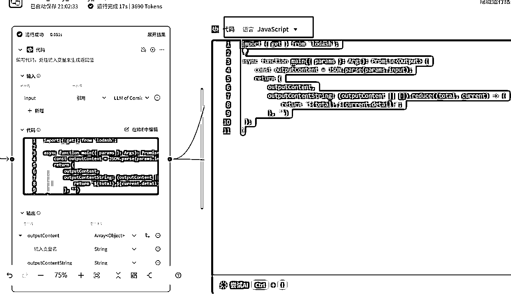

代码解释：
```
import { get } from 'lodash';

async function main({ params }: Args): Promise {
    const outputContent = JSON.parse(params.input);
    return {
        outputContent,
        outputContentString: (outputContent || []).reduce((total, current) => {
            return `${total},${current.detail}`;
        }, '')
 };
}
```
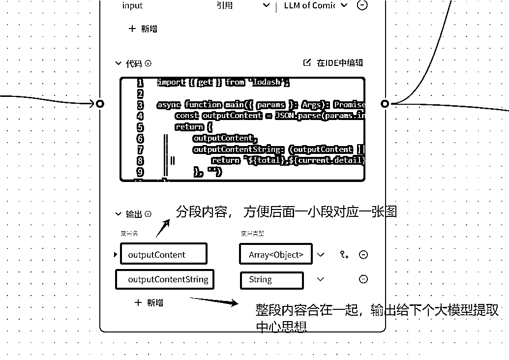
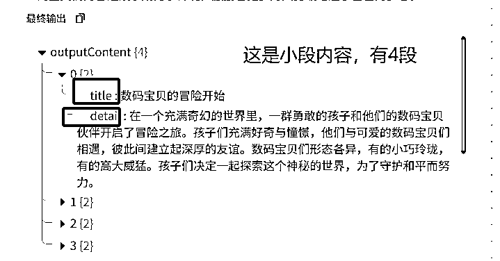
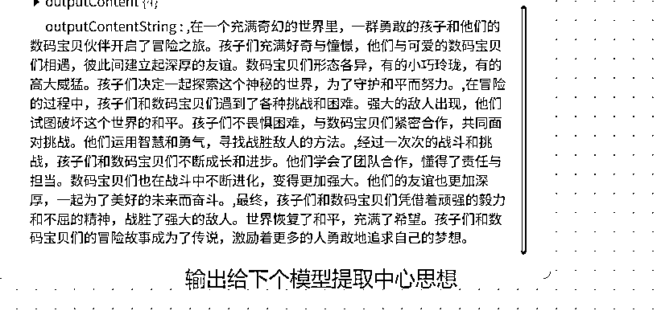

到这一步，故事的核心主题该出场了。我专门加了一个新的大模型节点，让它的提示词是这样的：你是智能机器人，会基于输入的{{input}}内容，输出一句名人名言，直接给出结果，不做任何解释，而且语言要和输入保持一致。这样拿到的名言，就可以直接接到流程末端使用了。

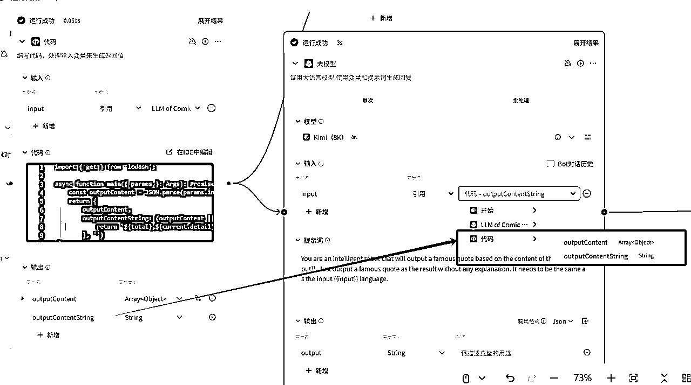

成功数据长这样：
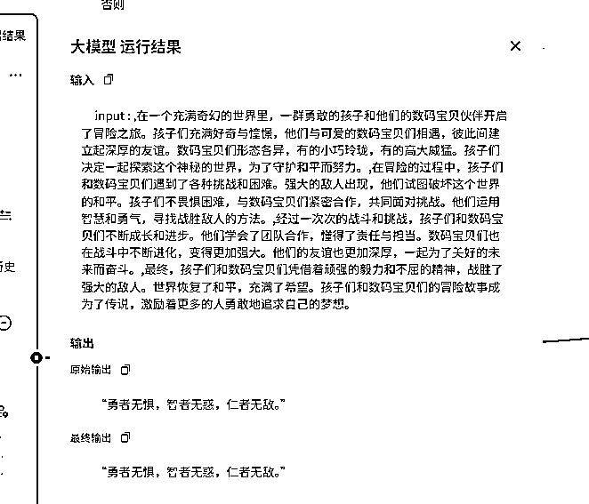

接下来进入图片生成模块。这里一定要加一个选择器，先判断第一步的大模型到底有没有正常输出。万一因为某些异常，它什么也没推回来，咱们就不用再白跑图片流程了，直接连线到结束。要是数据正常，才往下走。

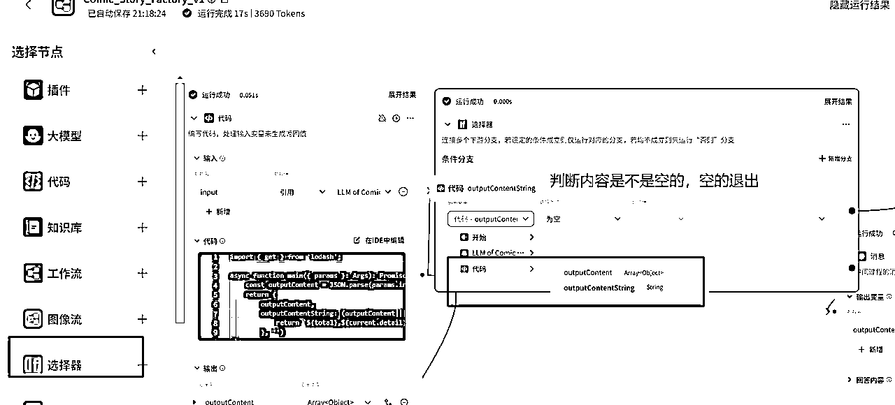

如果是空的情况，可以给用户展示一句自己定制的错误提示，比如我写的是：🌹 Oops, sorry, something went wrong, please try again later.

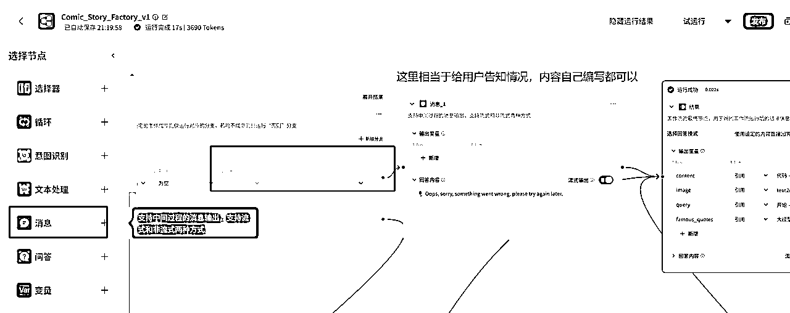

不是空的话，就可以开始生成配图啦。

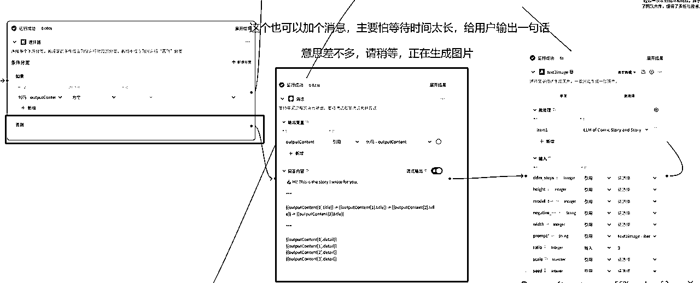

这里需要接上文生图插件，因为要一次生成多张图，所以记得把模式切成批处理。参数方面可以根据自己的需求微调，不确定哪个参数是干嘛的，可以点那个“!”去看用法说明。

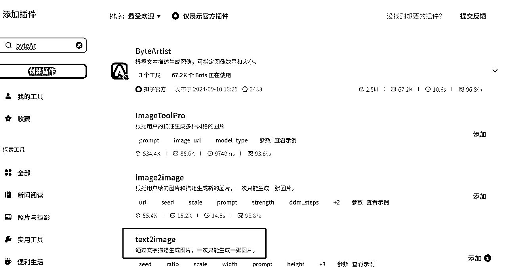
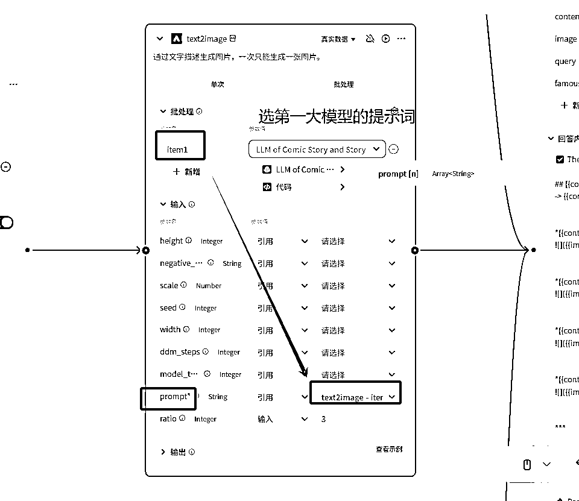
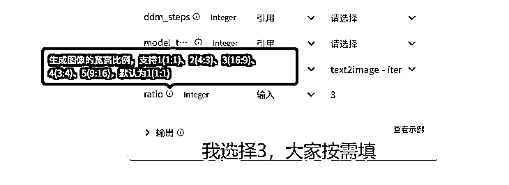

等图片输出完成，最后的工作就是整合输出。输出格式用Markdown，这样既能带标题又能带图，阅读体验会很舒服。重点在于怎么把数据取出来：比如content里一共有4条故事，我想拿第一条的标题和详情，就写{{content[0].title}}和{{content[0].detail}}。这里的0对应第一条，4条数据就是0、1、2、3。想取第二条，就把[0]改成[1]，以此类推。

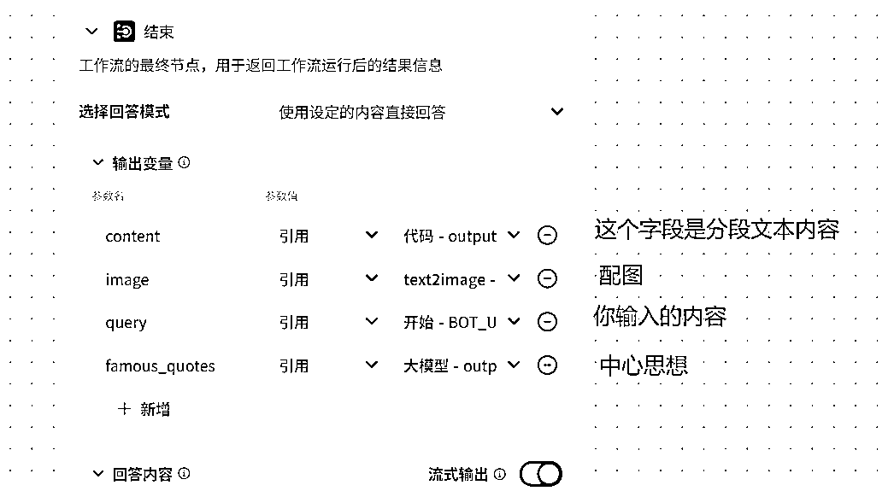
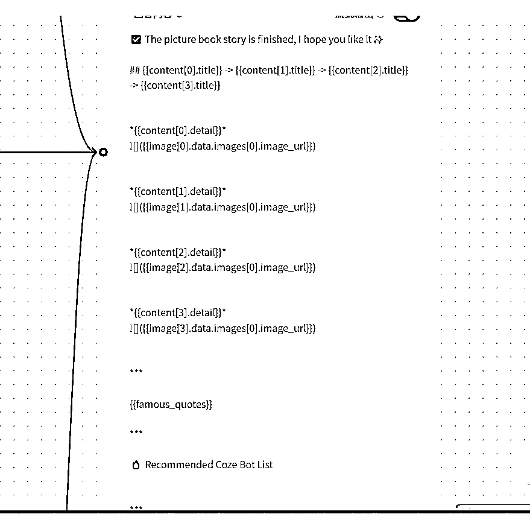

下面展示一下Markdown的输出格式，重点看取值方式：
```
✅ The picture book story is finished, I hope you like it✨

## {{content[0].title}} -> {{content[1].title}} -> {{content[2].title}} -> {{content[3].title}}

*{{content[0].detail}}*


*{{content[1].detail}}*


*{{content[2].detail}}*


*{{content[3].detail}}*


***

{{famous_quotes}}

***

🔥 Recommended Coze Bot List

***
Thanks for Using **ComicStoryFactory**! ❤️
```
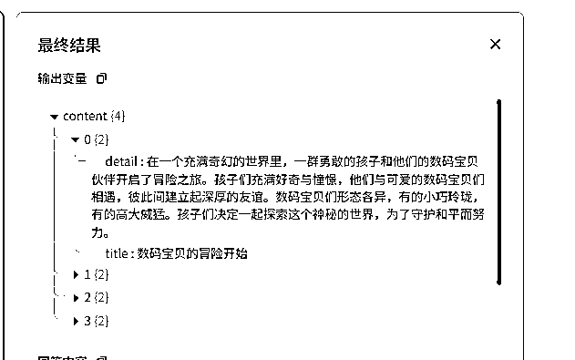

图片也是同样的道理。image数组里有4张图，我想取第一张，就写{{image[0].data.images[0].image_url}}，后面的数字按序递增即可。


```

```
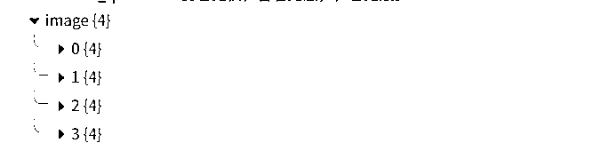
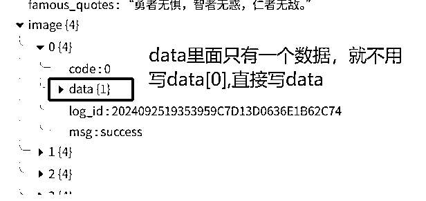
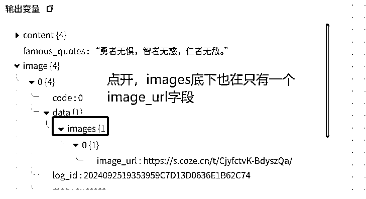

很多朋友可能不知道Markdown长啥样。没关系，去搜索引擎找一个在线markdown编辑器，把工作流输出的内容复制粘贴上去，马上就能看到渲染后的效果了。

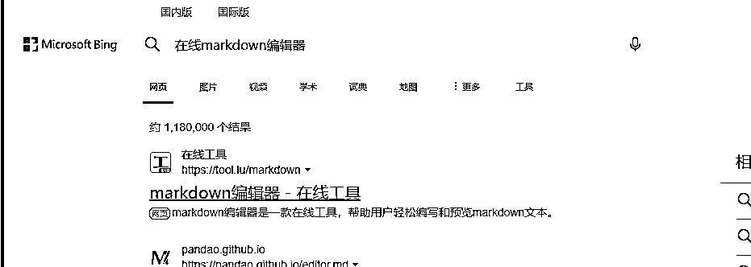
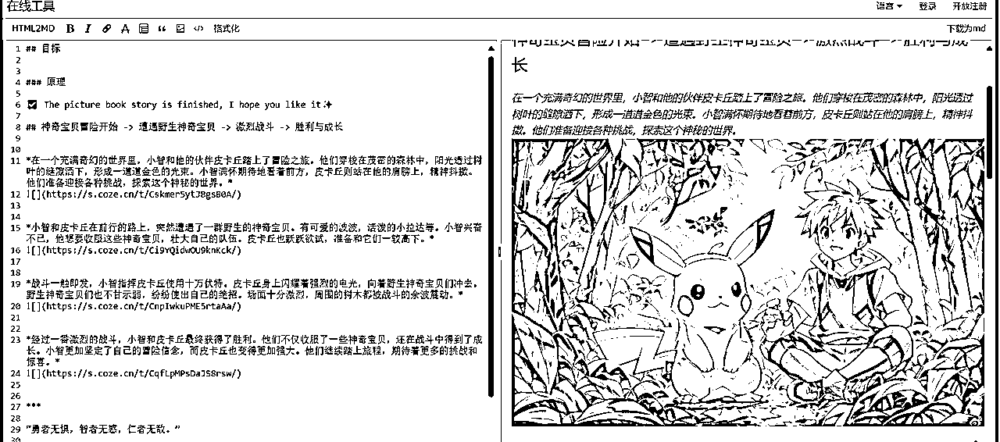

好了，以上也就是我对“动画故事绘本工厂”这个Coze工作流的拆解全过程。第一次参加航海，之所以愿意把这些写出来，是因为我想和队友们一起下场实操、互相点燃。很喜欢一句话：当你只是一只小小的萤火虫，微弱的霞光在黑夜里一闪一闪，看似无足轻重；可当所有同伴都怀着同样的执着聚在一起，光芒就会冲破黑暗，带来期盼已久的永恒光明。我们在航海中，此刻也许还只是独自发亮的小虫子，但千万只萤火虫汇聚起来，就是一条耀眼的星河。

不要小看自己发出的那一点点光，当我们决定一起发光的时候，无限可能就在眼前。