# 我自爆，借势龙哥盟，我拿到了百万流量，卡上了10个热搜
作者：龙哥

坦白局：一只虚拟猴子，让我握住了超乎预期的热度。

金金先自我介绍。距离《Black Myth: Wukong》席卷全网已经过去了近三十天，可许多同行仍在借着这波余温搞到钱。一圈对比下来，我最直接的感受是：与其死磕项目收益，不如抓住风口曝光。今天写这些文字，想完整复盘一下，我是怎么借这部国产游戏的热度，把一条短内容推到百万级观看，还登上了十几处热门榜单。

这篇内容主要聊三块：第一，由衷感谢赚钱·有术带来启发；第二，顺手记录近年做个人品牌的心路；第三，给打算入行或正在深耕内容创作的新手一些可执行的参考。

先亮成绩。这条作品在发布后快速起量，不到一整天，观看次数就破了百万，关注者涨了一千多，各平台热榜上先后拿下十多个位置。顺带交代一句，这条片的画质其实有点小卡，但话题势头太猛，几乎没人介意。

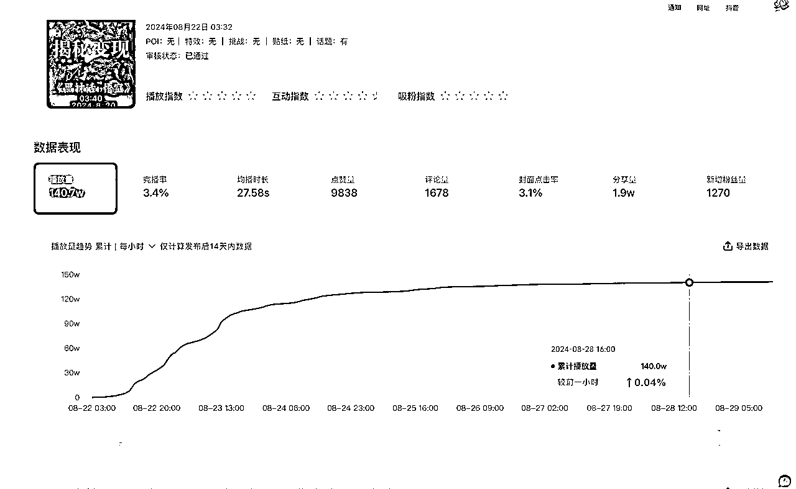
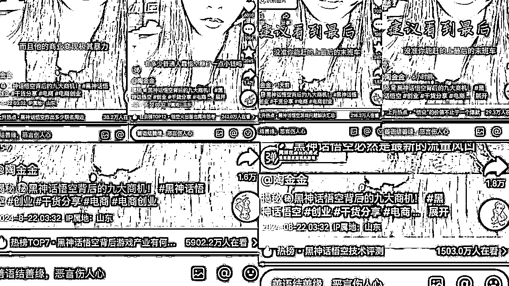
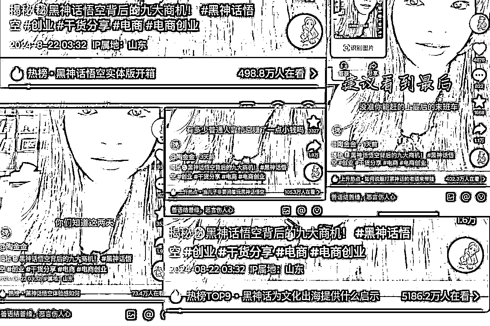

你可能觉得，这些信息谁不清楚？但“听明白”和“真去做”之间，隔着很多人一辈子走不完的路。愿意继续看的话，我就展开说说。

这条作品能跑出来，离不开三点前提。

第一，我被全民围观的热度震住了。我原本不玩游戏，可8月20日那天，不管打开哪款App、翻到哪个社交板块，入眼全是这只猴子。这种刷屏场面，我印象中只有电竞赛事进决赛时才见过。而这次的主角只是一款单机游戏，由此能感受到什么叫现象级。

第二，民族情绪被点燃了。我属于特别容易共情的人。看到制作人受访时讲团队坚持，看到某主播边难受边直播试玩，看到幕后人员因为热爱而守着低薪不愿离开，再看到许多人哽咽着说“国产3A终于来了”，我也忍不住鼻子发酸。尽管我不玩游戏，但还是为它感到骄傲。

第三，许多同行靠着类似题材快速出圈，让我觉得不跟进太可惜。AI创作者用绘图技术做出了猴子走秀的创意图，迅速成为爆款素材；美妆区开始模仿游戏里的女妖妆；情侣区玩起“谁悄悄买了这款游戏”的梗；旅行者奔向山西古建打卡；美术区搞起悟空主题创作；音乐区用游戏原声做国风混剪；知识区则聊起传统建筑和非遗传承。还有人设讨喜的老板直接给团队放假，人手送一台游戏主机；币圈玩家干脆搞关注抽奖，一夜炸出大量新粉。

只要能和自己定位沾上边，大大方方借势并不可耻。

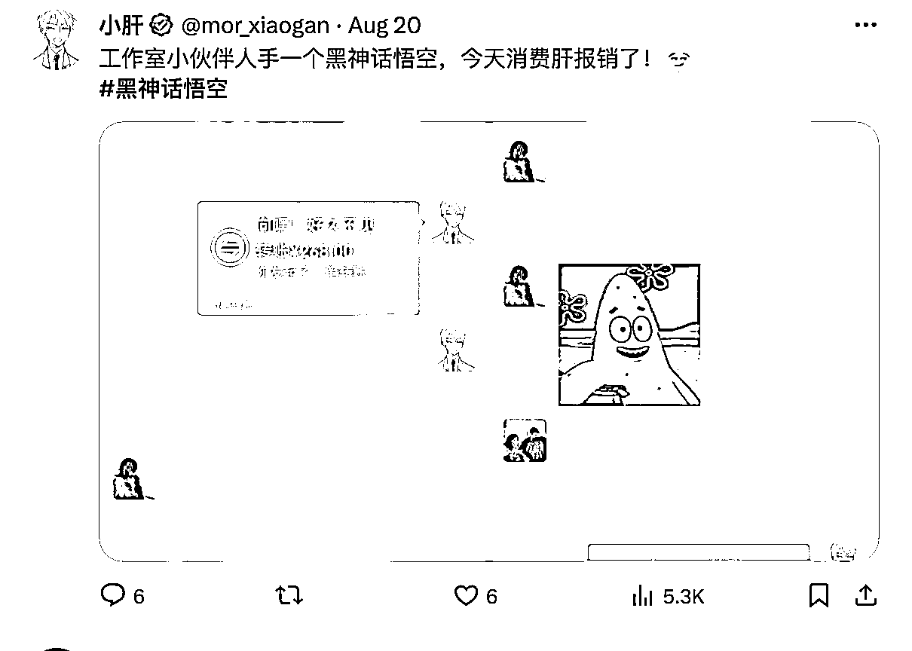
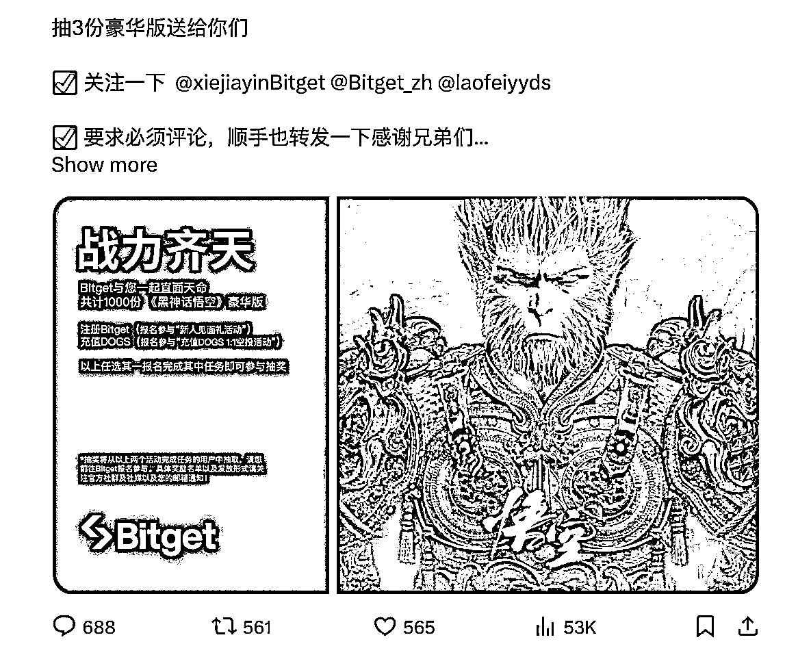
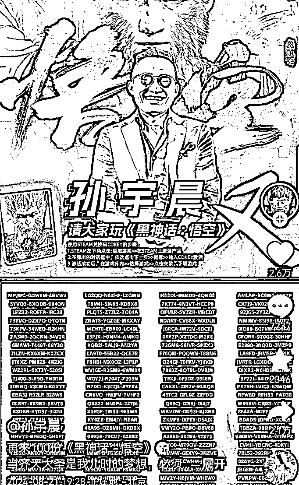
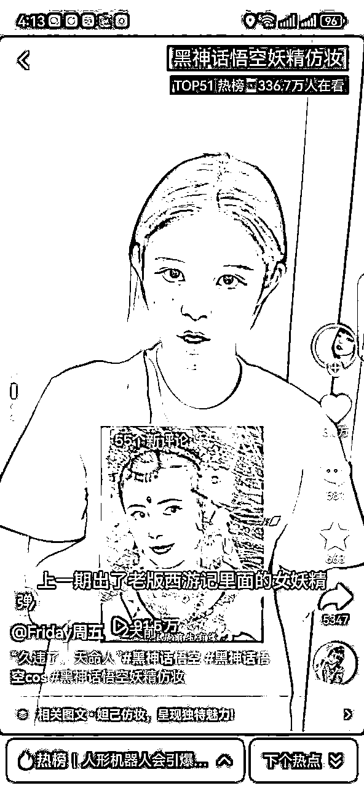
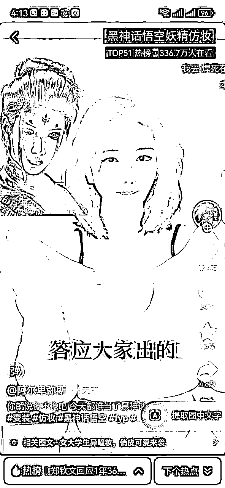
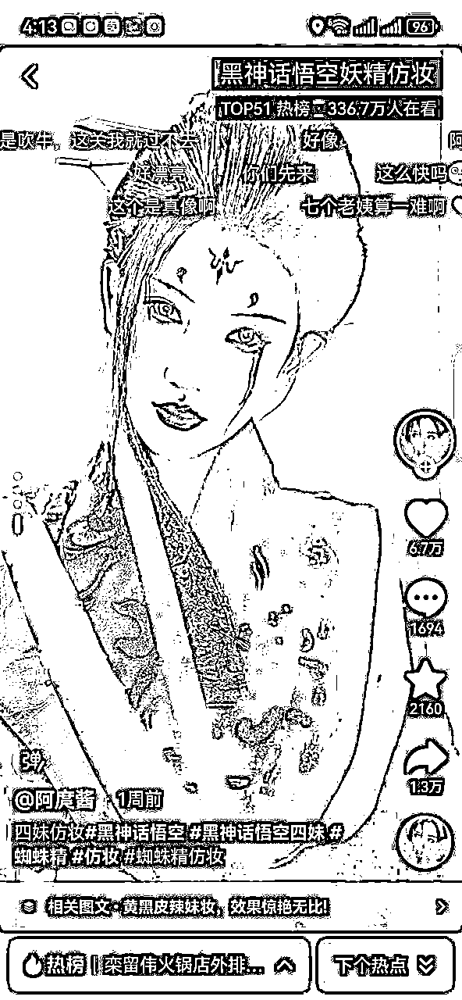

接着聊素材搜集。我的信息来源分两块，一是私域，二是公域。

私域方面，8月20日起，我所在的各个🛰️群几乎被这只猴子的讨论淹没。有人聊变现，有人聊玩法，有人搬运深度分析，那几天手机提醒响个不断。好友动态的更新量更是夸张，热度退了大半个月后，竟然还有人晒相关衍生品。我光是往回翻信息，就花了不少时间，可见大众参与度有多高。

但这么多信息里，真正能转化成作品的，还是得靠更垂直的渠道。这里必须重点感谢星球类社群，尤其是赚钱·有术。

赚钱·有术给我的体验，像一个被认真筛过的“掘金库”。同一个热点事件，外部聊天往往停在情绪层，而这里的成员会主动拆解收益路径，反复验证商业闭环。我也并非在别处看不到这些内容，但论密度和含金量，这里确实领先一截。那条作品里的许多观点，正是顺着赚钱·有术的风向标寻来的。这里的运营也值得夸，其他社群还在观望，他们已经组织圈友把悟空背后的生意版图摸了个透。这种氛围替我省下大量筛选功夫。要说搞钱类社区里的头号招牌，我服气。

多说一句：同一个资源，用不同方式去用，结果会差很多。要是为了找生意方向，这里的选择很多，从最新玩法到最落地的方案都有；但选择太多也容易分心，你能做的无非是反复对照自身长短板、多试多调整，没有捷径。要是换一种用法，把它当作信息中转站，那它几乎只赚不亏。

关键是别让它吃灰。我的习惯是隔几天就进去刷一轮，保持对商业信号的敏感。想做商业内容的朋友，更该好好利用它。有人拿着线索快速组队抢第一批红利，有人拿它做选题策划，各有各的收获。

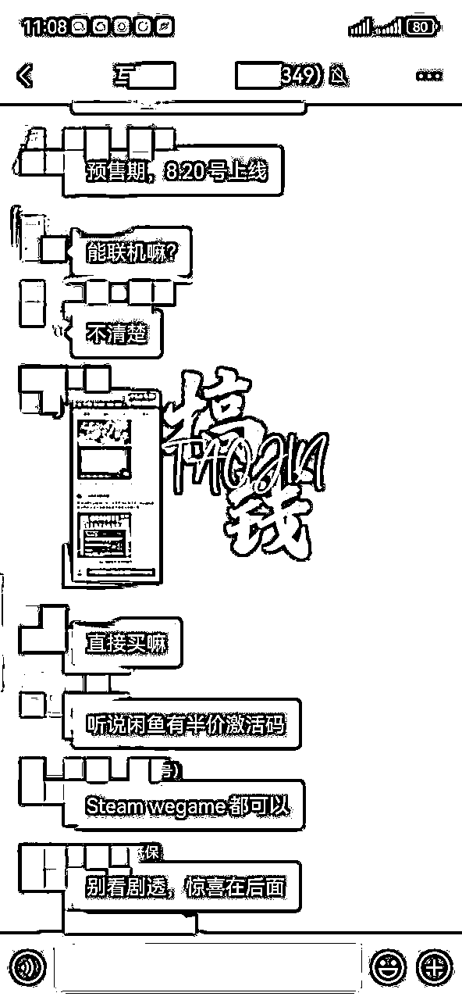
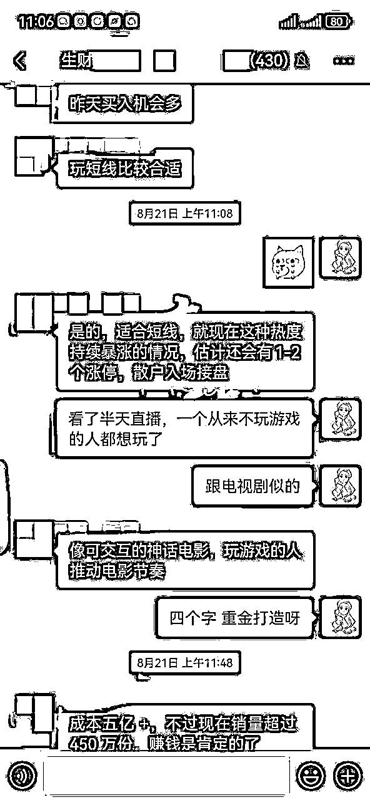
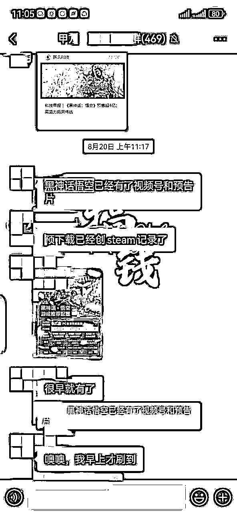
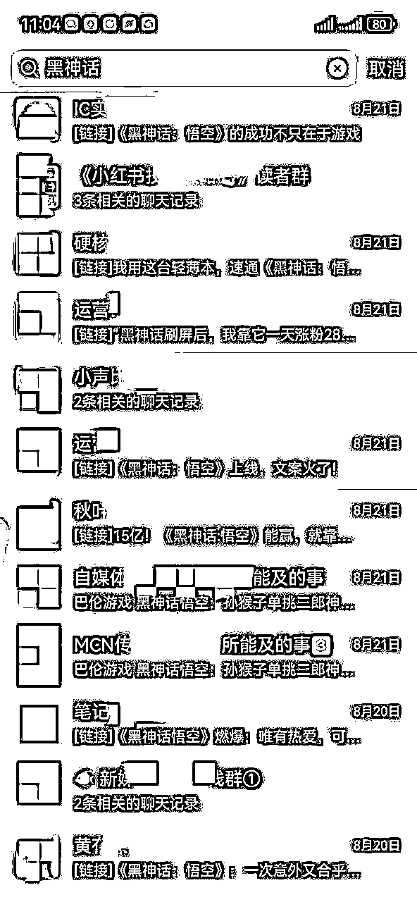
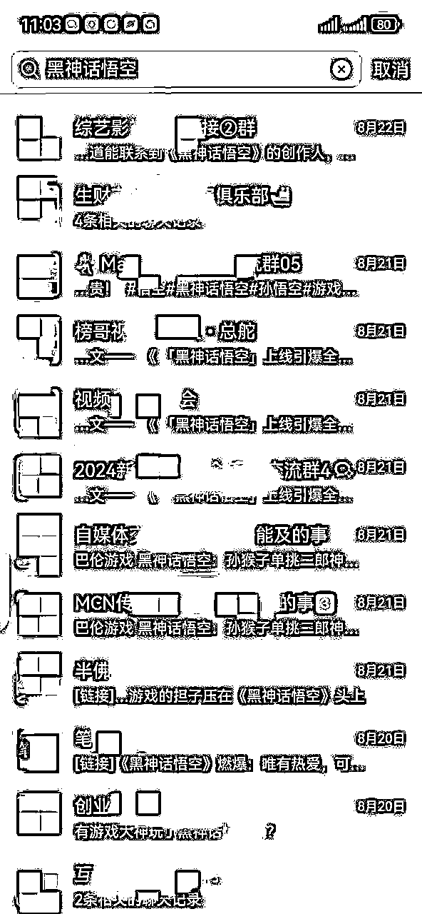

公域方面，我平时会看不同平台的图文内容，比如头条号、订阅号、问答社区等，热搜一出现，算法就会不断推相关文章。多读几种视角的解读，既能补盲区，也能验证已有素材是不是靠谱。短视频类站点同样重要，几大主流App都是热点的孵化场，我常在那边做观察。

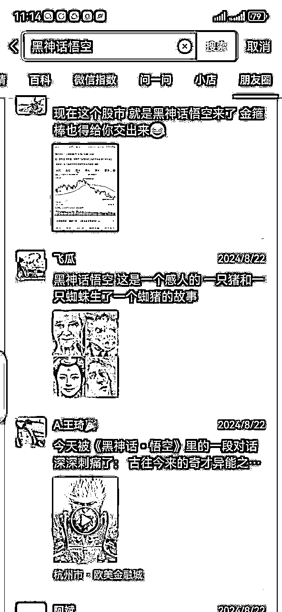
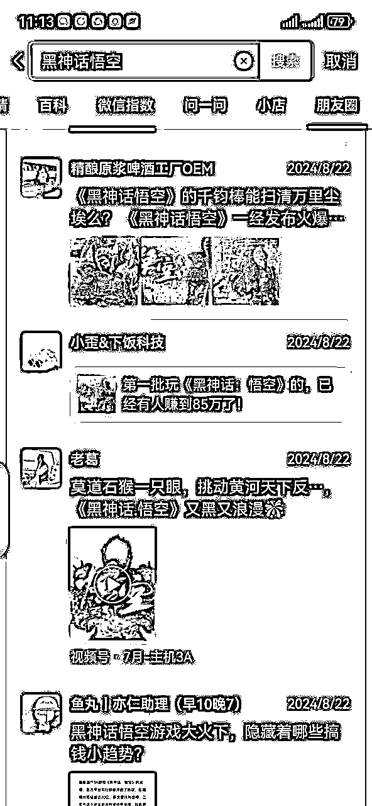
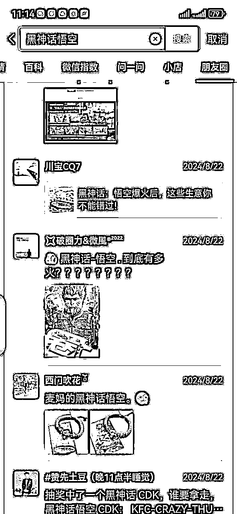
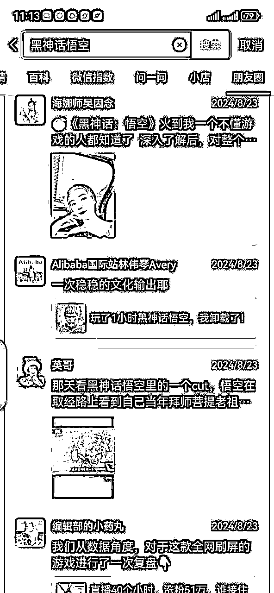
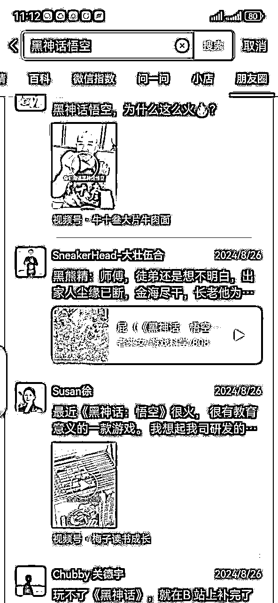

再聊拍摄与剪辑的体会。

第一条铁律：趁自己状态在线时开机。这里说的状态，不是刻意准备好的“录制状态”，而是你本来就在专心工作，顺手打开镜头。前者容易因为太过在意数据而准备过度，后者则松弛自然，反倒常有惊喜。

设备和工具要趁手。用手机拍摄时，前置镜头型号越新越好。光线充足时，后期只要轻微修一下。我属于天生面部纹路明显的类型，怕显老就备一块补光板，犯懒的话，便在室内或户外找光线通透的位置，把镜头对着脸测试，直到看不见纹路再开拍。后期还能加瘦脸、调肤色。剪物料时，短片我用轻巧的小软件，长片用主流剪辑工具。如果当天精神不佳或没上妆，我会用美颜模式，但清晰度会打折，比如这支悟空作品就录得有点卡，好在话题太热，大家的注意力没放在画质上。收音设备也不能马虎，我用遍市面上的主流款，最后固定为大疆。线材款容易甩来甩去，便携款偶尔漏录，只有这款目前没出过事。新人不妨一步到位，反而更省钱。再提醒一句，一定准备网盘存原始文件，电脑硬盘装不下多少高清素材。

接下来，说说什么条件适合做知识型创作者。

第一条，要会借势。不是什么热点都能碰。那些没有实锤、舆论压力又大的敏感事件，最好绕开，否则容易被反噬。合适的对象是积极、有趣、适合大众围观的话题。纯知识内容原本偏干，只盯着细分领域的话成长空间有限，把热点和人设结合，才有机会冲出原来的小水池。哪怕只是把公开资料梳理成一则作品，也可能破圈。我曾拿某平台发布的报告重点直接念了一段，没有额外加工，观看次数却冲到千万。当时没有第二个人把这份资料做成内容，可见“信息差”本身就是价值。

在这个赛道，会用巧劲也是一种竞争力。我的作品公开后，有多位作者直接照搬文案，甚至包括一个几十万粉的商业号。既然他们认定这事容易，怎么连动手整合都不愿意？后来我一并投诉，盗用内容已被处理。

借势还有一个隐藏好处：拉动整个主页的权重。任何渠道都一样，只要有一支内容爆了，近期其他作品的曝光也会跟着上涨，还会推荐给老关注者，减少流失，加固好感。

第二条，要持续补充素材。作品不会凭空出现，更不能靠搬运同行糊弄。想稳定创作，得先有稳定的输入。输入来自书籍、实操和各大内容源。做知识向创作者，最硬的基础就是有东西可讲。我的作品里大约八成来自日常业务里的经验复盘，两成来自社会热点，所以看起来比较垂直，来的人也很准。

有人担心自己水平不够，不敢开口。其实每个人都有独特积累：会搭配的能做穿搭分享，懂收纳的能做生活分享。一旦存在“你熟悉而别人陌生”的领域，你就有表达的资格。我带过的学员中，有人业绩比我强出许多，但并不妨碍我分享方法论。因为价值不一定只看成绩，很多细微的信息差，可能让别人少走很远的路。

第三条，别被热度牵着鼻子走。刚起步时，不妨把数据看淡一点；有经验后，再把数据当作资源。你要做热度的驾驶者，而不是车后的拖车。要是觉得作品不差却拿不到推荐，可以换别的渠道分发，好内容早晚会被看见。假如到处都没水花，那多半是作品本身还有问题。平台不会因为少你而受损；但数据是作品真实质量的折射。暂时数据差也别泄气，考试还能有零分呢，做了就有改进余地，不做才是一无所获。

第四条，接受计划赶不上现实。创作过程特别容易失控。有一天下午，我原本计划拍完就出门赴约，结果从午后一直忙到夜晚，前前后后花掉整整七个钟头。我原本估摸三小时足矣，结果剪辑时不断冒出新的想法，设备又出些小问题，时间就悄无声息地溜走了。以后还会遇到这种情况，你只能学会与失控共存。

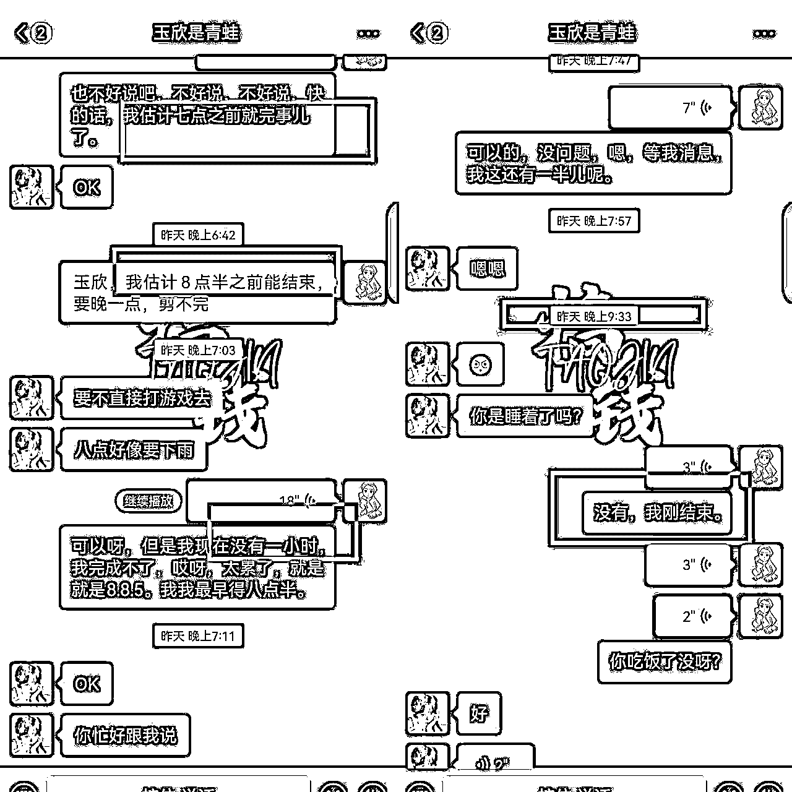

最后聊聊做内容创作者的好处与代价。

好处首先是自由。不用坐班，不被地点锁死。居家、办公区、咖啡厅，随处都能拿出设备开讲。出差时想开直播，有一部手机就足够。出去玩碰到热点，掏出来就能拍，生活和工作并不冲突。想歇几天不更新也没关系，主页的热度取决于内容品质，而不是为了凑频率发些没营养的东西。独立运作时，单枪匹马就能跑通全程，根本不必组团队。当然，机构化团队不在这个讨论范围内。

其次是低成本撬动回报。所谓零成本，只是说投入资金为零，时间精力可一点不少。翻看我的主页，破百万观看的作品有十几支，有的直接带来订单，有的间接接到广告，还有的只能用来攒人气。比如那条讲购物社区带货玩法的置顶内容，发布不久就有人来付款报名；还有一支关于主播直播间的拆解，后来被设备商寻来投广告。至于单纯的行业报告解读，涨的泛粉商业价值不高，但权重确实上去了。

但另一面也要有心理准备。坦白说，我们都在给平台做嫁衣。主页万一被处置，就等于失去经济来源。有些站或许还有申诉机会，但多数平台封禁之后没有任何周旋余地。我自己有个平台的账号，一晚新增数千关注，结果没高兴几天就被系统贴上敏感标签，曝光归零，最后只能注销。换了个新号重做，又涨了几千关注，这次却一切正常。你要问为什么，我只能说是运气。还有一回，我在某个外部内容社区发文，数据刚起飞就被封禁，同款内容放在别人名下却冲上热门。这种落差，除了接受没有别的解法。

当然，也有意外惊喜。我有一篇订阅号文章阅读量过万，直接带来五位数回报；一支较长的片子登上小热门，同样带来不小收益。但这些机会大多不可复制。归根结底，创作者能牢牢抓住的，不是方向、素材或拍摄细节，而是自己有没有持续执行的决心。与其和算法斗智斗勇，不如与自己较劲。

说到底，你的主页等同于你的公开名片。就算关注者不多，只要有一件作品被广泛看到，老关注者会重新热情起来，原本快淡忘你的潜在客户也会再次产生印象。我的这支片子爆了以后，许多通讯录好友都在各自的信息流里遇见过它。至少在那一刻，他们看见了我，也看见了我能给出的东西。这种认可也许会带来什么，谁都说不准。但热度的意义，大概就是这样吧。

很多人以为做IP挺风光，实际上，流量带来的第一份礼物，很可能就是焦虑。

做IP，该冲的时候要冲，该慢的时候也要学会慢。我常常提醒自己：别被流量推着走。可说实话，没有人能对数字真正无动于衷。

粉丝只有几百的时候，我什么都发，自拍、vlog、美食，纯粹自娱自乐，压根没想过赚钱。

等粉丝破千，我开始频繁刷后台，看涨粉、看播放量，心里有了计较。

到了几万粉，我开始慌：这条能不能爆？要不要开直播？下一条拍什么？

等粉丝到了几十万，我更焦虑：怎么还没上热门？是不是限流了？还要不要继续做？要不要换个方向？

流量涨起来，客户和钱也跟着来了。于是很自然地，我给“流量”和“钱”画上了等号。说我在乎流量，不如说我在乎收入。这话听起来没什么不对。可问题来了：你真的能不在乎流量吗？

我常常回想做视频的初心。第一个爆款，是一条在学校做版画的课堂视频，50多万播放，评论区围满了美术同好。我做视频的初心，是分享。第二个爆款，内容变了，初心没变，还是分享。

可现在的我，还没做出什么大成就，就先给自己扣上一串“流量帽子”。如果你天生乐观，也许不会焦虑；但如果你认真，只要还在这场上，焦虑就躲不掉。反过来想，会焦虑，也说明你是真的在乎。

当然，账号做出点声量后，也会被一些大V注意到。我遇到过千万粉博主直接找我付费，也收到过另一位千万粉博主的聚会邀约。朋友聚会时，别人介绍我，总少不了一句：这是某某号主，做某某行业的。

有粉丝，就意味着同时有黑粉和铁粉。

先说说防御能力。评论区是你的第一道防线。一条恶评能带偏整个评论区，一句不阴不阳的中评也够膈应人，所以该删就删，闭眼删。还有路人，刷到视频不管讲得怎么样，先踩一脚再说，什么难听的话都骂得出来。

我以前特别care，大清早刷评论，看到一条恶评，一整天的心情都毁了。

当然也有人夸你，各种夸。同行夸我，我基本没什么情绪，因为分不清是欣赏、客套还是捧杀。但粉丝夸我，我会很开心：原来付出有回报，终于有人看见我了。

再后来，我也一笑了之。因为这点夸奖，不过是漫长路上的一个开始。

最后，最要紧的还是那句：认清自己，认清现状，知道自己要什么，也清楚自己正在做什么。多辩证地看自己，了解自己，才能超越自己。做得好的，保持；不够好的，优化。

这篇想到哪儿写到哪儿，希望对新入局的博主有点用。也期待前辈大佬们多批评指教。