# 知识IP品牌节活动结束一个月后，我终于把感悟写完了
作者：龙哥

坦白说，这是一篇迟到一个月的作业。九月的活动，拖到热度退尽才动笔，我大概是最晚交卷的人了。不过也有好处——远离现场之后，那些真正有价值的东西反而浮出水面，变得更容易辨认。决定写下来，是因为我在想：要是把这些沉淀下来的心得讲清楚，没去过现场的人是不是也能分到一杯羹？

按老规矩，先谢人。感谢龙哥盟给我这次参会的机会，也感谢一直带着大家朝前跑的这个社群。同样要谢谢品牌节的赞助方之一——我的朋友、我的🛰️私域管理工具合作方，黑小喵和他的堆雪球团队。私域管理软件我碰过不少，堆雪球是最顺手的一个，真没有“之一”。我甚至敢放一句话在这儿：🛰️的规则只会越收越紧，靠钻空子的工具迟早要出局，能留下来的必定是靠谱的产品。所以做私域的朋友，将来绕不开这个名字。细节不铺开了，想深入了解的老板，去赚钱@黑小喵 就好。

活动当天到场的嘉宾阵容，上方图里都有，这里不逐一介绍了。

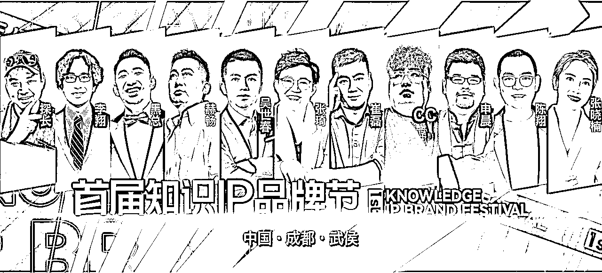

## 正文

活动结束那两天，群里的评价泾渭分明。有人说这不虚此行，也有人摇头说老师咖位够大，但干货撑不满；尤其听过闭门小场的，更是觉得大场没掏出真家伙。

这些说法我全认同，也能理解。那种规模的大场，要是每一段都填满干货，时间恐怕得翻三倍。我自己坐在底下听的时候，期待拉到满格，某些环节也确实觉得“水”。可回来以后，我把记忆重新回放了一遍，忽然咂摸出另一层东西：每位老师都带着“藏一点”的本能，同时又抱着“给你一点”的诚意，努力把IP创业这条路上的某个核心坐标，至少指给你看一眼。把这些坐标吃透、串联，再内化成自己的认知，这张票就没白买。

好比武林大会，少林方丈、武当掌门在台上各拆一套功夫给你看，已经够意思了。你还指望他们把压箱底的心法全册背给你？真想学，散场后主动加🛰️聊就是了——都是做知识付费的，链接起来门槛不高。

既然是一招半式，我也不玩虚的。以下五个板块，是我对五位老师分享的整理和个人理解：

1. 赫畅老师：三个认知，外加一个没点破的隐藏招数
2. 张晓楠老师：一句话心法——“别瞎花钱，别下牌桌”
3. 张琦老师：“多元讲解”式做IP
4. 崔磊老师：用“矛盾论”做内容
5. 吴世春老师：投资人里的段子担当

哪里讲歪了，各位尽管开喷，我改。

## 一、赫畅老师：三个认知，附加一个隐藏大招

赫畅老师的江湖地位，一张PPT就摆完了。百度百科收了他的名字，我就不浪费篇幅了，有兴趣自己动手查。

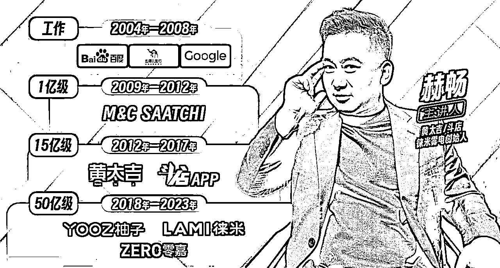

他整场分享对我而言，可以压成三个核心认知：

- 用自己的故事证明：创业无论成与败，都能沉淀为知识付费的产品
- 借星链的案例展开：创始人品牌营销的价值比想象中更大
- 以行业数据为参照：知识IP的时机，就是现在

### 认知一：创业的成与败，全是知识付费的原料

这段话的内核很简单。他做过许多公司的创始人，对每一家公司成在哪、败在哪，都有过切肤的思考。

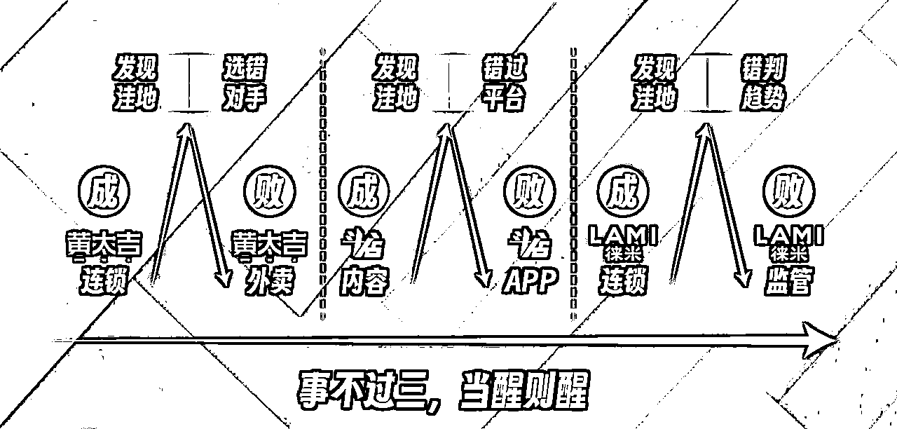

有意思的是，每一次坠落谷底，把他重新拉起来的，都是知识付费。

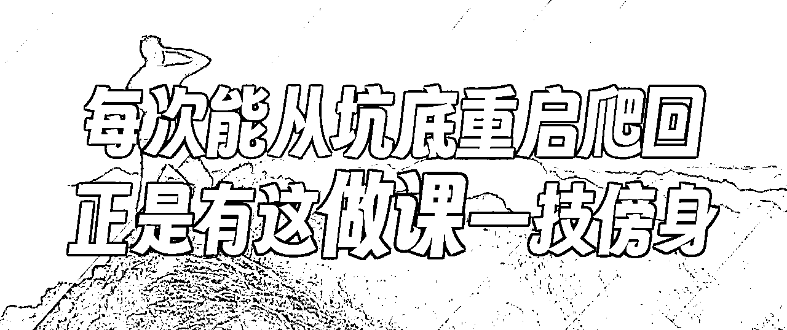

每开一家公司，都会迎面撞上一堆问题，砸进去无数时间和心力。但这些消耗，没有一分是浪费的。赢也好，输也罢，那些经历最终都变成了自己，或者同行，下一次出发时的补给。

老师现场的叙述，我不复述，只讲我自己的接收与消化。

活动结束我发过一条朋友圈，那句话是赫畅老师的原话，我略做了一点点改编。

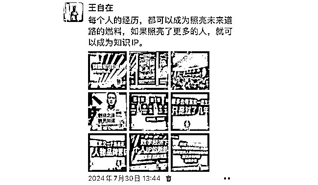

和这句话有共鸣的人，想必也被它戳到过。那一刻我想起很多年前看过的印度电影《贫民窟的百万富翁》。它讲的就是：你过往走过的路、吃过的苦，都会在未来某个瞬间，帮你换回点什么。没看过的人，可以去补补课。

每个人的路线都不同，但太阳底下无新鲜事，类似经历的人，轨迹总有大面积重合。你的创业故事，你学一门手艺的历程，甚至你在职场熬过的那些年——只要你擅长提炼、归纳、萃取，它就会凝结成你的独家经验，那就是你的一种知识。这种知识，会在未来的某一个路口，成为你的助推器。

当这份助推也能帮到身边的朋友时，你已经是一个知识IP了。再把它系统化、产品化，输出给更多素不相识的人，你就是有影响力的知识IP了。

比如这一次，我把参会的心得和思考写成文章，本身就是一次价值输出。比如我给电商团队做培训的内容，被我变成过课程。比如我操作📕聚光投放的经验，被我整理成了课件。比如我们搭建私域时的标准流程和沟通话术，被我们做成了在线学习资料。有些内容没标价格，但我赚到了足够珍贵的东西——粉丝的信任、朋友的认可、学员的感谢。你输出了价值，回报自然会想办法回来。

最后递上赫畅老师被问到“为什么做知识付费”时那个现场感极强的回答。

### 认知二：创始人品牌营销值多少钱——星链给的答案

赫畅老师的第二部分内容，与其说是安利，不如说是用“品牌”来打开话题。他没站在卖货的角度硬推，而是用人物品牌营销的商业逻辑和几个案例，把星链的价值揉进去讲。

具体的广告过程和案例细节，这里略过。结合他的PPT，我来转述其中我认为最有价值的部分——

现在从360红衣大叔那种量级，到我这样年流水还没破千万的小老板，都在琢磨着怎么下场做IP、做影响力。

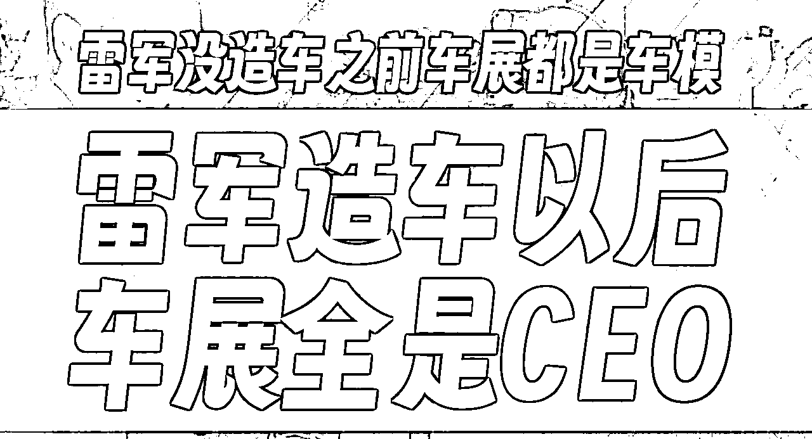

做出来的这个东西，就叫创始人品牌价值。

说来也巧，这次会场上，我碰见了那位买了红衣大叔迈巴赫的诸会长，并且蹭了一张合影。

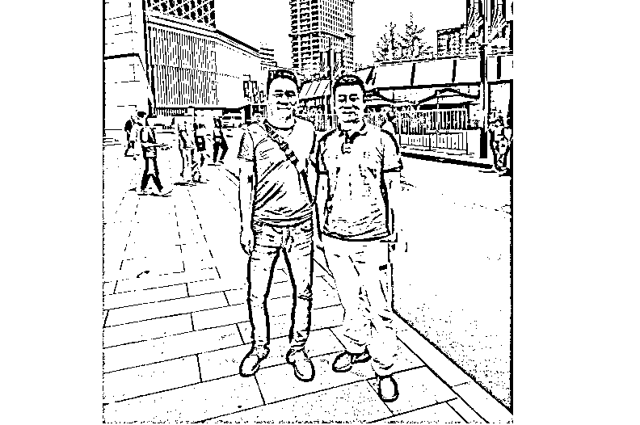

试想一下，如果诸会长没买那辆车，没做后面那一连串的营销动作，他不会有这种关注度。那他二手车卖得再好，我也不会想去排那张合影；就算合影不用排队，我也不会觉得这张照值得在文章里露脸。

赫畅老师给创始人们的那句话是：做IP，是为了提高行业的能见度。

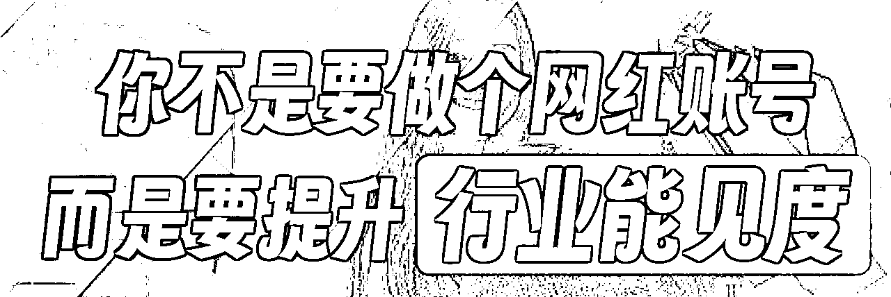

我把它翻译成白话：被看见，才可能被影响。

这让我想起抖音安老师的一句话，数据即神权，影响力即权力。你能影响你的粉丝、用户、客户、员工，影响每一个路过的人，这都是权力。互联网把这种权力摊到了每个人头上，创始人IP，只是其中一种高杠杆的抓取工具。

《冰与火之歌》里，龙妈的自我介绍总是含金量极高：“风暴降生丹妮莉丝·坦格利安，不焚者，弥林女王，安达尔人、洛伊拿人和先民的女王，七国统治者、全境守护者，大草海的卡丽熙，镣铐破除者，龙石岛公主，银发女王，龙之母。”

长吗？确实不短。但龙妈永远不会觉得自己话多。这一长串称谓，每一截都代表着一群人的认可，拼在一起就是她的影响力范围。她一路走来能不断拿到资源，靠的是什么？几乎都是头衔里那些身份换来的。有些时候，名号比现金好使得多。

这一点我深有体会。比如我在某个圈子里公开讲过课，攒下一点点名气，然后带着这点名头去对接合作，只要不碰对方的利润，基本都能免费拿下。在许多行业的生态里，资源正在回归原始形态——以物换物。创始人IP的价值与势能，就是其中最硬的一种“物”。

星链，就是帮创始人铸造这种硬通货的工具。

嗯，顺着讲下去，竟然真的顺出了安利的味道。但说实话，这是因为我确实认可老师这套逻辑，并不是想向谁推销。我自己也没用过星链。各位理性看待，多查资料，别因为看到文章里提了一句就盲目下单。

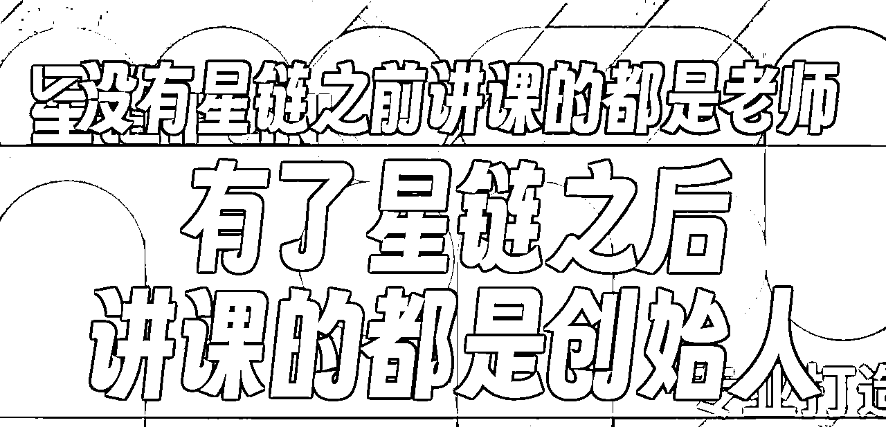

### 认知三：知识IP，正当时

对，就是正当时。

“知识IP”这件事的底层逻辑，前两条已经讲透了。赫畅老师这部分的核心，是“时机”。

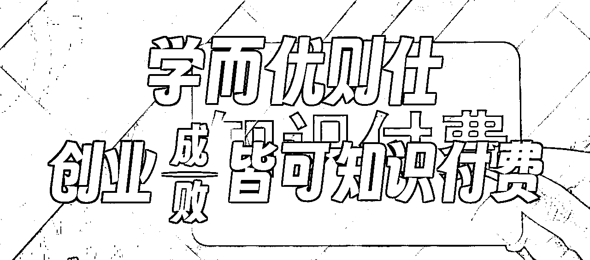

具体的数字我不摆出来了。浓缩成一句话：优秀的知识产品，会成为契合中国当下发展阶段、带动文化教育产业放大的一个重要市场。

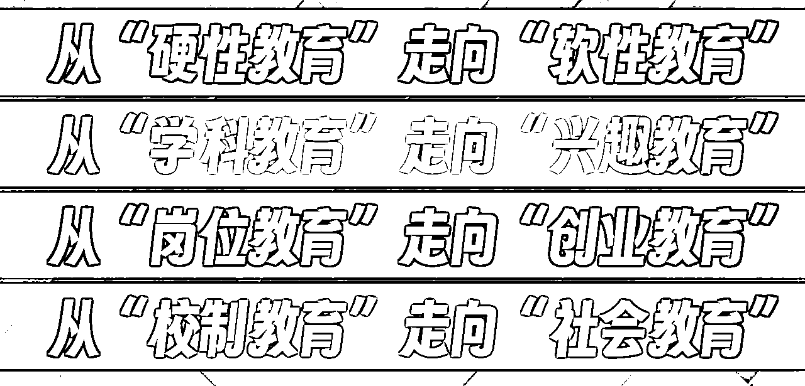

什么叫“正当时”？我的理解是：能产出价值，且被环境所呼唤，还站在趋势的轴上。当终身学习变成主流共识，当每个人有价值的经历都能成为他人前进的燃料——这就是知识IP最好的时代。

### 最后，有一个没露面的隐藏大招

从“创业成败皆知识付费”，到“创始人品牌力”，再到“行业窗口期”，赫畅老师的内容已经相当完整了。但我总觉得，他真正的杀手锏，并没有摊在桌面上。

这个念头的出处，是一篇讲“教学机缘”的文章。

那是我常看的👸号“记忆承载”，作者风叔写过一个故事，原文细节我记不全了，大意是：

有一天，须菩提向佛祖请教：“什么是教学机缘？何为机？何为缘？何为教学机缘？弟子不解，求世尊开示。”

佛祖笑了笑，说：“来，走近一些，附耳过来，说给你听。”

须菩提连忙又凑近一步，屏住呼吸，生怕漏掉一个字。

半晌，佛祖开口：“此刻，你用心听，是机；你我有缘相识，彼此敬重，是缘；我这样做，就是教学机缘。”

佛祖与须菩提之间是否真有这段对话，无法考证。原文里也只是借了人设，换成孔子和他的弟子，故事一样成立。我们要领会的，是内核。想读原文的，去搜那个👸号就行。

好的老师，就是随时随地能给你造出一个“教学机缘”。

赫畅老师，显然就是这种高手。他是氛围操盘手，是营销行家，更是节奏大师。整场演讲从他的个人故事开始，一路铺到行业数据，没有一句话离开“用事实论证目标”这条主轴。拨开来看：他心里装着一张明确的地图，然后用最合适的材料，修出一条通往终点的路，再请你上车。你喜不喜欢这趟旅程？不重要。在他亲手搭建的这个框架里，他就是正确答案。

这种架构演讲的功力，这种对现场的掌控，在我看来才是他真正的隐藏大招，值得每个做知识IP的人花长期功夫去修炼。

我特意用了“修炼”而不是“学习”，因为这东西看起来简单，做起来极难。想知道诚意到什么程度？我数过，他这次PPT一共157页。用心做过的，自然懂。

## 二、张晓楠老师：一套心法——“别瞎花钱，别下牌桌”

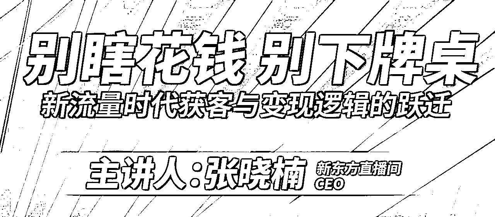

张晓楠老师，新东方直播间的CEO。她带着直播间从0做到1，硬是零投放扛过了半年，现在一年GMV十个亿以上。

她是来讲怎么投放的吗？恰恰相反，她讲的是：别瞎投放。

原话是：“在目前流量新渠道四面开花的环境下，广告投放就像一头吞金巨兽。”

注意，这个“神兽”不是你家笼子里的那只，是商业市场里那种会吃钱的大怪物。小公司扔进去几十万，大公司砸进去几千万，最后可能连声水响都听不见。

那她是劝大家不要投放吗？也不是。没有投放，新东方直播间撑不起现在这种规模，平台的资源都是烧出来的。你不花钱，平台凭什么给你那么大的量？

张晓楠老师真正想说的是：钱要花，但要花得聪明。

关于“聪明地花”，我谈点自己的经验。我负责公司投放已经两年了，主战场是📕聚光。另外我还是龙哥盟📕聚光投放航海的教练，手头也有一门聚光课程的稿子（还在写，没出版）。

前年和几个投放圈子的朋友交流，磨出一套选项目的“三投模型”：

- 第一条：赛道还在红利期，蓝海刚开，价格站没打起来，可投。
- 第二条：转化端有超强模型支撑，销售团队像狼一样抢量，可投。
- 第三条：产品定价里有高客单和二次转化设计，可投。

也就是说，在今天的投放环境里，三条里至少押中一条，项目才有希望做到微利，也就是“活下去”。押中两条，能吃上肉。三条全中，闭眼投——搞只边牧放键盘旁边都能赚钱，它会按开关，余额归零还会汪汪报警。

再简化：让成本做到比同行平均水平低20%，同时让转化率比同行平均水平高20%，这就是我们要做的。

但今年这个战况，是真的卷。

以前平台手里攥着大把没被分类的流量，那是红利期。算法成熟以后，流量被快速打标、分类、定价。给你的报价是精准的，精准到系统会用价格机制推动你和同行互相消耗。蓝海不是绝迹了，而是刚露头就被染红——我们自己的赛道，📕获客成本40-50，三个月就干到了240-300。

算法就是这样的：只要你的投入产出比好看，就会有人用最快的速度把你的打法暴露出去，引来一堆人分食，直到价格水涨船高、利润摊薄。平台在中间坐收溢价，这是结构性必然。

这段话题拉开来很长，不在这一一展开。感兴趣的朋友留言催一催，回头单开一篇细说。

在这种局面下，三投模型没有失效，但它的红利窗口大幅缩短——短到你还没开始回本，蓝海已经变血海。

### 三投模型之外：真正的突破口

张晓楠老师的分享，让我看到了另一个出口：哪怕你不符合三投模型的任何一条，仍然有机会不下牌桌。

这是我反复回放她讲话，又结合自己观察到的案例后，得出的总结。

我做聚光教材的时候，把广告投放换了个角度去看：花钱投广告，不是找平台买流量，而是帮平台把流量卖出去。你在平台的某个赛道里找到低价形态的流量，把它加工成高价值的交付，赚中间的差价，这才是商业底层的“低买高卖”。

平台的钱从哪来？是拿钱买来的。谁帮它卖得好，帮它变现多，它就把流量倾斜给谁。你在这个过程里分到一点利润，那就是你的本事。

记住，不是谁出价高，流量就给谁；而是谁变现厉害，流量就给谁。出价高，只是“变现厉害”的一个子集。

曝光转点击，点击转留存，留存转互动，互动转下单，最后到GMV。这条路，每一段你都优化到位了吗？每一项，都超过市场平均线20%了吗？每一次转化之间的跃升，都蕴含了多个节点的优化和无数参数的测试，你都做了吗？

标题曝光率可以？那你试过更多版本的封面吗？试错怕违规，那你做AB测试摸过违规线的边界吗？曝光够，但点击转留存崩了，用户进来看一眼就走，你的承接方案是什么？经验不够？拉20个头部同行，拆解他们怎么处理。不知道“好”的样子？拉100个，看吐了，你就懂了。

等等等等。（这篇不打算写成技术教学文，先讲通逻辑，运营细节等以后单列一篇。）

所以，投放还要不要做？要做。但别瞎做。在数据没垫扎实之前，在素材价值没跑赢出价之前，先按住手。（可以小额测，但不能无脑放。）

这就是张晓楠老师那句“别瞎花钱”的全部意思。

那正确的姿势是什么？就是别让付费广告站到C位。广告是用来放大你的利润、放大你的结果的，不是用来无脑堆GMV数字的。

那么，除了在出价上死磕，我们还能拿什么去做正向的差异化运营，把同行甩开20%？

答案在三投模型外面：团队。

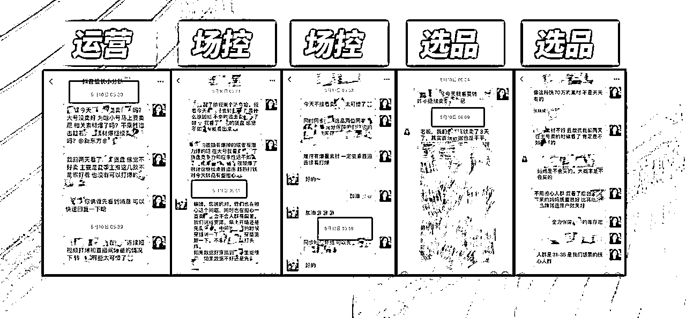

张晓楠老师分享过一个工作切片：那天上午9点直播间有重要新活动，清晨5:30她在群里留了条信息，5:51就收到了同事的反馈——该对齐的对齐，该改的改。

反面案例也有：另一个8点多才回消息的同事，提出了不同建议，而当天验证的结果证明那条建议是错的。

时间本身不是重点，它只是照出每个人用心程度的镜子。用心的人，拿到正确答案的概率，天然更高。

我前面讲的那些方法、那些细节——对标、AB测试、数据调优——全是基操，全部可复制。可把这些操作执行到位，需要一支靠谱的团队。优秀团队能干什么？做别人做不到的事，赚别人赚不到的钱。

### 两个身边的样本

**缺货时刻，二八法则里的那个“二”**

我之前写过一篇东西，讲一个合伙人的团队怎么打快手电商短视频投放。操作方法不复杂：抖音刚爆的视频素材一定最新鲜，第一时间搬到快手投，有概率再爆一次，然后出单了再找厂家发货。

但这个模式有个先天弱点：大部分时候没法备货，只能有单再去找货。可爆款是全国一起爆的，厂家排期跟不上，没货发出去就会亏。

这种情况，80%的运营会绕着走，不碰这类产品。20%的运营会直接杀向货源：提上礼物，连夜开车去厂家，把供货商当大客户伺候，一顿商量加交心。本来需求量也不大，往前插个队并不是难事。最重要的，你人到了现场，别人排再前，他不在场。近水楼台先得月，不就是这么回事吗？

**竞争赛道里，做“人无我有”**

我们公司有个业务，一直靠📕获客，再导入私域。

当初选📕，是因为我们在这个业务上入场晚，但当时的平台赛道简直蓝得发黑。黑到什么程度？抖音获客成本已经飙到150+，而📕还稳稳待在30-50的区间里。

那会儿的📕是真能赚钱。跟差不多同期入局的同行复盘时发现，就算是单枪匹马起步，后来长成三五个人的微型团队，单月进账几十万也不算稀奇。

可惜好光景没撑太久。如今再去联系那批人，还在坚持的几乎只剩我们，说全军覆没都不为过。

成本往上蹿了七八倍不说，运营动作的复杂程度也翻了好几番。我们是怎么一步步被卷进来的，讲出来大家就懂了。

起步阶段拼的是发笔记引流，稍微上点道就搞账号矩阵，几十个号不够就扩到几百个，反正有钱赚，添设备压根不算事儿。接着矩阵素人号不香了，又盯上蓝V认证号，六百块一个，上来先囤一百个。再后来免费流量打不过付费玩家，索性砸钱投广告，赤膊下场抢量。等大伙儿都开始投流，市场又来一轮大洗牌——相互举报、批量封专业号。那阵子手上没几十个已开户的专业号，再配上做笔记、过审核的整套门道，根本寸步难行。

从单打独斗到专业号投放矩阵，竞争维度早就跳了好几级。明摆着，眼下光吃红利就想留在局里，门儿都没有。

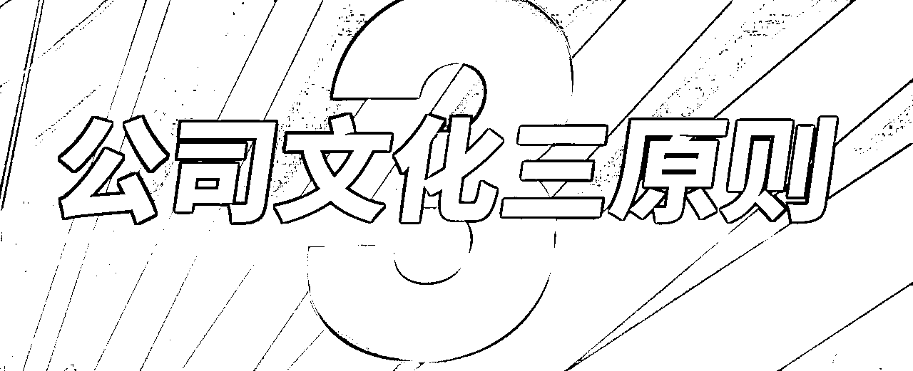

类似的情况比比皆是，干运营这行的谁没撞上过几回。张晓楠老师这回把话挑明了：把应对这些坑的思考固化成公司文化，再搭一个靠得住的班子，才是留在牌桌上的根本。

她的原话是“never say never”。

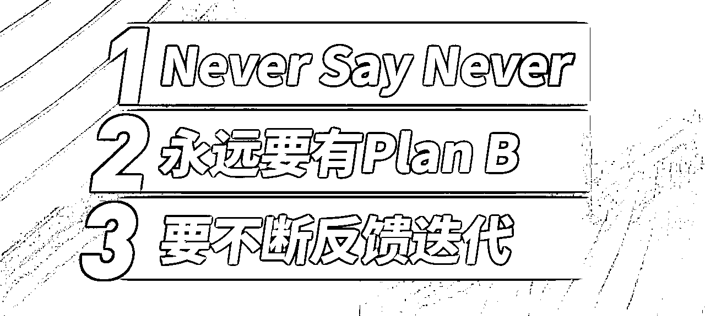

秉持这条信念，团队还得备着PlanB、能不断自我更新，才配继续玩下去。张晓楠老师聊的不乱烧钱的投放打法，加上这套企业文化，恰恰是眼下带大伙儿突围的刚需课。

## 三、张琦老师：把个人IP掰开揉碎讲透

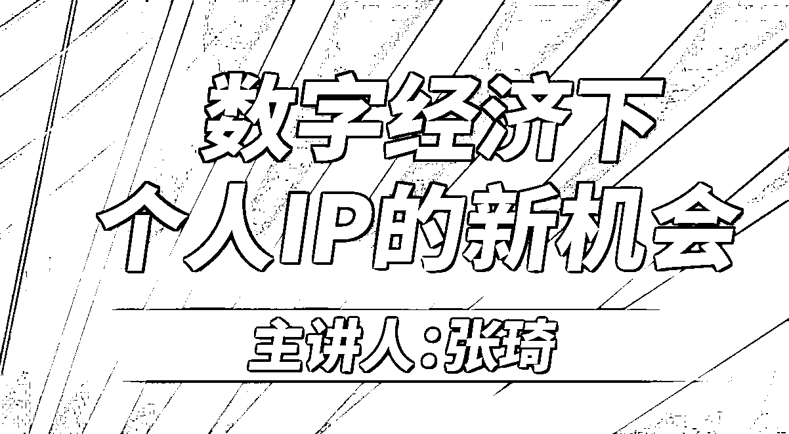

在抖音教商业的老师里，张琦算很贴地的那一类。我印象特别深，有阵子刷到她一条视频之后，算法跟开了水闸似的，哗啦啦推来一大堆，那流量阵仗确实吓人。可要是切到运营视角看，她的玩法、她释放的运营价值，还有她踩准的平台节奏，都值得细品。她讲东西不扎人，覆盖面广、层次多、落点也实，刚上手做个人IP的朋友听她准没错。

### 为啥要搞个人IP？

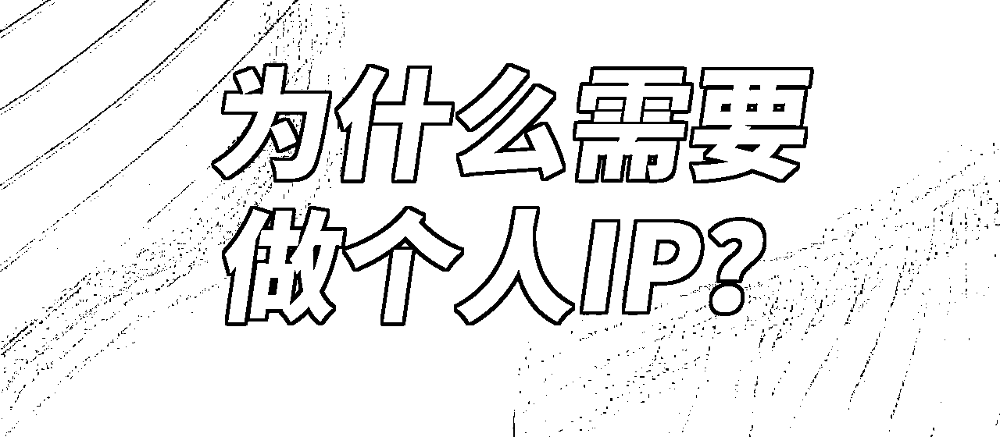

搁现在，这问题的答案能列一箩筐：风口啊、红利啊……听着都对，可全是大词儿。我猜来听课的大多数都琢磨过这事儿，毕竟大家不是已经在做IP，就是正准备做。什么个人影响力型、知识型、流量型、创始人型，名目不少，说到底都是想借IP攒出的那股劲儿，去撬动创业路上某块难啃的骨头。

比方说知识IP能变现，给现金流松口气；赫畅老师就提过，他的知识IP帮他填了不少资金窟窿。再比方说影响力IP能攒势能，够着高价值的人脉资源；哪怕只是个针尖大的垂直IP，也可能换来意想不到的好处。我们弄Shopee培训那阵，当地不少机构主动登门请我们去授课，还乐意分佣。好些原本得掏钱买的资源，靠这股势能白嫖来了。创始人IP呢，能更紧地把队伍拢住，顺手把管理上的疙瘩也解了——老板自己就是IP，IP跟公司长在一块儿，相当于换了个打法，对外影响力有了，对内管理也顺带捋顺了。至于流量IP，本身就是硬通货，谁攥着流量谁说了算。

所以说，动了做IP的念头，准是它能帮你摆平点啥，这才是最底层的动力。不妨先问问自己：就算做个芝麻大的IP，它能替你解决哪桩麻烦？

### 超级个体纪元

往后瞧，个人IP会变得跟家常便饭一样。谁不想有点影响力呢，这差不多成了眼下的文化刚需。而数字世界又把这扇门推得无限宽——你从哪个犄角旮旯切入都行，只管记录就成。

眼下不少三十出头的人，在公开平台晒日子还犯懒，因为那得额外折腾，又搭时间又搭精力。可往后的年轻人不同，他们打小泡在数字世界里，晒个性、晒独一份的日子本来就是活着的组成部分。再叠上AI工具把流程越削越短，从前得一个团队扑上去的活儿，将来一个人就能包圆。好比从前写日记、发🧣、晒朋友圈，往后在公开平台露个脸不再是加班式的负担，而是兴致到了自然就干——谁会对自己的爱好犯拖延症呢？

值越来越大，本越来越小，超级个体自然就成批冒出来了。这也是张琦老师特别点到的视角。

### 个人IP到底指啥？

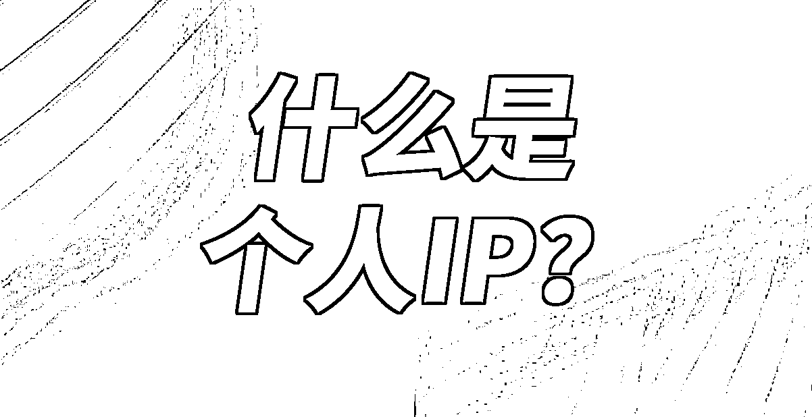

张琦老师想说的是：幻灯片上圈了那么多，你哪怕只吃透一个，甚至一个都没吃透也无妨。你的脾气、你的手艺，就跟早年间有人摆摊剃头、有人支锅蒸馍一个理儿，甭管买卖大小，只要能替某一撮人摆平具体的事儿、掏出实在的价值，就能靠这个立起IP。还是那句老话：你走过的路，能当柴火烧旺自己前头的道；要是这火还能暖到旁人，那就成了知识IP。

## 四、崔磊：拿“矛盾论”炼爆款

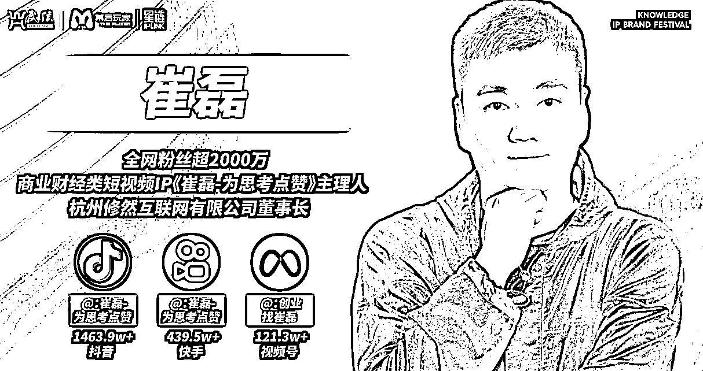

崔磊老师那场分享，等于把他压箱底的活儿摊开来给大家瞧。他掰了好几个案例，可翻来覆去只讲一桩事：《流量的关键：社会情绪》。他一遍遍叮嘱，得从正反两头去瞅问题、瞅事件，再从对立面里扒拉出对自己有利的情绪价值，照着这些情绪去攒内容。这就是爆款的命门所在，活脱脱一个矛盾论实战派，先给崔磊老师竖个大拇指。

这儿有个坑得绕开，不是说让你两头当墙头草——人家说天是蓝的，你点头；人家说天是黑的，你也叫好。不是这意思。我们讲究的是“提炼”跟“价值”，不是闭眼附和。说天蓝，兴许人家正站在朗朗晴空底下；说天黑，兴许人家头顶正压着厚厚乌云。矛盾论讲得明白，凡事都有阴阳两面。咱要做的是把观点背后那层值钱的东西刨出来，揉进内容里，这样才能跟抱持该观点的那拨人共振到一块儿，把他们的眼球吸过来，攥住对流量的掌控权。

这么一来，热点蹭上了，用户的立场也有了落脚点和情绪出口，出圈的概率自然水涨船高。

### 崔磊老师的案例复盘

他掏了好几个例子，咱挑“萝卜快跑”搭大健康行业那个来拆解。

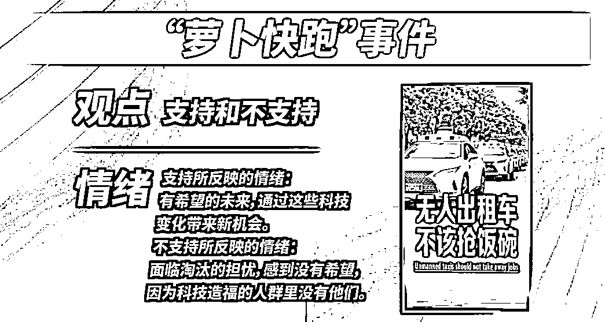

上头这张图，就是从热点里扒出来的，撑和支持两派各自的情绪抓手。

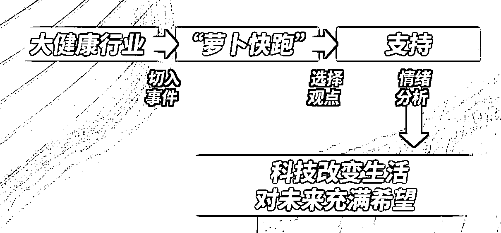

接着，拿大健康行业往“萝卜快跑”的热点上靠，冲着支持派的立场去攒话题。

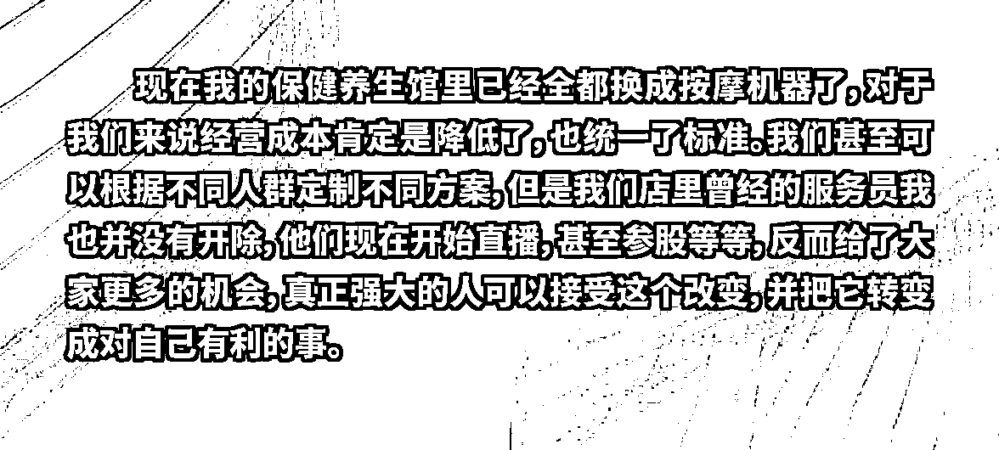

这么干，既亮明了力挺科技改善生活、多造价值的姿态，又抚慰了反对派的心气：往后不会拿裁人来安排活儿，而是更精地用人，让人去干机器干不了的差事。捎带手，还能给自己吆喝一波招商加盟。整场沟通的落脚点是：科技不是单给某一小撮人谋福，使对了地方，大伙儿都能沾光。

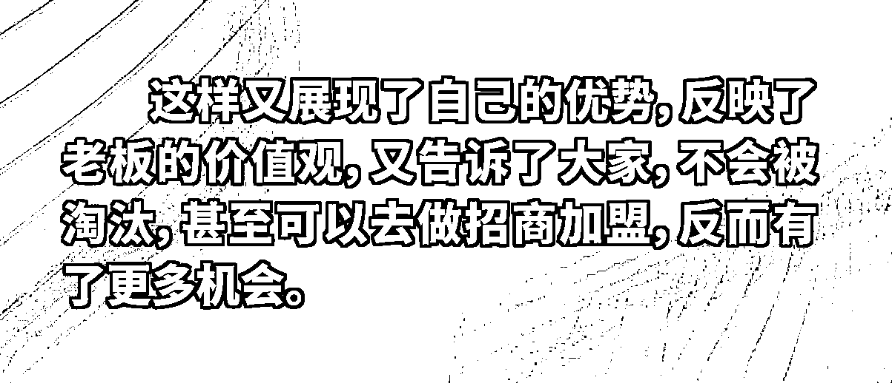

归根结底，流量底下压着热点，热点里头裹着各色观点，每种观点背后都杵着用户的情绪。要是能把自己惦记的流量跟用户对事件的这股情绪拧到一块儿，就掐住了爆款文案的七寸。毕竟得先让人家认你，人家才肯听你嘚啵。尤其对着普罗大众，你凭啥指望一篇文章就把人家几十年的三观给扭过来？靠谱的路子是摸到用户立场背后的情绪支点，先懂、再容、顺着来，最后才谈结合。这玩意儿不妨叫“内容沟通术”——大白话就是，把一桩事翻来覆去说圆喽，处处是价值，挑不出毛病。

## 五、吴世春：投资圈里的脱口秀演员

吴世春老师这“投资圈段子手”的名号真不是白给的，人家就是来讲笑话的。起码他那PPT是照这个路数攒的。

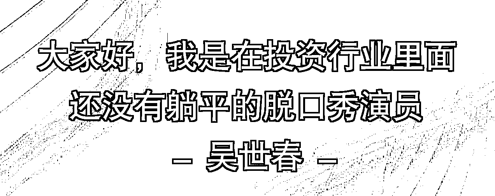

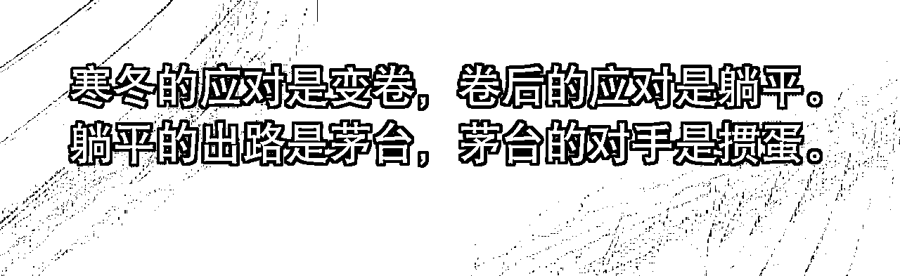

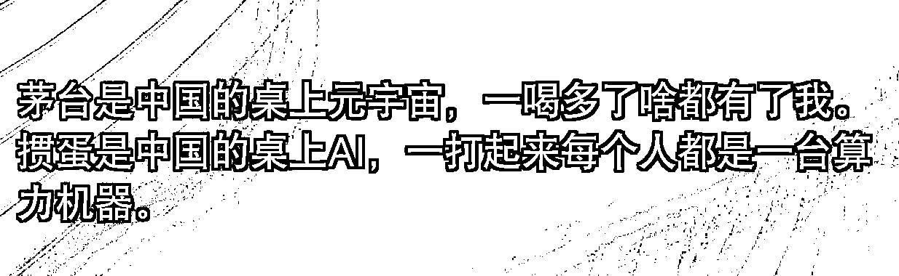

具体段子我就不照搬了，单说说我自个儿的体会。创业的人肩上扛的担子太多了，好多时候心气顺了，活儿才能干漂亮；咧嘴一乐，真能化掉不少糟心事。我差不多月月都有那么几天，心里堵得慌、脑子一团浆糊，基本没法干活。

早先碰上这种日子，我死磕、硬顶、熬夜加班，然后缴械，最后靠打游戏或者干瞪眼把时间熬过去。后来我琢磨明白了，索性把事儿和业务撂一边，歇口气，抿两口，看场电影，找哥们儿扯扯淡，或者领媳妇/对象整点浪漫。关键是咧嘴笑笑、松快松快，去够一够让人舒坦的事儿。完事儿那个电量满格、浑身是劲的我，又颠颠儿回来了。

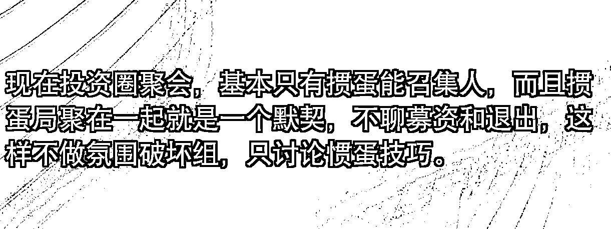

所以说压力来了，咱得学会轻装赶路。道理谁都门儿清，正确选项也摆在那儿，可创业这档子事天生跟人性拧着来，人一旦没了那股子热乎劲儿，就是很难做出逆着本能的选择——不管是跟长期目标妥协的时候，还是奔着大方向得扛住家里人和同事不理解的时候。

所以，寻个对自个儿胃口的法子，犒劳犒劳自己，乐一乐，然后轻装上路，这事儿真挺要紧。

末了，谢过耐心看到这儿的朋友。要是觉得有嚼头，劳驾回赚钱社区点个赞；想唠两句的，直接评论区留话，我瞅见就回。

张琦老师：甭管你是修鞋匠、洗衣工，还是家里有矿的，甭管你长得俏还是本事牛，个人IP这条路你都能蹚。

张晓楠老师：只要攥紧“never say never”和赖在牌桌上的那股劲儿，你照样能成自个儿赛道里的个人IP。

赫畅老师：走过的路既然能照亮往后的自己，那也一准儿能照亮更多旁人。

崔磊老师：务必学会换几个角度瞅问题，有正就有反，有人点头就有人摇头；把多层次的社会情绪价值提炼出来，把用户情绪跟自己的流量算盘拨到一处，这才是拿捏流量的高阶玩法。

吴世春老师：最要紧的嘛，得笑、得松快，让乐呵劲儿领你找回那个热血沸腾的自己。

本文配图均取自网络或公开线下场合，若有侵权请知会，我们立马删。