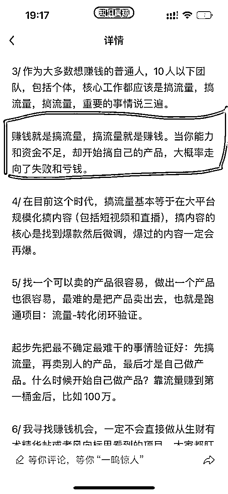

# 砸进去8万块，最后只留下7个客户：中老年知识付费踩坑实录

📕女装那篇复盘发出去之后，我们又在月租两万、两百平的大办公室里熬了一阵子，终究还是撤了。合同没熬满一年，押金两个月共四万，按约不退。好在房东看大环境不行，没拿“提前三十天告知”那一条较真，我们才算没多掏钱。

搬进回迁改造的居民楼后，房租降到几千块，人一下就轻了，感觉好歹能多撑些日子。

这件事给我们上的最狠一课就是：新手接项目，千万别开局就整豪华阵仗。当初无非觉得办公环境体面些，招人容易，结果证明纯属拿钱买教训。

女装黄了之后，我算彻底明白了——自己能力边界之外的东西，碰一样亏一样。可手头又没别的活可干，上班这条路，无论性格还是岁数都不合适。那就还是靠实打实做项目，一点点磨本事吧。

# 为什么盯上中老年培训？

做女装之前，银发经济那批精华帖我就翻过，心里一直记挂着这个方向，尤其看好中老年兴趣爱好的线上教学这条细分线。只不过当时脑子里有个预设：这类培训想做大，前期得烧很多钱。而女装电商看起来来钱快，我还幻想过等电商跑顺了，把它托管出去，拿赚到的现金流反哺老年项目。

我为什么觉得培训烧钱？身边有团队做职场教培，单买量一个月就是几百万，还养着上百号销售做转化，那阵势让我先入为主。

女装关停后，我把平台上银发经济的文章通读了一遍。我那位朋友更拼，三天三夜把老年人相关的项目和零散知识点全扒出来，梳理成一本手册。

这位朋友早前把小书数码产品的完整链路跑通过，懂内容也懂投放，同时对电商已经提不起劲。我俩来回碰了很多次，两家人还坐到一起吃了个饭，深聊之后方向就定了：一起做银发经济。

电商是坚决不碰了，别的事也没干过。可培训我俩都算有底子，于是银发赛道的知识付费成了最终答案。

（后面我会有意多用“当时以为”“自认为”“我寻思”这类词，因为那确实是我当时的判断，而现实走向完全不是那么回事，后面慢慢说。）

盘来盘去，只有老年培训这件事，我主观上觉得样样都落在自己能力范围内：

其一，知识付费我实操过，群裂变做过，近千人的公开群发售也搞过，交付的完整链条走过一遍。那还是我刚离开职场时的第一个从零到一的项目，靠模仿、请教、硬啃拿下来的，成长极大。遗憾的是后来自己跑去“思考人生”躺平了，复盘文档一直没写，现在想起来还挺懊悔。

其二，老年人偏爱的那套东西——书画、养生、中医、国学——恰好都是我的兴趣所在。我自己就是在四处求医的过程中对传统文化起了心，虽说不懂，但乐意接触，甚至设想过等财务自由了专门钻进去研究。动力这块，问题不大。

其三，他们对审美不怎么挑，而我恰好审美为零。女装那次让我明白，没穿搭眼光、不会拍摄构图就别往里凑，所以这回我自认为找到了舒服的位置。

其四，课程类产品轻，供应链不用愁。老师录完一次就一劳永逸，也不存在时效，过五百年那些知识点还是那些知识点。当年做头条课程可把我折腾惨了，平台隔三差五改规则，我就得盯着改课；文字直播还好，升到视频课那会儿，改一次头疼一次，从那时起我就烦透了绑着某个平台做课。

其五，我天性乐意帮人，看到别人因我而变好，那种快乐很实在。电商里你是跪着的，客户是爷；培训里你是站着的，客户来求进步。钱赚了，人也成长了，双赢。学员跑来跟我说“遇见你之后我变了”，那种成就感我特别吃。放到老年培训上，想象一群爱学习的老爷子老太太，因为我做的事，晚年多了精神寄托，还交到同好，光画面就够美。

其六，朋友痴迷流量，我偏爱打磨产品、做交付，正好互补。以前凡事一个人扛全链条，累得慌，一直盼着有个搭子。这回我自认为找到了，一个管获客，一个管产品服务，堪称绝配。

再加上平台三月份刚办过中老年培训的实战营，手册细到近乎手把手，我那时候真觉得占尽了天时地利人和。

起步选的品类是书法。按计划先把流量或产品任意一端跑通，就先分销群里渔火老师的书法课，等小闭环走顺了再自研产品。

实战营虽然结束了，我还是找上渔火老师说明来意，申请做推广。我们照着手册一步步来，可视频数据惨淡，播放量卡在七八百，零互动，点赞都稀罕。朋友有一条冲到几万播放，但涌进来的全是吃瓜群众，往私域导极其费劲。

视频号的分发逻辑我们完全摸不着头脑，跟📕压根是两套玩法。

眼看着同行一批批进场，我们却几乎原地踏步。原本还给自己定了个“小航海”：五月剩二十一天，十五天剪视频引流，六天转化，三周跑通。两个礼拜过去，纹丝不动。

你看，我这人就是容易盲目乐观。

流量端既然短时间跑不通，同行又越来越多，我就动起了加快的念头：先把产品端备好，到时候接上朋友的投放能力，迅速铺开抢用户。我盘算着，哪怕前期获客贵一点，后续复购加上这个人群的想象空间，回报怎么也是成本的上百倍。

跟朋友一说，他觉得可行。

于是分工：我啃产品端（知识付费闭环我走过），他攻流量端（📕流量闭环他跑通过）。

自己捏产品最大的好处是服务与交付质量全在自己手里。要是直接卖别人的课，用户冲着我的信任买了单，结果体验拉胯，我心里过不去。

# 创业路上最大的坑：流量没跑通，先埋头做产品

这个决定，后来被证明是我创业至今最惨痛的一课。

### 先说产品端，远没有想象中轻巧

真动手才发现，看着简单的活儿，落地全是细枝末节：

课程框架怎么搭？跟别人怎么区分？价格阶梯怎么定？免费体验课录哪些内容？社群转付费那一步定价几何？首购之后的进阶课选哪门？录课成本怎么压？一套体系课五六十到八十节，烧的钱不少。去哪找既会讲又专业的老师？怎么甄别？合作协议怎么写？课程配套物料找哪家供应商靠谱？具体怎么录，双机位还是多机位，怎么指导老师？版权归谁？

诸如此类，数都数不完。

实在没辙，我硬着头皮去问渔火老师，发红包请教，也做好了被拒的心理准备——毕竟我要做的是他的同行。没想到他一点没藏私，给了很多极有价值的信息。他反复叮嘱：多调研市场、多研究用户，看用户想要什么课，千万别听书法老师的话。因为书法老师既不懂营销，也不懂用户，更不懂市场。

他还说，眼下市面上的书法课体系乱成一锅粥，课多得连他这样的消费者都挑花眼。这点我挺服他——他自己当初啥也不懂，单靠用户调研就开发出一堆课。

可调研恰恰是我最弱的环节，我连那批老年用户聚集在哪都不知道，更别提看清需求。只好去课程平台翻书法课的销量，去电商平台看哪些字帖卖得动，补一补行业感觉。还专门买了一批书法书，研究人家给零基础用户怎么排目录。

既然要干，就得干明白，自己多少得懂点。

那阵子我还混进几个同行的免费群卧底，观察他们免费课怎么讲、怎么转付费，留意课程节奏、话术、一对一跟进。

让我难受的是，有些机构给用户发消息已经到了骚扰级别。早中晚各一轮，开课前五小时、三小时、一小时、半小时、十分钟、五分钟各来一条，我数过，单私信一天二十几条。不点链接，直接语音电话过来，说监测到你没在直播间。要不是为了蹲同行，我一秒都待不住。用户真吃得消这种待遇？

可群里那帮大爷大妈配合度高得吓人，让签到就签到，让交作业就交作业，指哪打哪。我朋友一度怀疑群里全是托。

同行体验课确实掐准了书法爱好者的痒处，反复灌输“跟我们学，很快出效果”。但我看老师示范时发现，有些主讲水平很一般，笔画是描出来的，不是一笔写就——我自己买了书、查了资料，知道这是误人子弟。

矛盾就来了：做销售做流量得顺着人性，可书法修习偏偏逆人性。谁不想快点看到成果？用户都是上了岁数的人，谁有耐心慢慢磨？走快餐路线，能活，但口碑迟早崩；走扎实路线，可能连认可这套理念的种子用户都招不满，撑不到口碑发酵那天。

那段时间我翻《小米创业思考》，里面一句话点醒我：忘掉同行在干什么，一切从用户需求出发。我就问自己：假如我是一个想学书法的新手，或者朋友孩子想学书法来问我推荐，我最希望对方拿出什么样的课程、什么样的教学体系和服务？

说白了，我想做长久生意，想要口碑。我不想看到用户砸了钱学几年，进步寥寥甚至白学。

所以我真沉下去找老师。朋友介绍、群内推荐、招聘平台，各种渠道都用上，一个月聊了将近四百人，多数来自招聘平台。里头有美院科班的，有自学的，也有中书协、省书协的。

起初我只看头衔，以为头衔越响、学校越好，教学能力自然差不了。后来才明白书法圈水深得很。外行想找个靠谱老师带路，太难了。于是我一遍遍改筛选标准：院校背景、头衔、教学履历、本人作品（还请了专业顾问做交叉验证）、笔法理论、试讲视频、系统教学规划、作业批改……流程整了一大套。

最终从四百人里留下八位左右。顾问说，这套师资配置比不少线下艺考机构还硬。

我当时的念头是：用户要学书法，我就得给最好的、最专业的。后来证明，这想法又偏了。

五月到八月，我全扑在产品上，研发书法课。还花大量时间逐条验证老师录的内容够不够细——我自己或同事以小白视角听，听不懂、抓不到点，就判不合格。

不管怎样，磕磕绊绊总算有了能推的雏形。

这段时间我基本没碰流量，心想朋友会搞定，不用我操心。

### 说好并肩的朋友，中途去进修了

我刚做产品那会儿，朋友还担心我三分钟热度、半路换赛道。我明确表态这次会沉住气。

后来他觉得视频号的机制跟📕差太远，玩不转，决定不碰视频号，回去深耕📕，同时建议我有余力也自己研究研究视频号。

渐渐地，我们联系稀了。从零星几句里，我拼出个大概：他好像没在做书法了。

八月我告诉他，产品有雏形了，合作老师也敲定了，可以推了。他说忙，人在很远的地方跟着一位“有结果的人”学流量，帮人搭团队，细节不清楚。

期间我特意请他到办公室，把产品体系规划、已录的课程片段、合作老师一一摆给他看，就想表明我一直在认真做产品。我还当面问了一句：书法还一起做吗？他点头，说把手头的事处理完会联系我。

但我心已经凉了半截。

我自己有个全职伙伴，也是转行过来的，啥都不懂。朋友不研究视频号了，我就让这位伙伴照手册去试，效果很差。当时我还想，朋友那边搞流量，我把产品打磨好，最后合到一块就行。

时间一长我才醒悟：不该把希望押在别人身上。我明明没有主动获客的经验，却理所当然地以为可以不碰流量，把时间全砸进产品研发。

朋友什么时候能腾出手，我不知道；我也不能干等，团队要吃饭。

最终只能自己上。真上手做流量，才知道自己错得多离谱。

# 想赚钱的普通人，第一件事是搞流量

“先搞流量，别急着做产品”这条忠告，龙哥说过，不少人也反复说过。我甚至开工前还读过一篇复盘：一个程序员闷头研发半年抖音小程序，上线才发现没用户。以前看这些，毫无感觉，转头就忘。只有自己栽进去，才懂句句是金玉良言。

道理我都看过，还是闭眼跳了坑。就算当初朋友铁了心一起干，也该两个人先把流量跑通再谈产品。何况一个人单干，更该流量先行。

因为不管卖什么，你都得有用户，都得获客。而我偏偏毫无流量经验，只能硬着头皮试。

八月下旬，我先照搬大同行的打法，招书法主播开播，卖一元体验课。之前选录课老师时攒了不少人选，可这时才发现同行已经把主播价码卷起来了：时薪四十到一百不等，外加提成。他们还跟书法达人合作，收一张用户名片给二三十块。按百分之五转化算，单个付费用户成本高达六百块！而且这种合作漏洞极大——推来的人准不准？是不是水军？会不会专为薅羊毛而来？

我当时还笑同行傻，成本这么高怎么回本？

等自己下场，才发现小丑是我自己。我们嫌这价太贵，就自己招主播开播。换了几个主播试，王牌给到一百块一小时，场观一千五到两千；其余主播场均两三百。转化？不提也罢。

分销团队也拉了八个人，搞了半个月，一个都没转成。最后一算，半个月只加了十三个🛰️，单个引流成本三百块，同行才二三十。

不认栽还能怎样？分销兼职和主播全停了。

请主播贵，那就自己上。书法我们不懂，但可以照手册打印些作品资料，直接开讲。结果观众秒进秒出。手机是几百块的安卓机，灯光不行，画面糊，场景更糟。公司其他项目的小伙伴瞅了一眼说：你这直播看着像骗子。

这时候哪还顾得上紧张，满脑子就一件事：到底说点啥，能让一个个活人愿意停下来听我讲两句？

总之，自己播、招兼职播、私信话术，没一样数据能看。

回头想想研究产品那段日子——纠结定价、纠结课程体系、反复测算成本，实在可笑。
没有流量，一切归零！

当初还花大把时间钻研书法笔法、抠产品细节，现在看纯属本末倒置。只要老师够专业、内容没硬伤、不是糊弄人的劣质品、能好好交付，就行了。产品优化迭代，应该等用户量起来后，请个专职课程研发来负责。

我真不该在那些细枝末节上耗那么多时间。

我算是认清了：这项目，我们就是个草台班子。老老实实研究短视频引流吧。

# 最后，数字人也救不了场

正好刷到数字人训练营的消息，一听AI数字人，我感觉像抓住了救命稻草，果断报名，拉着同事一起学。可群里的同学和教练都没碰过书法，给不出什么建议。有位教练听我说在做书法，开口第一句就是劝我换赛道。

我说：这事我已经砸进去好几个月和不少钱做产品，换赛道不可能。

半年，近八万，只换回七个用户。但或许，这七个人就是我花最贵的学费，买来“流量为王”这四个字。

过去大半年，我一直在做中老年书法培训这个项目，钱烧了不少，却几乎看不到正向反馈。回头去看，这段路走得相当曲折，也攒下了一堆教训。

最初，我们想着走捷径，琢磨市面上那些爆款美食或带货视频的文案结构，看看能不能套用到书法内容上。我们也尝试了平台自带的公共模板，做了好几个视频，但结果无一例外——播放量全都卡在一千左右。说实话，搞不清楚到底是内容本身太弱，还是被限流了。于是我们又动了换脸技术的念头，为此还特意添了一台新电脑，又是一笔开销。折腾了大半个月，数字人内容的表现反而连我们原本做的书法笔画教学都不如，效率更低，效果更差。最后没办法，还是老老实实回到最基础的动作上，按照航海手册里写的那样，认认真真剪视频，踏踏实实做主动私信，把基础执行做到位。说白了，别整天想着什么数字人、个人IP，先把笨功夫下足再说。

渔火老师当时也提醒我，这些事绝不能交给员工做，必须自己动手。招来的员工本质上是执行者，不需要他们动脑，指望他们去开疆拓土根本不现实，永远不要对执行层抱有不切实际的期待。这当然又暴露了我在管理上的问题——当时觉得招来的小伙伴以前在其他行业当过领导、带过团队，如今愿意降维来到创业公司从零开始，那肯定是一起打拼的啊。结果呢？把一个沙僧型的员工当成孙悟空来用，纯粹是我的失误。个中酸楚，不细说了，都是泪，都是教训。

回头看看，流量跟不上带来的连锁反应才是最致命的。当我们终于实实在在去执行后，开始有人加🛰️了。按手册里的惯例和同行的做法，一般是先让用户上五六天的免费体验课，最后两天集中转化。可是做群发售至少得凑够100人吧？我们整整花了一个月才勉强凑齐，最终实际进群的连80人都不到。因为最早加过来的用户等得太久，早就删了🛰️跑了。到了第二次做发售，我们拼了命在半个月里引流了近300人，可最終进群的也就180人，流失率依然高达40%。流量能力强的人，用户加了🛰️后等待时间一般不会超过一周，但我们愣是让人家等了半个月甚至更久。说白了，每轮辛辛苦苦做的引流，都有相当一部分是白费了。

从九月份正式开始认真抓流量，到写下这篇复盘，45天的时间里，我们只是勉强做完了两次群发售，因为来的人实在太少。更惨的是销售转化，两次群发售，转化率连1%都不到。

当初选这个赛道，除了自己觉得在能力圈之内，也是被“银发经济”“中老年用户有钱有闲有付费意愿”的说法打动了。可真做起来完全是另一回事。我们认真做了六天免费体验课，还做了数据监控。同行的作业提交率每天掉15%，我们这边听课率和作业完成率反倒不降反升。很多学员私下感谢我们，说课程质量高、服务用心，对他们帮助很大。我一直以为这意味着高度认可，对转化数据信心满满。结果一到收钱环节，没人说话了。我们的价格已经压到很低——同行收费两千多，我们只收几百——照样卖不动。后来我也做了一堆回访调研，得到的答案无非是“随便写写不想花钱”“没时间”“已经在别家报班了”。还有人更离谱，眼看我们的免费课要结束，赶紧跑去加我们其他账号的🛰️，问还有没有免费课可以上。她们就像候鸟迁徙一样，不断换机构去白嫖课程和作业批改服务。

我当时一度把问题归结为引流来的用户不精准、没有付费能力，但渔火老师坚持认为是转化流程和产品力出了问题，因为同样的引流方式，他们能做到7%到15%的群转化率，而我连1%都不到。最终真正付费的只有两三个人，这点收入连开班都不够，更别说覆盖老师的服务成本了。第一次群发售时，有人想报长期课，我甚至直接拒绝了；第二次发售把老师服务和课程做了价格差异化设置，算是稍微缓解了成本问题，但报名人数依然远远不够养活团队。而且群发售这种运营方式实在太重了，每次做完整个发售流程，其他所有事都得停下来，整个人彻底陷进去。以我们现在的人力来看，这种重度玩法根本不适合。我也在认真考虑要不要干脆砍掉社群发售这种转化模式。当然也想过找有流量的达人合作，但一直没遇到合适的。

做这个项目这么久，最大的一点领悟就是：大家都反复强调流量，强调它是最难的一环，以前我真不觉得。我回想自己做自媒体那些年，头条号容易出爆款，抖音稳定更新时突然来了个千万播放，一切都太顺利了——那本来是最好的锻炼流量能力的机会。但等到流量开始波动和下滑时，我完全没意识到自己的能力短板，而是直接躺平了。直到这次要拼真本事去获取流量时，那些短板终于清晰又具体地摆在面前。以前我从来不觉得这有什么问题，也不会刻意去练这块能力——说白了，我对流量是一无所知。甚至以前还瞧不起追热点的人，认为自己多清高，现在回头看，简直讽刺。过去三四年，我最该练的就是获取流量的能力，我却全然没有这个意识。

选择这个项目时，我自以为中老年书法培训还在舒适圈，又是大错特错。以前我做培训项目，绝大多数是内容型被动成交——用户在加🛰️之前已经看过大量我的文章，对我有信任基础，加上🛰️聊几句，直接打钱。但这次不一样，我没有任何品牌背书，也没什么深度长文，发出去的视频跟同行的几乎一模一样，用户根本分不出谁是谁，在你这儿学和在那儿学没什么差别。所以我几乎没有任何主动获客、引流和销售转化的经验，也没有任何辨识度。

更残酷的对比是，过去的项目是和赚钱这个刚需绑定的，搞钱是硬需求，内容传播和销售转化都有天然的拉力。而书法只是茶余饭后的消遣，写不写、写得好不好，对生活没多大影响。就像之前一位财友告诉我的，判断项目行不行就看他“需求刚不刚”。用户完全可以看免费视频自学，找个老师也多半会选广告打得响的——毕竟他们没法判断好坏。最讽刺的是，有一次我试图转化用户，强调我们老师有多专业、教学体系如何对标美院，对方直截了当地说：“我就是写着玩，要体系干什么用？”那一刻我才明白，我精心设计的那套体系，只适合艺考生、落榜的书法生，或者有一定基础、懂得分辨的爱好者；绝对不适合那些只是打发时间、不在乎老师专业度、也不关心课程体系的中老年小白。等我回头重新调整策略，他们依然不买账。群里的知识分享也好，我苦口婆心地告诉他们传统书法该怎么学、要有什么理念、别搞江湖路子也好——他们不听，宁愿去买同行两千多的课，哪怕那课圈内公认不专业、瞎教一通。

说到这儿想起一件挺讽刺的小事。前两天，一个做了多年教育的朋友来跟我打听游戏行业怎么样，他说不想干教育了，想转行做游戏。我说游戏卷死了，大家都在裁员，我朋友都亏了上百万，你还往这火坑里跳？他得知我今年竟然在投身教育，反过来说：教育都卷成这样了，我投的教育公司也亏了一百万，你居然还往里冲？大概我们俩心里都觉得对方是傻子吧。

之后我们聊到具体业务。我一直想不通，同行明明有实力有钱，为什么不做好课程？他反问一句：“你有没有想过——他是被逼的？”大家都卷，用户没有分辨力，你只能靠夸大宣传、过度承诺去忽悠，用户才肯掏钱。老实交付、认真教学，根本干不过会吹的人。其实也有人建议我不如直接把手里的用户卖给同行，换个活法。我不甘心，投入了这么多，而且我清楚同行课程的真实水平——那是坑人。结果好几个人吐槽我：拜托你接地气一点，团队都快活不下去了，你还惦记着用户？有情怀是好事，但先活下来再谈情怀。道理我都懂，可作为一个当过老师、真心喜欢教书育人的人，内心的煎熬，外人很难体会。

再说件让我挺受打击的事。国庆回老家，一个亲戚也在做自媒体，帮别的老板做引流转化分销，卖的是K12里一个非常细分的垂类——专门给孩子做数学提分。看了他们的话术和引流动作，简直简单粗糙到令人发指。可就算是那样简陋的操作，因为直击家长痛点，根本不愁成交，丢个手机号加上🛰️再丢个链接就出单，一个人每天都能稳定成交好几单。需求只要够痛、够刚，动作再原始也能出结果。反观我这个项目，光引流的话术就不知道测了多少轮，社群发售费了多少力气去精细化运营——付出与回报完全不成正比。但我心底就是不甘心。

创业以来，我几乎没怎么待过家。每天半夜回来，孩子们都睡了；早上他们去上学，我还在补觉，运气好能碰个面打个招呼又要出门。生活完全没有了，也谈不上陪伴家人，这根本不是我想要的状态。我理想中的项目，是做一个小而美的团队，两三个人，朝九晚五，双休，每个月有稳定且还不错的收入，离家近，工作和生活平衡。胖东来那种企业家是我向往的样子。但看看眼前，和理想简直是天壤之别。

同一个项目，不同的人来做，结局完全不同。渔火老师在做中老年项目之前，已经做过别的培训项目，创下几千万流水的成绩，团队也是自己一手搭建的。到了做书法项目时，他的能力可以直接迁移过来。而我，是从零开始起步，结果不同也是预料之中的事。这个项目我还是不想放弃，只是接下来该怎么走、怎么找突破口，要好好再想一想。如果有人有这方面的经验，也欢迎指点一二。