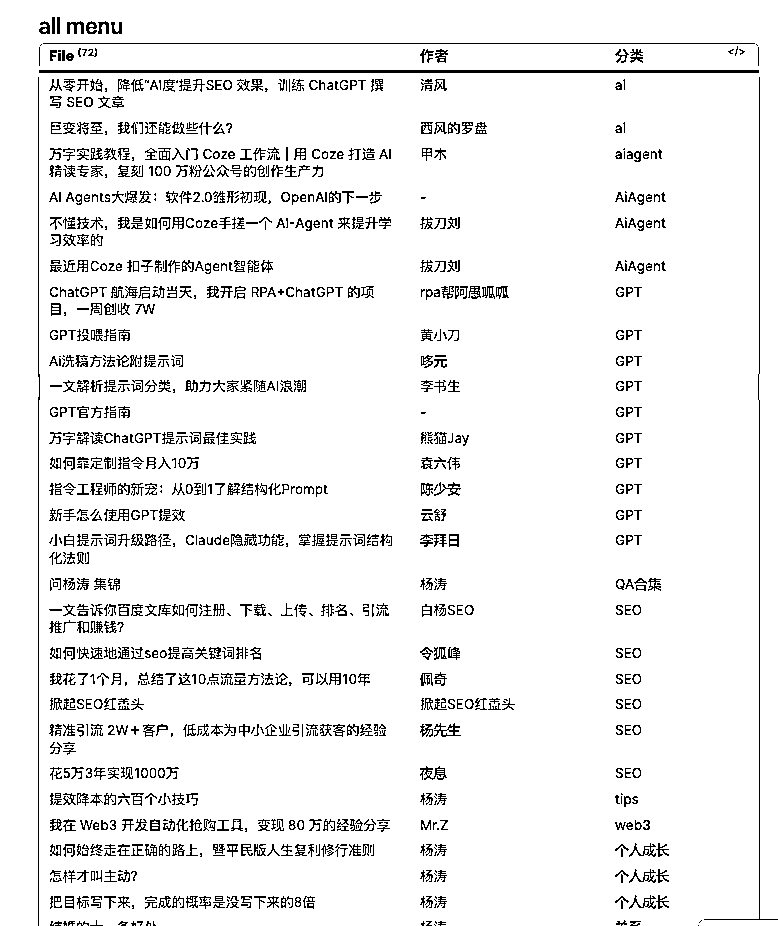
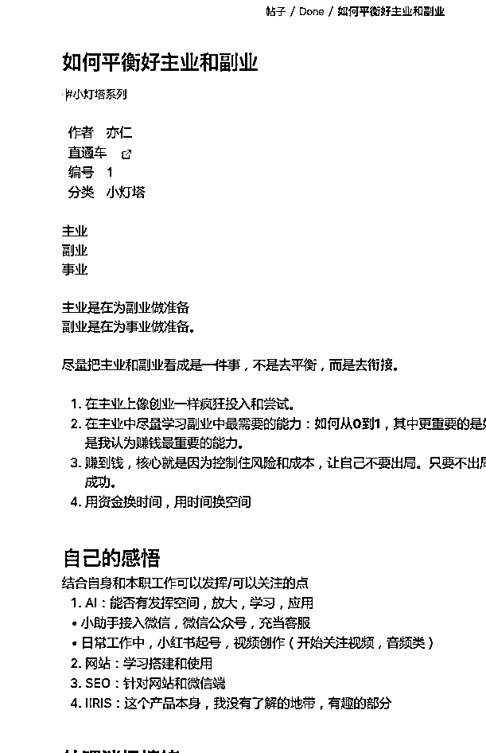
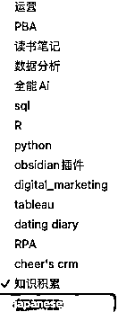
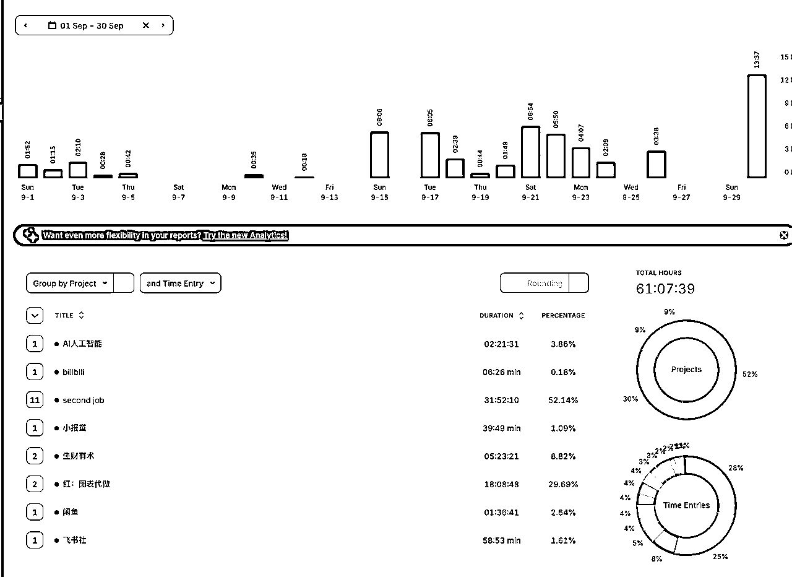
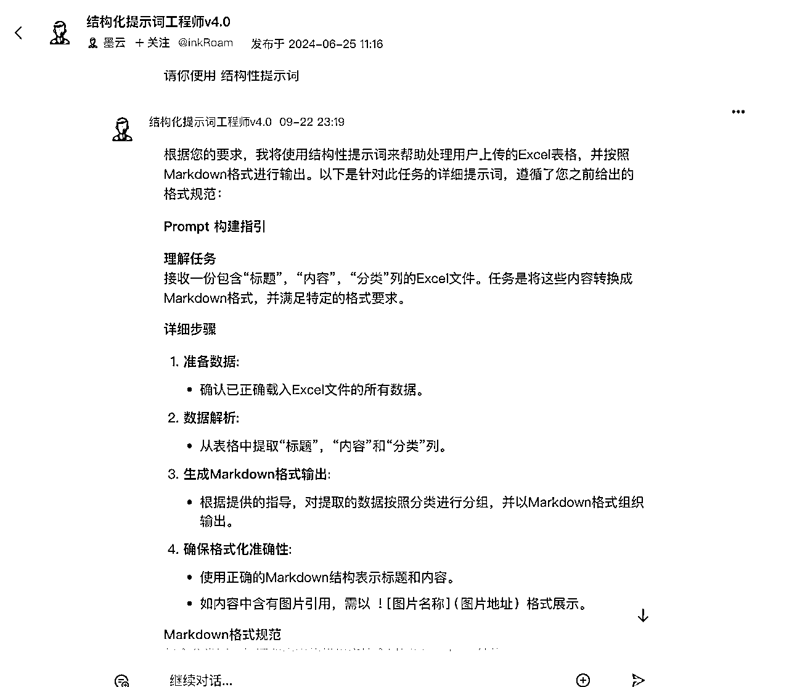
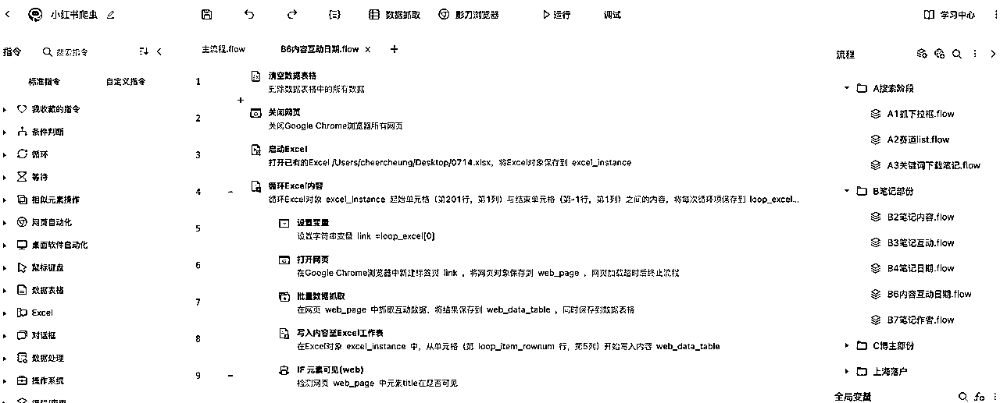
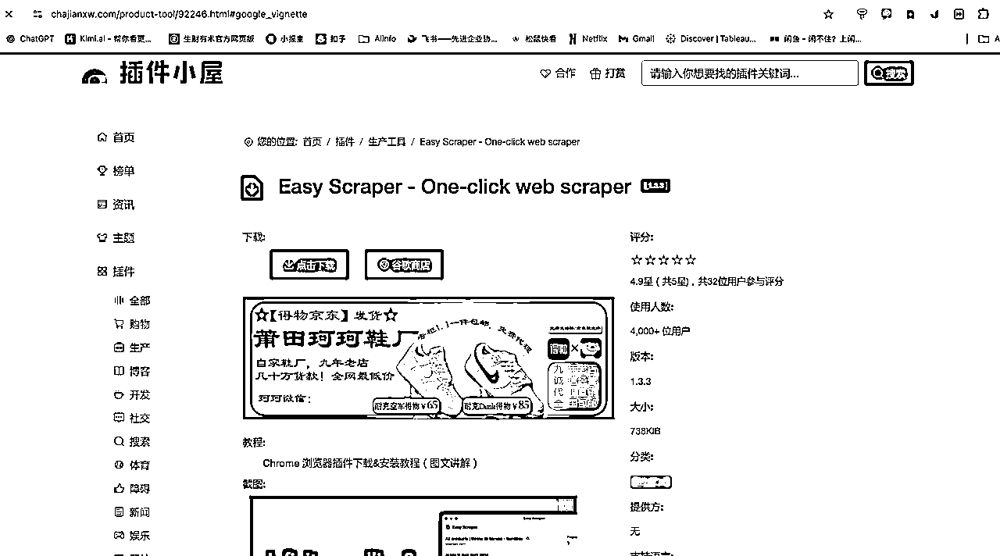
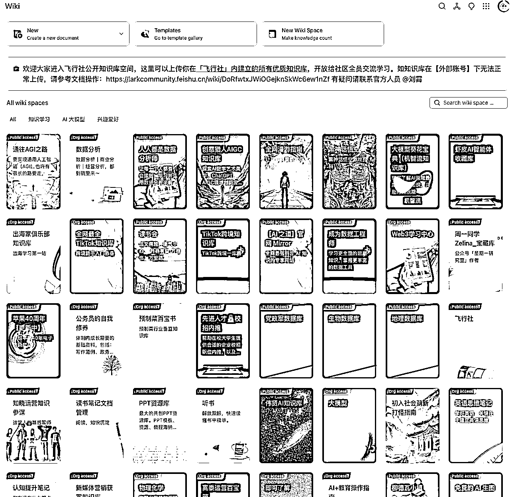
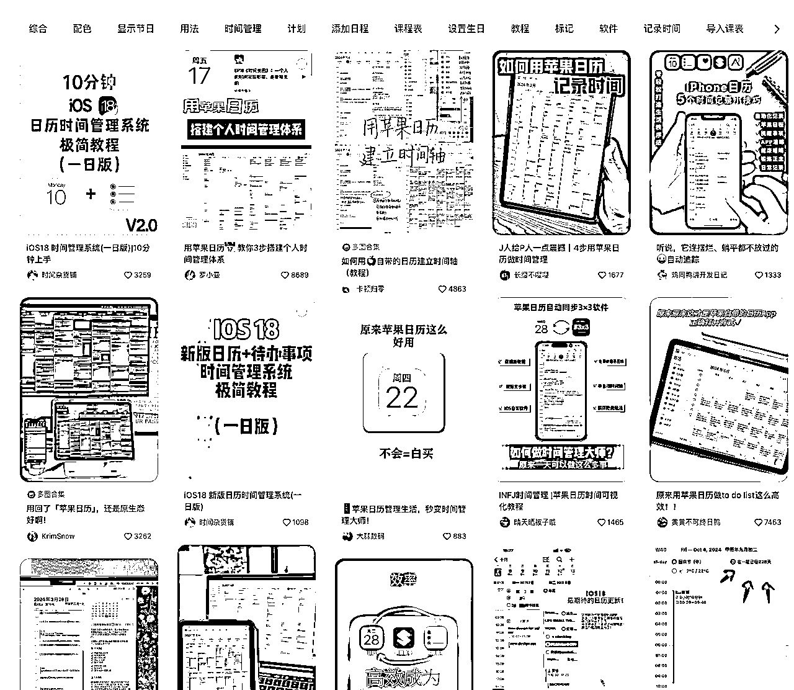
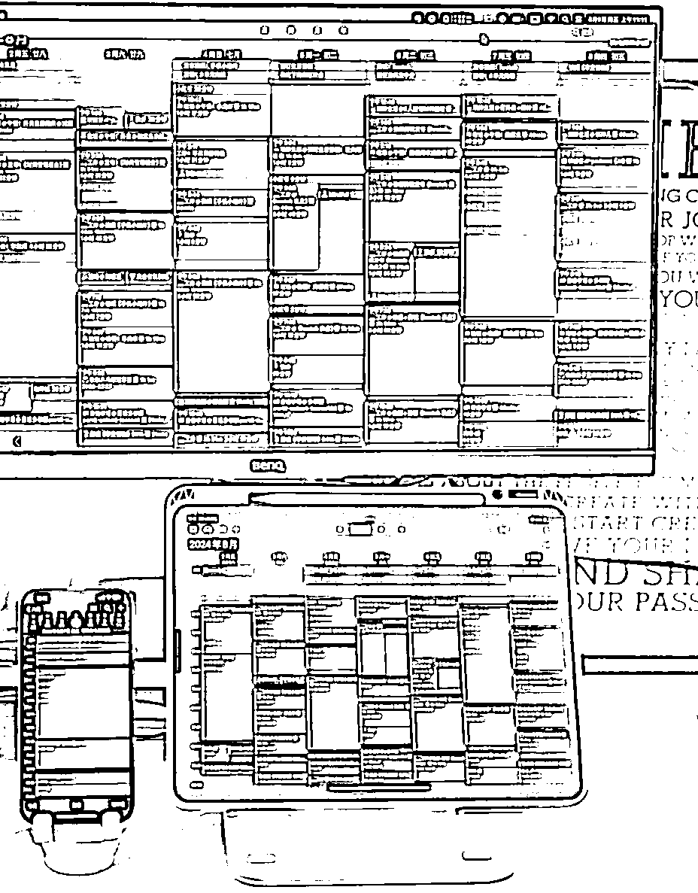

# 我的效率工具箱：把工作、学习和生活都安排明白
作者：龙哥

大家好，我是龙哥，也可以叫我悦悦、小悦、大悦，或者 Cheer。

名字很多，可能也正好对应了我的性格：不止一个面向，偶尔还带点“人格分裂”属性。

## 关于我

我是98年出生的水瓶座，女生，喜欢男生，也热爱自由。

平时看起来有点社牛，但本质上并不热衷社交，INFJ一枚。除了这些固定属性，我身上还有不少关键词：

- 知识区B站UP主
- AIGC创作者
- 📕博主
- 可视化设计师
- 数据分析师
- 外企市场人
- 超强执行力拥有者
- 严谨逻辑思维践行者
- 拥抱差异与多样性
- 适应环境速度快
- 喜欢打破常规
- 独立、坚定的新时代女性
- 试图做到美貌与智慧并存
- 当然，也是一名努力工作的“牛马”

说到底，我就是一个特别依赖工具的人。离开各种软件和平台之后，工作效率大概会直接掉到谷底。

下面这些工具，都是我长期使用、反复打磨过的效率搭子。

## 我的常用工具清单

1. Obsidian：搭建知识库、写作记录  
2. Toggl Track：追踪时间使用情况  
3. ChatGPT、Kimi、秘塔：AI对话与资料检索  
4. Coze/扣子：创建AI智能体  
5. 影刀RPA：执行自动化任务  
6. Easy Scraper：Google浏览器爬虫插件  
7. 飞书与飞行社：知识管理与互联网交流  
8. 提醒事项、备忘录、日历：苹果生态里的效率三件套  

---

# 1. Obsidian：我的私人知识基地

官网：https://obsidian.md/

Obsidian是一款基于本地存储的知识库工具。现在，我几乎所有需要沉淀的内容，都会先放进这里。

它最大的优势之一，就是方便检索，而且资料保存在本地，不太需要担心内容外泄。

我会按照不同主题建立独立的知识库，比如：

- 赚钱相关精华内容
- 新媒体运营记录
- Python爬虫学习资料
- 各类工作与项目笔记
- 甚至还有一个dating diary，专门记录约会，不过已经很久没更新了

它不只是一个写字软件，更像是我的第二大脑。

我简单了解了一下，赚钱里关于Obsidian的系统化实操内容似乎还不算多，所以之后可能会专门写一篇，分享我是如何用它管理知识和工作的。

---

# 2. Toggl Track：看看时间究竟去哪了

官网：https://track.toggl.com/

这是我用来记录时间的工具，主要使用电脑端，手机端相对少一些。

我会把不同任务的耗时记录下来，尤其是副业部分。这样一来，就可以大概算出自己在不同项目上的投入，以及实际时薪。

除此之外，我还会定期进行周复盘，看看这一周的时间到底花在了哪些地方。

很多时候，人会因为觉得自己“什么都没做成”而陷入虚无感。但当所有时间都有记录之后，就能更客观地看见自己的投入，也更容易调整下一阶段的安排。

---

# 3. ChatGPT、Kimi与秘塔：我的AI员工组合

## ChatGPT：全天候外籍员工

ChatGPT对我来说，已经不是偶尔使用的软件，而是几乎每天都会调用的工作搭档。

写东西、整理思路、完善方案、拆解任务，很多事情都离不开它。

如果把它当成一名员工，那大概就是：

- 每天24小时在线
- 一个月工作30天
- 不抱怨
- 不请假
- 随叫随到

这样的员工，现实里可不好找。

## Kimi：更容易上手的国产选择

我也经常向办公室的同事推荐Kimi。

它使用门槛比较低，整体表现也不错，作为国产AI工具，日常查询、整理和文本处理都可以胜任。

虽然不一定每次都完美，但已经足够应对很多常见场景。

## 秘塔：需要资料出处时的首选

当我需要引用参考资料、查找学术信息时，会优先使用秘塔。

相比直接让GPT生成资料，秘塔在搜索和提供参考来源方面更加适合做前期信息收集。

我通常的工作流程是：

1. 先用秘塔检索相关知识和参考资料  
2. 把整理后的内容作为背景材料  
3. 再交给GPT进行分析、改写或进一步产出  

这样比单纯让GPT“凭空回答”更稳妥，也能减少它一本正经胡说八道的概率。

---

# 4. Coze/扣子：把提示词变成桌面工具

国内版：https://www.coze.cn/home  
国际版：https://www.coze.com/

我会在Coze里制作一些结构化提示词，并且直接把网页保存成桌面应用。

这样一来，之后需要调用时，打开桌面图标就可以，不用每次重新找入口。

虽然现在很多人已经习惯直接向GPT提问，但我还是比较传统。通常在正式提问之前，我会先整理好提示词，按照自己的SOP来完成任务。

具体的使用方式，可以参考那篇《多工具结合使用才是YYDS》。

除了自己搭建的工具之外，Coze里还有不少现成的AI Agent，可以根据需求直接调用，还是很有意思的。

---

# 5. 影刀RPA：把重复工作交给自动化

官网：https://www.yingdao.com/

影刀RPA让我实现了比较轻松的📕内容采集，也把对标分析的操作门槛降低了很多。

它的上手速度其实不慢。我大概花了两周时间，每天投入四小时左右，就完成了一个能够抓取📕相关内容的程序。

影刀社区里还有很多公开流程，比如自动发消息、批量处理信息等，都可以直接参考。

我目前使用的是Mac版本，功能相对少一些。如果使用Windows系统，能调用的功能会更多，整体体验也会更“宝藏”。

如果你对自动化感兴趣，影刀真的值得花时间学习，入门并没有想象中那么难。

---

# 6. Easy Scraper：一个不太舍得公开的爬虫插件

这是一款Google浏览器插件。

下载链接：

不管你是刚接触爬虫的小白，还是已经有一定经验的使用者，我都觉得它非常好用。

尤其是采集📕热门帖子，基本可以做到一键完成，效率非常高。

我目前的📕内容采集流程，大致是：

**影刀RPA + Easy Scraper插件 + Python数据清洗**

前面负责采集，后面再通过Python整理和清理数据。

这套组合用起来之后，做内容研究、账号分析和竞品拆解都会方便很多。

---

# 7. 飞书与飞行社：知识库和互联网连接工具

我是在加入赚钱之后，才逐渐开始使用飞书的。

因为飞书也支持Markdown，所以对我来说，上手过程并不算困难。

但我更想推荐的是飞书社这个知识库。飞书似乎也在持续推动相关内容，里面的开源社区和各类干货，实际质量比我原本预期的高很多。

也正因为被里面的内容惊艳到了，我甚至花了一整天一整夜，把这篇工具分享整理出来。

在我看来，飞行社也可以算是一个互联网冲浪和认识新连接的地方。

最近我正在写自己的“个人说明书”。如果暂时没有👸号，那么用飞书来制作一份：

- 自我介绍
- 个人简历
- 人类使用说明书

也完全可行。

某种程度上，它既能展示自己，也方便别人快速了解你。

---

# 8. 苹果生态三件套：提醒事项、备忘录与日历

## 提醒事项：让Siri帮你记住重要事情

我平时会把提醒事项和Siri搭配使用。

比如直接对它说：

“Hey Siri，上午9点半提醒我，10点和上海的同事开会。”

到了设定时间，电脑就会自动弹出提醒，告诉我接下来要开会。

因为我的记性确实不太好，所以很多事情都会先交给Siri记录下来。

后来办公室里的同事也开始跟着使用这套方法。苹果生态最舒服的地方就在于，手机、电脑、平板之间可以顺畅联动。

而且在办公室里，我使用Mac的时间往往比手机更多，因此电脑端自动弹出提醒非常实用。

## 备忘录：最容易被忽略的随手记录工具

备忘录对我来说，主要承担“随手记”的功能。

市面上有很多功能丰富的笔记App，但我还是更喜欢苹果自带的原生体验，简单、顺手，而且设备之间同步方便。

很多人其实低估了iPhone备忘录的能力。如果你在📕搜索“iPhone备忘录”，大概率会发现：原来里面还有这么多功能，自己以前完全没用过。

## 日历：被低估的时间管理助手

日历也是苹果生态里非常实用，却经常被忽略的一项功能。

如果你日常使用Mac或iPad，会更容易感受到它的价值。

把会议、任务、约会和重要安排放进日历之后，时间会变得更加清晰，生活也不会总是靠临时记忆来维持。

# 最后说几句

以上这些，就是我目前使用频率最高的一批工具。

现在正在写的这篇内容，也是先在Obsidian里完成，再上传到飞书进行排版。

工具本身并不会自动让人变高效，但当它们真正融入工作流程之后，确实可以帮我们减少重复劳动、看清时间分配，也让知识和想法更容易被保存下来。

希望这份工具清单能对你有所帮助。

如果觉得内容还不错，欢迎给原文点个赞❤️