# 从0到15单：我的闲鱼二手手机实战复盘
作者：龙哥

先交代一下背景。我用的是一个闲鱼老号，平时就买卖点个人闲置，不是专门养的新号。说白了，之前对闲鱼的认知就停留在“能交易二手物品”这个层面，从来没有正儿八经把它当项目做过。

这次跑了跑，最后的数据是：卖出15单，退了1单，单笔利润在30到100元之间。每天投入的时间差不多一小时，主要工作就是上链接、碎片时间回回消息、安排发货。

整个过程走下来，我的核心感受是：流程里不是每个环节都重要，必须抓重点。如果要排权重，我觉得选品占70%，链接占20%，一对一成交占10%。

## 一、选品：供需匹配才是根本

选品的本质，是找到平台有货、市场有人要、自己能打得过别人的产品。我的货源是圈友提供的，各种品牌、各种型号的二手机放在那里，自己挑自己卖。

刚开始我很老实，按“有货源、有需求、有竞争力”这三步走。选出来的第一个品，上架没一会儿就有人问，聊了大概半小时就成交了。

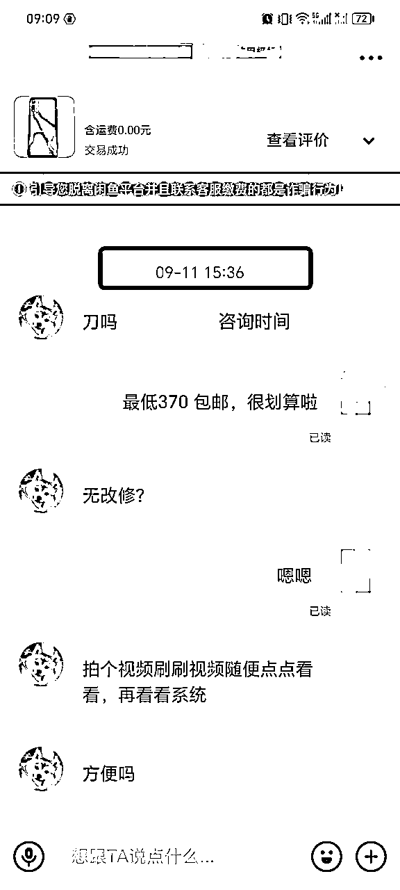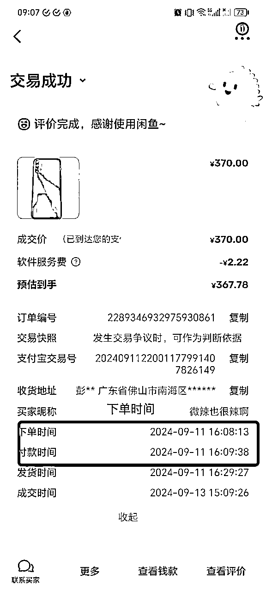

尝到甜头后，我开始卖200到400元价位的手机，因为我觉得二手货嘛，大家肯定都盯着便宜的去。事实也证明了这一点，低价机确实抢手，手慢一点就没了。有一次我在发货群里锁定手机慢了几秒，订单就被其他航海者截胡了。

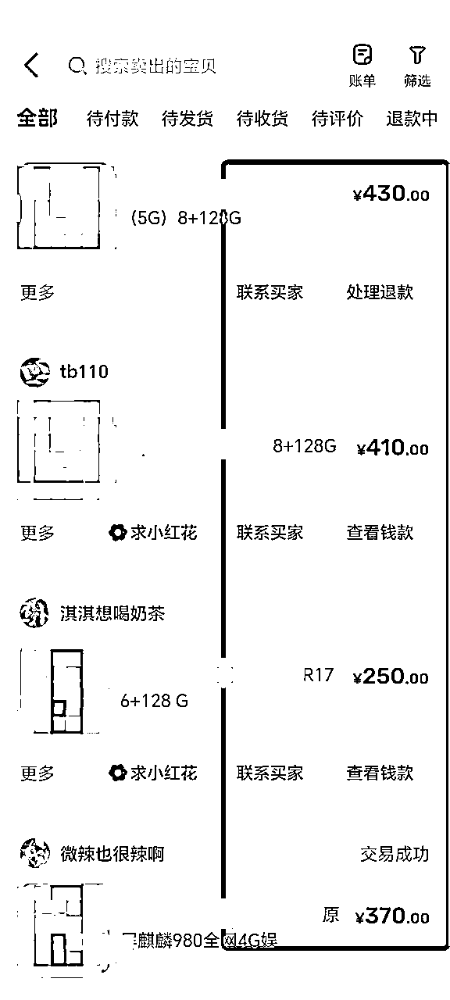

过了两天，平台上的低价机被扫了个精光。这时候我才发现问题：我一直默认“用户买二手就是图便宜，便宜就是200到400价位”，但这个想法其实站不住脚。用户真正想要的，是用划算的价格买到高价值的东西。价格不是唯一标准，价格和价值的匹配程度才是。

后来看到群里有人出800多的手机，我开始琢磨：高价机是不是也有市场？于是试着卖华为mate，反馈意外地好。

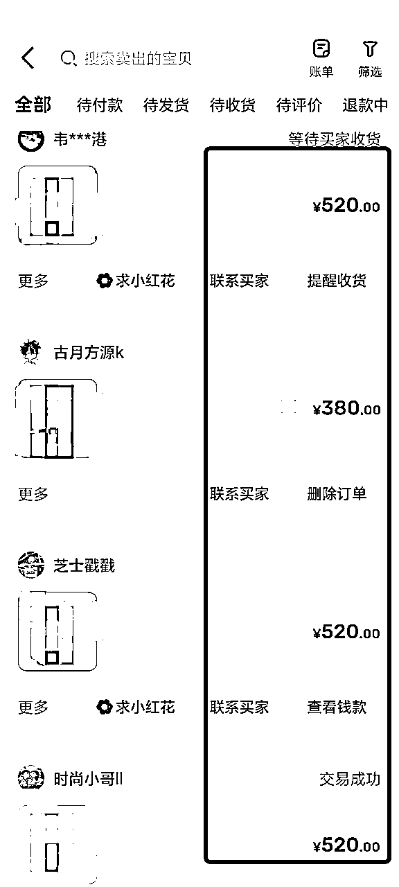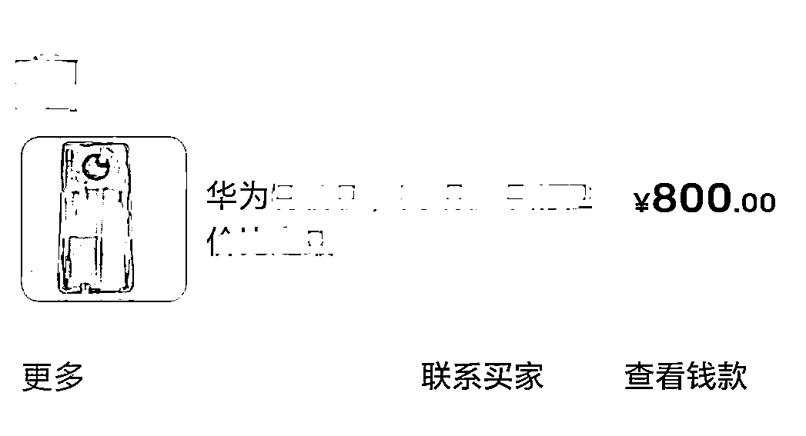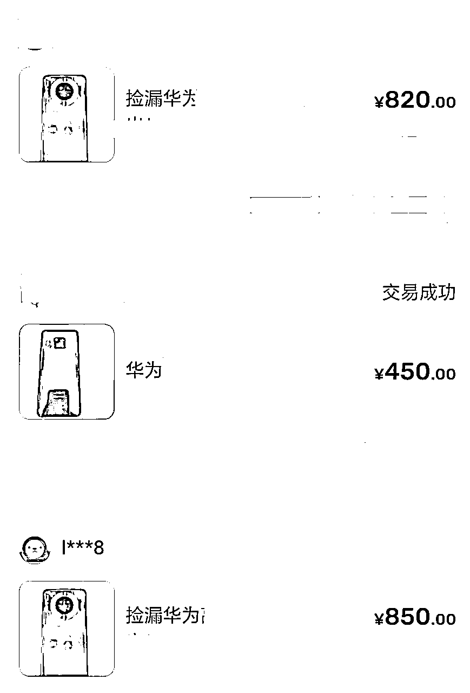

再往后，三星卖1800、OPPO卖5000，也有人毫不犹豫地拍下。原因很简单，这些机器本身就值那个价，价格又合理，性价比摆在明面上。所以说，人特别容易被自己的固定思维框住。当你发现自己只在一条路上打转，就该停下来重新审视，调整一下要素和行动方式。

自己出了一些单之后，也别光搂着自己的成绩。我抬头看了看其他航海者都在卖什么，发现iPad卖得不错，于是也跟着上架iPad，又拿下了两单。

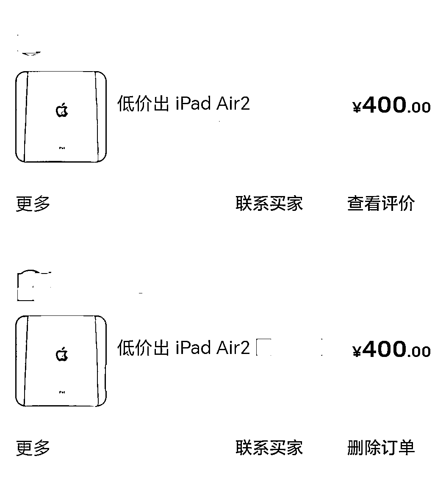

等到卖出5单的时候，我对二手市场已经有了基本的判断：哪些机型需求最旺，大概什么价位能出手。有了这个底，选品就更有针对性，每天盯着上新，看到有潜力的就挂上去。

还有一点：成功过的产品会给人信心，但也会变成束缚。人的需求千奇百怪，小众市场同样值得试。很多人看到某款产品会想“这谁会买啊”，可你不买，不代表别人没需求。我去📕搜iPhone SE和mini，发现真有人专门找。那就挂到闲鱼上试试看，目前还没出单，但敢于跨出边界本身就是收获。

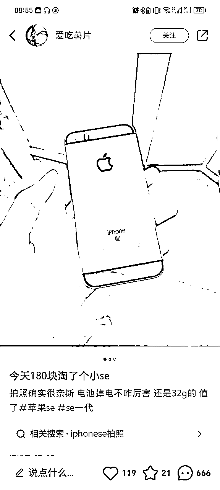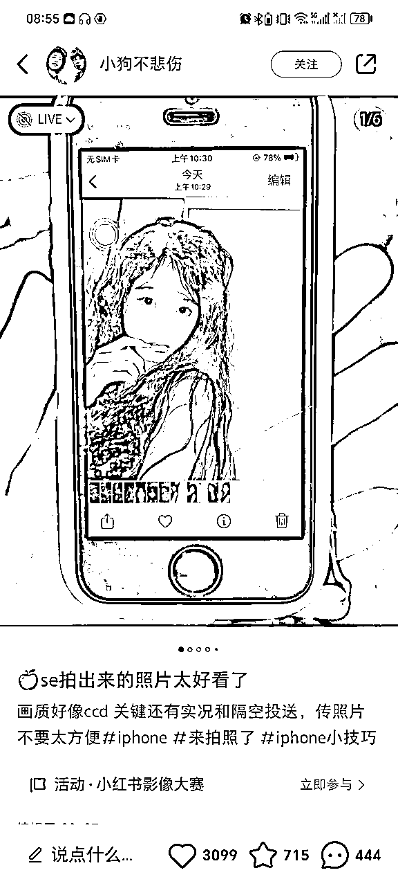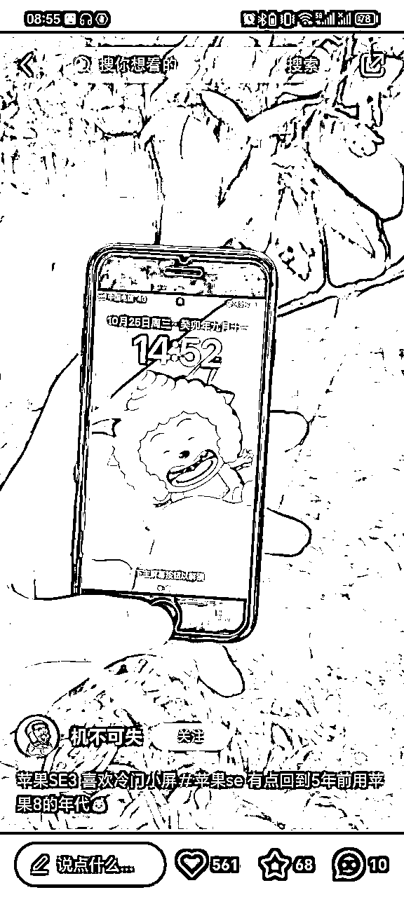

## 二、链接：先让人愿意点进来

用户搜索一个关键词后，屏幕上会出现一长串同行产品。凭什么点你的？这就是竞争。你要回答的是：我比同行好在哪里？

链接的第一眼极度重要，它决定了用户会不会点进来。至于点不点“想要”，则要看他进来后看到的信息完不完整。第一眼比拼的要素大概有五个：首图、关键词文案、定价、想要人数、卖家信用。

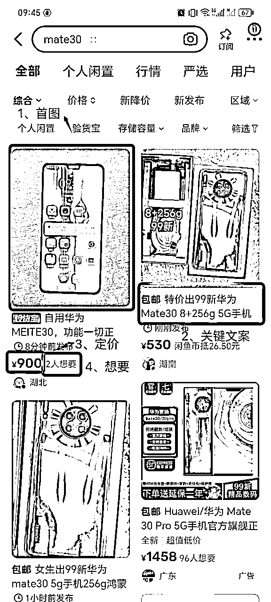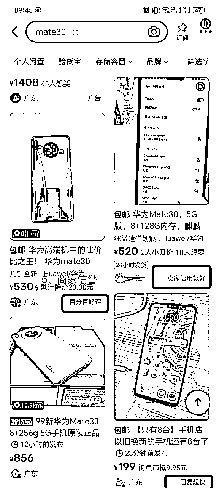

我主要把心思花在首图和文案上，其他的没太管。

首图有个细节：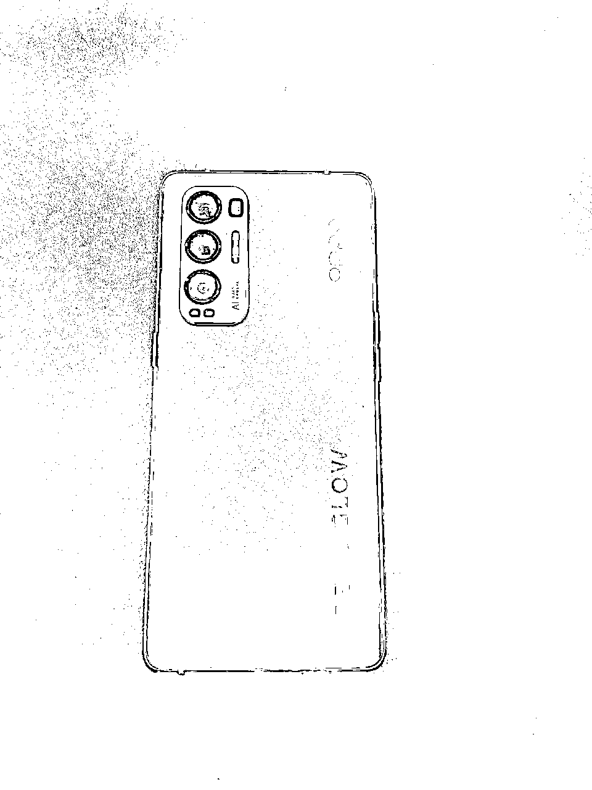 我放的是手机背面。刷到不少和我卖同款的人，首图都习惯用正面亮屏图，我偏偏不。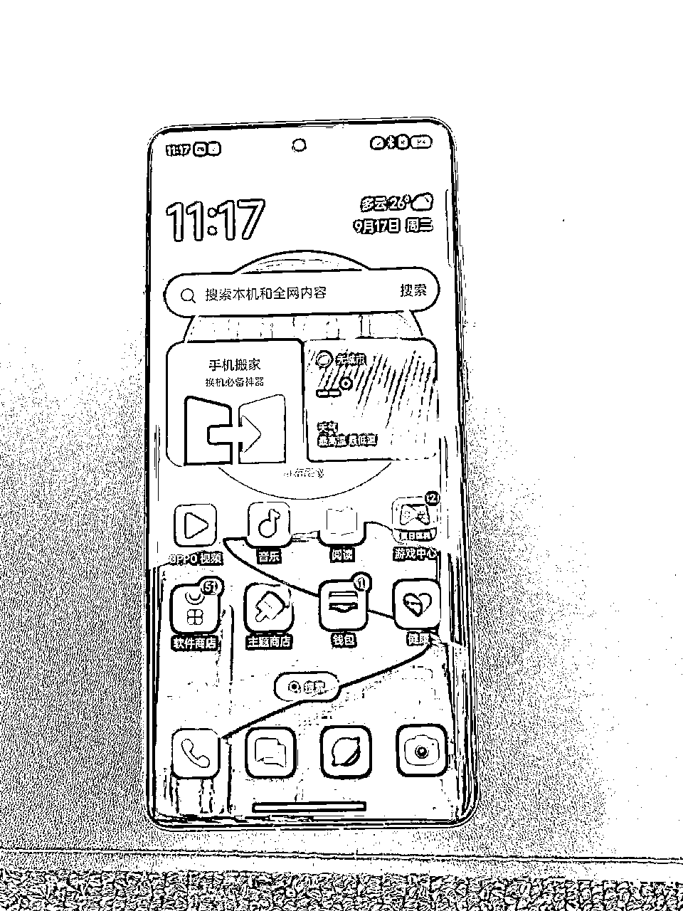 因为背面图才能展示一部手机的颜值，用户看了才有兴趣点进来；正面亮屏图没有任何营销信息，看完不知道你想卖啥，自然也不心动。剩下的配图就是补充信息：第二张放正面亮着配置的图，第三四五张放侧面，第六张放问题图或者其他。我全部用相册原图，不修图。

文案方面，每一部手机我都会专门写一句广告语。比如华为mate，我就写“华为最高端机，超高性价比！”；三星就写“三星万元机皇，2折就能买！”然后再列3个卖点关键词，比如“拍照天花板”“外观超高级”“性价比赛高”“宝石蓝高级”等等。至于其他非核心性能，去原详情页扒一下基本参数罗列上去就行。

定价则要合理：用户能接受，商家有得赚。我的习惯是在代发价基础上加40到70的利润，不算贵，也不会亏本。

## 三、1对1成交：掌握主动权

我给自己画了一张消费者购买决策图，用来判断客户处在哪个阶段。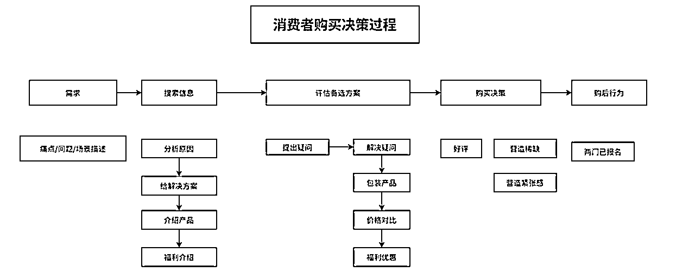

首先，二手机找上门的客户，大多已经是“次精准需求”了——至少知道要买什么品牌。所以我不觉得有必要去挖掘需求，有需求的人才会主动来问，差别只是精准度和意愿度的强弱。除非对方就是看不上你这款，你再问问他的需求和预算，换个款式推荐；或者他想多买几个的时候，你再顺手推荐其他产品。

另外，内容决定了你会吸引什么人群。之前有圈友问我，他做低价引流，怎么挖掘客户需求？其实低价吸引来的大多是只想要优惠、又没做过功课的人，这类人你很难挖出真正需求；要是用真实产品老实挂链接，吸引来的就是精准搜索的人。

如果客户问的是手机本身的问题，说明他在了解阶段，你只需问什么答什么。但如果他问了3到5个问题，还没开始谈价格，也没有表现出很强的购买意愿，那我就会进入意愿确认环节——问他是否诚心想要，想要的话我可以拍个实物视频给他。

对方不回复，说明意愿不够强，这场沟通基本可以结束。要是对方答应了，那购买意愿就挺高。这时候我会把手机卖点、信息、售后服务这些再讲一遍，最后告诉他：直接拍就行，今天就能发货。这个时候如果你谈价格，说明非常有戏。你继续跟他聊，但要让自己占主动权，让他感觉不是你急着卖，而是他急着买。这单基本上就成了。

有人一上来就问价格。我的原则是，价格放到最后一步再谈。因为你需要先弄明白，对方对产品有没有了解、需求是不是明确。如果他对产品完全没概念，谈价格只是浪费时间。

上来就问价的，通常有两种人：一种是真懂行，看完手机就知道值不值，直接进入价格环节；另一种是不懂行，上来就乱砍，单纯想占便宜。不管哪种，我一开始都会拒绝直接谈价。原因很简单：买一台手机需要额外信息才能做决定，光靠链接内容是不够的。第一种人如果真感兴趣，他会继续问更多产品问题，你确认他真想买，再回头商量价格；第二种人被回绝后往往就不说话了，说明需求不强烈，花时间陪聊不划算。

那遇到第一句就问价格的客户，怎么回？我不会正面回答，而是反问他：“手机您看了吗？满意吗？”或者“手机的问题您能接受吗？”用来判断他是真感兴趣、有购买意愿，还是随手瞎问。认真看过手机的，会重复一遍手机的问题跟你确认；不了解但有意愿的，会追问手机有什么问题。聊完之后，价格反而特别好谈，有的客户甚至不再讲价。再要求降价的，也就是稍微让一点点。要是一直不回复，那就不是高意向，不用继续了。

沟通风格也要看人。昨天有个小朋友来买平板，我就用年轻人喜欢的方式聊；今天有个帅哥买手机，人很直接、有点急，但态度真诚，我也就跟着直接、真诚地回应。我自己的本色不会变，对谁都真诚，但说话方式会随对象调整。

千万不要撒谎，撒一个谎就要用无数个谎去补。比如客户问“这是不是你自用的？”你随口说“家人用”，后面就很难再给她推荐别的手机——毕竟自用怎么会有这么多台？等于把自己后续推荐的路堵死了。

和客户的关系也要维护。第一款他没看上，如果你根据他的需求推荐第二款，很可能就成交了。

成交博弈更有意思。有个客户非常想要那台手机，但一直磨价格。降价空间其实还在，但我就是不想降，所以一直拖着。谁被动，谁着急。他既然真心想要，就不会差这20块钱。这时刚好又来了一个人也看中这台手机，我用这种紧迫感催了催对方，最后顺利拿下。

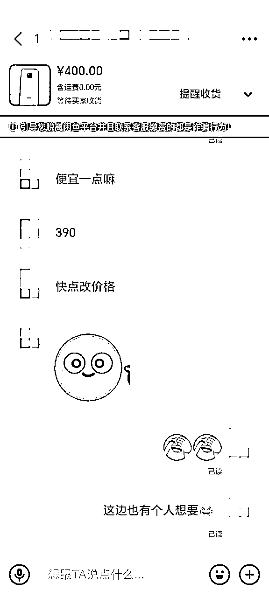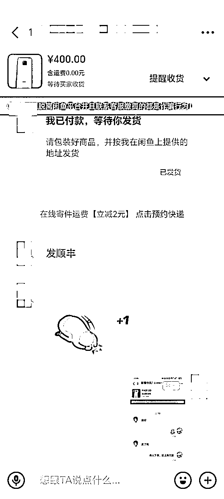

说到底，做成交要把自己的位置放高，势能拉满。不是我求你买，而是你心甘情愿地买，还觉得自己捡了便宜。对方反过来求你，你才有谈判空间。

## 四、发货和退货：给足安全感，也别过度承诺

发货时，先告知用户发货时间和售后保障。物流单号上传后，第一时间发消息给用户。收到货后提醒及时确认收货，有问题马上处理，要退就给退，干脆点。

退货也一样，我态度很直接：不满意就退。但退完我也会反思：是不是我承诺给得太满，把客户预期拉得太高，才导致退货？二手机本身就是不太完美的产品，有磕碰和划痕很正常，客户自然会犹豫。你不能夸大，一夸大，对方拿到货就容易失望退货。而且一旦退货，这一单利润直接清零，前面的沟通时间成本也全白费。作为中介，我确实很难完全掌握货源那边手机的实际成色，所以也难给客户一个特别准确的预期。

改进的方向是：把客户预期稍微降低一点，收货时反而容易有惊喜；不要过度承诺，如果注定要退款，还真不如一开始就别成交，至少不浪费时间不糟心。

## 五、几点认知

第一，我始终把闲鱼定义为个人出闲置的平台，而不是商家卖货的平台。这个定义会直接影响你的态度和做法。个人出闲置，文案极其简单、口语化；商家卖货，就会堆卖点、堆功能。这两码事，底层逻辑完全不同。

第二，我的玩法就是正常售价、实物图、真诚沟通卖货，没有任何骚操作。低价引流、挂虚假产品图这些事，我统统不碰。

第三，我做项目习惯先了解框架和大致流程，然后就上手实操，细节在行动中慢慢完善。当时花10分钟翻了遍手册就直接开干了。读十遍，不如亲手做一遍有感觉，真知都在行动里。

第四，不出手则已，一出手就要拿下。选品是关键，看准了、有成功率了再出手，而不是一口气挂10个大概率卖不掉的产品。

第五，算一算赚钱的性价比。卖二手机一单差价就30到70，你得想清楚自己投入了多少时间。有圈友说自己在做低价引流，靠泛流量变现。我觉得这样后期光沟通就能耗掉大量时间，还不保证有结果。花那么多时间去陪聊，图什么呢？性价比太低了。另外，别为了卖货过分吹嘘，管理好客户预期。预期一旦过高，退货率就上来了；退一单，这一单收入归零，前面的时间全打水漂。所以宁肯说话保守一点，也别太激进，不然得不偿失。

第六，做生意要接受起起落落。今天爆单，明天零业绩，都是正常的。这个过程很磨心态，但也正因为有起伏，日子才有意思。更要扛得住长时间没有正反馈的阶段，每天照常上链接、选品、提升自己。不管天气好坏，日行30公里。

以上是我个人的经验和认知分享，希望对你有点启发。祝大家都能拿到结果！