# 小绿书带货实战复盘：从0冲到92万曝光，我总结了一套可复制的打法

各位圈友，我是凳子哥，目前主力做跨境电商，业务线分两条：一条是实体商品出海，另一条是虚拟服务创收。

所谓实体电商，就是把实物产品挂到海外平台去卖。虚拟电商呢，则是向海外客户输出服务或技能来赚钱——比如帮老外搭个网站、做做国内代购、陪打游戏之类。这类虚拟项目启动门槛低，但生命周期普遍不长，所以我的定位一直没变：它是辅助实体业务壮大的备用引擎，而非主力战线。

国庆期间，生财的许老师给我们指了一个宝贵方向——小绿书图文带货。这篇文章，就是我在这个国庆前后围绕这个项目做的一次完整复盘，重点落在：**小绿书图文带货的供应链与选品逻辑**。

先聊两句供应链是啥。直白说，它就是从产品出厂到用户签收之间那条完整的链路——原料采购、生产加工、物流中转、仓库存储、终端销售……一步不缺。打个比方：你网购了一部手机，它从产线下来，经层层中转最后交到你手上，这条线就是供应链。

落到小绿书项目上，所谓供应链和选品，本质是从全盘视角拆解这套玩法的操作链路。

新手怎么入局？我会分几个层次来拆：

对圈友的价值，我总结为三条：

一是，从零起步到稳定出单的全过程实录，数据透明；
二是，目前小绿书的两条路线拆解——达人分销和自营店铺；
三是，我踩过的坑、攒下的经验，帮你避开弯路。

文章最后也会列出我需要的资源和帮助，期待在途中结识同频的伙伴，欢迎各位指教。

# 14天战绩：0粉起号，92万曝光，337单成交

9月29日，全新账号零粉丝起步。14天后，累计拿到92万+曝光，截图都在后面，不吹不黑。

GMV：9326.25元，超过75%的同类账号；
下单人数：307人，超过85%的同类账号；
成交单数：337单，超过84%的同类账号；
商品点击数：35115次，超过97%的同类账号；
总售出：354件，数字还在往上走；
总下单流水：11238.14元，超过74%的同类账号。

目前数据仍然在爬升阶段。小绿书图文带货这波浪潮，我们会继续押注、继续深耕。

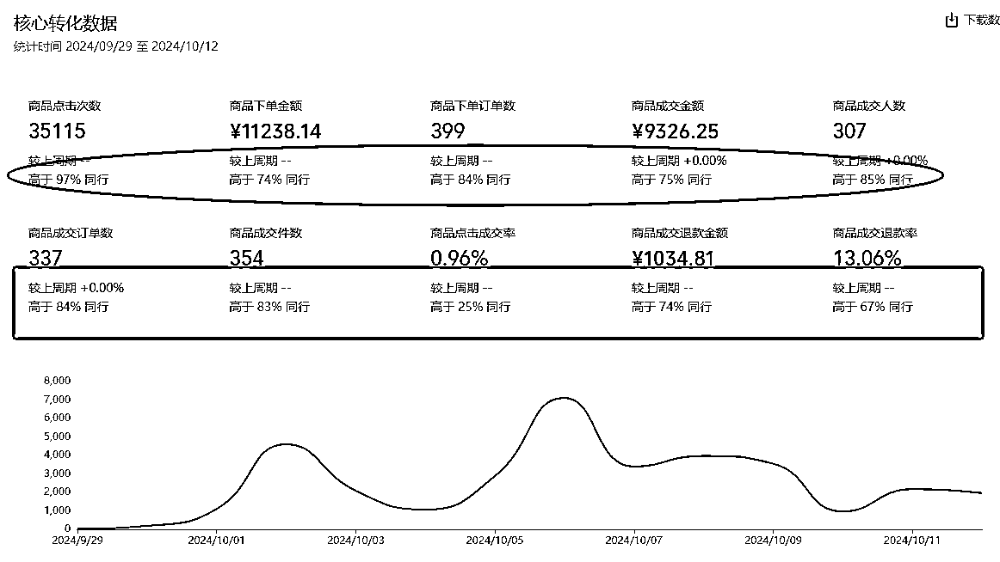

# 一、起步之前：方向握对了，就该谢人

能抓住这次窗口，不是我一个人嗅觉灵，而是有人在前方点灯。

9月25日，生财负责投资孵化的许老师在出差的最后一天，我们争取到一顿饭的见面时间。那天饭桌上，他跟我们提起了小绿书这个机会。没有许老师，我们和这个赛道可能就这么错过了。所以说，圈子的价值、贵人的指引，确实比自己摸黑走路强太多了。

第二位要谢的，是我的投资人张哥。他听完许老师分享后，第一时间就把这个项目提升到了战略高度。坦白讲，战略规划一直是我的弱项，没有张哥在后面推一把，项目推进速度绝对没这么快，我也不可能每天打鸡血一样熬夜干活。

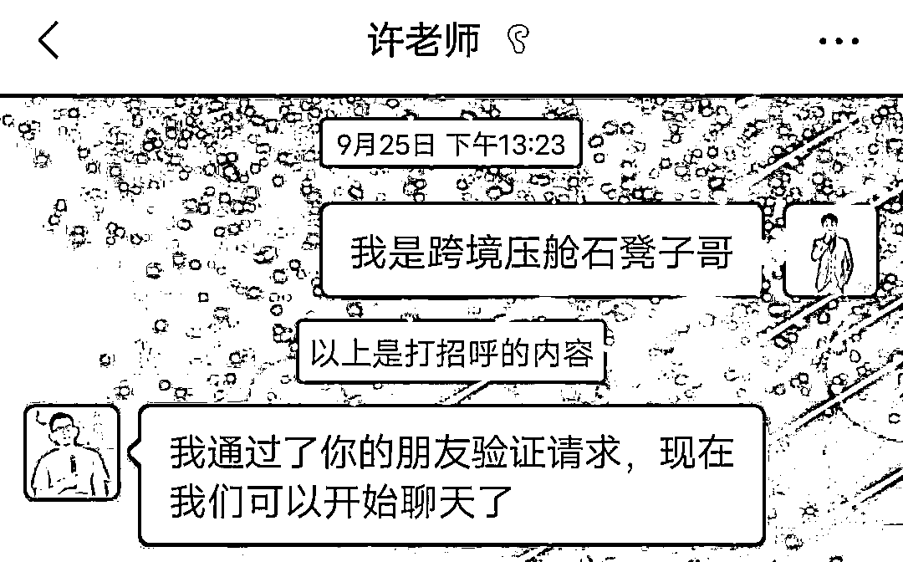

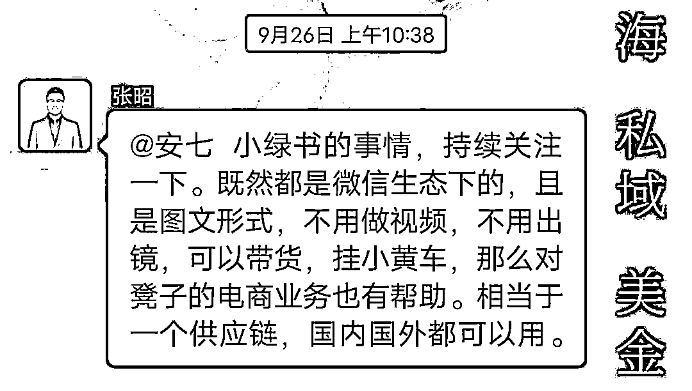

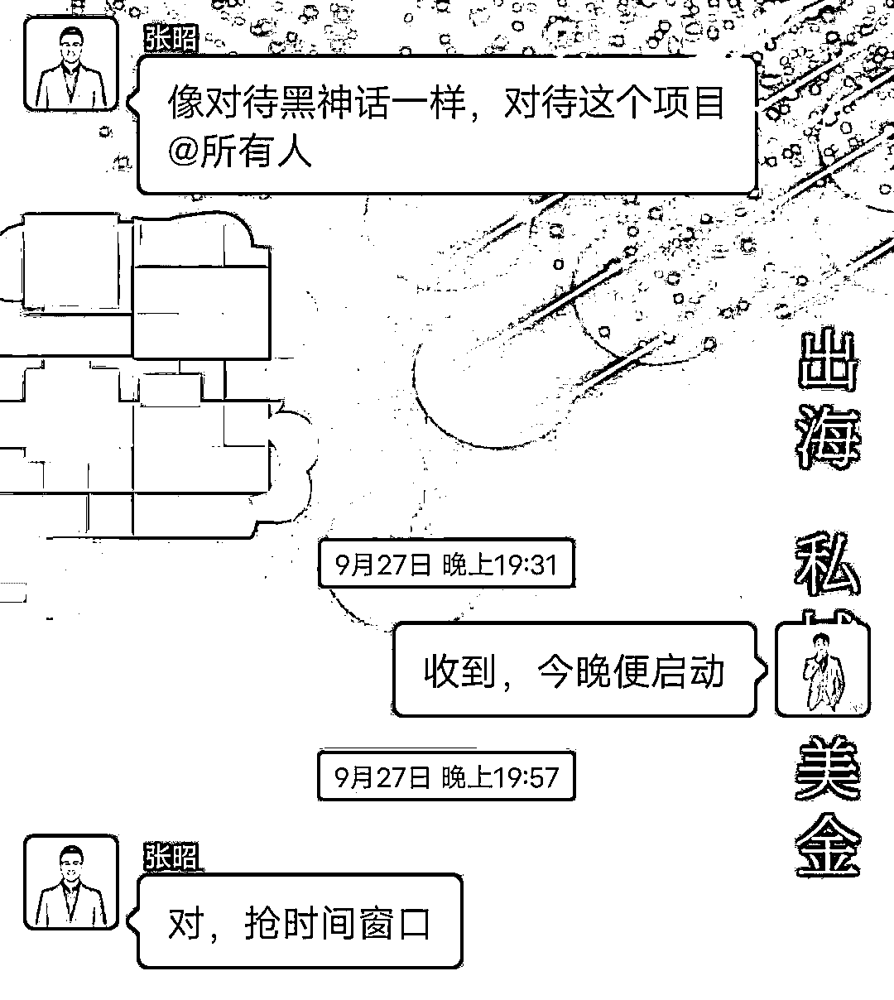

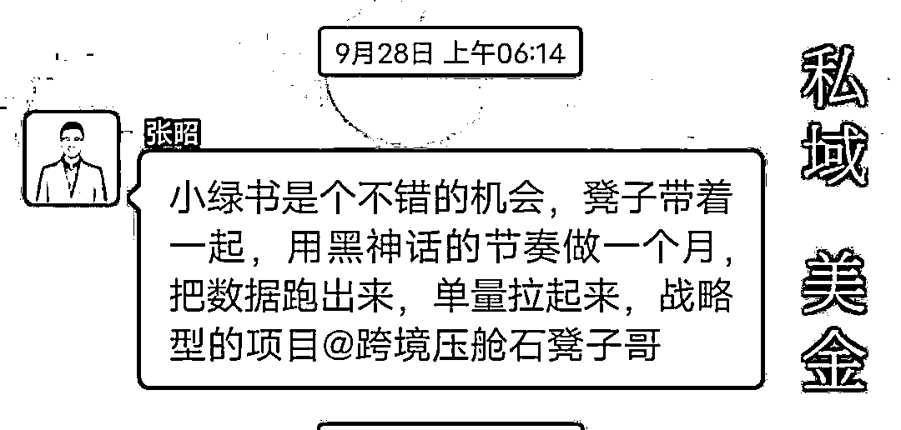

张哥常挂嘴边的一句话：多数人不是遇不到机会，而是识别机会的眼光太弱、重视不够、执行拖沓，好牌给了他照样打烂。

方向一旦定了，就跟知道了要攻哪座城一样。接下来的关键，就是执行力的比拼，是分秒必争的冲锋。

# 二、摸索期：先试水，再大力出奇迹

27号当天，我发了第一篇文章。过了两三天，浏览量涨到3000多，能明显感觉到系统给了一波推荐。

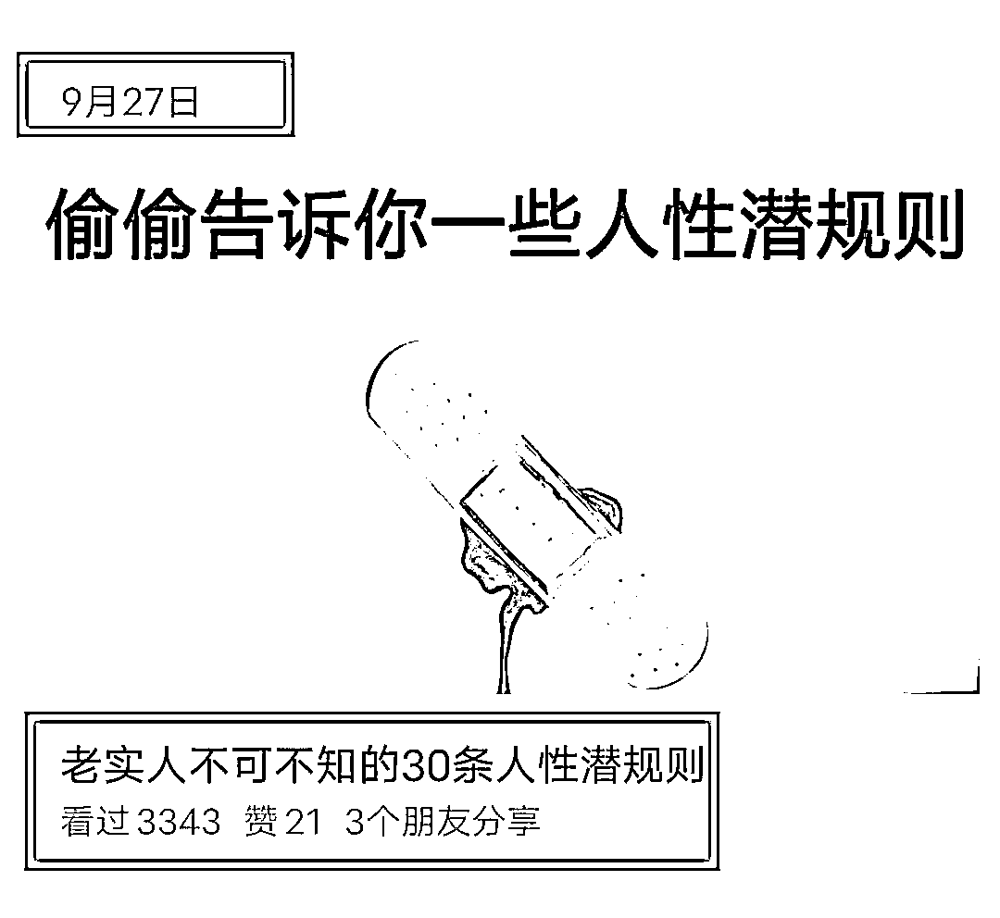

但，一单没出。

28号开始加码，一天至少更新8篇。

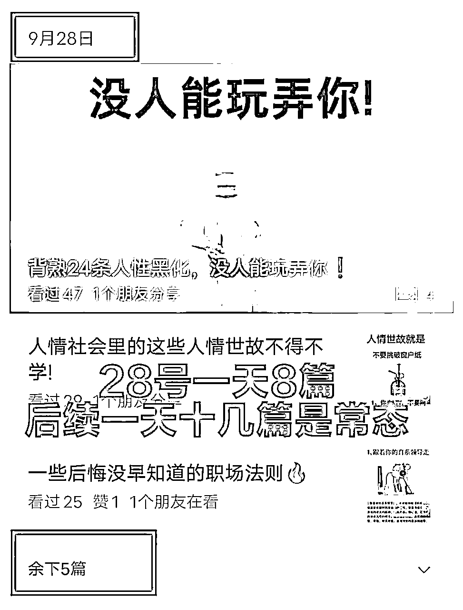

结果，依旧没破零。

那会儿我还只是以达人的身份，从选品中心拿别人的商品来卖。

这期间，一个关键讯息让我立刻调转方向：服务号的流量扶持力度比订阅号大得多。

消息确认的当天，我马上开通了服务号——结果发现，自己一年前就注册好的小店，一直躺在角落里吃灰。

再加上我本来就有跨境电商的底子，厂家资源和选品嗅觉都不缺。

那一刻，所有线索突然串成了一条线：

服务号——自己的货盘——自己的店铺——爆款图文——自营出单——学员跟进——学员分销——继续冲量

从这以后，整套打法和路线算是正式定下来了。

10月7日的店铺后台截图：

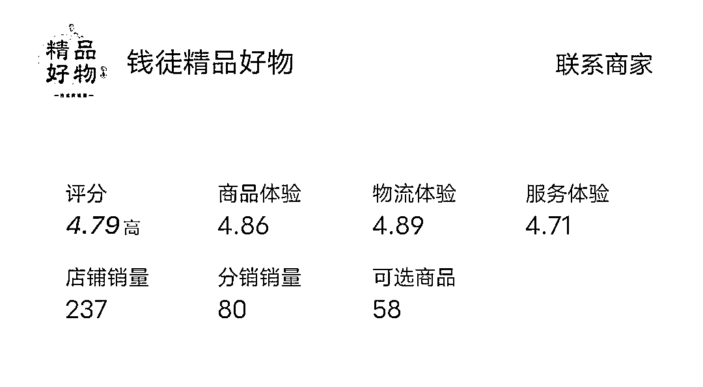

10月13日的店铺后台截图：

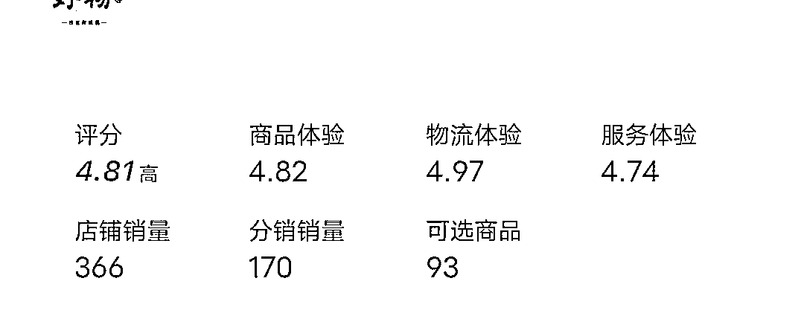

战术明确了，后面的事就剩两个字：执行。

自9月29日发第一篇文章以来，到10月13日这15天里，总共产出图文124篇。

累计跑出92.5万浏览量，其中系统推荐占比98.44%，平均单篇阅读7459次。

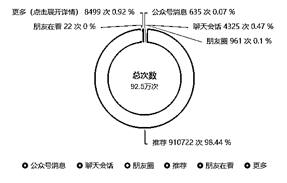

平均每天产出8.26篇。如果把第一天只发1篇和中间卡了一个技术问题停更一天都撇开，实际日均发布量是9.5篇。

每一篇能起来，一方面是团队里爆文教练把关很稳，另一方面是每篇都踩在一个有爆款潜力的产品和选品逻辑上。这样一来，光靠一个账号就把整个大盘的数据撑起来了。

自己亲手跑过项目的朋友，应该懂这句话的分量：

一种人是先看见结果，才愿意相信，甚至看见了还会反复怀疑；另一种人，是哪怕眼前什么都看不见，也会选择毫无保留地相信。

最后拿到结果的，往往是第二种人。

这段时间，我的日常安排就四件事：

1，上架新品
2，筛选爆品
3，输出图文
4，处理发货和退货

跑通零到一以后，团队伙伴能分担掉不少杂事，但这四块我一天都没放手。

原因很简单：首先，项目创始人必须是投入最深的那个人；其次，跟着你干的人，都在看你的状态。

如果我松下来了，或者一直做不出成绩，拿什么让人信服？这个项目从头到尾都不只是我一个人的事，背后站着一群学员和并肩作战的伙伴，他们都盯着我的动作。

大多数人总要看到结果才敢跟上。那我要做的，就是把结果快速砸出来，带着大家打胜仗——这就是最好的说服力。

项目启动没多久，我的第一篇10万+就来了。从那以后，局面彻底打开了。

# 三、发力期：别想太多，干就完了

9月30日当天，我连发14篇，其中两篇直接打爆——一篇10万+，一篇4万+。现在，前者已经逼近40万阅读。

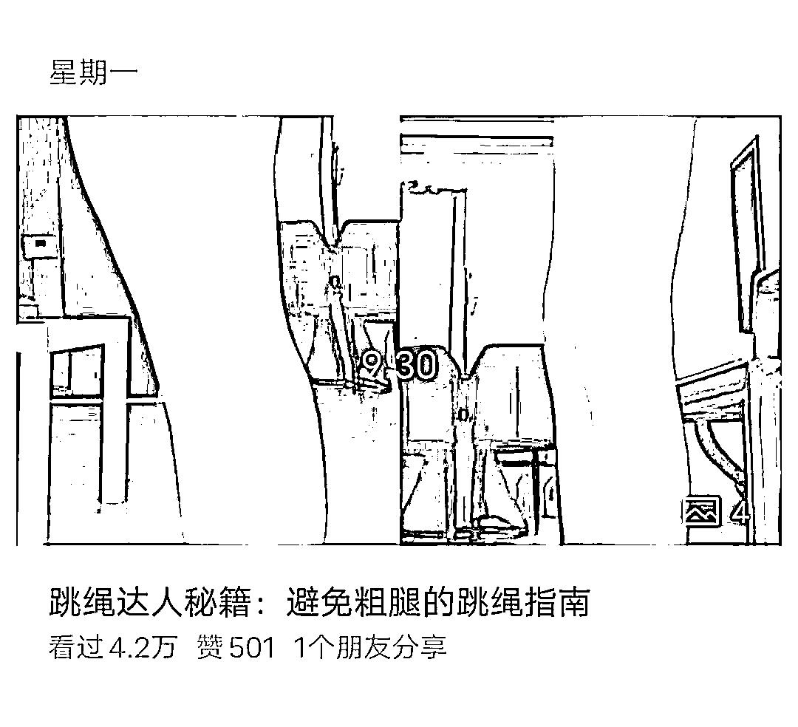

9月30日这个时间点，藏着一个小绿书新手很容易忽略的一个致命细节：

这是9月最后一个工作日。一过这天，就是整整一个国庆长假。

什么意思呢？如果没赶在这之前把服务号之类需要人工审核的资料全部办妥，后面就只能干瞪眼。

我们之所以走运，纯粹是因为行动够快——假期前就把号批下来了，后端的配套和技术支持也全部就位。

而有人国庆3号才提交服务号注册，直到7号还没通过审核，只能苦等工作日。

所有成事的条件都备齐后，剩下的就是持续输出、持续放大。

回头再看我们定下的打法：

服务号——自己的货盘——自己的店铺——爆款图文——自营出单——学员跟抄——学员分销——继续冲量。

到这一步，自营出单这个阶段性目标已经实现了。接下来要做的，是拉动更多学员入场，让大家赚到钱，把整体势能做上去。

# 四、上升期：跟着抄，也能赚到钱

这一节，重点聊聊学员们的出单情况。

很多人做项目时都会卡在一个怪圈里：我不喜欢的品类就不想带；我觉得不会爆的文章就不发；我觉得不顺眼的标题就不用。

结果就是，陷入“自我感觉”的陷阱，把效率和结果都拖垮了。

我提供给合作伙伴的跟做方案，已经简化到不能再简化：

第一步，拿我的图片；
第二步，用我的标题；
第三步，用我给的AI指令微调一下内容。

整套下来，三分钟搞定一篇。我还专门开过腾讯会议，教大家如何批量采集图片、高效率复用指令，学完马上就能用。

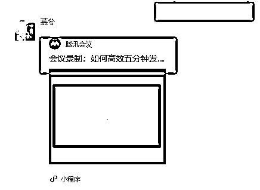

为此我建了一个专属打卡星球，报名人数24位。

每天发了多少篇，直接往星球里一扔就行。

## 1，达人侧复盘

打开后台的达人分销板块，数据是这样的：

累计35人出单，卖出28个不同的商品，总GMV 4344.57元。我给达人的佣金比例设置在30%到55%以上。

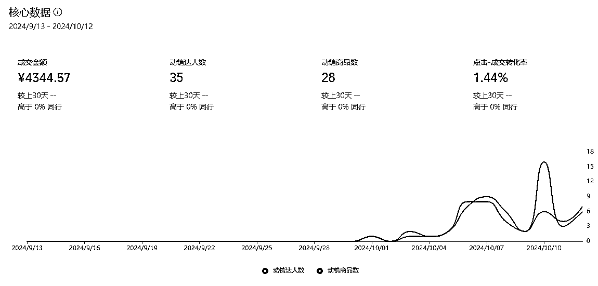

表现最好的那位达人，是跟发我那条跳绳爆款，同样跑出10万+，出了52单。

后台显示爆单日期是10月6日，意味着他大约10月4到5日才开始发——两三天时间，就做出了这个成绩。

他带的是55%高佣链接，跟发我的爆文，直接变现874.5元。不出意外他就是本期单王，额外还有红包奖励，两三天总收入突破1000+。

其他伙伴虽然没有那么猛的爆发，但正反馈都在路上。整体出单率约50%，后续随着假期结束、订阅号流量加速释放，这个比例还有上升空间。

关键的是，小绿书这个项目不需要额外投入，也不用承担囤货压资金的风险。达人入局只需要缴100元橱窗保证金；一旦跑出爆文，少则几百，多则上千。

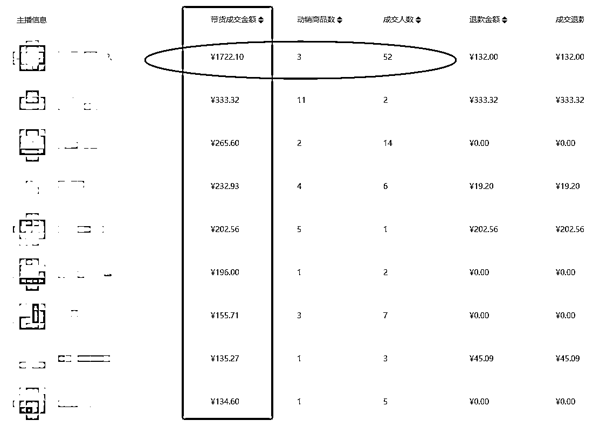

张哥的判断很精辟：要选就选那种下行风险有限、上行收益不封顶的项目。小绿书恰好符合。

## 2，大盘数据复盘

整个国庆周期内，店铺累计上架93个商品，卖出366单。其中两个跳绳款卖得最好，分别卖出121单和55单，全店共出掉35个不同品类。

现在到选品中心搜“成人款两用跳绳”，第二名就是我们的链接，评分上我们已经压过竞品。

这个位置带来的好处是，更多场外达人会主动来加我们的商品做分销，进而滚起复利——越滚越大。

这一点，后续我会专门展开聊聊达人分销和自营店铺的具体玩法。

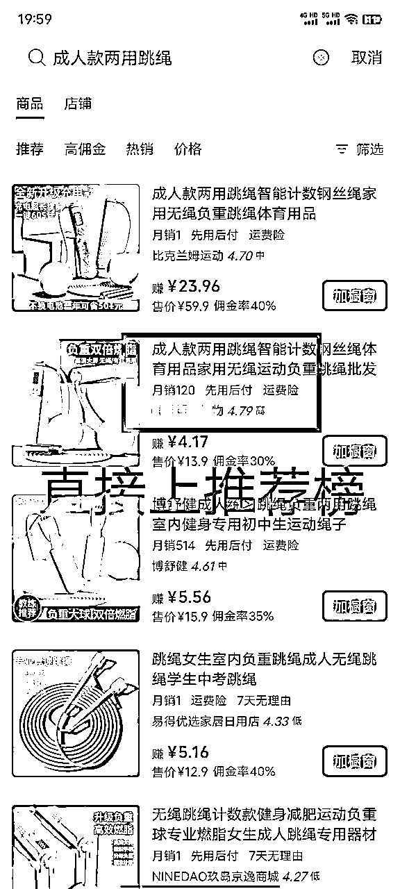

# 五、目前小绿书的两种主流玩法

现阶段玩小绿书，核心就两种路子：

## 1，达人分销

走达人分销，入场动作非常简单：开通视频号橱窗，缴100元保证金，就可以开始发图文了。

只要文章爆掉，订单就会跟着来；卖得越多，赚得自然越多。

优势在哪：投入极小、适合批量起号、操作流程短、门槛极低，配上自动化工具后产能可以拉得很高。

短板也很明显：货不是自己的，接触不了上游厂家，只能在选品中心挑，对整个商业链条的掌控偏浅。

避坑提醒：选品的时候，务必确认这家店是否发货及时。我们之前有个朋友踩过坑——文章爆了，出了几十单，结果商家一大半没发货，用户集中退款，损失相当难受。

后来才打听到，是商家国庆放假，根本不发货。这种情况下，达人基本没有话语权。如果是自己的店，至少还可以切换货源、换个厂家顶上。

这里顺便解释一下，为什么说自建小店本质上就是在搭自己的供应链——

有了店铺之后，选品、上架、谈物流、对接厂家货盘、搞定销售……这一整套动作都得亲自上手，远不是发条图文那么简单。

所以后文我会反复强调：自建小店，实际就是一条自我沉淀供应链的路——销量越大，和快递谈运费的空间就越大，和厂家谈拿货价的底气也越足，优势就这样滚出来了。

## 2，自建小店（搭建供应链）

如果有意自建小店，下面这些基础项要提前备齐：

#### 1）公司执照或个体户资质，年费500~600元
#### 2）开通服务号，年费300元
#### 3）开通商家后台

不同品类的保证金要求不一样，大致5000~10000元，基本可以覆盖大部分类目。

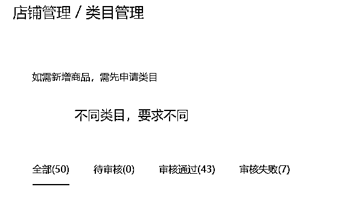

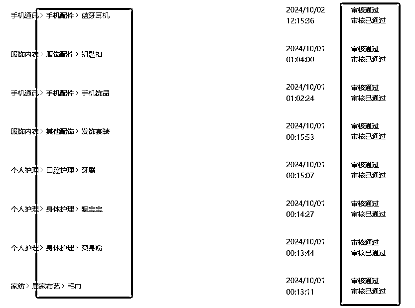

#### 4）确定货源模式：自发货，还是一键代发？

自发货的话，要到后台绑定快递电子面单合作商，个人推荐中通和极兔，最好再开一个顺丰备用。

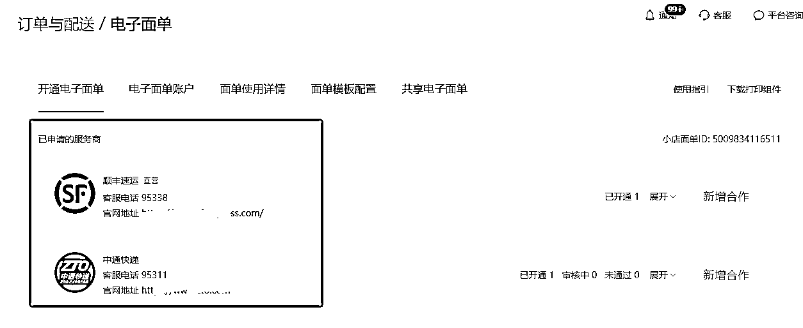

#### 5）如果做一件代发：

需要置办店管家这类工具，充值几个会员，整体月成本大概50元。

#### 6）准备一笔周转货款

达人分销可以零成本启动，但自己开店，每出一单都要压资金。

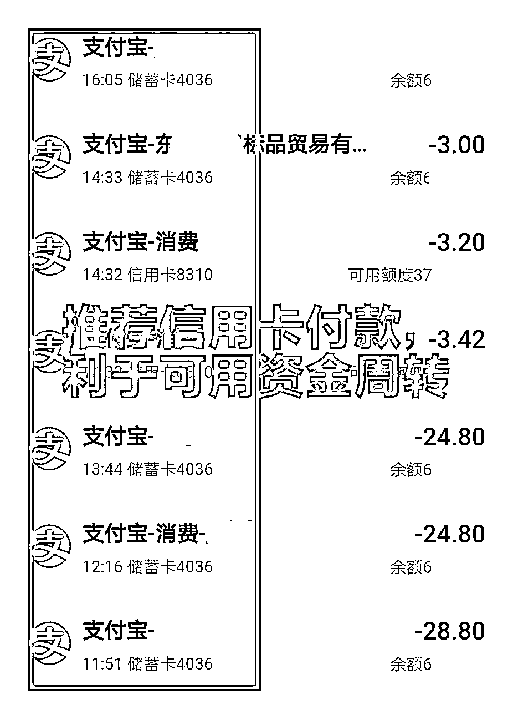

#### 7）这套流程完整走一遍，你基本就门儿清了

如果本身就有营业执照、货源渠道、快递对接等积累，这套流程一天内全部搞定不是问题。

前面这些条件都备齐之后，咱再来说说自建小店有多爽：

（做自建小店的过程，就是搭建自己供应链的过程）

1，你可以自由上架自己看好的潜力品
2，定价权完全握在自己手里
3，分销佣金比例随你设定
4，借此能接触到大量厂家，持续扩充供应链资源
5，能和真实买家直接对话，第一时间听到用户声音
6，对产品的理解会越来越深，反过来让爆文能力更强
7，可以逐步搭建私域池，为长期转化蓄水

当然，需要面对的东西也不少：退货退款、持续上新、流量焦虑、各类资质合规……这些都是新手必须迈过的坎。

如果你在达人分销和自建小店之间摇摆，我给的建议是：没有标准答案，一条路简单，一条路进阶，选哪个都不算错。

选定身份后，真正要做的事回归同一件：产出爆款内容。

有流量、有曝光，才有销量。所以与其纠结选哪条路，不如先动起来——先做达人，再做小店，完全来得及。这不是非此即彼的单选题，重要的是你迈出第一步。

# 六、经验与技巧指南

## A，达人分销的心得

### 1，没流量怎么办？

这是绝大多数玩家都会撞上的墙：每天勤勤恳恳发内容，数据却像一潭死水，心态很容易崩，甚至开始怀疑自己做的事情有没有意义。

很多人坚持了几周看不到起色，就彻底放弃了。

但我得说，没流量才是常态。普通人能做的只有一件事：拼命堆量。

一天1篇等于没发，日更10篇是及格线，日更20到30篇、并且确保每篇都带有爆款基因的人，才是真正的狠人，他不出结果谁出结果？

### 2，选品选得好，结果差不了

选品这事要拆成两面看：第一是选有实用性和差异化亮点的货，这样的品做内容才容易爆，爆了才有单；第二是选货源背后的商家，商家不靠谱，前面的努力全部白费。

微信小店虽然内置了选品中心，但不代表什么品都能随便上架。

比如有人带货出了单，结果商家迟迟不发货，最后超时系统自动退款，白忙活一场。所以，后端商家的靠谱程度，直接决定了你的收入能不能落袋。

### 3，对标爆款，抄是最快的路

我见过太多人连抄作业都抄不对。明明对标了一个爆款标题，改了两笔之后，就变得干瘪无味，用户根本不想点进去。

这种操作对结果影响极大——不出单才是正常的。

这个时候，最聪明的做法就是基本不动标题，或者顶多微调几个字，把精力花在正文的优化和改动上就好。小绿书现阶段对原创度的要求并没有那么苛刻。

## B，自营小店的经验

### 1，0元保证金试运营

如果选择自建小店，目前视频号官方有一个新店福利：申请开通0元保证金试运营。不用缴保证金，就能上架商品开卖。

不过，试运营期间的钱不能提现，且最多只能卖200单。想要解除限制，还是得把保证金补齐。

### 2，爆文=爆单，没有第二条路

小绿书的核心逻辑一句话：内容爆了，单子就来了。只要价格不离谱，订单基本都会跟上。

要是价格再有点竞争力，那离爆单就不远了。所以认真研究爆文很有必要——平时多留意高流量内容的共性，网感是慢慢养出来的。

另外，在上品时多花些心思做出差异化。比如我卖衣架，就不卖普通款，专门卖多功能衣架。

这样一来，做图文的时候素材吸引力更强，曝光和转化的概率自然更高。

微信小店目前不是上了架就能自动出单——它需要引流，靠曝光成交。过去靠直播和短视频，而现在小绿书图文，已经大幅降低了参与门槛。

### 3，佣金比例拉满

自营小店一个非常大的红利，就是定价权和佣金比例的支配权都在你手上。

加入优选联盟后，别人在选品中心就能搜到你的商品和店铺。如果你的基础销量数据好看、佣金比例给得也不低，外部达人就会主动把你的品加进橱窗去卖，顺带把你的销量推向更高。

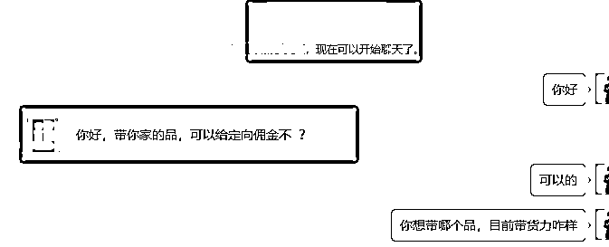

# 七、写在最后

## 1，玩法逻辑的归纳

把整套链路摸透之后你会发现：图可以用AI改，文可以用AI写，商品链接要么挂别人的，要么挂自己的——说到底，小绿书就是一门这么简单却高效的生意。

## 2，资源与价值沉淀

### 1）对小绿书存量玩家的

如果你已经在运营小绿书，却只是卡在选品中心做带货，还没有成型的后端供应链，那我们可以好好聊一聊合作的可能性。

先说说我现在能给到什么。

第一是选品能力。好品本身就是流量发动机，一款真正合适的货能自带复购、能持续推爆，文章滚动起来会越来越顺。

第二是佣金空间。我是可以自主议价、设置专属佣金的，有些货源我自己拿来卖自有1到3倍的利润差，我们完全可以联动出货，我这边给你开专属佣金比例。

### 给厂家的一些思路

客观讲，小绿书对厂家并不总是友好。商品上架了没曝光就等于没销量。所以跟达人合作分销，比单打独斗更现实。

我身边就有不少做这个路线的朋友，用视频号发内容、开播挂链，成交后直接和厂家结算，模式很通畅。

给厂家一个额外建议：在自己尝试自营的同时，尽量去拓展做一件代发的商家资源。让这些商家把你的货上到自家小店里去卖，优选联盟里的商家联系方式都是公开的，可以主动发起合作。

这条建议对三方都适用。达人可以争取更高佣金，商家可以拿到更多好货，厂家则能获得一批稳定的KOL分销渠道。

### 如果你还没入场

前面也讲过，小绿书的玩法很简单：图文+怼脸开拍，靠概率出爆款就能起量。

如果你想找个低成本的副业试试水，我觉得完全可以先动起来，几乎零投入。刷3分钟短视频的时间，不如花在写一篇小绿书上，说不定就是你的第一篇爆款。

不过一旦开始，就请认真坚持下去。三天打鱼两天晒网，最后一定一事无成。哪怕每天都在努力，也不是人人都能出结果，成功需要努力，更需要运气和概率。

好在有圈友同行，这条路不会孤单。无论何时，身边都有同频的人在路上。

## 我现在重点在找什么资源

### 1）能提供稳定后端服务的靠谱厂家货盘

只要产品有差异化、有特色，我们就能把它做大做透。

### 2）能一起分销的同频伙伴

市场蛋糕够大，但分的人越来越多。团结就是力量，人多才能把盘子做大一起赚钱。

今天的复盘就分享到这里啦。关于小绿书的任何问题，欢迎直接在评论区留言，我看到会回复。

风口还在，节奏也还在，我们会持续发力。保持执行力，相信每位圈友都能拿到自己想要的结果，和大家一起生财有术！