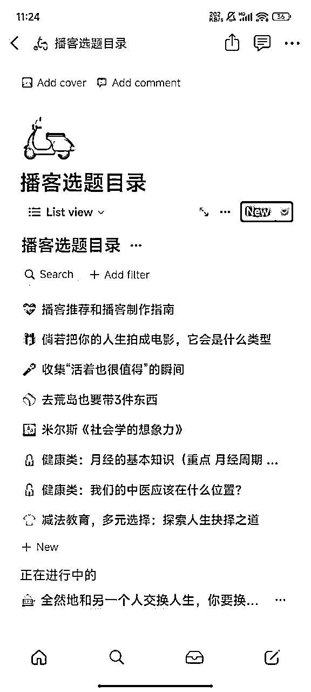
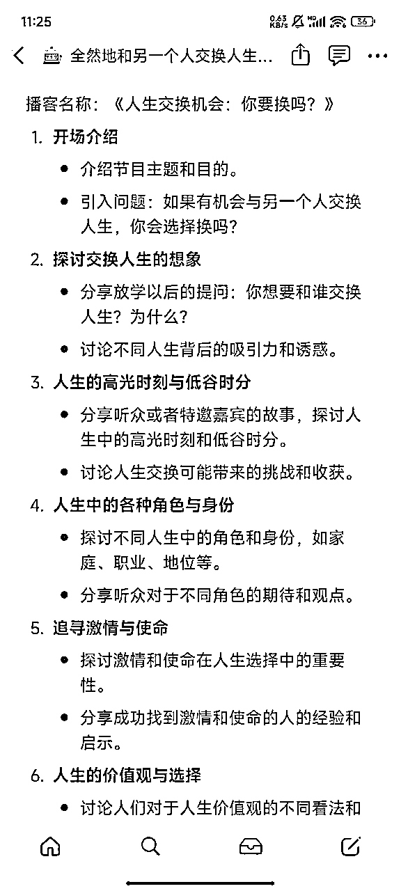
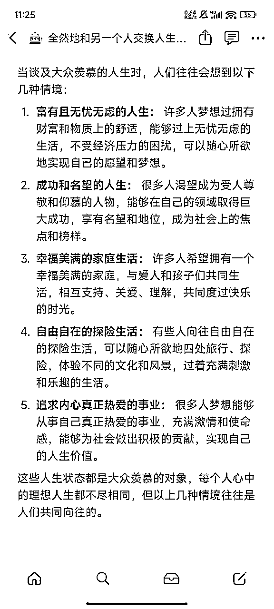
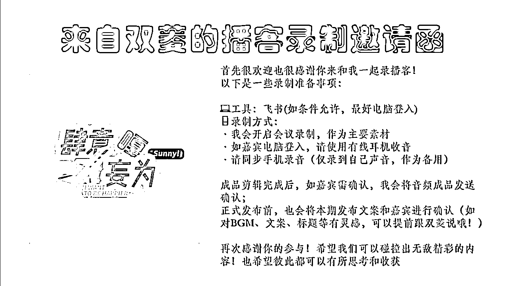
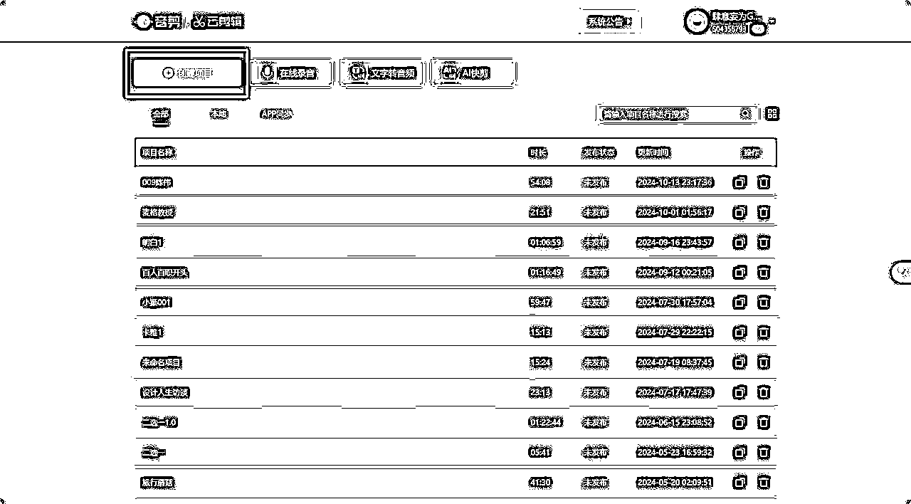
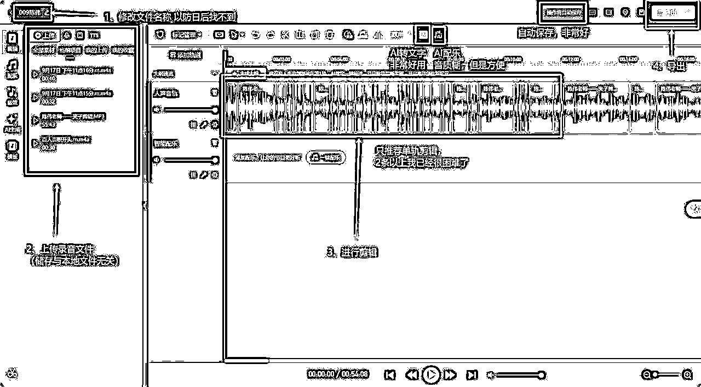
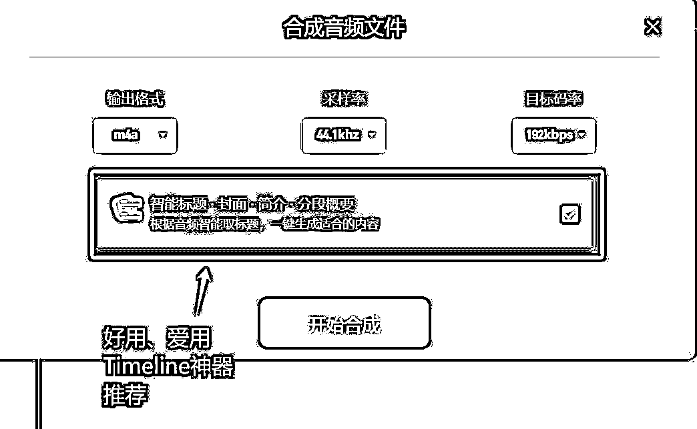
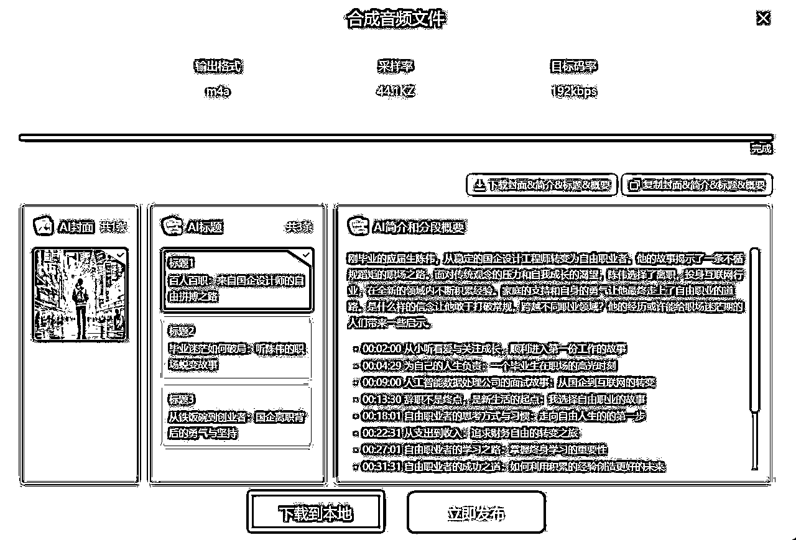

# 从零开始做播客：一份攒了很久的真实经验，帮你少走弯路

最近不少朋友在后台问我怎么做播客，今天终于挤出时间，把这几个月摸索出来的经验整理成了一份干货。不敢说面面俱到，但每一条都是自己踩过坑之后换来的，希望能帮正准备入坑的你扫掉一些障碍。

有一点想先说的是：别被网上眼花缭乱的教程吓住，选项太多反而让人迟迟迈不开第一步。记住，路是走出来的，不是想出来的，动起来比什么都强。

下面我会按照“一期播客从无到有”的时间线，把从选题、邀约嘉宾，到录音、剪辑、上线的全过程拆开来讲。

## 第一步：先搞清楚你想做哪种节目

根据我的观察，市面上的播客大概可以分成两类：

- 主题讨论型：比如《放学以后》《来都来了》《自习室》，几位主播围绕一个话题聊。
- 嘉宾访谈型：比如《搞钱学姐》《岩中花述》，每期邀请不同的嘉宾来讲自己的故事。

坦白说，我个人更喜欢前者，但这类节目对主播本人的知识储备和语言输出能力要求极高——聊得好是思想碰撞，聊不好就是大型尬聊现场。如果你是新手，我更建议从嘉宾访谈入手。找到一位优秀的嘉宾，他/她就能帮你扛起大半的内容输出压力。

这里分享一组比较理想的数据（来自雪姨的分享）：一期合格的访谈节目，嘉宾发言占70%，主持人占30%就够了。

## 选题那点事：不同节目类型，思路完全不同

### 主题讨论型：大纲就是你的命

1. **主题必须明确**。一档节目如果没有清晰的核心主题，聊着聊着就散成一盘沙。不是说闲谈不行，但如果你的目标是上小宇宙的榜单，听友们还是希望能听到有收获的内容。
2. **选题从哪里来？**
   - 热点事件：看到社会新闻有感触，记下来。
   - 其他播客：听到别人聊了个好话题，可以借鉴思路。有一些节目（比如《放学以后》）会定期向听友征集选题，这些选题是公开可用的，我上新人榜的那期就是从他们的征稿里找到的灵感。
   - 生活感悟或读书笔记：随时记录，慢慢积累成自己的选题库。

顺便给想冲榜的朋友一个参考数据：我上一期上榜的节目，上榜前单日播放量只有45，完播率约40%。同数据量的其他节目没上榜，所以我推测是主题占了决定性因素。上榜当天带来了194的播放量，后来友台冲上最热榜前三，又给我们带了一波很大的流量——这么看，首页推荐位才是真正的流量入口。

关于选题库，我强烈建议你建一个，用Notion或者其他笔记软件都行。平时听到有趣的播客、看到好的征稿启事，都扔进去。重点来了：把选题整理入库的时候，顺手把大纲也写了。这样以后约人录节目，直接把大纲发过去，对方一看就懂，沟通成本瞬间降低一大截，省去来回确认的麻烦。

### 嘉宾访谈型：先把人搞定

**1. 嘉宾从哪来？**

线上渠道：听友群、同好群、播客主播群，都可以。大胆私信你喜欢的博主，粉丝量1万左右的博主接受邀约的概率比较大。线下渠道：面对面邀约的成功率最高。我们当时是在杭州线下的课程活动上，一口气约到了好几位老师，效率非常高。

**2. 怎么邀请？**

- 先定采访主题，再根据主题定嘉宾。比如我想聊“毕业三年职场经历”，那嘉宾就得有职场故事可聊。
- 正式录制前，最好开个半小时的线上会议对一下提纲。
- 给嘉宾发邀请时，一定要把选题、大纲甚至是时间安排写清楚。

这里特别推荐一个“听友征稿”环节：在节目里发起音频征集，让听友投稿分享自己的故事。官方喜欢，听友也有“上电视”的参与感，一举两得。

**3. 选嘉宾的标准**

- 找刚辞职或正处于迷茫期的人，他们的真实经历能引发共鸣。
- 邀请在校大学生，提供对未来期待与焦虑的视角。
- 刚毕业的职场新人也很有价值，他们的转变过程既真实又接地气。

如果想采访到平时很难见到的大咖，不妨先找到共同的朋友引荐，能增加不少成功率。当然，最关键的一点永远是：嘉宾本人愿意分享。

**4. 录制地点怎么选？**

优先考虑嘉宾的舒适度。比如当时我们有两个选择——办公室（设备更好）或明白老师家（环境熟悉），我选了后者。人在熟悉的环境里会更放松，状态明显不同。另外，上门拜访带个20块钱的小礼物，效果出奇得好。你会明显感觉到，嘉宾收到礼物后语气都变得轻快了几分，戒备感一下子就放下了。

**5. 提纲怎么做？**

- 访谈类：建议做一个“嘉宾时间线”——提前把对方写过的文章、做过的采访都看一遍，整理出人生经历的时间轴，聊起来才不会断片。
- 主题类：用“总—分—总”结构就很好用，也可以用ChatGPT辅助生成初稿。
- 如果节目有赞助或活动信息，一定要写进大纲里，不然录制时真的会忘。

## 录制：说一万遍都不嫌多的三件事

### 第一，备份！备份！备份！

- 线下录：至少两个设备同时录。
- 线上录：会议录屏+自己本地设备录制，双保险。
- 文件传输：推荐飞书或钉钉，微信传文件会过期，千万别用。
- 本地储存：放在D盘或E盘，别放C盘。
- 另外一个小知识：一期1小时的最高质量音频，内存大概只要10MB左右，实在没借口不备份了吧？

### 第二，注意收音细节

手机录音的话，离嘴15-20厘米左右最为理想。正式录制前先试录一段，听听效果再开工。

### 第三，氛围管理

- 时刻关注嘉宾的状态和情绪，让对方感到放松。
- 话题跑偏时，主播要及时拉回来。
- 线上录制时记得开视频，关着视频容易抢话。
- 多设备录制时会有一个问题：会议导出声音质量不平衡。通常导入方音质好、对方音质差，为了保证双方音质接近，最好让对方也用自己的设备录一份，不过这样后期剪辑难度会大不少。

## 剪辑：找到最顺手的工具

市面上剪辑工具很多，专业的有Audacity，雪姨团队用的是剪映，但我目前最推荐的是喜马拉雅的线上剪辑。

原因有三：不太吃电脑配置、自动保存不怕丢、支持音频转文字直接剪。最关键的是它能把3轨音频同时处理，转成文字后直接在文字上剪切，粗剪效率极高——真的，用过的都说香。

进入喜马拉雅创作中心后，跟着的Cue流程操作即可。

再分享几个剪辑实操小技巧：

1. **录完尽快剪**。趁热打铁，这时候对记忆最鲜明，效率最高。
2. **剪文字时注意气口和电流音**。文字剪辑容易把句子的呼吸间隙剪掉，导致听着很突兀。解决方法是剪的时候稍微留一点余量，处理不好就还原重来。
3. **和主播朋友接力剪**。6点录完，两个人同一台电脑轮流剪，9点基本能搞定。对专注力有限的人（比如我）来说，这是救命的操作。
4. **不要太抠细节**，会累死。先粗剪，再精修，抓大放小。

## 上线：平台选择与发布

我的做法比较简单：小宇宙为主，同时它会自动托管到苹果播客和QQ音乐，省了我手动同步的功夫。

其他可以选择的平台包括：国内有喜马拉雅、荔枝FM、网易云、豆瓣、微博（对，它也有播客）；国外有Spotify、Substack（强烈推荐，公众号内容可以直接搬过来用）。不同平台内容各有偏好，但“一鱼多吃”总归不亏。

之前用过海外RSS托管来自动同步，但他们限制shownotes字数，对话痨太不友好了，所以我现在的做法是手动同步。

最后分享一个通用的shownotes模板，每次都在这基础上改改就能用：

- 【节目介绍】
- 【嘉宾信息】（可以放友台的链接互推）
- 【时间线】
- 【互动提示】
- 【参考资料/引用信息】
- 【主播/节目介绍&私域链接】

---

以上就是我从零做播客攒下的全部经验了。也许不够系统，但每一步都是真实的。做播客这件事，最难的其实就是开始。别怕做得不够好，重要的是，你先做出来。

祝各位都能做出让自己满意的节目。