# 夜校爆火，同城流量的红利怎么接？

信号已经很明确：今年3月，共青团中央基层建设部发布《青年之家·青年夜校项目实施指引》，“夜校”这个老概念被重新激活。现在越来越多的年轻人下班后不再只想躺平，而是主动走进课堂“去班味”。对想做本地流量生意的人来说，这是一股正在升温和走俏的新机会。

值得重点盯住的是，夜校的流量高度集中在公域平台，📕、抖音、视频号都是主要流量来源。谁能把这三个平台的注意力引到自己的私域里，再导到线下，谁就能把同城流量变成真金白银。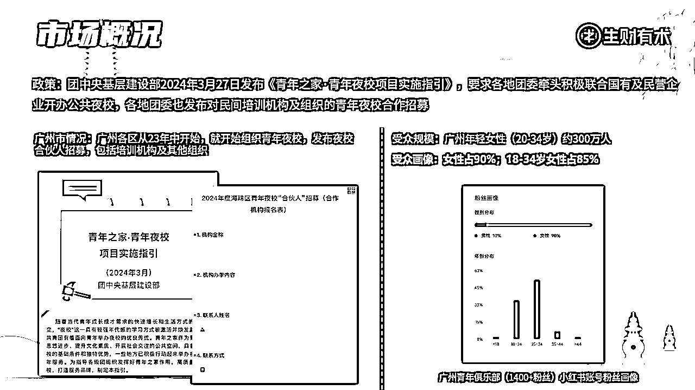

为什么说这个节点特别好？传统的成人教培行业普遍营销弱、获客难；很多老师水平不稳定，课程质量也参差不齐；再加上单身经济盛行，上班族想社交却没有合适的场景，年轻人找搭子成了潮流，而传统兴趣班的价格又常常虚高。这些痛点叠在一起，青年夜校恰好成为一个低成本整合资源、服务同城用户的入口。

产品端的打法不难理解：机构把课程打包成“课包”，项目方统一售卖，再由商家完成交付。用户不需要再满城找机构、对比价格、协调时间，信息差被抹平，选择也更标准。这个项目的核心用户是同城18到35岁、具备消费力的女性，她们愿意为兴趣买单，也是后续多元变现的种子用户。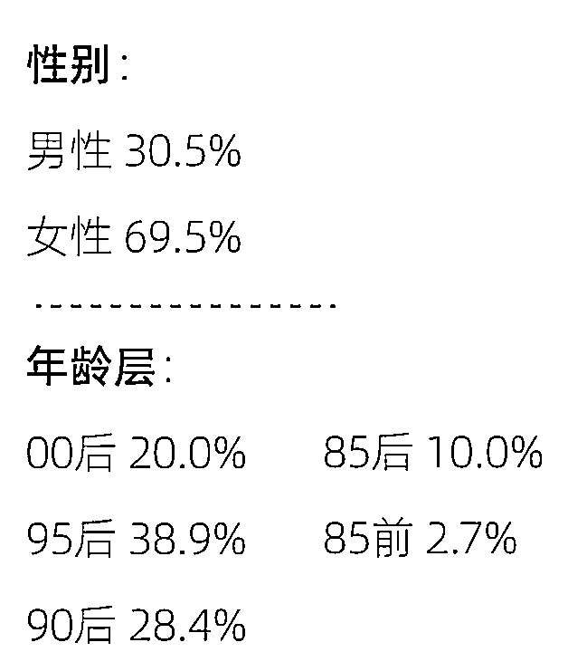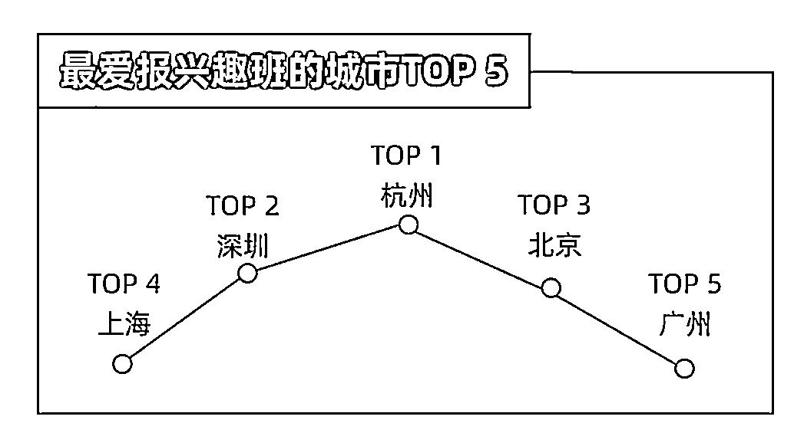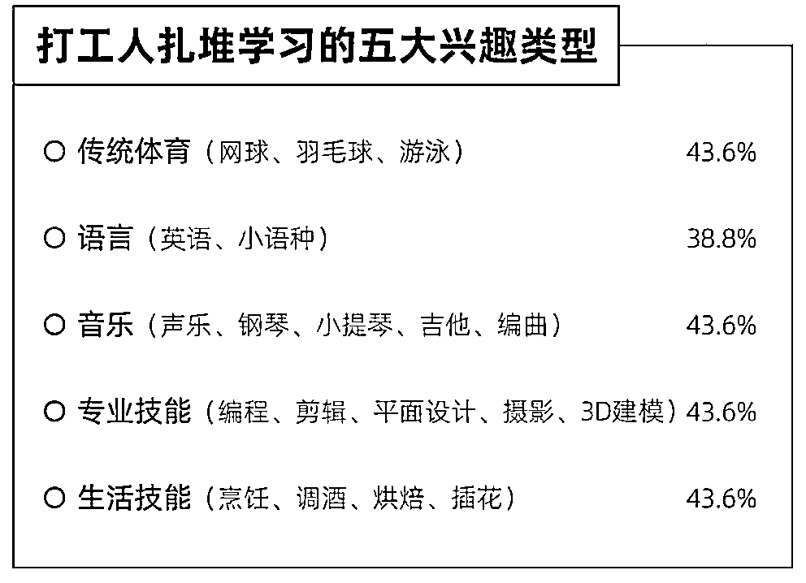

而且，这类同城粉丝的价值绝不止夜校本身。一个用户池可以反复变现：现在做夜校，过几年做月子中心、医美获客，再到后来做儿童兴趣班、老年兴趣班。同城流量因为地理位置限制，天然稀缺，本地商家也愿意为精准曝光付费；相比公域泛粉，它的转化路径更短，后端供应链稳定，用户一旦认可，复购和粘性都很强，还容易通过社区关系快速裂变。

项目方用半年时间，已经把这个闭环跑通。城市版图覆盖了北京、上海、广州、深圳、杭州、西安、厦门、长沙等一二线，也进入了芜湖、连云港、马鞍山、滁州等三四线。过程中有8位学员从一个人起步，逐渐组了自己的团队，扩大变现规模。课程交付和商家日常维护，已有专门团队承接，长周期的交付问题不用学员自己扛。

拆开看，项目执行其实分三步：公域获客、私域转化、商家BD与订单交付。公域端最重要的是爆款内容，所以📕日更、图文制作、矩阵发布、规避封号、导流🛰️、企业号设置、账号复盘，都需要一套成熟的方法。私域端则直接决定收入差异，破冰、挖需求、促单、复购这些环节，稍微差一点，转化率就天差地别，有人只能做到5%，有人能做到30%。交付端则直接影响退款率。

模式迭代也踩了不少坑。最早是中介抽佣加团课组班，抽佣比例通常在20%到60%。抽佣思路本身没问题，类似本地商家为美团入驻付费一样，但团课并不好做：成团难，排课时间众口难调，用户一等就烦，退款率一度冲到30%。而且兴趣班本来不是刚需，夜校真正的卖点是陪伴感。后来迭代成向B端收获客费，加入1对1课程和机构获客套餐；再之后砍掉大部分团课，主推1对1，退款率降到了5%。现在又上线体验课会员卡，单节课50元，办卡后周期内免费，很像健身房的年卡、月卡模式。收益则由商家课包中介费、活动课纯利、部分商家的营销获客费三部分组成。体验课还能承接那些担心线上不真实、觉得价格贵的意向用户。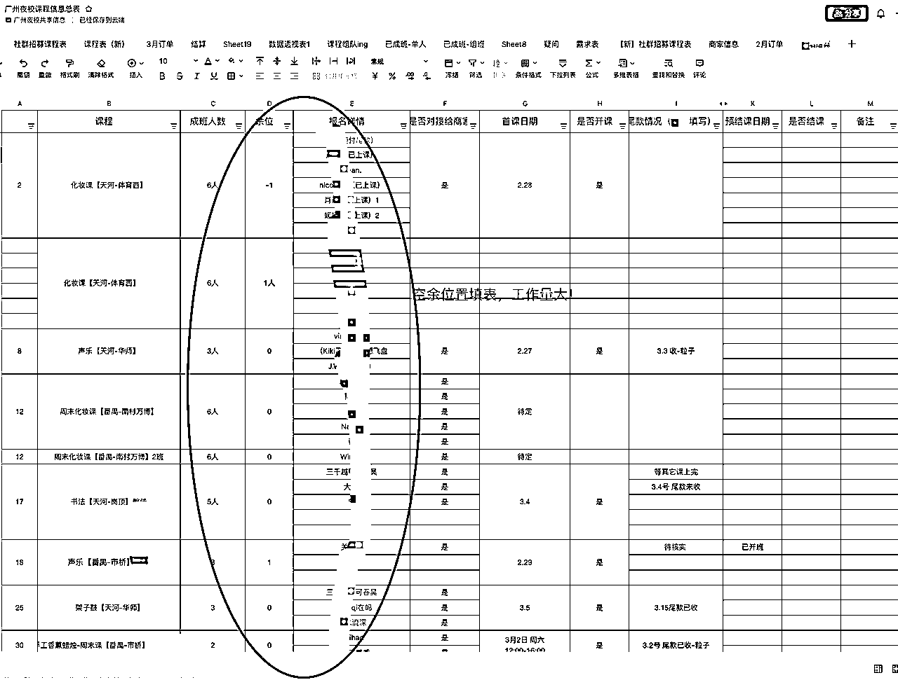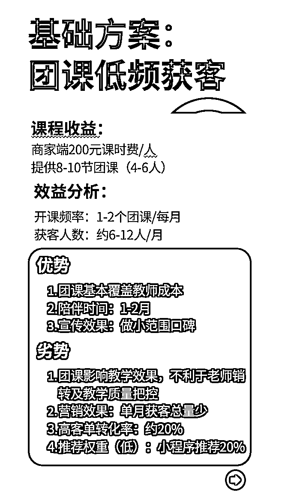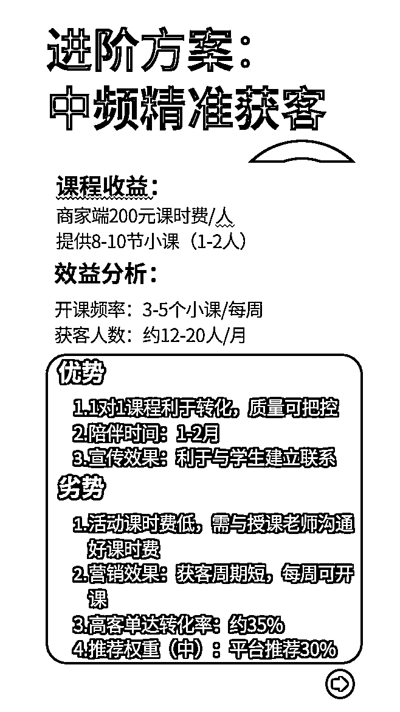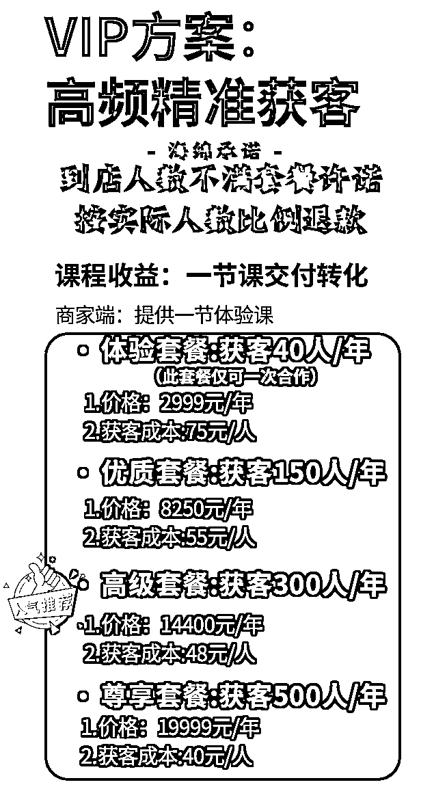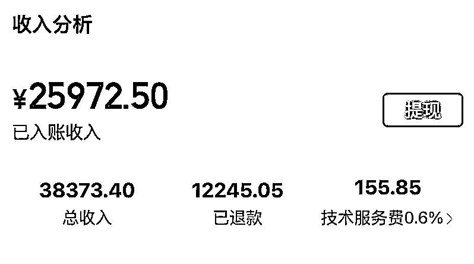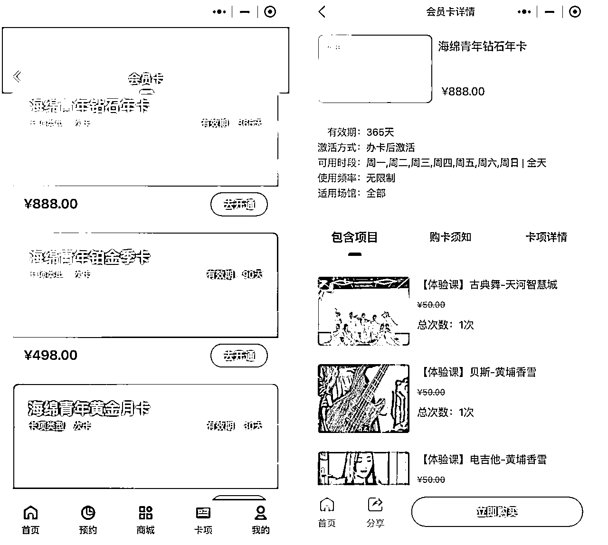

提效动作也很关键。团队开发了自己的小程序后台，下单、消课、组班都能自动完成，不需要人工干预，人效比之前翻了一倍。内容端则用软件做矩阵管理，目前广州已有50多个账号，全国接近500个，几个客服就能完成日常更新，人工效率至少提升3倍。

品牌是最大的差异化。海绵夜校瞄准的方向，是成为夜校领域里的“新氧”。当很多同行还没做品牌时，他们先把“海绵夜校”这个名字打进用户心智里。世界冠军祝福视频、世界小姐代言、品牌商标与小程序、LOGO吉祥物及周边，再加上全国统一客服电话400-800-2770，都有专人接听、7*18小时在线，信任感自然一点点垒起来。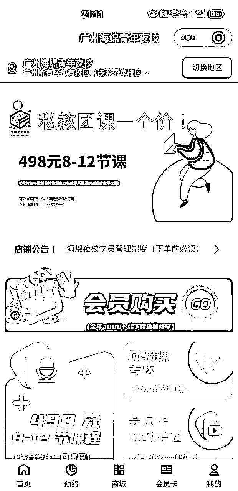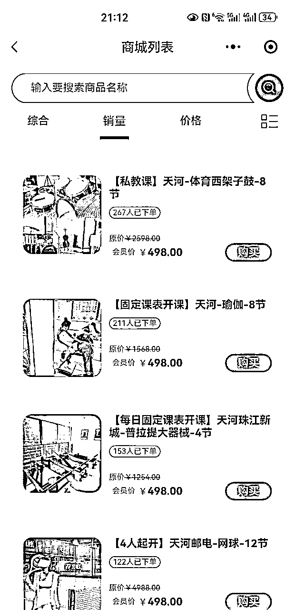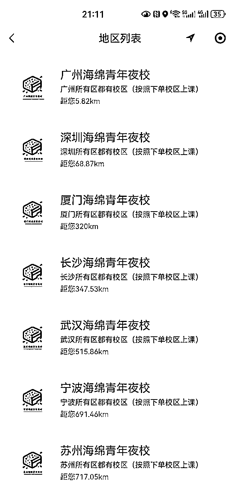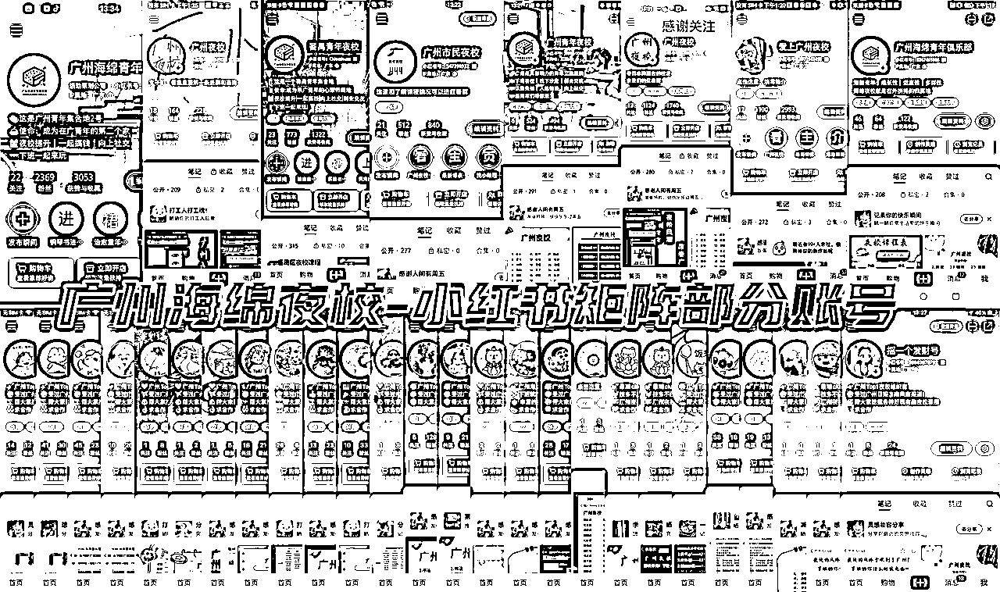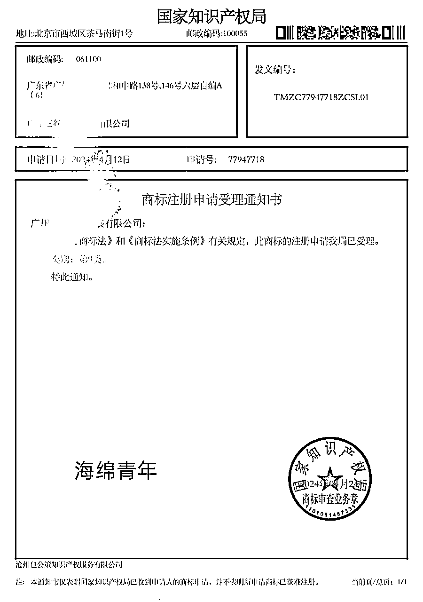

几个陪跑案例也很有说服力。圈友@鸿杰年初入场，引流超过3000人，最高一天成交44单，单日收益破万；7、8月跟随陪跑后，抖音流量连续50天破万，其中20天破10万，半年累计变现十余万。圈友@清华兼职入局，8月借郑钦文奥运网球夺冠的热点突了出来，2周跑通0-1，拿下70单，还获得当地排名前3的网球机构全年招生合作。圈友@江楠在上海首批进入，靠📕经验精准打击竞品，引流5000粉，变现12万并持续复购。

这些案例的共性，说白了就是执行力和坚持。项目已经跑出成熟模型，有模板、有方法，按节奏执行基本都能见到钱，至少不会亏。遇到不成班、产品方向不对、流量起不来、转化不理想这些问题都很正常，解决就好，别轻易下桌。竞争已经拉开架势，能留下来的人一定是在深耕的人，而时间会成为最大的壁垒。按往期经验，航海实操开始后一周左右就能见到第一笔收入，整期航海下来收益大约在8000元，平均每天出3单。当然，每个人的账号基础和转化能力不同，结果也会不同，教练团队会尽可能帮大家拿到更好的结果。

必须承认，项目也有实实在在的门槛。没做过📕图文和视频的，前期要在账号搭建和素材创作上花不少时间；私域运营靠感觉和靠体系，结果很不一样，朋友圈怎么发、新用户怎么聊、老用户怎么复购，都是影响转化的基本功；城市选择更不能靠主观拍脑袋，得靠市场调研和竞品分析来判断。这些环节航海里都有对应支持：纯净设备环境、纯净网络环境、一账号一IP；个人账号不够用，就先用好自己手头的，再借助家人和朋友的资源逐步放大；没有稳定流量，直接套用验证过的爆款模板；粉丝少，就坚持日更，慢慢吃长尾流量；每天进粉但转化不了，就按私域SOP一步步搭起体系。想放大矩阵时，团队也会协助设计方案。

夜校的热度已经变成一门真实生意。现在入局，恰好是不早不晚的时间窗口。如果你也想跟着已验证的路径走一遍，可以准备好账号和设备，一起上船。

如果你正在关注同城年轻流量这门生意，下面这个30天的线下实战项目，值得你花几分钟认真看完。它不是一个只讲理论的学习班，而是一条从引流、转化到后端交付全部跑通的完整链路。你不需要自己重新摸索，因为已经有人把坑踩平了，你只需要带着执行力和设备来。

### 一、这30天，你会经历什么

先聊你最关心的：能学到什么？内容覆盖得非常细，基本把同城夜校从0到1会遇到的环节全部拆开了。比如账号层面的多开与批量管理，公域平台上完整的一套引流路径，独立搭建账号定位框架的方法，以及不同平台的导流思路。工具层面也不会落下：如何用自动化工具降本增效，批量找到可用的素材，拆解那些已经跑出数据的图文或视频模板，📕图文的制作与批量产出，视频的自动化生产方式，全都有涉及。

流量进来之后，私域的活同样安排得明明白白：社群怎么激活、怎么持续运营，朋友圈人设怎么立，私聊话术和节奏怎么掌握，私域转化怎么一步步跑通。商业变现模式也提前帮你规划好了。不只是卖课程，而是理解同城夜校如何在传统中介模式上做升级，如何通过整合资源实现变现，以及在夜校课程之外，怎样做到“一粉多吃”——把同一个用户群体在同城这个盘子里切出更多维度的价值。

### 二、不是上了课就散场，而是有人陪你打完全程

这个项目最扎实的部分在实战节奏。基础培训阶段，教练团队会带你完成从底层搭建到平台引流、再到私域成交的完整培训，带教教练大多在相关领域深耕多年，不是纸上谈兵的类型。

培训之后是长达25天的线下实战和复盘周期。助教老师会每天跟进你的任务完成情况，随时答疑并且提供相应模板，每天还有固定复盘环节，教练带你一起梳理当天的动作，发现偏了马上调整，而不是等你自己迷失方向。到了咨询环节，如果现有模型跑通了、你想放大矩阵或者开拓更多模式，教练会根据你自身的情况以及你计划深耕的城市，帮你定制后续路径，目标是让你成功赚到钱，甚至变成一份属于自己的长期事业。

### 三、有人帮你搞定后端，你只需专注流量

很多人做同城生意最大的痛点是：前端流量要管，后端交付也要管，一个人活成一个团队，到头来两头都顾不上。

这个项目把后端的重担接了过去。教练那边有专业的BD中台支撑，专门有团队负责和商家谈合作。这里要提一个关键点：落地的是1v1夜校模式，转化率比传统团课模式更好，目前项目已经覆盖上海、广州、杭州等14个城市，对接了5000多家合作商户。你只需要专心做流量获取和私域转化，产品资源完全不用你操心。

交付端也是一样。过去做夜校变现，负责人不仅要自己找流量、做转化，还要长期跟踪订单直到交付完成，非常消耗精力。现在项目方专门安排了交付团队去跟进和落地订单，把你从这些琐事里解放出来，让你把劲都使在流量和私域上。

### 四、跑通之后，你还能往哪走

项目方“海绵青年夜校”接下来一年的目标，是在现有布局基础上继续下沉，最终在全国覆盖119个城市，形成真正的百城网络。总部会做全局统筹和全国联动，给到每个城市匹配的发展计划和均等的资源扶持。

如果你在30天航海过程中发现这个方向适合自己，并且愿意长期深耕，后续有两条路径可以考虑：

一条是**自营操盘手**。你会驻扎在广州总部，第一时间触达政策风向和流量动态，获得定期培训和商业咨询，参与119个自营城市计划。项目会根据你的实际情况帮你搭建团队，快速把盘子做起来。顺便说一句，团队设想过一个更大的目标：如果未来能站上纳斯达克，早期的你们就是原始股东。

另一条是**城市合伙人**。你可以自选城市，共享总部带来的转化流量，包括总部直播、品牌流量、付费投流等，同时获得品牌加持，比如代言人资源、品牌商标使用权等。总部还会有专业团队对目标城市做市场调研，确认城市基因和夜校模式的匹配度，并且持续线上陪跑，同步一手政策信息。

两条路的核心区别也很清晰：自营操盘手留在广州总部，依托自营盘开疆拓土，信息传达快，反馈效率高，有自建团队和总部资源支撑，整体更稳定；城市合伙人则是自己选城市、自己搭建团队，在海绵青年的品牌和资源基础上做执行，项目节奏自己把控，与总部共享资源。

### 五、你只需要搞定这些硬件成本

既然是线下实战，坐标在广州白云区。你承担自己的吃饭和住房开销，剩下的软件成本、网络成本、办公室成本，教练团队包了。

住宿方面，广州白云普遍房价在1500元左右，环境更好的会贵一点，找人拼房可以摊薄开支。教练也在找可长租的酒店供大家选择，丰俭由人。吃饭不用愁，广州的隆江猪脚饭、潮汕猪杂粉、烧鸭饭、白切鸡饭、煲仔饭，参考人均15—20元，按自己情况弹性安排。

设备上需要自己备好：一台笔记本电脑必带，因为每天要制作并在📕发布内容，电脑的效率比手机高很多；另外至少准备3台手机以及对应的手机卡，原则上手机越多，获得收入的概率越高。建议苹果8以上机型，二手市场参考价500到800元一台，因为要求一机一号，方便分别运营📕、抖音、视频号等账号。当然，如果有老账号可以直接利用，那就更省事了。预算紧张的话，电脑和手机都可以考虑二手，试错成本能压多低压多低。

### 六、什么样的人适合来

先说硬性要求：你需要认可同城夜校业务，并且愿意长期扎进去做。项目负责人把它称作“长征项目”，因为坚持下去，它可能是互联网领域少有的“养老型生意”。如果你只是想来赚快钱，这里不适合你。

时间投入也很关键。这个项目个人/兼职玩家会逐渐被淘汰，未来一定是团体化作战。你需要有充足时间，并且具备一定的抗压能力——不管去到哪个城市，都会遇到强劲对手，赢下来之后收益才会更可观。学习能力和韧性同样重要，不要因为几天没有正反馈就气馁，要不断学习、迭代，朝行业第一的位置走。如果你有销售经验，那种被市场反复打磨过的能力会是不错的加分项；会剪辑、会P图，那就更快一步，直接缩短了上手周期。

### 七、报名安排和这次航海的规则

本期航海是线下孵化模式，需要双向筛选。报名人数限100人，通过电话面试筛选出30至40位合适的圈友。报名流程是填写报名表单，等面试通知，审核通过后再做启程准备。项目周期一共30天，上课地点在广州市白云区，自带工具是1台电脑加至少3部手机和对应数量手机卡。

时间节奏给大家列清楚：

- 报名筛选：10月10日—10月13日
- 1天线下大课：10月18日
- 1天基建准备：10月19日
- 3天助教陪跑：10月21日—10月23日
- 25天线下实战+复盘：10月24日—11月17日

费用是2980元，无保证金，往返路费和食宿自理。退款机制给大家留了充足的缓冲：开课5天内（也就是10月22日24:00前），如果觉得不合适，可以无理由全额退款；5天之后除非不可抗力，不予退款。

赚钱圈友还有额外保障：按要求完成30天航海——每个账号每天至少更新三次内容并完成当天复盘打卡——30天后如果个人收益没有达到2980元，差额部分教练团队补齐。相当于用一份认真执行，换一个保底收入。

### 八、你可能会关心的三个问题

**一个人做能赚多少？**  
掌握同城年轻流量的前提下，即便是新手，首月做到1万以上是可能的。

**一个城市的上限在哪？**  
基于消费主力群体持续经营，单城市月营收能做到15至30万。

**夜校红利期不是过了吗，为什么升级版还值得入局？**  
主要有四个原因。第一，现在直接收取每单500元，相比过去收50元定金的模式，现金流明显更健康；第二，升级为1对1或1对2的约课形式，相比过去1对8的团课，等待周期更短，核销率更高，用户体验也更好；第三，搭配了专属工具，小程序就能完成买课和约课，比过去用快团团顺手得多；第四，现在是团队入场，分工明确，直接铺矩阵号，不博爆款，靠每天批量发笔记稳定获取私域，形成持续稳定的进量。

30天，从0到1亲手操盘一遍同城夜校的完整流程。名额有限，而且需要双向筛选，如果你已经在想自己适合哪条路，不如先把报名表填了。一次尝试，换来可能是一条长期能走的路。