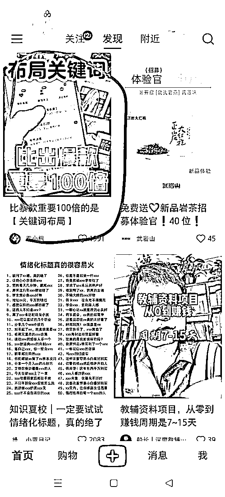
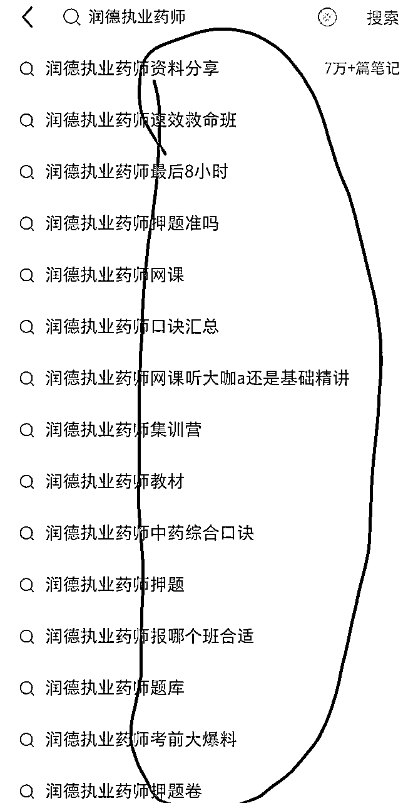
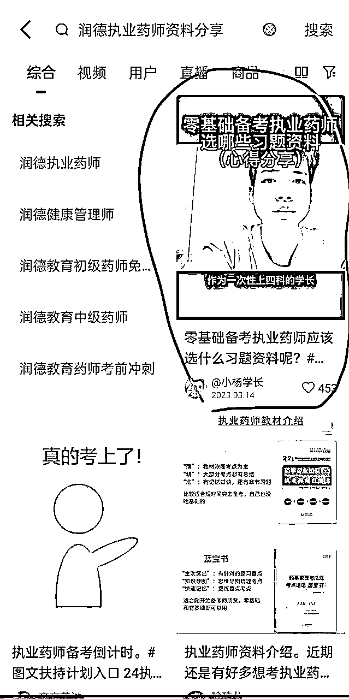
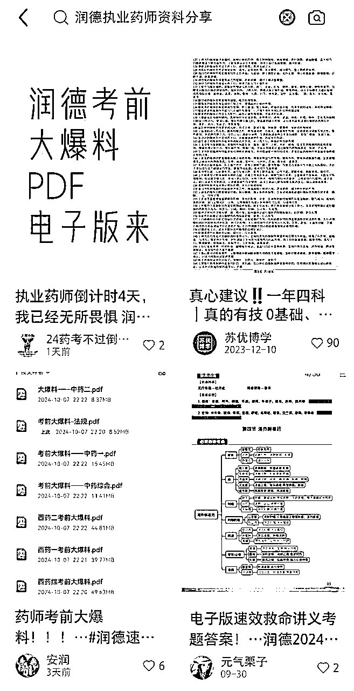
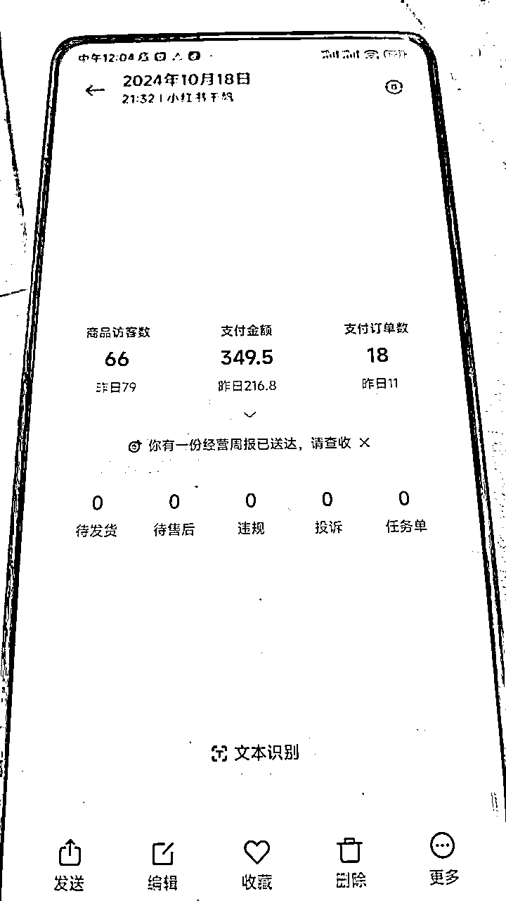

# 别再拼爆款了！小红书卖虚拟资料，关键词布局才是核心密码

> 来源：[https://qxgrvnd4nbk.feishu.cn/docx/QvsBdv9ErovPqrxzofFcxUk4nvE](https://qxgrvnd4nbk.feishu.cn/docx/QvsBdv9ErovPqrxzofFcxUk4nvE)

各位朋友好，我是更绪，四川南充人，现在在福建武夷山做茶叶生意。之前我写过一篇复盘，梳理了从今年4月开始在小红书卖虚拟资料的全过程，里面也聊了不少实操方法。奈何文字表达的局限性，加上很多人脑子里还装着抖音的推荐逻辑，对我想说的重点总是不太能get到。

和大家聊了一个多月，结合自己项目里的实战经验，我对很多问题有了更清晰的体感。今天就从流量本质出发，聊聊怎么在小红书把虚拟资料卖得更好，这也算是一次对过去自己的复盘。内容比较主观，有不对的地方欢迎指正！

全文拆成四个部分：
1. 推荐流量 VS 搜索流量
2. 卖资料的常见误区
3. 我当初为什么卖不出去
4. 小红书电商板块的未来判断

# 一、推荐流量VS搜索流量

## 1.比起爆款，关键词布局的价值高出百倍

最近刷小红书首页，看到一条笔记的标题一下子点醒了我——比起爆款，更关键的还是关键词布局。

我为什么这么笃定？

其一，小红书官方数据摆在那里，站内超过65%的浏览来自用户主动搜索，推荐流量最多也就35%。大家宁愿死磕那35%的随机分发，也不去占领占比更大的搜索入口，这逻辑本身就反了。所以我说，关键词布局重要到远超爆款。

其二，爆款谁都想做，但没人能保证。做爆款的核心无非是复制粘贴，其余都是添头。算法不确定性极强，除非你靠海量内容去硬堆概率，但本质依然是赌。关键词布局带来的搜索被动流量，确定性可控得多，可以沉淀成SOP：用聚光看搜索词，找到长尾词，然后把长尾词覆盖到笔记里。稳定、可复制。

其三，搜索流量有长尾效应。一篇埋词做好的SEO笔记，可能半年前写的，现在每天仍有用户通过搜索进来静默下单，完全不用管。靠命做出来的爆款，不可能有这种持续性。

其四，绝大多数创作者每天焦虑的是播放量低、同款笔记别人爆了我不爆、抄了爆款模板还是不爆。很少有人意识到搜索流量体量巨大，即便知道也只是知道，很少真正去做。竞争来看，其实还很空。

其五，从投放成本也能看出来。用聚光投搜索渠道的点击单价，往往比全站智投更高，这说明平台自己都在告诉你：搜索流量更精准、更值钱。推荐流量的爆款看着热闹，其实泛得很。

## 2.关键词怎么埋

其实没什么高深技巧，就是做SEO。

最简单有效的长尾词挖掘方法，直接用小红书搜索框。比如要卖润德执业药师资料，就在搜索框输入“润德执业药师”，自动联想出来的长尾词，直接分散到标题、开头、正文结尾、标签里，就是一篇合格的SEO笔记。

## 3.搜索排名怎么上

实操下来，大部分情况根本不用刻意去刷排名。笔记发出去，随着时间积累自然会慢慢出单。因为很多类目根本没人做搜索优化，你发几篇就能占据搜索结果，基本就是独家霸屏。

当然，需求大的类目会有点竞争，这时候就需要靠笔记数量和质量叠加来提升曝光。

小红书现在的搜索机制还比较初级，不像传统电商那样模糊匹配。它更像精确匹配，你搜什么，出来的内容就必须高度包含那个词。这对我们是利好，因为大量数据好但没做关键词的笔记会被过滤掉，竞争压力变小。

比如抖音搜“润德执业药师资料分享”，排前面的是400多赞的选资料心得视频；而小红书搜同样关键词，出来的基本全是资源分享类笔记。

小红书搜索排序主要看两点：关键词匹配度 + 搜索满意度。

匹配度看你埋词埋得准不准、长尾词是否覆盖。满意度看用户看到笔记后的行为：停留时长、赞藏评关等。

所以思路就是：先保证内容体面不丑陋，把SEO做到位，再用一点点投放比如聚光/乘风，给算法喂点互动数据，告诉它这篇笔记用户喜欢。这三步配合好，笔记上线后能长时间持续获客，真正做到躺赚。

# 二、卖资料的常见误区

## 1.过度焦虑版权

上篇我详细说过规避版权的方法，有兴趣可以回看。坦白说，除非是完全自研资料，否则100%规避版权是不现实的。

虚拟资料的优势是利润高、无库存、无发货、低成本，但必然伴随版权风险。按我讲的方法去做，风险已经控制在可接受范围。做事本就有风险，就像开车上高速会出事故，我们总不能因为怕风险就放弃高速带来的效率。

## 2.对播放量焦虑

很多人发条笔记几十播放就觉得废了，卖不掉了。

其实几十播放很正常，尤其是小众蓝海品类，平台一开始根本不知道推给谁，冷启动自然低。我不少笔记发出去就20播放，但之后长期靠搜索进来下单，照样持续产出。

给个实操数据：做搜索流，店铺100个访客能出10单左右，利润100-300。100个访客大概对应200-300播放。也就是说，200-300播放就能带来百来块到三百块的净利。你还觉得几十播放很惨吗？

刚起步的店铺，笔记总浏览200多，千帆进店66人，下单18单，净赚300多，这就是搜索转化的威力。

## 3.非要加微信成交

我一直不理解，为什么一定要导微信卖资料？如果只是卖资料，成本最低转化最高的是直接开小红书店铺挂链接。开店就是降维打击，没开店的人根本打不过。

请尊重流量漏斗，别把用户往外推。把店铺开通，链接挂上，比什么都重要。

## 4.掉进选品陷阱

选品重要，但没那么重要。

你用主观判断+客观数据选出的品，不一定完美，但大概率能及格。选品决定的是天花板，而不是能不能卖。

大家总爱讨论风口、红利，好像不选对风口就赚不到钱。其实一个月赚点小钱，更多取决于你笔记做得够不够多、够不够好、坚持够不够久，而不是品是不是神品。

# 三、为什么“曾经的我”卖不出去资料

## 1.太心急

对比抖音，小红书本身流量就慢，再做搜索更是慢上加慢。反馈周期长，我经常没布局完整就急着要结果，没看到转化就自我怀疑然后放弃。其实我发过的笔记，从来没有真正白发过，只是出单时间点被拉长了。

## 2.逻辑没理清

没有形成标准化打法，不知道自己为什么能卖出去，动作都是凭感觉、凭情绪。后来慢慢理清底层逻辑后，才能把思路清晰地讲出来。

核心是持续深耕、不断复盘。前提是先相信，等真没结果了再质疑。

## 3.知行不合一

很多道理明白了，但没有去执行，没有去坚持执行。人性问题很难避免，希望下次复盘时，我能更自律一些。

# 四、对小红书电商未来的看法

## 1.平台上限有限

看过一篇关于小红书老板和内部决策的文章，能感受到这个平台的上限不算高。老板的风格很“抽象”，很多决策不像大厂的风格。从我自己运营的感受来看，小红书的上限很难逼近字节这种巨头。

可惜用户质量确实高，错过了被系统化经营的机会。

## 2.机会依然很大

小红书电商做得混乱，迭代像乱抄，很多品类还是空白地带。这对普通人反而是机会。平台不完善、不成体系，规则并没有被完全吃透。

更关键的是用户的电商心智还没养成，很多品牌甚至不知道小红书能卖货。我在武夷山见过一个茶叶品牌，小红书月搜索上万，官方账号有几万粉，却没开店铺卖茶，抖音还在投千川。小红书账号就这么放着荒废。

写到这里就差不多了。文章既是分享，也是对自己的检验。大家有问题欢迎来交流，我尽量都有回复。