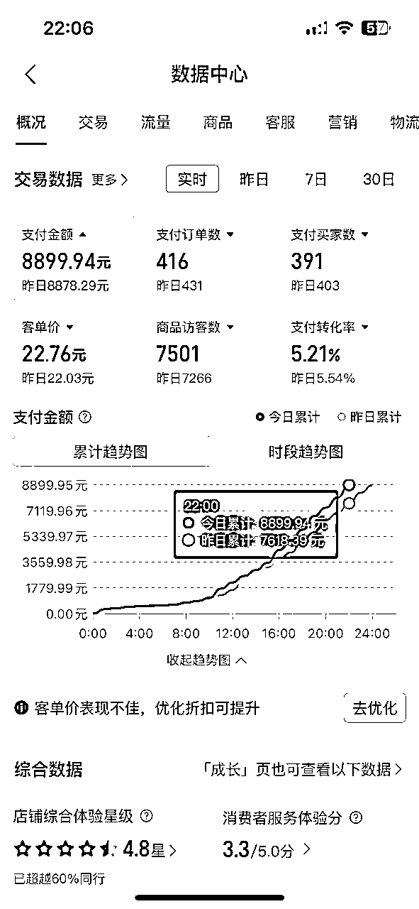

# ('2024拼多多最暴力无解3种起店玩法', (2, 20))

2024年，拼多多这套打法真的变了。平台规则反复调整，手里的预算如果不厚实，就别碰强付费。现在起店，先算利润，再想单量。亏本冲量并不是不行，只是后续想再拉回来，对款式、类目、客单价、运营能力都有硬要求。

你得先想清楚：产品有没有款式优势？没有价格优势，低价做不了，那付费到底怎么玩？我手里同时跑着好几个类目的店铺，最核心的是老照片AI修复。其中一个老照片修复店的数据：每天GMV稳在1万上下，差的时候也没低过5000。

启动店铺，只有3条路：

1. 自然流：比价截流、铺货、活动。
2. 半付费：卡日限额拉自然、高投产、全天付费。
3. 强付费：产品利润够、预算充足。

不管走哪条路，第一步永远是测链接。哪怕你是纯自然流，这一步也省不掉。

测链接怎么测？今年大家都在聊铺货、裂变，本质就是为了跑出一个或几个能打的款。比如我有几十个款，全传上去，看哪个链接数据漂亮；如果只有一两个款，那就多开几个链接，用不同主图、价格、SKU做出差异化，再上车测。哪个车能跑动，就加大力度。有些车跑不动，只要防比价做好了、出价也合适，那大概率是款不行，或者这个链接运气差。防比价必须做，这句话我不想再重复。

自然流最狠的玩法，还是比价截流。前提很简单：你的价格必须比绝大多数链接都低。操作更简单——找到对标竞品，1比1复制他的链接，但价格要低10%左右。前期可以挂一点直通车，加快入池和系统比价速度。一个链接起来了，接着做下一个；一个店跑起来了，接着开下一个店。这就是裂变和矩阵的本质。但尴尬的是，很多有价格优势的老板，根本看不上截流那点利润。

铺货就更粗暴了。一直找款，一直上链接，用数量硬堆流量。1个款带10个访客，10个款就是100，100个款就是1000。纯靠量大取胜。缺点也明显：转化低，劳神费力。

活动流呢，就是不停地上百万、584、万人团这些大活动。但前期得把链接基础做好，这东西不适合新手，适合懂规则的商家。反正就是一个活动接一个活动，靠活动反复拉权重，换取自然流量。问题是：活动一下，自然流就慢慢掉光，甚至瞬间归零。除非你一直赖在活动上，或者用直通车去接住。而且活动价格会一次比一次低。

半付费第一种：卡日限额拉自然。如果车子每天只跑4到8个小时，权重高了之后，剩余时间会不会出自然单？一定会。这就是大家常说的“卡日限额拉自然”。用直通车，尽量切成交出价模式，把点击率、转化率这些数据优化好，每天死死拉住限额。营业额上来，车一下线，自然流就进来了。

半付费第二种：高投产。高投产的核心，说穿了就是性价比——价格足够低。卡好高投产，前期要配合指数单，注意，必须是能计入销售额指数的单子，不是随便刷。后面再转全天付费。当你把前面的玩法都试过，直通车能开动了，但自然流还是少，那就去看点击率、转化率能不能优化，能拉就拉，然后尝试全天付费。

最后说强付费。什么是强付费？能做强付费的链接，一定是有高利润的。反过来讲，你一单只赚2块钱，做强付费能亏到你裤衩都不剩。我们做AI老照片的利润空间非常大，主要成本就是时间。简单算：一单利润10块，扣掉广告费、退货率、手续费，能剩几块，这种款才配做强付费。记住：别开极速，容易断流，也测不出真实数据。强付费的投产一定是低拉高，千万别一上来就把投产设得老高，那是自己找死。整体节奏就是：前期出价高点无所谓，保本或者微亏都能接受，后期慢慢拖价，再拉高投产。能保本最好，新手不懂就别碰货损，你根本玩不明白。做强付费必须有推广预算，三五千块就别玩了，最后容易搞成一个不上不下的烂摊子——丢了可惜，继续又怕没效果。而且一旦选了强付费，就别再想免费流量了！既然选了这条路，就坚定走到底，熬过瓶颈期就拨云见日。同时不断优化调整你的AI后期团队，把出图效率提上来。