# 新手做 AI 写作变现，这 10 个坑我踩过，分享给你

大家好，我是可可，2001 年语文老师出身，现在副业深耕 AI 写作，主要做引流和私域成交。精准客户已经引流破千，单日最高到账 2000+，月收入稳定过万。在上个月的航海实训里，我也担任了 AI 写作组的教练。

航海结束后，很多伙伴都拿到了第一笔收入。可和大家聊下来发现，入门阶段在写作交付上会反复出现一些典型失误。都是些看似不起眼的小细节，但写作是高度定制的工作，一个字之差意思就变了。细节上的疏忽会让客户觉得很不专业，信任需要一点点攒，却可能因为一次小错就崩掉。

今天就把我观察到的新手期高频错误梳理出来，希望能帮你少走弯路。

先说点数据提提神，找准细分赛道的话，AI 写作的成交率和客单还是很可观的，值得试试。

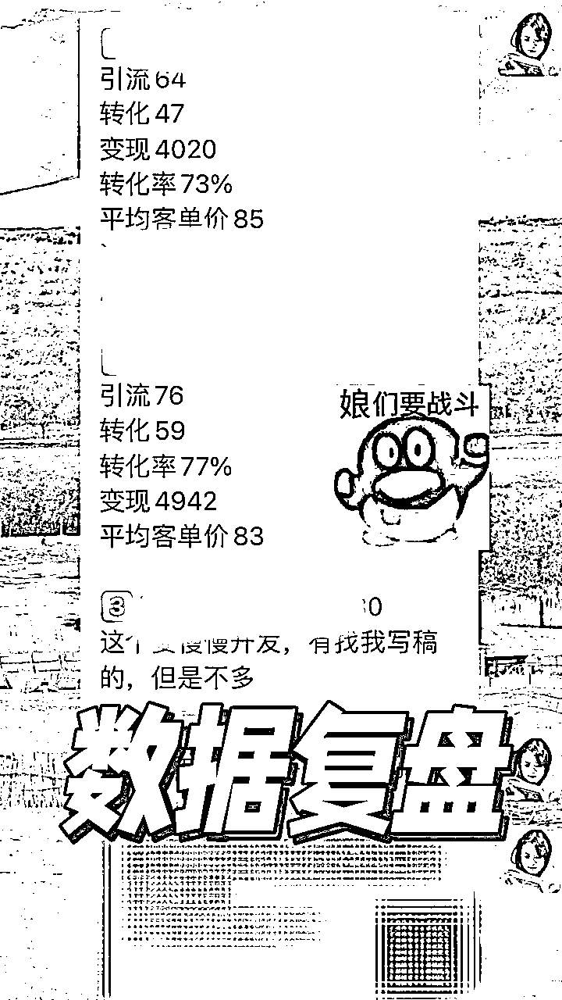

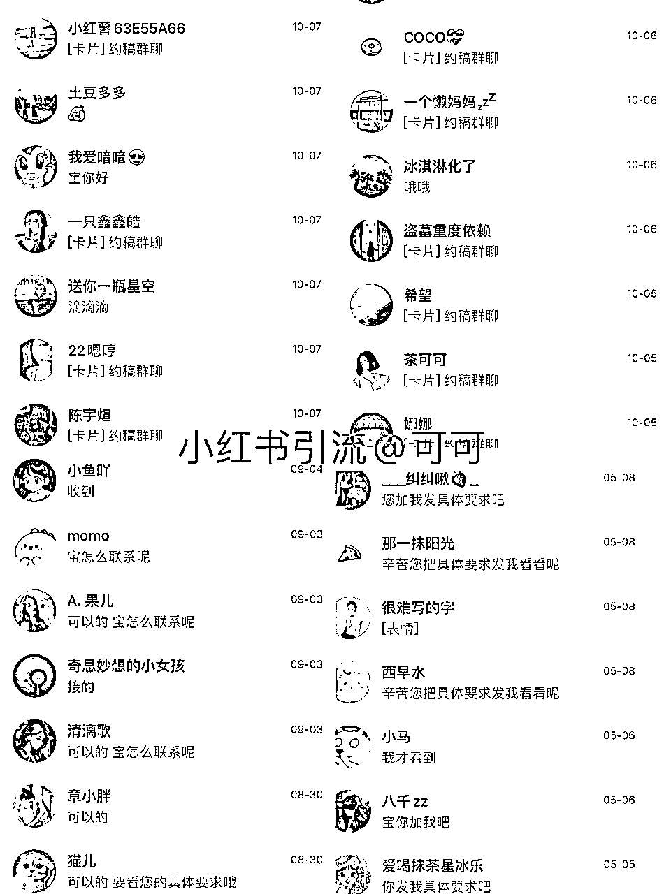

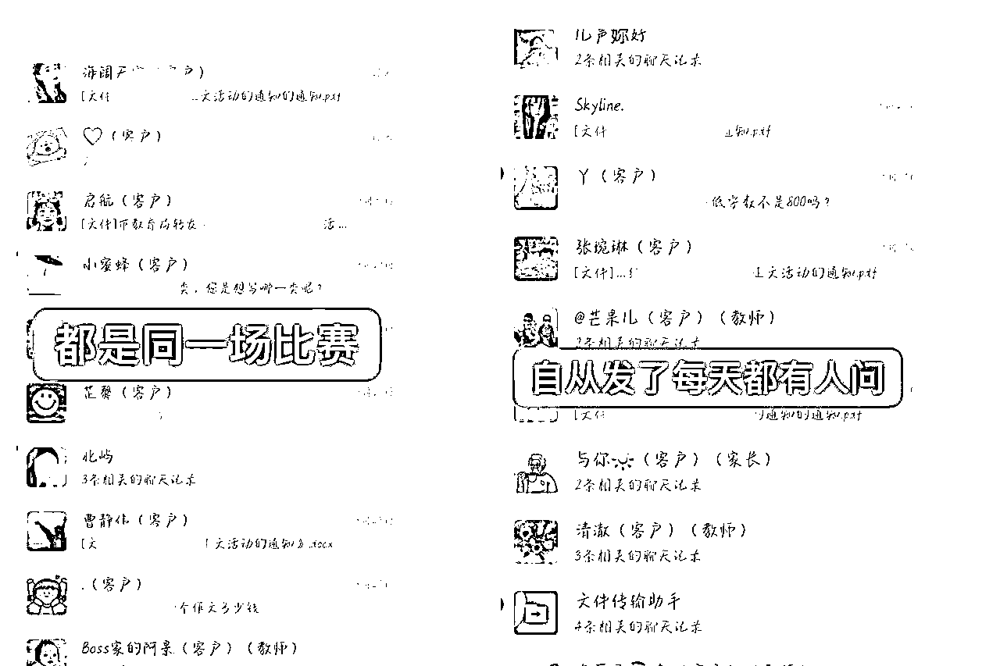

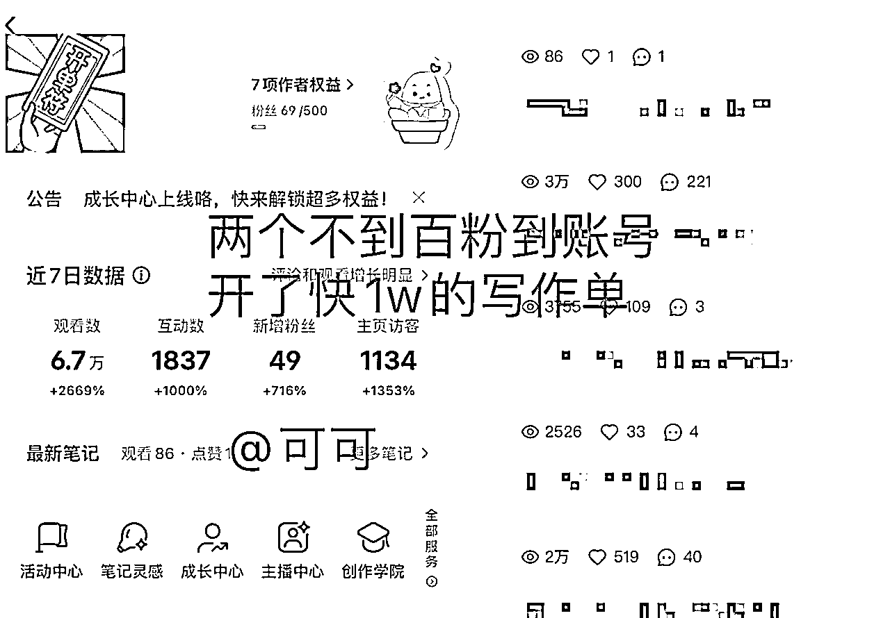

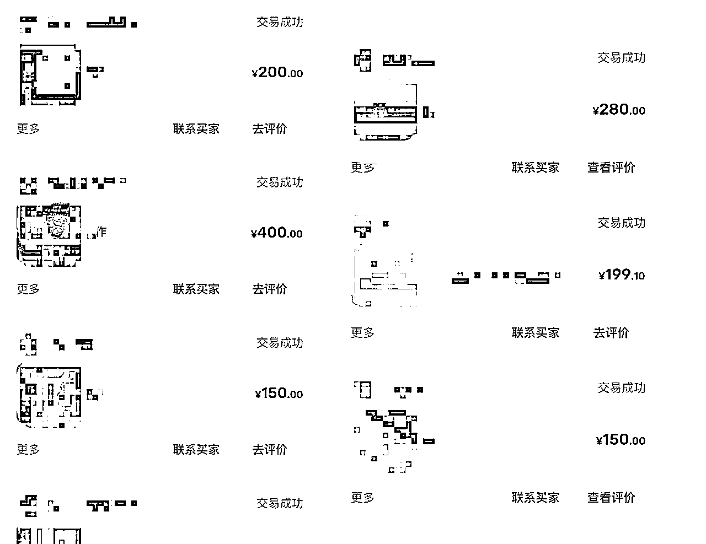

# 1. 字数宁多勿少，千万别卡线

客户要 1000 字，起码给 1030 字以上。写成 999 字，客户很容易不满意甚至挑刺。就像中考作文要求 800 字，你递交 780 字基本要被扣分。按标来，甚至略微超出，才是安全做法。

# 2. 先把需求问透，再动笔不迟

沟通最省成本的方式，就是把客户想要什么问清楚。需求描述得越具体，执行翻车的概率就越低。

把文体、字数、主题、特殊要求全部梳理成清单，心里有数再开写。不能一边写一边补，不然会顾头不顾尾。常见的就是主题点到了、额外要求也满足了，最后发现字数只写了 750，约定是 800。

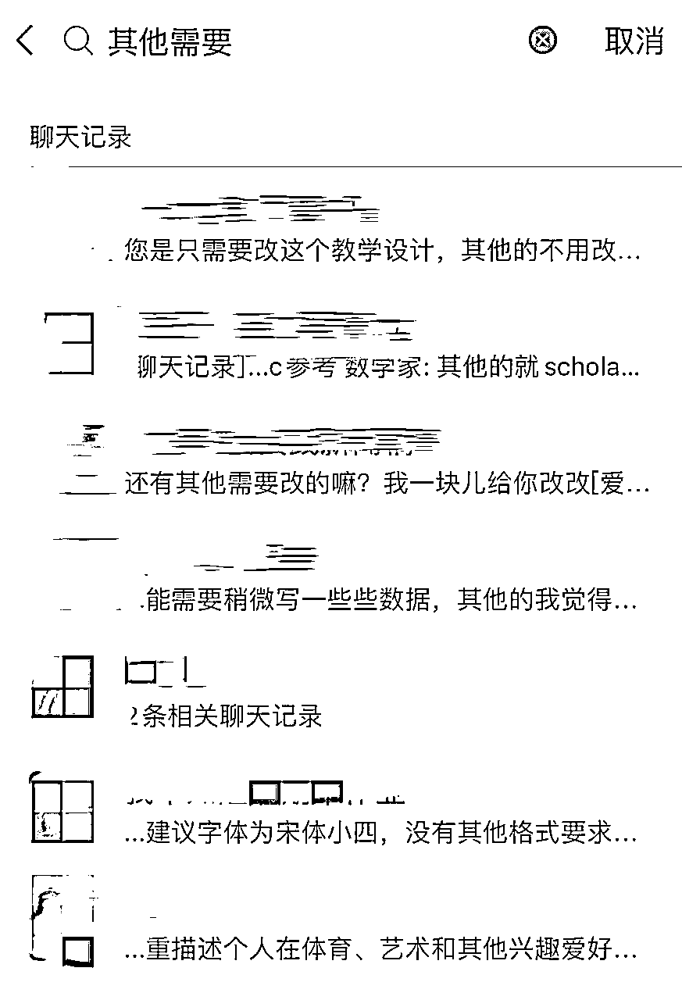

# 3. 遇到陌生体裁，先要模板别硬写

碰到没写过的格式，先问客户有没有参考样例或模板。有模板就照着走。没有的话，去小红书等平台搜同类型范文，挑几篇合适的发给客户确认风格是否对路，再开写。

写作本质是定制，沟通对齐需求永远是第一步。没有确认就自嗨，很难让客户点头。

# 4. 段落长短要匀称，排版也要好看

批改作业和审稿时我发现一个通病：段落极不平衡。一段写三百多字，下一段只有一句话，阅读体验很差。

文章里除开头结尾或强调段外，其余段落长度应大致相近。下面这份初稿就能看出问题。

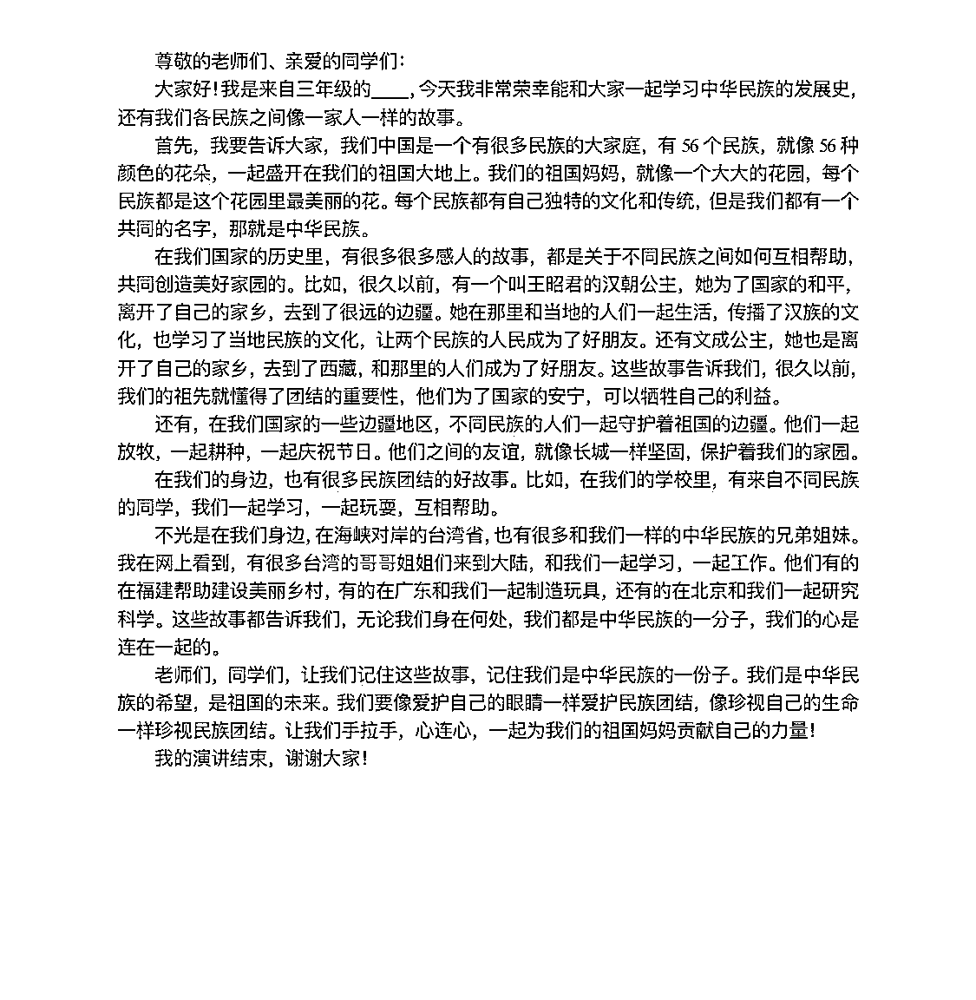

第 3 段明显过长，第 4、5 段则过于单薄。段间距也要调整，因为交付前我们通常是截图给客户手机预览。宋体三号、首行缩进 2 字符、行距 1.5 倍，手机上看起来最舒服。

效果如下：

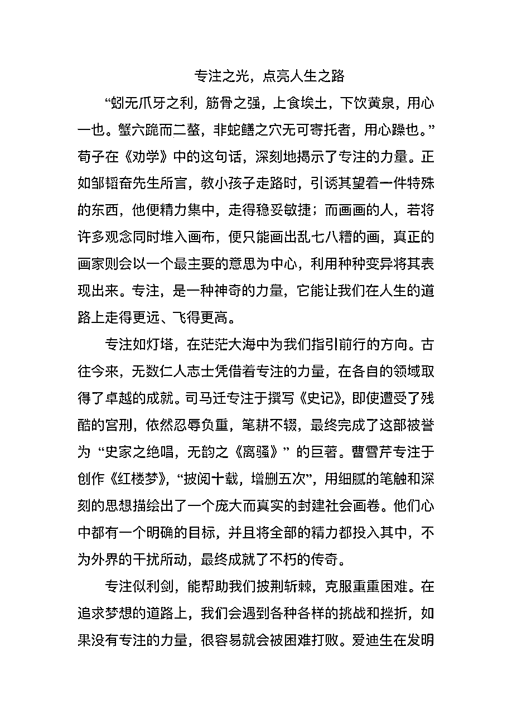

# 5. 给 AI 下指令，先做信息筛选

客户发来一堆资料、文件，尤其是征文、演讲、体制内文章时，信息量爆炸。关键是提炼核心，剔除冗余。

一方面是为了自己明白要什么，一方面是 AI 需要明确方向。整份文件原样丢进去，它很难判断重点，质量自然差。

以一份演讲比赛通知为例：

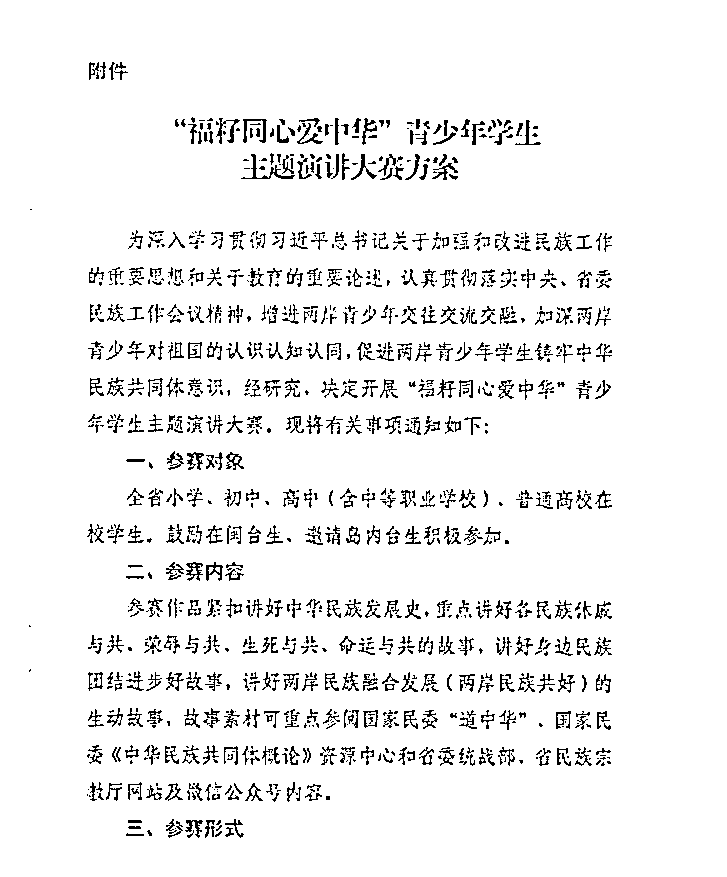

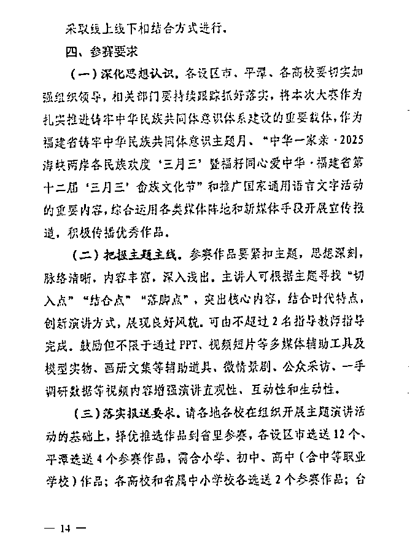

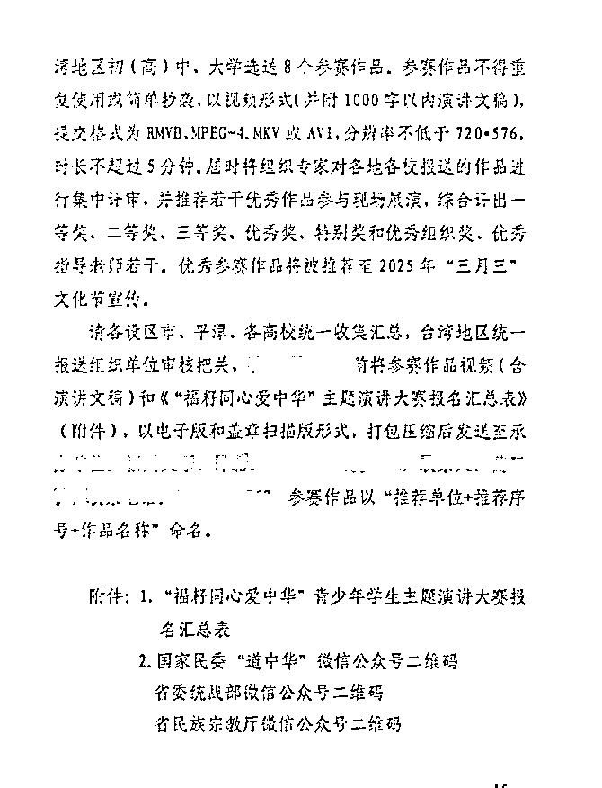

三页的通知内容很多，全部喂给 AI 会跑偏。细看下来，只有参赛主题和前两条参赛要求和写作强相关，其它都是背景信息。

所以下指令时只聚焦关键点即可。比如我会这样写：

假如你是一个演讲写作高手，请你根据下面要求，帮我写一篇1100字的演讲稿，具体要求如下：

1.该演讲比赛是“盐都石榴籽·童心跟党走”2024年自贡市铸牢中华民族共同体意识主题演讲比赛，但是这个只是一个主题，需要再自拟题目

2.参赛选手需围绕“铸牢中华民族共同体意识”主题进行演讲，以民族团结为题材，内容健康向上，具有时代感和民族特色。同时自贡市是一个多民族聚居的城市，可以结合一些这个地方的特点来写。

3.要贴近实际、贴近生活，彰显爱国主义精神，语言真挚感人，语言风格文艺有质感，有思想深度，能够打动人心，体现自己的思考，情感色彩丰富

4.在文中可以穿插一个民族团结的案例，故事主人公是杨秀明，但是只能作为案例丰富演讲稿的内容，不能大篇幅的写，杨秀明的具体故事已上传

PS.这个人物故事是我自己在网上搜索后，整理成word投喂给AI的

# 6. 必须人工核验，AI 会幻觉造假

AI 有时候会编造细节。客户限定了具体地名、人名、事件，写错了直接掉分。接传统文化稿时，地点错、习俗错这类问题很常见。读后感、观后感也一样，情节对不上原著就是硬伤。

办法是先把书籍或影片简介、原文要点整理成文档喂给 AI 再写，错误率会大幅下降。初稿完成后一定要自检案例和信息是否准确，别等客户指出才改。

# 7. 从小单练手，再谈大单

技能牢靠后要尽快实战检验。初期接几十块的低价单磨炼基本功，比空想赚大钱更重要。能力提上来，再去做流量和转化，才能形成闭环。

我最初也是从淘宝几十元的单子起步。

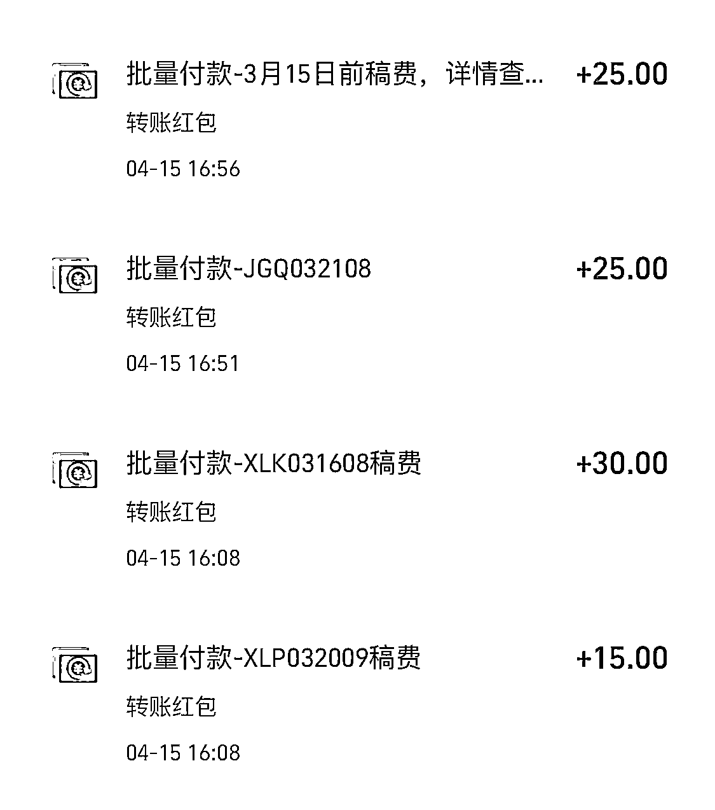

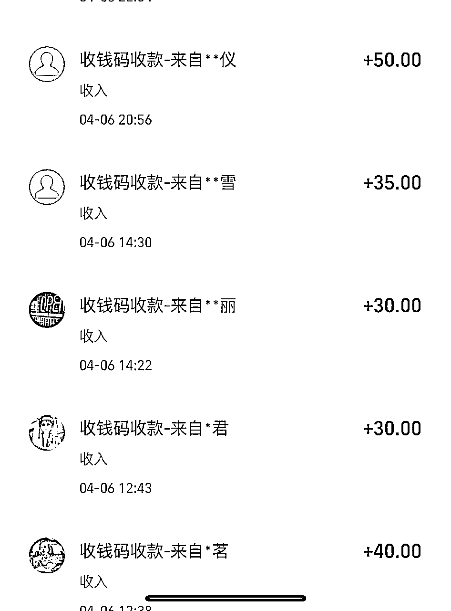

# 8. 客户的修改意见不能原封不动喂给 AI

交稿后客户的反馈往往口语化、笼统化，不能直接作为润色指令。客户写不出好文章，所以他的表述只能当思路，需要我们翻译成专业的写作指令。

反面例子：

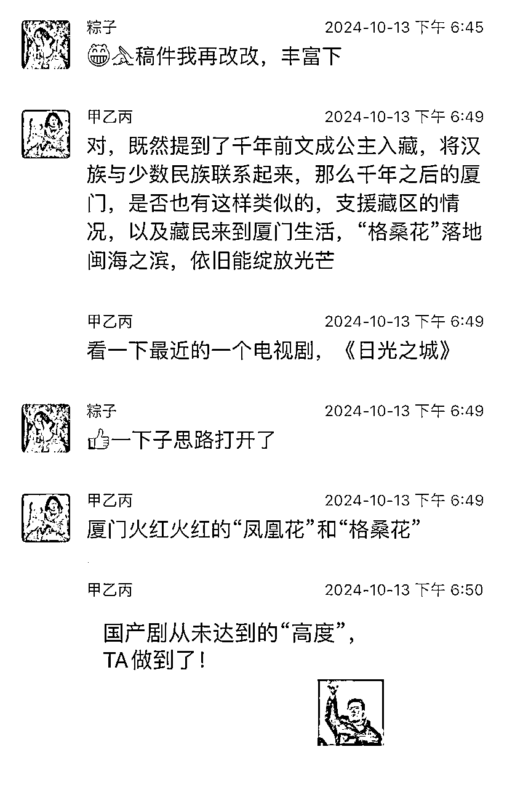

学员直接把客户原话塞进提示词，结果很尴尬。客户真实意思是希望做古今对比与衔接，从文成公主入藏自然过渡到今天藏民到厦门工作生活，突出民族团结主旨。

一个小技巧：去小红书搜“作文评语”，里面有很多现成的专业化表达，直接拿来改写指令。

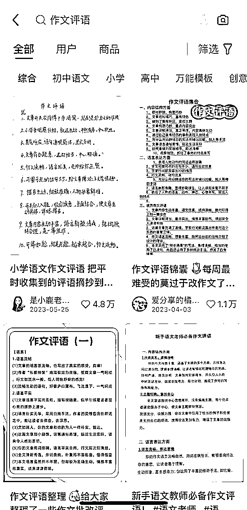

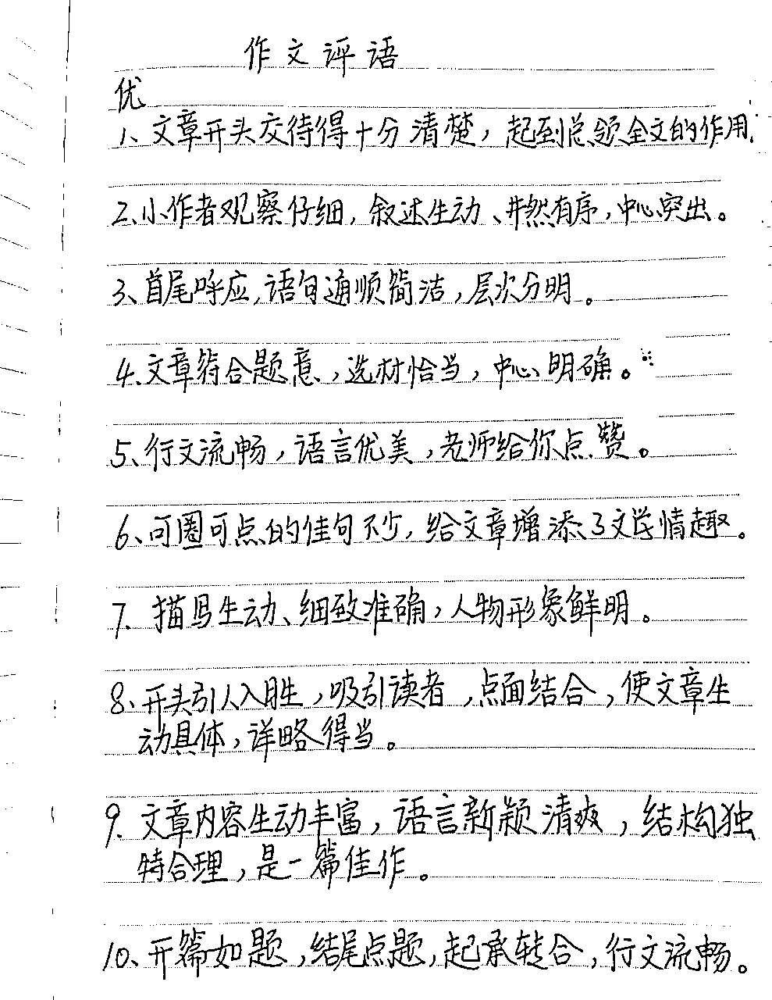

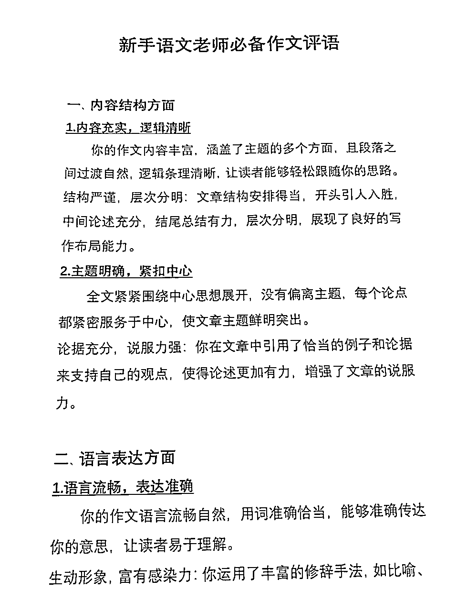

比如：
客户说文章没重点、太乱 → 提示词：逻辑清晰，详略得当，紧扣中心论点，不偏题。
客户说段落生硬 → 提示词：段落衔接自然，条理清晰，结构严谨。
客户说太平淡 → 提示词：语言有感染力，情感充沛，写出真情实感。
客户说太空 → 提示词：加入具体论据和事例，避免空话，立意深刻。
客户说没文采 → 提示词：语言文艺有质感，文采斐然，生动优美。
按这个思路转换，AI 就能按意修改。

# 9. 提示词不需要复杂，清晰就行

很多人刚开始迷信长篇大论的专业提示词，觉得越长越好。实际上大道至简，把要求用平实的语言条理化表达即可。

下面是我常用的简洁指令和效果：

请你以一个学生的身份，帮我写一篇850字的征文，具体要求如下：

1.征文主题是我们从“浙”里走来，但这个只是主题，需要再自拟一个题目

2.内容要求：紧扣浙江优秀传统文化主题，积极向上、贴近实际、贴近生活，彰显爱国主义精神，要凸显浙江宁波的传统文化，语言不能空洞，要有真情实感抒发爱乡爱国之情，写的贴近生活一些，不要一些大道理之类的

3.语言真挚感人，语言风格文艺有质感，适当引用古诗词，经典的句子，有思想深度，有见地，不能夸夸其谈，能够打动人心，体现自己的思考，情感色彩丰富，稿子要立意深，构思巧，注重价值性、创新性。

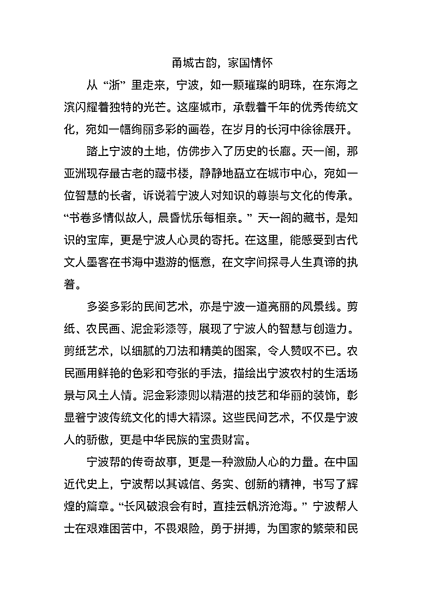

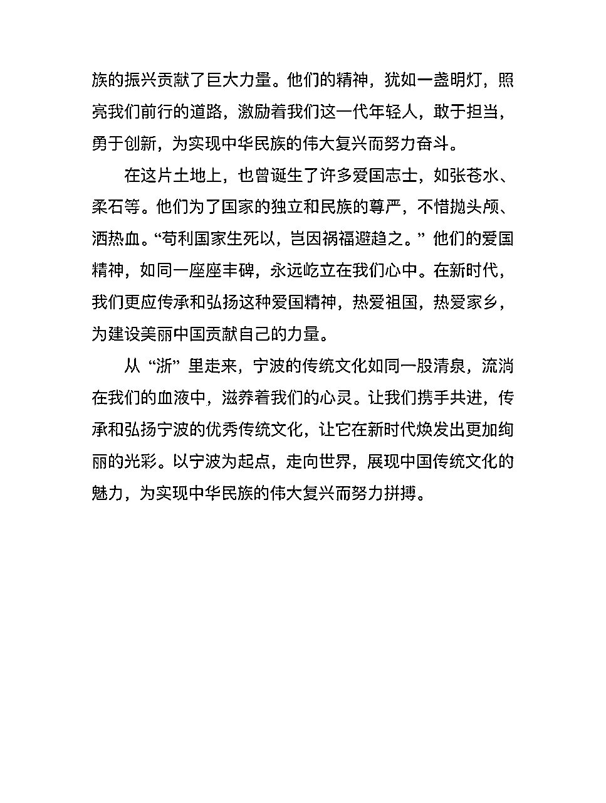

请你模仿我上传的这篇新闻稿的语言风格，写一篇新的关于企业参加展会的通讯稿，字数在1100字左右，内容要求如下：

1.【展会信息】

展会名称:第 90 届中国国际医疗器械博览会(称CMEF)

展会时间:2024年10月12-15日

展会地点:深圳国际会展中心

2.【企业信息】

企业名称:美客医疗

主营业务:专注于研发、生产和销售呼吸类医疗产品参展产品:1便携式制氧机、小型医用制氧机、弥散式制氧机参展新品:宠物氧舱、高压氧舱(重点介绍)

3.【要求】

文章以新品为重点，介绍企业的优势多结合国家发展政策，如银发经济、新质生产力等

新品的详细资料也已上传

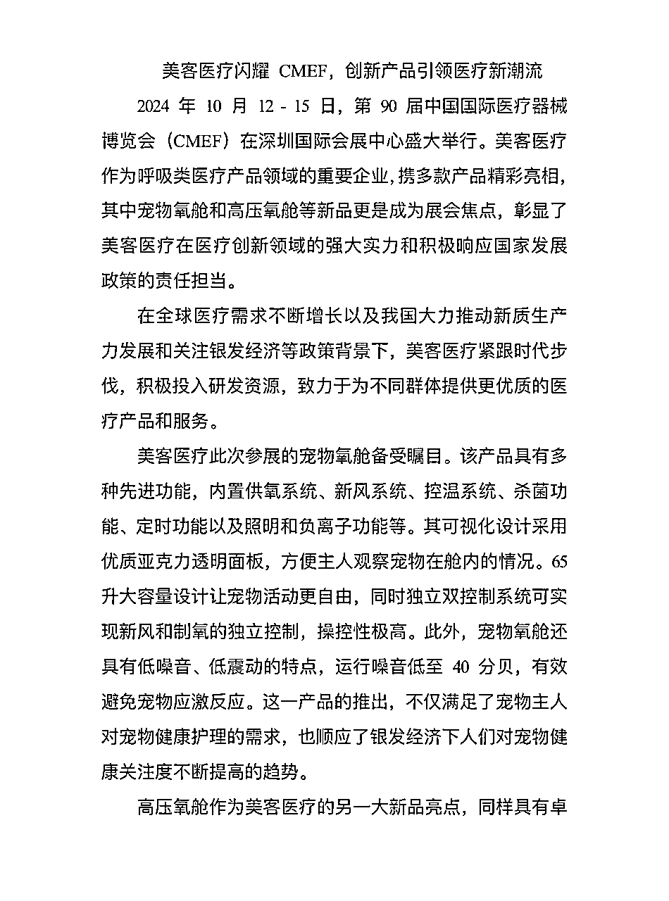

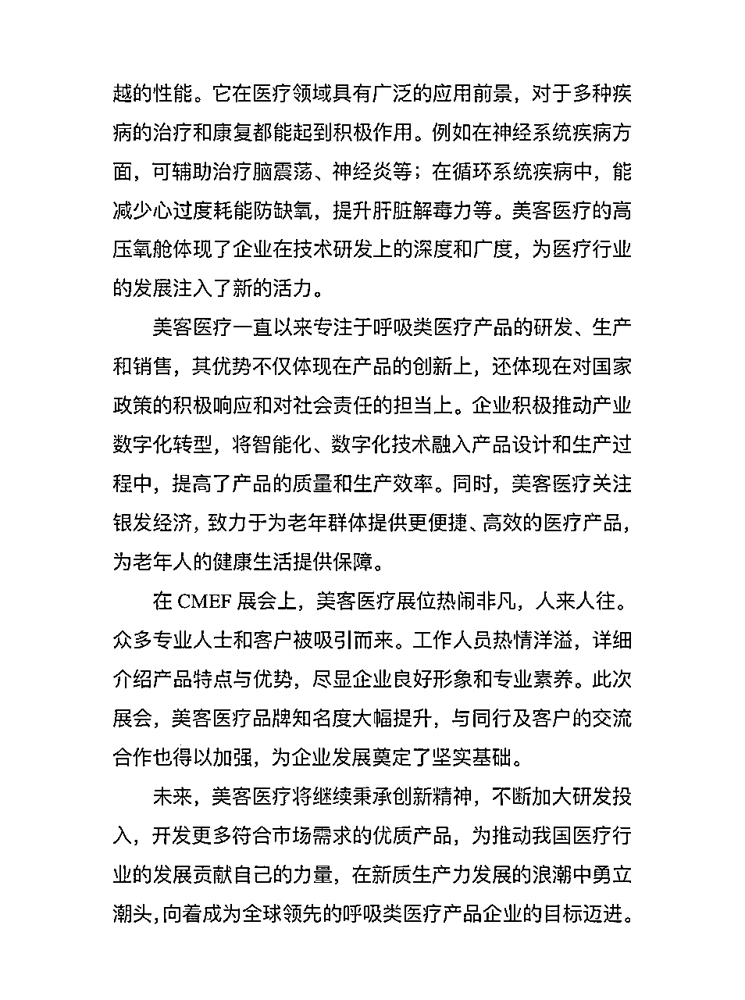

# 10. 自己做流量，才能放大收益

AI 写作变现的底层逻辑和其它项目一样：流量-转化-变现。想做大，靠别人派单不够，自己在各平台做获客更好。

自己掌握流量，不仅议价权更高，成交价也更高。反复沟通报价、交付的过程中，销售、转化、私域运营、个人 IP、内容感都会被锻炼，这些底层能力未来可迁移。看着作品上热搜、客户一个个进微信并成交，那种成就感会让人上头。

以上就是全部分享，感谢赚钱，也感谢互联网带来的可能性。

感谢我搭档小鹅，认知高执行力强，和她一起一个个解决卡点，让我收入越来越稳，也越来越有自信。难的时候她总说：“这很正常，没啥大不了。”对，一切都没那么可怕，做了再说。

路还长，内核稳比短期收益更重要。

有问题欢迎评论区交流，一起进步！