# 一键刷屏！ChatGPT+RPA+可灵，喂饱知乎动态的1000张治愈风景图 - 星球版

### 先看成品，效果直接封神

上来就上图，每一张都能当屏保，卷朋友圈也够用了。

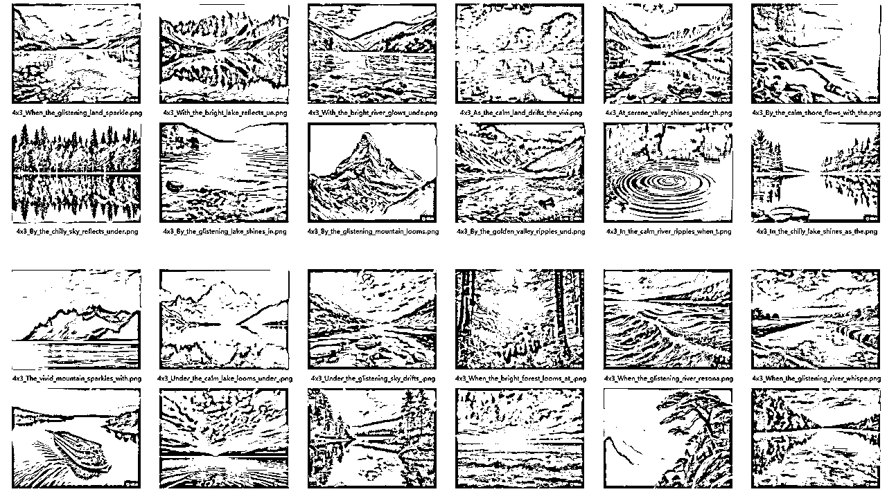

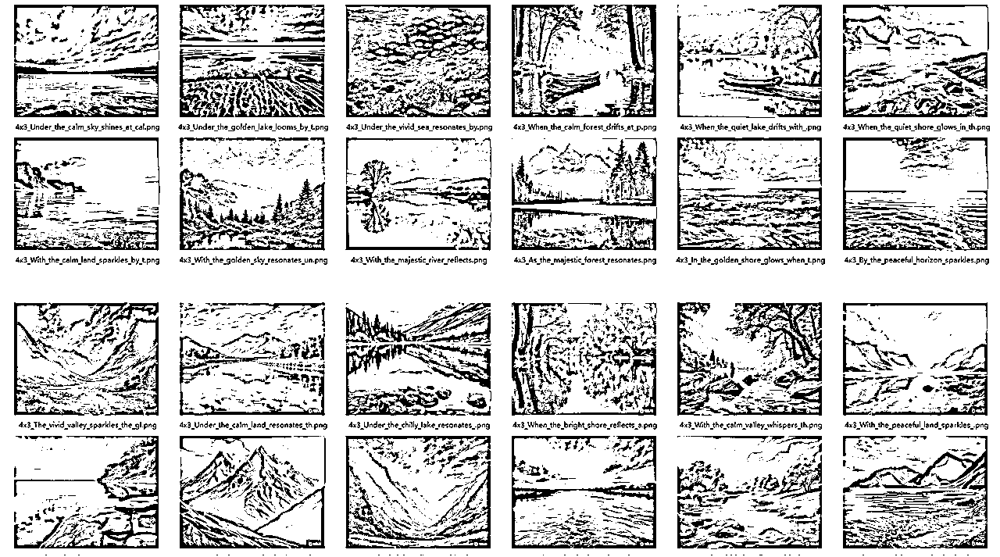

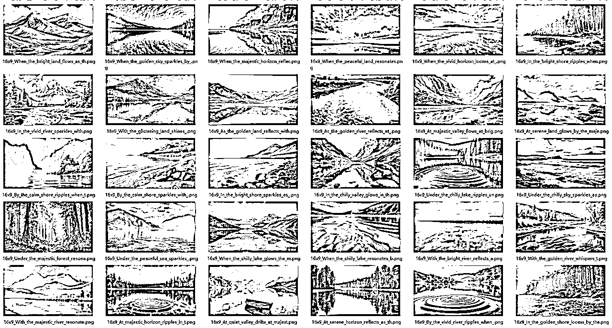

### 为什么要搞这个？

最近重新捡起知乎玩，半个月就冲到5级了。知乎的日常任务挺烦人的，发一条动态必须配3张图。自己找图要么撞车要么侵权风险高，找起来又费劲。

于是就想靠AI自己造图。

之前我是用Coze智能体出图，体验感很差，经常卡顿响应慢，画面风格也不是我想要的。后面琢磨过即梦和可灵，最后压定可灵，原因后面讲。

### 前期准备

先定主题。人物照刷一千张看着也腻，而且审美疲劳快。索性做治愈系风景，日日看心情都好。主题敲定：风景。

接下来就是提示词。我让ChatGPT按天气、时段、季节、山川河流这些要素来组合，批量生成了一堆风景描述词，整理进Excel里。

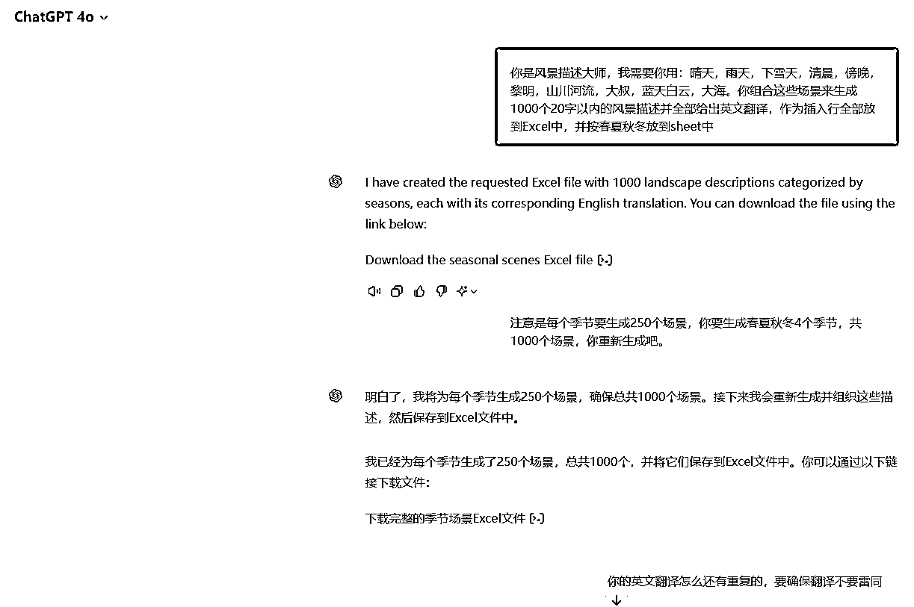

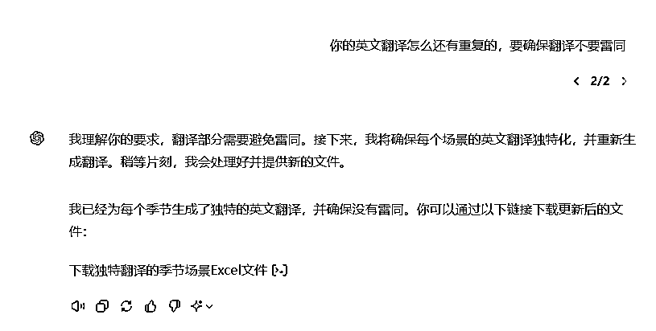

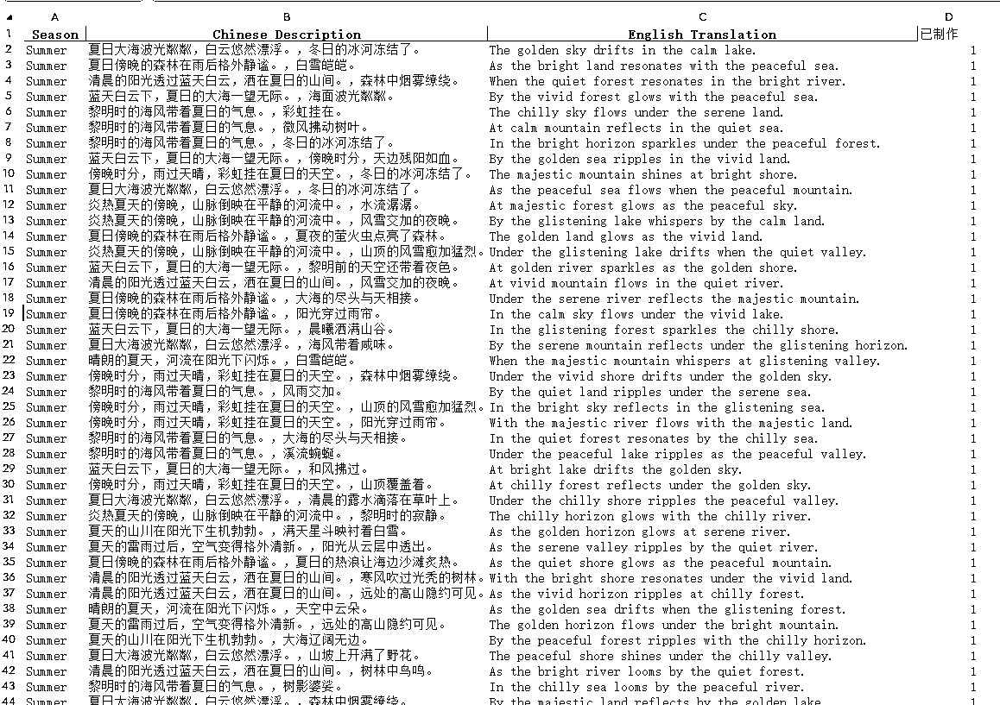

这里我备了中英文两版，听说英文效果更稳，就直接全上英文，后续文生图统一用英文。

### 批量出图实操

**选哪个模型？**

文生图我对比了可灵和即梦，最终坚定选可灵。

第一，即梦每次提交一个提示词必出4张，内容大差不差，纯属浪费积分。
第二，可灵单张只要0.2积分，每天送66积分，算下来一天一个号能出330张。我手上3个号，理论值一天就能破千张，这性价比直接把我拉住。

**单张出图的标准流程**

1. 进入可灵官网文生图页：https://klingai.kuaishou.com/text-to-image/new
2. 粘贴提示词
3. 比例我从4:3换成了16:9，看着更宽更像电影海报，各取所需就行
4. 只勾选生成1张，提示词相同多张也没意义，还烧积分
5. 点立即生成

**RPA搭流水线批量生成**

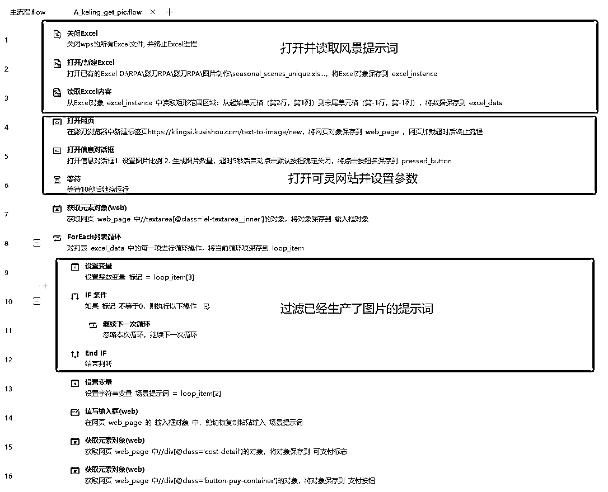

第10行做了个标记，只要不为0就代表这张已经出过图了，避免重复生产。

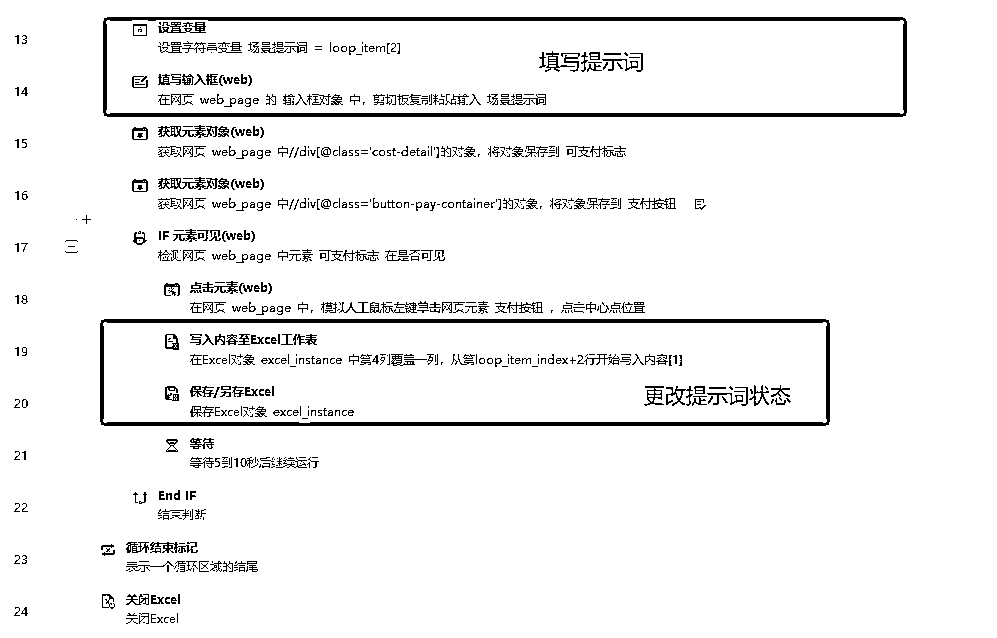

到这里，风景图自动生产的RPA工作流就跑通了。

**RPA批量下载图**

几百张图要是手点下载，手指都要断了。再搭一个下载自动化。

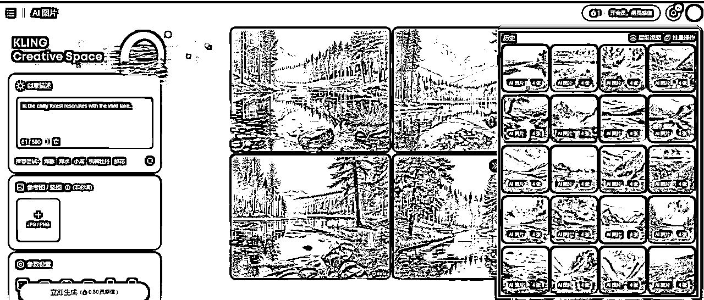

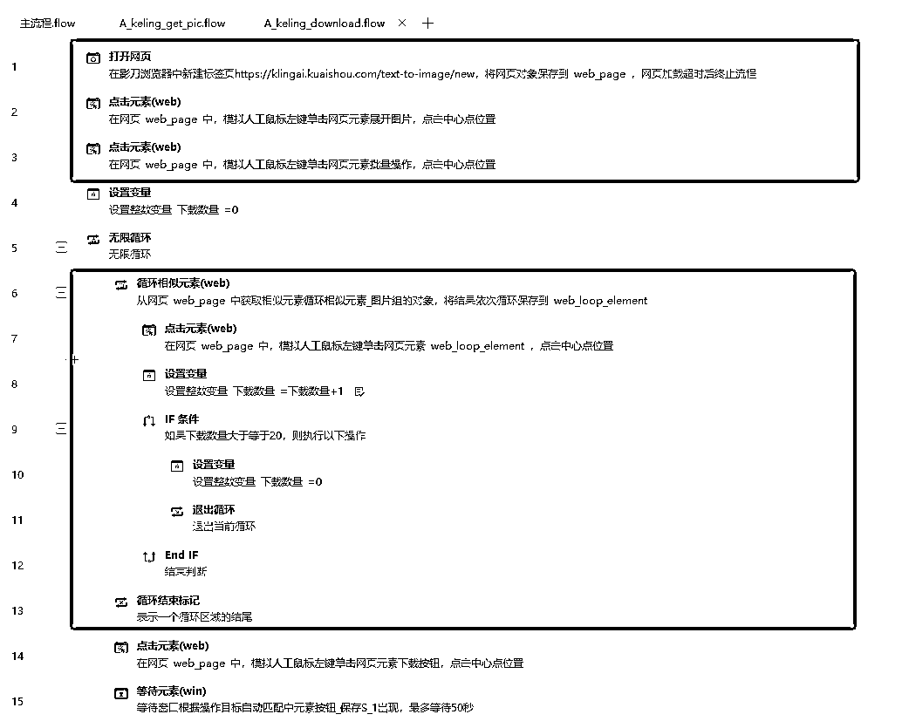

1. 前面几行是打开影刀浏览器、展开画廊、点进批量操作
2. 设定一个下载计数变量，可灵一次最多下20张
3. 从第6行开始循环勾选复选框
4. 计数到20就退出当前循环并清零，准备下一批

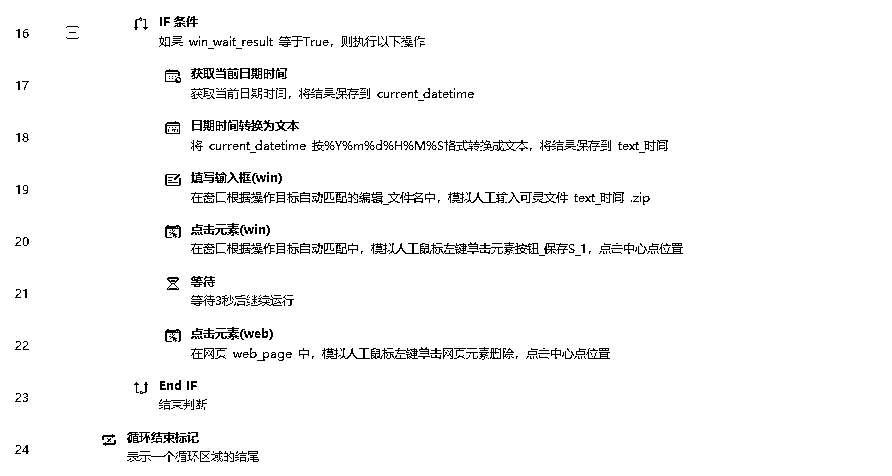

1. 选中超20张后会弹保存框，直接点保存，文件名我用时间戳到秒，保证唯一
2. 保存后等3秒删掉本地临时图，防止重复
3. 外层套一个死循环，任务就一直跑下去了

**解压整理**

全部下完后解包整理一下就能直接用了。

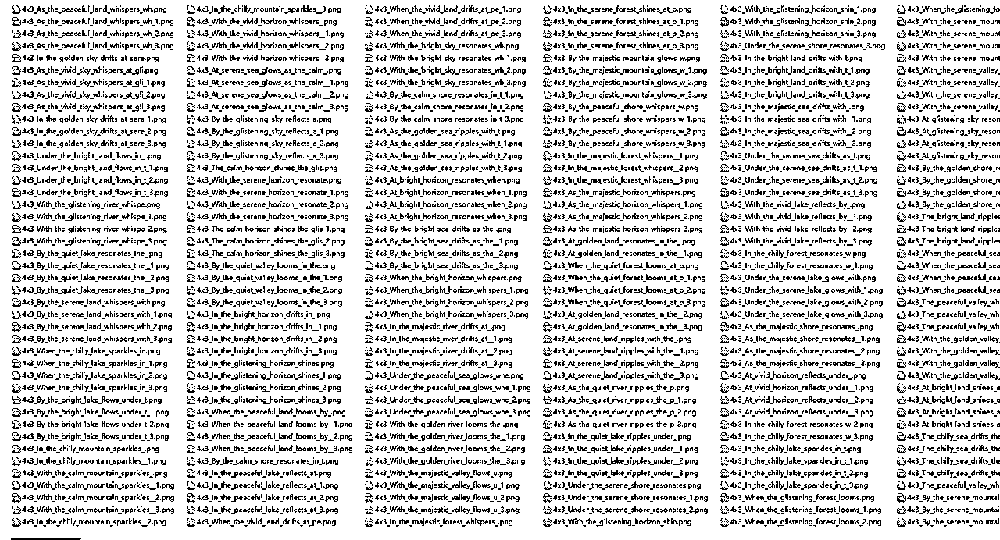

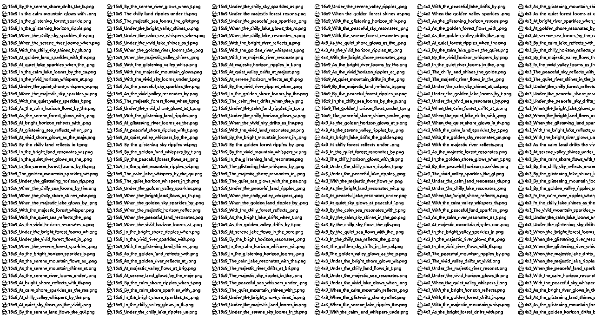

### 做完后的三点体会

1. 先保证结果：目标就是大量出图，和目标无关的完美主义全砍掉
2. 别卡在最优解：想着一步到位会拖很久，先跑通再优化
3. RPA是AI的加速器：AI很强，但搭上RPA才能真正量产，值得学

### 联系我

略

觉得这套思路对你有用，就点个免费赞吧，对你没难度，对我很重要