# 用本地化 AI 管线把抖音、📕、B站的爆款脚本日均薅到 2 万条以上
作者：龙哥


做短视频，热点跟得上、爆款能复盘，内容才有源头活水。市面上通用的轻抖、通义这类工具，只能一条条手动扒文案，面对海量账号的批量采集需求根本扛不住。下面这套我亲测自用的本地化工作流，通过私有部署的方式，结合 whisper / sensevoice 等语音识别模型，轻松实现对抖音、📕、B站、视频号等平台日均 2 万+ 条视频文案的自动化提取。

### 完整链路拆解

1. 视频素材采集：RPA 脚本、自主开发的小爬虫或第三方采集工具都可以，核心是按策略筛出对标账号的作品清单。
2. 无水印解析与下载：本地或服务器部署开源解析项目，输入目标平台的作品链接，拿到去水印视频直链并批量下到本地。
3. 视频转音频：用 ffmpeg 把下载好的视频转成音频，为后续转写做准备。
4. 语音转文本：调用 whisper 或 sensevoice 做语音识别。sensevoice 追求极致速度，whisper large 在准确率上更占优，根据场景自行取舍。
5. 数据清洗与二次加工：把识别结果喂给大模型做去噪、格式化、分段，重写后导出成可分析的表格或数据库。

这套方案的吞吐量很夸张。以 sensevoice 为例，在我的 4070Ti Super 上，处理一条抖音/📕短视频基本 3-5 秒搞定，B站长视频 30 秒内也能完成。一旦打开并发，单日峰值处理量可达约 2.6 万条，多平台累计时长轻松突破 1000 小时。

### 硬件配置建议

想跑稳跑快，硬件不能太将就：

* GPU：建议显存 8G 起步，能更好释放 whisper 和 sensevoice 的算力。实测 16G 显存的卡在多数视频上使用率在 40% 以上，8G 也完全可用。
* 内存：32GB 以上比较舒服，能保证多线程下载+转录同时跑不卡顿。

### 环境搭建前置

1. 安装语音识别引擎：二选一即可
* faster-whisper：PyPI 一键装，首次启动会自动拉模型。推荐 large-v3，参数量大、识别更准，但对显卡要求高、速度偏慢。
* sensevoice：阿里开源，速度极快，1 分钟音频约 1 秒转完，准确率略逊于 whisper。

2. 部署无水印解析工具：部署开源项目，输入作品链接即可返回图文详情与无水印视频地址。我参考魔改的是这个项目，上手快、投入少：https://github.com/NanmiCoder/MediaCrawler

3. 安装 ffmpeg：负责视频转音频的格式处理

下面是具体安装步骤

## 语音识别引擎安装

## 安装 faster-whisper

faster-whisper 地址：https://github.com/SYSTRAN/faster-whisper

直接从 PyPI 安装最省事，后续脚本里就能直接调用。执行：

```
pip install faster-whisper
```

如下即为安装完成

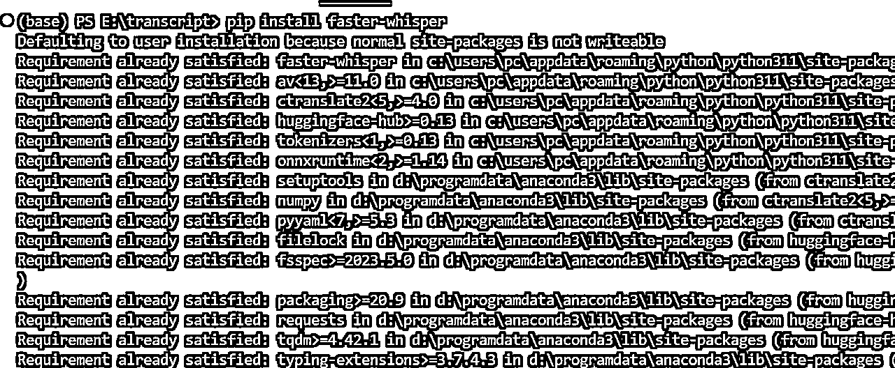

运行官方示例，首次加载会自动下载模型。我用的是 large-v3，准确率最高但转录慢，4 分钟视频约需 20 秒，sensevoice 基本不会超过 5 秒，且 whisper 的识别精度会更高一些。

网络不佳时可先从 Hugging Face 手动下载模型再本地加载，

```
from faster_whisper import WhisperModel
model_size = "large-v3"
# Run on GPU with FP16
model = WhisperModel(model_size, device="cuda", compute_type="float16")
# or run on GPU with INT8
# model = WhisperModel(model_size, device="cuda", compute_type="int8_float16")
# or run on CPU with INT8
# model = WhisperModel(model_size, device="cpu", compute_type="int8")
segments, info = model.transcribe("audio.mp3", beam_size=5)
print("Detected language '%s' with probability %f" % (info.language, info.language_probability))
for segment in segments:
    print("[%.2fs -> %.2fs] %s" % (segment.start, segment.end, segment.text))
```

这时运行脚本测试转录，文案已成功输出。

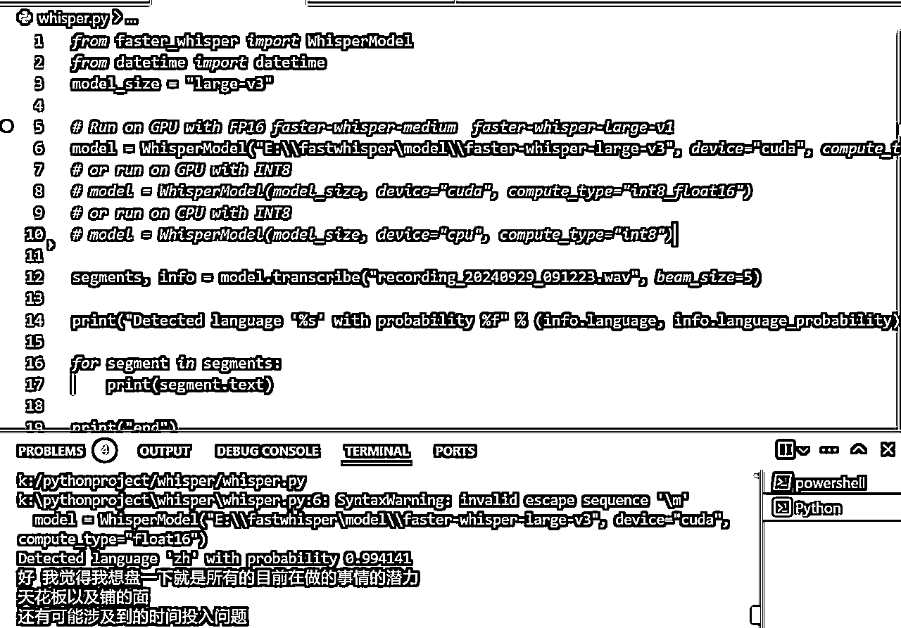

## SenseVoice 安装

sensevoice 的部署相对繁琐一些，先到项目页 https://github.com/FunAudioLLM/SenseVoice

一、使用 git 克隆代码

git clone https://github.com/FunAudioLLM/SenseVoice.git

没有 git 的话直接下载 zip 也可以

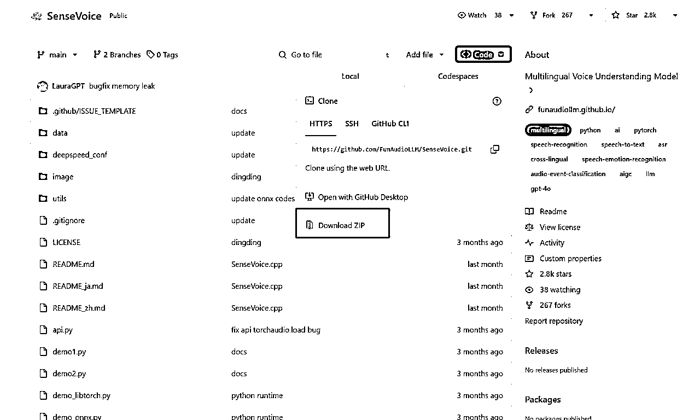

二、创建环境和安装依赖：

1. 安装 Miniconda（已有 conda 可跳过）
下载地址: https://docs.anaconda.com/miniconda/
安装成功后执行 conda --version 能看到版本号


2. 创建虚拟环境并装依赖：

```
conda create -n sensevoice python=3.8
conda activate sensevoice
```

在 conda 环境下依次执行：

```
pip install -r requirements.txt
```

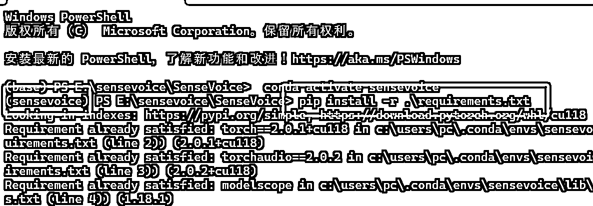

安装完后可启动 Web UI，通过浏览器打开 http://127.0.0.1:7860/ 即可看到服务已就绪

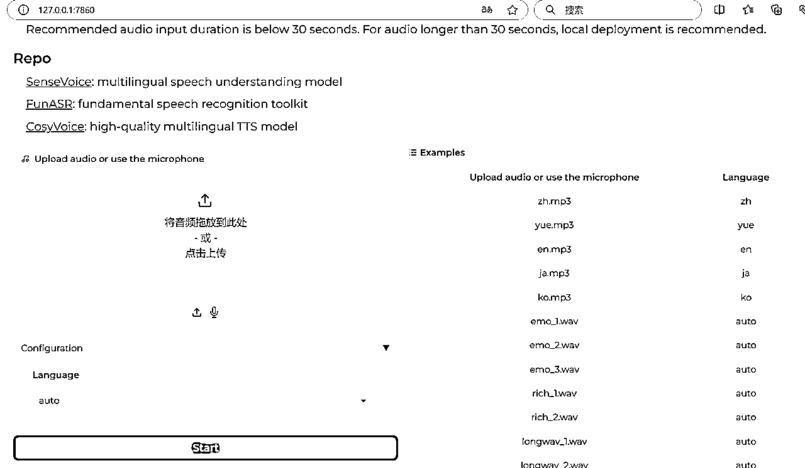

若要嵌入工作流，建议用 API/模块调用。官方也提供 API 启动方式，可指定 GPU 运行。测试时发现纯内存转录单次占用可达 40G 以上，对普通主机不友好，故暂不推荐。

API 启动方式：

```
export SENSEVOICE_DEVICE=cuda:0
fastapi run --port 50000
```

到此转录环境就准备好了，接下来做视频无水印下载环节

## 无水印下载

我采用的是 GitHub 上的开源爬虫项目，基于实际需求做了少量魔改。涉及爬虫细节就不展开，参考源项目：https://github.com/NanmiCoder/MediaCrawler

## ffmpeg 安装

官方下载页：https://ffmpeg.org//download.html
下载后解压，然后配置环境变量。

1. 打开环境变量：右键“此电脑”-属性-高级系统设置-环境变量
2. 编辑系统变量 Path：找到 Path，点编辑
3. 新增 ffmpeg bin 目录：例如 E:\ffmpeg-6.1.1-full_build\bin，按实际路径填写

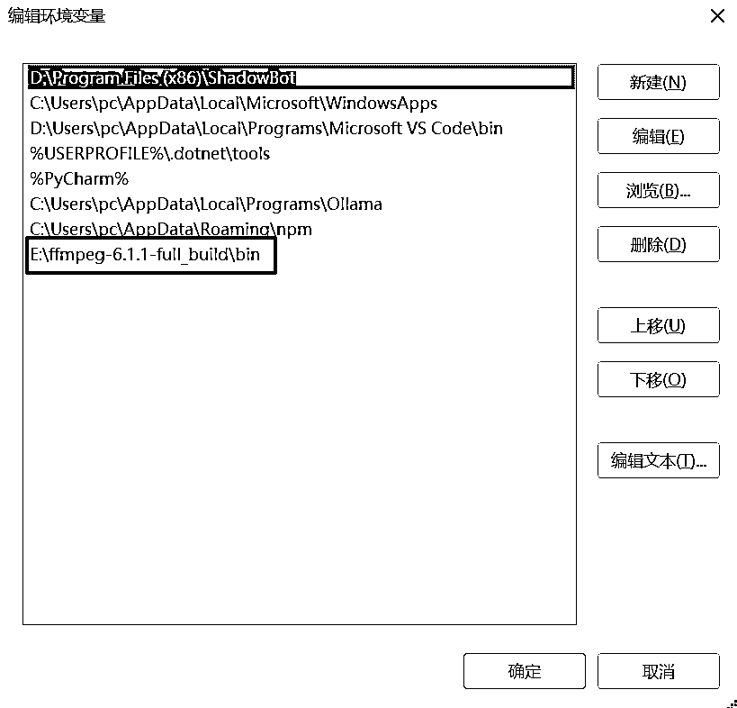

配置完成后打开 CMD，输入 `ffmpeg –version`，能返回版本信息即安装成功。

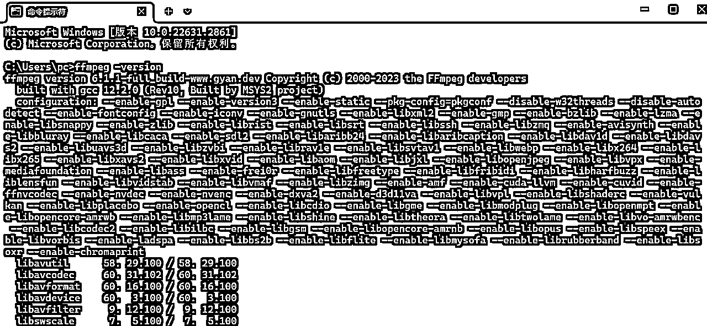

## 端到端自动化组装

上一步采集好的链接可以直接丢进脚本目录，或从自有素材库读取，按业务逻辑自定义即可。我的做法是用 Cursor 生成了一套脚本：后台线程批量负责视频下载，前端多线程负责转录，两者解耦，转录速度直接拉满。

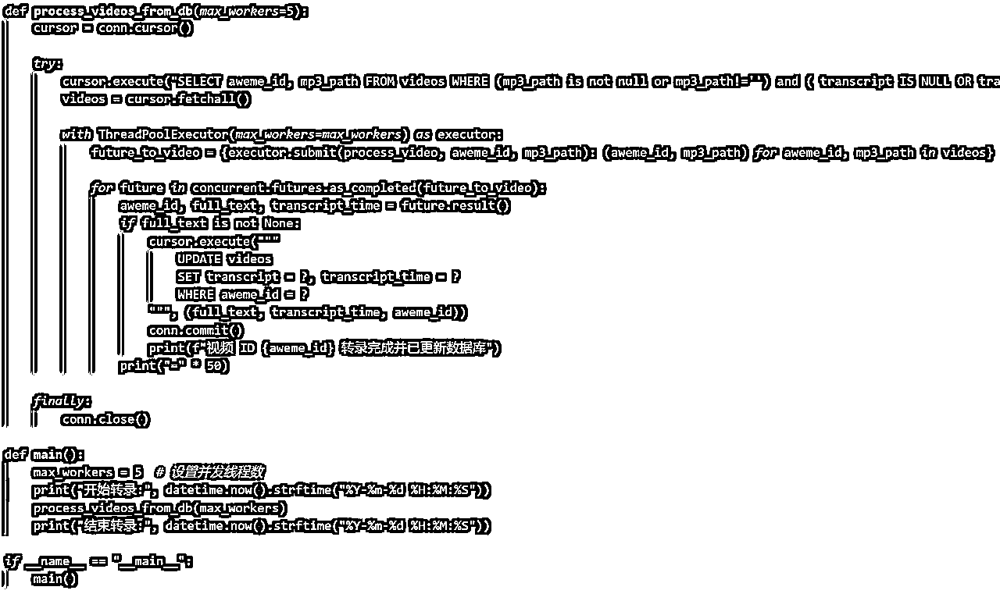

下图是 5 线程并发时的硬件占用，GPU 在 30-60% 之间浮动，效率很稳。图二是 3 线程并发转录 100 条抖音/📕/B站视频，总耗时约 6 分钟，其中还包含几个 3G 大小、长达一小时的 B站视频。


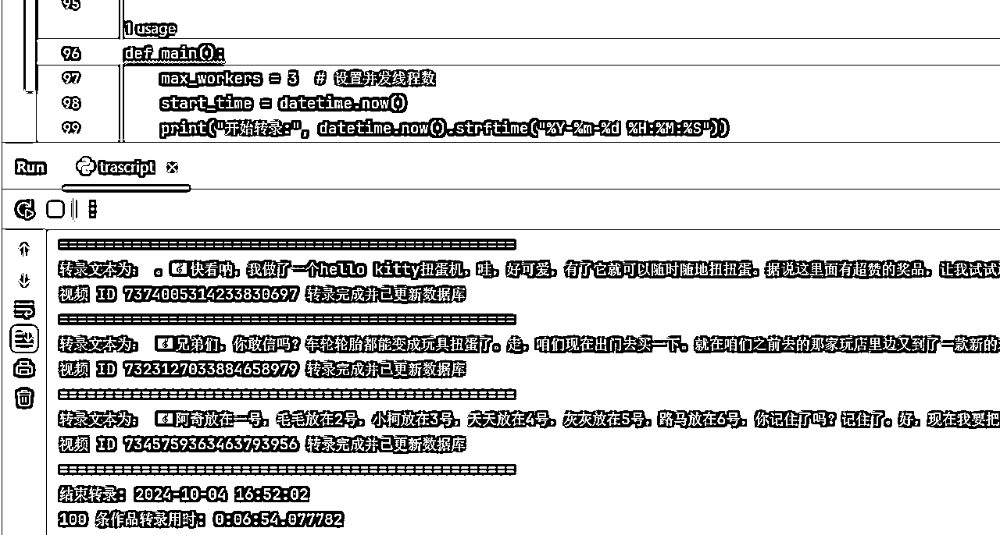

再开到 5 个线程，转录约一千条视频耗时 40 分钟左右，GPU 从未突破 60%。sensevoice 会自动标注情绪和背景音乐，用 emoji 体现，转录速度和准确度比较均衡，后续再用大模型对文案做优化重写即可。整体效果完全达到预期。

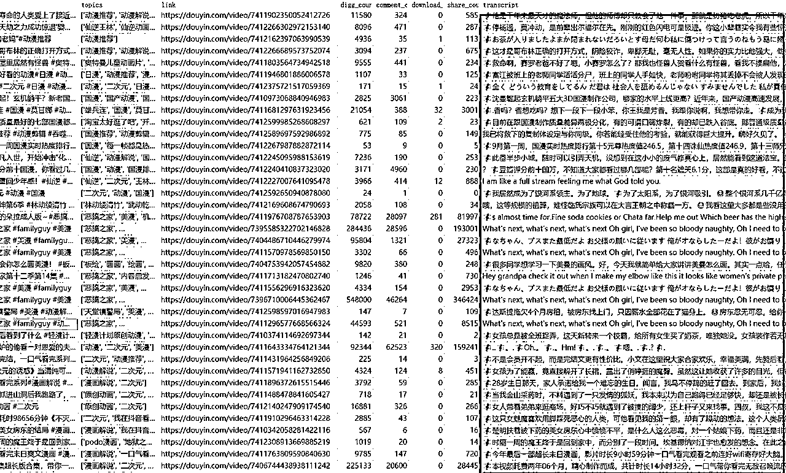

完整下载+转录脚本已整理好，代码基本靠 Cursor 一次生成。8666 端口为视频解析服务，基于前文提到的爬虫部署；8000 端口为 sensevoice 转录服务，同样可替换为 faster-whisper。脚本如下：

```
def whisper(file_path):
    # 在 GPU 上使用 FP16 运行 faster-whisper-large-v3 模型
    model = WhisperModel("E:\\fastwhisper\model\\faster-whisper-large-v3", device="cuda", compute_type="float16")
    segments, info = model.transcribe(file_path, beam_size=5)
    print("Detected language '%s' with probability %f" % (info.language, info.language_probability))
    texts = []
    for segment in segments:
        texts.append(segment.text)
        print(segment.text)
    full_transcript = '\n'.join(texts) 
    return full_transcript
```

下载脚本：

```
import sqlite3
from datetime import datetime
import requests
import os
from tqdm import tqdm
import subprocess
from datetime import datetime
from concurrent.futures import ThreadPoolExecutor, as_completed

def get_video_url(link):
    url = "http:/localhost:8666"
    response_content_body = requests.request("POST", url, data={'url': link})
    res_data = response_content_body.json()

    url = res_data['video_url']
    return url
import shutil
def convert_to_mp3(video_path, output_dir='downloads'):
    """
    使用 ffmpeg 将视频转换为 mp3

    :param video_path: 视频文件路径
    :param output_dir: 输出目录
    :return: mp3 文件路径
    """
    # 确保输出目录存在
    os.makedirs(output_dir, exist_ok=True)

    # 生成输出文件名
    video_filename = os.path.basename(video_path)
    mp3_filename = os.path.splitext(video_filename)[0] + '.mp3'
    mp3_path = os.path.join(output_dir, mp3_filename)

    # 检查 MP3 文件是否已存在
    if os.path.exists(mp3_path):
        print(f"MP3 文件已存在：{mp3_path}")
        return mp3_path

    ffmpeg_dir = r"E:\ffmpeg-6.1.1-full_build\bin"
    os.environ["PATH"] = ffmpeg_dir + os.pathsep + os.environ["PATH"]

    # 尝试找到 ffmpeg
    ffmpeg_path = shutil.which('ffmpeg')
    if ffmpeg_path is None:
        print("错误：无法在系统路径中找到 ffmpeg。")
        print("当前系统 PATH：", os.environ.get('PATH'))
        return None

    print(f"找到 ffmpeg 路径：{ffmpeg_path}")

    # 构建 ffmpeg 命令
    command = [
        ffmpeg_path,
        '-i', video_path,
        '-vn',  # 不包含视频
        '-acodec', 'libmp3lame',  # 使用 MP3 编码器
        '-q:a', '2',  # 音频质量，2 是较好的质量
        mp3_path
    ]

    try:
        # 执行 ffmpeg 命令
        print(f"执行命令：{' '.join(command)}")
        result = subprocess.run(command, check=True, stdout=subprocess.PIPE, stderr=subprocess.PIPE, text=True, encoding='utf-8', errors='replace')
        print(f"命令输出：\n{result.stdout}\n{result.stderr}")
        print(f"已成功将视频转换为 MP3：{mp3_path}")
        return mp3_path
    except subprocess.CalledProcessError as e:
        print(f"转换失败：{e}")
        print(f"错误输出：\n{e.stdout}\n{e.stderr}")
        return None
    except FileNotFoundError:
        print("错误：尽管在系统路径中找到了 ffmpeg，但无法执行。请检查文件权限。")
        return None
def download_video(video_info, output_dir='downloads'):
    """
    根据给定的URL下载视频并保存到指定路径,同时显示下载进度
    如果文件已存在，则直接返回文件路径

    :param video_info: 包含视频信息的字典
    :param output_dir: 保存视频的目录，默认为'downloads'
    :return: 保存的文件路径
    """
    url = video_info['url']
    title = video_info['title']

    # 创建安全的文件名，并限制长度
    safe_title = "".join([c for c in title if c.isalnum() or c in (' ', '-', '_')]).rstrip()
    safe_title = safe_title[:10]  # 限制标题长度为10个字符
    output_path = os.path.join(output_dir, f"{safe_title}.mp4")

    # 如果文件名仍然太长，使用哈希值作为文件名
    if len(output_path) > 255:
        import hashlib
        hash_object = hashlib.md5(title.encode())
        safe_title = hash_object.hexdigest()
        output_path = os.path.join(output_dir, f"{safe_title}.mp4")

    # 确保输出路径是绝对路径
    output_path = os.path.abspath(output_path)

    # 检查文件是否已存在
    if os.path.exists(output_path):
        print(f"文件 '{output_path}' 已存在，跳过下载。")
        return output_path
    headers = {
        'User-Agent': 'Mozilla/5.0 (Windows NT 10.0; Win64; x64) AppleWebKit/537.36 (KHTML, like Gecko) Chrome/91.0.4472.124 Safari/537.36',
    }

    response = requests.get(url, stream=True, headers=headers)
    response.raise_for_status()  # 如果请求不成功则抛出异常

    # 获取文件大小
    total_size = int(response.headers.get('content-length', 0))

    # 确保输出目录存在
    output_dir = os.path.dirname(output_path)
    if output_dir:
        os.makedirs(output_dir, exist_ok=True)

    # 使用tqdm创建进度条
    with open(output_path, 'wb') as file, tqdm(
        desc=os.path.basename(output_path),
        total=total_size,
        unit='iB',
        unit_scale=True,
        unit_divisor=1024,
    ) as progress_bar:
        for data in response.iter_content(chunk_size=1024):
            size = file.write(data)
            progress_bar.update(size)

    return output_path

# 新增函数:从数据库读取aweme_id和link
def get_video_links_from_db(db_path, limit=800):
    """
    从SQLite数据库中读取aweme_id和link

    :param db_path: 数据库文件路径
    :param limit: 限制读取的记录数,默认为10
    :return: 包含aweme_id和link的列表
    """
    conn = sqlite3.connect(db_path)
    cursor = conn.cursor()
    cursor.execute("SELECT aweme_id, link FROM videos WHERE video_path IS NULL LIMIT ?", (limit,))
    results = cursor.fetchall()
    conn.close()
    return results

# 新增函数:更新数据库中的视频和音频路径
def update_video_paths(db_path, aweme_id, video_path, mp3_path):
    """
    更新数据库中指定aweme_id的视频和音频路径

    :param db_path: 数据库文件路径
    :param aweme_id: 视频的aweme_id
    :param video_path: 下载的视频文件路径
    :param mp3_path: 生成的MP3文件路径
    """
    conn = sqlite3.connect(db_path)
    cursor = conn.cursor()
    cursor.execute("UPDATE videos SET video_path = ?, mp3_path = ? WHERE aweme_id = ?", 
                   (video_path, mp3_path, aweme_id))
    conn.commit()
    conn.close()
def process_video(db_path, aweme_id, link):
    try:
        link = link.replace('douyin.com', 'iesdouyin.com')
        print(f"处理链接: {link}")

        video_url = get_video_url(link)
        if video_url:
            downloaded_file = download_video(video_url)
            # 转换视频为 MP3
            mp3_file = convert_to_mp3(downloaded_file)
            if mp3_file:
                print(f"MP3 文件已生成: {mp3_file}")
                print("开始调用:", datetime.now().strftime("%Y-%m-%d %H:%M:%S"))
                # 更新数据库中的视频和音频路径
                update_video_paths(db_path, aweme_id, downloaded_file, mp3_file)
        else:
            print("无法获取视频信息")

        print("=" * 50)  # 分隔不同链接的处理结果
    except Exception as e:
        print(f"处理链接 {link} 时发生错误: {e}")

# 修改主程序
def main(max_workers=5):
    db_path = "douyin_data.db"
    video_links = get_video_links_from_db(db_path)

    with ThreadPoolExecutor(max_workers=max_workers) as executor:
        futures = [executor.submit(process_video, db_path, aweme_id, link) for aweme_id, link in video_links]

        for future in as_completed(futures):
            future.result()  # 这里可以处理每个任务的结果，如果需要的话

if __name__ == "__main__":
    main(max_workers=10)  # 设置10个并发线程
```
这是一份由语音转成的文字实录——一个保留原声细节的“文字镜像”。它让每一句话都落到纸面上，重要信息不再转瞬即逝。无论是快速回顾、精确引用，还是二次剪辑，这份文本都能成为得力助手。现在，就请让文字带你“听”见当时的声音。

```
import requests
import os
from tqdm import tqdm
from faster_whisper import WhisperModel
from datetime import datetime
import sqlite3
from concurrent.futures import ThreadPoolExecutor
import concurrent.futures
from datetime import datetime

def call_asr_api(file_path, language="auto"):
    # API端点
    url = "http://localhost:8000/transcribe/"
    # 准备文件
    with open(file_path, 'rb') as audio_file:
        files = {'audio_file': (os.path.basename(file_path), audio_file)}
        # 发送POST请求
        response = requests.post(url, files=files)
    # 检查响应
    if response.status_code == 200:
        return response.json()["transcription"]
    else:
        return f"错误: {response.status_code}, {response.text}"

def process_video(aweme_id, mp3_path):
    print(f"处理视频 ID: {aweme_id}")
    if os.path.exists(mp3_path):
        try:
            full_text = call_asr_api(mp3_path)
            print("转录文本为：", full_text)
            transcript_time = datetime.now().strftime("%Y-%m-%d %H:%M:%S")
            return aweme_id, full_text, transcript_time
        except Exception as e:
            print(f"处理视频 ID {aweme_id} 时出错: {str(e)}")
            return aweme_id, None, None
    else:
        print(f"MP3 文件不存在: {mp3_path}")
        return aweme_id, None, None

def process_videos_from_db(max_workers=5):
    db_path = 'douyin_data.db'
    conn = sqlite3.connect(db_path)
    cursor = conn.cursor()
    try:
        cursor.execute("SELECT aweme_id, mp3_path FROM videos WHERE (mp3_path is not null or mp3_path!='') and ( transcript IS NULL OR transcript = '')")
        videos = cursor.fetchall()

        with ThreadPoolExecutor(max_workers=max_workers) as executor:
            future_to_video = {executor.submit(process_video, aweme_id, mp3_path): (aweme_id, mp3_path) for aweme_id, mp3_path in videos}

            for future in concurrent.futures.as_completed(future_to_video):
                aweme_id, full_text, transcript_time = future.result()
                if full_text is not None:
                    cursor.execute("""
                        UPDATE videos 
                        SET transcript = ?, transcript_time = ? 
                        WHERE aweme_id = ?
                    """, (full_text, transcript_time, aweme_id))
                    conn.commit()
                    print(f"视频 ID {aweme_id} 转录完成并已更新数据库")
                print("=" * 50)

    finally:
        conn.close()
def main():
    max_workers = 5  # 设置并发线程数
    print("开始转录:", datetime.now().strftime("%Y-%m-%d %H:%M:%S"))
    process_videos_from_db(max_workers)
    print("结束转录:", datetime.now().strftime("%Y-%m-%d %H:%M:%S"))

if __name__ == "__main__":
    main()
```

平时做批量音视频转写，用来跑后台任务确实省心，但操作层面还是有优化空间。我琢磨着下一步就做一个更友好的GUI，把整个流程打磨得更顺手。

不过零散的日常视频也挺多的，每次单独搞又麻烦。索性一步到位，在飞书和🛰️里各挂一个机器人，需要时直接丢给它就好。下面是我自己跑通的效果。实现方式可以选择开源的wechatpy，也可以走hook协议，技术细节就不展开了。GitHub上搜“wechatpy”能翻到很多改好的项目，找个现成的版本稍作调整，用小号就能直接用起来。


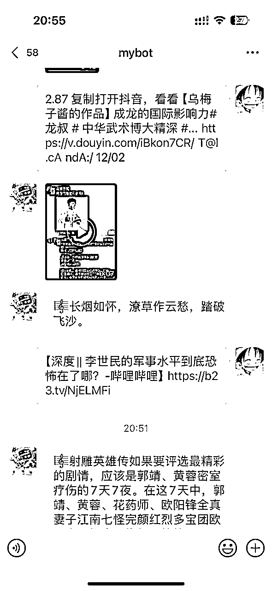

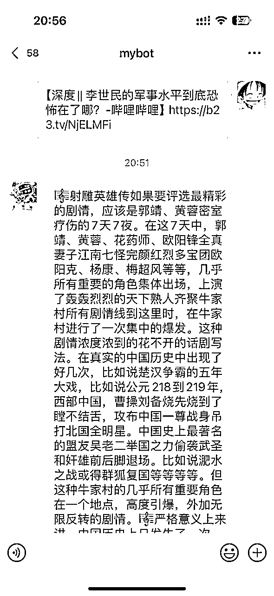

接下来的计划：

1. 智能分析：把AI加进来，自动做主题分类、文案二次润色，还能顺带完成分发。

2. 实时监控：上线一套监控机制，第一时间捕捉最新爆款文案。

3. 包装GUI：把操作入口做得更轻、更快、更简单。