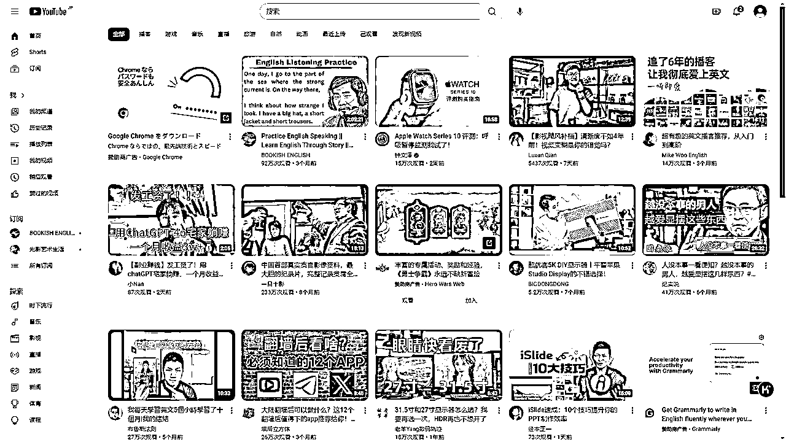
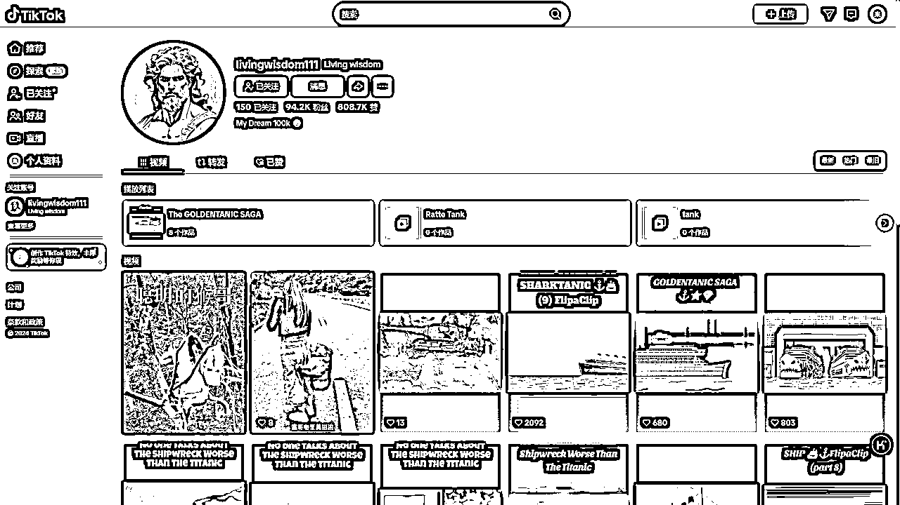
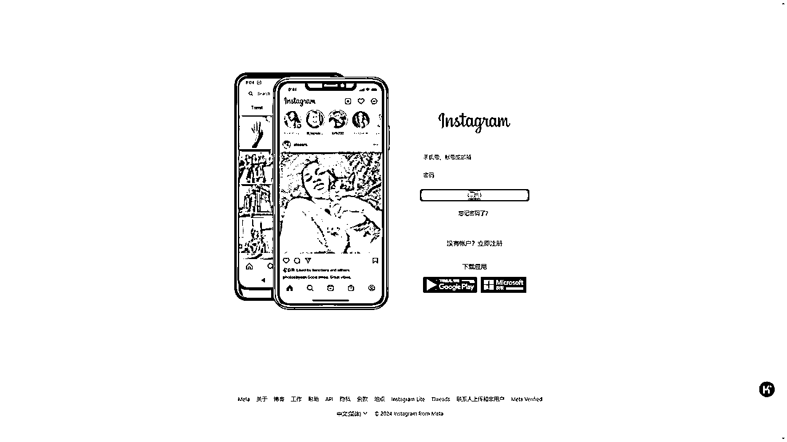
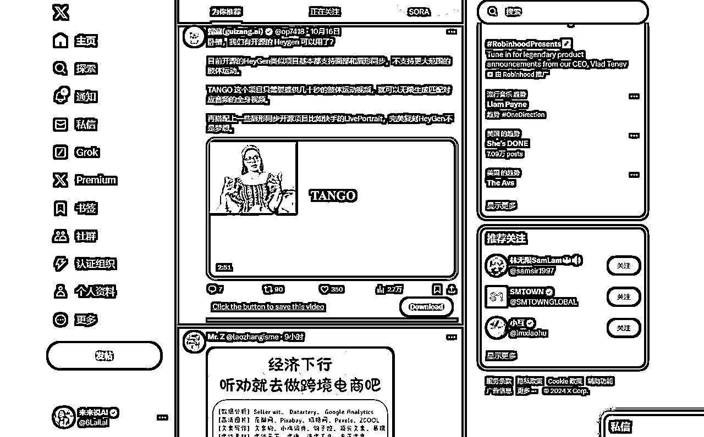
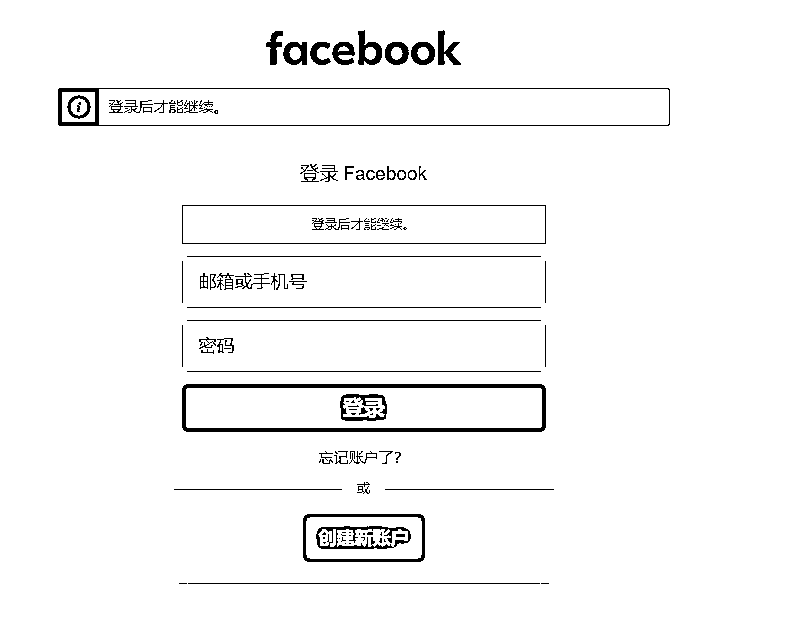
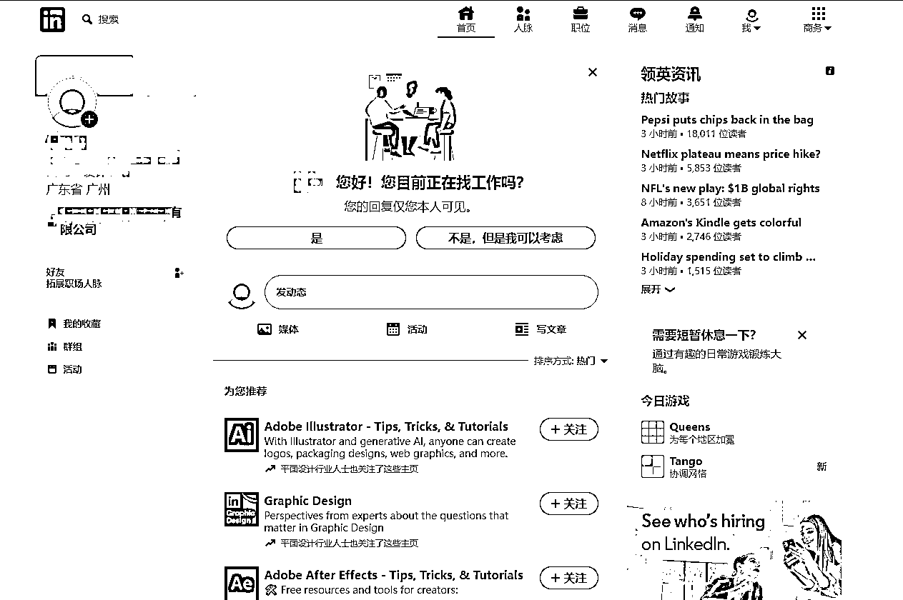

# 出海项目必备：海外社媒研究工具全景手册【含工具清单、官网、优劣势、适用场景及付费方式】
作者：龙哥

做海外市场研究，选对平台工具比盲目投放更重要。下面这份清单覆盖了当前出海团队最常用的8大品类社媒研究工具，每类都整理了工具名称、官网入口、优缺点、使用场景和收费情况，帮助你快速判断投入产出比。

注意：清单中存在部分功能重叠的工具，选择时建议按目标人群和内容形态来取舍。

### 视频类：YouTube

### 视频类：TikTok

### 图片类：Instagram

### 图片类：Pinterest

### 聊天类：Snapchat

### 社交类：Twitter

### 社交类：Facebook

操作风险较高，账号封禁情况比较普遍，做项目时一定要把投放地域固定好、规范好。

### 职场类：LinkedIn

### 使用说明
使用常见：以上工具的受欢迎程度和功能评价，均源于大众市场的普遍认可度与用户口碑的主观判断，并非基于真实的使用量统计数据。

### 参考来源
youtube工具来源：https://www.wpade.com/zh-CN/best-youtube-seo-tools.html

tiktok工具来源：https://www.cifnews.com/article/149693

介绍了8大类常用海外社交软件的营销类型：https://www.woshipm.com/marketing/5245364.html