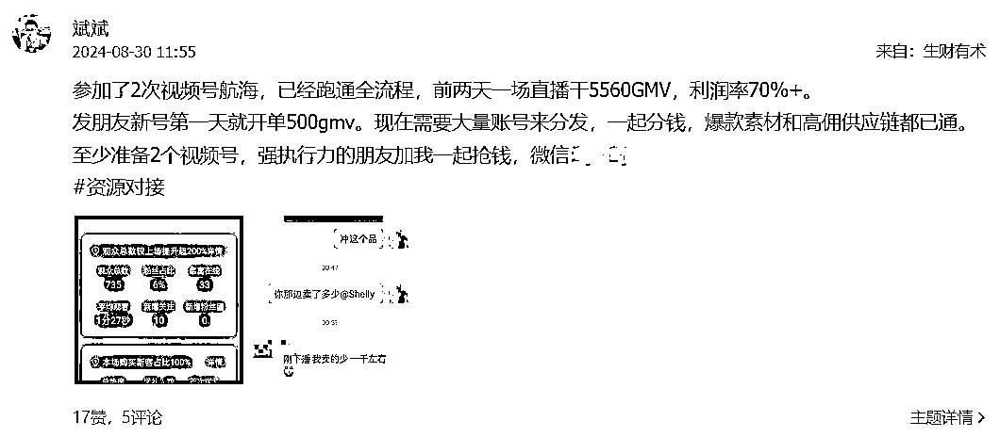
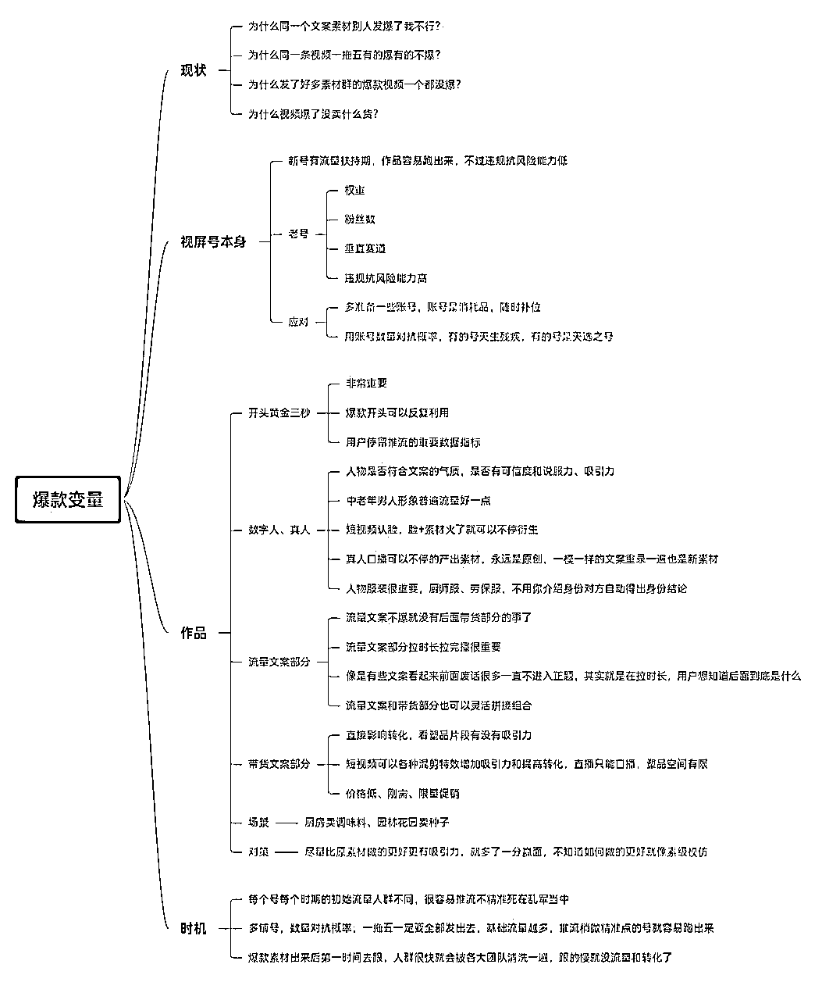

# 视频号数字人带货：我带百人团队跑通变现闭环，月GMV近10万，真实复盘

先摆数据，让圈友看得明白：过去一个月，我带着一百多位圈友跑视频号数字人带货，大盘销售额接近10万，累计发放佣金5万多，整体变现率超过30%。有2位圈友单月收入破万，十多人赚到四位数，其余参与变现在几十到几百元区间。

这个成绩算不上耀眼，但贵在真实、且在持续爬坡。如果这篇复盘能给你哪怕一点启发，就没白写。

---

## 一、我是谁

我叫斌斌，2024年4月加入龙哥盟，到目前累计利润大约10万。放在大佬云集的圈子里确实不起眼，但这是我自己一步步走出来的——之前好几年，我在副业上几乎颗粒无收，试过各种项目，撞过各种南墙，仿佛被困在0到1的循环里出不来。

加入赚钱后的几个月，我能清楚感受到自己的变化，每一步虽然不大，但方向对了，路就不会白走。

我的第一笔比较大的收入来自👸号爆文，当时写了50篇，出了11篇10万+，单月收入2.2万+，之前有帖子专门聊过。再往后，重心就转到了视频号，也是今天要展开的主题。

## 二、为什么会选视频号

早在2019年，我就碰过视频号和抖音。当时对自己的能力过于乐观，不混任何圈子，瞧不上搬运和二次创作，执拗地单打独斗，结果毫无意外地失败了。

进了赚钱后，我第一次航海参加的是视频号口播项目。因为人在外地出差，每天还要挤出时间更新👸号文章，视频号只拍了寥寥几条。可偏偏这几条，居然带回了100块收益。更受刺激的是，同群有圈友靠视频号几天时间做到了几千甚至上万。

那一刻我确信：视频号正处在红利窗口期。可航海结束后，素材从哪来成了问题。

视频号像一座信息孤岛，没有第三方工具能批量检索爆款，选品中心的佣金也没什么竞争力。我顺着赚钱里所有和"视频号"相关的帖子逐篇翻，凡是多个圈友交叉验证过的方法，我会格外上心。最后我报名了一个数字人视频号训练营（为避免广告嫌疑不点名），通过它同时解决了两个难题：每日更新的爆款素材，以及高佣供应链。

这段经历带给我的核心感悟是：想做什么事，就钻入什么圈子。前人踩过的坑，不需要你亲自再踩一遍。而且，抱团作战的力量远超个人瞎摸索。你以为的爆款是从最近一周的素材里找？我们只盯直播广场当下正在大爆的内容。

## 三、项目核心逻辑

整个玩法的链路其实不长：从直播广场抓取正在大爆的素材，用文案驱动数字人产出新视频，经过混剪去重变成新作品，发布后如果短视频火了，马上开直播挂车出货。

几个关键问题：

为什么要用正在爆的素材？因为爆过一次的内容大概率会二次爆，正在爆的爆率天然更高。

为什么不在短视频里直接挂车？因为平台会考核转化率，流量很难推起来。

面向什么人群？主打银发族。720P甚至480P画质已经够用，他们有钱有闲、不苛求画面细节，客单价可以做到拼多多的两三倍，利润空间自然更可观。

数字人和真人怎么选？真人口播考验表现力，需要长期积累，但长期价值更强；数字人风格多样，表现力问题可以用SOP标准化解决，缺点是复利效应弱。

直播门槛高不高？照着稿子念就行。圈内有句俗话：只要短视频爆了，直播间拴条狗也能出单。

## 四、百人共创计划怎么来的

我准备了5个号，每个号每天发6条短视频。埋头干了大约两周，突然出了爆款——一款急救毯，单条视频打出1万GMV，利润率72%，那场直播大概两三小时，赚了7000。

后来，我又拿朋友的号做分发测试，他的号也爆了。这位朋友从没做过副业，听我指挥播了一小时，竟然也干出了1000多GMV。可见视频号直播间本质就是收银台。

那一瞬间我冒出一个念头：为什么不拉一批人一起做，把规模放大？

原因有四：

第一，一张身份证只能实名两个视频号，号多了操作起来麻烦；第二，视频号容易判违规，即使不是抠像冲量打法，也常被暂停推荐；第三，视频号支持一拖五分发，只要获得授权就不限制流量，一个素材不铺满6个号等于浪费；第四，数字人彻底抹掉了主播表现力要求，全流程SOP化，没有能力门槛，也没有瓶颈。

于是共创计划诞生：

玩法设计是：3人6号一个作战小组，互相创作视频，授权后一拖五扩散，把素材和账号价值吃到最透。

简单算一笔账：一个人每天做2条视频，发到自己的2个号上是4个作品；3个人各做2条，6个号全铺开就是36条。每个人在创作上的时间成本并没有增加，但每天的作品曝光量翻了9倍，爆款概率也随之放大9倍。剩下的就看执行力，以及团队怎么分钱的机制了。

## 五、短视爆款的变量拆解

这部分是整个团队实践下来最有价值的沉淀，感谢每一位参与共创的圈友。

### 账号层面

- 新号有流量扶持，起量相对容易，但抗违规能力弱，建议先养三四天号再发力，多做真人口播能快速拉权重。
- 老号权重扎实，不易违规，也与粉丝基数、赛道垂直度有关，抗风险能力强。
- 多准备备用号。账号是消耗品，一组6个号随时替补，绝不让素材冗余浪费。
- 用数量对冲运气。有的号天生流量体质，有的号就是死号。有人做三四个号几天不出单，新开的号反而跑出来了。

### 短视频制作

**黄金三秒开头**：这是决定用户停留和平台推流的核心指标。爆款开头可以反复套用，抖音、📕、视频号上的优质开头都值得收集，沉淀成自己的素材库。

**数字人/真人形象**：人物是否契合文案气质，是否具备可信度和吸引力，直接影响数据。中老年男性形象的流量普遍更好。一旦某张脸+素材组合跑通，可以持续衍生更多视频。真人口播的优势在于每录一遍都是新内容，而且长期主义。服装细节也很讲究——厨师服、劳保服一上身，身份不证自明。你说什么别人未必信，但对方自己得出的结论，深信不疑。

**流量文案部分**：素材结构基本是"流量段+卖货段"。流量段不打动人，后面卖货再精彩也没人看到。很多文案前奏拖很长，看着啰嗦，其实是在拉完播率，让人忍不住想看后面讲什么。流量段和卖货段可以灵活拼接，比如今天爆的素材，流量段拆出来，接上转化率高的商品（像急救毯），组合出新作品。

**带货文案部分**：直接决定成交转化，关键看塑品片段是否有冲击力，文案和画面缺一不可。短视频能做各种混剪特效来增强感染力，直播只能口播，塑品空间极其有限。所以直播间推来的用户，可以引导先看短视频再回直播间下单。

还有三个转化技巧：低价引导进橱窗；选带升单设计的SKU（比如5块钱1个，10块钱3个）；用限量促销制造紧迫感——链接打开显示活动结束，反而推动用户下单。

### 场景

厨房卖调味料，花园卖种子，演播厅播新闻——画面里每一个元素都在对观众产生潜意识影响，场景贴合产品，转化就会更轻松。

### 对策

尽量比原素材做得更好更有吸引力，赢面就多一分。不知道怎么优化？像素级模仿原素材，先把及格线过了。

### 时机

每个号的初始流量池用户画像不同，推送不精准很容易死在冷启动阶段。多铺号、一拖五全部发出去，基础曝光足够大，总有一个号能被系统眷顾。所谓一将功成万骨枯，这是千军万马过独木桥。

爆款素材出来必须立刻跟进。红利期可能只有一天，各大团队一清洗，慢一步就没流量了。

以上变量我们已经整理成了导图：

## 六、为什么近70%的人没变现

30%的变现率意味着有七成圈友暂时没有结果。有些人虽然没变现，但拿到了比以往更好的数据反馈，也算进步。

但为什么多数人走不到变现那一步？我反复琢磨，总结了下面几点通病。

### 1、缺少快速正反馈

观察下来，能坚持的人几乎都是短期内拿到过正反馈的。我当然希望所有人都能快速拿到，但现实不允许。

有人说别把数据和变现当反馈，要把认知成长当正反馈。我试过，但发现我的血肉之躯做不到——我就是要数据和变现，其他理由都激励不了我。

所以我做的一切动作，都是帮团队里的人快点尝到甜头：把验证过数据好的素材优先分配；带货视频数据不好，就把流量段拆出来单独发；整理流量素材库供大家用；佣金哪怕只有一两块钱，也第一时间转给创作者；开通原创都算一个里程碑。

我的核心思路是，把正反馈的颗粒度切到最小——小到你只需要按一下发布键。哪怕你只参与了最小的一环，这份反馈也是真实的、有意义的。

有个小伙伴的话我一直记得：我的视频破一千播放了，以前拍很多从来没破过一千。我知道这成绩对你们来说不算什么，但对我真的鼓励特别大。

### 2、问题思维

有结果的人是方案思维，只想怎么解决问题，一路推进直到跑通闭环。没结果的人往往被问题思维困住，提出困难然后心安理得地放弃，理由还特别充分。

举个例子：A说"我两个号都被停止推荐了，没法做"，B建议"多搞几个账号，我以前做抖音也是找亲戚朋友借的"，A说"你以为别人会帮你啊，现在的人可自私了"。

满脑子问题，一个问题带出另一个问题，就是不想怎么解。说实在的，无缘无故谁会帮你？但爸妈兄弟姐妹的实名行不行？朋友的号分成、买点东西答谢行不行？关键在于你解不解决。

还有人喜欢预设困难：违规怎么办？没结果怎么办？侵权被告怎么办？

问题思维害人不浅。别总盯着障碍，要盯着答案。

### 3、预期不符合实际

俗话说三年入行，十年称王。开实体店没人指望一个月回本，打工入职还有3到6个月试用期，为什么做副业就想几天见成效？

大部分人的持久力撑不过一个月。如果你只有三分钟热度，那就得找三分钟能结束战斗的项目，否则只会心力交瘁、执行力崩盘、最后放弃。

校准预期能有效保护心力，避免反复内耗和自我怀疑。给自己定个期限：每天投入多少时间，坚持多少天，再看结果。这个动作很重要。

还有人连续几天出单甚至爆单，两天没出单就开始焦虑，这也是预期出了问题。做短视频要有心理准备：不爆是常态，爆单是变态。

### 4、没有基础执行量

有些人一直在找捷径，就是不肯踏实执行。看到广场上一条视频爆了，上来就问怎么做的；或者想入非非：我从抖音搬运会不会更好？群里素材用的人太多了，我得自己创造……既不用验证过有效的方法，也不测试自己的想法，成天空想。

投机者日复一日找捷径，有结果的人都在日拱一卒。

以前我总觉得"坚持、持久"是成功者的托辞，是他们不肯透露秘诀而编出来的借口。奇怪的是几乎每个成功者都这么说。等我自己带项目才明白：这是朴素而真实的道理。

先做100条视频再说。做了才可能有结果，任何项目都需要基础执行量兜底，否则就算赚钱也是撞大运，不可复制的结果反而会蒙蔽双眼。

0到1的路上太需要互相加油打气了。前方一片黑，恐惧、害怕、无助、无力都是正常的。李超鹏老师的寄语我一直记着，也希望能给你力量："我带出来的几乎所有口播IP，不乏现在月销几百万的大佬，成功之前都深深怀疑自己不适合这条路，无一例外。"

### 5、没有复盘优化

有人执行量够了，还是不赚钱，原因就是缺复盘这一环。我在群里说过，每做十几二十条没出单的人可以找我一起复盘，结果一大把没出单的人，来找我的不超过5个。

太多人每天重复同样的动作，却期待不一样的结果。

### 6、没大量测试

赚钱和市场存在不确定性，只能靠大量测试去对抗。铺号、铺素材、测内容，一个都不能少。

有人就两个号发，也不让队友帮忙一拖五分发，一天都做不满两条，有结果才怪。真想做出来，就得大量铺号、每天海量产出素材并全部发出去，一天低于10条都跑不出数据。大量测号、测素材——没有魔法，都是物理攻击。

### 7、不信，充满质疑

有圈友张口就问：你说A方法有效，B行不行？过两天又问C行不行，再来问D、E、F行不行？先抄再超，作业还没抄明白，谈什么创新？

还有人跟我抬杠，好像我忽悠TA，总希望我随时能证明、承诺点什么，不然就是骗子。什么时间能变现？能变现多少？没电脑怎么剪？即创卡了怎么办？平台到底行不行？上哪搞那么多号？

狠狠相信有结果的人，因为结果不会骗人。受限于认知高度和项目理解深度，你很容易做出错误判断。就像有时候感觉一个项目混混沌沌，一会儿觉得赚钱，一会儿觉得不行，反反复复纠结忐忑。这时，不如找一个值得信任且有结果的人，狠狠信他，听话照做。

### 8、忙，没时间

有人说上班996，确实没有多余的心力。这我理解，人不能什么都想要，老天最公平的就是给每个人的时间。

而且，忙是因为觉得有更重要的事、更重要的项目。换句话说，忙是因为觉得这件事不重要。为什么视频号航海几乎100%上岸率？因为不打卡2000块就没了——能变现最好，把保证金拿回来也是大事。

### 9、真的不适合

没电脑、年纪大了不会用电脑、剪辑太痛苦……这类人基本在加入阶段就被我筛掉了，只是难免有漏网之鱼。

还有网感实在不行的：商品不挂橱窗就硬卖；带货视频不引导进橱窗；视频噪音大、前言不搭后语……

没办法，没有一个项目适合所有人，也没有一个人适合所有项目。

## 七、共创计划执行复盘

### 关于SOP流程

新圈友加过来，先看项目介绍文章，有兴趣的简单问一两个问题就加入了。看不懂还在纠结的，我都会劝去看看别的项目——这类人很难做出结果。

随后我会发两个视频：一个项目视频教程，一个账号准备教程。完成第一条合格视频后，才能解锁后续教程。信息越多干扰越大，只会影响拔刀速度。最好的办法就是给执行手册：一二三四完成达标了，再看五六七八。

完成第一条合格视频后，进入启航手册学习和小组分配，然后开始小组打卡。启航手册实时迭代，我踩了什么坑、想到什么好方法，都会持续补充进去。

### 我的日常

每天在群里打鸡血：发转账截图、爆款数据、朴实道理、群友的高质量打卡。这些内容像浪一样一层层推着人往前走。我太懂0到1路上的迷茫、挣扎和放弃的念头了，因为我经历了无数次。

然后就是研究、思考、复盘、测试，拼命提高爆款率。结果才是硬道理，作为发起人必须敢为人先、排除万难。

爆款素材24小时随时更新——短视频赛道，好素材永远排第一。

### 关于流量来源

共创计划很好，但人从哪来？

这几个月我同时在写👸号流量主，账号从100粉涨到1万多粉，风格偏半IP半职场，积累了一部分精准粉丝。

我有5000多人的营销行业私域，但事实证明只是躺在好友列表里，真正加入的没几个。

团队里80%以上都是赚钱圈友。当时我在风向标和资源对接板块发布了视频号数字人的信息，不少小伙伴主动联系过来。

### 关于营销转化

后期我发现大家的问题高度雷同，索性写了一篇介绍文章，效率一下子提上来了。文字的复利无穷大，能打败时间。

这个项目我从来不去说服人，只做筛选。这套SOP市面上卖一两千甚至大几千都有，现在免费送出还觉得没价值的人，不是我要找的。赚钱新人课上讲了认知差——很多人知道了信息差但没有行动，是因为看不懂、看不清，解析不出项目价值。没必要多说，我毕竟也没收培训费，浪费时间等于谋财害命。

### 打卡与奖惩机制

- 每天三人小组群内打卡，内容包括：日期、当日创作视频数量、当日避坑心得或收获。
- 过原创的视频都算创作数量。数字人过不了原创就发口播或流量视频顶上。
- 组内成员过了原创的视频要第一时间跟发，顺手把商品链接一起发群里。
- 奖励与淘汰：
  - 产能高者不定期重新成组，强强联手。比如A每天发2-3条，B每天只发1条甚至断更，那就把A类圈友聚在同一组。
  - 创作20条原创或GMV达到200元，可申请进高手群，解锁高阶打法和资源分享。
  - 当天没创作，三人小组群内自罚红包（20元发3个）；连续2天不创作就劝退。
  - 原创视频跟发互相盯，视频做好了发出去就行，少发一个就少一次爆的机会。

## 要不要收费？

写到这，很多人应该已经猜到了：我没收一分钱培训费。而且，我只用不到三成的变现率，就撑起了整盘局的运转。原因在于——免费共创的模式撬动了上百人各自为自己的账号拼命，大家是在为自己干。

最后说点实在的：真想赚钱，先把基础执行量跑起来，别让臆想出来的困难拖住自己。有兴趣深入聊聊的朋友，评论区见。

最初这个项目我完全免费开放，结果发现九成报名者压根没动手，真正认真做的没几个。那段时间我几乎把精力全耗在答疑上，项目细节翻来覆去地讲，双方都被磨得够呛。

后来我从赚钱航海里得到启发，改成统一先交200元押金，只要21天打卡完成就全部退还。这么一调整，大家的行动力立刻不一样了。我又顺手做了个优化：只要能交出第一条达标视频，就先退100元。印象里这笔钱几乎人人都拿到了，还有圈友打趣说像“升级打怪”，体验感特别好。

可等到21天打卡收尾时，坚持下来的人只有三成左右。对多数人而言，比起损失100块钱，连续做21条视频显然更难熬。于是我忍不住想：如果把押金设成2000元，结局会不会直接反转？

再聊分钱：
整体利润/销售比例基本稳定在60%到70%。共创计划内部的利润分配完全按百分比来——账号拥有者（自己直播或自费代播）拿50%，素材创作者拿30%，我拿20%。

后来有位组员提醒我，可以设置阶梯式奖励。于是我们规定：每做到1万GMV，利润分成往上提5个百分点，上限是利润的95%。现在那位组员的GMV已经快2万了。

实际操作下来我发现，一个三人共创小组，要么整个团队一起做起来，要么一起停摆。这大概就是团队的意义：荣损与共。

最后真心感谢赚钱这个平台和所有给我力量的圈友。我的赚钱认知、项目和团队，几乎都来自这里。在公域找人交流链接，我总忍不住担心对方是不是想骗我，信任成本太高；可在赚钱，我心里特别踏实。

矫情的话不多说。接下来我会继续贯彻赚钱教给我的那句哲学：极致利他。多总结、多分享干货，就是我能给赚钱最好的回馈。也欢迎各位大佬随时来链接交流，一起龙哥盟。