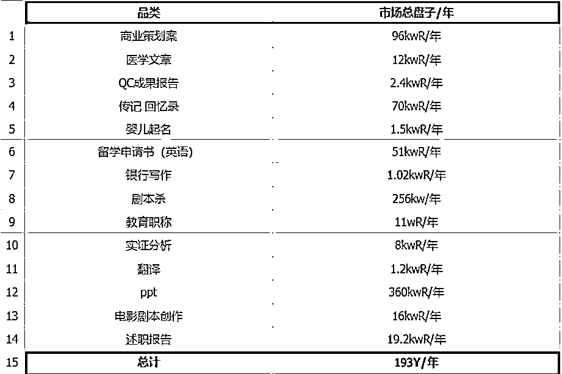
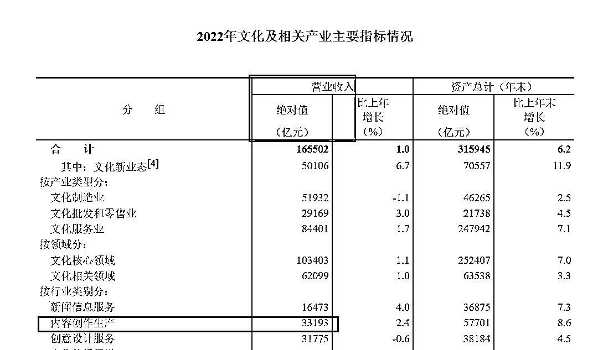
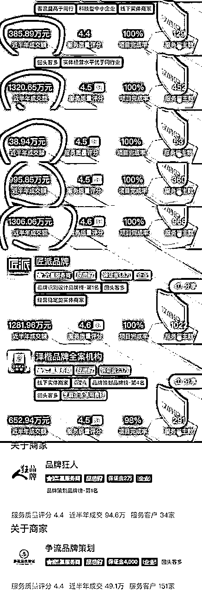

# 创业小白，如何去选择一个适合自己的项目，一点个人的经验分享
作者：龙哥

这年头聊创业，很多人第一句话就是：“我啥也不会，能干啥？” 作为在AI代写赛道摸爬滚打满一年的老学姐，我想说：别怕，大家都一样。去年这时候，我还是个对副业一窍不通的小白，如今也算是在一线趟出了点门道。创业这玩意儿，确实苦，但那种把想法变成现实的性感，一旦沾上，就再也戒不掉了。一路上被问题砸晕过，也怀疑过人生，但更多的是被同路人暖到、被一单单正反馈治愈到。今天不灌鸡汤，只分享我当初选项目时真实踩过的思考路径，希望对正在观望的你有那么一丢丢参考价值。

先抛个结论：想太多，不如先动起来。我当初决定搞点副业时，脑子一片空白。但很快发现，坐在原地空想，永远等不来答案。真正的转折是——先上路，路才会在脚下慢慢清晰。

我的起点其实挺普通：大数据技术出身，长期做toB业务。因为工作性质，我天天泡在外网看技术文档，从22年底就接触了ChatGPT。那会儿写一个模块要三天，后来用GPT二十分钟连测试都跑通了；写方案从前要搜半天资料拼凑，现在AI直接从大纲到内容全包了。尤其遇到生产环境里的奇葩故障，操作系统一个参数不对就能让集群宕机，底层源码的问题我自己基础又差，以前要翻好几本砖头书，现在只要我懂点思路，GPT就能帮我一路深挖到底。那段时间我天天研究到半夜，满脑子只有一个念头：All in AI。

所以我心里清楚：选项目，一定要挑自己有点积累的方向。纯粹的流量、供应链、营销，我一样都不擅长，但AI工具的使用我是龙哥。那就往这儿撞呗。

可撞完一圈又卡住了。看别人用AI做👸号、做📕，我也动心过。但拆开一看，人家本来就有爆文功底，懂网感、有素材库、能批量搞几十个号，还要会RPA提效。我就是个只会拿AI写代码的技术宅，硬要去做那些“爽文”“鸡汤文”赛道，先不提能不能成，光心理这一关就过不去。📕IP也想过，但要么靠广告得等到千粉，要么带货就得碰供应链，虚拟产品还得先花个把月写课做海报。我这种单线程选手，如果上班和副业两头烧，又迟迟看不到稳定进账，心态分分钟崩。说白了，链路太长的项目，不适合我这种急需短期正反馈的人。

然后我刷到一个风向：有人直接在闲鱼卖AI代写的稿件。不需要养号引流，不需要打造人设，来的人就是要买东西的，链路短得令人发指。我潜伏观察了一个多月，还去人家训练营当志愿者。发现什么水平的人？几个再普通不过的普通人，AI用得也不咋地，居然也能快速干到月入过万。那一刻我就知道：这是个蓝海早期项目，占着AI风口，普通人能迅速拿到结果，我能All in。

当然，冲动归冲动，我还是做了点理性调研。文字创作这块市场到底多大？从淘宝平台看，光15种写作题材的真实年成交额就有193亿（）；再看国家统计局数据，内容创作生产行业2022年营收3.3万亿（）；猪八戒网上几个做商业策划的店铺，半年销售额就破6千万，一年过亿（）。这还只是冰山一角，线下、新媒体、老客户渠道全算进去，千亿规模真不是吹的。而且代写这行当，从古代的书信先生到现代的高端策划，少说传承了一千年，本质是刚需，现在只是被AI重新赋能了一遍。市场够大，需求够老，加上AI提效，干个十年没问题。

方向定了，剩下的就是补短板。我没做过流量，就不自己瞎摸，直接花钱买了那圈友的闲鱼经验；AI写作我自己能搞定；销售转化在toB给客户打交道的经历里也练过。0到1的闭环要素凑齐了，剩下的就是玩命执行。

所以，如果你现在问我：普通人能不能做写手？到底能赚多少？我给不了标准答案，但我可以教你怎么找答案——去拆解真实案例。别光看别人晒收入，要去看他每天花几小时、连续做了多久、是什么学历水平、执行力强不强，把这些关键点逐一挖出来，再对照你自己的情况。比如你觉得自己学习力强、执行力也不差，那就看看你和案例里那个人还差在哪儿。差在哪，补哪，答案自然就有了。

没人能替你判断一个项目适不适合你，也没人敢保证你能赚多少。但拆解案例、认知自己这套方法，谁都能用。最后送你我奉为神明的这句话：实干兴邦，龙哥盟，勇敢者先享受世界。共勉。