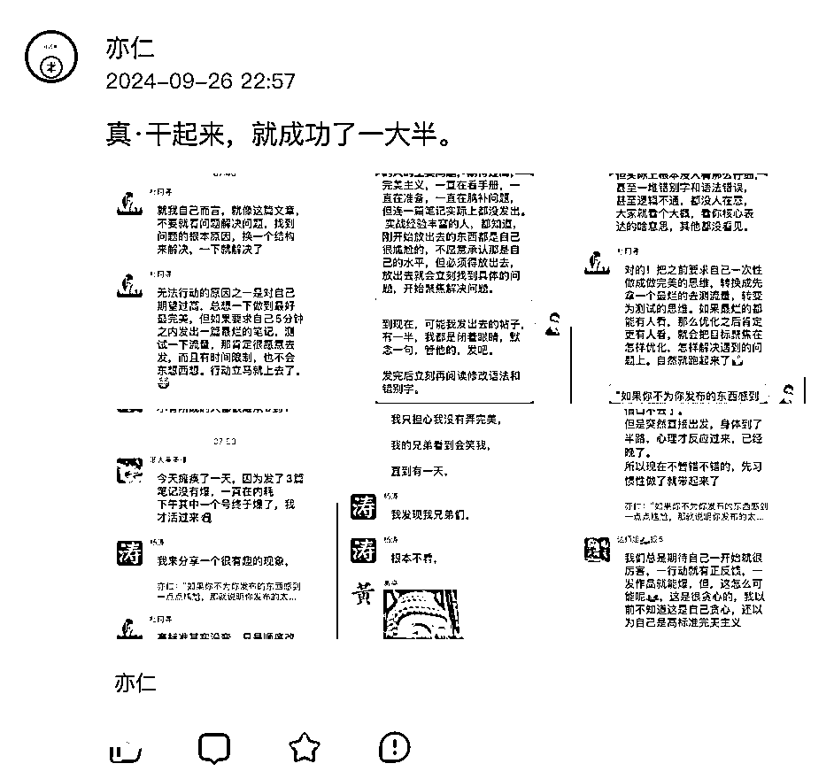
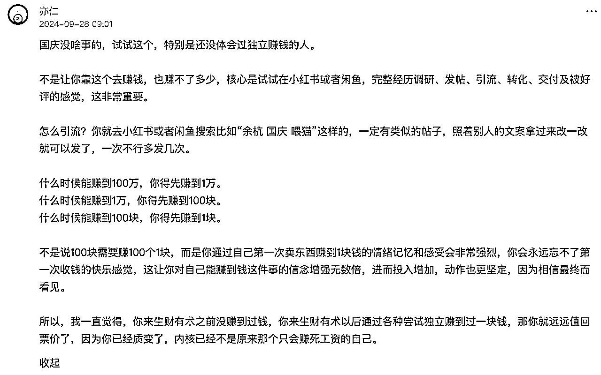
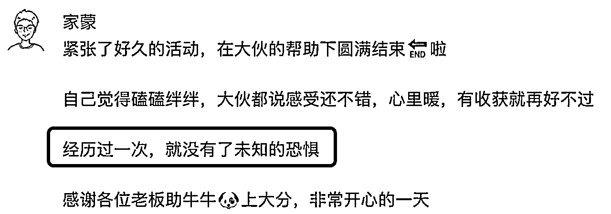
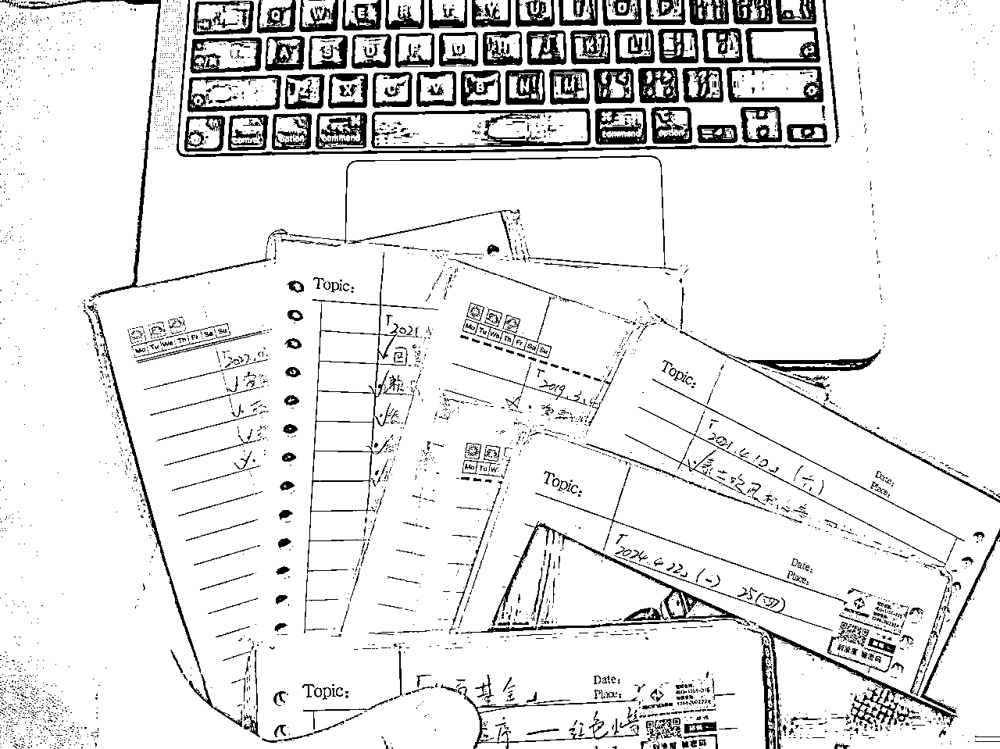
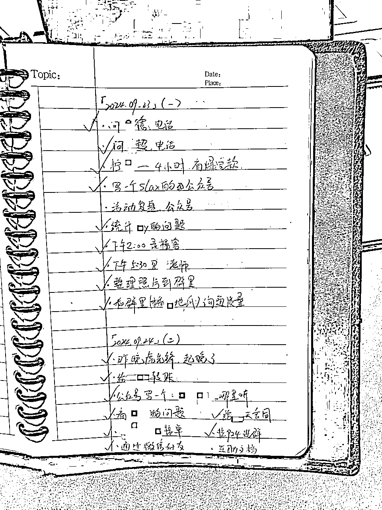
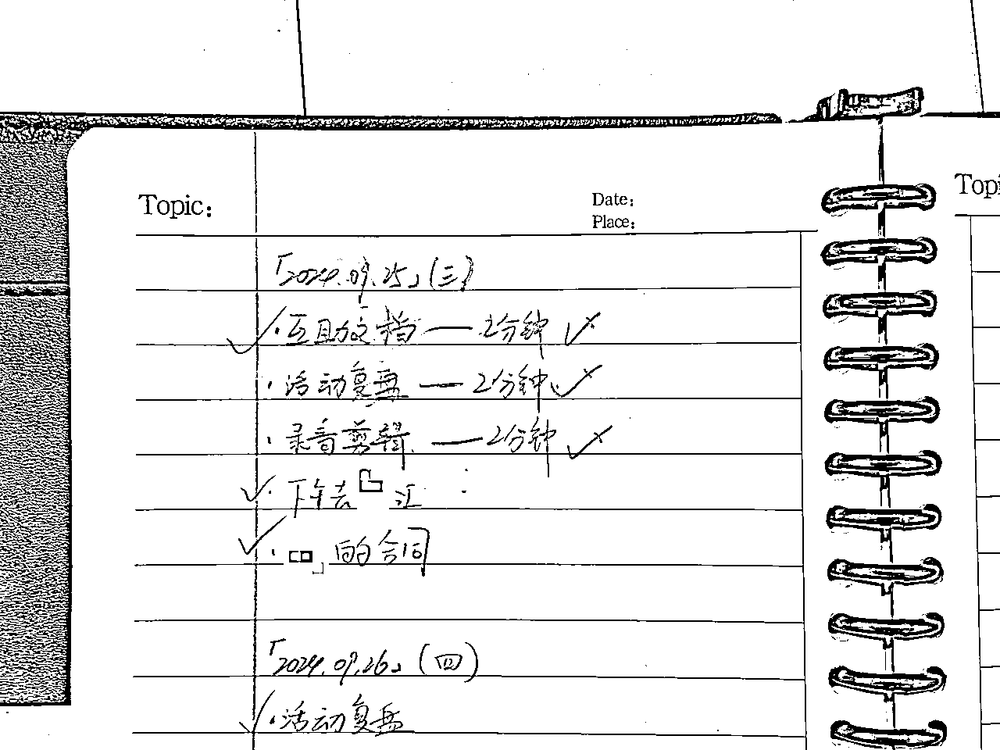

# 别再做思想上的巨人、行动上的矮子：三个亲测有效的“启动”秘诀

经常有人问我：“想做的事很多，但总迈不出第一步，怎么办？”

巧了，前两天刷到亦仁的一句话——「真·干起来，就成功了一大半。」这句话像一记小锤子，敲在我脑门上：对啊，别想那么多花架子，先赚到那一块钱，先去把事做了，先拿到一个结果，哪怕很小。

当你真的“动起来”那一刻，你就已经不再是原来的你了。

我在生财这个圈子里观察了好几年，发现一个挺有意思的现象：混得好的那拨人，未必是天赋最高的，但一定是“上手最快”的。你只要比身边人快半步启动，就能甩开一大截。

这真不是执行力的魔法，全靠同行衬托——太多人不是不努力，而是“心理赘肉”太多。想七想八，惯性巨大，迟迟不愿意迈腿，还动不动就想踩刹车。

说白了，拖延这毛病，我也有，而且不轻。最近看了不少国外的文章，发现和亦仁说的意思不谋而合，整理出来分享给你，希望能帮你往前挪那么一小步。

## 一、迟迟不动手的真相：你怕了

开门见山——拖着不做，根子上是恐惧。

面对一个陌生的项目，你心里没底，觉得掌控不了全局，于是不停告诉自己“等我准备充分了再上”。想追求完美，想一击即中，想憋个大招。

最典型的就是那句：“好的，我研究研究”。

请问，后来真研究了吗？没研究就不能开工吗？其实这是借口，是托词，本质是怕自己做不好、被人笑话。

我自己也刚趟过一次浑水——办线下见面会。完全没经验，对未知充满恐惧，一直拖一直拖，直到发现那位嘉宾只有9月21日附近有空，日期才“被迫”敲定。然后呢？Deadline一逼，所有事情竟然真的陆陆续续推起来了。

爬过那座小山我才后知后觉：之前那种拧巴、抗拒，全是因为对体系庞大、路径未知的惧怕。等真走了一遭，恐惧感自己就散了。

## 二、2分钟法则：给生活装个“启动马达”

拖延这事儿，人人都有，可能我稍微严重一点。我有强迫症，计划里的事没按理想状态完成，就会特别烦躁。所以在做事上，我要么准时搞定，要么直接躺平摆烂。

有个“2分钟定律”还挺扎心：一件事如果觉得有难度，最好在2分钟内去碰一下。如果2分钟之内不行动，你可能接下来几个月都不会碰它。

这说的就是我。

还有个类似的“2分钟法则”——如果这件事2分钟能做完，那别墨迹，顺手就干了；如果2分钟干不完，那就先干2分钟。哪怕只在表面上蹭一下，也会给自己一种“我为项目推进了”的心理暗示。

比如：
*   想写文章但半天憋不出一个字？那就打开Word建个空白文档，摸一下鼠标，2分钟，算数。
*   想健身但提不起劲？那就下楼跑2分钟，哪怕衣服换好就脱，也算有态度。

这种“往前拱一拱”的感觉，特别治愈。它减少了自责、内耗和自我否定——毕竟，我也是付出过2分钟努力的人呢。

## 三、一篇关于拖延症的好文章

关于拖延，我看过一篇特别棒的文章，作者是Tim Urban。这人还上过TED演讲，但我觉得文章比视频更好，尤其是里面“黑暗森林”和“心流”的论述，视频里根本没有！你要有兴趣，可以去找他的TED演讲视频《你有拖延症吗？》看看，B站就有。

说句实话，写这篇文章之前，我也拖延了很久：
*   怕写不好，被人笑话；
*   怕写出来没阅读量，冷冷清清；
*   怕被熟人看到，说我装文青。

操心一大堆，全是面子问题。我一直标榜自己要做个“渣男”，做个“叼毛”——就是吊儿郎当，别在意别人的眼光。但标榜归标榜，真到动笔时，内心戏还是多到爆。

于是，为了写拖延症，我决定先看看别人写拖延症的文章——这借口很合理吧？（笑）别说，二刷还真看出点新东西：

> “对于你真正擅长的事情来说，你很少会有拖延症。”

——就是因为不擅长、有恐惧，你才选择拖延。这不就是我发朋友圈时最真实的心态吗。

> “拖延者往往会利用那些不重要但紧急的事项，来不断推迟那些真正重要的任务。”

——我为了不写这篇文章，选择去看其他文章，还好不是去打扫卫生或整理书桌——不然这篇稿子又得泡汤。

> “那些惊人的成就，从远处看，不过是一连串平凡任务的集合。没有人‘建造一座房子’，他们是一块一块地放砖块，最终才有了房子。”

——这不就是2分钟法则的最好注脚吗？只要功夫深，多来几个2分钟，再大的工程也能一点点磨出来。

## 四、我自己的治拖“笨办法”

我一直有个习惯：每天在纸上写下当天要做的事。这习惯维持了好多年，纸都攒了厚厚一叠。

我翻到一张不敏感的记录给大家看看。状态好的时候，一天能划掉七八件事：

但更多时候，写下的事当天根本做不完。以前我的处理方式是“无限顺延”——明天再说吧。现在，我学会了给自己“垫2分钟”。就比如下面这一天，没干成几件大事，但三件重要的小事我都有推进：

*   互助文档
*   活动复盘
*   录音剪辑

互助文档是个大工程——那天我花2分钟打开了飞书，建了个空白文档，加上表头，觉得自己贼充实；
活动复盘很庞大——我打开语音备忘录说了2分钟感想，觉得输出好多,下次整理成文字就是现成素材，很充实；
录音剪辑动辄要十个小时——实在没时间，我打开剪映把素材导进去，分好类，对齐时间线，花了2分钟，下次再上手就顺滑多了，很充实。

多说一句：绝大多数人执行力都一般，都会内耗，都会拖延。所以别因为自己的小瑕疵就疯狂自责。给自己2分钟，鼓起勇气，往前拱一点是一点。

（你猜怎么着？第二天周四，我那个“活动复盘”居然真的完成了——这里头绝对有周三那2分钟的功劳。）

对了，写这篇文章本身我就用了“2分钟法则”。本来想顺着亦仁的帖子憋个大招、当天就发，结果拖了三天愣是没动手。第四天快下班前，我花了2分钟用语音粗略口述了一版，粗糙地丢进编辑框。第五天才重新编辑、排版、润色，这才发出来。

你看，整个过程我其实只花了“2分钟”来启动，加上25分钟整理，不到半小时的活儿，愣是被我拖了5天。

所以，别怕，先干起来两分钟，你就已经赢了那一大半。

希望这些对你有用。