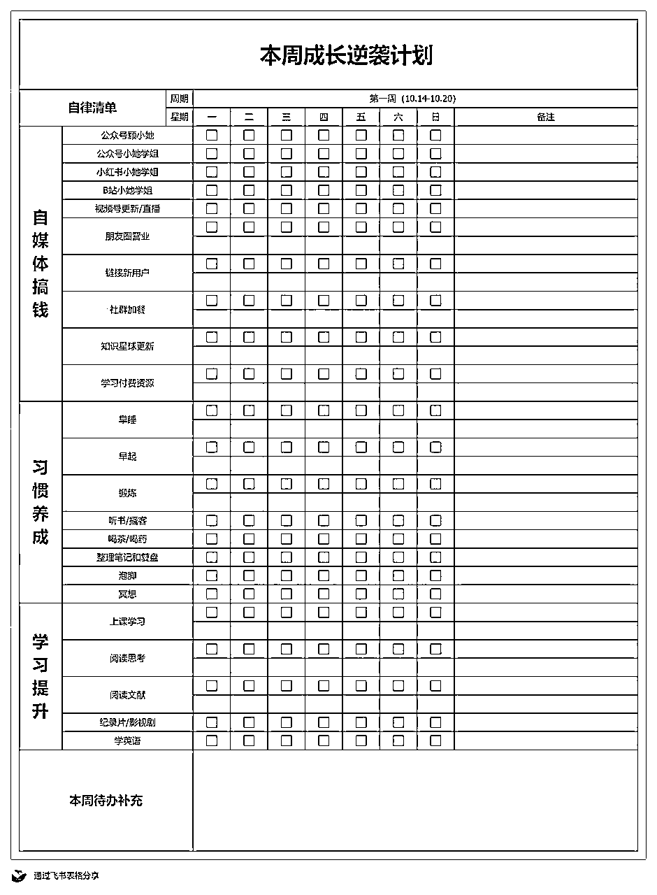

# 效率提升篇｜如何可视化一周的任务并效率翻倍（附带周计划表）
作者：龙哥

新的一周又开始了，你给自己的这七天定了什么调子？手上的活儿心里有数没？不妨停下来先想一想这两个问题，再接着往下看。

我折腾过不少时间管理的办法，后来发现一件事：以“周”为单位来规划节奏，对我来说刚刚好。一个月跨度太长，复盘容易滞后；一天天排得太细，又缺少弹性。所以我就顺着每月打卡表的路子，按自己的日常习惯和重点事项，拼出了一张专属的周计划表。你们完全可以照着这个思路，自定义一份属于自己节奏的版本。图我放这儿了，因为每个人要忙的事情都不一样，模板链接就不贴了～

**先从结构说起**

我把手头的事分成了三大块：“自媒体”“学习”“生活”，这三个词基本上概括了我现在的日常。毕竟一边当博主一边读研，学业和内容输出两头都得顾，谁也不能落下。

至于“生活”，不是每天必须完成的硬任务，更像是一些能提升幸福感的小仪式，不费时间、不占心力，但日积月累，能让人状态更好。真正重要的事情，应该围绕着你人生阶段的关键词来展开，这样才不会跑偏，也不会看到别人干什么就跟着干什么。每个任务都服务于自己的主线，那才是真正值得投入的方向。

表格里除了每天雷打不动的例行事项，还会有几条本周最重要的目标，这部分是灵活的——这也是按周做计划最大的好处：随时可以调整，不用把自己卡死。把一周的付出可视化，量化到每一个勾、每一个数字，你才能真正看见自己在哪里下了功夫，在哪里一直偷懒，下一周才有改进的可能。

**再说说临时任务怎么办**

留一个“本周待办”的区域是很有必要的。总会有突发的事儿插进来——比如研一刚开学那阵，某个课题或者一份PPT突然就来了。这种时候我就会把它塞进这个机动区，然后围着它重新分配时间，保证最重要的事不会被挤掉。

像泡脚、冥想这类小习惯，不必苛求每天都打卡，一周做到三四次就算完成。别一上来就对自己下狠手，标准定太严，哪天断了就自责，反而撑不久。

**周末复盘才是最关键的环节**

空白的格子不只是用来记录的，一周过完，它真正的价值才会浮现。你可以清楚地数出：这周写了几篇👸号、发了多少条朋友圈、剪了几条短视频，全部可视化。

我还会在每个科目下多留一个空位，用来补充具体数量。到了周末，我会问自己几个问题：这周最重要的事完成了吗？时间主要花在了哪里？有没有哪些事特别耗精力又没啥产出？该减的减，该删的删，第二周的表格自然会进化。我这周排得比较满，因为第一周本来就是拿来试错的，总得给自己一个观察周期。

**顺手分享一下我这周的三个重点**

关于学习，我每天会留出两个小时左右，集中整块时间学习。除了专业课外，更多的是手上的付费课程和资源。更关键的是，不管学什么，我都会逼自己有个产出，不然输入就是过眼云烟。

拍摄这块，最近📕、B站、视频号、抖音四个平台同步发。素材拍一次，多平台分发，曝光不浪费。目前B站1.2万粉，视频号快破千，📕出了两个百赞小爆款，抖音就当随缘分发，不太适合放长视频。视频口播里带点引流词，是目前我试下来比较稳妥的路径。

课程打磨也没停。这周在准备下一期📕课程的宣发，社群内部也在持续输出入门干货。至于发朋友圈、社群分享这类动作，已经熟到形成肌肉记忆了，有灵感拿起手机顺手就完成，不用专门腾时间。

最后说句掏心窝的话：想变成更好的人，靠羡慕别人、刷短视频，是等不来的。所有的愿望，都要靠你自己一步步走出来。认真想一想你想成为谁，然后朝着那个方向，哪怕每天推进一点点，都是在靠近。