# KS带货的两种跑法，我从零开始拆给你看

我是大麦，一个90后。在KS上做带货，不算老手，但两条路都亲自跑通了。这篇不绕弯子，把流程、坑、节奏全拿出来。

## 一、为什么建议把KS当基本盘

KS是三大短内容平台之一，曝光潜力一直被低估。和某音比，它挂购物车不需要粉丝量，也不用交保证金，进入成本小；和WeChat短内容比，它没那么容易废号。做过WeChat短内容的人，应该都对“封号”心有余悸。

所以我的结论是：KS做长线很舒服，但不能急。

## 二、两条能跑的路

### 1. 混剪好货推荐

这条路的核心是：原料不用多复杂，但必须堆量。很多人刷到那些封面像牛皮癣的带货短片，会觉得这能有人看？事实是，不仅有人看，还经常出百万曝光的爆红内容。所以别犹豫，先把质量做到及格，再用量去砸。

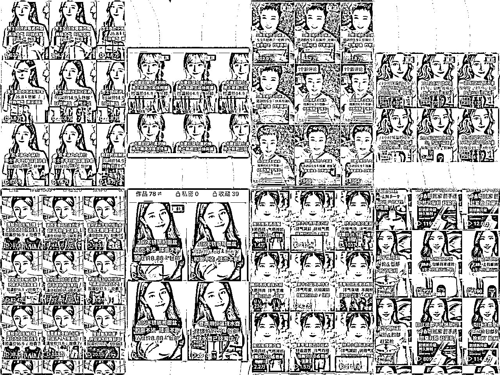

另一个特点：单笔利薄。对比WeChat短内容动辄50%以上的分成，KS一单可能只够买瓶水，听着心酸。但它走的是批发逻辑——货品单价不高、每单分成不高，架不住单子多。量一上来，总数就非常可观。

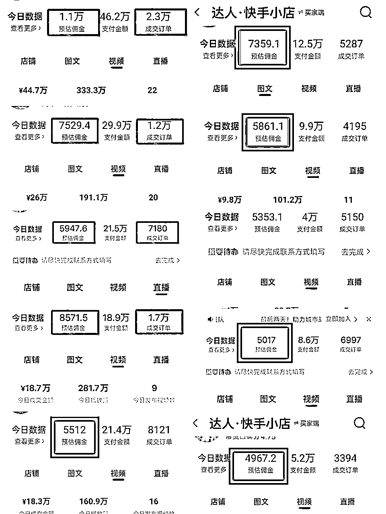

### 2. 长篇故事口述

第二种是3-5分钟的长内容，把一件事讲完整，可以是故事、方法或经验。有真人上镜，也有虚拟主播。这类内容在WeChat短内容上已经验证过，直接搬到KS也常常能跑出第二春。很多在WeChat发出去没多久就被限流的稿子，在KS反而能稳稳推很久。

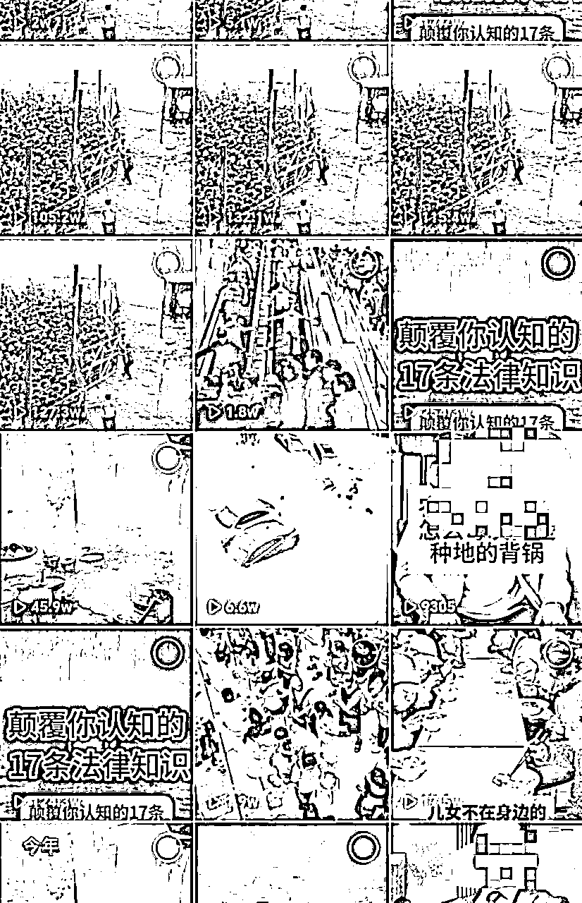

当然，KS也不是完全没规矩，偶尔会有优化提醒，严重了一样限流。但整体容错率比WeChat高，做长期IP没问题。曝光量有起伏很正常，平常心就好。我认识一个同行，3天跑了14.6万分成。这类内容的分成比例比混剪高，接近WeChat的水平，但对脚本功底要求也高，会写的人优势很大。

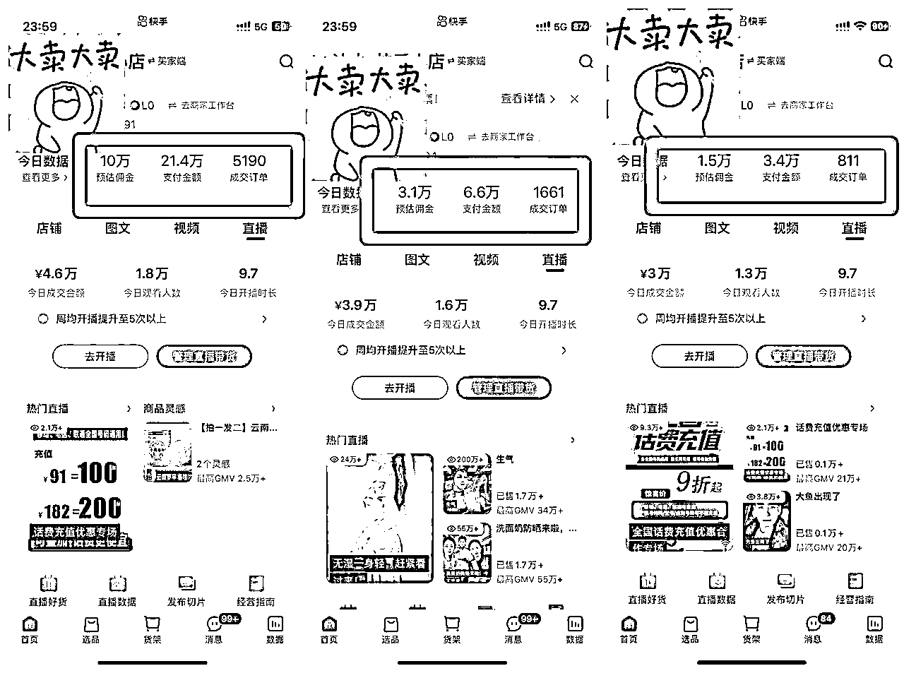

## 三、开干前，先备齐这些

### 1. 真人出镜
手机（安卓苹果都行）、落地支架、补光灯、领夹麦。软件：KS、KS极速版、剪映/快影、修图App、提词工具、某音、小某书。

### 2. 不露脸/虚拟主播
有两个选择：即创（限免）、蝉境（付费），按预算来。

### 3. 身份与ID
- 注册用实卡手机号，别用虚拟号，最好用流量注册。
- 一个实名信息可认证两个ID；同一部手机能同时装普通版和极速版。
- 老ID如果以前带过货、没违规、关注者偏中老年，能接着用；如果发过太多没人看的内容、关注人群也乱，直接注销，7天后再注册。违规过的ID也别留。
- 不用刻意养，注册完像普通人一样刷几天就行。

### 4. 主页四件套
头像、昵称、背景、简介，最简单的做法是参考同行。头像可以用本人照片、卡通形象、货品图；昵称要短、好记，别用生僻字。格式可以是“名字+严选”“名字+清单”“名字+日常”。

背景图参考：

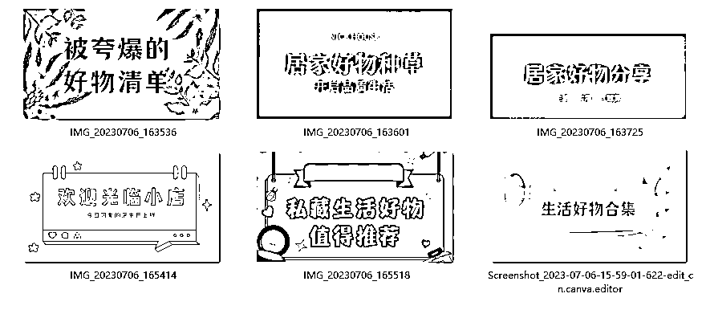

简介参考：

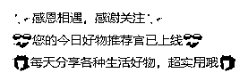

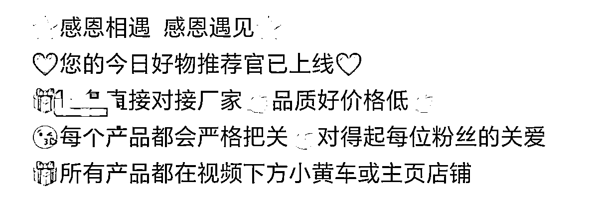

### 5. 开通站内小店
新ID打开首页左上角菜单 → 进小店 → 选择开店 → 达人通道 → 马上进入 → 个人身份 → 上传证件信息 → 扫脸确认。完成后可以切到商家后台。官方有操作视频。

## 四、新人必须知道的后台功能

- 连接WeChat轻应用，让成交提醒直接推过来。
- 货品上架/下架：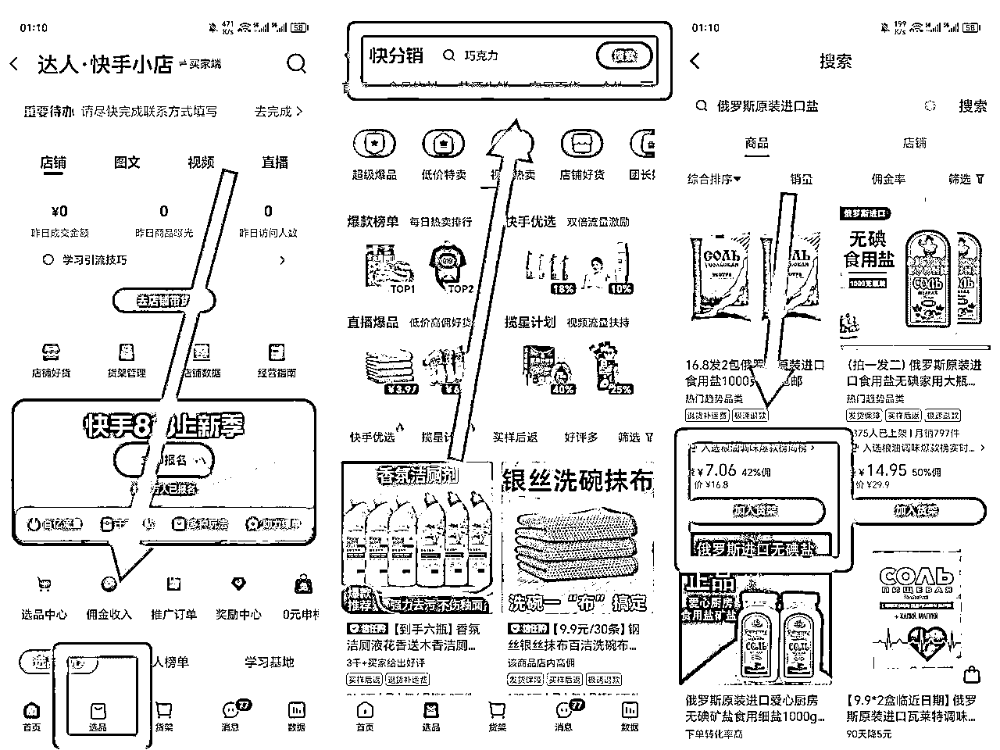
- 删除或隐藏内容：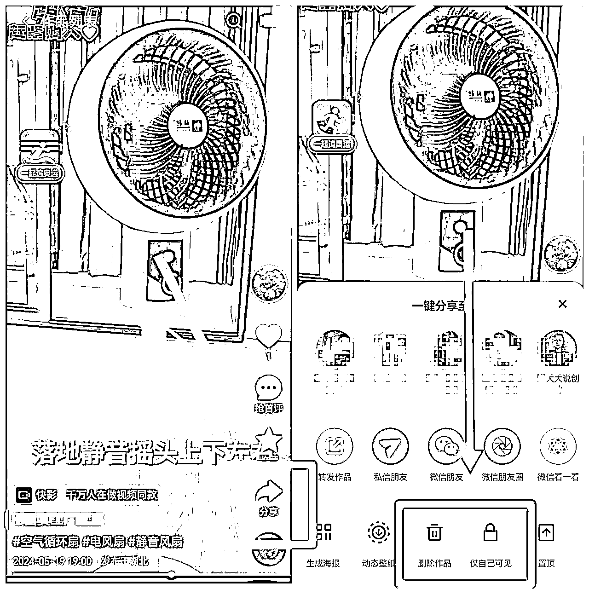
- 发内容时挂购物车：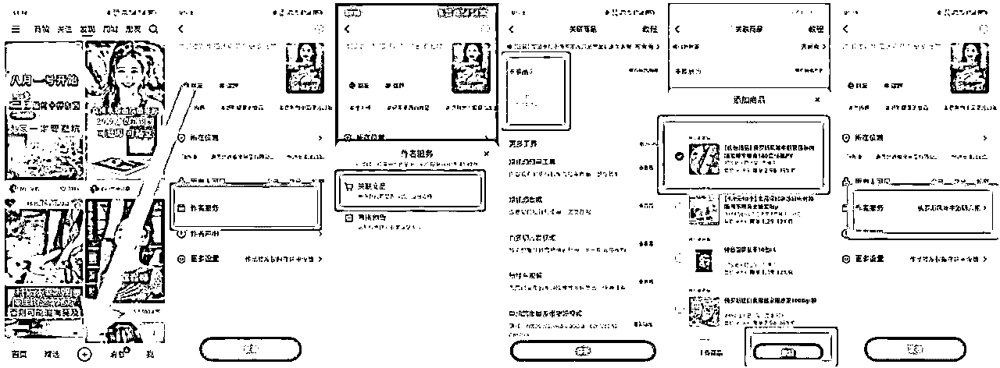
- 看哪个内容带来的成交：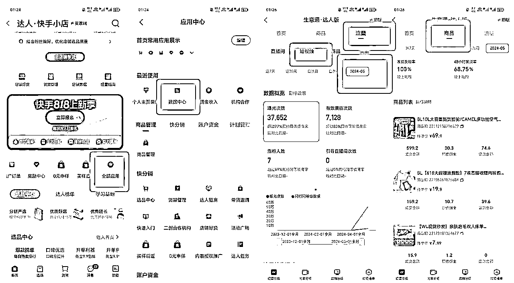
- 购物车图标不显示：新ID前14天看不到是正常的；之后不显示，多半是关联度不够或违规被摘了。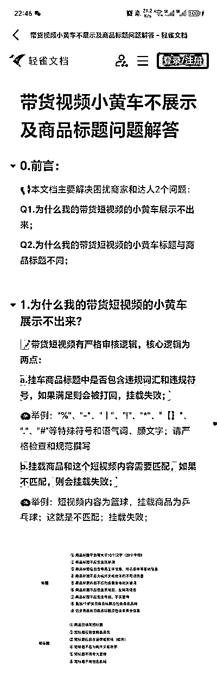
- 账户状态检查：主播后台 → 更多服务 → 账户检测。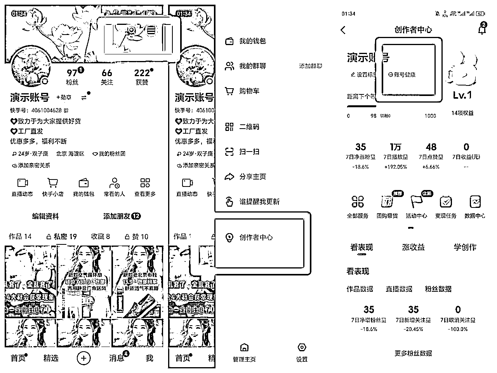
- 检测违规：内容发出去半小时，还没有“合拍”入口就是有问题；或者投流试试，投不进去/审核不过就是违规；再或者用账户检测。
- 看分成和订单：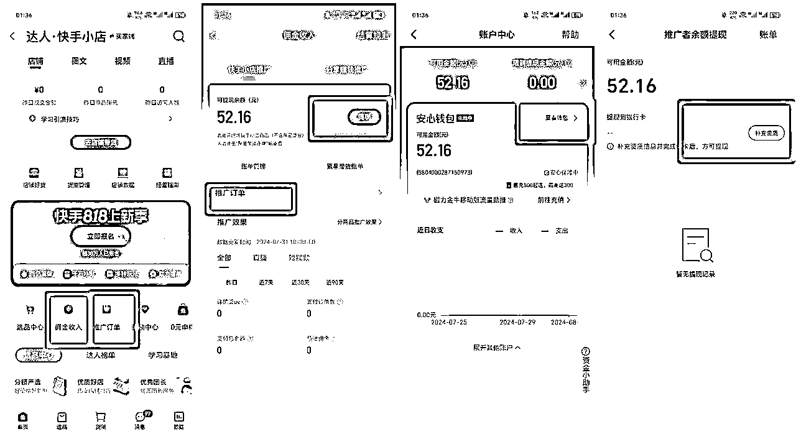
- 提取同行购物车里的链接：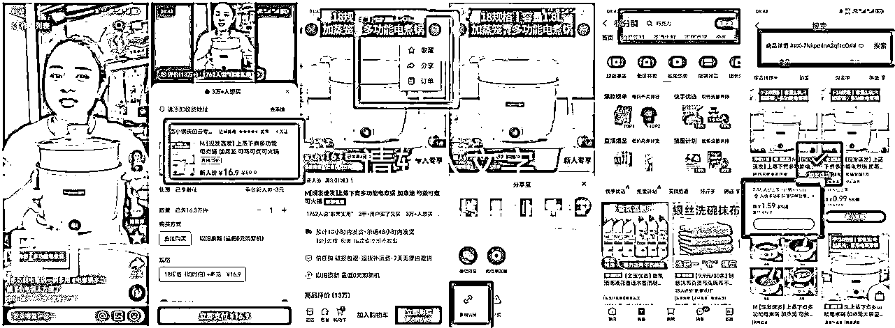
- 看热卖排行：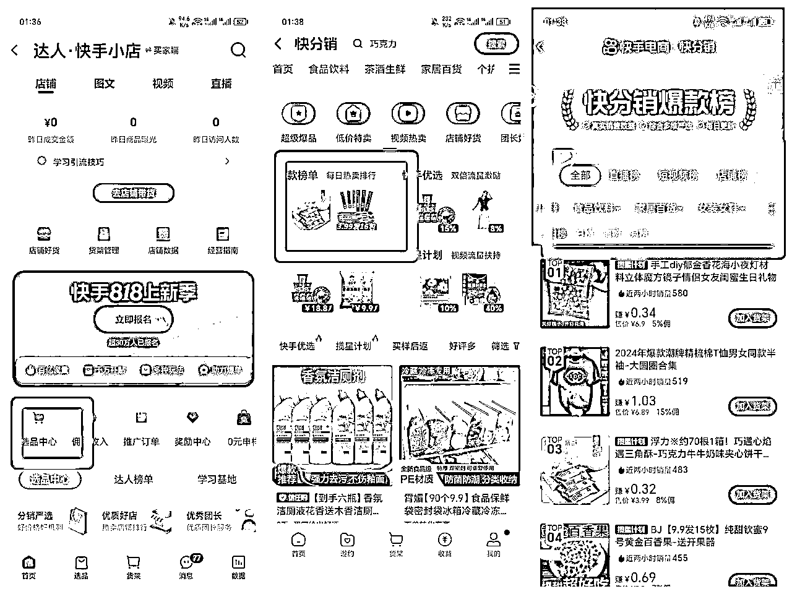
- 看店铺评分：小店 → 选货大厅 → 打开货品详情，往下划。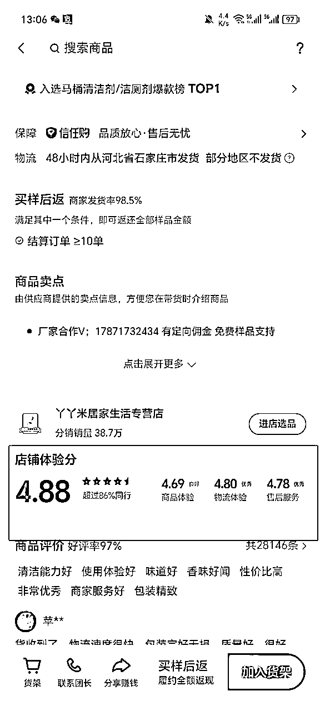

## 五、找参考对象，抄作业也讲方法

参考对象就是你的参照系。别人什么卖爆了，你跟着卖什么，能省很多试错。

在KS搜索框输入“品名+口述”，比如“清洁粉口述”“调味汁口述”“发酵粉口述”。注意区分两类：一类是混剪好货，一类是长篇口述。前者可以看“某某严选”“某某优选”这类ID，后者可以看“某某爱做菜”这类ID。

搜出结果后，先把前3-5条看完，再回首页刷新。新手别盯着大号，找粉丝3万以内、销量几千上万的ID来模仿，关注10-20个。首页推荐里出现点赞过千的内容，就多点赞，系统会推更多同类。把参考对象主页里所有点赞过500的内容拆一遍，重点看脚本怎么开头、怎么埋钩子、怎么逼单。

标签怎么打：平时只刷同行，刷到同类内容就完播、点赞、评论，再回首页，推荐会越来越精准。

## 六、脚本来源与改写

脚本可以自己写，也可以从某音、WeChat短内容、KS搬。KS的用户画像偏中老年，二线以下城市和农村用户多，与WeChat、P多多高度重合。WeChat上跑过的爆款脚本，搬到KS只需要做去重，用豆包改一遍就能用。

### 解析和提取
在WeChat里找解析小工具，就能把无水印原稿提出来；也可以用快影App里的提取功能。

### 改写方法
改写有两个作用：增强新鲜度 + 清除敏感词。某音/WeChat搬来的脚本不用大改，确认没有敏感词、替换一些词、调整段落顺序就行。

### 敏感词
KS对敏感词查得很严，尤其反感绝对化用语，比如“保证买到”“所有人都在用”这类话，能少写就少写。

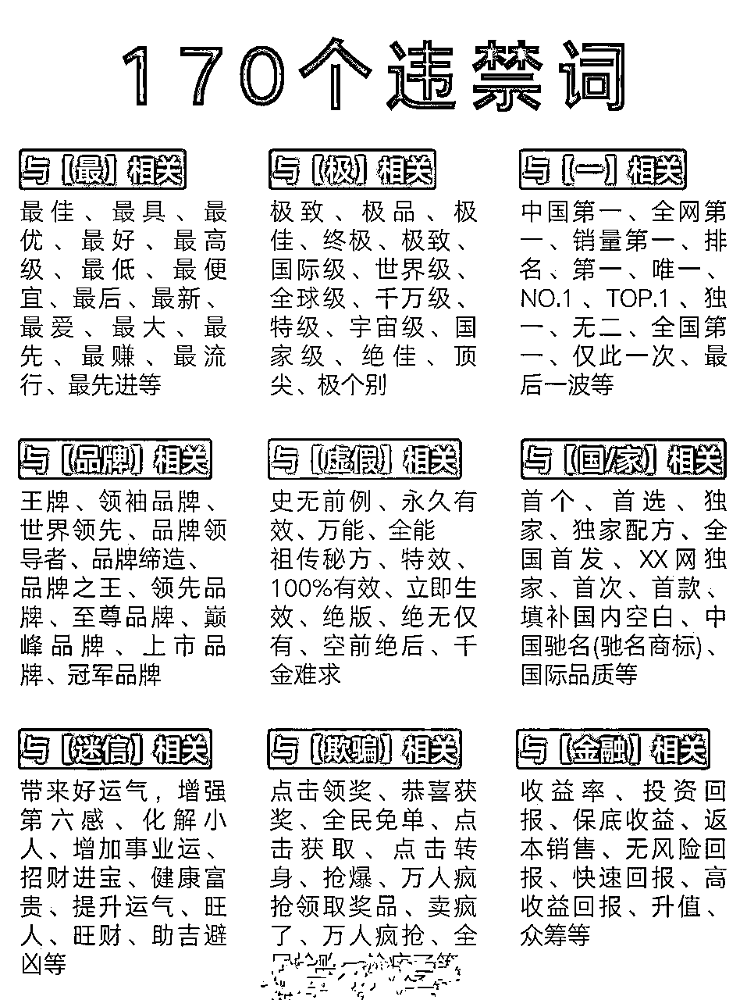

## 七、真人拍摄与虚拟主播

### 真人拍摄
工具：剪映、快影、提词工具。
场景：落地支架+补光灯，白天光线好可以不用灯；背景选白墙、绿植或户外，最好用绿幕，方便后期换背景。
拍摄时，背景要干净，别穿黑红两色的衣服，光线要亮但别过曝。手机放在一臂远的位置，头顶留白。说话要有中气、有高低起伏，别像读课文。眼神对着镜头，可以有手势。
提词器有两种用法：剪映自带的需要会员；或者把稿子存进悬浮提词工具，再用相机/KS拍摄。
开拍前把稿子读熟，练两遍。

### 虚拟主播
能真人就真人，平台政策会偏向真人内容，虚拟主播只能当过渡方案。硬要用，即创有免费额度。

## 八、玩法A：混剪好货，以量取胜

这种模式的核心是概率游戏，脚本结构通常三段：引入货品 → 讲卖点/使用场景 → 逼单。

### 8.1 数量要求
新手期一个ID一天至少5条；跑顺了以后，一天10条也不嫌多。千万别断更，KS对更新频率很敏感。

### 8.2 原料怎么找
刷KS首页推荐，只看72小时内的爆红内容。复制链接，用解析工具把原稿提出来。改稿时别只换几个字，最好把某音和KS两个平台的稿子嫁接，再掺30%自己的话，重复度才低。

### 8.3 剪辑流程
以快影为例，先准备口述录音和货品画面。货品画面去某音/KS搜对应实拍。

字幕处理：可以先识别字幕再剪，也可以剪完再识别。后识别更简单，但叠加画面里如果带了原字幕，也会一起识别出来。先识别则需要手动调图层。

封面处理：封面=人物头像+货品图，用溶图、遮罩、反向遮罩，透明度20%左右，画布比例9:16。加标题和价格，一般三行就够。头像可以用原片里的真人，也可以从小某书找好看图，记得把水印抹掉。

混剪处理：真人上镜就把货品画面和真人画面分段对应，讲切菜就配切菜镜头，讲炒菜就配炒菜镜头；不露脸就把真人画面全换成货品画面，口述录音放叠加层做参考。去重手段：叠加画面、遮罩、贴图、特效、字幕、音量、变速。开头最好保留热门原片的前几秒，也就是“爆红开头”。

### 8.4 ID方向
主流方向是综合型带货，一个ID能同时带百货、零食、日用品。综合型的好处是：哪个品有热度就能马上测，测出来再加大投入。更细分的话，吃货ID就集中选食品，裤子卖得好的ID就多选裤子。

### 8.5 起号与选货
前30单尽量选便宜又不容易出问题的货，把店铺评分抬起来。优先跟三类：全网都在爆的款，不分新老ID；破价款；72小时内刚热起来的款。发了一周左右，数据跑通后，再把便宜货和中高价位的货穿插着发。因为便宜货品质不稳定，会拉低店铺评分，分成也少。

### 8.6 挑货思路
两个入口：首页推荐和榜单。品类上，优先选快消品，比如纸巾、百洁布、保鲜膜；优先选受众广的，比如日用品、食品、应季服装、餐厨具；优先选应季的，比如夏天卖凉席、遮阳帽、驱蚊用品，冬天卖保暖，开学季和春节也有红利。还可以蹭其他平台的热门，某音、WeChat、P多多都在推的东西，基本不会错。

### 8.7 测货和跟款
重点：跟72小时内的爆红款，尤其是小号带火的款。首波曝光最大，目标是吃到这波，成为同行追赶的对象。
测货别押一个：比如一天发5条，食品、百货、服装各来一条。第二天看数据，数据好的货补2-3条新片，其余继续发新品。比如遮阳帽和凉凉裤数据好，第二天就再发两条同类，再加三个新品。某款货成交量持续上涨，就多补片接住。
但别死磕单一货品。单一货品的热度通常只有3-7天，一直发它会让你整个ID被它绑住，最后其他货全带不动。短期可以猛跟，长期要换。

### 8.8 补片
KS靠量取胜。成交的货要多补片，补得越多，接住的曝光越多。补片时，脚本开头结尾改一下，画面用最新找的，别让它看起来一模一样。

## 九、玩法B：长篇口述，以脚本胜出

### 9.1 找画面
根据口述内容找对应画面。卖调味汁，就找做菜镜头；卖洗衣机清洁剂，就找洗机镜头；卖油条粉，就找炸油条镜头。

### 9.2 剪辑
快影或剪映都行，和混剪的区别是：口述是主线，画面只是辅助。把录音铺好，按段落插入画面就行。

### 9.3 账户定位
目前主流是专精打法。要么主攻单款货，一个ID只做一款货，比如只做某调味汁、某清洁粉、某发酵粉；要么专攻某个类别，比如美食ID可以同时带调味汁和发酵粉。

### 9.4 发布节奏
和WeChat短内容的口述号不同，KS对重复内容更敏感。要求：每条内容不要原样重发，最多发两遍；每条脚本都要改；每条片子重新生成或重拍；每天都要发；一天至少3条，数据好就多产。发布时间选早晨、中午、晚上三个时段。

### 9.5 挑货标准
一句话：能解决具体痛点、有明显卖点、跟得上节令。优先选快消品，带明显痛点，比如养生、食品安全、做菜技巧、调味料、应急储备。受众要够广，比如清洁粉、调味汁、发酵粉、锅底清洁用品。和二十四个节令结合也是一种打法，蜂蜜、花草茶这类品，很适合按节令推。

## 最后一句
不管选哪条，先给自己两个月。完成最小闭环，再想放大。别急着要结果，把每一步做扎实，自然会有回报。

做快手带货也有一段时间了，今天把脑子里攒下的这些经验和圈友们掏心窝子聊一聊。老规矩，全是实操干货，没有虚的。

先说说赛道选择。我们眼下主攻的方向是养生类的冲调品和膏滋品。原因很简单——快手用户画像整体偏成熟，兄弟姐妹叔叔阿姨们对养生这事几乎没啥抵抗力，这就天然给了我们很大的操作空间。更妙的是，如果能把养生产品和二十四节气结合起来做内容，那简直是无缝贴合，转化起来非常舒服。

## 关于测品：别指望一口气吃成胖子

一个新号启动的时候，先别急着猛发。我常用的节奏是每天三条左右的视频拿去试水，持续三天左右。后面看数据反馈，再逐步加量。这个阶段的核心指标很简单：单条视频能不能破万。一旦有流量破万的苗头，第一时间去优化文案，再给它两三天的时间去验证。能持续跑出来的视频，就继续精修，往爆款方向去打磨。

不过说实话，这一行“千人千号”，每个号脾气都不一样，没有一套模板能走天下。对文案功底和操作效率的要求确实高。但只要你坚持去碰，慢慢摸透自己账号的“性格”，后面就会越来越顺手。

## 关于补视频：流量巅峰期别乱动

视频突然爆了的时候，流速会非常猛。点赞一分钟好几个，甚至好十几个地往上跳。这时候最重要的一件事，是马上开播去接住这波流量，而不是火急火燎去补视频。当然，备用视频得提前备好。等到你明显感觉流速降了、点赞高峰期一过，赶紧把新视频补上去，接住流量余温。

## 关于直播：多一条变现路子，多一分收成

好物类内容平时以短视频挂车为主，但如果视频流量不错，完全可以直接开播。毕竟变现渠道不嫌多。口播类是主要靠直播做转化的，时间上比较自由。我们一般盯一个信号：单条视频点赞一分钟能超过三个，而且播放量一直在涨，那就果断开播引流，把人拉到直播间里成交。这个玩法其实和视频号特别像。

直播的形式也越来越多，真人直播、数字人直播、不出镜直播、代播都可以选。

真人直播需要你准备好“人、货、场”——出镜的人、样品、直播场景，都要提前安排好。话术方面，逼单话术和通用话术都要有，并且根据当下在线人数和进人速度灵活调整，不能一套词用到底。

不出镜直播的做法是：准备一个旋转台，摆上样品，你可以自己口播，也可以提前录好一段音频在直播间循环播放。不过这里要提醒一句，循环播放音频是有违规风险的，用之前得掂量掂量。

数字人直播又分两类：一种是免费的，用快手直播伴侣下载，生成一段数字人出镜的直播画面视频，剪法跟普通视频差不多；另一种是付费的，比如快手官方的女娲数字人，这个每天必须配合付费投流，不然会被清退。市面上现在更多是第三方服务商在做，他们会帮你搭好直播间、开通白名单，当然会收服务费。

直播间数据方面，推荐一个工具：快手跟播助手，链接是 https://zs.kwaixiaodian.com/page/helper

## 关于口碑分：别等扣分了才来后悔

新号一开始是没有口碑分的。在快手小店账号名字下方能看到，一般出满三十单之后才会生成。

这里有一个关键概念要拎清楚：店铺评分会直接影响我们的带货车口碑分。店铺评分越低，往往意味着商家的产品质量、物流、售后这些环节越拉胯。口碑分一般四分到四点四分算中等，要是跌到四分以下，账号就会面临隐形限流。所以带货挂链接之前，一定要挑店铺评分高的商家。

好物赛道对口碑分非常敏感，因为视频挂车非常看重数据考核，选品的时候一定把店铺评分和商品评价纳入核心考量。相比之下，口播类视频不怎么挂车，很多人根本不会去关心这个分数。

## 关于违规：这些坑要避开

好物类常见的违规原因有：同质化内容太多、原创度太低、虚假宣传、恶意骗流量、违反电商规则、内容有误导风险等等。多数情况下只是单条视频被限制，严重的话也可能被限流或者罚款。处理的办法一般是：先申诉，再去跟人工客服沟通。沟通的话术有个小窍门——态度诚恳一点，适当卖个惨，带点正能量。先承认自己刚来快手做创作，不小心踩了坑，后面一定努力产出优质原创内容。大多数情况下，官方处理结果还是比较人性化的，不用太怕。

## 好物赛道 vs 口播赛道

很多圈友会纠结走哪条路。简单聊聊我的看法。

**好物赛道**是目前最主流的带货玩法，做的人多是多，但相对抖音来说，不卷也没那么严。圈子里流传一句话叫“没有起不来的号，只有起不来号的人”——这话说得很直白，考验的就是执行力。执行力到位，这事就成了一半，另外一半交给选品和剪辑，剩下的就是量变堆出质变。好物赛道靠视频挂车出单，对直播没有硬性要求，如果时间不充裕，那就可以把全部精力放到选品和剪辑上，非常友好。

**口播赛道**适合文案功底够硬、又愿意走实拍路线的人。几乎零成本，发着玩可能就莫名其妙爆了。如果你手里有清晰的打品思路，找到既有痛点又有卖点的产品，再配上好文案，用几个号分头去测，爆单的机会非常大——但老话还是那句，一切离不开执行力。不擅长实拍的话，上数字人也完全可以，节约一大块时间，用来专心调文案、测品，也方便打矩阵号。

口播赛道一般要配直播来承接流量，具体怎么选，还是看你自己的实际情况。

## 怎么把盘子放大

如果你剪辑效率够高，或者有搭档打配合，完全可以上多账号矩阵操作。快手比较耗时间的就是剪视频，而矩阵操作对这两种赛道都适用。

口播类内容模板化程度高，打品也相对单一，找素材省事。认准一个品，用多个账号、多套文案轮番去测，机会总是试出来的。

好物类相对麻烦点的地方在于品类多，每个品都得单独找素材，工作量会比较杂。但好处是视频短，多数控制在一分钟左右，而且不强制开播。对那些没时间挂直播间的人来说，这个短板也就无所谓了。

今天先聊到这里。想说的还很多，但篇幅有限。如果这些内容能给你哪怕一丁点启发，我就特别满足了。祝圈友们往后身体健康，财源滚滚。

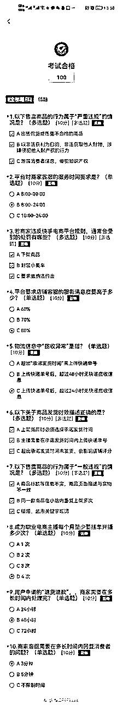

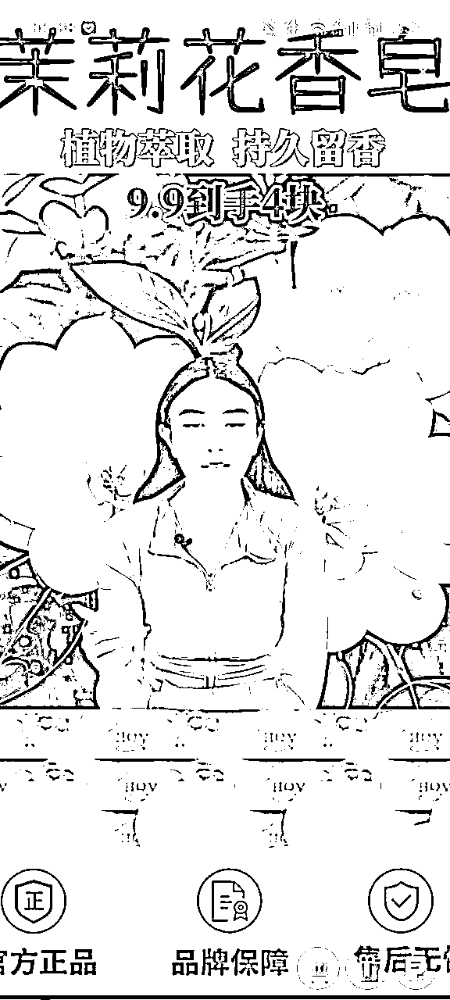

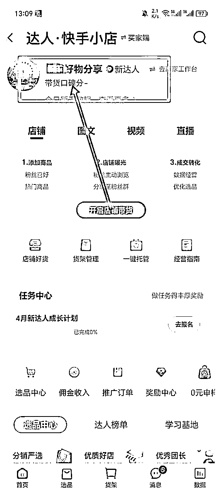

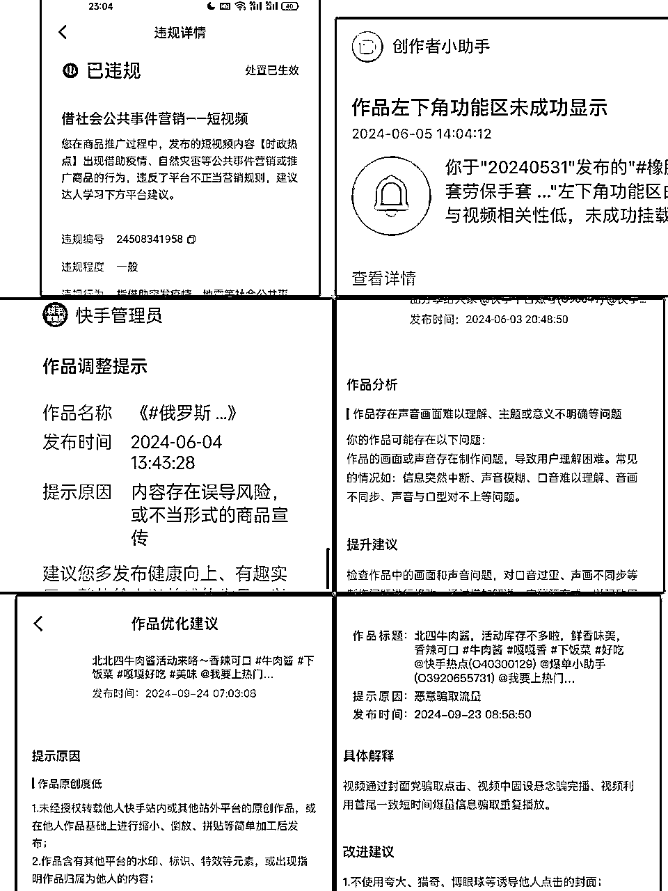