# 深度挖掘推特AI前沿资讯和工具分享：从采集监控到可视化

最近圈里都在聊“AI自媒体”这个超级标的，但真正动起手来，很多人卡在了第一步：优质素材从哪找？尤其是AI这个日新月异的领域，想要持续输出，必须得有一手信息源。

推特目前依然是全球AI信息密度最高的地方之一，技术大佬、官方账号、行业KOL基本都在上面实时更新。如果能把这些账号集中监控起来，再配合AI自动摘要和推送，就等于拥有了一条源源不断的“AI素材流水线”。

基于这个想法，我用 Cursor 做了个小工具。它能抓取推特 List 时间线上的推文，你可以直接引入现成的热门 AI List，也可以自己建一个 List 专门放想跟踪的人。采集完以后，AI 会自动生成摘要和选题分析，还能作为多媒体素材的起点。界面是用 PySide 糊的，最后打包成了 exe，解压就能用。工具链接放在文末，有需要自取。目前是第一版，基础功能都能跑，遇到 bug 或者有优化想法，欢迎在星球评论区一起聊。

工具用法很简单：输入推特 List 链接和 Cookie，设置要采集的页数，勾选是否需要 AI 摘要（需要的话填一下 DeepSeek Key），就能开始采集了。为了让阅读和选材更直观，我还让 Claude 设计了一个展示页面，一并打包进去。所有数据都存在本地，等于给自己搭了一个私有的 AI 资讯素材库。

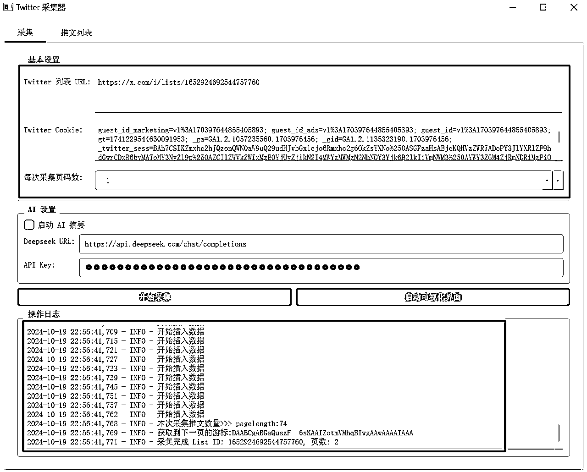

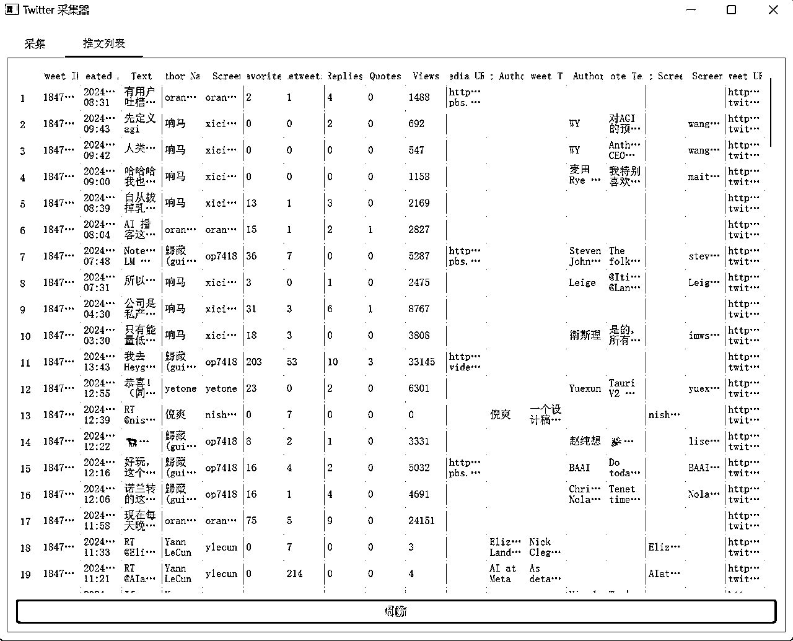

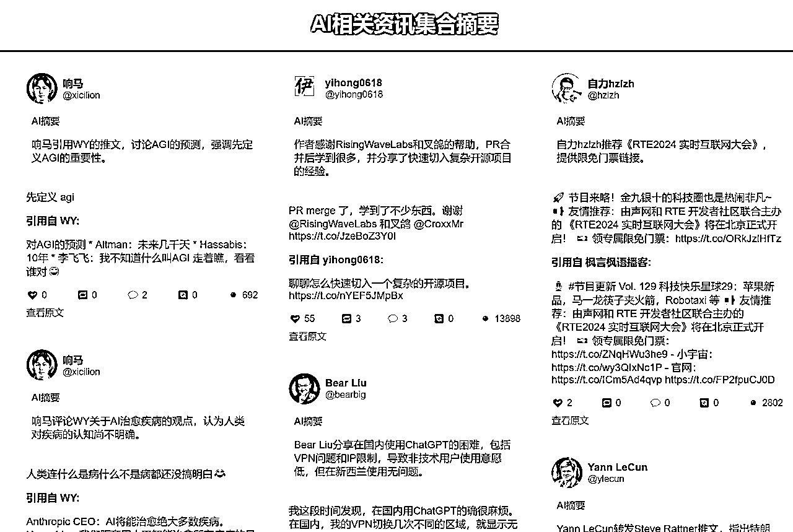

整个工具主要是靠 Cursor + Gemini 开发出来的，所以我把过程中的提示词和生成代码也整理了，一并分享，希望能给你一些启发。

下面是实现思路复盘：

1. **推文监控采集**：主要目标是抓取推特 List 和指定账号的最新动态。采集方法有好几种，简单说两种。一种是影刀 RPA，但也有坑：推特前端样式是动态渲染的，没法直接用样式选择器，只能自己写 xpath 或通配符匹配，效率偏低。不过影刀也有快速玩法，就是请求拦截，它是支持的。拦截之后解析数据，我实测大概每分钟能采 60-100 条，轻度用够，但整体效率还是不行，大约只有 API 方式的十分之一。另外影刀侵入性较强，会接管鼠标键盘，影响你同时做别的事。所以临时采一批可以用它，要做实时监控或重度采集，还是得走 API。

2. **定时执行和推送**：采集问题解决后，可以设定每分钟或每小时自动跑一次，顺带更新点赞、评论、转发、阅读等数据，方便直观对比热度。同时还可以对抓到的推文做 AI 摘要和推送。

3. **数据可视化**：数据只存在数据库里，阅读体验肯定差。所以让 Cursor 写了一个简单的静态页面集成到工具里，方便浏览采集结果。

再讲讲推特 API 获取数据的门道。主要有几种方式：官方企业版 API 确实稳，但马斯克收购推特后把免费权限关了，企业版价格贵、能采的数据还少，性价比很低。对咱们来说不划算。所以只能自己动手，借助 AI 逆向推特 web 端 API，然后花几毛钱买个推特 cookie 白号。这种方式基本能实现无限采集和监控，而且 web 端 API 相对稳定，不用频繁维护，能长期用。相比之下，影刀之类的方案入门简单，但效率和成本都不占优。

下面说下怎么用 web 端 API 拿数据。

之前赚钱的 AI 编程课里有类似的爬虫模块，航海手册也写过不少，这里不重复。以 List 接口为例：打开你要监控的 List，按 F12 打开控制台，在页面上随便找一段文字复制（比如我找的是“Open science is”），然后在控制台按 Ctrl+F 搜索这段文字，就能定位到返回推文数据的接口——它叫 `ListLatestTweetsTimeline`。

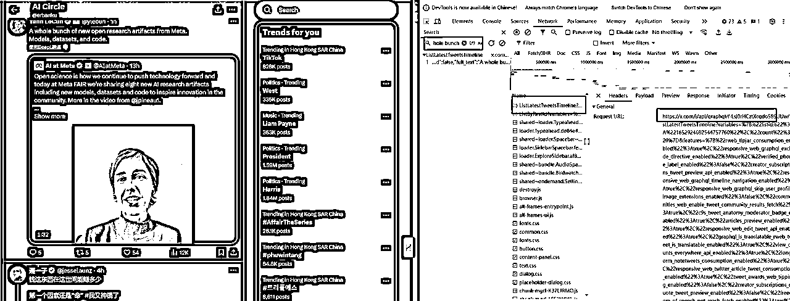

定位到接口后，要看怎么调用。打开 GitHub 上开源的推特 API 文档：

https://github.com/fa0311/TwitterInternalAPIDocument/blob/7d63d8905f4ea9225af44381beebeb078cd6e1fe/docs/json/API.json

全局搜索一下 List API 的接口参数：

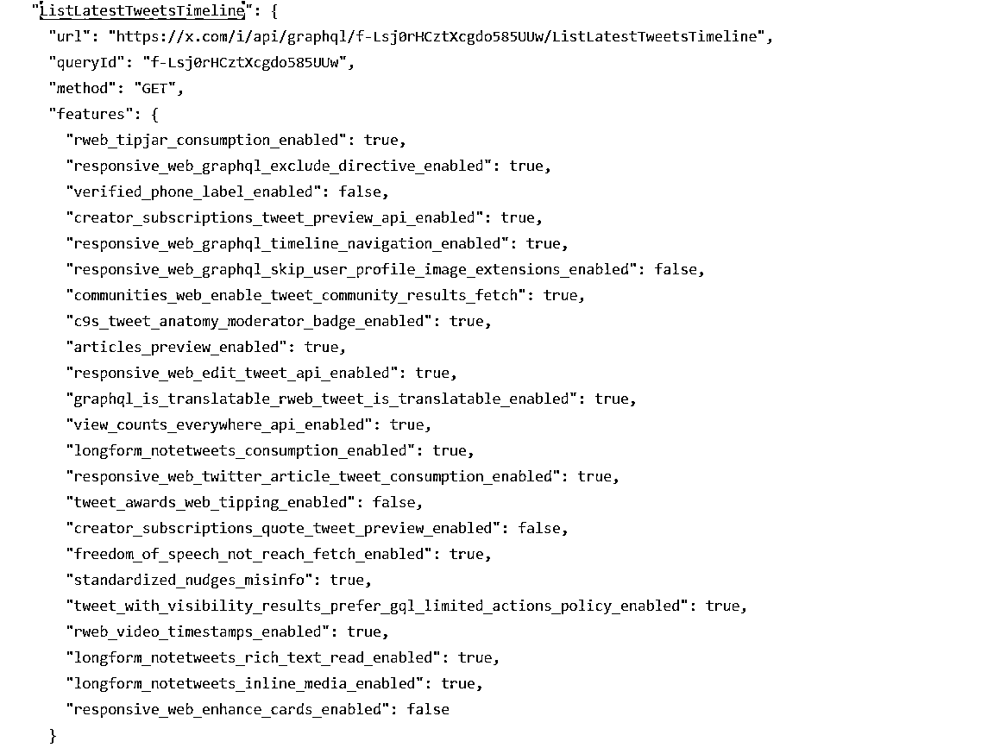

接下来就可以让 Claude 或 Gemini 接管代码部分了。在控制台右键接口，选择“复制-复制 curl”，然后打开 Gemini Studio（这里可以免费使用 Gemini 1.5 Pro 002）。之所以用 Gemini 做前期工作，是因为它上下文极大，有 200 万 token，相比 Claude 能一次性生成完整代码。我们把刚才复制的 curl 信息发给 Gemini，让它生成代码。

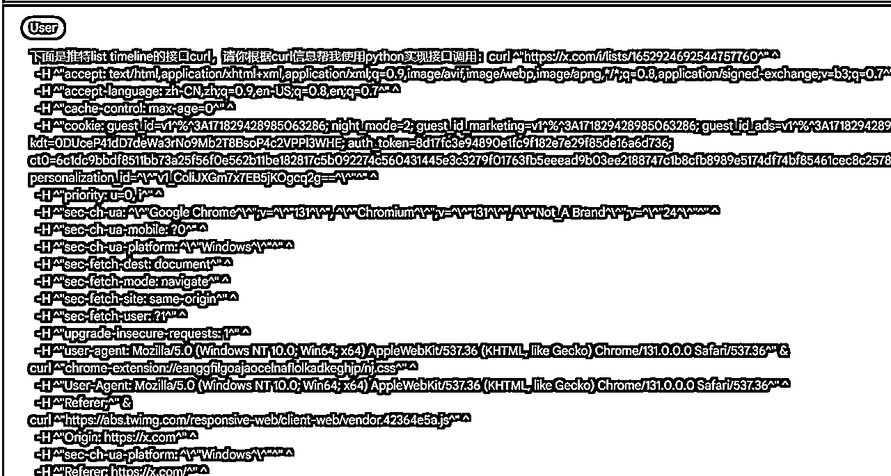

稍等片刻，Gemini 就会给出第一版代码：

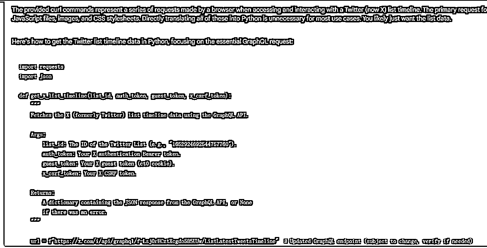

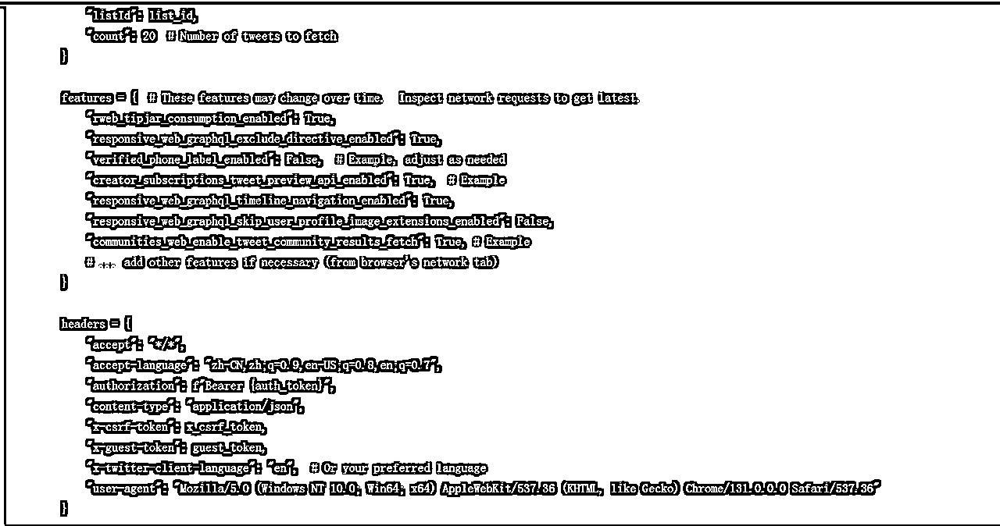

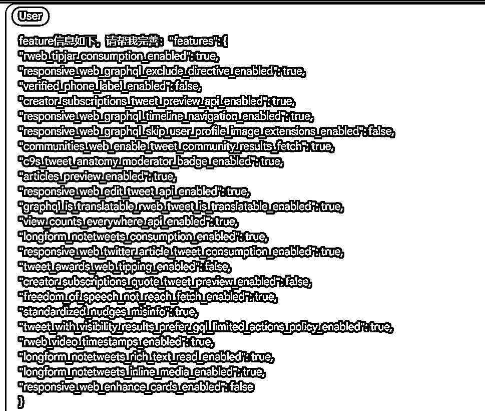

这个版本里有些 features 被省略了。我们把刚才拿到的 API JSON 补充给它，让它完善这部分，然后直接拷贝代码尝试执行：

```
import requests
import json

def get_x_list_timeline(list_id,cookie, auth_token, guest_token, x_csrf_token):
    """
    Fetches the X (formerly Twitter) list timeline data using the GraphQL API.

    Args:
        list_id: The ID of the Twitter List (e.g., "1652924692544757760").
        auth_token: Your X authentication Bearer token.
        guest_token: Your X guest token (ct0 cookie value).
        x_csrf_token: Your X CSRF token.

    Returns:
        A dictionary containing the JSON response from the GraphQL API, or None 
        if there was an error.
    """

    url = f"https://x.com/i/api/graphql/f-Lsj0rHCztXcgdo585UUw/ListLatestTweetsTimeline"

    variables = {
        "listId": list_id,
        "count": 20  # Number of tweets to fetch
    }

    features = {  # Copied directly from your provided features (but verify in your browser)
        "rweb_tipjar_consumption_enabled": True,
        "responsive_web_graphql_exclude_directive_enabled": True,
        "verified_phone_label_enabled": False,
        "creator_subscriptions_tweet_preview_api_enabled": True,
        "responsive_web_graphql_timeline_navigation_enabled": True,
        "responsive_web_graphql_skip_user_profile_image_extensions_enabled": False,
        "communities_web_enable_tweet_community_results_fetch": True,
        "c9s_tweet_anatomy_moderator_badge_enabled": True,
        "articles_preview_enabled": True,
        "responsive_web_edit_tweet_api_enabled": True,
        "graphql_is_translatable_rweb_tweet_is_translatable_enabled": True,
        "view_counts_everywhere_api_enabled": True,
        "longform_notetweets_consumption_enabled": True,
        "responsive_web_twitter_article_tweet_consumption_enabled": True,
        "tweet_awards_web_tipping_enabled": False,
        "creator_subscriptions_quote_tweet_preview_enabled": False,
        "freedom_of_speech_not_reach_fetch_enabled": True,
        "standardized_nudges_misinfo": True,
        "tweet_with_visibility_results_prefer_gql_limited_actions_policy_enabled": True,
        "rweb_video_timestamps_enabled": True,
        "longform_notetweets_rich_text_read_enabled": True,
        "longform_notetweets_inline_media_enabled": True,
        "responsive_web_enhance_cards_enabled": False
    }

    headers = {
        "accept": "*/*",
        "accept-language": "zh-CN,zh;q=0.9,en-US;q=0.8,en;q=0.7",
        "authorization": f"Bearer {auth_token}",
        "content-type": "application/json",
        "x-csrf-token": x_csrf_token,
        "x-guest-token": guest_token,
        'Cookie': cookie,
        "x-twitter-client-language": "en",
        "user-agent": "Mozilla/5.0 (Windows NT 10.0; Win64; x64) AppleWebKit/537.36 (KHTML, like Gecko) Chrome/131.0.0.0 Safari/537.36"  # Use a recent User-Agent
    }

    params = {
        "variables": json.dumps(variables),
        "features": json.dumps(features)
    }

    try:
        response = requests.get(url, headers=headers, params=params)
        response.raise_for_status()  
        return response.json()
    except requests.exceptions.RequestException as e:
        print(f"Error fetching list timeline: {e}")
        return None

# Example usage (replace with your actual tokens and list ID):
list_id = "1652924692544757760"  
auth_token = "YOUR_BEARER_TOKEN"  
guest_token =  "YOUR_GUEST_TOKEN" 
csrf_token = "YOUR_CSRF_TOKEN"
cookie = """guest_id_marketing=v1%3A170397644855405893; guest_id_ads=v1%3A170397644855405893; guest_id=v1%3A170397644855405893; gt=1741229544630091953; _ga=GA1.2.1057235560.1703976456; _gid=GA1.2.1135323190.1703976456; _twitter_sess=BAh7CSIKZmxhc2hJQzonQWN0aW9uQ29udHJvbGxlcjo6Rmxhc2g6OkZsYXNo%250ASGFzaHsABjoKQHVzZWR7ADoPY3JlYXRlZF9hdGwrCDxR6byMAToMY3NyZl9p%250AZCIlZWVkZWIxMzE0YjUyZjlkN2I4MWYzMWMzN2NhNDY3Yjk6B2lkIiVmNWM3%250AYWY3ZGM4ZjRmNDRiMzFiOGUzNWNmMDQ0M2Q0MQ%253D%253D--a1032fec6b1279a56ef98ed6409fb8e9303b54e6; NID=511=MSkwom0gp_PpMgPDCVicYVO8odOhWyGU4B1TtKZ8lahQWKob7RPqwK5p4Jjdyvi7xNeW0dIDQL7e71ZKqv7Z5cWN26x-1YCgsLo58tkHqy2rC6Im9xBrcSw9Zndg4Gf_xDaaCizmTTWCx4r1zYeI_oY1S3VqkW2ai37NJDyJJ9g; kdt=SiX4cEsjpuX5mSWohFt2yFyOV3ANPqzQd3ZHhytq; auth_token=730391e07856f7dd3515e0eb7c97800516767076; ct0=d66936b453dbcf3f95157e281da838810f3c3be41a1c057b9657672df2a7f16c81a55972370652ea76b552bbe2decdb56bd3b3f0616cf5b93cfec70aa4920de87f9624478df0baad08011257c82f1f09; att=1-l49KMoXof90t5eHuSXqsfFl90UEKwVD8hhJxnl0i; lang=en; personalization_id="v1_9sDk8dsuFpe6HoiVDmtyQA=="; twid=u%3D1716477605153501184"""
timeline_data = get_x_list_timeline(list_id, auth_token, guest_token, csrf_token)

if timeline_data:
    # Now you can work with the timeline_data.  For example, to get the tweets:
    tweets = timeline_data['data']['list']['tweets_timeline']['timeline']['instructions'][0]['entries']
    # ... process the tweets
    print(json.dumps(tweets, indent=4))
```

第一次执行当然会报错，因为 token 的问题还没处理。去谷歌搜索“推特账号购买”，多对比几个网站，挑最便宜的，比如几毛钱一个的账户。可以直接买 cookie 号，也可以登录账号以后手动导出或复制 cookie，效果一样。

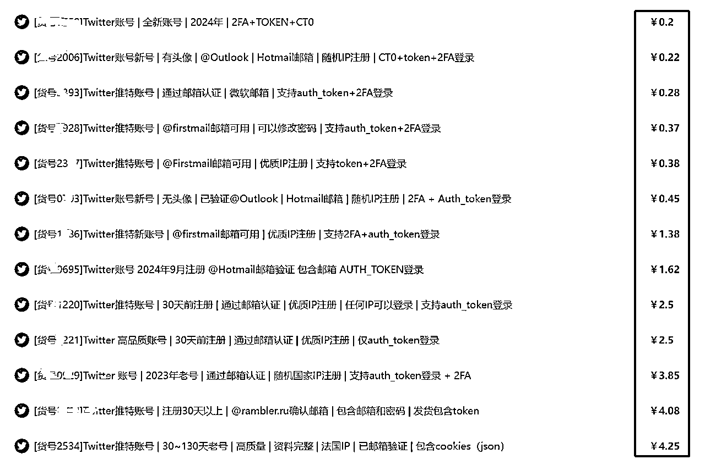

这样一套组合下来，从采集、监控到可视化，整个流程就闭环了。希望这个思路能给你带来一些启发，也欢迎一起交流优化。

搞定 Cookie 之后，剩下的流程交给 Cursor 来完善就行。把抓到的 Cookie 注入代码，移除不再需要的 guest_token，同时从 Cookie 里把 ct0 字段的值提取出来当作 CSRF 凭证，再补上固定的 Authorization 请求头。这两步做完就能直接跑，解析结果也是正常的。同一个思路也能用在抓取目标账号的个人主页时间线上：想实时盯动态，就多准备几个白号轮流请求，轮询间隔设短一些；如果并不追求实时，一小时扫一次足够，单账号本地执行即可，不需要代理。

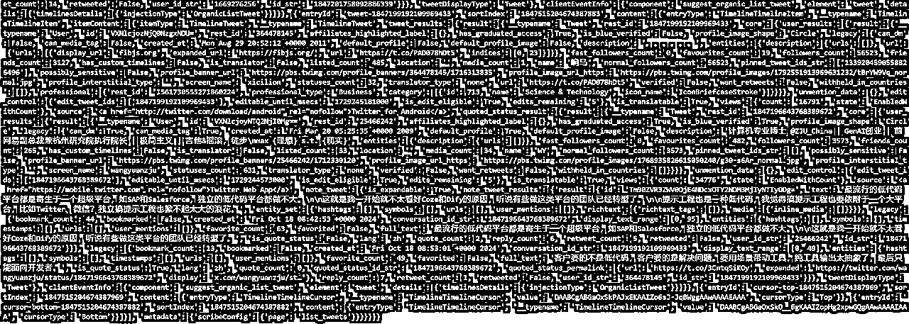

解析出的数据最好直接落到存储里，后续做分析、展示和自动推送都会省事很多。SQLite 和 MySQL 任选其一，整体思路与此前聊的 AI 辅助开发差别不大。下面这段解析入库逻辑是让 Gemini 生成的，功能上能跑通就行，暂时不追求代码优雅，先保证可用。

```
def extract_tweet_info(self, result):
        """
        Extracts information from a single tweet result.
        """
        tweet_info = {}

        legacy = result['legacy']
        quoted_status_result = result.get('quoted_status_result', {}).get('result', {}).get('legacy', {})

        tweet_info['quoted_status_text'] = quoted_status_result.get('full_text')
        tweet_info['quoted_name']  = result.get('quoted_status_result', {}).get('result', {}).get('core',{}).get('user_results',{}).get('result',{}).get('legacy',{}).get('name')
        tweet_info['quoted_screen_name']  = result.get('quoted_status_result', {}).get('result', {}).get('core',{}).get('user_results',{}).get('result',{}).get('legacy',{}).get('screen_name')

        retweeted_status = legacy.get('retweeted_status_result')
        if retweeted_status:
            tweet_info['retweeted_name'] = retweeted_status['result']['core']['user_results']['result']['legacy']['name']
            tweet_info['retweeted_screen_name'] = retweeted_status['result']['core']['user_results']['result']['legacy']['screen_name']
            # 如果是转推，则覆盖full_text为转推前的文案
            tweet_info['retweeted_full_text'] = retweeted_status['result']['legacy']['full_text']
            quoted_status = retweeted_status['result'].get('quoted_status_result',{})
        views = result.get('tweet', result).get('views', {}).get('count',0)
        user_legacy = result.get('tweet', result).get('core', {}).get('user_results', {}).get('result', {}).get(
            'legacy', {})
        screen_user = user_legacy.get('screen_name')
        followers_count = user_legacy.get('followers_count')
        fast_followers_count = user_legacy.get('fast_followers_count')
        name = user_legacy.get('name')
        profile_url = user_legacy.get('profile_image_url_https')
        reply_count = result.get('legacy', {}).get('reply_count', 0)
        quote_count = result.get('legacy', {}).get('quote_count', 0)
        retweet_count = result.get('legacy', {}).get('retweet_count', 0)
        favorite_count = result.get('legacy', {}).get('favorite_count', 0)
        user_link = f'https://twitter.com/{screen_user}'
        tweet_text = result['note_tweet']['note_tweet_results']['result']['text']
        tweet_create_time = result['tweet']['legacy']['created_at'] if 'tweet' in result else result['legacy'][
            'created_at']
        converted_time = datetime.strptime(tweet_create_time, '%a %b %d %H:%M:%S %z %Y')
        formatted_time = converted_time.strftime('%Y/%m/%d %H:%M')

        tweet_info.update({
            "tweet_id": tweet_id,
            "tweet_url": tweet_url,
            "user_link":user_link,
            "tweet_text": tweet_text,
            "views": views,
            "followers_count": followers_count,
            "fast_followers_count": fast_followers_count,
            "reply_count": reply_count,
            "retweet_count": retweet_count,
            "favorite_count": favorite_count,
            "tweet_create_time": formatted_time,
            "quote_count": quote_count,
            "screen_name": screen_user,
            "name": name,
            "profile_url": profile_url,
            "media_urls": media_urls
        })

        return tweet_info
```

落库结果长这样：主流 AI KOL 和不少官方账号的动态都在里面，点赞、收藏、转发、浏览这几项核心指标都保留着，完全够后续使用。

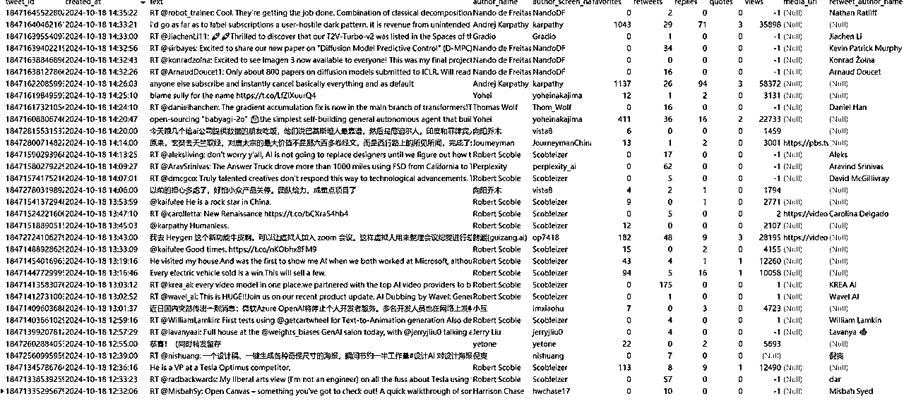

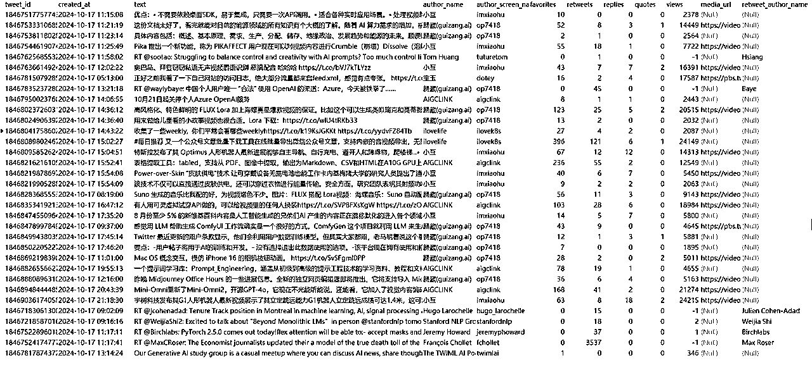

## 用 LLM 做总结与二次筛选

采集只是开端。表格里直接看内容很痛苦，一天下来几百上千条根本看不完。更合理的方式是，让 LLM 先逐条提炼重点，再通过前端界面手动挑选，最后将选中的内容同步到飞书或🛰️。

### LLM 总结

总结模型我一般优先用 DeepSeek 或豆包，通义千问也能胜任，原因主要是量大便宜。百万 token 只要 1~2 元，而且 DeepSeek 注册送 500 万 token，豆包则直接给 1 亿 token 的赠送额度，日常试用完全不心疼。

以 DeepSeek 为例：去开放平台完成身份认证，再在后台生成一个 API key 就行。

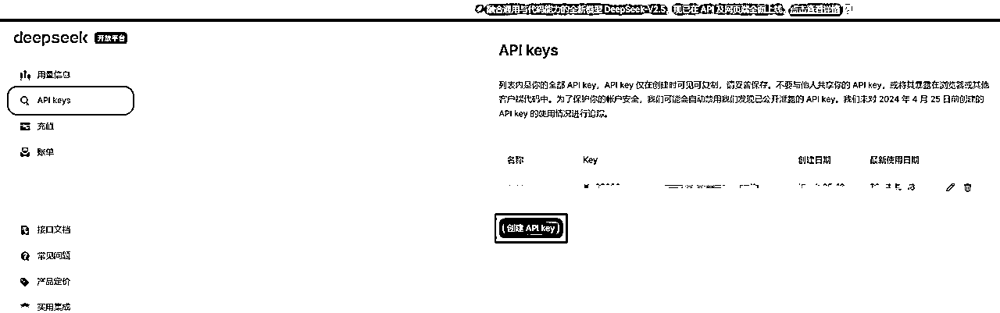

它的接口文档在官网可以直接查看，由于协议与 OpenAI 兼容，用 openai 库或自己发请求都能对接。

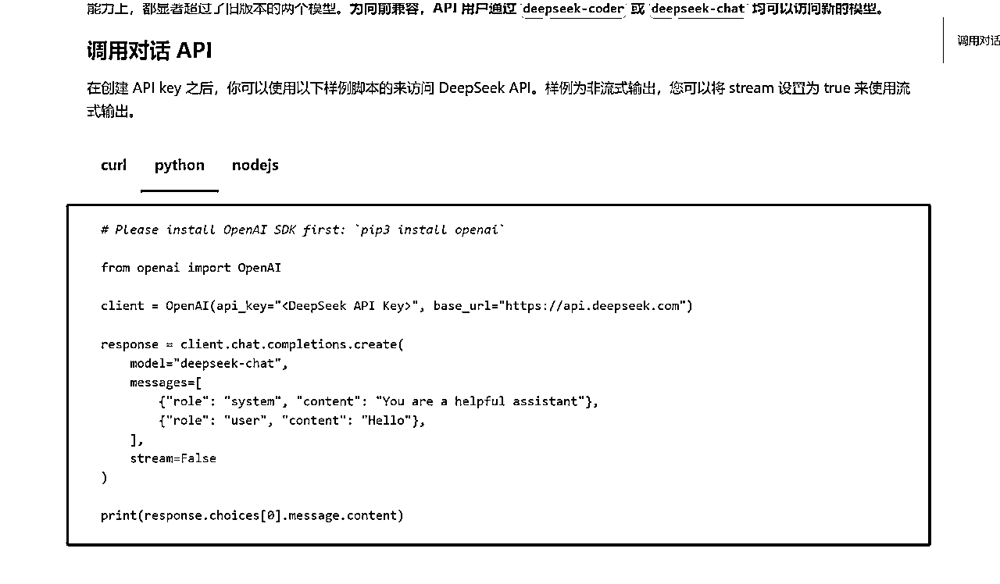

这是一段最基础的调用示例。我需要的改动是：采集完推特数据之后，自动把原始内容、转发内容、引用内容、作者以及引用作者一并交给 LLM，并生成摘要。让 Cursor 在这个示例的基础上完善即可。

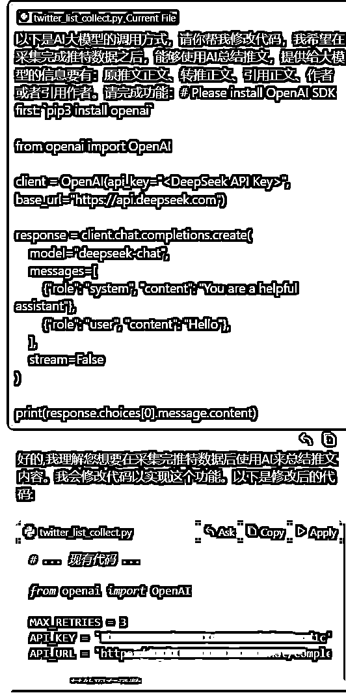

```
def get_tweets_from_db():
    conn = mysql.connector.connect(**connection_params)
    cursor = conn.cursor(dictionary=True)
    cursor.execute('''
    SELECT 
        tweet_id,
        author_name,
        text,
        retweet_author_name,
        retweet_text,
        quote_author_name,
        quote_text
    FROM tweets_list WHERE ai_summary IS NULL OR ai_summary = ''
    ''')
    tweets = cursor.fetchall()
    cursor.close()
    conn.close()
    return tweets
```

拼接上下文时，按作者、内容、转发作者、转发内容、引用作者、引用内容的顺序组织即可。

```
def fill_tweets_ai_summary():
    tweets = get_tweets_from_db()
    print(f"获取到的推特数量：{len(tweets)}")
    for tweet_data in tweets:
        tweet_content = f"""
        author_name:```作者```

        text:```内容```
        retweet_author_name:```转发作者```

        retweet_text:```转发内容```
        quote_author_name:```引用作者```

        quote_text:```引用内容```
        """
        print(tweet_content)
        summary = get_deepseek_response(tweet_content)
        if summary:
            print(f"推文ID: {tweet_data['tweet_id']}")
            print(f"摘要: {summary}")
            # 更新数据库中的ai_summary字段
            upate_tweet_summary(tweet_data['tweet_id'], summary)
```

我给 LLM 的总结指令大致是：用不超过 50 字的中文，提炼一条推文里最有价值的信息，方便我判断是否值得作为选题；若是转发，需要说明原推的重点；若是引用或评论，则需要点出作者对原推的态度。如果以后想提取别的信息，按需调整指令就行。

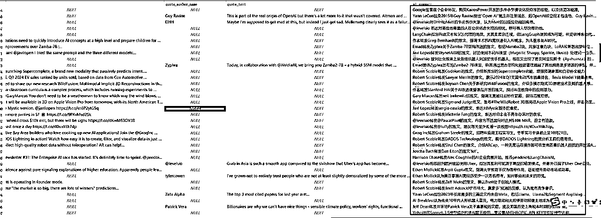

### 前端查看界面

采集和总结都有结果后，不然每次都要打开客户端导表格，太麻烦。干脆让 LLM 生成一个简单的 Web 页面来做展示和筛选，本质上就是一段需求描述的事。

我的 MySQL 表设计大概是：主键为推文 ID，后面跟着发布时间、推文内容、作者昵称/用户名、点赞/转发/回复/引用/浏览数、媒体 URL、转发来源作者/转发内容、引用来源作者/引用内容、LLM 总结结果和抓取时间。前端页面直接读取这些字段即可。

最近搞了个小工具，过程挺有意思，分享给大家。一开始只是想用 FastAPI 搭个页面，把 AI 生成的摘要和原推文信息、链接一起展示出来。设计上我直接用了卡片风格，主色调选了推特标志性的天蓝色，整体布局尽量清爽，阅读体验优先。没想到的是，用提示词一句话还真能生成出能跑的代码，而且一个字没改就渲染成功了。

不过第一版颜值确实一般，那就继续用提示词打磨呗。让它给每条推文加卡片样式，搞成瀑布流横铺的效果，视觉上明显好多了。第二版基本就是我想要的，虽然图片和视频还没直接渲染出来，但我觉得目前也没必要，毕竟点进原文就能看，或者到时候推送的时候自动把视频下载下来发到飞书或🛰️就够用了。

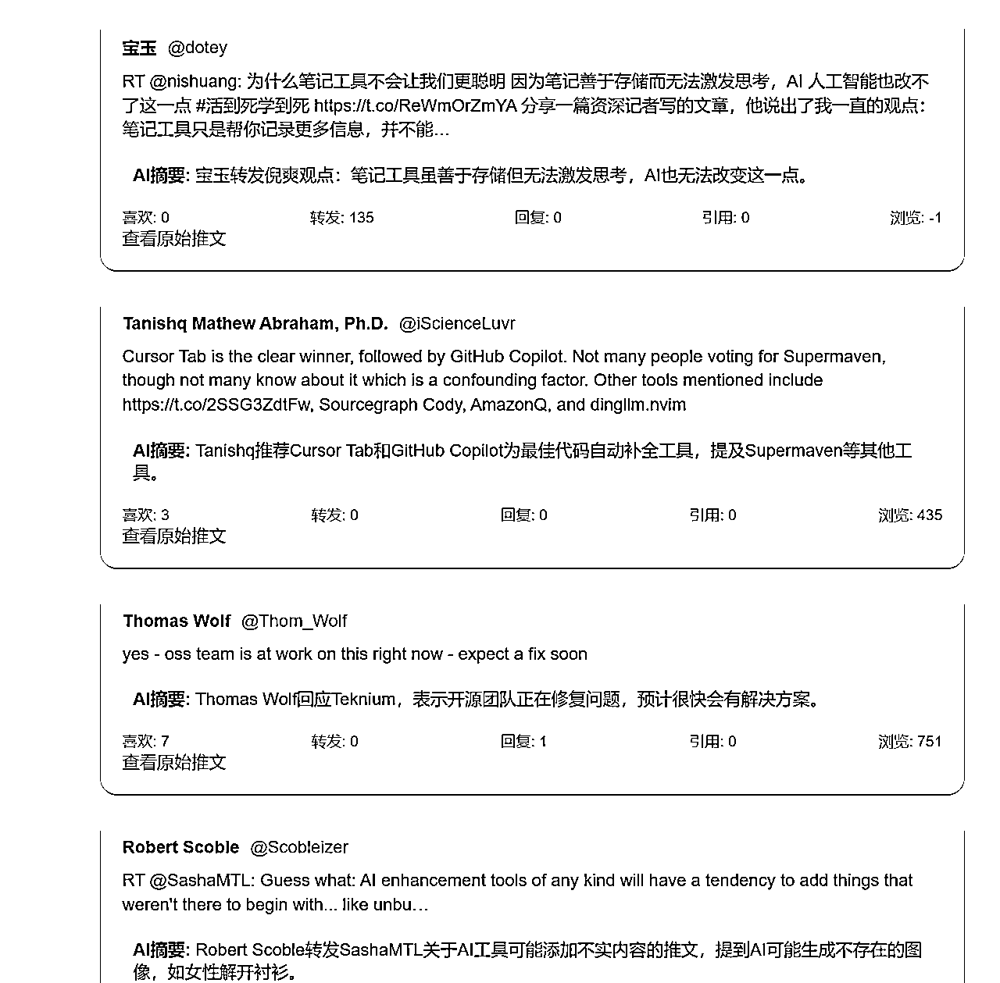

到这一步，代码已经能完整跑起来，主要功能都实现了。接着我就想，既然能采集和摘要，那不如把推送也做了。飞书有官方机器人接口，直接调就行。🛰️的话官方不支持个人机器人，所以建议用小号接入 wechatpy 或者 wcf，稳定性还行，但千万别用大号。

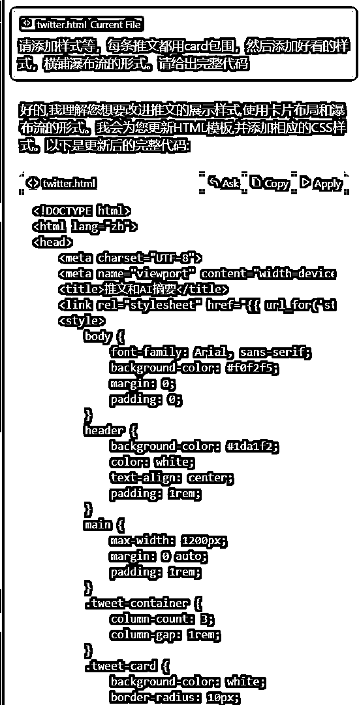

再后来感觉命令行不够方便，就用 PySide6 包了一层 GUI。界面分两个 tab：采集和列表。采集那边要填推特 list 链接、cookie 和页数；列表 tab 则是展示数据库里已有的推文信息，数据从本地的 SQLite 的 tweets_list 表读取。第一版界面出来真的丑，那就继续改样式。

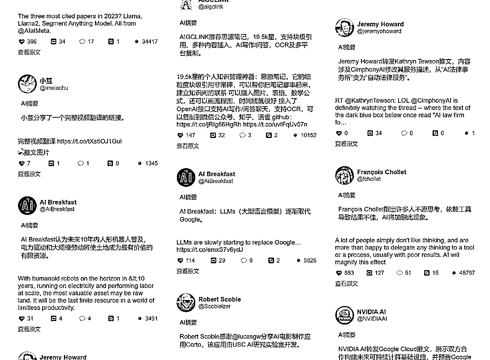

我让它在采集 tab 底部加一个日志框，用来显示操作记录和系统消息，同时整体重新做了视觉设计，布局和配色都调整了一番。改完之后确实顺眼多了，截图随便一看就是比较规整的工具界面。到这一步，最小的 MVP 算是做完了。

```

    推文和AI摘要

# 推文和AI摘要

            

                    

## {{ tweet.author_name }}

@{{ tweet.author_screen_name }}

### AI摘要

{{ tweet.ai_summary }}

{{ tweet.text }}

                
                
                

                    ❤️ {{ tweet.favorites }}
                    🔁 {{ tweet.retweets }}
                    💬 {{ tweet.replies }}
                    🔄 {{ tweet.quotes }}
                    👁️ {{ tweet.views }}

                [查看原文](https://twitter.com/{{ tweet.author_screen_name }}/status/{{ tweet.tweet_id }})

            

```

因为底层把原始推文的所有信息都保存下来了，后续能扩展的空间就很大。比如加个图片和视频下载功能，或者在列表后面加一个“改写”按钮，自定义提示词一键改写，然后直接进素材库，方便后期创作或者分发到多平台。感觉玩法还挺多的。大家如果有更好的点子，欢迎评论区留言，呼声高的话我后面就安排上。

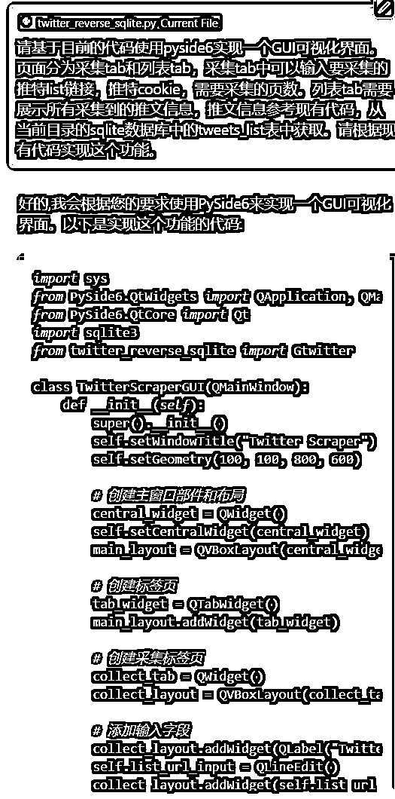

整个开发流程就是这样了。我已经把工具打包成 exe 放出来了，感兴趣可以直接下载用。另外说明一下，这个软件除了采集之外没有其他网络交互，数据都存在本地：API key 放在当前目录的 config.json，推文数据存在 twitter_data 文件夹里。为了方便大家体验，我还在下面放了一个 cookie，懒得到处找推特小号的可以直接复制去用。当然采集的时候记得自己要有外网环境，🪜这个就不多说了。

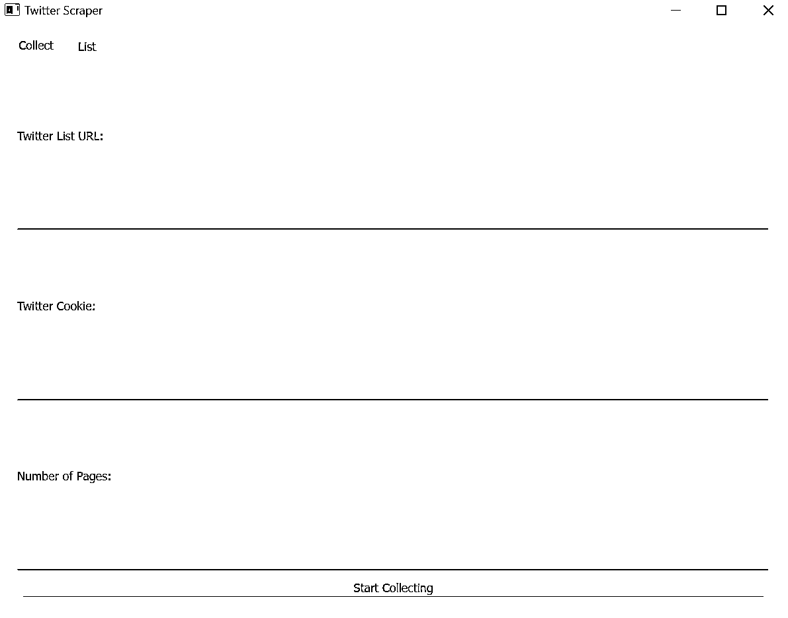

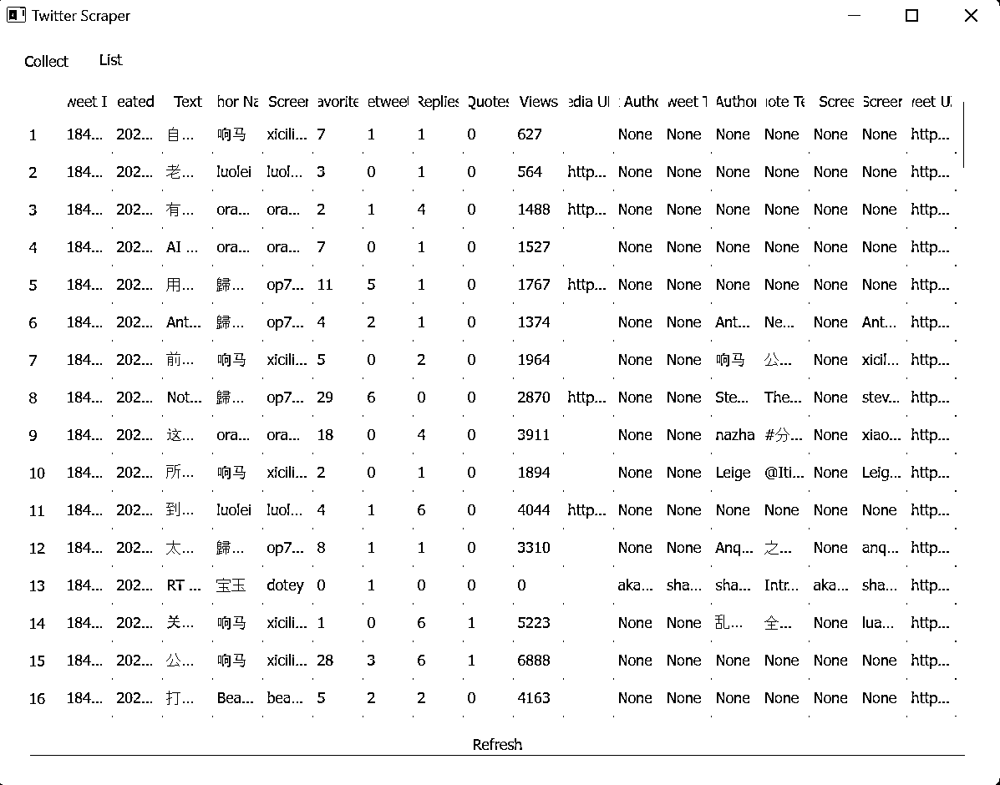

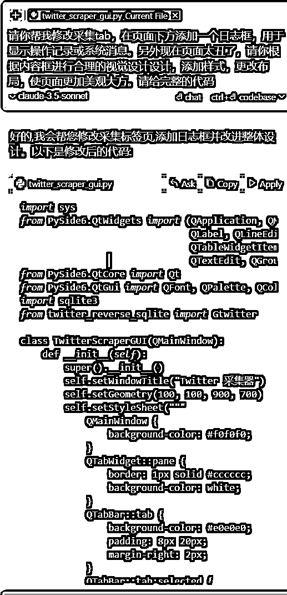

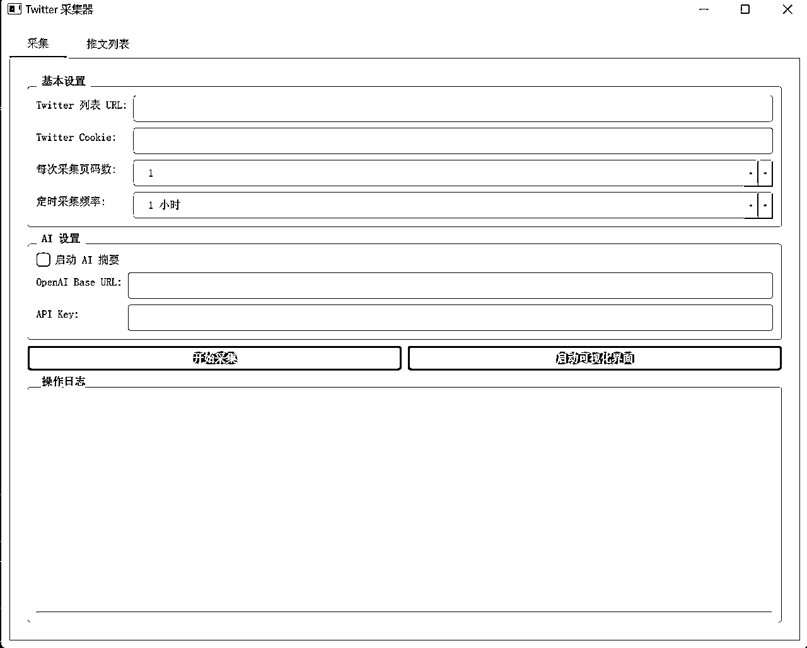

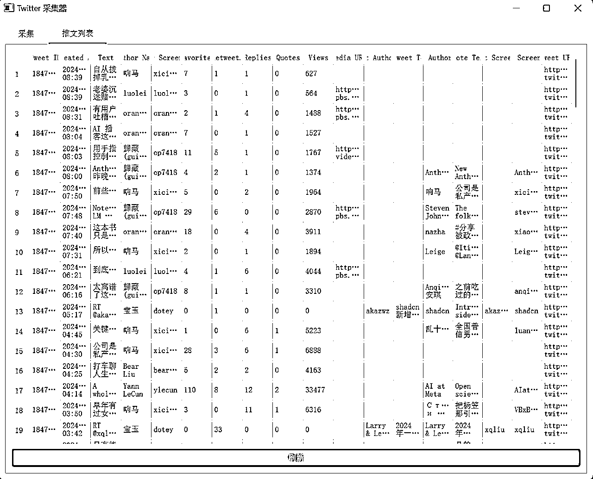

```
guest_id_marketing=v1%3A170397644855405893; guest_id_ads=v1%3A170397644855405893; guest_id=v1%3A170397644855405893; gt=1741229544630091953; _ga=GA1.2.1057235560.1703976456; _gid=GA1.2.1135323190.1703976456; _twitter_sess=BAh7CSIKZmxhc2hJQzonQWN0aW9uQ29udHJvbGxlcjo6Rmxhc2g6OkZsYXNo%250ASGFzaHsABjoKQHVzZWR7ADoPY3JlYXRlZF9hdGwrCDxR6byMAToMY3NyZl9p%250AZCIlZWVkZWIxMzE0YjUyZjlkN2I4MWYzMWMzN2NhNDY3Yjk6B2lkIiVmNWM3%250AYWY3ZGM4ZjRmNDRiMzFiOGUzNWNmMDQ0M2Q0MQ%253D%253D--a1032fec6b1279a56ef98ed6409fb8e9303b54e6; NID=511=MSkwom0gp_PpMgPDCVicYVO8odOhWyGU4B1TtKZ8lahQWKob7RPqwK5p4Jjdyvi7xNeW0dIDQL7e71ZKqv7Z5cWN26x-1YCgsLo58tkHqy2rC6Im9xBrcSw9Zndg4Gf_xDaaCizmTTWCx4r1zYeI_oY1S3VqkW2ai37NJDyJJ9g; kdt=SiX4cEsjpuX5mSWohFt2yFyOV3ANPqzQd3ZHhytq; auth_token=730391e07856f7dd3515e0eb7c97800516767076; ct0=d66936b453dbcf3f95157e281da838810f3c3be41a1c057b9657672df2a7f16c81a55972370652ea76b552bbe2decdb56bd3b3f0616cf5b93cfec70aa4920de87f9624478df0baad08011257c82f1f09; att=1-l49KMoXof90t5eHuSXqsfFl90UEKwVD8hhJxnl0i; lang=en; personalization_id="v1_9sDk8dsuFpe6HoiVDmtyQA=="; twid=u%3D1716477605153501184
```