# 出海网站收款实战：从海外公司搭建到资金回流全流程拆解

这篇文章想把我在做海外站、跑通跨境业务时踩过的坑和经验整理出来。无论你正准备把业务推向海外，还是已经开始尝试，这里的内容或许能帮你少走弯路。

项目源于亲身实操海外站点并设立境外主体时的真实经历。我们很清楚过程中会遇到哪些卡点和迷惑，所以希望用自己的教训，为同路人提供一点可用的参考。

后续会持续更新，涉及境外主体设立、银行开户、支付对接、合规法务以及站点的技术实现等多个方面。

# 海外主体设立

1. 全流程概览

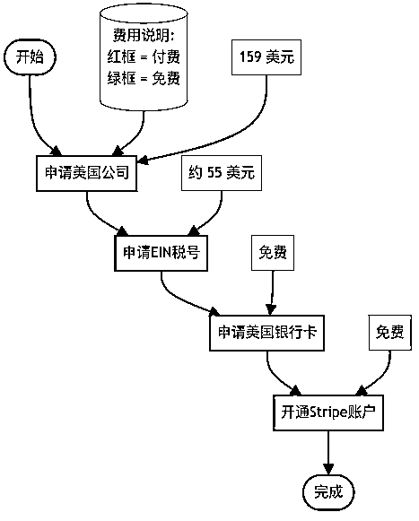

### 全景图速览

要让海外网站真正能收款，需要先把几项前置工作串起来，如图所示：

注意点：

*   「实益所有权信息申报」我办理时只要 9 美元，如今涨到 25 美元。
*   公司登记费也上调了，以前 100 美元，现在是 104 美元。
*   因此图示里的 159 美元，现在实际要 179 美元。
*   有打算的朋友建议抓紧，越早越省。

### 时间投入

我第一次完整走完，耗时很久。从 6 月 2 日递交公司设立申请，到 7 月 22 日完成 Stripe 激活，整整 51 天。期间走弯路不少，比如水星银行尝试了两次都没过，还遇到 IRS 把法人姓名写错的乌龙，绝大部分时间都在等。

我这属于特例，正常节奏会快很多，下面时间仅作参考。

注意： 以上所列天数均为工作日，不含周末和法定假日。

1. 注册海外公司

本文以美国公司为例，我注册的是美国主体，所以就按美国来讲解。

### （1）注册渠道

👉 wyomingagents （再推荐一个国内的海外公司注册平台，大家有兴趣可以了解一下 IngStart）

wyomingagents 负责美国怀俄明州企业注册与后续管理。怀俄明州税负低，很适合小团队或个人创业，成本可控。

### （2）操作步骤

*   点击「Form a Company」开始建公司
*   页面显示主体设立费 $150，下方有「实益所有权信息申报」选项一并勾选，后面再说明原因。
*   无需提前在这平台注册，流程走到后面会自动引导注册。

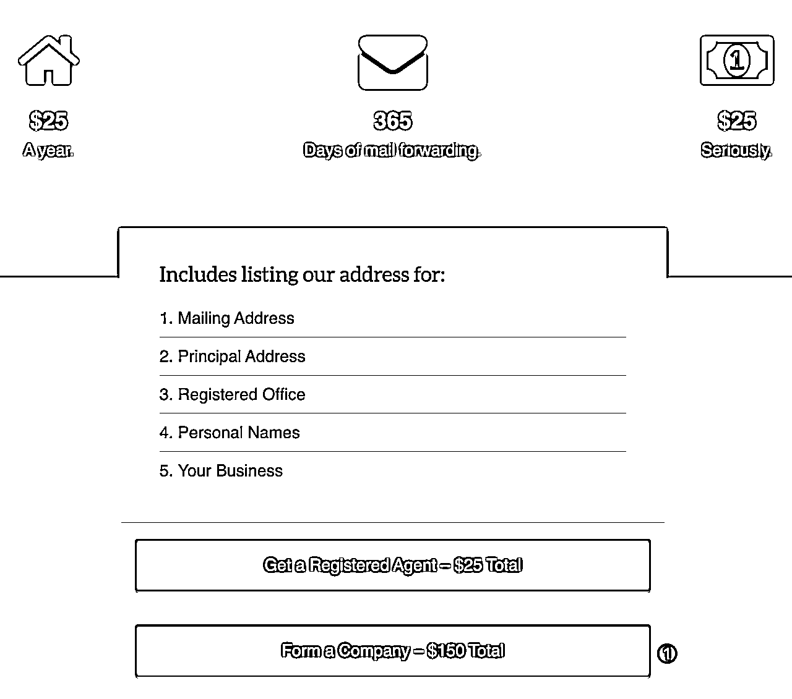

*   填写基础信息

① Desired Company Name：填写你想用的英文公司名

② Alternative Company Name：填一个备选名，防止主名不可用时可用备选

③ Business Entity Type：个人经营选 LLC 单一成员有限责任公司即可

④ Notify Your Attorney of a Lawsuit：选 NO，我们没有律师

⑤ "We'll file your Beneficial Ownership Information for you"：强烈建议勾选。实益所有权信息申报是美国联邦法规要求，新设和存续的美国公司都需向财政部金融犯罪执法网络 FinCEN 申报实益所有人。提前提交能提升透明度，银行开户时也常被要求。漏勾的话公司成立后再补或找第三方补办都很麻烦，直接一步到位更省事。

* * *

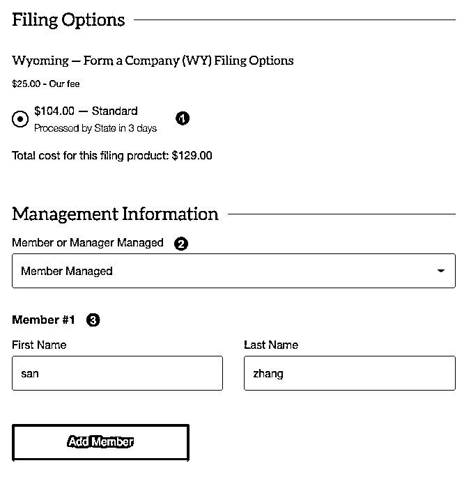

① 费用项：LLC 只有这一个套餐，默认即可。费用已调整 100 美元 -> 104 美元。

② Member or Manager Managed：默认即可。

③ Member #1：单人公司就填自己，拼音即可。如张三，First Name san，Last Name zhang。

④ 有合伙人点「Add Member」添加。

* * *

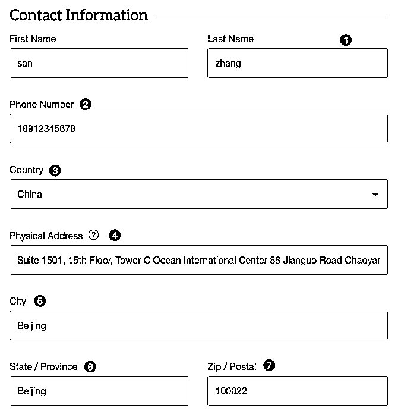

① First Name、Last Name：同上，拼音填写

② Phone Number：填本人常用手机号

③ Country：China，按国籍选

④ Physical Address：务必填真实居住地址，我填的是租房地址。建议先写中文收件地址，再用 AI 翻译成英文表达

⑤ City：长期居住城市，拼音

⑥ State / Province：长期居住省份/城市，拼音

⑦ Zip / Postal：当地邮政编码

* * *

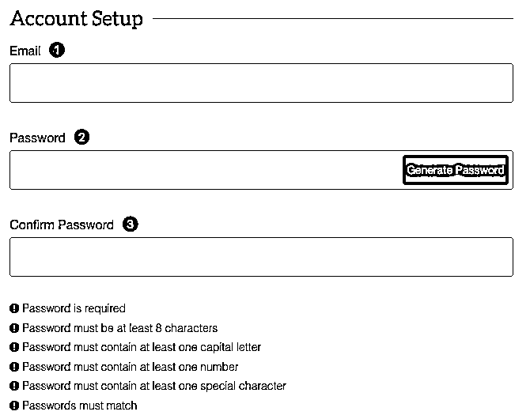

① Email：此步为注册 wyomingagents 账号，用常用邮箱

② Password：密码强度要求高，注意保存，公司文件都会托管在此平台

*   至少 8 位
*   至少含一个大写字母
*   至少含一个数字
*   至少含一个特殊字符

③ Confirm Password：重复输入保持一致

* * *

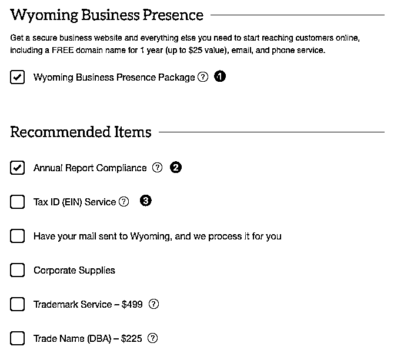

① Wyoming Business Presence Package：怀俄明商业启动包，包含：

*   1 年免费域名，价值最高 25 美元：后面会让你提供域名，系统会自动用 WordPress 搭一个简易官网，基本不可用，需自行改动
*   邮件与电话服务：送一个怀俄明美国号码，有 App 可收短信，实测能收但 Telegram 验证码收不到，官方说应可收，可能是网络原因

② Annual Report Compliance：默认勾选，免费。法律要求每年成立周年日申报，不交可能被州政府注销公司

③ Tax ID 服务：EIN 很关键，后续开美卡、激活 Stripe 都用得上。但我没选，太贵。美国籍 75 美元，非美国籍 250 美元，差距大。可自行向 IRS 官网或第三方申请，后文《2、申请 EIN 税号》会细说

④ 其他如 Corporate Supplies、Trademark Service、Trade Name DBA 等通常用不到

* * *

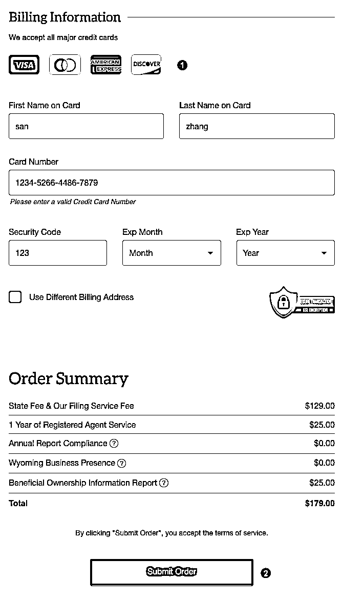

① 填写支付信息，国内 Visa 信用卡可用，我用招行 Visa

② 确认后提交，收到扣款短信即代表订单成功，通常 3 天左右下证，速度很快

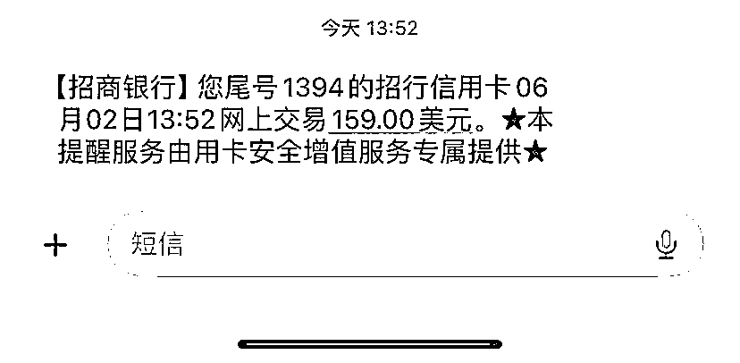

### （3）核对信息

提交订单后，信息录入阶段结束。登录平台核对订单里的公司信息，操作很简单，我放当时截图对照：

*   红框内容需逐项确认
*   点击「Continue」进入验证环节

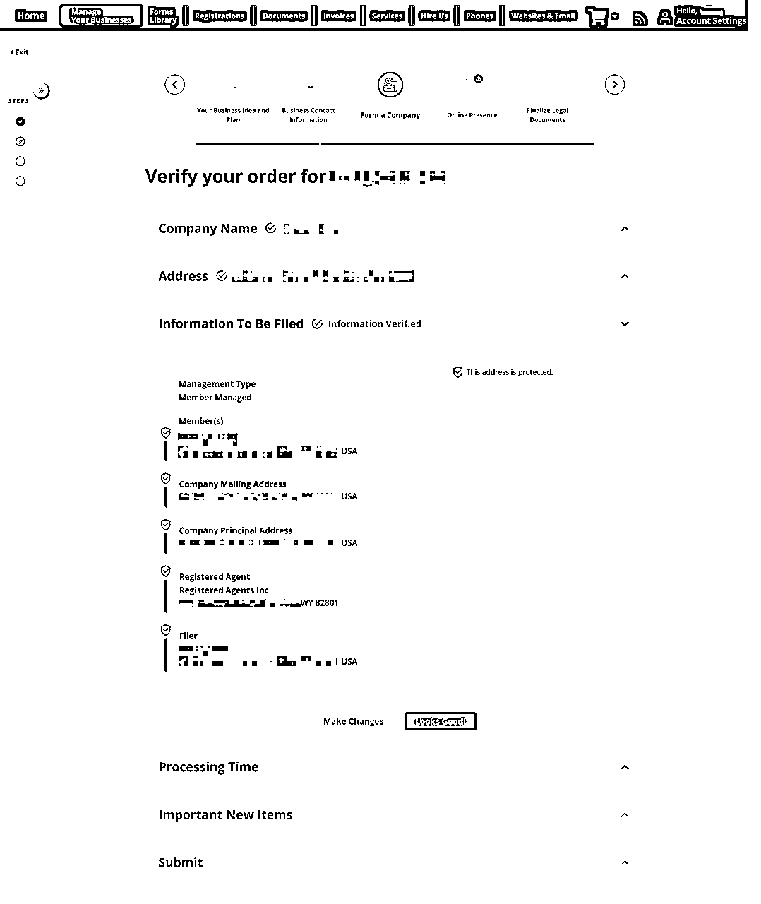

*   核对完成后会下发美国代理地址，即注册地址，多处会用到，保存好

至此怀俄明州公司设立申请完成，静待审核。成功后平台可下载：Operating Agreement、Initial Resolution、Formation Document

### （4）补充说明

*   套餐含网站、电话、商业邮箱，可在后台查看
*   官网是 WordPress 部署，会给账号密码，第一年免费，后续可取消续费
*   邮箱可自行登录收发
*   美国手机号下载 App 登录即可收发
*   试用期后邮件、SSL、电话、网站每项每月 9 美元。域名一年后按市价每年约 25 美元。续费及代理服务按年计费

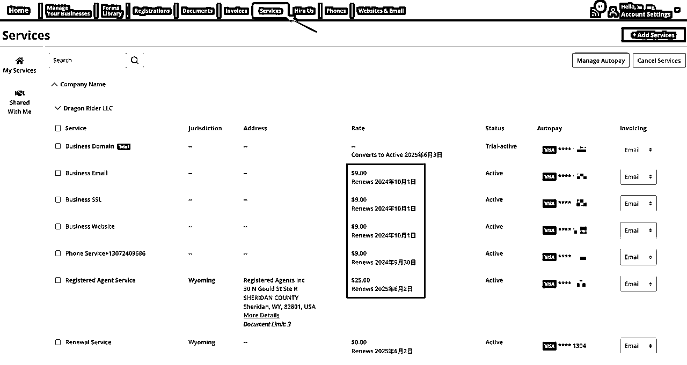

1. 最后提醒

美国公司注册流程并不复杂，建议尽早办理以免再次涨价，单人公司能省则省。

注意：若要开通空中云汇支付，必须注册英国公司，这是我后来才搞明白的，美国公司申请不下来，除非有美国身份。但美国公司可开美卡，有卡就能接 Stripe。

开卡前需先办 EIN，请看 2、申请 EIN

# 国内海外公司注册平台推荐

*   网址：IngStart WEB：英格斯特

最近接触到 IngStart，感觉不错。它协助在美国、香港、英国、新加坡等地区注册公司，并提供合规税务服务。

操作挺顺滑，先注册账号后即可在线完成全流程，代理地址、股东信息等一站式搞定。

优势在于集中管理、中文客服、价格有竞争力，核心是：一条龙省心。

感兴趣可上官网咨询客服，整体来说对不想折腾的人很友好。

# 申请 EIN

1. 什么是 EIN？能用在哪？

EIN 即 Employer Identification Number，中文叫雇主识别号，是 IRS 颁发的 9 位企业唯一编号，相当于企业的 SSN，即美国税务身份证，俗称税号。

主要用途：

*   报税：用于提交联邦税表
*   开户：绝大多数银行开商业户要求提供 EIN
*   以上两点最关键，其他用途可自行查阅

有了 EIN，后续事宜会顺畅很多。

1. 办理 EIN

先决条件是已有公司。第 1 部分提到注册时捆绑申请 EIN，非美国籍费用昂贵，遵循省钱原则，可另行申请。

有网友直接去 IRS 官网在线申请，信息较多较繁琐，但免费且符合条件可即时下发。

我选择在 Fiverr 找代理办。搜索关键词 “EIN”，挑评价高、订单多的服务商即可。价格相近，部分商家打包业务显示偏高，进店选仅办 EIN 即可。

沟通后代理会列材料清单，主要是公司注册成功后的文件。先付定金，完成后付尾款，通常 7 个工作日左右。但我这次踩坑了。

6 月 4 日提交资料，代理预计 8-12 天。

6 月 13 日，代理反馈 IRS 确认信上把法人姓名写错了。据说这种错虽少见但偶有发生，IRS 人手紧张易出错，纠正比较麻烦。

6 月 13 日到 6 月 20 日，代理反复与 IRS 邮件沟通，后又补纸质说明，花了 8 天。

6 月 21 日，EIN 终于下来。

前后耗时 18 天，不过期间我在开发网站，还未用到，所以不影响。

1. 收尾建议

Fiverr 上找代理办 EIN 性价比高，省心且有人把关。平台靠谱，还能找到公司注册+EIN 一体服务。

公司和 EIN 到手后，下一步是申请美国商业银行卡，请看 3、申请美国银行卡

# 申请美国银行卡

1. 为什么需要美商卡？

*   Stripe 激活要求商业卡，不建议用个人卡
*   财务分离可降低税务风险
*   其他好处可自行了解

1. 机构选择

出海圈最常提的是「水星银行」。它并非银行而是金融机构，卡适合小团队和个人，费用低便捷。

但对国内用户审核趋严，我申请两次未通过，邮件询问也未获明确原因。

后来改申「空中云汇」，可开美国商业卡。

1. 开通空中云汇美国商业卡

注意：若需开通空中云汇支付功能，请务必申请英国或香港主体，或先与官方确认。

### （1）地址

👉 Airwallex 空中云汇

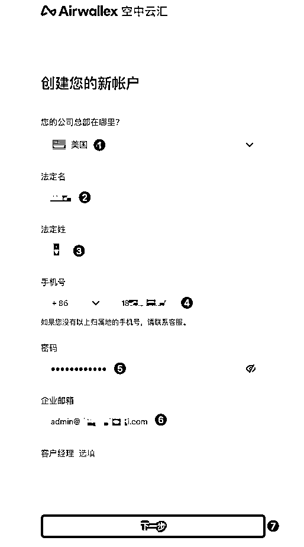

### （2）开户流程

① 公司所属国家：美国

② 和 ③ 法人姓名，即你本人，填中文即可

④ 手机号：本人常用号码

⑤ 密码：登录密码，妥善保管

⑥ 企业邮箱：我用的是注册公司时申领的邮箱

* * *

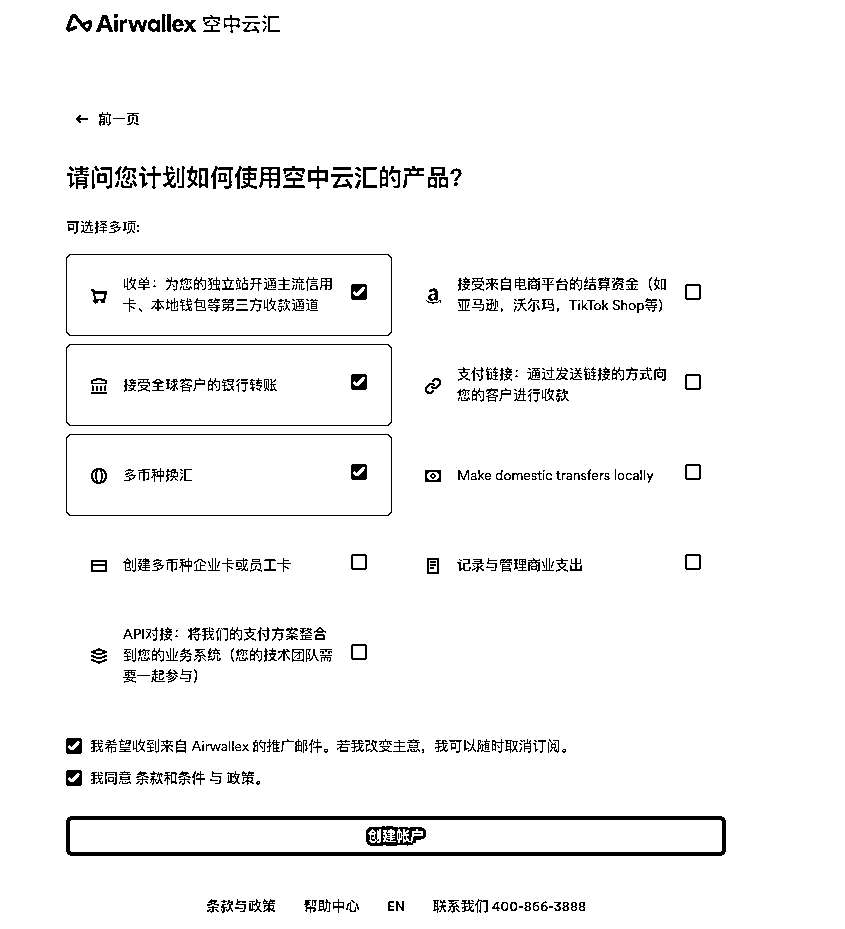

选择业务用途，一般选「收单、接收转账、多币种换汇」三项足够

* * *

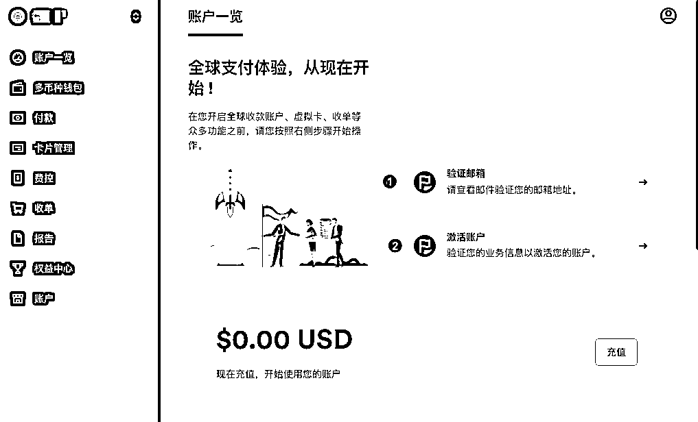

① 验证邮箱：点击链接验证即可

② 激活账户：步骤较多，共 10 个模块，下面逐项说明

* * *

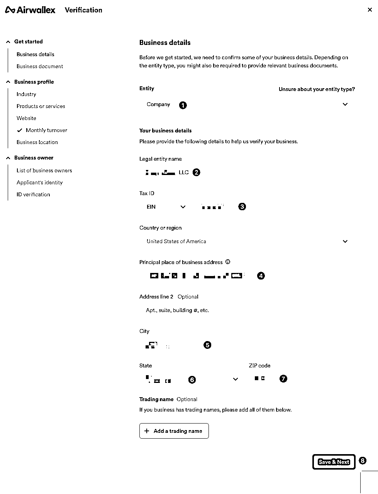

① Entity：选「Company」

② Legal entity name：公司法定名称，如 ABC LLC

③ EIN：即前面申请的税号

④ Principal place of business address：主要营业地址，按常住有效地址填写

⑤、⑥、⑦ 填写对应城市、省市、邮编

* * *

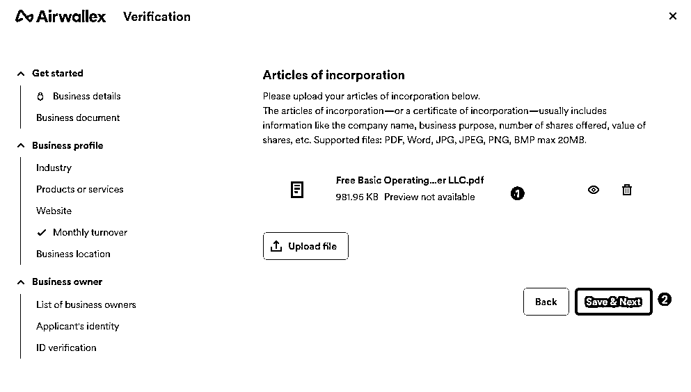

① 上传第 1 部分的公司注册文件，下载后上传

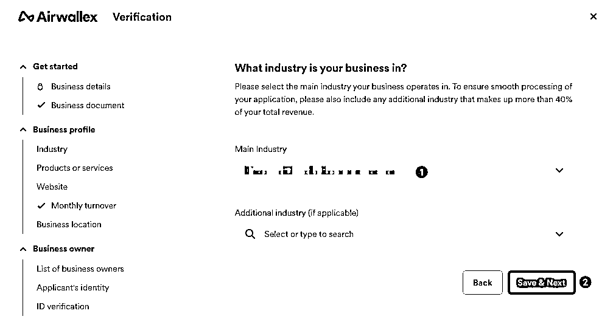

* * *

① 选择主营行业，按实际情况选

* * *

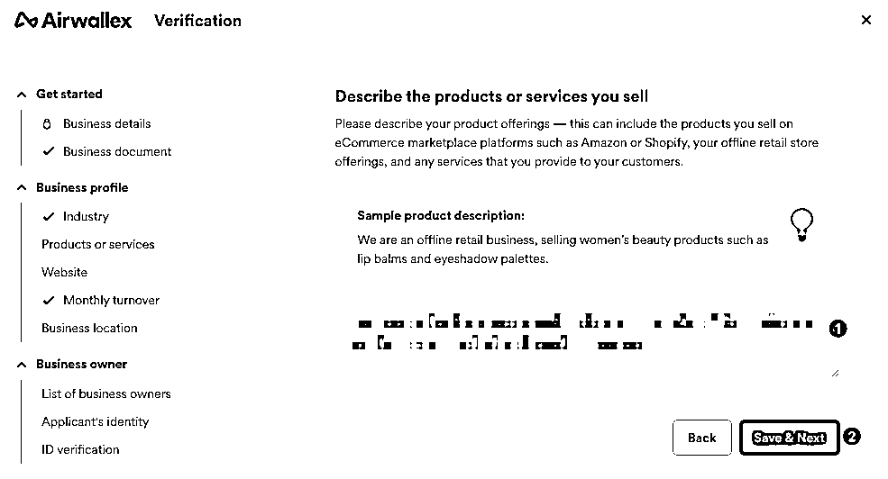

① 填写产品或服务描述，简洁清晰即可，参考示例

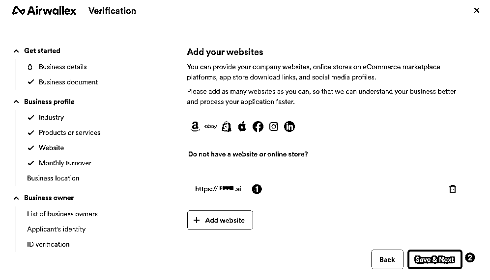

* * *

① 填写网站地址，需已上线，可为官网或电商店铺、应用商店链接、社媒资料。建议多填几项，人工审核时材料越全越真实通过率越高

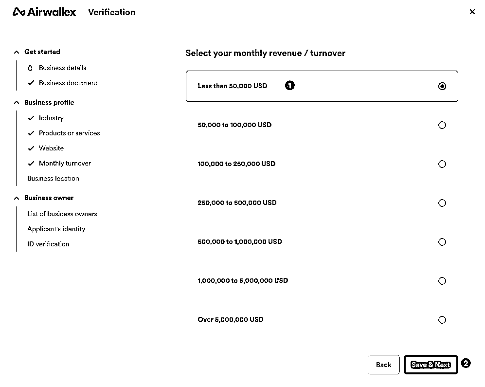

* * *

① 选择月收入或营业额区间。若暂无收入，选最低档即可

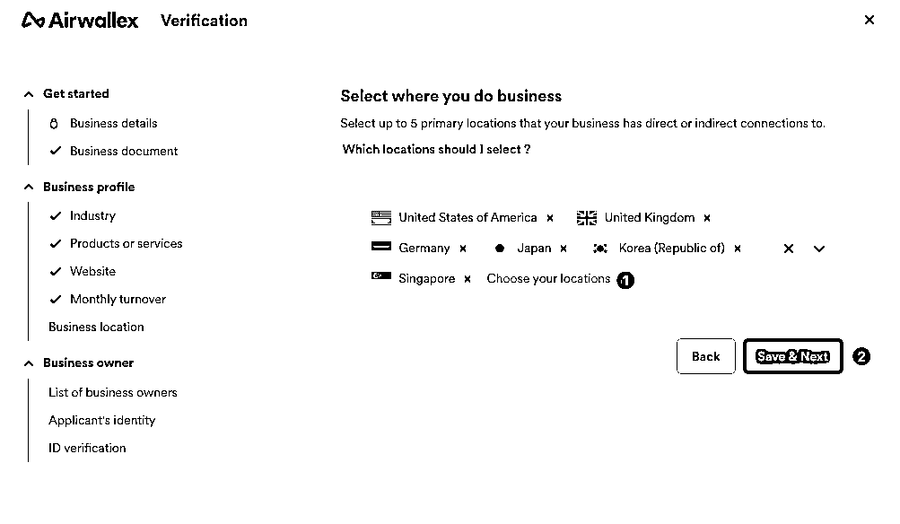

***

① 第一步是划定业务版图：地区上限为五个，勾选即可；假如生意铺向全世界，那挑出几个重点市场填上就行。

***

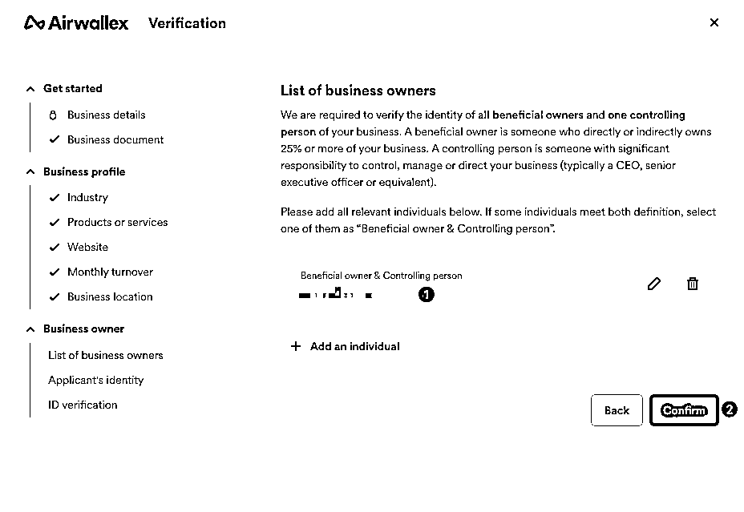

① 此处录入的是企业的实际掌舵人。独资经营就写本人姓名；若存在联合创始人，依次往下补充。

***

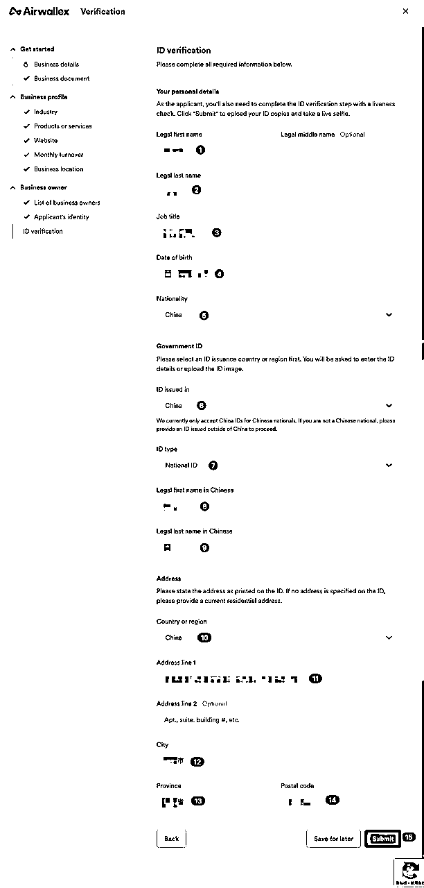

这一屏收集的是申请人本人的资料。提交之前，还有一道在线实时身份确认要走：按下“Submit”以后，页面会带着你上传身份证扫描件，再录一段简短的视频来核实“你是你”。

①～⑤ 姓名、岗位、生日、国籍这些格子照实填，此处略过。

⑥～⑨ 政府证件环节需注意：“空中云汇”眼下只认中国公民持有的中国身份证；持外国护照的朋友，则要交由中国以外地区签发的证件。咱们勾个人身份证这一项就好，等做实时核验时系统会提示你拍照。

⑩～⑭ 现居住地址按实际情况录入，中文书写完全没问题。

⑮ 点下「Submit」后页面自动跳到实名验证环节，跟着指引走，难度不大。

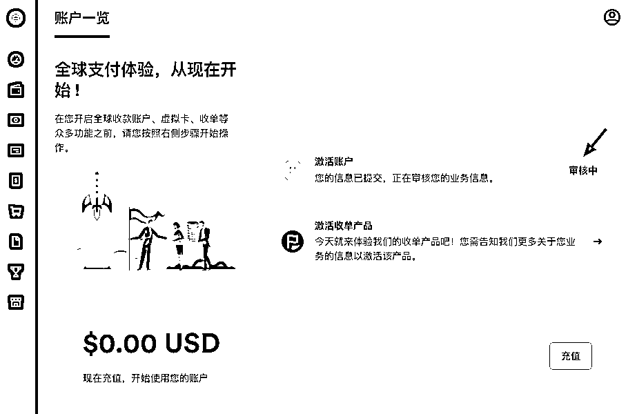

***

上述内容全部落笔，“激活账户”的标记便转为「审核中」。

1.  收尾闲聊

有件事得反复叮嘱：假如你冲着“空中云汇”的付款能力来的，那公司最好落在英国或者香港，美国主体基本走不通（美籍人士除外），这话是我跟官方确认过的。

好在我们平时也用不上它的付款模块，能拿到美国银行账户来收钱就够使了，付款那边交给 Stripe 去激活就行。

“空中云汇”的申请递上去以后，剩下的就是耐心等，通常三到五个工作日，对方会打来电话，核对部分细节，同时告诉你美国主体想把“空中云汇”的全部能力打开，还差什么门槛和材料。

我们那会儿没问明白，一度以为美国公司跟“空中云汇”无缘了，正琢磨备选路径呢，没几天却收到短信——账户已经批下来了。

接着登入“空中云汇”后台，把美国商业银行账户选好开通，这事就算落地。

1.  走到这儿，美国商业银行账户的办理正式收尾，出海网站收款全流程只剩最后一关：去把 Stripe 激活。

# 激活 Stripe

做跨境独立站的朋友，对 Stripe 这名字多半不陌生。它安全性高、接入门槛低、费率不算贵，买家结账时的体验也顺滑，称得上是出海收款的优先选项。

能读到这一段的你，公司、EIN、海外银行账户想必都齐了吧？若还差火候，不妨翻翻下面三篇旧文补补课：1、海外公司注册；2、申请 EIN；3、申请美国银行卡。

好，咱们正式动手。

1.  激活 Stripe

### （1）地址

👉 Stripe 官网

### （2）激活 Stripe

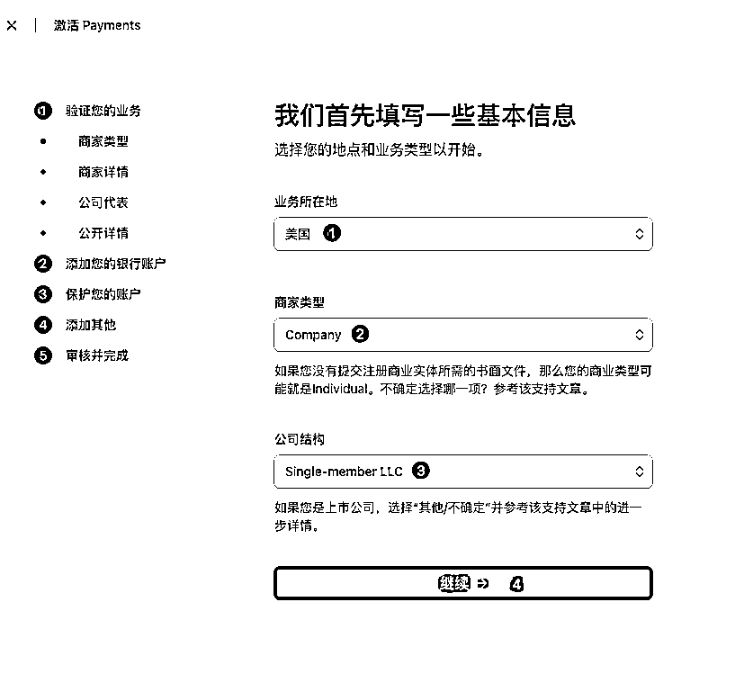

① 业务所在地：美国，如实选择你公司真正注册的那个国家。

② 商家类型：Company 这一项即可。

③ 公司结构：Single-member LLC，照着你公司的实际形态挑。

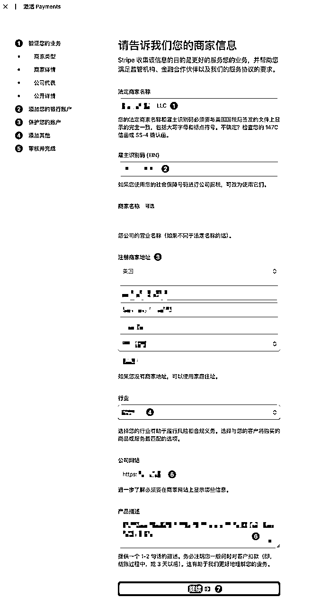

***

① 法定商家名称：把你注册下来的公司名原样搬上去。

② 雇主识别码（EIN）：公司税号 EIN 对号入座。

③ 商家注册地址：用注册海外公司时分配到的那个海外地址。

④ 行业：勾选公司真正从事的业务门类。

⑤ 公司网站：申请公司那阵子搭的官网可以填，但内容太单薄过不了审；换成别的已运行站点也成，我自己填的是新近上线的 AI 绘图站：https://imgai.ai

⑥ 产品描述：网站能做什么，平实、扼要地写清楚就行。

***

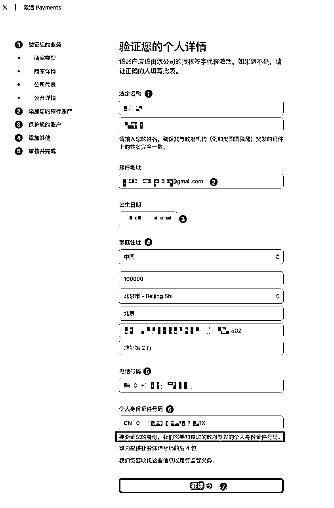

① 法定名称：这一环节核验的是公司法人，写你本人的名字，中文即可。

② 邮件地址：留常用的那个邮箱，Gmail 会更稳妥。

③ 出生日期：跟证件上印的日子对得上。

④ 家庭住址：目前实际居住的位置。

⑤ 电话号码：我留的是当初注册公司时配的美国号；手头没有的话，填国内手机号理论上也行。

⑥ 个人身份证号码：国家选中国（CN），随后录入身份证号。

***

下面这块是展示给客户的商户公开资料，付款说明、账单、收据上都可能出现。

① 对账单描述符：公司名直接填进去。

② 客服电话：我留的是公司座机，可以设置成不在收据与账单上露出。

③ 客服地址：用的是公司在美国的注册地址。

***

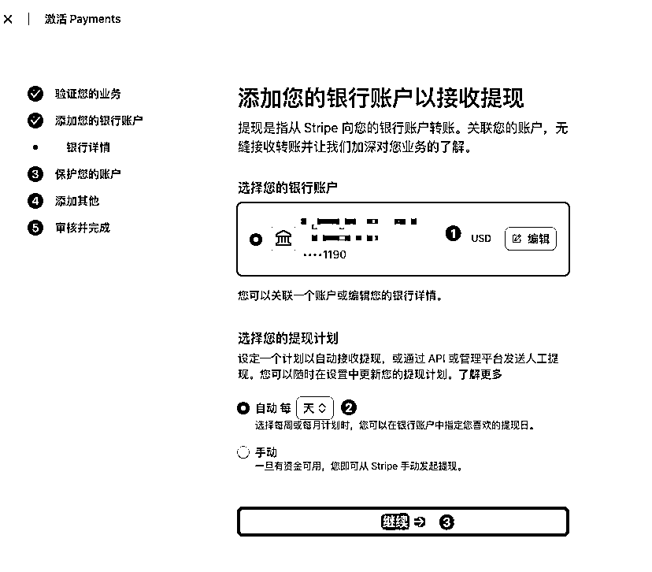

① 选择您的银行账户：把第 3 步“申请美国银行卡”里办下来的那张美国商业银行卡资料填进去。

② 选择您的提现计划：自动到账或手动提现，看自己习惯定。

***

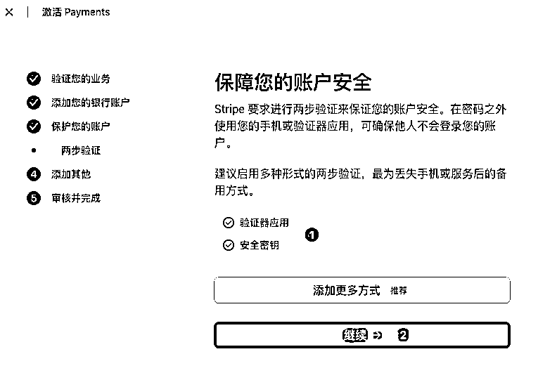

① 这里触发的是 Stripe 账户的双重验证，跟着提示点几下就好，不复杂。

***

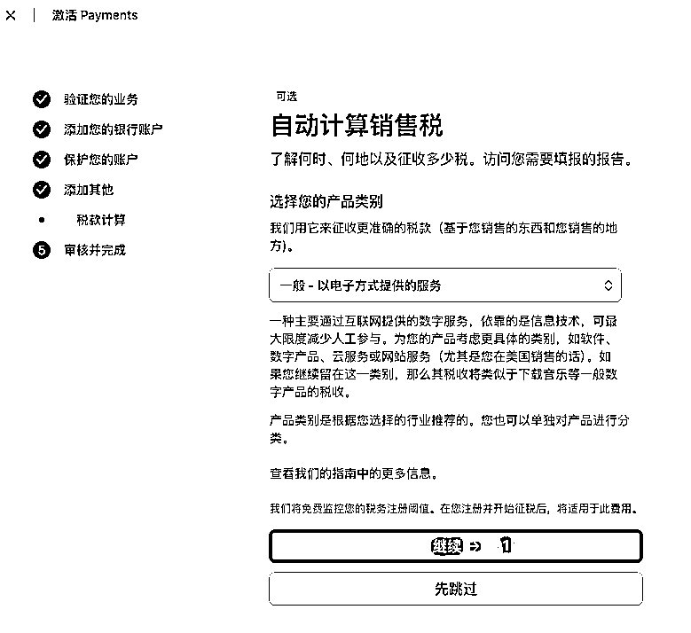

***

① 税款计算方式需要选一下，我取了系统默认的“一般 - 以电子方式提供的服务”。你也可以横向比比别的选项，哪个贴合业务就选哪个；拿不准就维持默认。

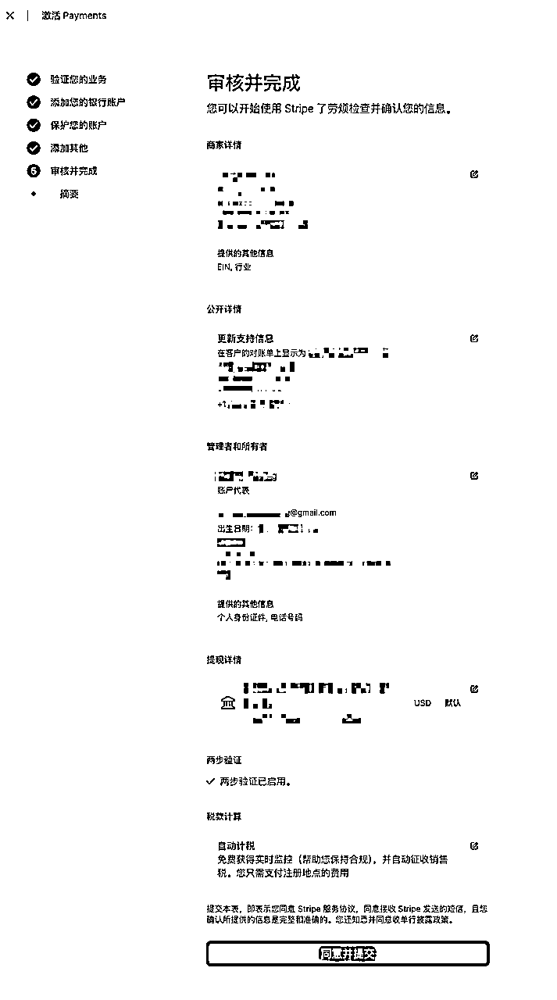

***

信息填到这一步基本见底，按下「同意并提交」，页面理应带你去「补充身份验证资料」。还记得先前录过的身份证号吧？此处要你把证件照片传上去，拍或选都行。

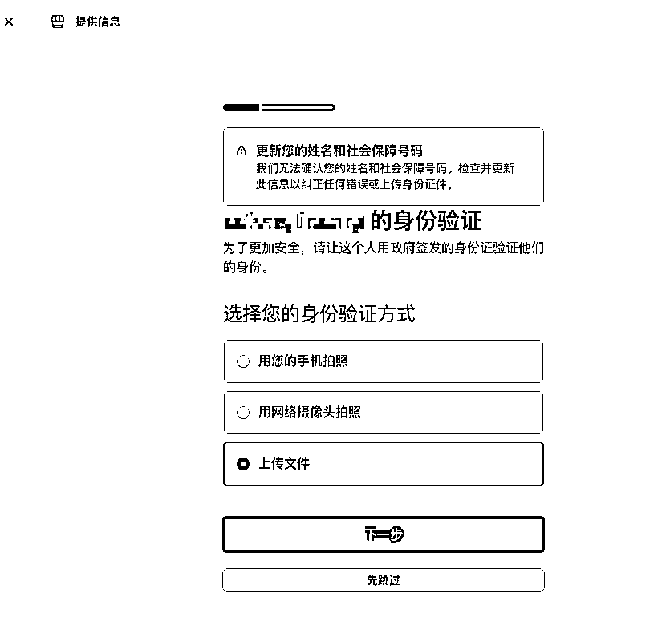

***

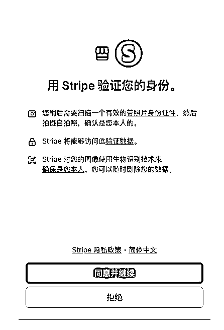

到了「补充身份资料验证」环节，挑个自己顺手的渠道把材料递上去就成。建议事先把身份证正反面拍好存着，届时直接选取上传。

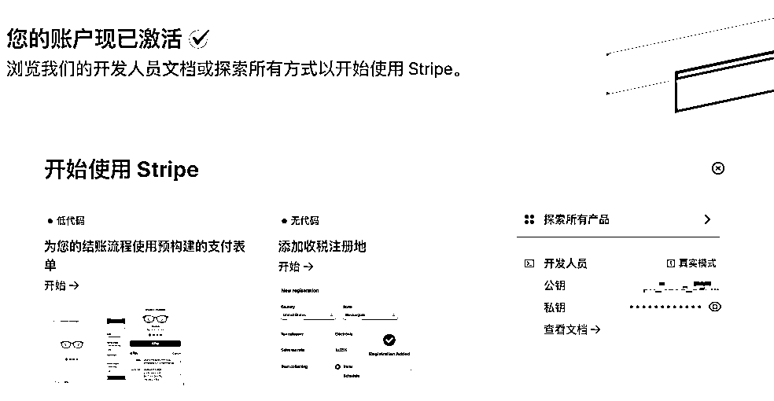

***

全部动作做完，页面会切到「激活成功」，意味着 Stripe 正式启用！余下的活儿，就是照 Stripe 的接入说明，把支付能力嵌进你的站点。

1.  写在末尾

行文至此，出海收款这条链路算是全程走通了。动身之前觉得步骤繁琐，可这关非过不可；路上碰到的坑和意外一茬接一茬，全靠自己边试边推，前后磨了一个月光景。

如今再回望，这番折腾很值。亲手趟过一遍，方知其中门道；日后再办，自然轻车熟路。

倘若这些文字能为你省下几分力气，那我便心满意足了！

末了，愿诸位也愿自己：扬帆出海，破浪前行，一路坦途，满载而归！