# 半个月进账8000+，没出过爆款的📕虚拟资料玩法，新手照做也能跑
作者：龙哥

各位好，我叫巧克力，7月11号才正式成为赚钱的一员，纯纯的新面孔。

承蒙团队抬爱给了这次亮相的机会，我想把自己的实操过程摊开来聊一聊。假如你同样刚进圈、对虚拟资料这条线有兴趣却迟迟没迈出第一步，但愿我这点经验能帮你撬开一道缝。

内容我打算按下面几块来展开：

1、开船至今我究竟拿到了什么成果
2、资料引流的具体变现链路
3、爆款笔记的打造思路
4、零爆款的背景下我靠什么撑住更新
5、把私信流量导入私域的做法
6、收入明细拆解
末尾再加一段写给尚未跑通的朋友的掏心话

---

## 1、从开船到今天，我交出了怎样的答卷

航海周期是9月9日至9月26日。这半个多月里，我手上同时跑着三个📕账号：两个方向是考研，一个方向是云南专升本。

下面几张截图是三个号的浏览量表现。你扫一眼大概会嘀咕：就这？

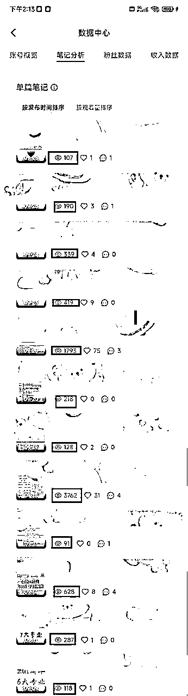

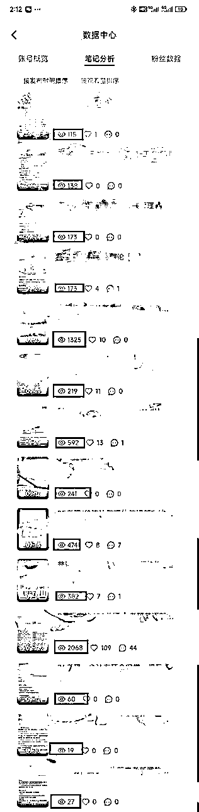

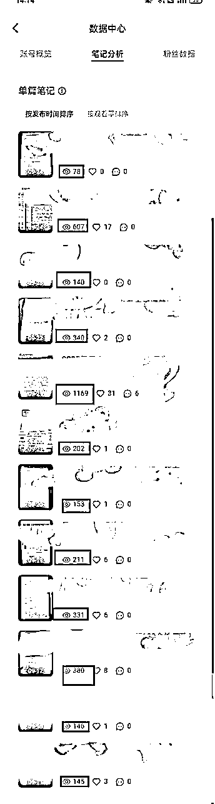

坦白讲，三个号都没出过哪怕一次真正意义上的爆款，阅读量天花板也就三千出头。其余内容基本停留在一百多两百多的水平。可偏偏就是这种一百多浏览的冷门笔记，照样有人主动发私信，而最终付钱的客户，全部来自这些私信。

至于在评论区喊要资料的，多数是冲着免费来的，连加个🛰️都嫌麻烦。

我体会最深的一句话就是：量变堆出质变，更新绝对不能停。

截至目前的数据：

专升本方向：🛰️新增47人，成交4单，转化率8.5%
考研方向：🛰️新增29人，成交6单，转化率20%

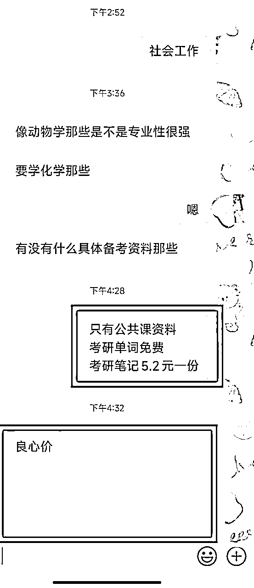

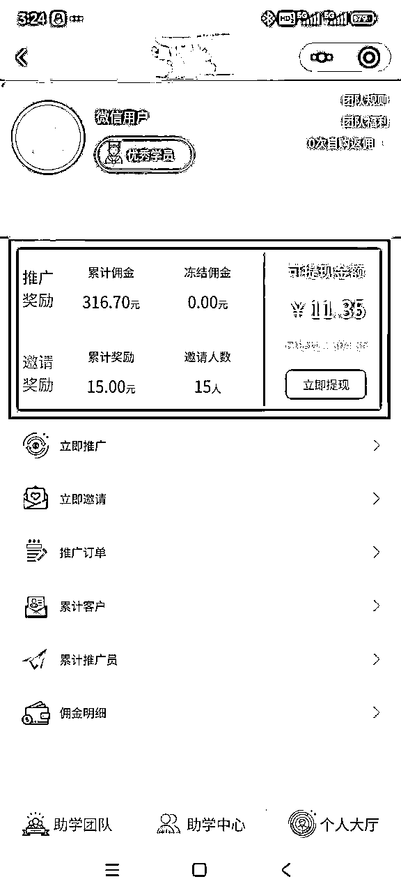

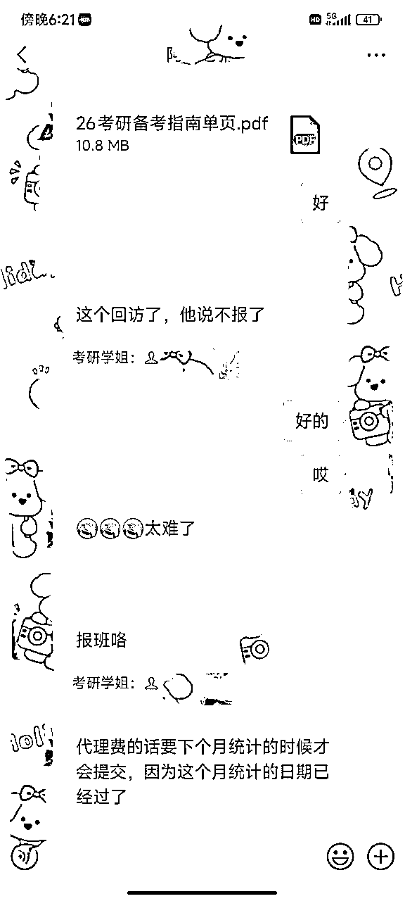

这半个月下来，累计进账接近8000元。我走的变现方式以课程推荐为主，部分返点比例相对可观。

## 2、变现链路该怎么搭

我认为了解清楚“钱从哪来”是动手前的第一课。当初看到航海标题的那一刻，我脑子里转的就是变现方式和赛道选择这两件事。

开船首晚听完米杰教练的直播，有句话直接点醒了我：先搞清楚这份资料的需求盘子有多大，最直白的衡量尺子就是报考规模。教练当时把各类考试的报名数据都整理出来了。

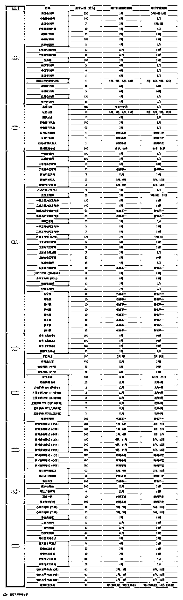

于是我锁定了两个方向：考研和云南专升本。这两块我自己比较熟，手头也攒了些现成材料，算不上从零起步。

变现组合其实有多种玩法：

1、纯卖资料（公共课、专业课都算）
2、免费送公共课资料 + 顺势推荐网课（比方说笔记主题是考研单词，那就推背单词课程或带背训练营）
3、送资料 + 对接本地机构

我最终拍板的是：送资料 + 卖资料 + 本地机构推荐三管齐下。

设备方面简单交代一下：两部手机、一台平板、三个账号、两个🛰️号。

## 3、爆款笔记的打造思路

下一步要琢磨的就是怎么让笔记爆起来。航海手册里翻来覆去强调一件事：先模仿，再模仿，还是模仿。

希平教练给出的动作是：深度体验100个同行，筛出100篇对标笔记。

这里提个醒：刚上手别急着上爬取工具，也别用AI去洗稿。我头一天用后羿采集器，刷刷刷扒了一大堆笔记下来。

接着挑点赞量高的，原封不动复制粘贴，无脑搬运。结果发出去照样只有几百个小眼睛。

后来才琢磨明白：问题出在网感没养起来。光盯着数字看，你压根分辨不出对方是靠账号权重、靠图片、靠标题，还是靠发布时机赢的。

所以给新手的建议是：老老实实手动刷📕。

这一动作有三重收益：

其一，慢慢养出网感；
其二，账号权重跟着往上走；
其三，反向训练平台算法——你反复刷考研资料，首页就铺满考研内容；你反复刷考研辅导班，系统自然给你推相关玩意儿。

体验100个同行、刷完100篇笔记这项功课，我其实还没做完。我的态度是：边干边发边琢磨。总不能等100篇全啃完才动笔，那黄花菜都凉了。

再说手动刷笔记还得整理成表格，这活儿确实磨人。干到这步就忍不住感叹：挣点钱真不容易，那些亮眼数字背后没有一个是白捡的。

## 4、零爆款，我靠什么撑住更新

这里得给📕点个赞，它太懂拿捏人心了。我发的每篇笔记都陆陆续续收到点赞，也总有人顺着笔记摸过来发私信。这份正反馈就是我不断更的底气。

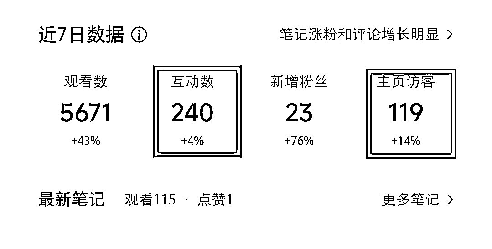

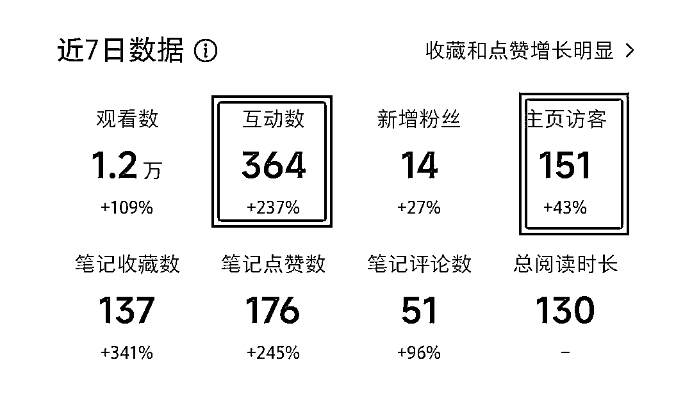

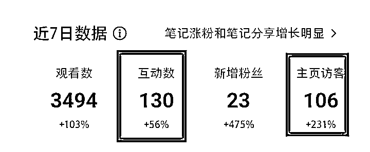

## 5、私信流量怎么导入私域

我清楚自己眼下在平台眼里就是个无名小卒，只要不做得太出格，一般不会被盯上。

我的操作很朴素：拿平板写上🛰️号，拍成照片，当成一篇笔记发出去。遇到私信索取资料的，就把这篇笔记甩过去。碰到评论区要资料的，统一回一句“私信学姐发你哦”。

我几乎不在站内深聊，也没建群。理由很实在：建群就得花心思打理，还平添被举报的隐患——万一同行混进来，瞅见你发联系方式，截个图一举报，那真是一报一个准。

小提醒：📕的昵称和头像尽量跟🛰️保持统一，信任感会高不少。

等对方加上🛰️，就该进入搞钱环节了。小钱钱，真心甜，开工。

我的开场话术长这样：嗨，这里是XX学姐。感谢你的信任添加🛰️。如果需要以下资讯可以回复数字哦：

1、专升本word资料（免费）
2、专升本历年真题49元（资料+课程）
3、专升本网课（1999课程+教材）
4、云南专升本志愿填报指导（免费）

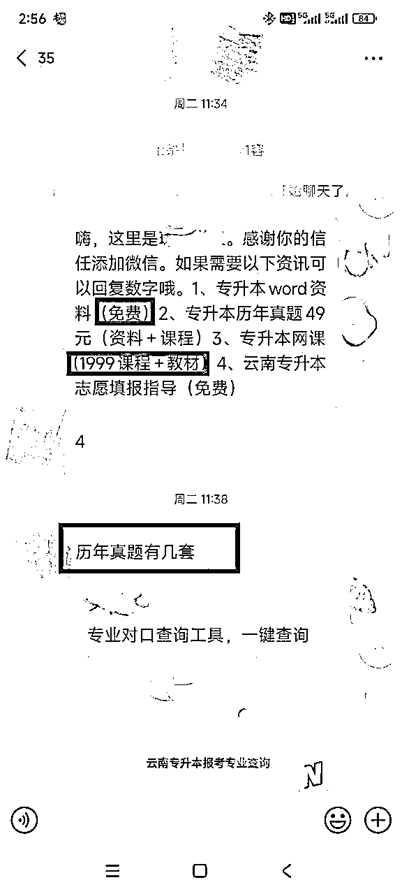

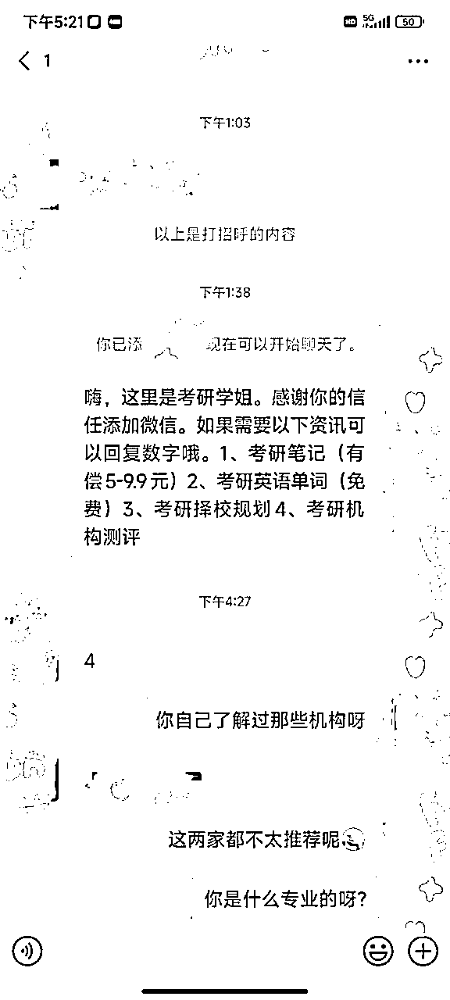

凡是加进来的，我都先把这套话术发过去。对方要是选了免费资料，我发完会请她回📕笔记底下点个好评，帮着抬一抬热度，紧接着问一句：打算报班还是自学？

回自学的，基本就到此为止。回有报班意向、或者说还在摇摆的，我就开始细细往下聊。

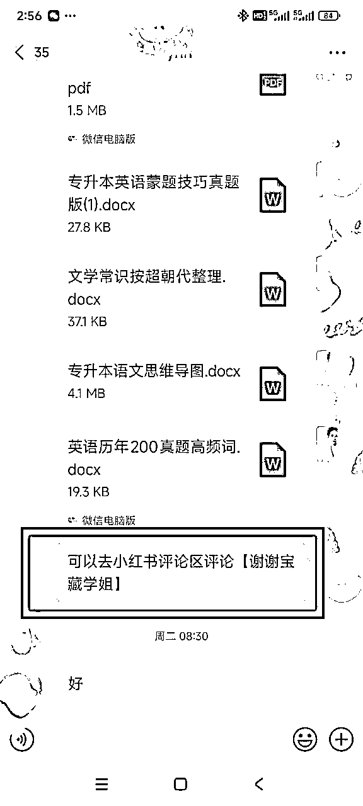

能走到加🛰️这一步，说明你手上正好攥着她急需的东西，所以我觉着目的性摆得明白些也无妨。有人上来就直说要什么资料。

碰上付费资料，直接告诉她转账后我发你。
碰上辅导班需求，那就把班型情况掰开揉碎讲清楚。

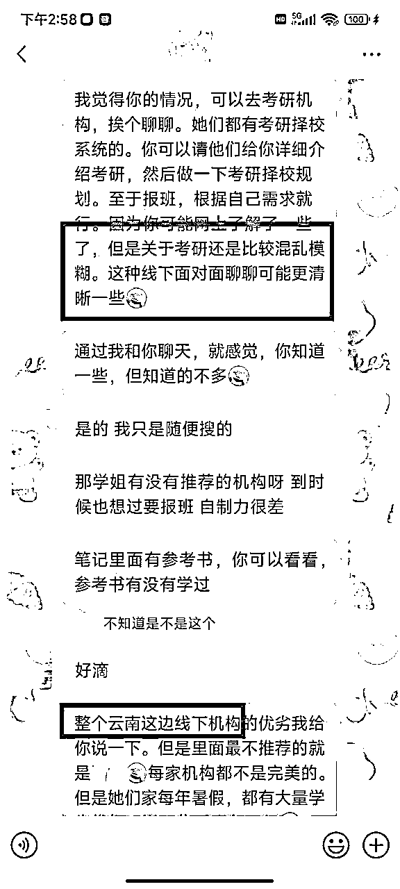

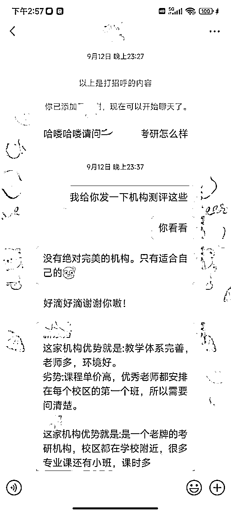

## 6、收入明细拆解

1、专升本：资料售卖300元，小程序拉新16元，课程返点922元。
2、考研：资料售卖15.6元，机构推荐课程返点6480元。

## 写在最后：给还没跑通的朋友几句掏心话

1. 航海手册写得相当扎实，务必逐字吃透。
2. 必须亲自下场发笔记。只有先发了，回头再翻手册，那种“原来如此”的顿悟才会冒出来。
3. 📕虽说带点玄学色彩，但标准动作是实打实存在的。动作做到位，爆不爆交给概率。这轮没爆，提笔写下一篇就是了。
4. 封号、版权这类顾虑：咱现在还是小角色，平台未必立刻动手，放心大胆去试。我手上的资料全是从某鱼、某多多淘来的，有人要，直接把上家给的百度网盘链接转过去。
5. 学项目本质是学全流程。流程没从头到尾走一遭，你对整个项目的理解就始终隔层纱。

## 高频疑问快答

问：淘来的资料带水印咋整？
答：有人要买，先收款，再把链接发过去。十有八九对方就没下文了。真没几个人会追着问：这水印名字怎么不是你？

问：爆款笔记能直接搬吗？
答：一比一搬。怕违规的话，图片照着原笔记的构图自己重做一版，文案在原稿基础上替换几个措辞。怕被举报，就把被你搬的那位博主拉黑，基本就稳了。

问：非得坚持一卡一号一机吗？
答：手册这么写是出于严谨考量。真想规模化铺开，确实得靠疯狂堆账号数量，那这套配置就是刚需。但新手起步阶段，一个人能把单号运营明白就已经很能打了。所以卡、号、机的搭配不必过分纠结，WiFi连不连也别太放在心上。

以上就是我的全部心得。我能这么快跑通，核心在于变现路径提前想透了。路径一清晰，搭话术、攒资料的时候，目标感自然就强。

日常动作无非是：收资料、写笔记、磨话术、找培训机构谈合作。要是只押注卖资料这一条腿，在流量还没起势的前期，我大概率撑不下去。

2024，搞钱大吉！