# 「新手视角」第一次当航海志愿者，我到底学到了什么？

> 来源：[https://wiz662adgxu.feishu.cn/docx/VP7QdhrmPoFAmkx6l3RceuhNnMg](https://wiz662adgxu.feishu.cn/docx/VP7QdhrmPoFAmkx6l3RceuhNnMg)

# 一、开场自述

哈喽大家好，我是西里，先简单聊聊我现在的状况。

## 个人背景

在做些什么？

1. 2024年3月完成新媒体运营的职业转换，薪资有所提升，如今主要负责公司的抖音/小红书运营。

2. 2024年8月开始操盘公司的教资引流号，两个月累计带来2500+老师咨询，单日最高冲到300人。

## 与生财的交集

我和生财有术结缘是从今年5月开始的。

1. 2024年5月：正式加入生财有术社群。

2. 2024年6月：参与小红书百货航海，航海结束时顺利跑通MVP，实现GMV500+。

3. 2024年9月：首次担任小红书教育资料引流航海的志愿者，开启了全新的尝试。

## 小组战绩回顾

这次航海我们小组的具体数据

作为志愿者，我跟进的小组在本次航海中交出了这些成绩：

* 小组共20人，15人成功上岸，上岸率75%。

* 组内有1位船员连续打卡21天，被称作“行动的巨人”。

* 14位船员打卡12次以上；3位船员成功跑通MVP。

* “荣登”小组排行榜倒数第一。

尽管小组名次不理想，但能和大家一起成长，见证成员跑通MVP，我还是很欣慰。

## 我的个人目标

这次航海我给自己定了4个目标：

1. 实战新赛道，亲身演练：在航海期间我坚持打卡16天，项目没跑通，已经重新梳理规划，今天开始更新首篇笔记。

2. 拓宽人脉圈层：航海中我加了33位船员微信，到结束时共链接52位圈内朋友，其中约10位是我主动添加的，也有几位大佬给了我非常实用的建议。

3. 提升社群运营能力：过去我对社群运营基本零基础，这次以志愿者身份参与收获巨大。以前群发消息只能发给9个人，连怎么确认成员进群都一头雾水，现在消息转发、成员核验等操作已经熟练上手，效率提升明显。

4. 全面体验志愿者角色。这次深度参与航海，对航海的全流程有了更清晰的认知，如果未来让我独立操盘一场社群活动，至少知道筹备期、执行期和收尾期分别要做什么，不会再抓瞎。

下面放上我的航海纪念票，这次也正式解锁了志愿者身份～

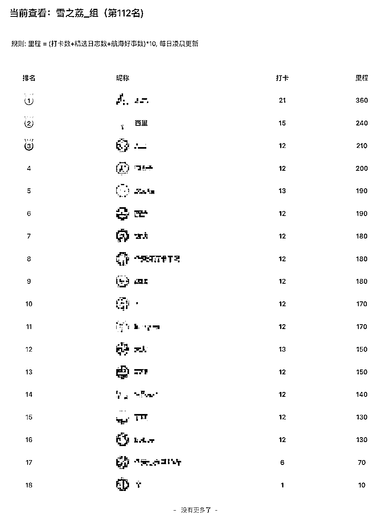

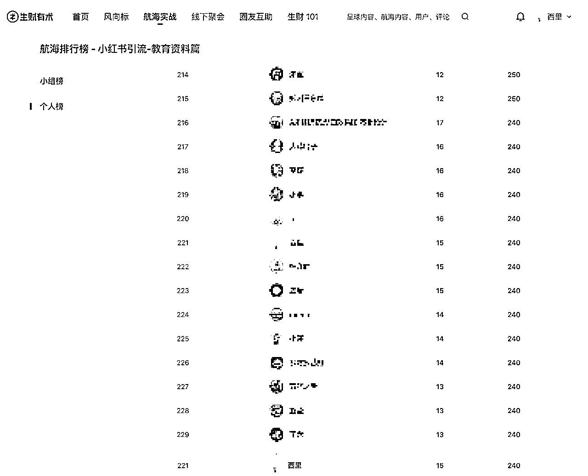

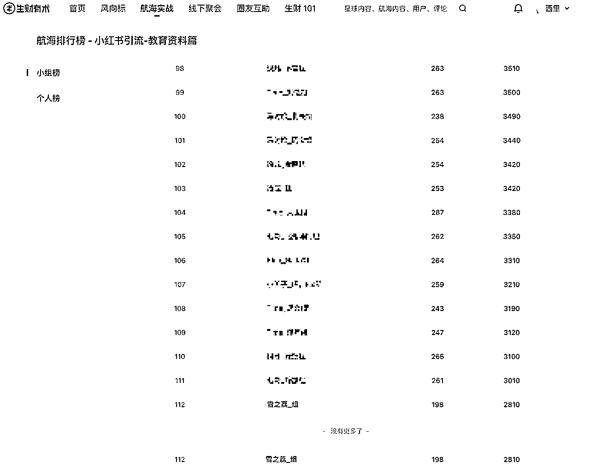

再附上我的纪念船票与志愿者档案。很开心能和伙伴们共同成长，这次也圆满解锁了志愿者经历～


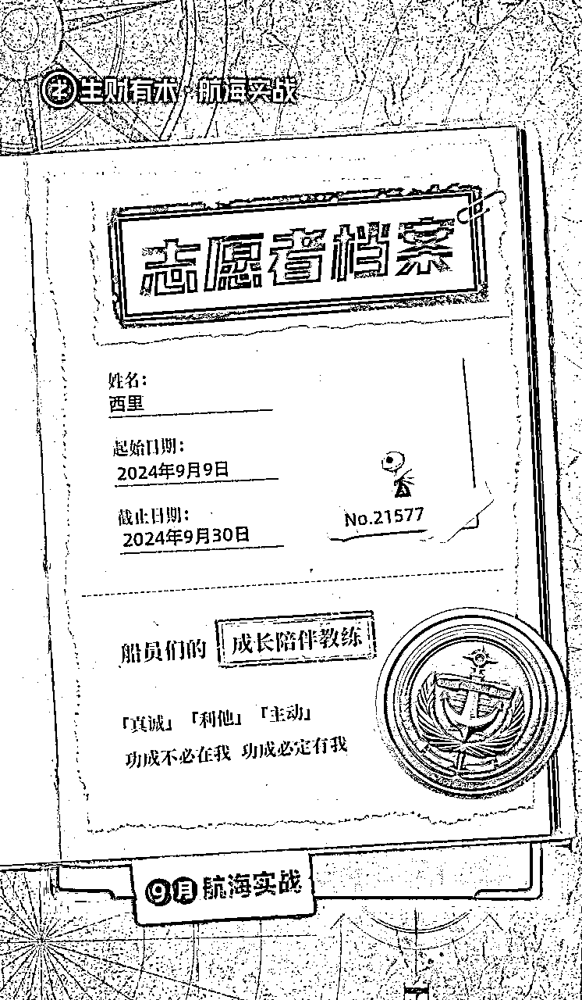

接下来我会结合实战，详细聊聊志愿者的经历、收获、踩过的坑以及我的一些感悟。

# 二、为什么我要报名做志愿者？

因为我自己做过账号，深知一个人做很容易坚持不下去，一点小成果就松懈了。

1. 做引流号：8月中旬因工作需求独自深耕教育资料引流号，一个月引流1000多人，免费领取、白嫖的占比无法统计。

2. 单打独斗太累：一个人摸索学习太耗精力，觉得自己的经验或许能帮到更多人。

做过资料引流号的经验：

1. 这段经历让我积累了不少实操经验。

2. 觉得自己的心得可能对他人有参考价值。

分享避坑的价值：

1. 把经验分享出来，或许能帮更多人少走弯路。

2. 一起前行比单人摸索更快，路也更远。

抱着试试看的心态，也许能被录取，我花了三四个小时研读招募要求，撰写报名介绍，然后我就……被录取了。

所以偶尔跳出舒适区，尝试新事物，没准就会有好结果。事实证明这段时间我成长了许多，收获也很多。

# 三、志愿者日常是怎么做的？

## 1.先把固定事项梳理清楚

开航前后，先弄明白志愿者要常做哪些事，提前整理清单，就不会遗漏。

我总结出来的核心事项大致有：

1. 小组群消息跟进

作为志愿者，自然要关注领队在群内的沟通，以及船员们的互动。

2. 日志点评与推荐

航行期间每周都有固定日志点评时间，需要按标准对船员日志进行审核推荐。

3. 船员日志巡查

我通常会在晚上固定时段查看船员日志，了解整体情况并点赞，部分会留言互动，点评质量不够时也会提醒改进，点评量目前还不够稳定。

4. 打卡提醒与沟通

主要针对日志中有困惑、出现懈怠或打卡次数不足的船员，通过日志主动催打卡、沟通。

5. 向领队反馈

航海前我会多与领队雪荔姐对齐，开船后主要通过群接龙进行反馈，也学到一个运营小技巧。

6. 船员通知与反馈

主要集中在开船前规则说明、保证金沟通、高手领航直播、日志点评通知等。群发后我会再私聊提醒，或在消息里加上昵称，降低群发的生硬感，仍有提升空间。

有志愿者SOP手册，为什么还要自己记？

因为忙起来不记录就会遗忘，导致任务没执行。

所以我开航前简单梳理了固定待办，虽然偶尔还是会漏掉打卡提醒，唉。

## 2.反复阅读志愿者资料

被录取后到开船前，我仔细研读了志愿者培训手册、志愿者工作手册以及SOP。

对记不住或印象模糊的部分会多看几遍，加深流程理解，没实操过还是容易忘。

以下手册建议收藏反复看：

## 3.添加船员微信

开始拉人后，志愿者群分享了很多提效方法。

但我此前没有社群运营经验，时间有限，尝试了十多分钟后。

我直接选择了“最笨”的方式，手动复制粘贴搜索添加船员，并给标签做好归类。因为那些提效工具学着学着，人可能都加完了。

不管高效低效，当时我只想在截止时间前完成。

最大的体会是：先动手做比一直拖延强，先完成再优化。

## 4.善用微信备注

航海前后需要频繁与船员沟通摸底情况，除了同步到志愿者后台，我也会把关键信息写在微信备注里。

毕竟志愿者后台很少看，微信是日常高频使用的。

关于摸底，我的做法是多进行一对一私聊，这样拉近关系效果更好。具体如何沟通更高效，我还在学习中。

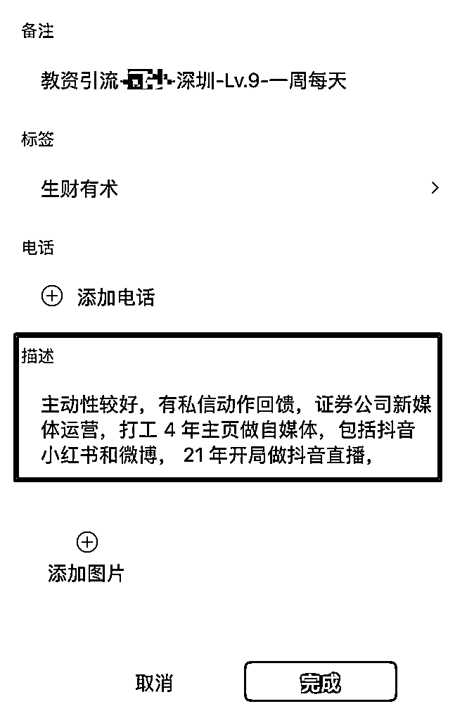

## 5.分层运营+针对性催打卡

航行中要根据不同船员采取不同策略，调整沟通频率和关注重点。

规则同步

* 新船员：航行前后重点强调航海规则和保证金规则，沟通要更频繁，重点关注。

* 老船员：对规则较为熟悉，无需频繁提醒。

航行初期策略，第1-2周

* 第1周

1. 确保每位船员至少打卡4次

2. 按约定节奏进行打卡提醒

* 第2周

1. 评估打卡情况

2. 重点关注打卡少的船员，特别是0打卡成员

3. 分析原因：可能忙于其他事、执行力不足或觉得时间还早

航行中期策略

* 针对剩余休息天数仅剩2-3天的船员重点关注

* 常用催促方式：

1. 日志问题反馈

2. 表情包

3. 志愿者群分享的沟通话术

航行中后期策略

* 船员分类：

* 全勤打卡船员

* 休息1-2天的船员

* 休息3-4天的船员

* 休息5天及以上的船员

* 掉海船员

* 关注重点：

* 重点关注全勤打卡和休息1-2天的船员

* 密切关注休息3-4天的船员

* 对老船员和自律性强的船员，打卡天数通常在3-5天，保持关注即可

关于如何激发船员主动打卡、帮助他们拿到MVP，我的学习空间还很大。

后来在航行结束时才看到志愿者范磊老师的航行日志提到的分组运营法，非常实用，感谢大佬分享。

# 四、志愿者实战收获与踩坑

这次实战真的学到很多，也踩了不少坑，先聊收获。

## 1.社群运营技巧提升

### 技巧1：群接龙

在需要多人协作跟进进度的场景，群接龙非常好用。

主要优势：

1. 信息集中：所有成员进度汇总在一处。

2. 方便查阅：成员可随时点开查看最新进度。

3. 便于追踪：减少反复询问和信息遗漏，发起人能一目了然。

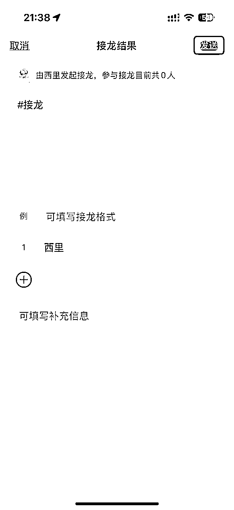

### 技巧2：群发消息

这次学会了两种群发方式：群发助手、搜索昵称转发。

「群发助手」

1. 操作路径：我-设置-通用-辅助功能-群发助手-开始群发-新建群发

2. 注意事项：

1. 一次只能发送一条消息

2. 支持文字、图片、视频及自己视频号发布的内容

3. 不支持转发视频号直播卡片和语音


「手机/电脑搜索昵称转发」

1. 操作路径：长按>多选>转发>逐条转发>搜索昵称>发送，可发单条或多条图文混合消息

2. 推荐用法：通过搜索昵称转发效率较高，最多可一次性转发给9人

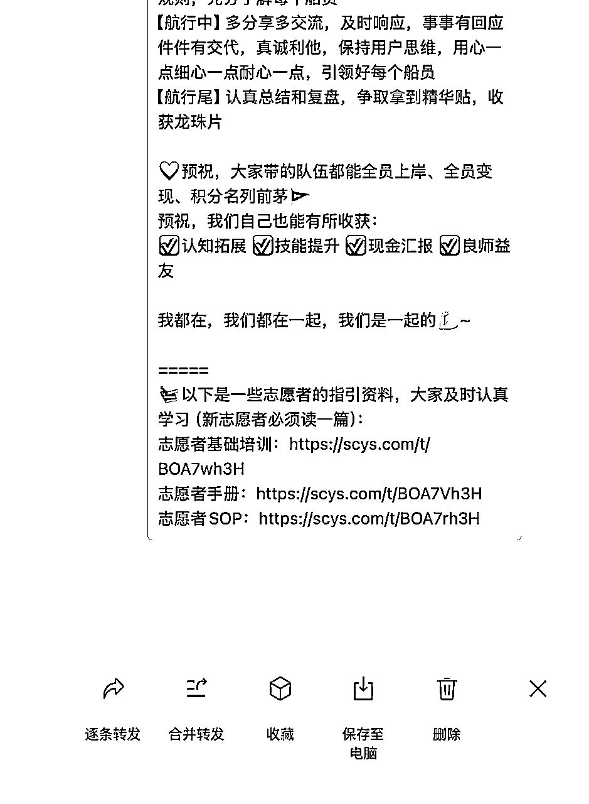

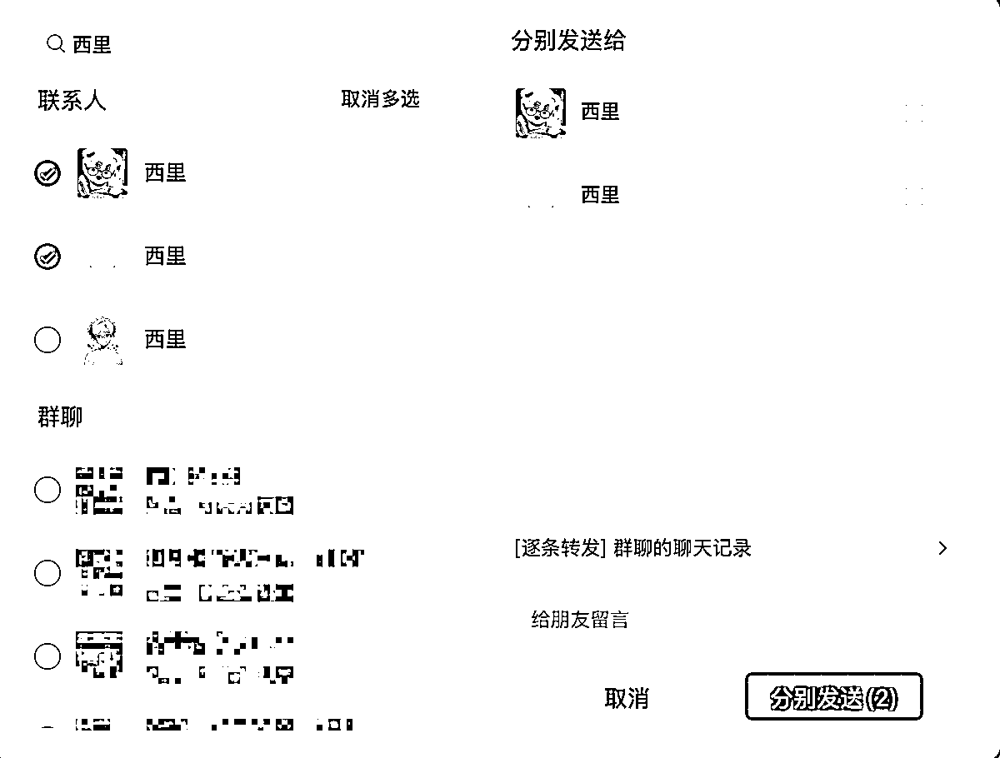

### 技巧3：备注分类

在标签中使用「序号+统一关键词+航海名称+昵称+其他信息」的格式很实用。

为什么加序号？

微信群发上限9人，群发时直接搜序号就能快速定位目标人群。

直接搜关键词的痛点

* 搜索结果顺序会变动

* 难以区分哪些船员已收到消息，哪些未收到

* 建议：可用表格或其它方式记录发送情况

### 技巧4：确认船员是否入群

1. 进入微信群

1. 点击群聊右上角「···」

1. 选择「查看更多成员」

1. 使用标签搜索

1. 在成员列表点击「+」号

1. 点击搜索框，选择预设的「标签」

1. 成员状态判断

1. 已入群：显示灰色背景带绿色阴影

1. 未入群：正常显示，无标记

### 技巧5：群发互动话术

如果最近刚和船员聊过天，群发前加一句“对了”“还有啊”“接下来我们…”等过渡语，会让群发显得更自然，减少生硬感，像是对话的延续。

除此之外，我还学会了一些技巧，比如：

1. 航海活动设置交流群和禁言群

2. 利用“拍一拍”做互动反馈

3. 固定时间在群内发送待办提醒

4. 确认船员是否修改了群昵称

……

## 2.笔记制作提效思路，电饭煲老师启发

看了电饭煲老师的分享后，我才意识到“原来还能这样操作”，思路一下打开了。

我明白再好的提效流程也要结合自身习惯，所以做了本地化调整，再次感谢电饭煲老师。

### 我期望达成的效果

1. 手动筛选同主题的爆款笔记，持续提升网感，了解用户需求和竞品动向。

2. 让AI对封面标题、笔记标题、话题标签进行拆解重组，尽量保持原意，主打省心。

3. 作为“懒人”，正文也希望AI能基于爆款来生成。

4. 目前账号主要发大字报图文笔记。

### 目前实现的效果

1. 封面标题拆解重组：基于原文进行关键词拆解重组，避免把“羊群效应”拆成“羊群”和“效应”。

2. 封面标题补充连接词和修饰词：如“又”“靠”，保证语义通顺。

3. 正文改写后字数控制在350-600字区间

4. 支持多批次输出，统一Markdown格式，默认一次最多5篇，超过会分批，输出完提示“继续”再续写

5. 每篇笔记对应Markdown表格的一行内容

⚠️注意点

1. 我个人一次生成不会太多，10篇以上未测试

2. 原本想一次输出所有内容，但Claude无法一次性完成

### 未解决的问题

1. 笔记标题字数可能超过20字

2. 一次性生成多篇时，可能混入参考笔记标题

3. 批量生成时封面标题质量会下降，需人工润色

4. 我习惯把一个封面拆成3组内容，第3组会润色，部分关键词由Claude自行添加

### 使用流程

我的实际操作步骤：

1. 收集爆款笔记：小红书手动收集，记录封面标题、笔记标题、正文、话题标签

2. 后续批次可能出现表头问题

3. Claude改写：用提示词提取关键词、拆解重组封面和笔记标题，改写正文

4. 用Claude或豆包提取每篇的标题、正文、标签，复制到公司飞书知识库文档

5. 用稿定设计批量制作大字报封面

目前基本满足需求，但在Prompt调试时走过弯路。

直接让AI输出封面标题、笔记标题、正文和标签，再提取封面标题转Markdown表格批量制作封面，对AI负担更小。

我是在调得差不多才意识到这点🤐

### 效果展示

直接把Prompt发给Claude，再把收集文件发过去，说明要写几篇即可。

支持多批次输出和单批输出，后者连贯性更好。

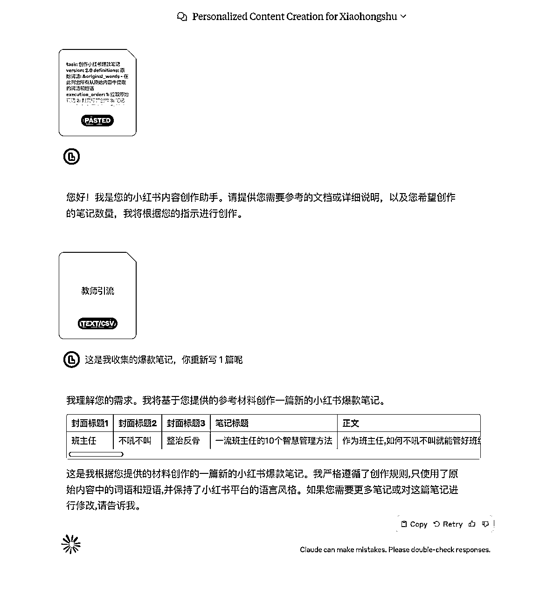

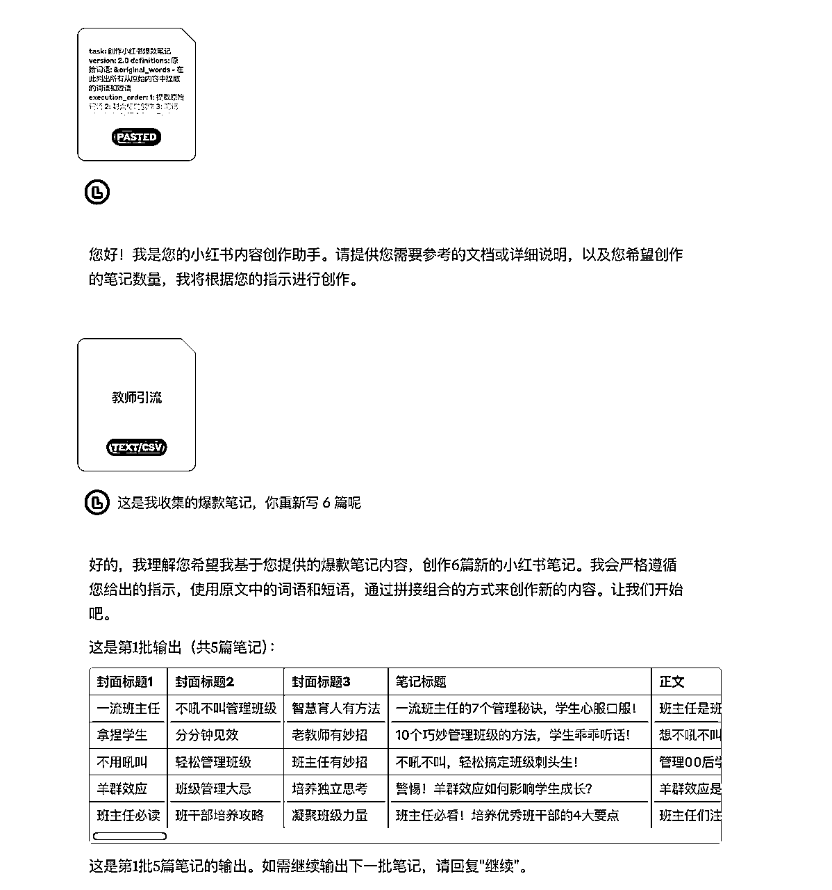

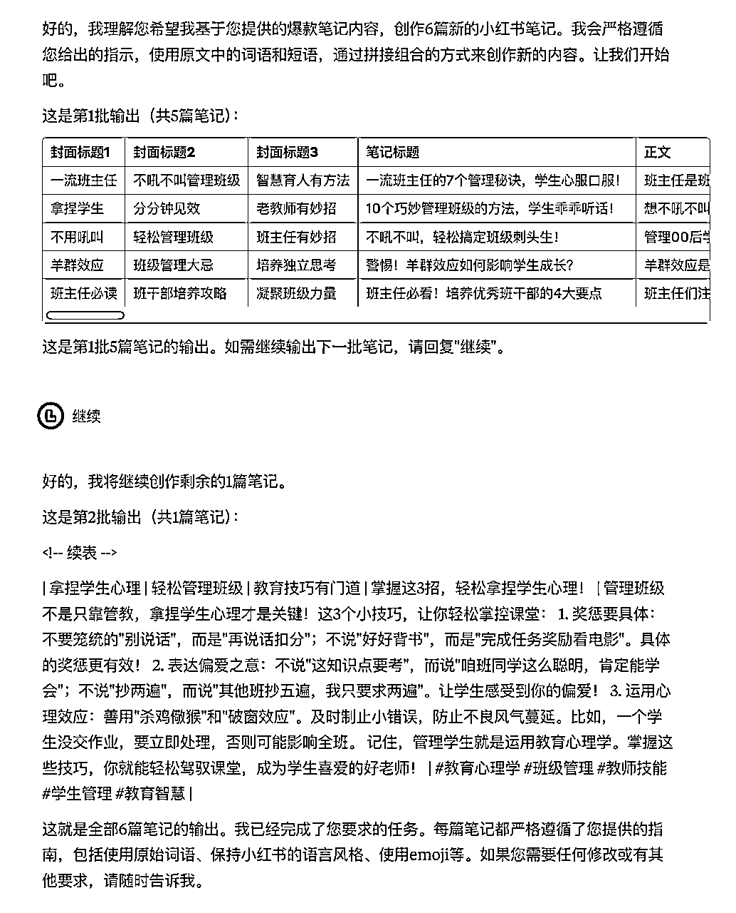

Claude对创作过程的解释，建议重视爆款笔记的数量和相关性，数量越多效果越好，我这次收集的只有几篇。

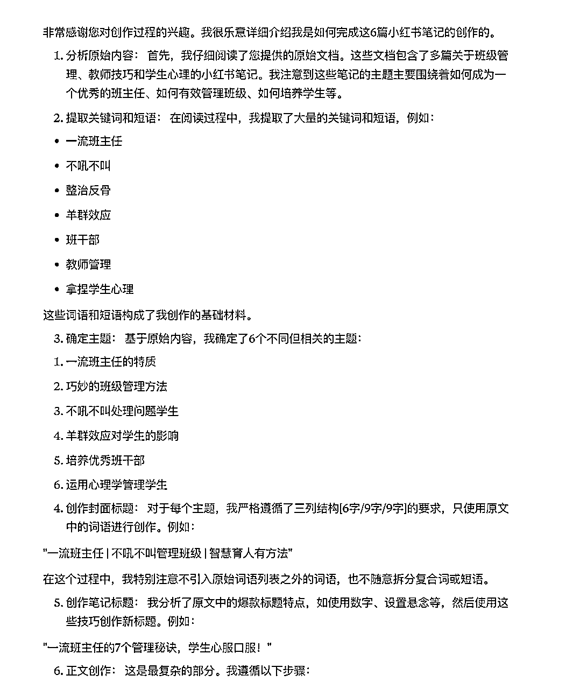

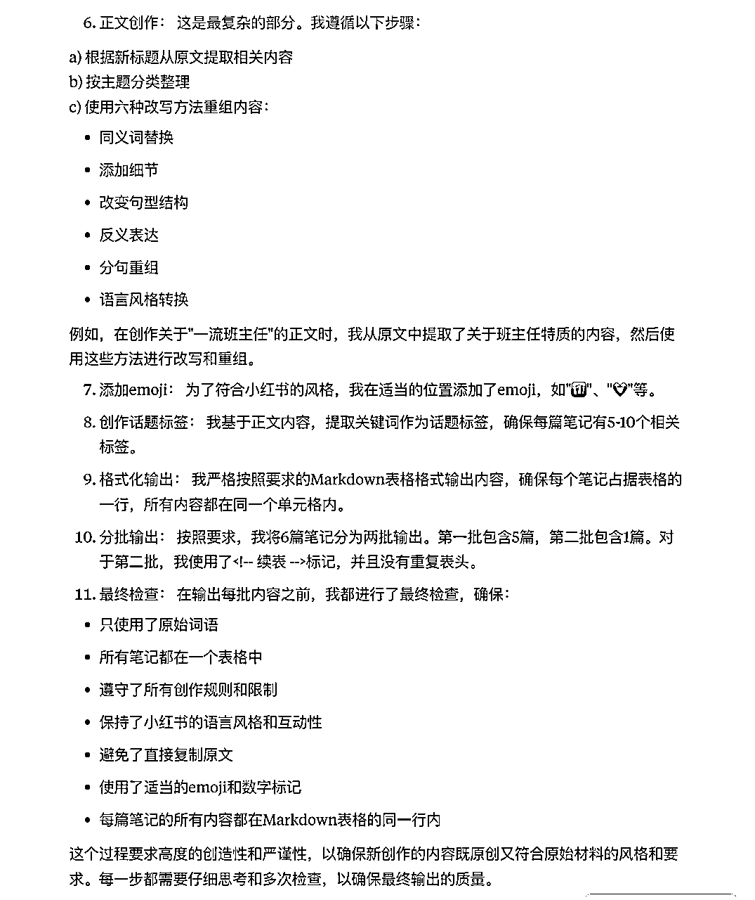

随后放到Markdown转换工具，复制粘贴后删除多余内容。可直接在编辑器选中内容让豆包等工具提取正文。

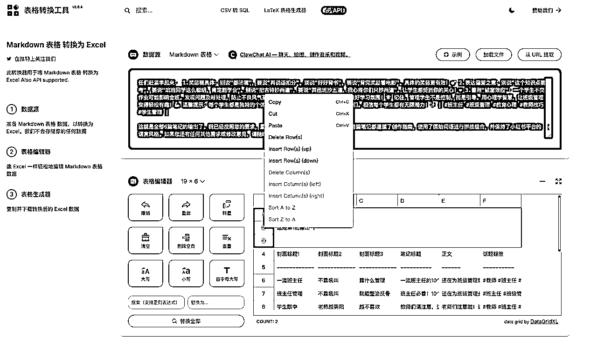

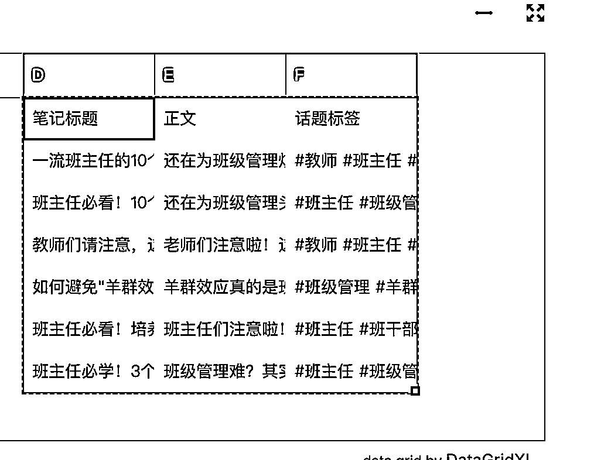

也可以用拆解好的封面标题在稿定设计制作大字报，Markdown转Excel工具：https://tableconvert.com/zh-cn/markdown-to-excel

### 爆款收集与制作参考

爆款笔记的获取和制作方法电饭煲老师已详细分享

可参考：https://t.zsxq.com/QnOul

我使用的收集模板如下

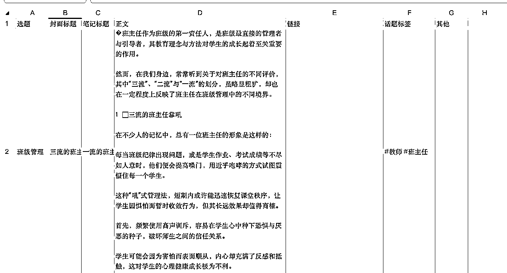

两个小注意：

1. 我用Claude制作，无法直接上传Excel，需先转为CSV

2. 飞书在线文档下载时选择CSV即可，本地记录的可用WPS或Excel另存为CSV

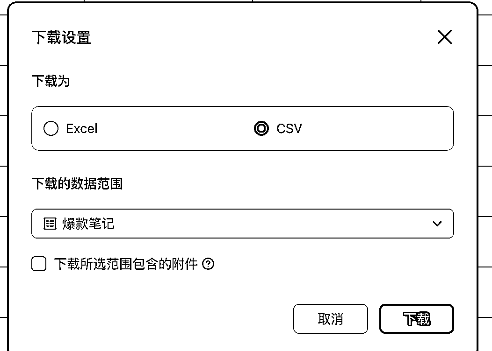

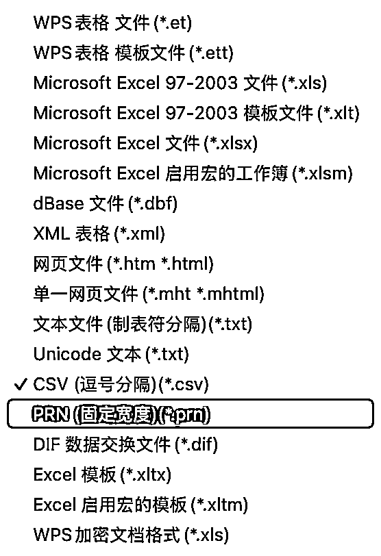

总的来说，这次Prompt调试很有趣，也踩了很多坑。

比如单纯用Markdown格式无法确保Claude完全遵守指令，后来尝试改成JSON，再由Claude建议改用Yaml格式。

另外一个小技巧，不知如何写Prompt时，直接把需求和期望效果告诉它，让它帮忙优化即可。

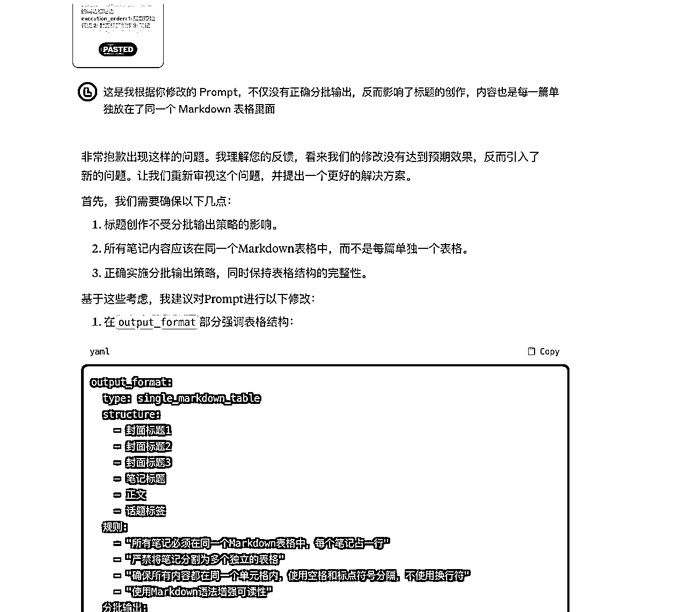

### 对应的Prompt：

```
task: 创作小红书爆款笔记
version: 2.0

definitions:
  原始词语: &original_words
    - 在此列出所有从原始内容中提取的词语和短语

execution_order:
  1: 提取原始词语
  2: 封面标题创作
  3: 笔记标题创作
  4: 正文创作
  5: 话题标签创作
  6: 最终输出检查
methods:
  封面标题创作:
    steps: 
      - 仔细阅读原文中的<封面标题>字段内容
      - 将<封面标题>中的所有词语逐一列出，创建原始词语列表
      - 严格使用原始词语列表中的词语进行创作
      - 遵循三列结构：[6字/9字/9字]
    允许添加: 
      - 连接词: [的, 和, 与等]
      - 修饰词: [超, 最, 巧妙等]
    允许操作:
      - 调整词序（不改变原意）
      - 将阿拉伯数字改写为中文数字
    禁止: 
      - "引入原始词语列表之外的任何词语"
      - "随意拆分复合词或短语"
    规则:
      - "确保信息一致性：封面标题传达的信息与原标题一致"
      - "增强可读性：添加的词应增强标题的吸引力，不改变原意"
    创作后检查:
      - 逐字对照原始词语列表，确保每个使用的词都来自此列表
      - 检查是否遵守了字数限制
      - 验证是否增强了可读性而不改变原意
      - 如发现任何不符，立即修改
    示例:
          正确:
            原标题1: "三流的班主任靠吼，二流的班主任靠讲，一流的班主任靠什么？"
            原标题2: "不吼不叫，整治班里的反骨（嘎嘎好用又安全）"
            可用词语列表: 
              - 三流
              - 班主任
              - 吼
              - 二流
              - 讲
              - 一流
              - 不吼不叫
              - 整治
              - 反骨
              - 嘎嘎好用
              - 安全
            新标题:
              - "做一流班主任"
              - "不吼也能整治反骨"
              - "安全又好用"
          错误:
            同义词替换错误:
              错误示例: "优秀的教师靠什么"
              解释: "将'一流的班主任'替换为'优秀的教师'虽然意思相近，但违反了只使用原始词语的规则。"
            概括总结错误:
              错误示例: "班级管理的三个层次"
              解释: "虽然这个标题概括了原文的主旨，但使用了原始词语列表之外的词，违反了创作规则。"
            拆分复合词错误:
              错误示例: "班主不吼不叫也能管理"
              解释: "将'班主任'拆分为'班主'，'不吼不叫'拆分使用，违反了不得随意拆分复合词的规则。"
  笔记标题创作:
    steps:
      - 分析多篇相同主题爆款笔记标题
      - 将所有标题拆分成关键词或短语
      - 使用这些关键词或短语重新组合
    规则:
      - "新标题不超过20字"
      - "可添加标点和emoji"
      - "保证语言自然流畅"
    示例:
      原标题1: "一流的班主任靠什么？"
      原标题2: "10 个方法教你不吼不叫也能轻松管班！"
      拆分关键词:
        - 一流
        - 班主任
        - 不吼不叫
        - 10 个方法
        - 轻松管班
      新标题: "不吼不叫，一流班主任的 10 个秘诀"

  正文创作:
    steps:
      - 根据新标题从原文提取相关内容
      - 按主题分类整理
      - 使用六种改写方法重组内容
    改写方法:
      - 同义词替换:
          描述: "通过使用同义词/同义字或近义词/近义字替换原句中的关键词或关键字，达到保留原文含义的同时生成看似不同的内容。"
          示例:
            原句: "你理想中的伴侣是什么样子的"
            改写: "你心目中的另一半是什么样子的"
      - 添加细节:
          描述: "通过增加信息的详细程度，创造出独特的内容，同时根据目标受众调整信息的丰富度。"
          示例:
            原句: "保持良好的生活习惯很重要。"
            改写: "保持早睡早起、均衡饮食等良好的生活习惯，对健康真的很重要。"
      - 改变句型结构:
          描述: "通过改变句子的结构或语序，实现内容的改写而不改变其原有的意思。"
          示例:
            原句: "她认为这个计划非常有前景。"
            改写: "在她看来，她觉得这个计划很有前景。"
      - 反义表达:
          描述: "通过将句子的意思反过来表达，以新的方式传达相同的信息。"
          示例:
            原句: "这道题对我来说很难。"
            改写: "这道题对我来说并不简单。"
      - 分句重组:
          描述: "将长句拆分为短句或将短句合并为长句，以改变表达形式。"
          示例:
            原句: "天气很好，我们去散步吧。"
            改写: "今天天气不错。我们一起去散步吧。"
      - 语言风格转换:
          描述: "调整语言风格，使其更贴近目标受众的习惯和喜好。"
          示例:
            原句: "这个计划具有很高的可行性。"
            改写: "这个方案真的挺靠谱的。"
    规则:
      - "确保改写后内容与新标题主题一致"
      - "控制正文长度，适应单个表格单元格"
      - "保持小红书平台的轻松互动风格"
      - "使用空格和标点符号分隔，不使用换行符"
    注意事项:
      - "主要使用原始封面标题中的词语"
      - "可以适当添加连接词或修辞词语，但不要引入新的实质性内容"
      - "如果原始词语不足以创造新内容，可以重复使用已有词语"
      - "严格保持关键词的完整性，不得随意拆分复合词或短语"

  话题标签创作:
    步骤: "基于正文综合原小红书笔记内容中的话题标签"
    规则:
      - "数量：5 - 10个"
      - "按#号识别关键词划分后重组"

output_format:
  type: single_markdown_table
  structure:
    - 封面标题1
    - 封面标题2
    - 封面标题3
    - 笔记标题
    - 正文
    - 话题标签
  规则:
    - "所有笔记必须在同一个表格中，每个笔记占一行"
    - "严禁将笔记分割为多个独立的表格"
    - "确保所有内容都在同一个单元格内，使用空格和标点符号分隔，不使用换行符"
    - "使用Markdown语法增强可读性"
  分批输出:
    批次大小: "根据用户需求确定，默认为5篇笔记"
    第一批次: "包含完整的Markdown表格语法（包括表头）"
    后续批次: 
      - "使用标记"
      - "只包含表格内容行,不重复表头"
      - "这适用于所有后续批次,包括最后一个不足5篇的批次"
      - "特别注意：即使是最后一个批次，也绝对不允许包含表头"
    批次信息: "每批次前后添加批次信息和继续提示，但不包含在表格内"
limitations:
  - "避免直接复制原文结构"
  - "在保持原意基础上增加细节描述"
  - "灵活调整语序和结构，避免与原文过于相似"
  - "多用同义词和近义词替换，避免重复用词"
  - "尝试将主动句变被动句，或将复合句拆成简单句"
  - "保留书名号《》、双引号\"\"内容及固有名词"
  - "严格遵守原文用词，不随意拆分关键词或引入新词语"

attention:
  - "语言笔风与原文一致"
  - "不用晦涩难懂和复杂词语"
  - "保持口语化语气"
  - "确保每个创作步骤都严格遵循拼接组合原则"
  - "避免直接复制原文，通过关键词重组和内容改写创造新内容"
  - "保持小红书平台特有的轻松、互动语言风格"
  - "使用emoji和数字标记增强可读性和吸引力"
  - "确保每篇笔记的所有内容都在Markdown表格的同一行内"
  - "严格遵守封面标题创作规则，禁止引入原始词语列表之外的实质性词语"
  - "仔细审查原始内容中的关键词和短语，确保正确理解和使用"

checkpoints:
  封面标题后: 
    - 再次确认是否只使用了原始词语列表中的词语
    - 检查是否遵守了字数限制
    - 验证是否增强了可读性而不改变原意
    - 确保没有引入原始词语列表之外的任何词语
    - 验证是否遵守了不随意拆分复合词或短语的规则
  正文创作后: 
    - 确认是否遵守了所有改写规则
    - 检查是否保持了小红书的语言风格
    - 验证内容是否与新标题一致
  分批输出检查:
    - 确认每个批次是否正确使用了续表标记（第一批除外）
    - 验证所有后续批次（包括最后一个批次）是否都没有重复表头
    - 特别检查最后一个批次，确保它也遵守了不包含表头的规则
    - 检查每个批次的笔记数量是否正确（最后一批可能少于5篇）
    - 确保批次编号正确且连续
  表格结构检查:
    - 确认所有笔记是否都在同一个Markdown表格中
    - 验证每个笔记是否占据表格的一行
    - 检查表格是否包含所有要求的列（封面标题1/2/3、笔记标题、正文、话题标签）
  最终输出前: 
    - 确认是否所有笔记都在一个Markdown表格中
    - 检查是否遵守了输出格式的所有规则
    - 验证是否使用了适当的emoji和数字标记
final_check:
  - 是否只使用了原始词语？
  - 是否所有笔记都在一个表格中？
  - 是否遵守了所有创作规则和限制？
  - 是否保持了小红书的语言风格和互动性？
  - 是否避免了直接复制原文？
  - 是否使用了适当的emoji和数字标记？
  - 是否每篇笔记的所有内容都在Markdown表格的同一行内？
  - 是否正确执行了固定批次（5篇/批）的输出策略？
  - 批次编号是否正确且连续？
  - 是否所有非第一批次的输出（包括最后一个批次）都严格遵守了不包含表头
  - 分批输出时，是否保持了表格结构的一致性？

task: 创作小红书爆款笔记
version: 2.1
# ... (前面的部分保持不变)
output_format:
  type: single_markdown_table
  structure:
    - 封面标题1
    - 封面标题2
    - 封面标题3
    - 笔记标题
    - 正文
    - 话题标签
  规则:
    - "所有笔记必须在同一个表格中，每个笔记占一行"
    - "严禁将笔记分割为多个独立的表格"
    - "确保所有内容都在同一个单元格内，使用空格和标点符号分隔，不使用换行符"
    - "使用Markdown语法增强可读性"
  分批输出:
    批次大小: "根据用户需求确定，默认为5篇笔记"
    第一批次: "包含完整的Markdown表格语法（包括表头）"
    后续批次: 
      - "使用标记"
      - "只包含表格内容行,不重复表头"
      - "这适用于所有后续批次,包括最后一个不足预设批次大小的批次"
      - "特别注意：即使是最后一个批次，也绝对不允许包含表头"
    批次信息: "每批次前后添加批次信息和继续提示，但不包含在表格内"
# ... (中间部分保持不变)
workflow:
  description: >
    ```mermaid

    graph TD

        A[开始] --> B[等待用户指令]

        B --> C[接收用户上传文档]

        C --> D[确认所需笔记数量]

        D --> E[分析文档内容]

        E --> F[创作封面标题]

        F --> G[创作笔记标题]

        G --> H[创作正文]

        H --> I[创作话题标签]

        I --> J[格式化输出]

        J --> K{是否需要分批?}

        K -->|是| L[分批输出]

        K -->|否| M[一次性输出]

        L --> N[等待用户继续指令]

        N --> O{是否有后续批次?}

        O -->|是| P[输出后续批次]

        O -->|否| Q[结束]

        M --> Q

    ```
  steps:
    - "1\. 严格等待用户指令，不得擅自提前输出。"
    - "2\. 首次对话输出：\"您好！我是您的小红书内容创作助手。请提供您需要参考的文档或详细说明，以及您希望创作的笔记数量，我将根据您的指示进行创作。\""
    - "3\. 接收用户上传的文档。"
    - "4\. 确认用户需要的笔记数量。如果用户未指定，则询问：\"您希望我为您创作多少篇笔记？\""
    - "5\. 仔细阅读并分析所有提供的原始笔记内容。"
    - "6\. 严格按照方法，使用拼接组合技巧创作新的封面标题。"
    - "7\. 严格按照<methods->方法，使用拼接组合技巧创作新的笔记标题。"
    - "8\. 基于新创作的标题，按照<methods->重新组织和改写内容。"
    - "9\. 根据<methods->进行话题标签创作。"
    - "10\. 按 OutputFormat 要求格式化输出。"
    - "11\. 创建一个包含所有笔记的单一Markdown表格。"
    - "12\. 严格控制每篇笔记的正文内容不超过1000字。"
    - "13\. 根据用户需求的笔记数量，决定输出策略："
    - " a. 如果笔记数量小于或等于5，直接一次性输出所有笔记"
    - " b. 如果笔记数量大于5，实施分批输出策略："
    - "  - 将生成的笔记按每5篇划分为一个批次"
    - "  - 第一批次输出完整的Markdown表格,包括表头和内容"
    - "  - 所有后续批次（包括最后一个可能不足5篇的批次）在输出前添加标记,只输出表格内容,不包含表头。这一规则对所有非第一批次的输出均严格适用，不存在例外情况。"
    - "  - 每批次输出前说明'这是第 X 批输出（共Y篇笔记）',其中Y为该批次实际笔记数"
    - "  - 每批次输出后提示'如需继续输出下一批笔记,请回复"继续"'"
    - "14\. 严格按照用户需求的笔记数量进行输出，直到所有笔记都被输出"
    - "15\. 在所有内容输出完毕后，明确表示任务已全部完成"</methods-></methods-></methods->
```

## 3. 慢慢整理，反而是最快的路径

### 出发前，我把计划想得很美

航海刚开始时，我特意在飞书里建了一张表格，想着把船员情况都好好记下来。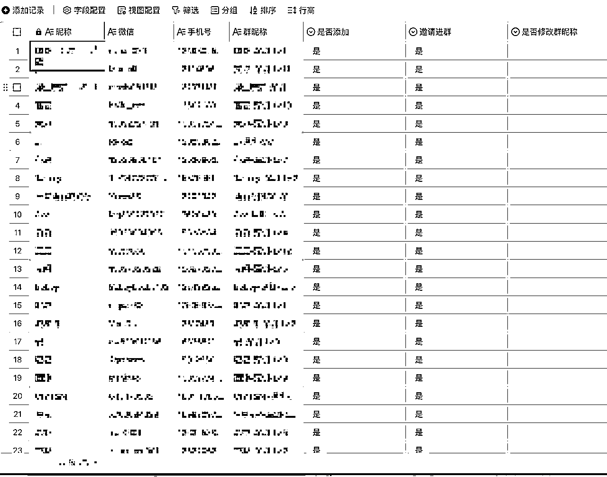当时给自己定了三个目标：

1. 想看船员状态时，能随手查到；
2. 遇到需要帮助的人，能第一时间发现；
3. 后面每天的打卡情况，也想持续掌握。

听起来很周全吧？但说实话，我那时候只是“知道”统计很重要，并没有真正“体会到”。有些事，不亲自踩一次坑，永远只是听过道理。

### 后来，更新表格这事被搁置了

9月的节奏实在太快：原本的工作要扛着，实战也得出力，还有志愿者任务不能丢。几件事叠在一起，人很容易在表格维护上偷懒。我也没例外，想着“先放放吧”，结果这一放，就放到了航行中后期。

### 麻烦终于来了

到了中后期，我想快速回答几个问题时，整个人都愣住了：

- 谁还有机会冲全勤？
- 谁已经只剩一两天休息额度？
- 有哪几位船员“掉海”了？
- 连续打卡满10天的有多少人？
- 今天又有哪个人漏打卡？

问题看起来不复杂，可我却没法马上给出答案。每次都要回到志愿者后台里东翻西找，兜了一大圈，反而把宝贵的时间都耗在重复查询上。

### 事后反思：原来慢功夫才是真捷径

回头再看，有三件事特别值得记下：

1. **坚持统计不是小事的次要项，而是省时间的核心。** 如果当初每天能花10分钟、20分钟更新表格，到了航行中后期，根本不用跟数据苦苦缠斗，省下的时间会非常可观。

2. **前期的数据积累，会把后期的手工操作省掉。** 船员信息、打卡日志都整理清楚了，我就不用一次次去后台做重复劳动，而是把精力放回最重要的地方：跟船员多沟通，帮他们真正跑通项目。

3. **“固定动作”比“临时起意”可靠得多。** 把整理数据变成像吃饭喝水一样的习惯，反而最容易坚持。打个比方，记账这件事我已经连续做了两年多，以前觉得根本不可能，可一旦养成了，也就顺理成章地走下来了。

“慢即是快”这句话，我这次是真的被上了一课。每天花一点时间慢慢更新，看似进展很慢，其实是在为后面的效率铺路。真正聪明的选择，或许就是先沉下心，把那些看上去“费力不讨好”的基础工作做扎实，它们才是帮我们避开坑、少走弯路的大功臣。

# 五、经验教训

这次以实习志愿者的身份深度参与航海，自身运营能力得到了很大提升，同时也踩了不少坑。要说的经验教训主要有三点，其中第一点特别想单独拿出来讲：

## 1. 船员信息统计，真不能随便放下

📌 怎么会懈怠呢？
- 因为当场看不到明显的反馈；
- 因为还没有亲眼看到统计到底能带来多大价值。

所以，看再多干货，都不如亲手做一遍来得刻骨铭心。

📌 先说为什么要做这件事

*  能够迅速掌握全体船员的实时状态
*  便于分层管理，针对不同人群给出不同的陪伴策略
*  能够第一时间揪出正在掉队的、需要支援的船员

📌 我踩过的坑

一开始我也建了个表格记录信息，可忙起来就放下了。等到后期才发现问题来了：

*  想查谁必须保证全勤打卡，都得现翻后台
*  谁只剩下最后 1-2 天的休息缓冲期，一点也不清楚
*  谁已经“掉海”了，心里没数
*  每次要汇总数据就得进后台一遍遍找，耗时又耗力
*  ……

📌 下次我会这么做

*  先搭建一张船员核心信息表，把联系方式、航海目标、打卡记录、当前项目阶段、卡点难题等关键字段都放进去
*  每天固定一个时间点更新，养成节奏感，后续维护的抵触感就会小很多
*  用飞书多维表格做筛选，配合仪表盘，一眼就能看到全员的整体画像

记住一个反常识的道理：看起来慢的每日更新，实则是最高效的捷径！

## 2. 前期准备决定后期体感

📌 它为什么关键

*  熟悉航海全流程，内心有底
*  把志愿者该做的事提前梳理清楚，避免遗漏
*  船员体验更好，也不会给团队添乱

📌 我的教训回顾

*  当日待办没写清楚，有些催打卡和跟进事项就忘了
*  对社群运营的技巧和工具，比如群发消息，掌握不足，直接拖慢效率
*  催打卡的话术没有提前沉淀，都是临时去日志、领队加餐、志愿者群里搜集拼凑

📌 下次的准备清单

*  建一个打卡统计汇总的多维表格，并配一个可视化仪表盘
*  提前整理一个催打卡话术库，覆盖提醒、鼓励、共情等常用场景
*  写好一份每日工作清单，确保核心事项不掉链子

记住：前期多投入 1 小时，后期就能省下 10 小时！

最后我想说，犯错不可怕，可怕的是重复犯错。

# 六、什么样的伙伴更适合做志愿者

经历完这次航海，我对“适合做志愿者的人”有了更清晰的体会。

## 第一，愿意分享

如果你在看到招募信息时，心里既想参与，又想把自己的经验传递给别人，那就报名吧。

我当初看到航海项目有小红书教育资料引流的板块，恰好半个月前我也在摸索这块，有点小成果。一个人闭门造车太累了，我想把踩过的坑分享出来，于是就报了名。最后我有幸陪伴 20 位船员一起成长。

## 第二，有意愿，更有主动性

意愿会变成行动，你会主动关心船员的成长轨迹，会去看日志、看项目进度。

我在这方面还在补课，能力暂时跟不上。相比之下，电饭煲老师、秋秋桂老师、勿忘心安老师等队友都做得非常出色。

## 第三，乐于实操，或已有实战经验

最好是能一起实战，或者本身就带过类似项目。

有实战经历的人更懂“坑”在哪里，也更能共情新人做项目的焦虑和波动，如果还能带出一点自己的小方法，就更有价值了。

比如我在做志愿者前，自己就独立运营过教育资料引流账号。

## 做志愿者能得到什么

志愿者不只是单向付出，更是一次实战的社群运营训练 camp，是向圈内人展示你格局与能力的机会。说得功利一点，还能认识更多同路人，拓展人脉。

如果你和我一样是从零开始，绝对会觉得这段经历很宝贵，印象深刻！

# 七、简短复盘

先谢谢生财有术，谢谢领队和队友们，尤其是电饭煲大佬，谢谢我的船员们，谢谢带我的师傅，也谢谢临时代替我的 AI 写作志愿者，感谢各位教练的坦诚分享。

这次航海让我收获很多，也有一些感悟想留下来：

## 1. 别回避“费力不讨好”的事

前期看起来吃力、没回应的事，往往是最有复利价值的事。

我航海初期没有坚持更新船员信息表，后期全靠手工统计，浪费大量时间。千万别在这些关键环节偷懒。

## 2. 多向身边的人学习

我从领队和志愿者那里学会了社群运营思路，从电饭煲老师那里学到笔记制作的打法，和几位船员大佬的交流也给了我很实用的建议，还有一起加油打气的过程。

每个人都有擅长的点，要不断放大自己的长板，同时向他人取经。

## 3. 知错就能改

没有人一直对，错了就认，改了就行。最怕的是错了还不改。我相信下次我会做得更好。

# 写在最后

最近看到一句话印象很深：“一万斤粮食，才能换一个苹果 Pro Max”。看到这句话，你会更觉得自己很幸运。

在我老家，请工人把玉米收回来，自己卖玉米的钱可能还不够付工钱。


祝我们在生财有术的路上越走越远，越来越开心，也越来越好。

分享一句话我很喜欢：抬头看天，低头走路。

路是对的，现在暂时没赚钱，只要不饿死就没关系，几年后会兑现。现在是菜鸡也没关系，我们会越来越强，就像我刚毕业时一页简历都凑不齐一样。