# AI教育+抖音，一个月接7条广告，我的完整复盘

大家好，我是Ann，赚钱圈龄三年。

前几天龙哥发帖聊AI自媒体，提到接AI广告这件事，正好是我最近在做、而且已经拿到结果的方向。这一个月我接了7条广告，目前累计已接下8条。这篇帖把我从0到1的过程掰开揉碎讲一遍，希望能给你参考。

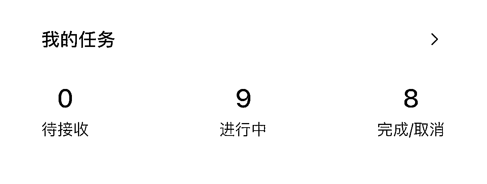

先看我的完整变现闭环：
抖音发AI教育内容 → 广告主刷到 → 接星图广告 → 接星广推广 → 持续收益+持续发布 → 被更多AI广告主看到 → 接更多商单。

## 一、为什么会做这个号

我过去做过不少项目。这个抖音号早期跟着航海做过IP和直播，也靠少儿英语启蒙赚到过钱。账号有2万基础粉，但去年年底断更了。原因很简单：我把精力转到了视频号带货，那边日佣金最高能过万，自然就把低收益项目砍掉了。

今年年初，我在抖音发过两三条“ChatGPT陪小朋友练英语”的视频，播放量冲到几万。

要知道，我平时发英语相关内容，基本只有一两千播放。

那几条视频还吸引了几百人加微信，全是来问ChatGPT怎么下载安装的。
数据出现异常，我却不知道怎么放大，只能一边焦虑，一边持续关注AI方向。

## 二、我具体做了什么

上个月9月，我发现豆包适合给娃检查作业、陪娃互动，就随手发了几条分享视频。初衷真不是变现，纯粹觉得这App对家长有用。

发了大概4条之后，就有广告主私信来问要不要接广。
当时我星图还没开过张，就让对方先出价。2万粉、几百播放，对方给了500元。我想反正视频本来就要发，就答应了。

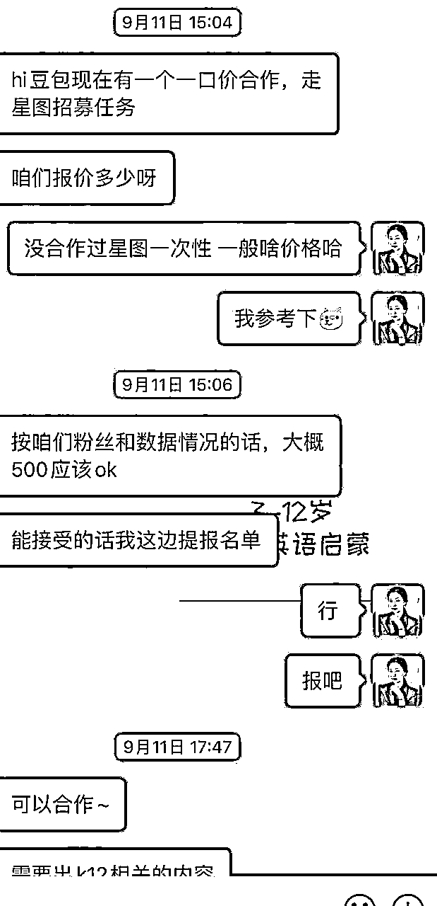

结果那条口播视频直接爆了，播放量超过2000万。
随后对方让我做二次去重，投星广。

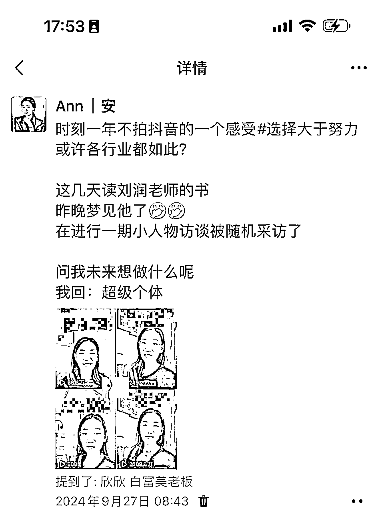
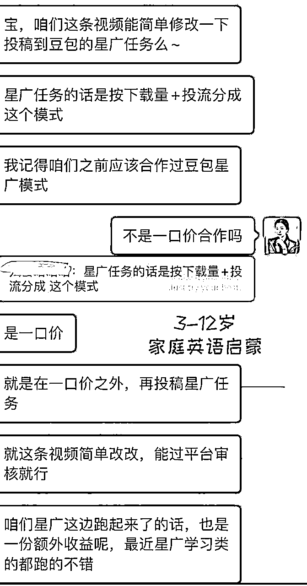

顺便科普下两者的区别：
星图是打包价，发布即付款；
星广则要挂下载组件，按实际下载量分成。
说到这想感慨一句：我理想中的生活就是超级个体，两三个人搭伙，积极向上，做点喜欢的事顺便把钱赚了，还能带娃。可能赚不了大钱，但胜在压力小。
期待在赚钱遇到同频的姐妹，一起往前走。

## 三、现在的持续收益

目前有两个方向的收入持续进账：

1. 星广的下载分成。只要有人通过我的组件下载，我就能分钱，这个太爽了。

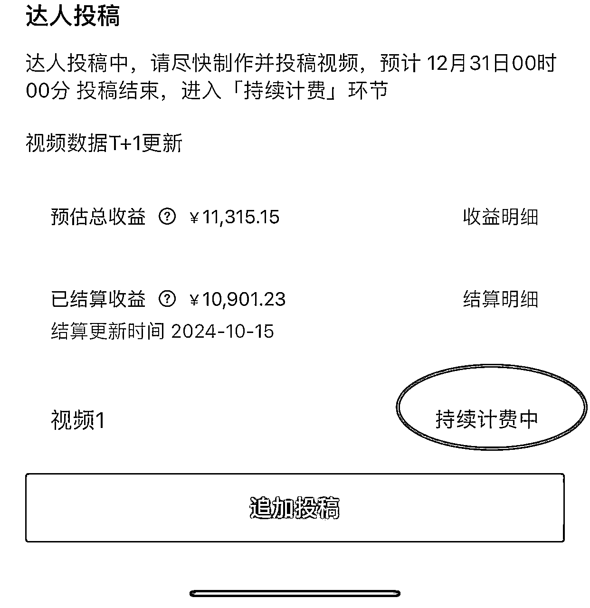

如果某条视频跑出好数据，广告主还会连续追投星图和星广。到现在，豆包广告我前前后后接了不少，七八条是有的，这会儿也还在谈新的。
我们自己也可以主动问一句：要不要追加投放？

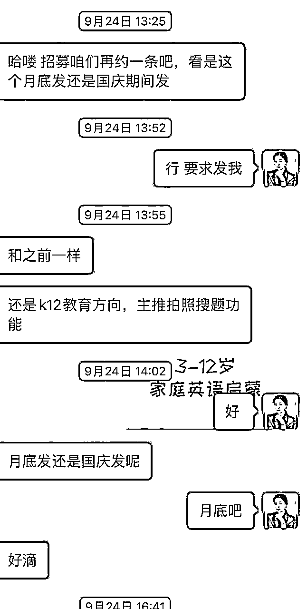

2. 豆包推广效果好，另一个广告主也找上来了，开始接其他AI类广告。

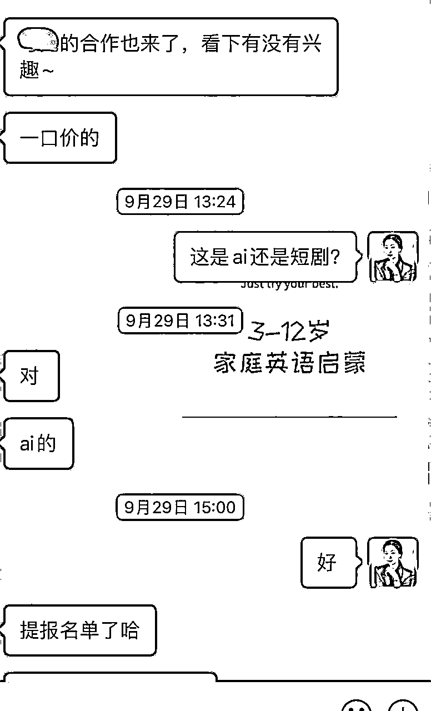
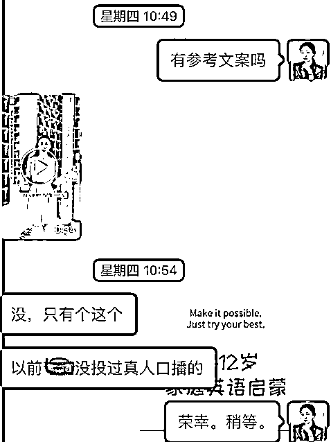

## 四、怎么接广告、怎么报价

1. 我的观点是：传媒公司和广告主都有自己的圈子，第一步是混进去。
第一次有人找上来，最好先谈成合作，别一开口把人家吓跑。
我第一次报价就让对方开价，500元就接了。
而且星广这种按效果结算的模式，对素人博主来说，只要视频质量够好，后期收益往往比一口价的星图还高。
先接下单子，广告主再用投流推一把，你的内容就更容易被AI圈看到，商单也会跟着来。
2. 后台的星图任务可以常去逛，挑顺眼的直接报名就行。

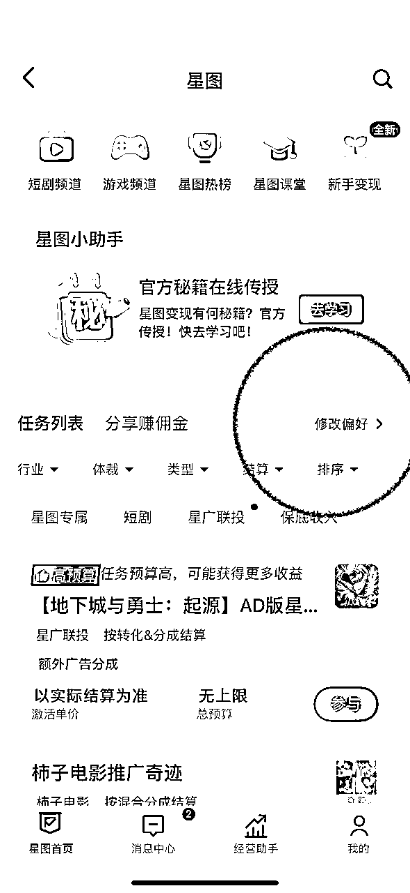

3. 把星图的任务偏好改一下，推荐会更精准，不然海量任务里容易漏掉机会。

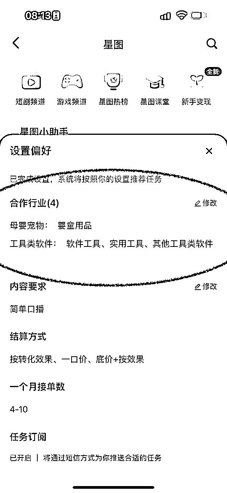

4. 定期提醒广告主：要不要再追投一波？毕竟对方也是人，忙起来可能就把你给忘了。该主动时就主动，不丢人。

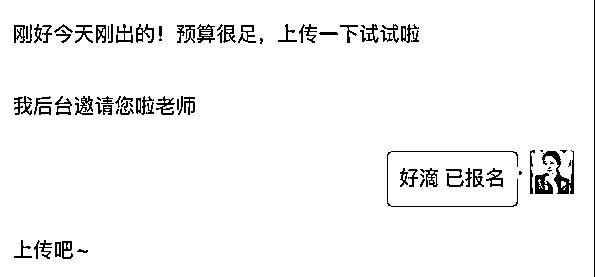
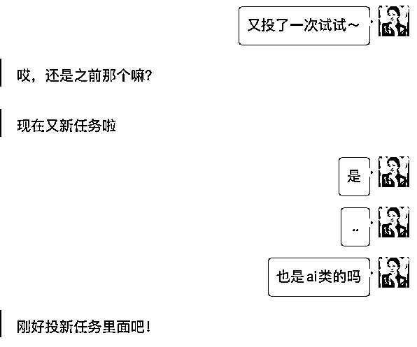

## 五、其他想说的话

1. 龙哥那个AI自媒体接广风向标，让我意识到眼下不少广告主正在试水，红利期还没结束。
2. 新手尽量找AI和现有业务的结合点。我选的是AI+教育，比单纯讲AI更有差异化。单纯讲AI的话，大牛太多，打不过。
3. 有星图权限后，可以去后台搜AI相关任务申请，我刚报名了剪映的星图。至于权限怎么开通，聪明的圈友AI一下就知道。
4. 收益方面，有一条豆包视频变现超过1万。虽然对老手不算大钱，但它只用了4条视频，时间、精力、成本都很低。
5. 期待11月的大航海，有专业团队带更多人一起分这波红利。趁热打铁，干就完事了。
6. 往期只发过一个帖子，讲的是航海多次、每条船都出成绩的经验分享：https://t.zsxq.com/kFjkE。说来惭愧，我配不上航海家的称号。