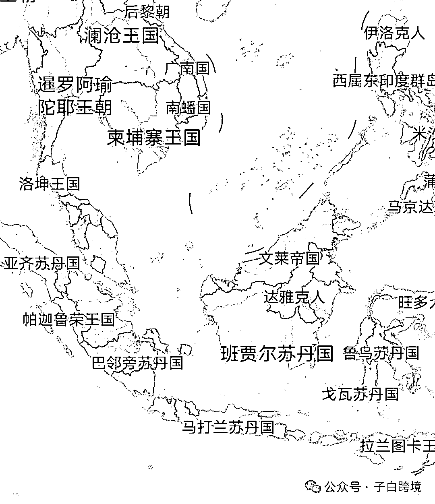
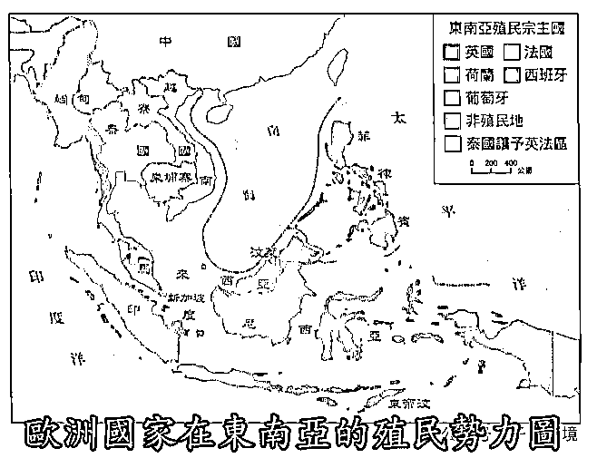
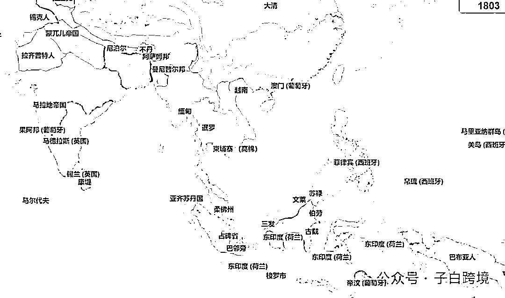
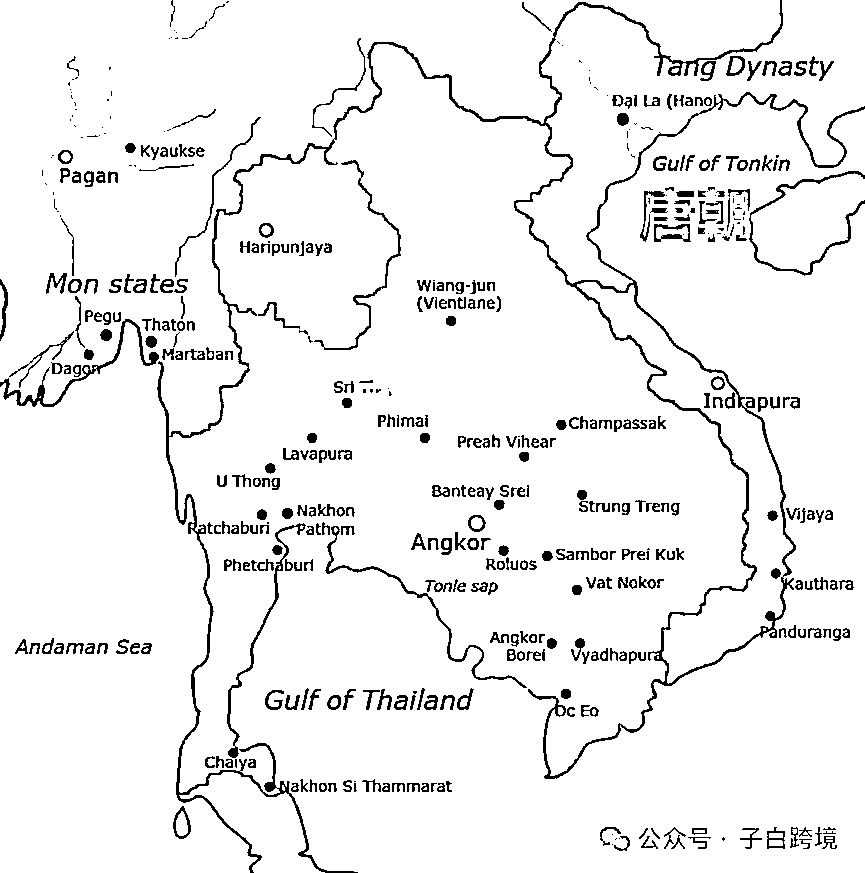
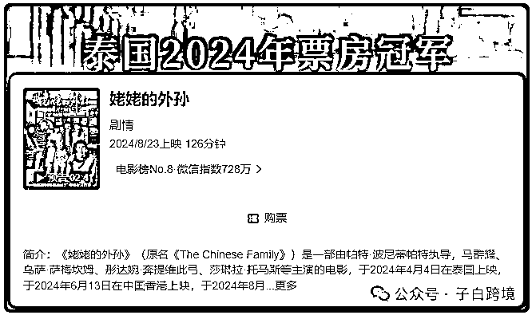
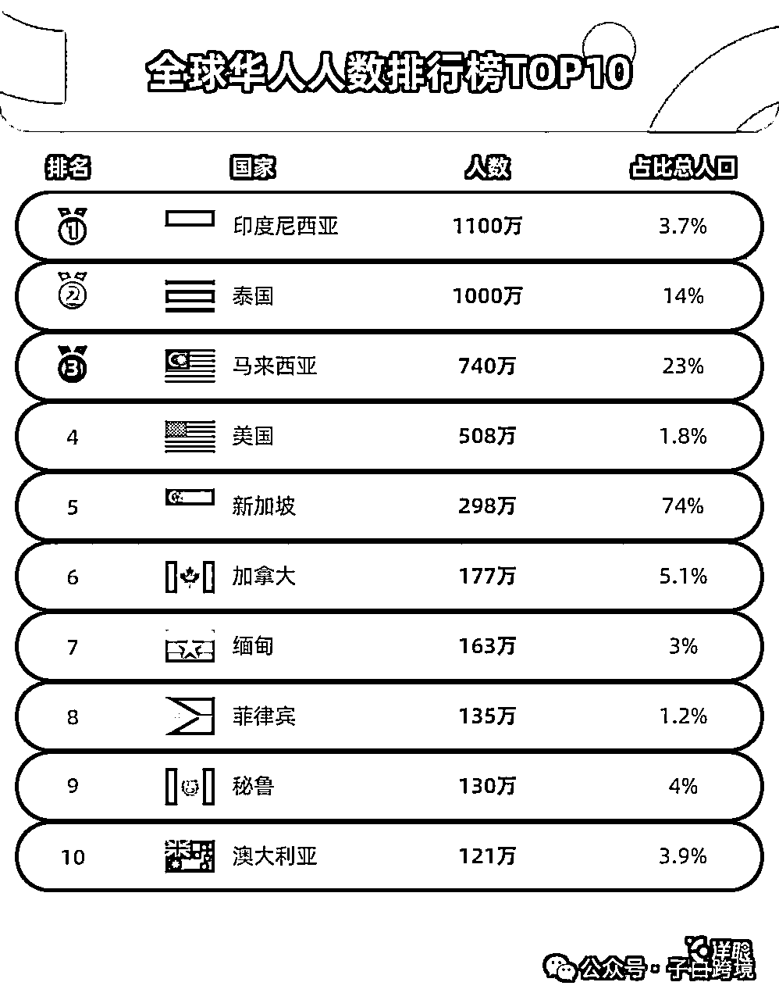
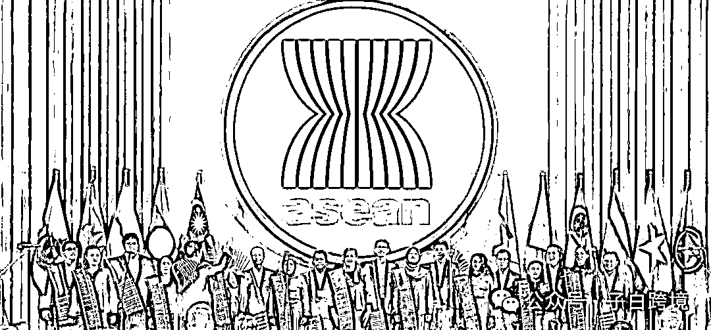
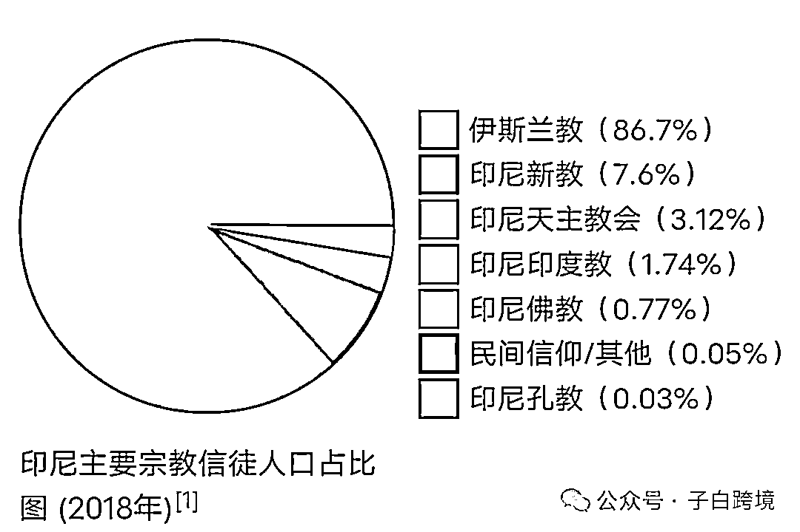

# 我们口中常说的“东南亚市场”，到底存不存在？

> 来源：[https://zcndrp2kur9p.feishu.cn/docx/VRGKd2lvHoiVPNxeewTcfXOKn1f](https://zcndrp2kur9p.feishu.cn/docx/VRGKd2lvHoiVPNxeewTcfXOKn1f)

东南亚，华人旧称南洋，地理上指亚洲东南部。范围涵盖中南半岛与马来群岛，是由缅甸、泰国、柬埔寨、老挝、越南、菲律宾、马来西亚、新加坡、文莱、印度尼西亚、东帝汶这11个国家共同构成，版图约457万平方公里。——百度百科

这个区域划分，本质上是战争留下的产物。

当下我们熟知的东南亚十一国版图，并非历史自然演化而来，而是二战时期盟军为方便调度设立的东南亚战区沿用至今。上世纪七十年代美军战略规划进一步将其固化为通用说法。换句话说，这十一国的共同点，仅仅是地图上挨得比较近。问一问当地人，没有人会把自己称作“东南亚人”。

近代以来，除泰国也就是当年的暹罗，其余皆为殖民地。英属缅甸成为今日缅甸，英属海峡殖民地、马来亚、北婆罗洲演变为马来西亚、新加坡、文莱；美西时期被统治的菲律宾，荷属东印度成为今印度尼西亚，法属印度支那分裂为老挝、柬埔寨、越南，葡属东帝汶则为今东帝汶。

殖民时代塑造的心理距离至今未消。巴达维亚，也就是现在的雅加达，一名知识分子对遥远荷兰的认知度，远胜于隔壁的东南亚邻邦。数据很直观：常驻泰国的印尼籍人士只有三千余人，而印尼人在荷兰的常住人口则超过170万。

语言与文化的隔阂同样明显。

中国作为东亚文化中心，对东南亚多地产生过影响；泰国、柬埔寨、缅甸、老挝则深受印度文化浸润，并曾直接被吴哥王朝掌控。真正有交集的只有老挝与泰国，两地语言相近、族群相通，即便如此文字系统也从未统一。

对泰国人而言，缅甸和柬埔寨充其量是“陌生的邻国”。他们清楚泰国王室源自缅甸的孟族，宫廷泰语饱受高棉语影响，往后就所知甚少。至于菲律宾、印尼，在泰国普通民众的认知里近乎异域。

新加坡、马来西亚、文莱的英马语社群，因殖民历史、族群结构和经济往来，彼此互动相对顺畅。

但最大的马来语国家是印度尼西亚。印尼流行音乐能横扫马来西亚等地的榜单，新加坡马来裔却几乎无感。历史与现实的鸿沟，让印尼与上述国家在认同感上始终有限。

内容产品的传播边界也印证了这一点。泰国影视在老挝、缅甸的接受度较高，对越南、马来西亚、新加坡的渗透却微乎其微。今年泰国票房冠军《姥姥的外孙》，在马来西亚创下泰国电影票房纪录，却仍未能挤进该国历史票房前百。

校园里的社交圈也如此。在美国高校，新加坡与马来西亚学生常混在一起，文莱学生也会被纳入这个圈子，而印尼学生通常游离在外。

因此谈内容生意，根本不存在一个统一的东南亚市场，真正有效的单位是单个国家。

顺带说一句东南亚华人的特殊存在。华人从未真正文化融入当地，多少带着文化宗主的傲慢，多与本族人抱团。人数超三千万，经济实力强，构成了东南亚隐藏的上层阶层。

经济与贸易的割裂更彻底。

印度尼西亚最大的贸易伙伴是中、美、日，在东盟内部，最大的贸易伙伴马来西亚，仅占其进口的5.19%、出口的4.82%。菲律宾最大贸易对象同样是美、中、日，印度尼西亚仅占其出口的7.26%。

东盟远不如欧盟紧密，并没有统一的对外关税区。每个成员国都有各自的关税体系、进出口法规、会计准则。泰国建了仓，并不能覆盖马来西亚，更别说菲律宾。你在越南用的法务、会计、人力外包资源，到新加坡基本要推倒重来。

所以就商品贸易而言，所谓完整的东南亚市场也不成立。

再往内部拆解，裂痕更大。

印度尼西亚是二战后拼凑起来的庞然大物，整合了荷兰在东南亚的殖民遗产，由一万七千多个岛屿组成，海洋面积远超陆地，交通成本极高，民族、宗教、社会生态千差万别。

荷兰的文化殖民远不及英国深入，荷兰语与宗教并未普及。今日印尼拥有5大主流宗教，约86%人口为穆斯林，300多个民族，742种语言。人口最多的爪哇族仅占40%，爪哇语无法作为通用语，只能以廖内方言为基础的马来语作为国语，讽刺的是马来族本身只占印尼人口的3.7%。

马来西亚内部同样分裂。西马三大族群各行其是，马来人占70.1%，华人22.6%，印度人6.6%，生活方式截然不同。东马的族群结构则介于其间。

连国家内部统一的市场都做不到，何谈跨国的东南亚整体市场。

不少创业者误以为在马来西亚跑通的模式能复制到越南，事实是完全两套逻辑。东南亚不是一个市场，而是十一个不同的市场，必须因地制宜，逐个击破。