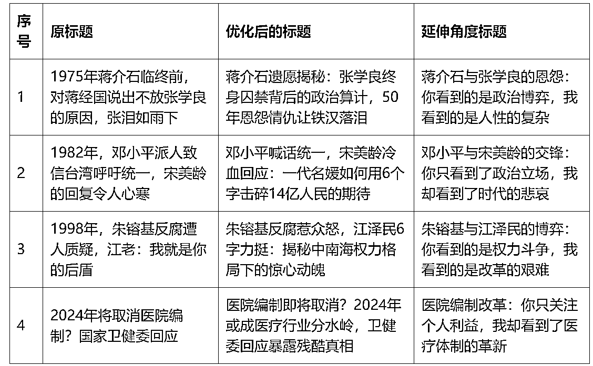

你是不是也遇到过这样的尴尬：编辑反复强调“标题要参考爆款、对标爆款”，可真到自己动手时，却只能硬着头皮从零开始想？既没抄到爆款的魂，又憋不出一眼抓人的题，最后只能干瞪眼。

为了解决这个痛点，我干脆自己折腾了一个“标题优化机器人”。它长在POE平台上，用的模型是Claude Sonnet，名字叫Title_Master_LZJ。用法很简单：你把原标题丢给它，它就能吐出优化版和延伸角度版。当然，使用它需要梯子，地址放在最后。

这个机器人是怎么炼成的？简单说，我让它深度学习咪蒙的起题心法。咪蒙那套东西，虽然有人嫌“俗”，但在抓眼球这件事上确实有几把刷子：内容可以略带夸张，但绝不能编造，得塞进实打实的信息点，比如时间、地点、数字；敢跟主流观点唱反调，专门挑容易引发争论的角度切入；一句话戳中读者心里的憋屈、焦虑和不甘；语气透着点玩世不恭的自嘲和调侃；再巧妙包装成“有收获”的鸡汤，让人想转发；同时还深谙人性里的猎奇和从众心理。它生成的标题，就是带着这种味道。

此外，它还额外给出“延伸角度标题”，比如那种“表面看是落差，背后看是人性逻辑”的对比式表达，帮我们把思路打开，从不同切口去追热点。

放出提示词之前提醒一句：直接用也可以，不过你完全能按自己的需求改成其他风格。这个机器人的完整指令和地址如下，拿走不谢。

效果在此：

实用信息再划一遍重点：平台是POE，模型是Claude Sonnet，BOT名叫Title_Master_LZJ，需要科学上网，直达链接：https://poe.com/edit_bot?bot=Title_Master_LZJ

附上我调教它用的提示词（可自行微调）：让它扮演咪蒙，牢记九条写作铁律；输出的标题要遵循“可以夸大，但绝不能无中生有”的底线；形式上要和用户提供的格式保持一致——如果用户给了多个标题，要按“序号、原标题、优化后的标题、延伸角度标题”的表格返回；字数压在30～60字之间；直接给成品，别加开场白和结尾语。

有句话说得好：标题不是玄学，是技术。用对工具，再加上一套靠谱的起题思路，爆款离你就不远了。