# 复盘：小红书引流卖资料 26 天，纯变现 6907.76 元

> 来源：[https://avt9va2pkj4.feishu.cn/docx/Rf35dYa1WoakDwxzqP8cIKTvnvg](https://avt9va2pkj4.feishu.cn/docx/Rf35dYa1WoakDwxzqP8cIKTvnvg)

大家好，我是稳稳。7 月 5 号加入生财，来自湖北宜昌。这次 9 月航海，是我第二次上船，也顺利把小红书引流项目从 0 跑通到 1。

越分享越旺，分成这段经历细说一下。如果你在做虚拟资料引流变现，也卡在类似的地方，或许能照着参考一下。

我的拆解分三块：

1. 截至 10.16 的收入走势
2. 从零起步的心路
3. 实操时的正确打法

# 截至 10.16 的收入走势

本次航海主题是小红书引流变现教育资料。跟着航海手册学习、直播间跟教练请教、群里不断复盘，我把流程摸透了，也把最小闭环跑通了。从 9.27 到 10.16，单靠资料销售，包括题库，累计变现 6907.76 元。

这是从第一笔成交起的收入曲线。

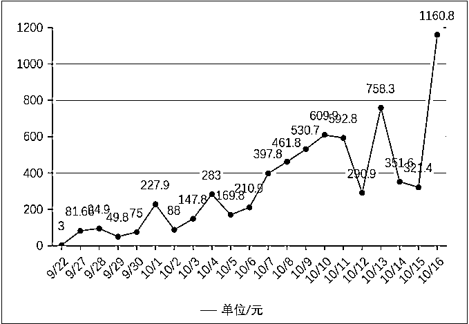

航海期间我共用了 4 个小号。9 月 9 日开船到 9 月 23 日，我先做了小学教辅，面向家长的群体。用了 2 个号发了 12 条笔记，私域只进来了 1 个人，卖出了一份 3 元的小学资料。最小 MVP 成了。

9 月 24 日起换成银行考试内容，换了另外 2 个号发了 18 条，基本没动静。9 月 26 日开始在原小学账号上同步发成考笔记，一共发了 40 多条，其中单条最高播放 6282。附上部分成考号的数据截图。

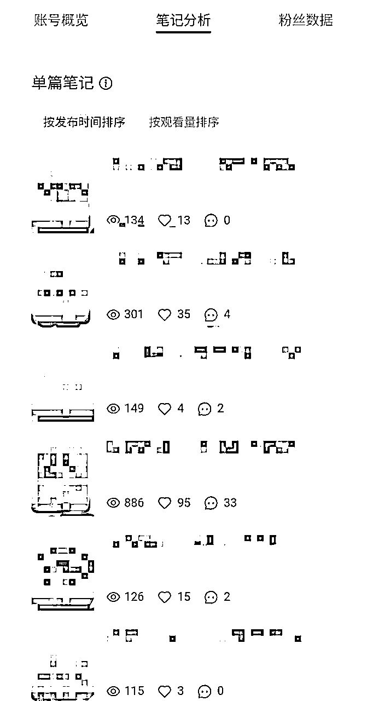

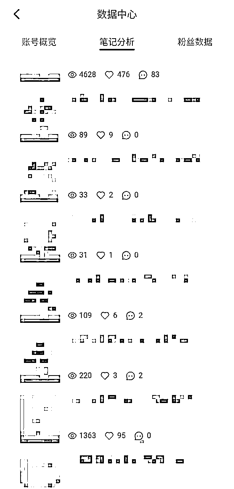

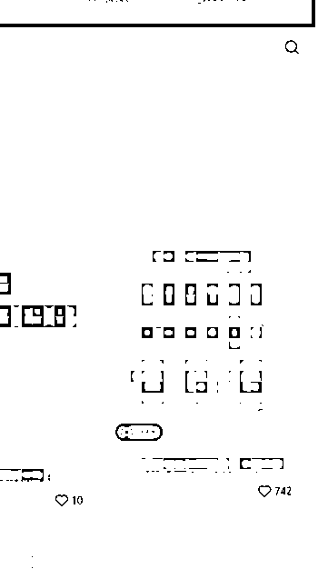

从 9 月 27 日产生第一笔成考订单算起，到 10 月 16 日，微信累计新增 488 人，实际成交 152 单，转化率约 31%，GMV 6904.76 元。下图是部分收款截图。

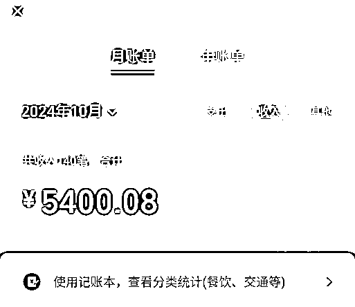

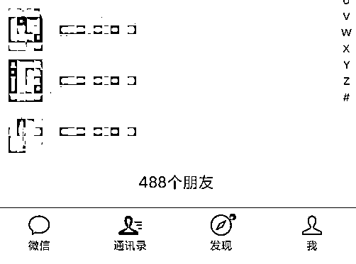

# 从零到跑通的心路历程

## 为什么会加入生财

第一次航海是视频号口播。我在加入生财之前就关注这个赛道，看了 @郭晓文 老师的回放直播，进而关注到他的公众号，才接触到生财有术。听了三天公开课后就直接付费入圈，非常感谢老师的指引。

## 第一个项目视频号口播没跑通

报完航海一开始很亢奋，最后航海结束也只变现了几块钱，还是创作者分成带给的，并不是口播带货闭环变现。也就是说，整段航海我没把项目跑通。

结束后再坚持了半个月，焦虑、恐慌、不安、自我怀疑轮番上阵。情绪一上来就做不好事。正反馈看不到，我就先把这个项目放下了。

### 这次失败带给我四点改变

#### ①学会自我鼓励
当时很迷茫，觉得自己怎么都做不好。后来想起一句话：每个人在成功前都试过很多次失败，才总结出自己的打法。这次视频号没跑通，也就离跑通更近一步。

#### ②链接到高手和伙伴
生财航海聚集了很多高手。我本性比较内向，但越到后面越怕错过链接机会。主动在群里 #举手 提问、参与讨论，和老师圈友交流，解开了很多困惑。

#### ③养成阅读习惯
视频号航海可选读书号，这点点燃了我阅读的欲望。之前一直想读却没坚持住，这次借助项目契机开始系统输入，《认知觉醒》对我影响很大。书里提到的清晰目标→专注行动→反馈反思→拉伸练习，让我开始真正做复盘。

#### ④形成复盘习惯
我觉得一次航海不一定要完整闭环才算成功，更重要的是审视自己：这次做了什么、有哪些成长、哪里暴露了问题、之后怎么优化。我开始每天复盘。刚开始定的小目标基本完不成，但生财说“把手弄脏”，我理解成先堆一堆“狗屎”再优化。坚持下来后，大部分小目标都能完成了，状态越来越稳，也更期待下一期航海。

## 跑通最小 MVP，启动小红书引流

### 为什么挑小红书教育资料赛道

视频号停掉后，我继续看贴、复盘。生财的项目太多，看什么都赚钱就是自己赚不到。后来我明白，不是项目不行，是自己没跑通。看到《全域虚拟电商实操手册·年赚百万项目的背后》这篇贴子被启发，结合自身情况判断这个赛道现阶段更适合我，于是决定上船。

### 正式启动前的卡壳与突破

#### ①行动前拖延，卡在资料库
航海开始后按手册执行，前 10 天我几乎没发笔记。手册虽然保姆式教学，但我死磕后端资料库，觉得自己没基础，卡了近一周。听了米杰教练直播受启发，群里教练也反复强调先动起来。9 月 19 日才发出第一条笔记。

发了几条后我仍纠结资料是否齐全，怕引流过来没货卖。@希平 教练点醒我：先做起来，成交了再去买同行的补。@Time 领队也给了我方向。

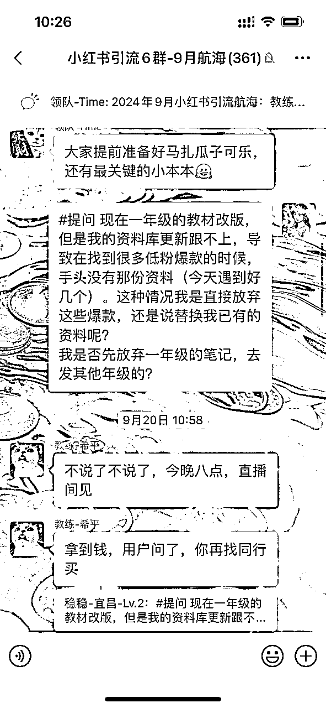

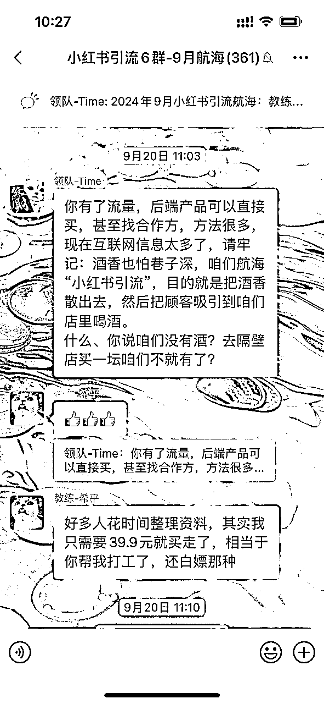

#### ②笔记没流量到跑通闭环
我珍惜航海群交流，遇到问题就 #举手。

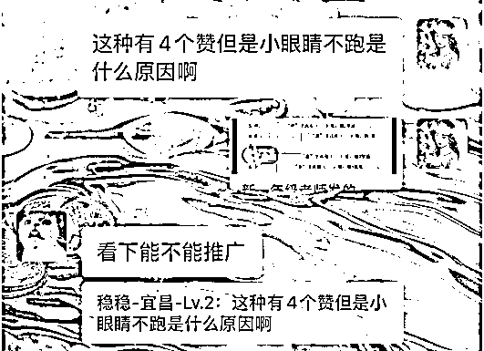

起初笔记阅读量很低，有的只有二三十。很焦虑，后来给自己做了三次自问：

第一，我想把这件事做好吗？是的。
第二，适合我吗？没有适合不适合，只有能不能挣到钱。项目没问题，先跑通再评价。
第三，困境怎么破？自检前端。流量无非作品质量和数量。质量看封面、标题、内页、文字；数量看发帖频率和篇数。找不到原因就全部优化，坚持发。

想通后继续干。9 月 21 日引来第一个微信用户，卖出第一份 3 元资料，闭环成立。之后第三篇笔记数据小爆发，日增赞和阅读上千。虽然很快转赛道，但我把号养了一段时间再发考试内容。

## 放大测试，换赛道重启

跑通后我开始思考能否长期做。小学教辅不是我的擅长和喜好，后期放大难度大。看到群里有伙伴报喜，我请教后得到新思路——做考试类。在同行调研后我在小红书搜索相关内容。

### ① 赛道选择看市场和自己
看笔记总量判断体量，看爆款点赞评论判断需求。我身边有做学历提升的朋友做得不错，说明有钱赚且后期可合作。结合市场热点、个人经历和资源，我决定主攻各类考试。航海手册里有 9-11 月教育热点表，我就按表落地。

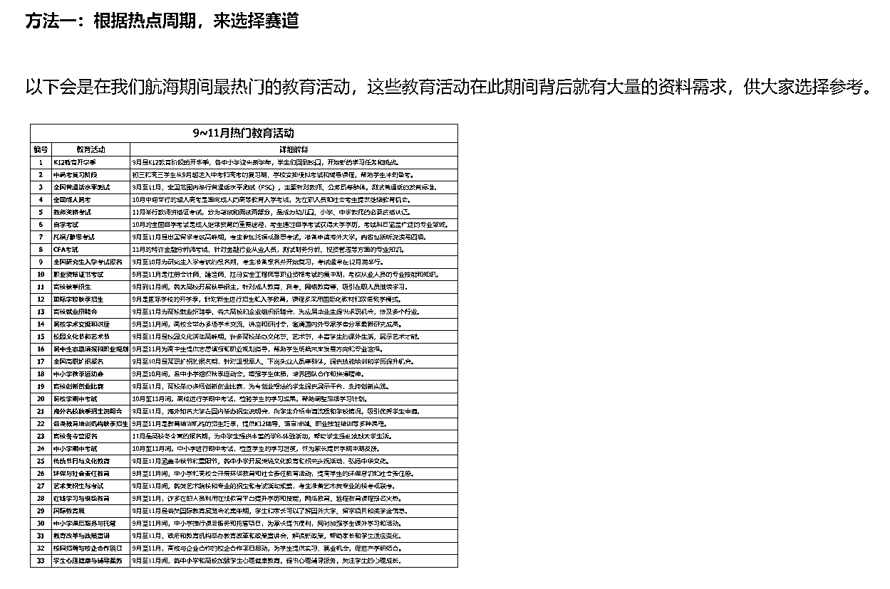

### ② 变现组合
低价资料包引流 + 升单题库/线上课，后期可做收代理、对接机构做高客单。暂时还没展开。

### ③ 后端资料策略由简到繁
很多人卡在资料，我也卡过。手册里有三种做法：自研、跟机构合作、买资料整理。能力有限我选后两种。先准备一手低客单引流资料，心里踏实。过程中不断扩充，爆款对标里缺的资料就去搜集，公域搜索、买同行、拼多多闲鱼都行。整理后再组包，比同行更全。

资料不用买贵的，几份拼在一起就是自己的。资金有限就先做小范围。成考和自考都要火，我选成考：全国统考科目少、资料好找、新手上手快，先跑通闭环再说。

### ④ 提升效率：账号和制作速度
4 个号之前一天只能发 1 条，后来流程化后一天能发 2 条。手册说一天 3 条不难，量变才有质变。

账号从小学转考试，起初流量弱，发 3-4 条后数据变好。账号有限不必注销重来，直接转赛道操作即可。

群里教练每天问：今天发够十篇没？我没做到。问题在想保证质量又不想纯搬运，导致模仿过度连内页都照抄，耗时严重。作图慢是我最大的痛点，试了 PS 效率上不来，后来用手机醒图，裁剪、混合模式、标记都方便，封面和内页制作快很多。用正片叠底让截图与背景融合，加标题就成新图。熟练后效率和心态都提升了。

### ⑤ 做爆款需要决策力和熟练度
9 月 24 日发第一条银行秋招，两个号一天 8 条，发三天引了几个人没成交，可能赛道陌生。

9 月 26 日发第一条成考，播放不高但私信进 4 人，27 日成单 75 元，正反馈来了。后面每天坚持发，成交稳定但没爆。

筛选爆款我曾眼花缭乱，觉得哪个都好却迟迟不下手。后来明白：爆款有时效，要会抄作业，不能纠结。决策力是关键。

提升熟练度要建标题库和封面库。分析封面文字、受众当时的心理、情绪触发点和行为引导。比如临考焦虑期，封面展示胸有成竹，点进来看妙招。

要学会分析并快速决策、快速制作，逐步形成可复用的模板，再在此基础上原创。

干货笔记是提升权重、引爆的关键。我之前几乎不做干货，后来明白高质量干货几篇顶上几百篇低质量的。

### ⑥ 前端引流到私域
笔记下求分享的评论和私信都要抓。私信用户需求更强、转化更好。

人少时我一张张图轮换发，人多时直接拉群。用小号建群，大号分享群聊，群内用打卡或投票保持活跃，减少重复引流话术。

提醒：大号只做内容，不要聊价格、是否收费、加微信等话题，避免伤害主号。

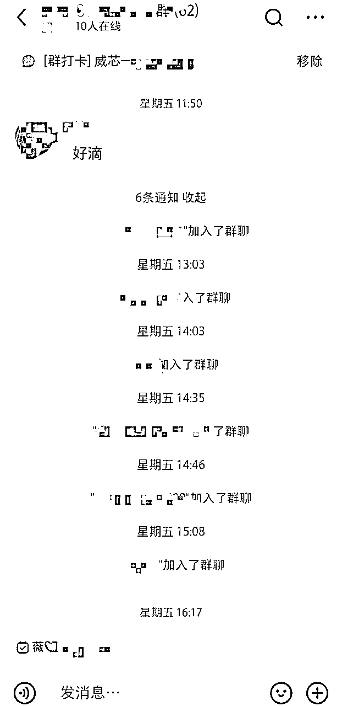

### ⑦ 账号是消耗品
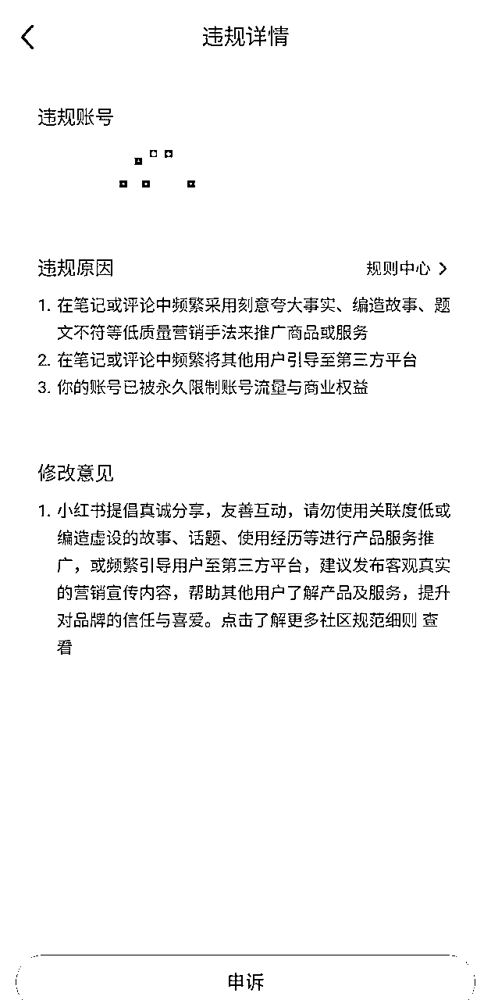
木已成舟别纠结。我有个号小爆后流量变好，后来挂了很心痛。群里反复说账号是消耗品，能挣钱就行。能做起一个就能做起第二个。附图是一次小爆。

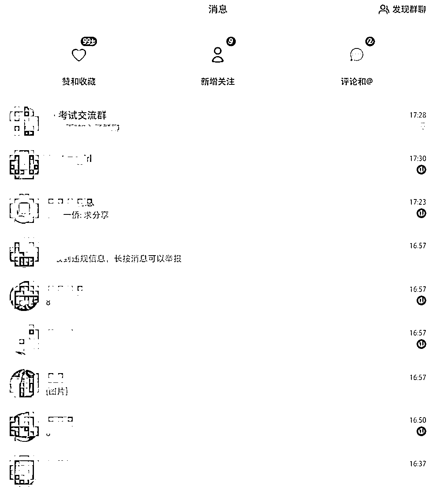
保护账号重要，但平台判定难说，最核心的是练出快速起号的能力。

### ⑧ 成交是概率，及时自检
引流的人每天不一样，可能早上就成单，可能要等到晚上。半天没成交别慌，是概率问题。引 100 人里 20 人成交算正常水平，不达标就自检。

#### 话术
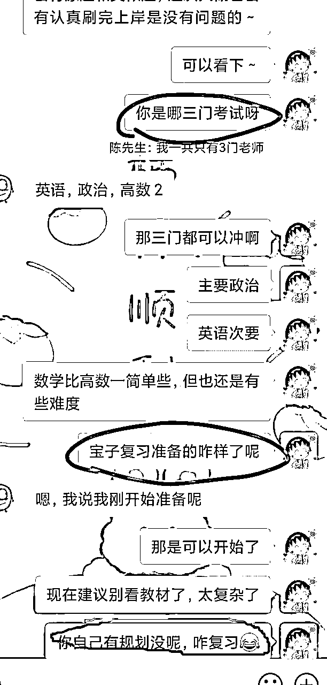
比如有顾客问完价格还聊，我就问他备考进度、遇到什么难题，继续互动，成交概率大。

#### 朋友圈信任感
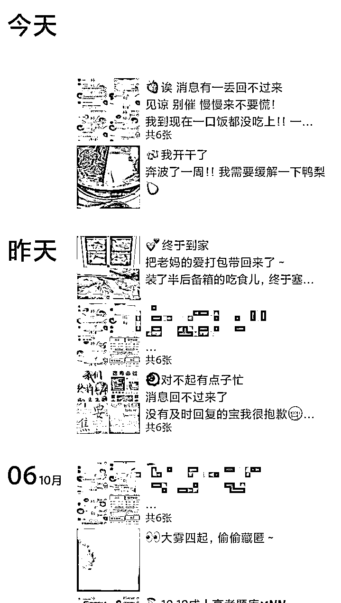
朋友圈要体现真实生活，建立信任。之前一条生活分享被点赞，紧接着就有人询价成交。

#### 揣摩心理
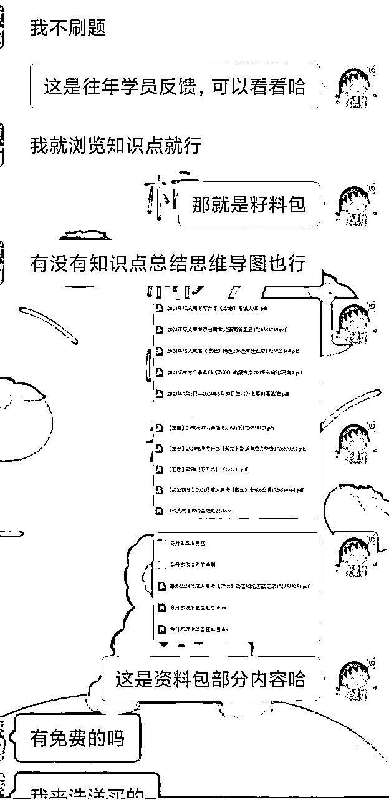

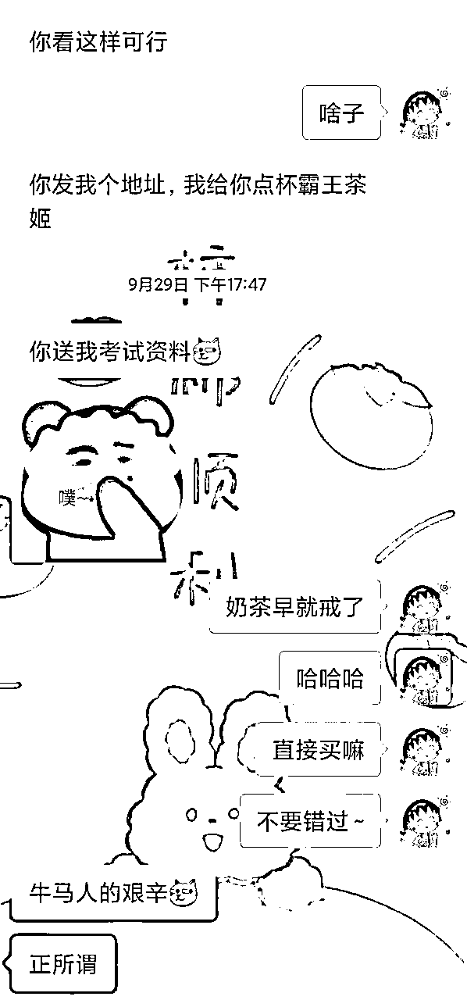
有顾客直说来薅羊毛，要免费，还说请我喝奶茶。后来给了优惠才成交。顿悟是他想用奶茶钱买资料，想讲价。遇到问题别退缩，解决就行。

国庆期间到现在，每天越来越忙，但制作笔记和私域成交的流程越来越顺。各种顾客都能应对，靠的就是大量练习和复盘优化。做项目过程枯燥，尤其没正反馈时要坚持，但也很有趣。前期当任务觉得难，后来当成体验，每个人的回应都不一样，很有意思。

### ⑨ 二度成交提升转化
对未成交客户，我在考前推冲刺急救资料包。群发 280+ 人，成交 15 余单。

成人高考的考期越来越近，我突然冒出一个想法：那些之前没有下单的老客户，是不是可以再努一把力？更关键的是，越临近考试，新进来的用户对价格合适、马上能用的资料接受度极高，基本是看到就买。

于是我当天晚上就把网盘里的资料包整理归档。原计划第二天早上再推送，结果一想晚上大家空闲时间更多，干脆立刻把话术写好直接群发了。

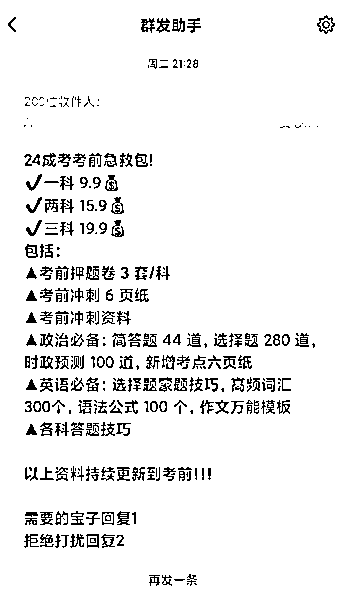

截至现在统计，旧客户回流加上新增加的客户，这个资料包总共成交了39份，GMV破500。

踩坑提醒：这类活动的资料最好在活动启动之前就提前准备好。网盘链接是最省心的交付方式，如果时间实在来不及，直接打包成PDF发过去也没问题。我当时就是资料没收尾，结果有客户咨询想买，我却还在赶工，场面一度很狼狈。

# 该怎么正确行动

航海手册的指导非常细致，只要照着执行，持续复盘、持续优化、持续干下去，结果自然会来。

这次航海对我触动最大的两件事，我也整理出来和大家同步。

## 用数据思维拆解问题，别被情绪带跑

遇到卡点、心里烦躁都很正常，关键是别让焦虑、怀疑这些情绪影响了执行力。与其问自己我做不到，不如问自己为什么做不到、哪个环节出了问题，然后针对性去练。

当正反馈比较少的时候，就用数据来看待自己的行为。比如笔记没火，归根结底无非是质量和数量两个维度，那这两个维度就分开去优化。

## 任何环节都先做起来，坚持下去就会有答案

在流程还没跑通的阶段，我也曾犹豫不决。但我看了一眼航海群，出发时400多号人，已经有人选择退出去做别的了，那我在这个小红书引流的赛道上，是不是已经先淘汰了10%的人？

我还在犹豫后端资料库要不要先发笔记的时候，领队正好在群里提醒大家先发笔记。我当时就想，如果我现在就发，是不是就能领先前面50%的伙伴？这样复盘下来，跑通的概率会明显提升。

这条航线上高手很多，我不一定是最强的，但我希望自己每一步都能全力以赴，靠近优秀的人，每一天都比前一天进步，这就够了。

所以说，先动起来，先完成再慢慢打磨，千万别因为追求完美而一拖再拖。先动手把事做了，再谈优化。

* * *

# 鸣谢：

最后要感谢 @郭晓文 老师的大方分享，让我有机会认识生财这个平台！感谢生财航海给的机会，感谢教练 @米杰 在航海启动前给我的鼓励和信心！也感谢航海期间各位教练、领队 @Time 、志愿者 @刘佳 以及所有圈友的陪伴、付出和无私分享。特别感谢 @Time 、@澄歌 对这次分享的协助。

航海结束了，但交流可以继续。愿大家在各自的海域里继续前行、不断打磨。一起加油，一起冲！

让我们携手成长，生财有术。

